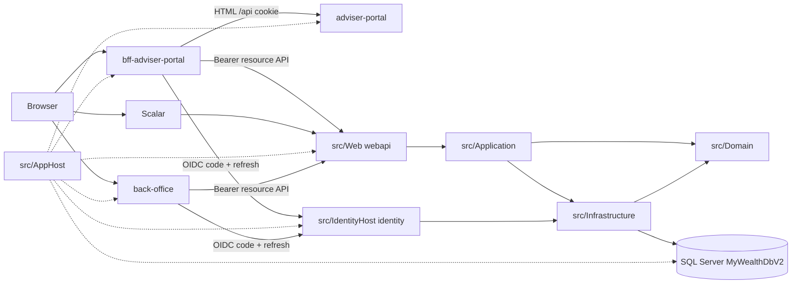

# Architecture

This document owns **hosts, layers, ports, and cross-cutting behaviour**. Scope and phasing live in [function-plan.md](function-plan.md). Aggregates and invariants live in [domain-model.md](domain-model.md). Tables live in [database-design.md](database-design.md). HTTP conventions and the resource catalog live in [api-design.md](api-design.md). Session protocol detail lives in [ADR 0014](adr/0014-openiddict-authorization-code-pkce.md); this file only places the host.

**Product:** MyWealthV2.

Same rule as the function plan: if a later phase will use it and today’s design would have to change, ship the final infrastructure now. If later use or shape is not decided, wait.

Phase 1 closes the platform base: tenants, session, four roles, people, currency catalog, Adviser Portal shell. The ledger is a Phase-2 domain. Accepted ledger slices: Instruments (`0010`, landed `9ea2f2a`), Accounts (`0012`, landed `3e8b8f3`), posting / `/transactions` (`0013_transactions.sql`, landed `79129eb`). Holdings wait for their spec.

---

## 1. Style

Clean Architecture + CQRS (MediatR), hosted by .NET Aspire.



Rules that stay true:

- `Domain` has no project references. Entities are hand-written, not scaffolded from the database.
- `Application` depends only on `Domain` and abstractions it owns.
- `Infrastructure` implements those abstractions and maps to existing tables with Fluent API.
- `Web` (`webapi`) is the resource-API composition root. Endpoints dispatch MediatR only.
- `IdentityHost` (`identity`) is the authorization-server composition root: OpenIddict + hosted login.
- New write / read use cases are scaffolded with `dotnet new ca-usecase`.

The frontend is an independent React application (React + Redux Toolkit + TypeScript + Vite + Tailwind). Portals **do not issue tokens**. The browser talks to `bff-adviser-portal`. That host redirects to `identity`, holds access and refresh tokens, and calls `webapi` with Bearer (ADR 0016).

Portals:

- **Adviser Portal** — only frontend in Phase 1. OIDC client id `adviser-portal` is held by `bff-adviser-portal`, not by the browser.
- Customer Portal — second BFF + client on the same authorization server; accepted ([customer-portal/customer-portal.md](customer-portal/customer-portal.md), [features/bff-customer-portal.md](features/bff-customer-portal.md))
- Back Office — landed ([backoffice/back-office.md](backoffice/back-office.md)). Blazor host `back-office` with MudBlazor (no BFF). Scalar remains. Back Office is the only client that issues SystemAdmin a code; `adviser-portal` refuses SystemAdmin (identity-auth amendment 2026-11-11).

Aspire resource names must not be generic (`Frontend`, `Web`). Hosts: `identity`, `webapi`, `adviser-portal`, `bff-adviser-portal`, `customer-portal`, `bff-customer-portal`, `back-office`, `worker`. Phase 1 does **not** split a separate identity **database**.

One AppHost orchestrates every resource. Separate projects are separate processes. Each ASP.NET project has its own Kestrel and port. Aspire does not merge two projects onto one Kestrel.

---

## 2. Solution map

| Project | Path | Responsibility |
| --- | --- | --- |
| AppHost | `src/AppHost` | Aspire graph: `dbserver`, `MyWealthDbV2`, `identity`, `webapi`, `adviser-portal`, `bff-adviser-portal`, `customer-portal`, `bff-customer-portal`, `back-office`, `worker` |
| IdentityHost | `src/IdentityHost` | Authorization-server composition root; OpenIddict; hosted login |
| Web | `src/Web` | Resource-API composition root; Minimal API; OpenAPI / Scalar; Bearer validation. Portal CORS removed (`5e85e9c`); browser does not call `webapi` |
| Application | `src/Application` | Commands / queries, validation, pipeline, DTOs, named-policy map, port interfaces |
| Domain | `src/Domain` | Entities, value objects (including `Money`), events, enumerations. No session-protocol types |
| Infrastructure | `src/Infrastructure` | EF mapping, Identity user store, OpenIddict EF stores, interceptors, schema applicator, port adapters |
| Shared | `src/Shared` | Aspire resource-name constants |
| ServiceDefaults | `src/ServiceDefaults` | Health, OpenTelemetry, service discovery |
| BffAdviserPortal | `src/BffAdviserPortal` | Adviser Portal session edge. Confidential client holder. Cookie + OIDC + YARP |
| BffCustomerPortal | `src/BffCustomerPortal` | Customer Portal session edge (accepted). Confidential client holder. Cookie + OIDC + HttpClient proxy |
| BackOffice | `src/BackOffice` | SystemAdmin UI. Blazor + MudBlazor. Confidential client `back-office`. Cookie + OIDC. Calls `webapi` with Bearer. No BFF |
| Worker | `src/Worker` | Background worker. Hangfire Server for async and recurring work (ADR 0017). First consumer: Reports. |
| AdviserPortal | Independent frontend | Vite SPA. No tokens. OIDC client id `adviser-portal` is not held here |
| CustomerPortal | Independent frontend | Vite SPA (accepted). No tokens. OIDC client id `customer-portal` is not held here |
| Tests | `tests/*` | Domain unit, application unit, infrastructure integration, functional |

`ApplicationDbContext` includes the Identity **user** store and the OpenIddict EF stores. **Both hosts share the same mappings and the same database.** Do not use `IdentityRole` / `AspNetRoles`.

---

## 3. Request paths

Three processes for a portal session, plus the resource API. Do not add a custom `POST /auth/login` that issues tokens.

### 3.1 Authorization server (OpenIddict, process `identity`)

Hosted in `src/IdentityHost` (ADR 0014). Aspire resource name: `identity`.

| Surface | Choice |
| --- | --- |
| Protocol | OpenIddict **defaults, do not remap**: `/.well-known/openid-configuration`, `/.well-known/jwks`, `/connect/authorize`, `/connect/token`, `/connect/revocation`, `/connect/logout` (plus default `/connect/userinfo`). Callers follow discovery; do not hard-code |
| Hosted login | Password page on `identity`: email + password + tenantCode (SystemAdmin omits tenantCode) |
| Client | Three confidential clients. `adviser-portal` is held by `bff-adviser-portal`. `back-office` is held by `src/BackOffice`. `customer-portal` is held by `bff-customer-portal` (accepted). Authorization code + PKCE + refresh. No password grant. |
| Access | Short-lived JWT. **Asymmetric** signing. Public keys on JWKS |
| Refresh | OpenIddict token store. Revoked on logout (at once), and on password change and disable (when the outbox delivers the event). Rotated when presented. No custom `RefreshTokens` table |
| Scopes | `openid`, `profile`, `offline_access`, `api`. Role and tenant are JWT claims, not scopes. Permissions are not expanded into the token |

The login gate on the authorization server reads domain invariants: tenant enabled, `UserStatus = Active`, valid Identity link, then the client × role allow-list. `adviser-portal` issues a code only to TenantAdmin and Adviser. `back-office` issues a code only to SystemAdmin. `customer-portal` issues a code only to Customer. SystemAdmin may complete login with no tenantCode. Adviser-management resource policies stay 403.

IdentityHost isolates the two first-party clients with a per-client cookie scheme (identity-auth amendment 2026-10-27). `/connect/authorize` and hosted `/login` authenticate and sign in only against the scheme for the current `client_id`. `/connect/logout` signs out only that scheme. A login on one client does not silently authenticate the other. This is server-side; clients do not send a special parameter.

The BFF redeems the adviser-portal code and stores tokens. The SPA does not. It does not own a password form that issues tokens. Contract: [features/bff-adviser-portal.md](features/bff-adviser-portal.md). The Back Office host redeems its own code the same way and calls `webapi` with Bearer. Contract: [backoffice/back-office.md](backoffice/back-office.md).

### 3.2 Resource API (`webapi`)

Minimal API → MediatR. Pipeline order:

Logging → UnhandledException → Authorization → Validation → Performance → Handler

Save interceptors and domain-event delivery:

- `AuditableEntityInterceptor` is the only registered save interceptor.
- Domain events are written to `OutboxMessages` in the same database transaction as the business changes (ADR 0018, accepted). Immediate post-`SaveChanges` MediatR dispatch is removed. Implementation follows [features/outbox.md](features/outbox.md).
- `Payload` is the serialised domain event. `TenantId` is also a column so the worker can set tenant context without parsing JSON.
- Delivery is at-least-once from the `worker` (ADR 0017). The worker claims by `Status`, publishes via MediatR in a new scope, then sets `Processed`, `Failed`, or `DeadLettered`. Handlers must be idempotent.
- A handler failure does not roll back the original command. Token revocation remains eventually consistent, but the event is no longer lost. See [adr/0018-transactional-outbox.md](adr/0018-transactional-outbox.md) and [fixes/domain-event-dispatch.md](fixes/domain-event-dispatch.md).

Writes to Tenant / User check `RowVersion`. Conflict maps to HTTP 409.

Bearer tokens are accepted only from `identity` (discovery / JWKS). `/users/me` lives on `webapi`; it is not a token endpoint. Login-page cookies stay on the `identity` origin. `webapi` returns 401 on auth failure and never redirects to the login page.

Application authorization (ADR 0013): named policies on endpoints; `RolePermissions` mapped in code; assignment scope (this tenant / own customers) enforced in the handler. Do not register empty ledger policy names in Phase 1.

### 3.3 How OpenIddict is hosted

**Phase 1 hosts OpenIddict as its own Aspire resource `identity`.** Two Kestrel processes, one SQL database (`MyWealthDbV2`), one Infrastructure mapping set. Not a second identity database.

```text
AppHost
  dbserver (SQL container)
    └── MyWealthDbV2          connection string → identity and webapi
  identity                    src/IdentityHost
    ├── OpenIddict            default /connect/* + discovery + JWKS
    └── hosted login          email + password + tenantCode
  webapi                      src/Web
    └── resource API          MediatR + Bearer
  bff-adviser-portal          src/BffAdviserPortal
    └── cookie + OIDC + /api proxy
  adviser-portal              Vite SPA (no tokens)
  bff-customer-portal         src/BffCustomerPortal (accepted)
    └── cookie + OIDC + /api proxy
  customer-portal             Vite SPA (accepted, no tokens)
```

Aspire does three things for the session stack:

1. Injects the `MyWealthDbV2` connection string into `identity` and `webapi`. The BFF does not run the applicator.
2. Publishes service-discovery URLs for `identity` (issuer), `webapi`, `bff-adviser-portal`, and `adviser-portal`, so redirect URIs and the OIDC authority match.
3. In Development, adds the BFF callback origin and the Scalar origin to client redirects. The browser does not call `webapi` for the product path.

The schema applicator runs **once** (default: `webapi` startup, or an explicit apply step). `identity` must not run a second applicator concurrently.

### 3.4 Phase 1 configuration (locked here; package versions and lifetimes are not)

| Item | Choice |
| --- | --- |
| Packages | OpenIddict ASP.NET Core + official EF store (follow the package tables; do not invent `RefreshTokens`) |
| Issuer | Base URL of `identity` (Aspire service discovery in Development; a stable HTTPS name in production) |
| Keys | Asymmetric signing. Development certificate is allowed. Production certificate; private key is not committed. APIs validate via JWKS. `UseLocalServer()` is not the default validation path |
| Client | One `OpenIddictApplications` row: `ClientId = adviser-portal`, confidential + PKCE, password grant off. Secret in Aspire config, not in git |
| Redirect | `{bffOrigin}/signin-oidc`. Post-logout `{bffOrigin}/`. `{bffOrigin}` is the BFF https browser entry. A `*.dev.localhost` alias is upserted only when that host is a browser entry. Do not lock the Development launchSettings port |
| Scopes | `openid`, `profile`, `offline_access`, `api` |
| Tokens | Short-lived JWT access. Refresh in `OpenIddictTokens`. Absolute / sliding lifetimes belong in the identity-auth Feature Spec |
| Login page | Razor Pages at `/login` on `identity`. Validates with `UserManager`, then returns to the authorization-code flow |
| Claims | `sub` = user PublicId, `email`, `role`, `tenant_id`, `tenant_code` (tenant claims empty for SystemAdmin) |
| Resource API | `webapi` uses JwtBearer / OpenIddict validation against the `identity` issuer and JWKS. No second symmetric key that mints tokens |
| Seed | Client row: SQL or startup seed. People and passwords still go through `UserManager` |
| Revocation | `webapi` handles domain events and writes the shared OpenIddict store through a port. Logout revokes on `identity`. A later identity-database split replaces that port only |

Access lifetime is 15 minutes. Refresh lifetime is 14 days absolute. Hosted login is Razor Pages at `/login`. See identity-auth.

---

## 4. Local runtime

```bash
dotnet run --project src/AppHost
```

| Resource | Name | Notes |
| --- | --- | --- |
| SQL Server container | `dbserver` | `RunAsContainer` |
| Database | `MyWealthDbV2` | Aspire `AddDatabase` name = SQL name = connection-string name injected into `identity` and `webapi` |
| Authorization server | `identity` | OpenIddict + hosted login |
| Web API | `webapi` | Scalar at `/scalar`; Bearer only |
| Adviser Portal | `adviser-portal` | Vite frontend. No OIDC client in the browser |
| Adviser Portal BFF | `bff-adviser-portal` | `src/BffAdviserPortal`. Cookie session, code exchange, `/api` proxy |
| Customer Portal | `customer-portal` | Vite frontend (accepted). No OIDC client in the browser |
| Customer Portal BFF | `bff-customer-portal` | `src/BffCustomerPortal` (accepted). Cookie session, code exchange, `/api` proxy |

**Database lifecycle (ADR 0008)**

- Source of truth: versioned SQL under `database/schema/` plus `SchemaVersions`.
- Startup runs the schema applicator for scripts not yet recorded. The default path does **not** `EnsureDeleted`.
- Local reset is an explicit command: drop → scripts → seed.
- Reference data (currencies, sample tenant rows, optional OpenIddict client) may be SQL or startup seed.
- Identity users and passwords go through `UserManager` (hashes are not hand-written into SQL).

EF does **not** generate migrations. `IEntityTypeConfiguration` maps only.

identity-auth scripts: SchemaVersions, Identity user tables, OpenIddict tables, Tenants (no ReportingCurrency), Users, UserTokens. Currencies slice adds `0008_currencies.sql` and `0009_tenants_reporting_currency.sql`. Instruments slice adds `0010_instruments.sql`. Accounts slice adds `0012_accounts.sql`. Phase 1 scripts do not include Holdings, Transactions, a custom RefreshTokens table, or AspNetRoles.

---

## 5. Cross-cutting

| Concern | Choice | Where |
| --- | --- | --- |
| Authentication | OpenIddict authorization code + PKCE; hosted login; short JWT + revocable refresh | `identity` issues; `webapi` validates; Infrastructure is shared |
| Login key | Non-SystemAdmin must send tenantCode. Email unique inside a tenant. SystemAdmin email unique globally | Hosted login + Domain lookup |
| Authorization | Named policies + code Role → permission; scope in the handler | `webapi` endpoints + Application (ADR 0013) |
| Tenancy | Shared database + row `TenantId` + **database FK** + application dual check + EF global query filter (safety net) + isolation tests | Everywhere. No SQL RLS, database-per-tenant, schema-per-tenant, or subdomain in Phase 1. See [fixes/tenant-query-filter.md](fixes/tenant-query-filter.md) |
| Currency | `Currencies` catalog + in-memory `ICurrencyCatalog` | Domain rules + Infrastructure |
| Instruments / market / FX | Tenant instrument catalog. `IMarketData` reads `InstrumentPrices`. `IFxRate` reads `FxRates` | [features/instruments.md](features/instruments.md), [features/instrument-prices.md](features/instrument-prices.md), [features/fx-rates.md](features/fx-rates.md) |
| Keys | Internal `int` identity; HTTP uses `PublicId` UUID | Domain / database / API |
| Money | `Money` value object in Domain; no balance column in Phase 1 | Domain |
| Validation | FluentValidation + database constraints + entity invariants | Use case + SQL + Domain |
| Mapping | AutoMapper (may keep) | Application |
| Errors | Rule / validation 400; unauthenticated or cannot complete login 401; policy 403; invisible / cross-tenant 404; concurrency 409 | `webapi` |
| Observability | Aspire / OpenTelemetry defaults | ServiceDefaults |
| CORS | No portal CORS on `webapi` (`5e85e9c`). BFF does not add credentialed CORS. Scalar stays on the `webapi` origin | `webapi` |
| Ports | See §6 | Defined in Application, implemented in Infrastructure |

Tenant resolution: login requires tenantCode except for SystemAdmin. The JWT carries tenant PublicId and `tenantCode` (empty for SystemAdmin). An EF global query filter on tenant-scoped entities acts as a safety net. The filter is engaged only after a tenant id is known (`ITenantIdAccessor` on the `DbContext`). Until then it matches every row, so login lookup, the current-user load, schema tests, and seeders keep working. A tenant-code login and a MediatR request engage it before the user or handler query. The report job and the disabled-tenant token revoke engage it from the row they just loaded. SystemAdmin has no tenant, so the filter stays disengaged and the handler predicate remains the control. `IgnoreQueryFilters()` is the escape hatch for a query that must cross tenants while the filter is engaged. Request handling must **not** trust only the filter. Repositories / handlers tighten to the current tenant again (dual check). Isolation tests are a CI gate.

API paths and JSON use PublicId only. Internal code still uses `int`.

Password change, disable, and logout revoke that subject’s OpenIddict tokens. The User aggregate does not hold tokens. Logout revokes at once. Password change, person disable and tenant disable revoke when the outbox delivers the domain event ([features/outbox.md](features/outbox.md)); until then an existing refresh token still works, because the token endpoint does not re-check status on a refresh grant. After a tenant is disabled, that Code must not complete login, and existing refresh fails once the event is delivered. Disabling a tenant does **not** bulk-update `User.Status`. Person status is independent; login checks both.

---

## 6. Ports

| Port | Ships | Notes |
| --- | --- | --- |
| `IApplicationDbContext` | Phase 1 | EF entry |
| `ICurrencyCatalog` | Phase 1 | In-memory catalog. Hot path does not JOIN `Currencies` |
| `IEmailSender` | Phase 1, no-op | Invite / reset seam. No send use case this phase |
| `IIdentityService` (or equivalent) | Phase 1 | Create / verify / change-password for Identity users. OpenIddict protocol stays out of Domain |
| Token-revocation port | Phase 1 | `webapi` writes the shared OpenIddict store today. Replace the adapter if the identity database splits later |
| `IMarketData` | Phase 3 instrument-prices | `TryGetPrice(instrumentId, asOf?) → Money?`. Missing → empty, not 0. Implemented against local `InstrumentPrices` table (EODHD daily job at 12:00 UTC). See [features/instrument-prices.md](features/instrument-prices.md). |
| `IFxRate` | Phase 3 fx-rates | `GetRate(from, to, asOf?)`. Same currency = 1. Missing pair → `FxRateNotFoundException`. Implemented against local `FxRates` table (Frankfurter hourly job). See [features/fx-rates.md](features/fx-rates.md). |

Do not add a port whose surface is still open. Do add a port (or value object) when later use is certain and omitting it would force a Phase-1 redesign (`Money`, `ICurrencyCatalog`, no-op `IEmailSender`).

---

## 7. Tests

| Project | Purpose |
| --- | --- |
| `Domain.UnitTests` | Phase 1: User / Tenant invariants, currency Code, `Money`. Phase 2: `Instrument` (landed). `Account` (landed). `Transaction` (spec accepted) |
| `Application.UnitTests` | Pure application helpers, policy map |
| `Infrastructure.IntegrationTests` | Real database: scripts + EF mapping + FK + applicator |
| `Application.FunctionalTests` | HTTP + TestAppHost (**starts `identity` and `webapi`**). Cross-tenant read / write must fail. Login gate is on `identity` (disabled / Pending / wrong tenant → no session) |

Each new Feature Spec says which test project gains coverage and which isolation assertions it adds. From Tenants onward, every business slice has isolation tests.

A Customer completing the authorization-server flow must have a test. Adviser-management routes must return 403 for a Customer token.

---

## 8. Frontend constraints (detail lives in portal docs)

- Client id and Aspire resource name: `adviser-portal`.
- Login: redirect to hosted login on `identity`. The portal does not own a token-issuing password form.
- Session: access + refresh. Refresh hits the token endpoint on `identity`. Logout is end session (`/connect/logout` action on IdentityHost, identity-auth R21) plus `POST /connect/revocation`. The portal redeems an authorization code once.
- Menu filtered by role. A Customer must not enter this client.
- Phase 1 pages: shell, Profile, Customers, Advisers. Default home is Customers. No Accounts, Instruments, Transactions, or Dashboard.
- People resource APIs use the `/users` namespace (`/users/me`, `/users/advisers`, `/users/customers`, `/users/tenant-admins`). Tenants and currencies stay at the root.

---

## 9. Where Phase 2 attaches

The session stack, four roles, User / Tenant invariants, and `identity` as the authorization server **do not change**. Phase 2 adds ledger policy names, ledger aggregates, and `IMarketData` / `IFxRate`.

SystemAdmin receives Phase-2 ledger policies and calls `webapi` from Scalar (later Back Office). List / create take a tenant PublicId. Adviser Portal does not grow SystemAdmin ledger screens. Phase 1 people routes stay as they are.

Each Phase-2 slice adds Development / TestAppHost `TestSeed` rows. Not schema scripts. Not Production.

The ledger is one domain with internal slices. Instruments, Accounts, and Transaction + cash-leg storage are locked in their Feature Specs. Holdings / security legs wait. There is no separate Journal / CashLedger table. Tendencies: [domain-model.md](domain-model.md) §8 and [function-plan.md](function-plan.md) §5.

If the identity **database** splits later, replace the revocation / login-principal port implementation. Do not change the protocol or the Aspire resource name `identity`.

---

## 10. Background worker

Phase 3 introduces a general-purpose background worker (ADR 0017).

- Project: `src/Worker`. Aspire resource: `worker`.
- Hosts Hangfire Server. Storage is SQL Server on `MyWealthDbV2` in the `Hangfire` schema.
- Business logic stays in `Application`. The worker resolves and runs Application services; it does not own domain rules.
- Manual work is enqueued from `webapi` after the normal policy and handler scope checks.
- Recurring work is driven by Hangfire recurring jobs whose scope is owned by a schedule record. Generation re-validates that scope.
- Queues (`reports`, `email`, default) provide light isolation. One worker project is enough until a concrete resource or failure-domain need appears.
- First consumer: [features/reports.md](features/reports.md). The same worker delivers domain events from `OutboxMessages` (ADR 0018 and [features/outbox.md](features/outbox.md), both accepted), runs the hourly FX rate sync ([features/fx-rates.md](features/fx-rates.md), ADR 0019, both accepted), and runs the daily instrument price sync at 12:00 UTC ([features/instrument-prices.md](features/instrument-prices.md), accepted). Email and other async tasks land here later unless a later ADR splits them.

---

## 11. ADR index (architecture view)


Locked conclusions follow function-plan §0 and these ADRs. The `docs/adr/` folder holds English ADRs 0001–0018 (as of 2026-11-01). All are accepted unless a later ADR explicitly supersedes one.

| ADR | Constraint on this document |
| --- | --- |
| 0001 | Aspire + Clean Architecture |
| 0002 | SQL Server hosted by Aspire |
| 0003 | React / Redux / TypeScript / Vite / Tailwind; portal is its own resource |
| 0004 / 0009 | Money = amount + currency; platform `Currencies` + `ICurrencyCatalog` |
| 0005 | Shared database + TenantId; dual check + isolation tests |
| 0006 | **Superseded as issuer and host by 0014.** No custom `/auth/login`. OpenIddict is not inside `webapi`. ASP.NET Identity still stores password hashes |
| 0007 | Internal int PK; external PublicId |
| 0008 | Versioned SQL is schema truth; applicator; `EnsureDeleted` is not the default boot path |
| 0010 | Instrument catalog — Phase 2 |
| 0011 | Ledger tendencies — Phase 2; cash booking locked in posting spec |
| 0012 | `UserStatus` + `UserTokens` / email-port seams; invitation not built |
| 0013 | Four roles, one table per layer, named policies + code map |
| 0014 | OpenIddict in Aspire `identity`; authorization code + PKCE; hosted login; one client; same `MyWealthDbV2` |
| 0015 | `Idempotency-Key` on mutating creates; first consumer `/transactions` |
| 0016 | First-party portals use a BFF (`bff-adviser-portal`). Browser talks to BFF; BFF holds tokens and calls `webapi` with Bearer. |
| 0017 | General-purpose background worker (`src/Worker`) with Hangfire. First consumer: Reports. |
| 0018 | Transactional outbox for domain events (accepted). Same-transaction write to `OutboxMessages`; worker delivers via MediatR. Contract: features/outbox.md (accepted). |
| 0019 | FX rate source and refresh (accepted). Frankfurter daily rates, hourly Hangfire job (UTC), directed pairs for active catalog currencies. Contract: features/fx-rates.md (accepted). |
| — | Instrument prices (accepted, no new ADR). EODHD EOD, daily Hangfire job at 12:00 UTC, local `InstrumentPrices` table. Contract: features/instrument-prices.md (accepted). Follows ADR 0019 pattern. |
| — | Portfolios (accepted). Model portfolios, Full Rebalance, assignment lock. Contract: features/portfolios.md (accepted). No new ADR. |

---

## 12. Changelog

| Date | Change |
| --- | --- |
| 2026-09-11 | First English draft. Aligns with locked Phase-1 host: `identity` + `webapi` + `adviser-portal`, shared `MyWealthDbV2`, OpenIddict authorization code + PKCE, dual-check tenancy, Phase-1 ports only. |
| 2026-09-11 | Protocol paths locked to OpenIddict defaults (including `/connect/revocation` and `/connect/logout`); do not remap. |
| 2026-09-14 | End-session passthrough requires an IdentityHost SignOut action (identity-auth R21). Portal revokes refresh then redirects; authorization codes redeem once. |
| 2026-09-11 | Point HTTP conventions at api-design.md. People APIs use the `/users` namespace. |
| 2026-09-12 | identity-auth: Razor `/login`; JWT claim names; 15 min / 14 day absolute tokens. Currencies not in the identity-auth script set. |
| 2026-09-20 | Instruments ports + `/instruments`. SystemAdmin ledger policies on Scalar. |
| 2026-09-21 | Instruments landed `9ea2f2a`. Accounts Feature Spec opened as `draft`. |
| 2026-09-21 | Accounts landed (`0012_accounts.sql`, `/accounts`, Disable-Customer guard, TestSeed). |
| 2026-10-12 | ADR 0017 proposed: general-purpose `worker` host for Hangfire. First consumer Reports. |
| 2026-10-14 | ADR 0017 accepted. Reports Feature Spec accepted. QuestPDF. Aspire shared volume for PDF. |
| 2026-11-01 | ADR index updated: `docs/adr/` holds 0001–0017. Added 0016 (BFF) and 0017 (worker) to the constraint table. CI (GitHub Actions) now runs build + test on push/PR. |
| 2026-11-01 | ADR 0018 proposed: transactional outbox for domain events. Dispatch section and worker note point at the outbox path. |
| 2026-11-01 | ADR 0018 accepted. Feature spec [features/outbox.md](features/outbox.md) opened as draft (open items with reference approaches). |
| 2026-11-01 | [features/outbox.md](features/outbox.md) accepted. Former open items locked to the reference approaches. |
| 2026-11-02 | ADR 0019 and [features/fx-rates.md](features/fx-rates.md) accepted. Hourly Frankfurter sync into `FxRates`. `IFxRate` reads the local table. |
| 2026-11-02 | [features/instrument-prices.md](features/instrument-prices.md) accepted. Hourly Twelve Data sync into `InstrumentPrices`. `IMarketData` reads the local table. |
| 2026-11-08 | Source switched to EODHD (global EOD free tier). See features/instrument-prices.md change summary. |
| 2026-11-08 | Instrument price sync runs daily at 12:00 UTC. |
| 2026-11-02 | [features/portfolios.md](features/portfolios.md) drafted. Full Rebalance model portfolios. Async job + per-account handle. Assigned accounts reject manual security trades. |
| 2026-11-02 | [features/portfolios.md](features/portfolios.md) accepted. Assign and single-account rebalance are synchronous. Weight change and bulk rebalance return 202. Disable unassigns every Active assignment. |
