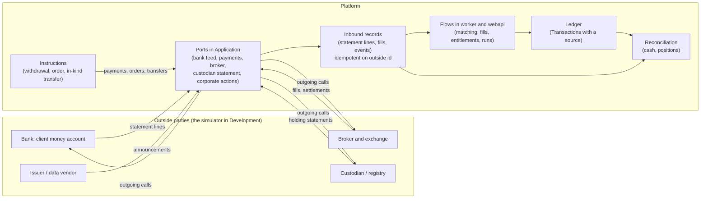

# Custodial accounts roadmap

**Status on 2026-11-25:** steps 0 to 15 of §13 have landed. The target of §2 holds, except the second person's approval of an adjustment (X1), whose spec is accepted and not landed yet. What comes next, and where each remaining item goes, is in §13.1.

When this plan was written (2026-11-19), the five custody mode slices of [future-plans.md](future-plans.md) §9 had landed. A Custodial account could be opened, the manual entry matrix refused the hand-entered types that write a position or a balance, the server set `bookedAt`, and the read side showed funds under management. A Custodial account was still a hand-entered account, only with fewer types: deposits and withdrawals were typed in, trades were filled at once at the server's price, and some writes did not exist yet.

This document plans the part after that. The goal is that a Custodial account works like an account in a real wealth platform's books: its numbers come from platform-side flows driven by signals from outside parties (a bank, a broker, a custodian, an issuer), not from a person typing them. A separate simulator project plays those outside parties, so the flows can be tested by hand and shown in a demo.

How to use this document:

- It is a `note`, not a build contract. Each item in §4 to §11 needs its own discussion and Feature Spec (or ADR) before any work starts. Do not create tables, routes or handlers from this file.
- Names in this file are working names. They become glossary terms only when a spec adopts them.
- The order in §13 is a recommendation. Change it here when a decision changes it.
- When an item gets a spec, or lands, update its row in §13. When a flow lands, its spec changes one cell of the manual entry matrix and removes one row of [known-issues/custodial-account-gaps.md](known-issues/custodial-account-gaps.md).

---

## 1. Where we started (2026-11-19)

This section is the starting point of the plan and is not kept up to date. The state today is the matrix in §2 and the table in §13.

| Area | On a Custodial account on 2026-11-19 | Where |
| --- | --- | --- |
| Opening | `Brokerage` only, one cash currency, immutable custody mode. The tenant may limit which modes can be opened | custody-modes R3, tenant-custody-modes |
| Hand entry | `TransferIn`, `TransferOut`, `CloseOut`, `Buy`, `Sell`, `InternalTransfer`, `FxConversion` and reverse are allowed. `Interest`, `Opening`, `OpeningHoldings`, `StockIn`, `StockOut`, `Split`, `Bonus`, `Scrip` are refused | `CustodyRules` in `src/Domain/Custody/CustodyRules.cs`, custody-modes R5 |
| Numbers | Server price, trade fee schedule, reference FX rate, server `bookedAt` | custody-modes R10–R13, R18 |
| Same mode on legs | A Transaction never mixes Custodial and External accounts | custody-modes R8 |
| Portfolios | Only Custodial accounts can be assigned and rebalanced. A rebalance is proposed, confirmed by a person and traded through orders ([rebalances.md](features/rebalances.md), landed 2026-11-23) | custody-modes R14, R15 |
| Read side | Net worth `byCustodyMode`, funds under management, "Held on platform" in the Customer Portal | custody-mode-grouping |

Facts in the code that the plan builds on:

- The `Transaction` factories do not call the matrix (custody-modes R7). A platform-side flow can post a `Buy`, a `Split` or an `Interest` directly, with its own date. This is the hook every flow below uses.
- `Transactions.Reference` is free text (`nvarchar(100)`). Rebalance writes `rb:{handle}:{B|S}:{InstrumentId}` into it (`RebalanceAccount.cs`), which puts an internal integer on the wire. There is no other record of which process wrote a Transaction.
- The `worker` host runs Hangfire. Inbound data already follows one pattern: a port in Application (`IMarketData`, `IFxRate`), an HTTP adapter in Infrastructure (EODHD, Frankfurter), and a recurring job that pulls and stores (`InstrumentPriceRecurringJob`, `FxRateRecurringJob`). The outbox (ADR 0018) handles outgoing events.
- Roles are SystemAdmin, TenantAdmin, Adviser and Customer (`RolePermissions.cs`). There is no operations role, and a Customer has no write permission at all.
- A Customer has no bank details and no tax attributes. An Account has no payment reference. A Tenant has no client money bank account.
- `posting.md` §1 fixes how a later review step works: "maker-checker is a status on this same row plus an approve command — not a second resource". Today every Transaction is posted.

---

## 2. Target

A Custodial account is done when all of these hold:

1. **Every Transaction has a source.** It was written by a platform-side flow (a bank statement line, a payment, an order fill, a corporate action, an interest run, an in-kind transfer, a migration batch, a rebalance) or by a controlled adjustment, and the Transaction says which one.
2. **One hand-entered write.** The only write a person types on a Custodial account is an adjustment: a reason code, a separate permission, and later a second person's approval.
3. **The books agree with the outside, every day.** A bank reconciliation proves that the Custodial cash per currency agrees with the client money bank account. A custodian reconciliation proves the same for positions.
4. **Money and securities leave only through instructions.** A withdrawal goes only to the Customer's nominated bank account, after review. Securities leave only through an in-kind transfer out.
5. **External accounts do not change.** Every item below is "a Custodial account does X". External accounts keep every hand-entered type and the caller's numbers.

The manual entry matrix at the end of the plan. The External column stays as today.

| Type | Custodial hand entry, today | Custodial at the end | Written by |
| --- | --- | --- | --- |
| `TransferIn` | refused (from deposit matching, landed 2026-11-20) | refused | Deposit matching (B4) |
| `TransferOut` | refused (from withdrawals, landed 2026-11-21) | refused | Withdrawal (B6) |
| `CloseOut` | refused (from account closure, landed 2026-11-22) | refused | Account closure (B8) |
| `Buy` / `Sell` | refused (from orders, landed 2026-11-23; a rebalance trades through orders from rebalances, landed 2026-11-23) | refused | Order fills (O1); rebalance through orders (O3) |
| `InternalTransfer` | allowed, same Customer only (D14, from withdrawals, landed 2026-11-21) | allowed, same Customer only (D14) | Hand entry |
| `FxConversion` | allowed, both Custodial | allowed (later through an outside FX party, O5) | Hand entry |
| `Interest` | refused (written by the interest run, landed 2026-11-22) | refused | Interest run (I2) |
| `Opening` / `OpeningHoldings` | refused (written by a migration batch, landed 2026-11-24) | refused | Migration batch (T2) |
| `StockIn` / `StockOut` | refused (written by an in-kind transfer, landed 2026-11-24) | refused | In-kind transfer (T1) |
| `Split` / `Bonus` / `Scrip` | refused (`Split` and `Bonus` written by corporate actions, landed 2026-11-22; `Scrip` never written: a reinvested dividend is a `Dividend`, landed 2026-11-25) | refused | Corporate action events (C1, C3) |
| `Dividend` | refused (written by corporate actions, landed 2026-11-25) | refused | Corporate action events (C2) |
| `Adjustment` (new) | allowed with its own permission, posted at once (through a request that a second person approves, from adjustment-review, accepted 2026-11-25, not landed) | allowed with its own permission, through a request that a second person approves | Adjustment request (F3, X1) |
| Reverse | allowed only for `Manual` sources (`Rebalance` until rebalances, landed 2026-11-23, ended D15); never for an `Adjustment` from adjustment-review (accepted 2026-11-25, not landed) | allowed only for `Manual` sources (P6), never for an `Adjustment` | Hand entry; flows reverse their own writes |

---

## 3. Principles for every item

These are the working rules the plan assumes. Each is open to change in the spec that first needs it; the decisions in §12 list the ones that need an explicit answer.

| # | Principle | Why |
| --- | --- | --- |
| P1 | **The platform does not know the simulator.** It talks to ports. The simulator is one adapter behind them; a real bank or broker would be another. | No business code changes when a real connection replaces the simulator. |
| P2 | **The platform pulls.** A recurring `worker` job calls the port and stores what it gets, as the price and FX syncs do today. Outgoing instructions are calls on the same ports. Push is not built in the first version (D1). | No inbound endpoint and no machine-to-machine sign-in on `webapi`. Same pattern and same tests as EODHD. |
| P3 | **Inbound records are stored before they are used, and are idempotent on the outside party's id** (statement line id, fill id, event id). A unique index rejects a second copy. | A feed can resend. Reconciliation needs the raw record next to what the platform did with it. |
| P4 | **A flow books at the time the platform processes the signal.** Outside dates (value date, trade date, settlement date, record date) go into detail rows on the Transaction, the same pattern as `TransactionFxDetails` and `TransactionFeeDetails`. | The ledger cannot check a balance as of a past date (no replay yet). Booking at processing time keeps custody-modes R10 true for flows too. |
| P5 | **Flows call the `Transaction` factories directly** and do not go through the matrix (custody-modes R7). Each flow sets the Transaction's source. | The matrix is about what a person may type. |
| P6 | **A person reverses only what a person entered.** On a Custodial account a hand reverse is allowed only for a `Manual` source. A flow undoes its own writes (a returned payment, a broken trade, a cancelled corporate action). Anything else is corrected with an adjustment. | Otherwise a hand reverse can undo a bank receipt the bank still shows, and reconciliation breaks. |
| P7 | **Instructions are their own aggregates.** A withdrawal, an order or an in-kind transfer has a lifecycle (requested, approved, sent, confirmed, failed). The Transaction is posted only when the outside party confirms. | An instruction is not a ledger entry until it happens. See D3 for how this sits with posting §1. |
| P8 | **Committed cash is reserved.** A pending withdrawal or an open buy order reduces available cash; it does not change the cash balance. | The same cash must not be sent twice. |
| P9 | **Automated tests do not need the simulator process.** Functional tests use in-memory fakes of the ports, fed by the test. The simulator is for manual testing, demos and a few end-to-end runs. | Fast, repeatable tests. |
| P10 | **The simulator keeps its own books.** It never reads the platform's ledger tables. | Reconciliation must compare two independent records, or it always agrees and proves nothing. |
| P11 | **One outside party at a time.** The simulator grows only by the party the current flow needs. | Keeps the side project small. |

---

## 4. Stage F — Foundations (platform only)

No simulator needed. These make the later flows small.

### F1. Transaction source

- **What:** every Transaction records which process wrote it. Working shape: a source kind (`Manual`, `Seed`, `Rebalance`, later `BankFeed`, `Payment`, `OrderFill`, `CorporateAction`, `InterestRun`, `InKindTransfer`, `Migration`, `Adjustment`) and an optional source id (the PublicId of the instruction, event or run).
- **Changes:** a schema script with a back-fill (`rb:` references → `Rebalance`, `TestSeed-` references → `Seed`, the rest → `Manual`); the factories take a source; the transaction item shows it; rebalance stops putting `InstrumentId` into `reference` (closes the internal-id leak). Customer Transactions Report may show the source.
- **Depends on:** nothing.
- **Also decide:** whether the source is one column pair on `Transactions` or a source kind plus a typed FK per source table. Recommendation: kind plus a nullable `SourcePublicId`, no FK, because the source tables do not exist yet.

### F2. Outside parties behind ports (ADR)

- **What:** an ADR that fixes P1–P4, P9 and P10: ports per outside party, pull by the `worker`, inbound records stored first and idempotent, a stored cursor per feed, booking at processing time with outside dates in detail rows.
- **Changes:** documentation only. The first port arrives with B3.
- **Depends on:** nothing. Write it before B3.
- **ADR:** [0021](adr/0021-outside-parties-behind-ports.md) (accepted 2026-11-19). It also fixes, at decision level, the simulator host of S0 (D8, D10, D16, D17, D19) and adds rules this section did not list: no outside call on the `webapi` request path, processing as a separate step after the pull commits, outgoing calls idempotent on the instruction's PublicId, no automatic Hangfire retries on pull jobs, and no shared code between the platform adapter and the simulator except a test-only scenario library.

### F3. Controlled adjustment, first version

- **What:** a new `TransactionType` `Adjustment` for cash, security or both on one Account, with a required reason code and memo. Its own permission, TenantAdmin only. Allowed on both modes, or on Custodial only (decide in the spec). Shown separately in reports.
- **Why early:** every later flow needs a way to fix a break that is not a reverse (P6). Without it the only fix is a hand reverse, which P6 takes away.
- **Changes:** enum value and schema `CHECK`, reason code list, `POST /transactions/adjustment` (own route, [api-design.md](api-design.md) §7.7), permission, matrix row, Adviser Portal form for TenantAdmin.
- **Later:** review by a second person (X1). The first version has no review, so it adds no Transaction status. X1 is [adjustment-review.md](features/adjustment-review.md) (accepted 2026-11-25), and it adds no Transaction status either.
- **Depends on:** F1.
- **Spec:** [adjustments.md](features/adjustments.md) (accepted and landed 2026-11-19). Its §11 records the decisions that refine this section: Custodial only; `transactions.adjust` for TenantAdmin only, not SystemAdmin, and also needed to reverse an adjustment; source `Manual`, so the `Adjustment` source kind of F1 is dropped; four reasons (`EntryError`, `CorporateAction`, `ReconciliationBreak`, `Other`); the holding change as signed quantity and cost changes on one instrument; not subject to the portfolio trade lock; the reason shown in the Customer Transactions Report, not in the Customer Portal.

### F4. Reverse by source on Custodial accounts

- **What:** P6 as a rule: on a Custodial account, a hand reverse of a Transaction whose source is not `Manual` → 400. Rebalance trades: decide whether they count as manual (an Adviser pressed Rebalance) until orders exist.
- **Changes:** one rule in `ReverseTransaction`, the matrix row for reverse, Adviser Portal hides Reverse on those rows.
- **Depends on:** F1. Can be part of the F1 spec.
- **Spec:** F1 and F4 are one spec, [transaction-source.md](features/transaction-source.md) (accepted and landed 2026-11-19). Its §11 records the decisions that refine this section: the reverse rule is Custodial-only; `Seed` is not hand-reversible; the seed back-fill matches the exact seed references, not the `TestSeed-` prefix; existing `rb:` references are cleared; the source id of a rebalance trade is the rebalance handle; the Customer Transactions Report does not show the source yet.

---

## 5. Stage B — Bank: deposits, withdrawals, reconciliation

The first outside party. It closes the largest gap: today anyone with `transactions.create` can record a deposit no bank received.

Real-world shape: Customers pay into the firm's client money trust account at a bank, with a reference. The platform reads the bank statement, matches each receipt by reference, and credits the Customer's account. Unmatched receipts wait in suspense. Withdrawals go only to the Customer's nominated bank account, after review, as a payment instruction to the bank. Every day the firm proves that the Customer balances add up to the trust account balance.

### B1. Client money bank accounts

- **What:** per Tenant and currency, the trust bank account the firm holds client money in (bank, masked account number, currency, status).
- **Who sets it:** SystemAdmin in Back Office, or TenantAdmin in the Adviser Portal (decide).
- **Rule:** a Custodial account can be opened only in a currency that has an active client money account. This is a new check on `CreateAccount`, next to tenant-custody-modes.
- **Depends on:** nothing.
- **Spec:** B1 and B2 are one spec, [client-money-accounts.md](features/client-money-accounts.md) (accepted and landed 2026-11-20). Its §11 records the decisions that refine this section: SystemAdmin sets the client money accounts in the Back Office; the account number is stored in full, not masked, because Customers pay to it; the details never change (disable and add a new one); at most one active per currency; reopen is not checked; no bank connection yet (B3 adds it, ADR 0021 rule 3); the demo seed adds none.

### B2. Deposit reference on a Custodial account

- **What:** a payment reference generated when a Custodial account is opened, unique in the Tenant, short enough for a bank reference field. Customers quote it when they pay in.
- **Changes:** column and unique index, account item field, Customer Portal shows deposit instructions (trust account, reference). Back-fill existing Custodial accounts.
- **Depends on:** B1 for the instructions page; the reference itself does not.
- **Spec:** [client-money-accounts.md](features/client-money-accounts.md) (accepted and landed 2026-11-20), with B1. Its §11 records: nine characters with a Luhn mod 32 check symbol, first a letter, random, unique on the platform rather than in the Tenant (a unique index, with a redraw before the save and after a save that hits it); Custodial accounts only; never changed or reused; deposit instructions on their own route `GET /accounts/{id}/deposit-instructions`.

### B3. Bank feed port and statement lines

- **What:** a port that returns statement lines for one client money account after a cursor; a `worker` job that pulls them and stores each line once (P3); a statement line table (outside id, account, value date, amount, direction, payer details, reference text, status: unmatched, matched, returned, ignored).
- **Simulator:** S1 bank, receipts side.
- **Depends on:** F2, B1.
- **Spec:** B3 and B4 are one spec, with S1 receipts, [deposit-matching.md](features/deposit-matching.md) (accepted and landed 2026-11-20). Its §11 records the decisions that refine this section: a client money account names a bank connection kept in configuration (URL and key on `worker` only); the feed is addressed by the trust account number; one cursor row per client money account; only active client money accounts are read; one recurring job per connection, polling interval `PollMinutes` per connection (default one minute), each account read on its own (ADR 0021 rule 15 amended to "one job per connection"); the payer's account number is masked on store; debit lines are stored and wait for B6.

### B4. Deposit matching and suspense

- **What:** a receipt whose reference matches a Custodial account of the same currency posts a deposit (`TransferIn`, source `BankFeed`, a cash movement detail with value date, bank reference and masked payer). Anything else stays unmatched. An operator can match an unmatched line to an account by hand (this posts the same deposit with the operator recorded), or mark it for return to the payer.
- **Matrix:** hand `TransferIn` on a Custodial account → refused.
- **Pages:** a Suspense page for the operator; the Customer sees the deposit with its value date.
- **Decided:** a dishonoured or recalled receipt after it was credited: the flow reverses the deposit while available cash allows; otherwise nothing is posted and the line waits in suspense for an adjustment ([bank-returns.md](features/bank-returns.md) R3, landed 2026-11-21).
- **Depends on:** F1, F4, B2, B3.
- **Spec:** [deposit-matching.md](features/deposit-matching.md) (accepted and landed 2026-11-20), with B3. Its §11 records: reference candidates from the text with the Crockford mapping and the check symbol; a reference of another Tenant's account counts as not found; permission `statement-lines.manage` for TenantAdmin only; match, ignore, request return, reopen and undo match on the line, guarded by `rowVersion`; undo match is a Reversal by the flow, refused when the cash is gone (then an adjustment), so no balance goes negative; a recall or dishonour is a debit line and comes with step 6b; request return records the decision and step 6b sends the payment; hand `TransferIn` on a Custodial account refused for every caller.

### B5. Nominated bank account

- **What:** a Customer's bank account that withdrawals may be paid to: masked number, account name, currency, verified flag, who verified it and when. Changes are audited.
- **Who:** an Adviser adds it for the Customer, an operator verifies it (the anti-money-laundering control). The Customer only sees it (D6).
- **Depends on:** nothing.
- **Spec:** B5 and B6 are one spec, with S1 payments, [withdrawals.md](features/withdrawals.md) (accepted 2026-11-20, landed 2026-11-21). It decides: the full account number is stored and shown on the nominated bank account (masked on withdrawals and payouts); one currency per nominated bank account; details never change (remove and add again); a TenantAdmin other than the person who added it verifies or rejects it, with a note; permissions `nominated-bank-accounts.read`, `.manage` and `.verify`; SystemAdmin none.

### B6. Withdrawals

- **What:** an instruction aggregate (P7): requested → approved → sent → paid, or rejected, cancelled, returned. On request the amount is reserved (P8). Approval is by a different person from the requester. On approval the platform sends a payment to the bank port. When the bank statement shows the payment, the platform posts the withdrawal (`TransferOut`, source `Payment`) and releases the reservation. A returned payment posts nothing, or reverses the posted withdrawal if the return comes after it.
- **Who:** the Adviser requests it on the Customer's behalf; the Customer sees its status (D6). An operator approves.
- **Available cash:** cash balance minus reservations. Shown on the account; used by withdrawals now and by buy orders (O1). Later, only settled cash is available to withdraw (O2).
- **Matrix:** hand `TransferOut` on a Custodial account → refused.
- **Simulator:** S1 bank, payments side (execute, fail, return a day later).
- **Depends on:** B3, B5, the operator permissions (D5).
- **Spec:** [withdrawals.md](features/withdrawals.md) (accepted 2026-11-20, landed 2026-11-21), with B5. It decides: the amount is reserved on request, and every write that lowers cash on a Custodial account (flows and rebalance included) keeps available cash `≥ 0`, except the payout; only a TenantAdmin approves, never their own request (a very small firm keeps two TenantAdmin logins); cancel only before the first send attempt; one outgoing payment record, sent by the existing bank sync job before its pull; the payout (`TransferOut`, source `Payment`) is posted from the debit line, found by the end-to-end id the bank echoes; a returned payout is reversed by the flow; the bank rejects at once or returns later (no payment status feed); hand `TransferOut` refused, hand `CloseOut` limited to a rounding remainder, and `InternalTransfer` between two Customers' Custodial accounts refused (D14); no balance check and no scenario library in the simulator bank yet.
- **Spec, the other debit lines:** the parts deposit-matching left for B6 that are not withdrawals (sending a receipt back to its payer, recalls and dishonours of receipts, debit lines the platform did not cause) are step 6b, [bank-returns.md](features/bank-returns.md) (accepted 2026-11-21, landed 2026-11-21). It decides: request return creates the return payment, reopen cancels it until the first attempt, a rejected return goes back to suspense; a recall reverses the deposit while available cash allows, otherwise suspense and an adjustment; unknown debit lines go to suspense and can only be ignored; a receipt return needs no second approval; each return payment has its own instruction id, at most one open per line.

### B7. Bank reconciliation

- **What:** per client money account and day: the bank's closing balance against the sum of Custodial cash in that currency, plus unmatched receipts, minus payments sent but not yet on the statement. Every difference is listed as a break with its cause. A break is fixed by its flow or by an adjustment (F3), never by editing.
- **Output:** a report in the existing report framework (a new catalog entry granted per Tenant) and an operator page with the open breaks.
- **Open:** interest the bank pays on the trust account belongs to the firm or to the Customers (see I2); until decided it shows as a known difference. Answered by [interest-run.md](features/interest-run.md) (accepted 2026-11-22): the bank's interest line is set aside by the platform and shown as `BankInterest`, next to `InterestCredited` and `TaxWithheld`.
- **Depends on:** B4, B6.
- **Spec:** with S1 balances, [bank-reconciliation.md](features/bank-reconciliation.md) (accepted and landed 2026-11-21). Its §11 records: the bank sends a statement balance with each feed page, stored with the lines it covers, and an opening balance is set once, instead of a closing balance per value date (two clocks, D9); a run is one client money account at one instant, read at SNAPSHOT from local tables, stored and never edited; the platform side is every Custodial account of the Tenant in the currency, and cash that never passed through the trust account (trades, FX conversions, adjustments, other cash) is a known difference by cause; suspense lines are breaks, lines not processed and returns in progress are timing, ignored lines are known; a payment sent but not yet on the statement is not an item, because the payout is posted from the debit line (this refines "minus payments sent but not yet on the statement" above); a break is fixed only by its flow or an adjustment and disappears from the next run; daily at 17:00 UTC and "Run now"; permission `bank-reconciliations.manage`, TenantAdmin only; the PDF is a report of a new scope `Tenant`; no scenario library.

### B8. Account closure flow

- **What:** closing a Custodial account becomes a flow: no open instructions, no holdings, withdraw the balance to the nominated account, write off a remainder smaller than the currency's minor unit (the reason `CloseOut` still exists, custody-modes §4.2) as a rounding adjustment, then close.
- **Matrix:** hand `CloseOut` on a Custodial account → refused.
- **Depends on:** B6, F3.
- **Spec:** [account-closure.md](features/account-closure.md) (accepted and landed 2026-11-22). Its §11 records: an account closure is its own record, a sub-resource of the Account (`/accounts/{accountId}/closures`), requested by an Adviser or TenantAdmin; it refuses while the account holds anything, has an Active portfolio assignment, an open withdrawal or another closure, and does not sell, unassign or cancel; the payout is the cash balance rounded down to the minor unit, paid as an ordinary withdrawal created with the closure, whose approval is the only approval; with nothing to pay out the closure completes at once; while the payout is on its way the account is closing and accepts no hand write, and its receipts and returned payouts wait in suspense (`AccountClosing`); the payout, the remainder write-off and the close are one database transaction; the closure ends with its withdrawal (no cancel route of its own); the remainder is a `CloseOut` written by the flow with a new source `AccountClosure`, not an `Adjustment` (this refines "as a rounding adjustment" above); `POST /accounts/{id}/close` and hand `CloseOut` are refused on Custodial accounts; permissions `account-closures.read` and `.request`, SystemAdmin none.

---

## 6. Stage I — Income on cash

### I1. Minimal Customer tax profile

- **What:** the few tax attributes the interest run needs: RWT rate (or "not provided"), whether an IRD number is held, tax residency. Not a KYC module.
- **Check against IRD** when the spec is written ([future-plans.md](future-plans.md) §1). This note settles no rate.
- **Depends on:** nothing. Coordinate with roadmap step 2 (income events), which needs the same profile.
- **Spec:** I1 and I2 are one spec, with S1 trust interest, [interest-run.md](features/interest-run.md) (accepted and landed 2026-11-22). Its §11 records: three attributes per Customer (tax residency, IRD number held, the chosen RWT rate), and the IRD number itself is not stored; a Customer with nothing saved is withheld at the non-declaration rate; the rates are constants checked against Inland Revenue on 2026-11-22 (individuals only: 10.5, 17.5, 30, 33 or 39 % chosen, 33 % with no rate chosen, 45 % without an IRD number, NRWT 15 % for an overseas Customer); the Adviser or TenantAdmin sets it with the existing Customer permissions, and the Customer reads it; the profile is read when interest is paid, with no history table.

### I2. Interest run

- **What:** a Tenant interest rate schedule per currency, effective-dated and never changed once in effect (the trade fee schedule pattern), possibly tiered. A daily accrual per Custodial account, posted monthly as `Interest` (source `InterestRun`) with an interest detail (period, rate, gross) and a withholding tax cash leg with a tax detail.
- **Shape:** the withholding leg and tax detail are the same shape roadmap step 2 needs for dividends. Settle it once, in whichever spec comes first.
- **Clock:** the run uses the platform clock. A SystemAdmin can also trigger it for an as-of date: up to today on production, any date in Development (D9, D18). The run is idempotent per (Account, period).
- **Open:** whether the firm keeps a margin between the bank's rate and the Customer's rate, and how B7 shows it.
- **Closes:** the interest gap. `Interest` stays refused by hand.
- **Depends on:** F1, I1.
- **Spec:** [interest-run.md](features/interest-run.md) (accepted and landed 2026-11-22), with I1. Its §11 records: an interest rate schedule per Tenant and currency with marginal bands of annual rates; an accrual per Custodial account and UTC day on the closing balance (Actual/365, 8 decimals), stored once, with a cursor per account; a posting per calendar month as one `Interest` with a `Principal` leg, a `Tax` cash leg with a tax detail (the shape dividends reuse) and an interest detail, source `InterestRun`; the tax decided from the tax profile when the interest is paid; a stored run per Tenant and as-of date, daily at 00:30 UTC for yesterday; the SystemAdmin trigger of D18 with an as-of date of at most yesterday (this refines "up to today"), a later date only with the option `Interest:AllowFutureAsOfDates`; an account closure posts the interest accrued so far before its payout, and a closing account is not accrued; for D12, the firm sets the Customer rate and the margin is what the bank pays above it; the bank's interest on the trust account is a statement line of kind `Interest` that the platform sets aside, and the bank reconciliation shows it, the interest credited and the tax withheld as three known differences (this answers the "Open" of B7); no flow reverses an interest posting; permissions `interest-rates.read` / `.manage` and `interest-runs.read` / `.start`.

---

## 7. Stage C — Corporate actions

The event belongs to the instrument, not to an account. The platform computes each account's entitlement from its holding and posts it. Detailed analysis of today's `Split` / `Bonus` / `Scrip` is in [split.md](features/split.md) §13 and the known issue.

### C1. Corporate action events: split, consolidation, non-taxable bonus

- **What:** a corporate action aggregate: instrument, kind, ratio as two integers, ex-date, record date, payment date, status. A feed port (the simulator plays the issuer or data vendor), plus an operator entry of the announcement itself (entering the event is not entering a result). A job finds Custodial accounts holding the instrument and posts one Transaction per account (source `CorporateAction`), idempotent on (event, account).
- **Entitlement date:** quantity as of a date can be computed from the security legs (quantity is additive; only cost is path-dependent). On a Custodial account `bookedAt` is the server's time, so that sum is reliable without replay.
- **Rules:** not subject to the portfolio trade lock (portfolios R18). Fractions: decide between rounding down and cash in lieu (cash in lieu needs a price).
- **External accounts:** keep hand `Split` / `Bonus` / `Scrip`. Whether the event may also be applied to External accounts is a later question.
- **Closes:** the split gap.
- **Depends on:** F1, F2.
- **Spec:** step 10 is two specs. [simulated-instruments.md](features/simulated-instruments.md) (accepted and landed 2026-11-22) is step 10a: D11 for prices and the data vendor half of S4. [corporate-actions.md](features/corporate-actions.md) (accepted and landed 2026-11-22) is step 10b: C1 with the issuer half of S4. Its §11 decides, every point as recommended: a corporate action is a Tenant's row on a Tenant's instrument, and a feed announcement is platform data fanned out to every Tenant's instrument with the symbol and quote currency; kinds `Split`, `Consolidation` and `Bonus` with a ratio of two whole numbers, posted as the existing `Split` and `Bonus` types (no new type; `Scrip` waits for C3) with source `CorporateAction` and a corporate action detail; it takes effect by a signal, the party's `Effective` version on the feed or, for a hand-entered one, the first price dated from the ex-date (or "Apply now"), never by the platform calendar alone; the entitlement is worked out on the holding when it is posted, for the accounts that held the instrument when the action took effect (this refines "quantity as of a date" above); fractions are rounded down to 8 decimals with no cash in lieu (this answers "Fractions" above); a TenantAdmin enters the event with `corporate-actions.manage`, only for an instrument no market data connection serves; Custodial accounts only; no flow reverses an applied action (the inverse action or an adjustment corrects it), so P6's "a cancelled corporate action" covers a cancellation before the action takes effect.

### C2. Cash dividends

- **What:** a dividend event (amount per share, currency, imputation credit, foreign tax) posted as `Dividend` (the reserved value becomes active) with an income detail and withholding legs.
- **Open:** a dividend in a currency other than the account's (D13).
- **Depends on:** C1, I1, roadmap step 2 (income events). This is where the two threads meet.
- **Spec:** C2, C3 and the rest of S4 are one spec, step 15, [dividends.md](features/dividends.md) (accepted 2026-11-24, landed 2026-11-25). Its §11 decides, every point as recommended: a dividend is a fourth kind of corporate action, `Dividend`, on the same aggregate, feed, hand entry and entitlement, with terms per share (amount, a tax source `NewZealand` or `Foreign`, imputation credit, foreign tax as a rate, an optional plan price) and no ratio; it is paid in the Instrument's quote currency; going ex, by the corporate action's existing signals, fixes the entitled accounts and their quantities on the platform's own holdings and posts nothing (this refines "income detail and withholding legs" into two moments); the Customers are paid only when the custodian's payment is on the client money account, found by the issuer's event id in the reference or matched by a TenantAdmin, within a rounding allowance of 2 minor units per entitlement unless a person accepts the difference; each account gets one `Dividend` Transaction (the reserved value becomes active) with source `CorporateAction`, the gross as `Principal`, a `Tax` leg of the new kind `ForeignWithholding`, a `Tax` leg of RWT at 33 % by Inland Revenue's formula (imputation credits and foreign tax taken off) or NRWT at 30 % for an overseas Customer on a New Zealand dividend, decided from the tax residency when it is posted, and a dividend detail that holds the imputation credit; rates checked against IR284 (October 2025) and IR291 (March 2026) on 2026-11-24; for D13, an account in another currency is converted at the reference rate when the dividend is posted (this refines "on the payment date"); `Dividend` stays refused by hand on both modes, and an External account's dividends stay with roadmap step 2; an account cannot be closed while a dividend is to be paid on it; the bank reconciliation gains the timing difference `DividendsNotPosted` and the known difference `DividendDifference`, and `TaxWithheld` counts dividend tax; no new permission, source kind or job.

### C3. Dividend reinvestment and taxable bonus issues

- **What:** reinvest a dividend into new shares at the plan price, with the cost of the new shares equal to the reinvested amount. Replaces the `Scrip` name.
- **Depends on:** C2.
- **Spec:** [dividends.md](features/dividends.md) (accepted 2026-11-24, landed 2026-11-25), with C2. Its §11 decides, every point as recommended: a standing reinvestment election per Custodial account, recorded by the Adviser (D6); a plan is a price on a feed dividend, and a hand-entered dividend, an account that follows a portfolio and an account in another currency (D20) do not reinvest; when the dividend goes ex the platform works out a participating quantity per electing account that leaves the New Zealand tax in cash, and the `worker` sends one election per dividend to the custodian through a new port `ICustodianElections`, with the corporate action's PublicId as the key; the custodian delivers the new shares as a custody movement, and the platform shares exactly that quantity out by largest remainder; the reinvestment is part of the `Dividend` Transaction, a cash leg with the new role `Reinvestment` and a security leg whose cost is the reinvested amount, and `Scrip` is never written on a Custodial account (this refines "Replaces the `Scrip` name" and the §2 matrix: a dividend in shares is a `Dividend`, and the name stays for External hand entry until the type route moves); a TenantAdmin can pay a dividend in cash when no shares arrive; taxable bonus issues and other non-cash dividends are left out (this refines the title above).

---

## 8. Stage O — Orders and the broker

### O1. Orders

- **What:** an order aggregate (P7): instrument, side, quantity (later amount), type (market only at first), state (draft → placed → partly filled → filled, or cancelled, rejected, expired). Placing reserves the estimated cash for a buy and the quantity for a sell. The broker port places and cancels orders; a `worker` job pulls fills. Each fill posts a `Buy` or `Sell` (source `OrderFill`) with an execution detail: price, trade date, settlement date, broker reference, fill id.
- **Fees:** the Tenant's trade fee schedule stays the charge to the Customer. The broker's own commission is the firm's cost and is not in the Customer ledger.
- **Matrix:** hand `Buy` / `Sell` on a Custodial account → refused; the Adviser places an order instead.
- **Prices:** the server price on today's immediate trade is no longer used for Custodial fills; the estimate for the reservation still uses the latest close.
- **Simulator:** S2 broker and exchange.
- **Depends on:** F1, F2, B6 (available cash).
- **Spec:** O1, O2 and S2 are one spec, [orders.md](features/orders.md) (accepted and landed 2026-11-23). Its §11 decides, every point as recommended: a broker connection in configuration, named by the Tenant and kept on the order; ports `IBrokerOrders` (place, cancel) and `IBrokerFeed`, with one feed of execution reports per connection (`Fill`, `Cancelled`, `Expired`, `Settled`) stored as platform data and an order named by its PublicId; `Market` and `Day` orders by quantity, with no draft and no second approval (drafts come with O3); a price limit of 5 % around the reference price, set by the platform, so a buy reserves the most it can cost and no fill costs more (this refines "the estimated cash"); a reference price at most 4 days old; each fill one `Buy` or `Sell` with source `OrderFill`, the order's PublicId as source id and an execution detail; the trade fee charged on the order across its fills, from the schedule of the day it was placed; a fill that cannot be posted waits and is tried again on every run; a fill of an ended order is still booked; cancelling at once before the first send, otherwise a request the broker answers; no broken trade and no flow that reverses a fill yet (step 11b in §13, as 6b was); an order and a portfolio assignment never on one account, with rebalance unchanged until O3; a corporate action that takes effect ends the open orders in its instrument; hand `Buy` / `Sell` refused on a Custodial account for every caller.

### O2. Settlement

- **What:** fills settle on their settlement date (T+2 for NZX and ASX, T+1 for US shares; check when specified). Cash from a sale is in the balance from the trade date but available to withdraw only after settlement. Settlement is confirmed by a signal from the broker or custodian, not by the platform's calendar (D9).
- **Depends on:** O1.
- **Spec:** [orders.md](features/orders.md) (accepted and landed 2026-11-23), with O1. Its §11 decides: the platform holds no settlement cycle or calendar, and stores the trade date and settlement date the broker sends (this answers "check when specified": the cycle is the party's); a fill settles when the broker's `Settled` report names it, with no ledger write; unsettled cash is the net proceeds of sell fills not settled yet, with unsettled buys not netted; withdrawable cash is available cash minus unsettled cash; a withdrawal and the from side of an internal transfer or an FX conversion need withdrawable cash, while orders, adjustments and rebalance use available cash; an account closure waits for open orders and unsettled fills. Paying and receiving settlement cash through the client money account, and its bank reconciliation, is a later step (11b in §13); until then trades stay the known difference `Trades` of B7.
- **Spec, the remainder (O1 and O2):** step 11b is [trade-settlement.md](features/trade-settlement.md) (accepted and landed 2026-11-23). Its §11 decides, every point as recommended: an order carries its settlement account (the trust account number) when its instrument is quoted in the account's currency, the Tenant has an active client money account in it and the broker connection has the broker's bank account for it in configuration, and an order that cannot settle through the bank is still placed; the broker nets the fills of a settlement account, currency and settlement date into one broker settlement, named on each `Settled` report and closed by a new `Settlement` report; the platform works out its own net and stores a trade settlement, `Disputed` when the figures differ; the firm's net is paid by an outgoing payment of kind `TradeSettlement` with no approval, the broker's net is a receipt named by the settlement id, and the matched statement line posts no Transaction; a refused or returned payment is paid again, and a TenantAdmin can set a settlement aside with a note; `Settled` still decides withdrawable cash; in the bank reconciliation a fill's cash is the timing difference `UnsettledTrades` until its settlement completes, the trade fee is the known difference `TradeFees`, and `Trades` keeps rebalance trades, trades typed before orders and sells in another currency (this refines "Closes" in §13); a broken trade is a new `Broken` report, reversed by the flow once while the fill is the latest security activity on its holding and the cash allows, otherwise corrected with an adjustment and resolved by hand; a trade broken after it settled is skipped.

### O3. Rebalance through orders

- **What:** a rebalance produces a proposed set of orders. The Adviser confirms, then the orders are placed. Today's immediate trades and the portfolio trade lock are re-thought in the same spec ([portfolios.md](features/portfolios.md)).
- **Open:** whether the Customer must consent before each rebalance (discretionary service or not). If so, the Adviser records the consent (D6).
- **Depends on:** O1.
- **Spec:** step 12 is [rebalances.md](features/rebalances.md) (accepted and landed 2026-11-23). Its §11 decides, every point as recommended: a rebalance is its own stored run per Account, with a proposal (lines on the rebalance, not draft orders) that an Adviser or TenantAdmin confirms, also when a weight change proposed it; the service is discretionary, so no Customer consent is recorded per rebalance (this answers "Open" above; a non-discretionary assignment stays a later item); the proposal is an estimate valid for 24 hours, and the quantities are worked out when each wave of orders is placed; the sells are placed first, the buys when the sells are in the ledger, each buy reserved at its price limit, with one top-up wave; a wave with an order that was not filled in full ends the rebalance as `Incomplete`, and the platform places nothing again; one open rebalance per Account, a newer proposal replaces an unconfirmed one, and a weight change during a rebalance in progress becomes a follow-up proposal; unassign and disable cancel the open rebalance; the trade lock stays (on an assigned Account only its rebalance places orders), and a rebalance order is cancelled only with its rebalance; rebalance trades are order fills with source `OrderFill`, the source kind `Rebalance` is no longer written and no longer hand-reversible (D15 ends); every target line must be quoted in the Account's currency (D20); every attempt is stored, and the assignment loses its last-rebalance fields; permissions `rebalances.read` and `rebalances.confirm`; the advance is a sixth step of the broker job. The simulator broker does not change.

### O4. Order aggregation and allocation (later)

Combine orders of many Customers into one order to the broker and allocate the fill at one average price. Only after O1–O3 are stable.

### O5. FX through an outside party (later)

A Custodial `FxConversion` priced by an FX provider with a spread, instead of the reference rate. Adds an FX fee kind. Low priority.

---

## 9. Stage T — Securities in and out, and positions

### T1. In-kind transfer

- **What:** an instruction to move a Customer's existing shares in or out of a Custodial account. In: requested → in transit → arrived (confirmed by the custodian signal) → posted with the cost and acquisition date the instruction carries. Out: the reverse, to another broker or registry. Whether beneficial ownership changes is recorded (it decides the tax treatment).
- **Matrix:** `StockIn` / `StockOut` stay refused by hand; the flow writes them (or new type names, decided with the type route moves of [future-plans.md](future-plans.md) §4).
- **Simulator:** S3 custodian and registry.
- **Depends on:** F1, F2. Better after tax lots exist, which is not planned yet (§10).
- **Spec:** T1, T3 and S3 are one spec, step 14, [in-kind-transfers.md](features/in-kind-transfers.md) (accepted and landed 2026-11-24). Its §11 decides, every point as recommended: an in-kind transfer is an instruction at `/in-kind-transfers`, `In` or `Out`, between a Custodial account and a counterparty (another broker, custodian or registry) typed on the transfer; requested by an Adviser or TenantAdmin and approved by another TenantAdmin in both directions, with no register of verified counterparty accounts; `Requested` → `Approved` → `Sent` → `Completed`, or `Rejected`, `Cancelled`, `Failed`, `SetAside` (this refines "requested → in transit → arrived → posted" above: the arrival and the posting are one step); the `worker` instructs the custodian with the transfer's PublicId as the key, the custodian answers at once, and the custody movement that names the transfer is the confirmation (no status feed); the movement posts the existing types `StockIn` or `StockOut` with the new source `InKindTransfer` and an in-kind transfer detail, booked at the processing time (D2, D4); a transfer in carries one total cost and an optional acquisition date, the caller's numbers, and whether beneficial ownership changes is recorded and not acted on; a transfer in needs an instrument quoted in the Account's currency (D20); a transfer out reserves its quantity and takes only the transferable quantity (available quantity minus purchases that have not settled); a movement that does not match its transfer exactly posts nothing and waits in suspense, and a TenantAdmin sets the transfer aside and corrects with an adjustment; no transfer on an account that follows a portfolio; no flow reverses a completed transfer; account closure waits for open transfers, and a transfer out is the second way to empty an account; hand `StockIn` / `StockOut` stay refused on a Custodial account. Tax lots are still not planned; the acquisition date waits in the detail.

### T2. Migration batch

- **What:** a TenantAdmin bulk import of opening cash and holdings into empty Custodial accounts, with control totals that must agree before the batch posts. Source `Migration`. Replaces `Opening` / `OpeningHoldings` for Custodial accounts.
- **Depends on:** F1.
- **Spec:** step 13 is [migration-batches.md](features/migration-batches.md) (accepted and landed 2026-11-24). Its §11 decides, every point as recommended: a migration batch is a Tenant's record at `/migration-batches` with one entry per empty Custodial account (no Transaction on it yet), `Draft` → `Submitted` → `Posted`, or `Cancelled`; it writes the existing types `Opening` and `OpeningHoldings` with the new source `Migration` and a migration detail (the previous provider and the date the balances were taken), booked at the posting time (D2, D4); four control totals typed from the previous provider's closing statement (account count, cash per currency, quantity per instrument, cost per currency), compared exactly with the totals of the entries; the cash of a batch must be funded before it is submitted: the provider's bulk transfer is a receipt on the trust account that a TenantAdmin matches to the batch on the statement line, and per currency the funding must equal the batch's cash (this refines "Depends on: F1" above: it also builds on B3, B4 and B7); a TenantAdmin other than the submitter posts, with one permission `migration-batches.manage`; the post is one database transaction on `webapi`, all entries or none, validated again under the Account locks, with at most 500 entries and 5 000 holdings per batch; a holding's instrument must be quoted in the Account's currency (D20); an Active portfolio assignment does not stop an entry and no rebalance is proposed; no flow reverses a posted batch (an adjustment corrects an entry); in the bank reconciliation the funding of a batch not posted yet is the timing difference `MigrationNotPosted`, and a posted batch leaves no item; the API takes JSON and the Adviser Portal reads the CSV; the holdings have no outside proof until T3. The simulator does not change.

### T3. Custodian reconciliation

- **What:** a custodian statement port; a daily comparison of the custodian's holdings per instrument against the sum of Custodial holdings; breaks listed like B7.
- **Depends on:** O1 (otherwise nothing changes positions), S3.
- **Spec:** [in-kind-transfers.md](features/in-kind-transfers.md) (accepted and landed 2026-11-24), with T1. Its §11 decides, every point as recommended: a safekeeping account per Tenant and currency at a custodian (the firm's pooled account for the securities quoted in that currency, the twin of the client money account), set by SystemAdmin in the Back Office, never edited, at most one active per currency (decided 2026-11-24), on a custodian connection kept in configuration; a Custodial account can still be opened without one; port `ICustodianFeed` returns the custody movements after a cursor and, with every page, the custodian's positions at that cursor, instead of a statement per day (two clocks, D9; this refines "a custodian statement port" and "daily holding statement"); one job per connection, `custodian-sync:{connection}`; a movement is matched to an in-kind transfer, to the fill it delivers (an order now carries the safekeeping account, and the broker's fill id names the trade) or to a corporate action, and anything else waits in suspense, where a TenantAdmin can only ignore it with a note; a run is one safekeeping account at one instant, read at SNAPSHOT, stored and never edited, with one line per instrument quoted in its currency: the custodian quantity, the platform quantity and five components that add up to the difference (movements not processed and trades not settled are timing; movements in suspense, delivered fills not booked and the unexplained rest are breaks); there is no known difference, so a holding from a seed, from a trade before orders or from a migration batch not delivered yet is a break until the custodian holds it (this refines "breaks listed like B7": B7 has known differences); quantities are compared exactly, with no tolerance and no value in money; daily at 17:10 UTC and "Run now"; permissions `custody-movements.manage` and `custodian-reconciliations.manage`, TenantAdmin only; no PDF report. It answers the open points of [migration-batches.md](features/migration-batches.md) (the outside proof of migrated holdings) and [corporate-actions.md](features/corporate-actions.md) (rounding at the custodian).

---

## 10. Stage X — Corrections and controls, and what this plan leaves out

| Item | What | Note |
| --- | --- | --- |
| X1 | Review of an adjustment by a second person | The first status on a Transaction, as [posting.md](features/posting.md) §1 describes. Balances, holdings and reports must ignore an unapproved row. Large; do after the flows. **Spec:** [adjustment-review.md](features/adjustment-review.md) (accepted 2026-11-25). Its §11 decides, every point as recommended: the review is on an adjustment request at `/adjustment-requests`, approved before anything is posted, and a Transaction gets no status (this replaces "the first status on a Transaction" and makes the item small); request and approval both take `transactions.adjust`, and the approver is not the requester; only a TenantAdmin requests; the approval posts the `Adjustment` in one database transaction with the new source `AdjustmentRequest`, checked again under the Account lock; a request reserves nothing; `POST /transactions/adjustment` is removed; an `Adjustment` is never reversed by hand, and the opposite request corrects it; an account closure waits for open requests; the Development seed gets a second TenantAdmin in the demo firm. |
| X2 | Cancel and rebook, replay | Rebuilding positions by replaying Transactions in order. Deferred (future-plans §9). Needed for tax lots and backdating. Moved to the business roadmap (§13.1). |
| X3 | Period close | A date per Tenant before which nothing may be written. After X2. |
| X4 | Third-party payments | See D14. |

Not in this plan: replay, tax lots and NZD cost, the FIF report, multi-currency cash in one account (future-plans §5), a valuation-only record for property and loans, the legal structure of the holder (individual, joint, trust, company), real bank or broker connections, and the advisory fee (future-plans §1 step 4), which can use Custodial accounts as its base once B and O exist.

---

## 11. Stage S — The simulator project

A separate project that plays the outside parties for manual testing and demos. It grows one party at a time (P11), each with the flow that needs it.

### S0. Skeleton

- **Project:** `src/Simulator` (working name), an Aspire resource in Development and in the test AppHost, and a container on the VPS showcase (D10). The operator can stop that container at any time; the platform's pull jobs must survive it.
- **Sign-in:** the simulator is a client of `identity`. Its control pages need a dedicated account (D16). The routes the platform calls stay on the internal network (D17).
- **Storage:** its own database on the same SQL Server container, its own schema scripts in a separate folder (D8). It never reads platform tables (P10).
- **Control:** a small control API (Scalar first, a Blazor page set like Back Office later): advance the clock, run a scenario, inject an event, inject a fault, show its own books.
- **Clock and randomness:** its own clock that can jump ("to T+2", "to month end"); every random choice from a seed. Same seed and same steps give the same signals.
- **Scenarios:** named scenario definitions shared with the in-memory port fakes used by functional tests (P9), so both are driven by one description. Working home: a small shared library referenced by both.
- **Reference data:** it may read instruments and reference prices through `webapi` read routes. It owns the prices of simulated instruments (D11). Never ledger data.
- **Spec:** [simulator.md](features/simulator.md) (accepted and landed 2026-11-19). Its §11 records where it refines this section: the TestAppHost gets the simulator database only, not the process (P9); the simulator reads no platform data, and S2 is recommended to carry the reference price in the order call instead of reading `webapi`, because D16 gives the operator no `webapi` permission; scenarios and their shared library come with S1; the clock runs at real time plus an offset and can be paused; a reset starts a new world whose id is in every outside id and cursor; the party routes listen on their own port; the platform's machine credential is a key the simulator owns; the VPS container runs under a compose profile.

### S1. Bank (with B3–B7)

The receipts side (the first two rows, without recalls) is in [deposit-matching.md](features/deposit-matching.md) (accepted 2026-11-20) §4.6: bank accounts, standing accounts from configuration, receipts with a delay or delivered twice, and the statement feed. It adds no scenario library yet (simulator §11 point 7 put it with S1). The payments side is in [withdrawals.md](features/withdrawals.md) (accepted 2026-11-20, landed 2026-11-21) §4.7: a payment route idempotent on the platform's instruction id, a payment mode (execute, hold, reject), execute a held payment, return a payment. Returning a receipt and recalling a receipt are in [bank-returns.md](features/bank-returns.md) (accepted 2026-11-21, landed 2026-11-21) §4.5. Neither adds a scenario library; it is proposed for B7. Balances for reconciliation are in [bank-reconciliation.md](features/bank-reconciliation.md) (accepted and landed 2026-11-21) §4.7: the statement balance on each feed page, a bank charge, and a line left out of the feed; it adds no scenario library either (§11 point 12). Interest on the trust account is in [interest-run.md](features/interest-run.md) (accepted 2026-11-22) §4.8: a control route that adds a credit line of kind `Interest` with an amount the operator types, and `kind` on the feed item; no scenario library. The migration batch ([migration-batches.md](features/migration-batches.md), accepted 2026-11-24) makes no change to the simulator bank: the previous provider's bulk transfer is an ordinary receipt with no deposit reference, which waits in suspense until a TenantAdmin matches it to the batch.

| Signal or action | Platform flow |
| --- | --- |
| A payer pays into a trust account with a reference (right, wrong, missing, partial, duplicate) | B4 matching and suspense |
| Statement lines arrive late, or twice | B3 idempotency, B7 timing differences |
| A receipt is recalled or dishonoured | B4 reverse |
| A payment instruction is executed, rejected, or returned a day later | B6 |
| Closing balance per account per day | B7 |
| Interest on the trust account | B7, I2 |

### S2. Broker and exchange (with O1–O3)

Accept, reject, partly fill, fill, cancel, expire an order; fill price from its price source with a configurable slippage; contract note; settlement on the settlement date; a broken trade after a fill.

The party is the **simulator broker**, in [orders.md](features/orders.md) (accepted and landed 2026-11-23) §4.10: an order route idempotent on the platform's client order id, an order mode (fill with a percentage, hold, reject), fill and cancel of a working order by the operator, a cancel route, a fill price from the simulator market for a simulated instrument and from the order's reference price for any other (D11; simulator §11 point 8), a seeded slippage, expiry at the end of the simulator day, settlement after a number of weekdays when the clock reaches the settlement date, working orders cancelled when a corporate action takes effect, and every fill, cancellation, expiry and settlement as a report on one feed. The contract note is a number on the fill. It checks no position and no cash. A broken trade is not in that spec (step 11b in §13), and it adds no scenario library. The remainder is in [trade-settlement.md](features/trade-settlement.md) (accepted and landed 2026-11-23) §4.8: `settlementAccount` on the order route, broker settlements with a `Settlement` report, the broker's receipt as a credit line at the simulator bank (S1 needs no new route), a settlement mode (pay, hold) with a pay action that takes an amount, and breaking a fill that has not settled. It adds no scenario library either. Rebalance through orders ([rebalances.md](features/rebalances.md), accepted and landed 2026-11-23) makes no change to the simulator broker: a rebalance order is an ordinary order, and the order mode, the fill percentage and the clock show its paths.

### S3. Custodian and registry (with T1, T3)

Daily holding statement per instrument; in-kind transfer arrival and departure; a position that disagrees with the platform.

The party is the **simulator custodian**, in [in-kind-transfers.md](features/in-kind-transfers.md) (accepted and landed 2026-11-24) §4.12: safekeeping accounts, each in one currency, with standing accounts and their opening positions from configuration; a transfer route idempotent on the platform's instruction id; a transfer mode (execute, hold, reject) and execute of a held transfer, also with another quantity; a movement nobody asked for, which may be left out of the feed so that only the position changes; a feed of movements per account with the positions at the cursor on every page (in place of a statement per day); and a rounding mode (fractional, whole shares) for corporate actions. It also stands in for the other broker or the registry on the far side of a transfer, and checks no position. It changes the simulator broker and market: the order route takes `safekeepingAccount` and a settled fill is delivered there as a movement that names the fill, and a corporate action first settles the open trades of its symbol and then changes the custodian's positions. It adds no scenario library.

### S4. Issuer and data vendor (with C1–C3)

Announce a split, consolidation, bonus issue, dividend or reinvestment plan with its dates; cancel or amend an announcement.

The party is the **simulator market**. Its data vendor half is in [simulated-instruments.md](features/simulated-instruments.md) (accepted and landed 2026-11-22) §4.3: simulated instruments ending in `.SIM`, one price per simulator day by a seeded step or set by the operator, standing instruments from configuration, and a price route the platform reads on a market data connection. Its issuer half for splits, consolidations and bonus issues is in [corporate-actions.md](features/corporate-actions.md) (accepted and landed 2026-11-22) §4.8: announce, amend and cancel before the ex-date, effective when the simulator clock reaches the ex-date with the price rebased, and every version on a feed. Dividends and reinvestment plans come with C2 and C3. Neither spec adds a scenario library.

Dividends are in [dividends.md](features/dividends.md) (accepted 2026-11-24, landed 2026-11-25) §4.12: the market announces a dividend with its terms, an optional plan price and a required payment date on the existing routes and feed, and makes it effective when the clock reaches the ex-date, with no price change and no cancelled order. The simulator custodian (S3) changes with it: an income account per safekeeping account (the firm's client money account), a dividend payment per account with the position entitled at the ex-date, an election route idempotent on the platform's instruction id, and on the payment date a credit line at the simulator bank with the event id as its reference, plus a `CorporateAction` movement for plan shares; an income mode (pay, hold) lets the operator pay another amount. The simulator bank (S1) does not change. It adds no scenario library.

---

## 12. Decisions

Each question has a status. Decided items were confirmed in discussion on 2026-11-19; the first spec that needs one writes it as a rule. Open items keep a recommendation.

| # | Question | Status and answer | First needed by |
| --- | --- | --- | --- |
| D1 | Does the platform pull signals, or do outside parties push to an inbound endpoint? | **Decided:** pull only in the first version, through ports and `worker` jobs (P2). Push is not built. A simulated push may be added later as its own item, once a flow runs on pull. | F2 |
| D2 | When is a flow's Transaction booked? | **Decided:** at processing time, with outside dates in detail rows (P4). Booking at the outside date needs balance checks as of a date, which needs replay; revisit after X2. | F2 |
| D3 | How do instructions sit with posting §1 ("maker-checker is a status on the same row, not a second resource")? | **Decided:** instructions (withdrawal, order, in-kind transfer) are separate aggregates that talk to an outside party; the Transaction is posted when the outside party confirms. Posting §1 stays the rule for reviewing a ledger entry itself (X1). The B6 spec amends posting §1 to say this. Amended by [adjustment-review.md](features/adjustment-review.md) (accepted 2026-11-25): the review of an adjustment is also on a record of its own, the adjustment request, although it talks to no outside party. No Transaction gets a status, and posting §1 no longer plans one. | B6 |
| D4 | New types (`Deposit`, `Withdrawal`) or the existing `TransferIn` / `TransferOut` with a source? | **Decided:** keep the existing types and add the source. Renames go with the type route moves (future-plans §4), for both modes at once. | B4 |
| D5 | Who operates suspense, approvals, reconciliation and adjustments? | **Decided:** new permissions mapped to TenantAdmin first. A separate operations role (ADR 0013 amendment) only when one TenantAdmin doing everything gets in the way of the four-eyes rule. | F3 |
| D6 | May a Customer act in the Customer Portal (request a withdrawal, add a nominated bank account, give consent)? | **Decided:** no. The Customer Portal stays read-only. Every action for a Customer is entered by the Adviser in the Adviser Portal on the Customer's behalf. The Customer sees its status. | B5, B6 |
| D7 | Are unmatched receipts in the ledger (a suspense account) or only on the statement line? | **Decided:** only on the statement line. B7 adds unmatched lines to the comparison. | B4 |
| D8 | Simulator storage | **Decided:** own database, own schema scripts applied by the same schema applicator, in a separate folder. | S0 |
| D9 | One clock or two? | **Decided:** two. The platform keeps the real clock. The simulator's clock sets outside dates only. Settlement and other outside events arrive as signals. Clock-driven platform jobs (interest) get a manual trigger with an as-of date; where it is available is D18. | S0, I2 |
| D10 | Is the simulator deployed? | **Decided:** yes, also to production (today the VPS showcase). The simulator is a client of `identity`, and its control pages need a dedicated sign-in. The operator can stop its container at any time, so every pull job must survive an unreachable simulator: the job fails, the cursor stays, the next run continues. Follow-up questions: D16–D18. | S0 |
| D11 | Where does the simulator get prices? | **Decided:** two kinds of instrument. *Simulated instruments* (made-up symbols under a simulator exchange suffix, for example `.SIM`) are owned by the simulator end to end: a seeded daily random walk from the previous close, corporate actions that move the price (a 2:1 split halves it), and fills. The platform reads their prices from the simulator through an `IMarketData` adapter chosen by the suffix (an amendment to instrument-prices). *Real instruments* (EODHD) fill at the platform's reference close plus a seeded slippage; the simulator does not invent their price path. A free random walk on a real instrument would drift away from the price the platform values holdings and reserves cash with, and a simulated split would not show in EODHD prices. The price half is decided in [simulated-instruments.md](features/simulated-instruments.md) (accepted 2026-11-22, §11 points 2–6): the suffix is configured per market data connection, the platform reads prices through a new port `IMarketPrices` next to the EODHD source (not a second `IMarketData`, which stays the read port over the local table), every polling interval, and stores them under the platform's date because of the two clocks (D9). Fills wait for S2. | S2, C1 |
| D12 | Does the firm keep an interest margin? | **Decided** (2026-11-22, [interest-run.md](features/interest-run.md) §11 point 6): the firm sets the Customer rate by its interest rate schedule, and the margin is whatever the bank pays above it. The margin is not booked; the bank reconciliation shows the bank's interest, the interest credited and the tax withheld as known differences. Whether a firm may keep a margin is checked against the client money rules before a real launch. Rejected: passing the bank's interest through, shared by daily balances. | I2 |
| D13 | A dividend in a currency other than the account's | **Decided:** convert at the reference rate on the payment date and store the FX detail (refined by [dividends.md](features/dividends.md) R32, accepted 2026-11-24: the rate of the UTC date of `bookedAt`, the platform's posting time), until multi-currency cash exists. Multi-currency cash stays out of this plan (future-plans §5); the part this plan cannot avoid is D20. | C2 |
| D14 | `InternalTransfer` between Custodial accounts of two different Customers | **Decided:** refused on Custodial accounts (same Customer only); it is a third-party payment. External accounts unchanged. | B6 or its own small amendment |
| D15 | Is a rebalance trade a `Manual` source for P6? | **Decided:** yes until O3, then rebalance writes through orders. Ended by [rebalances.md](features/rebalances.md) (accepted 2026-11-23): `Rebalance` is no longer written or hand-reversible on a Custodial account. | F4 |
| D16 | Which account signs in to the simulator? (from D10) | **Decided:** a new platform-level role that may sign in only on the simulator client and has no `webapi` permission (ADR 0013 amendment, client role allow-list). Not SystemAdmin, which also has all of Back Office. Named `SimulatorOperator` in [simulator.md](features/simulator.md). | S0 |
| D17 | How are the platform's calls to the simulator protected? (from D10) | **Decided:** the feed, payment and order routes listen only on the internal network and are not routed by Caddy, and the platform calls them with a machine credential. Only the control pages go through Caddy, behind the sign-in of D16. | S0 |
| D18 | Where is the manual "run for a date" trigger of date-driven platform jobs available? (from D9, D10) | **Decided:** (b) on production and (c) in Development. This concerns jobs whose result depends on a business date or period (the interest run, later the advisory fee accrual), not the price, FX or outbox jobs. The platform keeps the real clock, so a month-end run would otherwise wait for the real month end. The trigger is a SystemAdmin route on `webapi` in every environment, not a simulator action. The command refuses an as-of date after today unless a configuration option allows future dates. The option is off by default and on in the Development settings. The rule reads the option, not the environment name, so functional tests can cover both settings. A host outside Development with the option on fails at startup, before it listens (as `SystemAdminBootstrap` does with bad configuration). Every date-driven job is idempotent per (Account, period) whatever the option: a catch-up run and the scheduled run can meet the same period. Rejected: (a) Development only, because production needs catch-up after a missed run; (c) on production, because it posts periods that have not happened. Refined by [interest-run.md](features/interest-run.md) R32 (accepted 2026-11-22): the as-of date is at most yesterday (UTC), not today, because today's closing balance does not exist yet; the option is `Interest:AllowFutureAsOfDates`. | I2 |
| D19 | Is the simulator one tenant's outside world or every tenant's? | **Decided:** every tenant's, because the deployment is a showcase. Every client money account (B1) points at the simulator bank. Revisit before a real launch. | B1, S1 |
| D20 | An order in an instrument whose quote currency differs from the account's currency (from D13) | **Decided:** refuse it for now. The Customer opens a Custodial account in the quote currency and converts first. Automatic FX at the fill (as buy-sell R12 does today) is revisited with multi-currency cash (future-plans §5). Refined by [orders.md](features/orders.md) R9 and R34 (accepted 2026-11-23, §11 point 7): a buy order is refused as decided here; a sell order is allowed and converted at the reference rate when its fill is posted, so that a holding in another currency that a rebalance or an earlier hand trade left on a Custodial account can still be sold. | O1 |

---

## 13. Recommended order and tracking

Each step depends only on earlier steps. "Closes" names the matrix cell or known-issue row the step removes.

| Step | Items | Simulator | Closes | Spec | Status |
| --- | --- | --- | --- | --- | --- |
| 0 | Custody mode slices 1–5 | — | — | custody-modes and four others | landed 2026-11-19 |
| 1 | F1 Transaction source, F4 reverse by source | — | Rebalance id leak | [transaction-source](features/transaction-source.md) | accepted 2026-11-19, landed 2026-11-19 |
| 2 | F2 ADR, S0 skeleton | S0 | — | [ADR 0021](adr/0021-outside-parties-behind-ports.md), [simulator](features/simulator.md) | accepted 2026-11-19, landed 2026-11-19 |
| 3 | F3 Adjustment (no review) | — | "No correction other than reverse" | [adjustments](features/adjustments.md) | accepted 2026-11-19, landed 2026-11-19 |
| 4 | B1 client money accounts, B2 deposit reference | — | — | [client-money-accounts](features/client-money-accounts.md) | accepted 2026-11-20, landed 2026-11-20 |
| 5 | B3 bank feed, B4 matching and suspense | S1 receipts | Hand `TransferIn` | [deposit-matching](features/deposit-matching.md) | accepted 2026-11-20, landed 2026-11-20 |
| 6 | B5 nominated bank account, B6 withdrawals, available cash | S1 payments | Hand `TransferOut`; hand `CloseOut` beyond a remainder | [withdrawals](features/withdrawals.md) | accepted 2026-11-20, landed 2026-11-21 |
| 6b | B4 / B6 remainder: receipt returns, recalls, other debit lines | S1 returns and recalls | — | [bank-returns](features/bank-returns.md) | accepted 2026-11-21, landed 2026-11-21 |
| 7 | B7 bank reconciliation | S1 balances | — | [bank-reconciliation](features/bank-reconciliation.md) | accepted 2026-11-21, landed 2026-11-21 |
| 8 | B8 account closure | — | Hand `CloseOut` | [account-closure](features/account-closure.md) | accepted 2026-11-22, landed 2026-11-22 |
| 9 | I1 tax profile, I2 interest run | S1 trust interest | "No interest" | [interest-run](features/interest-run.md) | accepted 2026-11-22, landed 2026-11-22 |
| 10a | D11 simulated instruments and their prices | S4 data vendor | — | [simulated-instruments](features/simulated-instruments.md) | accepted 2026-11-22, landed 2026-11-22 |
| 10b | C1 corporate actions (split, consolidation, bonus) | S4 issuer | "A split cannot be recorded" | [corporate-actions](features/corporate-actions.md) | accepted 2026-11-22, landed 2026-11-22 |
| 11 | O1 orders, O2 settlement | S2 | Immediate `Buy` / `Sell` | [orders](features/orders.md) | accepted 2026-11-23, landed 2026-11-23 |
| 11b | O1 / O2 remainder: settlement cash through the client money account and its reconciliation; a broken trade after a fill | S2 broken trade and settlements, S1 | The known difference `Trades` of B7, for order fills | [trade-settlement](features/trade-settlement.md) | accepted 2026-11-23, landed 2026-11-23 |
| 12 | O3 rebalance through orders | S2 (no change) | Hand reverse of a rebalance trade (D15); the known difference `Trades` of B7, for rebalance trades | [rebalances](features/rebalances.md) | accepted 2026-11-23, landed 2026-11-23 |
| 13 | T2 migration batch | S1 (no change) | "No opening balance" | [migration-batches](features/migration-batches.md) | accepted 2026-11-24, landed 2026-11-24 |
| 14 | T1 in-kind transfer, T3 custodian reconciliation | S3; S2 and S4 (deliveries and corporate actions at the custodian) | "Existing positions cannot be moved in" | [in-kind-transfers](features/in-kind-transfers.md) | accepted 2026-11-24, landed 2026-11-24 |
| 15 | C2 dividends, C3 reinvestment | S4 issuer dividends; S3 (dividend payments and elections) | `Dividend` reserved | [dividends](features/dividends.md) | accepted 2026-11-24, landed 2026-11-25 (with roadmap step 2, for Custodial accounts) |
| 16 | An end-to-end run across all parties; the scenario library of S0 | every party | — | — | next; not specified |
| 17 | X1 adjustment review | — | The second person's approval of target 2 | [adjustment-review](features/adjustment-review.md) | accepted 2026-11-25 |
| parked | O4 order aggregation, O5 FX through an outside party | S2 | — | — | not planned (§13.1) |
| moved | X2 replay, X3 period close | — | "History cannot be entered" (X2) | — | with [future-plans.md](future-plans.md) §1 (§13.1) |

Steps 9, 10 (10a, then 10b) and 13 do not depend on each other or on the bank stage beyond steps 1–3; they can move earlier if a demo needs them. Step 10 is the one to move first if a seeded instrument announces a split (see the known issue).

### 13.1 After step 15 (2026-11-25)

Every flow of the plan has landed. Of the five conditions of §2, four hold. The second sentence of condition 2, the second person's approval of an adjustment, is the only part left. The items that were listed as "later" are not one stage, so each gets its own answer here.

| Item | Answer | Why |
| --- | --- | --- |
| Step 16: an end-to-end run and the scenario library | Next, before any new flow | Each step was tested with in-memory fakes of the ports (P9). The paths that cross steps through the simulator process are the least tested: a deposit, an order, its settlement, a dividend, interest, a withdrawal and a closure on one account, ending with a bank reconciliation and a custodian reconciliation that both agree. Every spec from S0 on put the scenario library off (§11); a named scenario now has steps across four parties to combine, which is the condition [simulator.md](features/simulator.md) §11 point 7 set for it. The demo tenant also has no client money account and no safekeeping account ([demo-tenant-seed.md](features/demo-tenant-seed.md)), so the showcase cannot open a Custodial account until SystemAdmin adds them. |
| Step 17: X1 adjustment review | Next; accepted 2026-11-25 | It completes condition 2. §10 called it large because it added the first status on a Transaction, which balances, holdings and reports would then have to ignore. Since §10 was written, three flows have put a second person's approval on a record of their own, before any Transaction exists: withdrawals, migration batches and in-kind transfers. [adjustment-review.md](features/adjustment-review.md) follows that pattern and amends [posting.md](features/posting.md) §1 and D3. |
| O4 order aggregation and allocation | Parked | Nothing depends on it. It changes orders, trade settlement and the custodian reconciliation together. Open it only as a topic of its own. |
| O5 FX through an outside party | Parked | Nothing depends on it, and §8 already calls it low priority. A Custodial `FxConversion` stays a hand entry at the reference rate, and the known difference `FxConversions` of B7. |
| X2 replay, X3 period close | Moved out of this plan | They are not about Custodial accounts only. Replay is what booking at an outside date (D2), backdating and tax lots need, so it opens when the business roadmap needs it ([future-plans.md](future-plans.md) §1, at the latest step 6, the FIF report). X3 follows X2. |
| X4 third-party payments | Unchanged | Refused (D14). No plan. |

After steps 16 and 17 this plan is complete, and work returns to the business roadmap of [future-plans.md](future-plans.md) §1: what is left of step 2 (dividends and withholding on External accounts), then step 3, historical valuation.

One row of the known issue stays open: history cannot be entered on a Custodial account. The simulator's clock does not close it, because the platform keeps the real clock (D9) and books at processing time (D2). X2 is what closes it.

---

## 14. Existing documents each stage touches

| Document | Change | Stage |
| --- | --- | --- |
| [custody-modes.md](features/custody-modes.md) | Each flow changes one cell of the matrix (R5) and the reverse rule | F, B, C, O, T |
| [known-issues/custodial-account-gaps.md](known-issues/custodial-account-gaps.md) | Remove one row per closed gap | B, I, C, O, T |
| [posting.md](features/posting.md) | Source on the Transaction; §1 clarified for instructions (D3); available cash; §1 no longer plans a status on the Transaction (amended by [adjustment-review.md](features/adjustment-review.md), accepted 2026-11-25) | F, B, X |
| [adjustments.md](features/adjustments.md), [transaction-source.md](features/transaction-source.md), [custody-modes.md](features/custody-modes.md), [account-closure.md](features/account-closure.md) | An adjustment is requested and approved, has the source `AdjustmentRequest` and is never reversed by hand; a closure waits for open requests (amended by [adjustment-review.md](features/adjustment-review.md), accepted 2026-11-25) | X |
| [portfolios.md](features/portfolios.md) | Trade lock does not apply to corporate actions (amended by [corporate-actions.md](features/corporate-actions.md), accepted 2026-11-22); an order is refused on an assigned account, and an assignment on an account with a live order (amended by [orders.md](features/orders.md), accepted 2026-11-23); rebalance through orders: a proposal a person confirms, then orders in waves, and the assignment loses its last-rebalance fields (amended by [rebalances.md](features/rebalances.md), accepted 2026-11-23) | C, O |
| [buy-sell.md](features/buy-sell.md), [trade-fees.md](features/trade-fees.md) | Custodial trades come from fills; the fee schedule is unchanged, and an order is charged once across its fills from the schedule of the day it was placed (amended by [orders.md](features/orders.md), accepted 2026-11-23) | O |
| [split.md](features/split.md), [holdings.md](features/holdings.md) | Corporate actions replace hand entry on Custodial accounts (amended by [corporate-actions.md](features/corporate-actions.md), accepted 2026-11-22); a reinvested dividend adds a security leg with a cost and `Scrip` is not written on a Custodial account (amended by [dividends.md](features/dividends.md), accepted 2026-11-24, landed 2026-11-25) | C |
| [instrument-prices.md](features/instrument-prices.md) | Prices of simulated instruments come from the simulator (D11; amended by [simulated-instruments.md](features/simulated-instruments.md), accepted 2026-11-22) | S, O |
| [internal-transfers.md](features/internal-transfers.md) | Same Customer only on Custodial accounts (D14) | B |
| [bank-reconciliation.md](features/bank-reconciliation.md), [withdrawals.md](features/withdrawals.md), [bank-returns.md](features/bank-returns.md), [deposit-matching.md](features/deposit-matching.md) | Settlement cash of order fills through the client money account: the settlement payment, the broker's receipt, a returned payment and the reconciliation items of order fills (amended by [trade-settlement.md](features/trade-settlement.md), accepted 2026-11-23) | O |
| [accounts.md](features/accounts.md), [customers.md](features/customers.md), [tenants.md](features/tenants.md) | Deposit reference, nominated bank account, tax profile, client money accounts; unsettled and withdrawable cash on the account and the broker connection on the Tenant ([orders.md](features/orders.md), accepted 2026-11-23) | B, I, O |
| [adr/0013](adr/0013-roles-authorization-single-user-table.md) | Operations permissions, maybe a role; the fifth role `SimulatorOperator` (ADR 0021 rule 25) | F, B, S |
| [adr/0021](adr/0021-outside-parties-behind-ports.md) | Outside parties behind ports (F2) and the simulator host, one ADR (accepted) | F, S |
| [reports.md](features/reports.md) | Reconciliation reports; source in the Customer Transactions Report | F, B, T |
| Adviser Portal and Customer Portal page contracts | Operator pages, deposit instructions, withdrawals, orders, contract notes | all |
| [architecture.md](architecture.md), [deployment.md](deployment.md), [features/identity-auth.md](features/identity-auth.md) | The simulator resource and its VPS container, its `identity` client and sign-in role | S |
| [domain-model.md](domain-model.md), [database-design.md](database-design.md), [api-design.md](api-design.md), [glossary.md](glossary.md) | With each spec | all |
| [future-plans.md](future-plans.md) §9 | Points here for the order | now |
