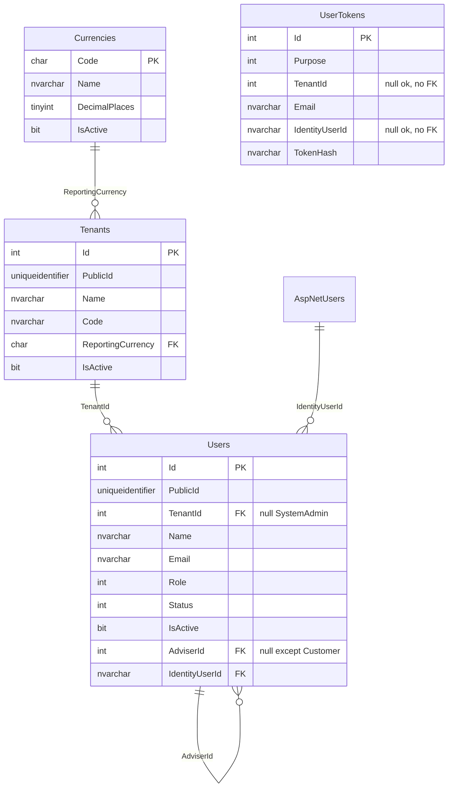

# Database design

This document owns **accepted tables, keys, indexes, constraints, and script order**. Scripts themselves live in `database/schema/`. Aggregates and invariants live in [domain-model.md](domain-model.md). Scope lives in [function-plan.md](function-plan.md). Field rules for Instruments live in [features/instruments.md](features/instruments.md). Field rules for Accounts live in [features/accounts.md](features/accounts.md). Field rules for Transactions live in [features/posting.md](features/posting.md). Boolean catalog flags are `IsActive` (naming amendment 2026-09-21, script `0011`).

**Product:** MyWealthV2.

Phase 1 scripts create the platform base. Phase 2 accepted and landed: `Instruments` (`0010`), `Accounts` (`0012`), posting (`0013_transactions.sql`, `79129eb`), holdings (`0014`, `0015`), the StockIn / StockOut type check (`0016`), and the Split / Bonus / Scrip type check (`0017`). Do **not** create a second Journal / CashLedger table. There is no custom `RefreshTokens` table; refresh lives in the OpenIddict token store. Demo rows are `TestSeed`, not the schema script.

**Amendment 2026-11-13 (tenant composite keys, accepted, landed):** [fixes/tenant-composite-keys.md](fixes/tenant-composite-keys.md) proposes scripts `0027_child_tenant_ids.sql` (`TenantId` on cash legs, security legs, `TransactionFxDetails`, `PortfolioLines`) and `0028_tenant_composite_keys.sql` (tenant composite FKs replace single-column FKs between tenant rows). §3, §6.6, §7, §9, §11.4 and §11.6 are updated when it is.

---

## 1. Platform

| Item | Choice |
| --- | --- |
| Engine | SQL Server (Aspire container `dbserver`) |
| Database | `MyWealthDbV2` |
| Access | EF Core 10 `UseSqlServer` |
| Schema truth | Versioned SQL under `database/schema/NNNN_description.sql` |
| Version ledger | `SchemaVersions(Id, ScriptName, AppliedAt)` |
| EF | Fluent mapping only. No EF migrations. Domain is not scaffolded from the database. |
| Naming | Pascal-case tables aligned with CLR. OpenIddict and Identity keep package names. |
| Context | `ApplicationDbContext` includes Identity **user** store + OpenIddict EF stores. Shared by `identity` and `webapi`. Do not use `IdentityRole`. |

Identity password seed goes through `UserManager`. OpenIddict clients may be inserted in SQL or in a startup seed.

---

## 2. Lifecycle

- Startup: schema applicator runs scripts not yet in `SchemaVersions`. The default path does **not** drop the database.
- Local reset: explicit drop → all scripts → seed (`UserManager` for passwords; OpenIddict clients in SQL or startup).
- CI: empty database applies the full script set; mapping and FK tests run against that database.

---

## 3. Conventions

| Topic | Convention |
| --- | --- |
| Primary key | `Id int` identity, clustered. Internal only. |
| Public id | `PublicId uniqueidentifier NOT NULL` unique on resources that appear in HTTP. Default `NEWSEQUENTIALID()` or an app-generated UUID. Not the PK. |
| Tables with PublicId | `Tenants`, `Users`, `Instruments`, `Accounts`, `Transactions` |
| Tables without PublicId | `Currencies` (natural key `Code`), `SchemaVersions`, `UserTokens` (caller holds the raw token; store stores the hash), Identity string keys, OpenIddict package keys |
| Tenancy | Business tables carry `TenantId`. Null only on `Users` for SystemAdmin. FK `Users.TenantId` → `Tenants`. Child tables of a tenant row carry `TenantId` too (`0027`). Every reference between two tenant rows is a tenant composite FK `(TenantId, XId)` → `(TenantId, Id)` (`0028`). See [fixes/tenant-composite-keys.md](fixes/tenant-composite-keys.md). |
| Instants | Every `datetimeoffset` column holds offset `+00:00` (UTC). The application converts before it writes; `0029` converted existing `Transactions.BookedAt` rows. Date-only columns (`AsOfDate`, `RateAsOfDate`) are `date`, UTC business dates. See [fixes/utc-instants.md](fixes/utc-instants.md). |
| Audit | `Created datetimeoffset`, `CreatedBy nvarchar(450)`, `LastModified datetimeoffset`, `LastModifiedBy nvarchar(450)` on `Tenants`, `Users`, `Instruments`, `Accounts`, `Transactions`, and `TransactionCashLegs`. `CreatedBy` stores the actor’s Identity id or a system name. |
| Concurrency | `RowVersion rowversion` on `Tenants`, `Users`, `Instruments`, `Accounts`, `Transactions`, and `TransactionCashLegs`. Transaction reverse does not require a client `rowVersion`. |
| Soft delete | Not used. |
| Status + IsActive | Rows that have a **status machine** store both: `Status` (source of truth) and `IsActive` (filter bit). `IsActive` is **derived**, never written by HTTP. Preferred SQL: persisted computed column from `Status`. Catalog rows (Tenant, Currency, Instrument) have `IsActive` only — no status machine. Never `IsEnabled`. |
| Money | No money columns in Phase 1. When the ledger exists: `decimal(18,4)` + `char(3)` FK to `Currencies`. |
| Strings | `nvarchar` + explicit max length. Email / Name / Code uniqueness is case-insensitive (`SQL_Latin1_General_CP1_CI_AS` or an equivalent CI collation). |
| Enums | `int` on `Users.Role`, `Users.Status`, `UserTokens.Purpose`, `Accounts.Type`, `Accounts.Status`, `Transactions.Type`. Also `Accounts.CustodyMode` (`0031`). |
| Delete | `RESTRICT` (no cascade) on Phase-1 business FKs. |

---

## 4. Phase 1 table list

```text
SchemaVersions
Currencies
AspNetUsers / AspNetUserClaims / AspNetUserLogins / AspNetUserTokens
  (Identity user store only — no AspNetRoles / AspNetUserRoles / AspNetRoleClaims)
OpenIddictApplications / OpenIddictAuthorizations / OpenIddictScopes / OpenIddictTokens
  (plus any extra table the chosen OpenIddict EF package maps, e.g. Sessions — follow the package)
Tenants
Users
UserTokens
Instruments                  -- Phase 2 instruments slice (`0010`)
```

Not in Phase 1:

- Custom `RefreshTokens`
- `AspNetRoles` and related role tables
- Ledger tables
- Empty placeholder Journal / CashLedger tables

---

## 5. Relationships



`AspNetUsers.TenantId` is a projection column. It is **not** drawn as an FK.

---

## 6. Columns

### 6.1 SchemaVersions

| Column | Type | Null | Notes |
| --- | --- | --- | --- |
| Id | int identity | no | PK |
| ScriptName | nvarchar(200) | no | Unique. File name of the applied script |
| AppliedAt | datetimeoffset | no | |

### 6.2 Currencies

Platform catalog. No audit, no `RowVersion`, no `PublicId`.

| Column | Type | Null | Notes |
| --- | --- | --- | --- |
| Code | char(3) | no | PK, ISO 4217 upper case |
| Name | nvarchar(100) | no | |
| DecimalPlaces | tinyint | no | ISO minor units for display / validation (JPY = 0, NZD = 2). Not the Phase-2 money-column scale (`decimal(18,4)`) |
| IsActive | bit | no | Default 1. **Platform** flag. Not per tenant. Disable does not rewrite `Tenants.ReportingCurrency`. Renamed from `IsEnabled` in `0011`. |

Seed: NZD, AUD, USD, EUR, GBP, JPY.

No `NumericCode` column (not required by the catalog ADR).

### 6.3 Identity user store (`AspNetUsers` + siblings)

Use the ASP.NET Identity schema for a **user-only** store (`IdentityUserContext<ApplicationUser>` / equivalent). Do not create role tables.

`ApplicationUser` maps to `AspNetUsers` and adds **one** business column:

| Column | Type | Null | Notes |
| --- | --- | --- | --- |
| TenantId | int | yes | Projection. Null for SystemAdmin. **No FK** to `Tenants` |

Do **not** add on `AspNetUsers`:

- `DomainUserId` — reverse pointer. Lookup is `Users.IdentityUserId` (unique). A reverse FK would cycle with `Users.IdentityUserId → AspNetUsers`.
- `Role` — truth is `Users.Role`. Login already loads `Users` for `Status` and tenant.
- `DisplayName` — truth is `Users.Name`.
- `AdviserId` / `Status` — Domain only.

Identity’s own `Email` column stays (framework). Turn **off** `RequireUniqueEmail`. Uniqueness is on `Users`.

`AspNetUserTokens` is Identity’s authenticator / provider token table. It is **not** `UserTokens`.

### 6.4 OpenIddict stores

Library-owned. Register with `UseEntityFrameworkCore()` and keep package column names.

Default tables:

| Table | Holds |
| --- | --- |
| `OpenIddictApplications` | Clients. Phase 1 row: public client `adviser-portal` |
| `OpenIddictAuthorizations` | Grants |
| `OpenIddictScopes` | `openid`, `profile`, `offline_access`, `api` |
| `OpenIddictTokens` | Authorization codes, access tokens, **refresh tokens** |

Do not add business columns to these tables. Do not replace `OpenIddictTokens` with a custom refresh table.

Client seed: SQL insert or startup seed. Both are allowed.

### 6.5 Tenants

| Column | Type | Null | Notes |
| --- | --- | --- | --- |
| Id | int identity | no | PK |
| PublicId | uniqueidentifier | no | Unique |
| Name | nvarchar(200) | no | Unique CI |
| Code | nvarchar(50) | no | Login code, unique CI, `[a-z0-9-]{2,50}` |
| ReportingCurrency | char(3) | no | Added by the currencies slice (`0009`). FK → `Currencies.Code`. No column default after apply |
| IsActive | bit | no | Default 1. Renamed from `IsEnabled` in `0011`. |
| RowVersion | rowversion | no | |
| Created / CreatedBy / LastModified / LastModifiedBy | audit | | |

Amendment 2026-11-18 (tenant custody modes, accepted, landed; [features/tenant-custody-modes.md](features/tenant-custody-modes.md) §6): script `0033_tenants_allowed_custody_modes.sql` adds `AllowsExternalAccounts bit NOT NULL` and `AllowsCustodialAccounts bit NOT NULL`, each with a named DEFAULT 1 that stays after the script, and `CK_Tenants_AllowedCustodyModes` (at least one is 1). Existing rows allow both. No index and no FK; no rule ties `Accounts.CustodyMode` to these columns, because narrowing the setting leaves existing accounts alone.

`Code` is treated as immutable after create by the Tenants slice (no update API). The column itself is ordinary.

identity-auth created `Tenants` **without** `ReportingCurrency`. Login only needs `Code` and the active flag. The currencies slice adds the catalog (`0008`) and then `Tenants.ReportingCurrency` (`0009`). `0011` renames `IsEnabled` → `IsActive` on `Currencies`, `Tenants`, and `Instruments`. Do not back-fill `0002` / `0005` / `0008` / `0010`.

### 6.6 Users

One table for all five roles. Credentials live on `AspNetUsers`.

| Column | Type | Null | Notes |
| --- | --- | --- | --- |
| Id | int identity | no | PK |
| PublicId | uniqueidentifier | no | Unique. JWT subject uses this |
| TenantId | int | yes | FK → `Tenants`. Null only for SystemAdmin and SimulatorOperator |
| Name | nvarchar(200) | no | |
| Email | nvarchar(256) | no | Unique inside a tenant; platform-level people (SystemAdmin, SimulatorOperator) unique among themselves (`UQ_Users_SystemAdmin_Email`, `WHERE TenantId IS NULL`) |
| Role | int | no | 0 SystemAdmin, 1 TenantAdmin, 2 Adviser, 3 Customer, 4 SimulatorOperator (`0036`) |
| Status | int | no | 0 PendingActivation, 1 Active, 2 Disabled. Source of truth |
| IsActive | bit | no | Derived. `1` iff `Status = Active`. `0011` persisted computed column (landed `bbd0f26`) |
| AdviserId | int | yes | Required for Customer. FK → `Users.Id` |
| IdentityUserId | nvarchar(450) | no | FK → `AspNetUsers.Id`. Unique. One-to-one |
| RowVersion | rowversion | no | |
| Created / CreatedBy / LastModified / LastModifiedBy | audit | | |

Uniqueness:

- Filtered unique `(TenantId, Email)` WHERE `TenantId IS NOT NULL`
- Unique `Email` WHERE `TenantId IS NULL` (SystemAdmin)
- Unique `IdentityUserId`
- Unique `PublicId`

CHECK (in SQL; tests cover the same):

- `Role = SystemAdmin` → `TenantId IS NULL AND AdviserId IS NULL`
- `Role IN (TenantAdmin, Adviser)` → `TenantId IS NOT NULL AND AdviserId IS NULL`
- `Role = Customer` → `TenantId IS NOT NULL AND AdviserId IS NOT NULL`

Same-tenant Adviser for a Customer is enforced by the tenant composite FK `(TenantId, AdviserId)` → `Users (TenantId, Id)` since `0028` ([fixes/tenant-composite-keys.md](fixes/tenant-composite-keys.md)). The application checks it too.

**One-way FK only:** `Users.IdentityUserId` → `AspNetUsers.Id`. No `AspNetUsers` → `Users` FK.

### 6.7 UserTokens

Reserved seam for invite / password-reset. Phase 1 **creates the table and has no write API**.

The token follows the **login principal** (`AspNetUsers.Id`), which is the usual shape for reset and matches Phase-1 create (Identity row already exists when a person is created). `IdentityUserId` is nullable so an email-first invite can be stored later without a migration that changes meaning.

| Column | Type | Null | Notes |
| --- | --- | --- | --- |
| Id | int identity | no | PK |
| Purpose | int | no | 0 Invite, 1 PasswordReset |
| TenantId | int | yes | Null for SystemAdmin reset. **No FK** |
| Email | nvarchar(256) | no | Denormalised; login key with tenant |
| IdentityUserId | nvarchar(450) | yes | Logical pointer to `AspNetUsers.Id`. **No FK** |
| TokenHash | nvarchar(128) | no | Store hash only. Unique |
| ExpiresAt | datetimeoffset | no | |
| ConsumedAt | datetimeoffset | yes | Null = unused |
| Created | datetimeoffset | no | |
| CreatedBy | nvarchar(450) | no | |

No `PublicId`, no `RowVersion`, no `LastModified`. Consume sets `ConsumedAt`.

Why no FK on `IdentityUserId` / `TenantId`: this is a seam table. A reverse or extra FK would couple token rows to Identity / tenant delete order before any write use case exists. Lookup is by hash (unique) or `(TenantId, Email)`.

---

## 7. Foreign keys and delete (Phase 1)

| Parent → child | Child column | On delete |
| --- | --- | --- |
| `Currencies` → `Tenants` | `ReportingCurrency` | RESTRICT (added in `0009`) |
| `Currencies` → `Instruments` | `QuoteCurrency` | RESTRICT (`0010`) |
| `Tenants` → `Instruments` | `TenantId` | RESTRICT |
| `Tenants` → `Users` | `TenantId` | RESTRICT |
| `Users` → `Users` | `TenantId`, `AdviserId` (tenant composite FK since `0028`) | RESTRICT |
| `AspNetUsers` → `Users` | `IdentityUserId` | RESTRICT |
| OpenIddict package FKs | as shipped | as shipped |

Since `0028`, every FK from one tenant row to another is a tenant composite FK. The full list is in [fixes/tenant-composite-keys.md](fixes/tenant-composite-keys.md). FKs to `Tenants`, `Currencies`, `Reports` and `AspNetUsers` stay single-column.
| Identity package FKs | as shipped | as shipped |

No FK:

- `AspNetUsers.TenantId`
- `UserTokens.TenantId`
- `UserTokens.IdentityUserId`

---

## 8. Indexes (Phase 1)

Beyond PK / unique constraints already listed:

- `Tenants(Code)`, `Tenants(Name)`, `Tenants(PublicId)`, `Tenants(IsActive)`
- `Users(TenantId, Email)`, `Users(TenantId, Role)`, `Users(AdviserId)`, `Users(PublicId)`, `Users(IdentityUserId)`, `Users(Status)`, `Users(TenantId, IsActive)`
- `UserTokens(TokenHash)`, `UserTokens(TenantId, Email)`, `UserTokens(IdentityUserId)`
- OpenIddict / Identity: keep package indexes
- `Instruments(PublicId)`, `Instruments(TenantId, Symbol)` CI unique, `Instruments(TenantId, IsActive)`
- `Accounts(PublicId)`, `Accounts(TenantId, CustomerId)`, `Accounts(TenantId, IsActive)`
- `Transactions(PublicId)`, `Transactions(TenantId, BookedAt)`, unique filtered `Transactions(ReversedByTransactionId)` where not null (`0018`)
- `TransactionCashLegs(AccountId)` INCLUDE `Amount`, unique `TransactionCashLegs(TransactionId, AccountId)` (`0024`)
- `TransactionSecurityLegs(AccountId, InstrumentId)` INCLUDE `Quantity, CostAmount`, unique `TransactionSecurityLegs(TransactionId, AccountId, InstrumentId)` (`0024`)

---

## 9. Script order

```text
0001_schema_versions.sql
0003_identity.sql            -- user store only; AspNetUsers.TenantId
0004_openiddict.sql          -- package tables
0005_tenants.sql             -- no ReportingCurrency
0006_users.sql               -- FKs to Tenants and AspNetUsers
0007_user_tokens.sql
0008_currencies.sql          -- platform catalog + seed
0009_tenants_reporting_currency.sql  -- ALTER Tenants.ReportingCurrency + FK
0010_instruments.sql         -- tenant catalog; no demo rows; shipped as IsEnabled
0011_rename_is_enabled_to_is_active.sql  -- catalog IsEnabled → IsActive; add Users.IsActive derived from Status
0012_accounts.sql            -- Account container; no demo rows; Status + derived IsActive
0013_transactions.sql        -- Transactions + TransactionCashLegs + IdempotencyRecords; no demo rows
0014_holdings.sql            -- TransactionSecurityLegs + Holdings
0015_transaction_type_opening_holdings.sql  -- CK_Transactions_Type widened to 0–9
0016_transaction_type_stock_in_out.sql      -- CK_Transactions_Type widened to 0–11
0017_transaction_type_split.sql             -- CK_Transactions_Type widened to 0–14
0018_transaction_reversed_by.sql            -- ALTER Transactions.ReversedByTransactionId + FK + unique filtered index
...
0024_leg_accounts.sql                       -- AccountId onto both leg tables (back-filled); drop Transactions.AccountId
0025_transaction_type_internal_transfer.sql -- CK_Transactions_Type widened to 0–15
0026_fx_conversions.sql                     -- CK_Transactions_Type widened to 0–16; TransactionFxDetails
0027_child_tenant_ids.sql                   -- TenantId onto leg tables, TransactionFxDetails, PortfolioLines (back-filled)
0028_tenant_composite_keys.sql              -- read-only pre-check; UNIQUE (TenantId, Id) on parents; tenant composite FKs replace single-column FKs
0029_transactions_booked_at_utc.sql         -- SWITCHOFFSET(BookedAt, '+00:00') on rows with a non-zero offset; instant unchanged
0030_trade_fees.sql                         -- TransactionCashLegs.Role; TradeFeeSchedules, TradeFeeBands, TransactionFeeDetails
0031_accounts_custody_mode.sql              -- Accounts.CustodyMode (existing rows 0 = External); CHECK 0–1; no default left
0032_remove_external_portfolio_assignments.sql -- data only; Active assignments on External accounts become Removed
0033_tenants_allowed_custody_modes.sql      -- Tenants.AllowsExternalAccounts / AllowsCustodialAccounts (DEFAULT 1 kept); CHECK at least one
0034_entered_trade_fees.sql                 -- drop CK_TransactionFeeDetails_BrokerageSchedule (a Brokerage fee may have no schedule)
0035_transaction_source.sql                 -- Transactions.SourceKind / SourcePublicId, back-filled; rebalance trades lose the rb: reference
0036_users_role_simulator_operator.sql      -- CK_Users_RoleShape lets Role 4 (SimulatorOperator) have no tenant and no adviser
0037_adjustments.sql                        -- CK_Transactions_Type 0–17 (Adjustment); TransactionAdjustmentDetails
0038_client_money_accounts.sql              -- ClientMoneyAccounts; one active per (TenantId, Currency); account number unique among active rows
0039_accounts_deposit_reference.sql         -- Accounts.DepositReference char(9), back-filled on Custodial rows; CHECK iff Custodial; unique filtered index
0040_client_money_accounts_bank_connection.sql -- ClientMoneyAccounts.BankConnection nvarchar(50), existing rows 'simulator'
0041_bank_statement_lines.sql               -- BankFeedCursors, BankStatementLines, TransactionBankReceiptDetails; CK_Transactions_SourceKind 0–3
0042_nominated_bank_accounts.sql            -- NominatedBankAccounts
0043_withdrawals.sql                        -- Withdrawals, OutgoingPayments, TransactionPaymentDetails; BankStatementLines payout columns; CK_Transactions_SourceKind 0–4
0044_bank_returns.sql                       -- OutgoingPayments.Kind and ReturnOfLineId; BankStatementLines statuses 0–6, reasons 0–11, methods 0–4, new Matched CHECK
0045_bank_reconciliations.sql               -- ALLOW_SNAPSHOT_ISOLATION; BankFeedCursors balance columns; BankReconciliations, BankReconciliationItems; CK_Reports_Scope adds Tenant; report bank-reconciliation
```

Do **not** back-fill `0002_currencies.sql`. identity-auth stopped at `0007`. Currencies scripts are forward-only `0008` / `0009`.

OpenIddict client / scope seed may sit in `0004` or in a later seed script / startup. Identity users are **not** inserted as raw password hashes in SQL.

---

## 10. Dual-write rules (not extra columns)

Creating any login-capable person, one transaction:

1. Insert `AspNetUsers` (`TenantId` projection set or null).
2. Insert `Users` with `IdentityUserId`.
3. Do not write a reverse key on Identity.

Login: resolve `Users` by `tenantCode + email` (SystemAdmin: email only), then verify the password on that `IdentityUserId`. Do not `FindByEmail` across tenants.

Name, Role, Status, AdviserId change only on `Users`. After password change, disable, or logout, revoke OpenIddict tokens for that subject — no extra business table.

---

## 11. Phase 2 tables

### 11.1 Instruments (accepted)

Script `0010_instruments.sql`. Columns and uniqueness: [features/instruments.md](features/instruments.md) §6. No ISIN / Exchange / Kind / price. No seed in the script — `TestSeed` only.

### 11.2 Naming amendment `IsEnabled` → `IsActive` + Users derived bit

Script `0011_rename_is_enabled_to_is_active.sql`. **Landed** in GitHub master `bbd0f26` (2026-09-20). Forward ALTER only. Do not edit `0005` / `0006` / `0008` / `0010`.

As shipped: `sp_rename` on `Currencies` / `Tenants` / `Instruments` columns, defaults, and indexes. `Users.IsActive` is a persisted computed column:

```sql
ALTER TABLE [Users] ADD [IsActive] AS ISNULL(CAST(CASE WHEN [Status] = 1 THEN 1 ELSE 0 END AS bit), 0) PERSISTED;
CREATE INDEX [IX_Users_TenantId_IsActive] ON [Users] ([TenantId], [IsActive]);
```

| Table | Change |
| --- | --- |
| `Currencies` | `IsEnabled` → `IsActive` |
| `Tenants` | `IsEnabled` → `IsActive`; index `Tenants(IsActive)` |
| `Instruments` | `IsEnabled` → `IsActive`; index `(TenantId, IsActive)` |
| `Users` | add `IsActive` derived from `Status`: `Active` → 1; `PendingActivation` and `Disabled` → 0. Prefer persisted computed column. Index `(TenantId, IsActive)` |

`IsActive` on Users is a filter projection. Login and disable still use `UserStatus`. HTTP disable / enable do not accept `isActive` in the body.

People list items may include `isActive` alongside `status` after `0011`. Filter stays `enabledOnly` (true = `IsActive = 1`).

### 11.3 Accounts (accepted)

Script `0012_accounts.sql`. Columns: [features/accounts.md](features/accounts.md) §6. `Status` Open=0 / Closed=1. `IsActive` persisted computed (`Status = 0` → 1). No balance or institution columns. Landed in the repo 2026-09-21. No seed in the script — `TestSeed` only.

Amendment 2026-11-17 (account custody mode, accepted; [features/account-custody-mode.md](features/account-custody-mode.md) §6): script `0031_accounts_custody_mode.sql` adds `CustodyMode int NOT NULL` to `Accounts` (0 External, 1 Custodial) with CHECK 0–1. The script adds the column with a default of 0 so that existing rows become External, then drops the default: an insert that does not name the column fails. No new index and no FK. Forward only; `0012` is not edited.

Amendment 2026-11-20 (client money accounts, accepted, landed; [features/client-money-accounts.md](features/client-money-accounts.md) §6.2): script `0039_accounts_deposit_reference.sql` adds `DepositReference char(9) NULL`, gives every existing Custodial row a reference in the same script (random, Luhn mod 32 check symbol, redrawn while used), then adds `CK_Accounts_DepositReference` (not null iff `CustodyMode = 1`) and unique `UX_Accounts_DepositReference` WHERE not null. Still no institution or account-number column on `Accounts`.

### 11.4 Transactions (accepted spec; landed)

Script `0013_transactions.sql`. Columns and rules: [features/posting.md](features/posting.md) §6. Header `Transactions` plus child `TransactionCashLegs` (one cash leg per header this increment). Idempotency table in the same script ([ADR 0015](adr/0015-idempotency-keys.md)). No `Accounts.Balance`. No seed in the script — `TestSeed` only.

Amendment 2026-11-10 (leg accounts, [features/leg-accounts.md](features/leg-accounts.md)): script `0024_leg_accounts.sql` adds `AccountId int NOT NULL` (FK → `Accounts` RESTRICT) to `TransactionCashLegs` and `TransactionSecurityLegs`, back-fills it from the header, then drops `Transactions.AccountId` with its FK and index. The header keeps `TenantId` and has no Account or Customer. Cash legs are unique per `(TransactionId, AccountId)`; security legs per `(TransactionId, AccountId, InstrumentId)`. Forward only; `0013` / `0014` are not edited.

Amendment 2026-10-13: script `0018_transaction_reversed_by.sql` adds nullable `ReversedByTransactionId` (FK → `Transactions` RESTRICT, unique filtered index `WHERE ReversedByTransactionId IS NOT NULL`). Forward ALTER only. Do not edit `0013`. The original stores `ReversedByTransactionId`; the Reversal stores `OriginalTransactionId`.

Amendment 2026-11-11 (FX conversions, [features/fx-conversions.md](features/fx-conversions.md) §6): script `0026_fx_conversions.sql` widens `CK_Transactions_Type` to 0–16 for `FxConversion` and adds `TransactionFxDetails`: `TransactionId int` (PK and FK → `Transactions` RESTRICT; at most one row per Transaction), `BaseCurrency char(3)` and `QuoteCurrency char(3)` (FK → `Currencies.Code` RESTRICT; CHECK `BaseCurrency <> QuoteCurrency`), `Rate decimal(18,8)` (CHECK `> 0`), `RateAsOfDate date`, `RateSource nvarchar(50)`. No `TenantId`, `PublicId` or `RowVersion`: the row is part of an immutable Transaction. Leg shape is enforced in Domain and Application.

Amendment 2026-11-13 (tenant composite keys, [fixes/tenant-composite-keys.md](fixes/tenant-composite-keys.md)): script `0027_child_tenant_ids.sql` adds `TenantId int NOT NULL` (FK → `Tenants` RESTRICT) to `TransactionCashLegs`, `TransactionSecurityLegs` and `TransactionFxDetails`, back-filled from the header. The header's `TenantId` is copied onto every leg and the FX detail by the Domain. Forward only; `0013`, `0014`, `0024` and `0026` are not edited.

Amendment 2026-11-15 (trade fees, [features/trade-fees.md](features/trade-fees.md) §6): script `0030_trade_fees.sql` adds `Role int NOT NULL` (default 0 = `Principal`, CHECK 0–1) to `TransactionCashLegs`, replaces the unique `(TransactionId, AccountId)` with a filtered unique index `WHERE Role = 0`, adds `UNIQUE (TenantId, Id)` on `TransactionCashLegs`, and adds `TransactionFeeDetails`: one row per `Fee` cash leg (PK and FK `CashLegId`), `TenantId`, `TransactionId`, `Kind int` (CHECK 0–0, `Brokerage`), `TradeFeeScheduleId` (FK RESTRICT; required for `Brokerage`), `BasisAmount` and `FeeAmount decimal(18,4)` (CHECK `> 0`), `Currency char(3)`; UQ `(TransactionId, Kind)`. No `PublicId` or `RowVersion`. Forward only.

Amendment 2026-11-18 (External caller numbers, accepted, landed; [features/external-caller-numbers.md](features/external-caller-numbers.md) §6): script `0034_entered_trade_fees.sql` drops `CK_TransactionFeeDetails_BrokerageSchedule`. A `Brokerage` row with `TradeFeeScheduleId` NULL is a fee the caller entered on an External account; every existing row keeps its schedule. No CHECK replaces it, because which fees may lack a schedule depends on the Account. `TransactionFxDetails` does not change; a rate the caller entered has `RateSource = 'Caller'`.

Amendment 2026-11-19 (transaction source, accepted; [features/transaction-source.md](features/transaction-source.md) §6): script `0035_transaction_source.sql` (not written yet) adds `SourceKind int NOT NULL` (CHECK 0–2: `Manual`, `Seed`, `Rebalance`; temporary default 0, dropped at the end) and `SourcePublicId uniqueidentifier NULL` (no FK, no index) to `Transactions`, with a CHECK that `Manual` and `Seed` have no id and `Rebalance` has one. Back-fill: rebalance trades (reference `rb:{32 hex}:{B|S}:{digits}`, `Buy` / `Sell` only, else the script stops) become `Rebalance` with the parsed handle and a null `Reference`; rows with one of the listed seed references become `Seed`; the rest `Manual`. Forward only.

Amendment 2026-11-19 (adjustments, accepted; [features/adjustments.md](features/adjustments.md) §6): script `0037_adjustments.sql` widens `CK_Transactions_Type` to 0–17 for `Adjustment` and adds `TransactionAdjustmentDetails`: `TransactionId int` (PK; at most one row per Transaction), `TenantId int` (FK → `Tenants` RESTRICT; index), `Reason int` (CHECK 0–3: `EntryError`, `CorporateAction`, `ReconciliationBreak`, `Other`); FK `(TenantId, TransactionId)` → `Transactions (TenantId, Id)` RESTRICT, as `TransactionFxDetails`. No `PublicId` or `RowVersion`: the row is part of an immutable Transaction. One row on every `Adjustment` and on its Reversal, held by the Domain. No back-fill. Forward only.

Amendment 2026-11-20 (bank feed and deposit matching, accepted; [features/deposit-matching.md](features/deposit-matching.md) §6.2): script `0041_bank_statement_lines.sql` widens `CK_Transactions_SourceKind` to 0–3 (`BankFeed`) and requires a `SourcePublicId` for kinds 2 and 3. It adds `TransactionBankReceiptDetails`: `TransactionId int` (PK), `TenantId int` (FK → `Tenants`; index), FK `(TenantId, TransactionId)` → `Transactions (TenantId, Id)` RESTRICT, as `TransactionFxDetails`, `ValueDate date`, `Reference nvarchar(140) NULL`, `PayerName nvarchar(140) NULL`, `PayerAccount nvarchar(40) NULL` (masked). One row on every deposit and on its Reversal, held by the Domain. No back-fill. Forward only.

Amendment 2026-11-20 (withdrawals, accepted, landed; [features/withdrawals.md](features/withdrawals.md) §6.2): script `0043_withdrawals.sql` widens `CK_Transactions_SourceKind` to 0–4 (`Payment`) and requires a `SourcePublicId` for kinds 2, 3 and 4. It adds `TransactionPaymentDetails`: `TransactionId int` (PK), `TenantId int NOT NULL`, FK `(TenantId, TransactionId)` → `Transactions (TenantId, Id)` RESTRICT, as `TransactionBankReceiptDetails`; `ValueDate date NOT NULL`, `Reference nvarchar(18) NULL`, `PayeeName nvarchar(140) NULL`, `PayeeAccount nvarchar(40) NULL` (masked). 0..1 per Transaction, on a payout and its Reversal only. No back-fill.

### 11.5 Holdings (accepted, landed)

Scripts `0014_holdings.sql` and `0015_transaction_type_opening_holdings.sql`. Columns: [features/holdings.md](features/holdings.md) §6. `0016_transaction_type_stock_in_out.sql` widens `CK_Transactions_Type` to 0–11 for `StockIn` (10) and `StockOut` (11). `0017_transaction_type_split.sql` widens that check to 0–14 for `Split` (12), `Bonus` (13), and `Scrip` (14). No new column. No seed in the scripts — `TestSeed` only.

---


### 11.6 Portfolios (accepted)

Feature spec: [features/portfolios.md](features/portfolios.md) (accepted 2026-11-02).

Script `0023_portfolios.sql`:

- `Portfolios` — TenantId, Name, BaseCurrency (immutable), IsActive, drift / minimum-trade / cash-residual settings, PublicId, audit, RowVersion
- `PortfolioLines` — PortfolioId, InstrumentId, TargetWeight (decimal 2 places), SortOrder. `TenantId` (copied from the Portfolio) since `0027_child_tenant_ids.sql`, [fixes/tenant-composite-keys.md](fixes/tenant-composite-keys.md).
- `AccountPortfolioAssignments` — TenantId, AccountId, PortfolioId, Status (Active/Removed), AssignedAt, AssignedBy, LastRebalanceAt, LastRebalanceStatus, LastRebalanceMessage; filtered unique on AccountId where Status = Active

No seed in the script. Development / TestAppHost `TestSeed` adds one demo portfolio and one assignment, and does not post rebalance trades.

Amendment 2026-11-17 (custody modes, accepted, landed; [features/custody-modes.md](features/custody-modes.md) §6): script `0032_remove_external_portfolio_assignments.sql` changes data only. Every `AccountPortfolioAssignments` row with `Status = 0` (Active) whose Account has `CustodyMode = 0` (External) gets `Status = 1` (Removed), with `LastModified` and `LastModifiedBy` filled. No table, column, index or constraint changes; holdings and transactions are not touched. One `UPDATE`, safe to run again. After it, an Active assignment exists only on a Custodial account; that is kept by Application, not by a constraint. `TestSeed` then puts the demo assignment on a Custodial demo account.

### 11.7 Trade fee schedules (accepted)

Feature spec: [features/trade-fees.md](features/trade-fees.md) (accepted 2026-11-15). Script `0030_trade_fees.sql`:

- `TradeFeeSchedules` — TenantId, PublicId, QuoteCurrency (FK `Currencies`), EffectiveFrom (`date`), MinimumAmount, CapAmount (nullable), audit, RowVersion. UQ `(TenantId, QuoteCurrency, EffectiveFrom)`. CHECK minimum `≥ 0`; cap null or `> 0` and `≥` minimum.
- `TradeFeeBands` — TenantId, TradeFeeScheduleId (tenant composite FK), FromAmount, RatePercent `decimal(7,4)`. UQ `(TradeFeeScheduleId, FromAmount)`. CHECK from `≥ 0`, rate 0–100.

No seed in the script. Development / TestAppHost `TestSeed` adds one schedule.

### 11.8 Client money accounts (accepted, landed)

Feature spec: [features/client-money-accounts.md](features/client-money-accounts.md) (accepted, landed 2026-11-20). Script `0038_client_money_accounts.sql`:

- `ClientMoneyAccounts` — TenantId (FK `Tenants`), PublicId (unique), Currency (FK `Currencies`), BankName `nvarchar(100)`, AccountName `nvarchar(140)`, AccountNumber `nvarchar(34)`, IsActive, audit, RowVersion. Unique `(TenantId, Currency)` WHERE `IsActive = 1`; unique `(AccountNumber)` WHERE `IsActive = 1`; index `(TenantId)`. No column changes after insert except `IsActive`.

No seed in the script. Development / TestAppHost `TestSeed` adds a USD and an NZD row per firm.

Amendment 2026-11-20 (bank feed and deposit matching, accepted; [features/deposit-matching.md](features/deposit-matching.md) §6.1): script `0040_client_money_accounts_bank_connection.sql` adds `BankConnection nvarchar(50) NOT NULL`, the name of a bank connection in configuration, `'simulator'` on every existing row through a temporary default that the script drops. It never changes after insert.

### 11.9 Bank statement lines (accepted)

Feature spec: [features/deposit-matching.md](features/deposit-matching.md) (accepted 2026-11-20, landed 2026-11-20) §6.2. Script `0041_bank_statement_lines.sql`:

- `BankFeedCursors` — PK and FK `ClientMoneyAccountId` → `ClientMoneyAccounts` RESTRICT; `Cursor nvarchar(500) NULL` (opaque); `LastSucceededAt`, `LastFailedAt`; `LastFailure int NULL` (CHECK 0–6); RowVersion. One row per client money account, written by the `worker` only.
- `BankStatementLines` — the bank's inbound records ([ADR 0021](adr/0021-outside-parties-behind-ports.md) rule 7). TenantId, PublicId (unique), ClientMoneyAccountId, `Connection nvarchar(50)`, `OutsideId nvarchar(100)`; unique `(Connection, OutsideId)`. ValueDate, Direction (CHECK 0–1), `Amount decimal(18,4)` (CHECK `> 0`), Currency (FK), PayerName, `PayerAccountMasked nvarchar(40)`, ReferenceText, ReceivedAt. Status (CHECK 0–4), UnmatchedReason (CHECK 0–6), the match columns (account, transaction, method, time; all set iff `Status = 1`, CHECK), the last action columns (action, note, person, time), audit, RowVersion. FKs RESTRICT. Indexes `(TenantId, Status, ReceivedAt DESC)` and `(Connection, Status, ReceivedAt)`. The economic columns never change after insert.
- `TransactionBankReceiptDetails` — §11.4.

Unmatched receipts are not in any ledger table (roadmap D7). No seed.

Amendment 2026-11-20 (withdrawals, accepted, landed; [features/withdrawals.md](features/withdrawals.md) §6.2): script `0043_withdrawals.sql` adds to `BankStatementLines` `EndToEndId nvarchar(100) NULL`, `ReturnOfOutsideId nvarchar(100) NULL`, `ReturnReason nvarchar(140) NULL`, `RelatedLineId int NULL` (FK `(TenantId, RelatedLineId)` → `BankStatementLines` RESTRICT) and `WithdrawalId int NULL` (FK `(TenantId, WithdrawalId)` → `Withdrawals` RESTRICT); widens the `UnmatchedReason` CHECK to 0–7 and the `MatchMethod` CHECK to 0–3; filtered indexes on `(Connection, EndToEndId)` and `(Connection, ReturnOfOutsideId)`. The Matched CHECK is unchanged. Existing lines keep null in the new columns.

Amendment 2026-11-21 (bank returns, accepted; [features/bank-returns.md](features/bank-returns.md) §6.1): script `0044_bank_returns.sql` widens the `Status` CHECK of `BankStatementLines` to 0–6, `UnmatchedReason` to 0–11 and `MatchMethod` to 0–4, and replaces the Matched CHECK: `Status = 1` needs `MatchMethod` and `MatchedAt`, and either both `MatchedAccountId` and `MatchedTransactionId`, or both null with `RelatedLineId` set; any other status has no match columns. No back-fill.

Amendment 2026-11-21 (bank reconciliation, accepted; [features/bank-reconciliation.md](features/bank-reconciliation.md) §6.1): script `0045_bank_reconciliations.sql` adds to `BankFeedCursors` `Balance decimal(18,4) NULL`, `BalanceAt datetimeoffset NULL` (both null or both set, `CK_BankFeedCursors_Balance`) and `OpeningBalance decimal(18,4) NULL` (set whenever `Balance` is, `CK_BankFeedCursors_Opening`). No back-fill: the first page after the script sets them.

### 11.10 Nominated bank accounts (accepted)

Feature spec: [features/withdrawals.md](features/withdrawals.md) (accepted 2026-11-20, landed 2026-11-21) §6.1. Script `0042_nominated_bank_accounts.sql`:

- `NominatedBankAccounts` — TenantId, PublicId (unique), `CustomerId` (FK `(TenantId, CustomerId)` → `Users`), `Currency char(3)` (FK → `Currencies`), `BankName nvarchar(100)`, `AccountName nvarchar(140)`, `AccountNumber nvarchar(34)` (full, as entered), `AccountNumberKey nvarchar(34)` (upper case, no spaces or hyphens), `Status int` (CHECK 0–3); added by and at; reviewed by, at and note (set together, CHECK by status); removed by, at and note (all set iff `Status = 3`); audit; RowVersion. Every user FK is a tenant composite key, RESTRICT. Unique filtered `UX_NominatedBankAccounts_Customer_Number` on `(TenantId, CustomerId, AccountNumberKey, Currency) WHERE Status IN (0, 1)`. No seed in the script.

### 11.11 Withdrawals and outgoing payments (accepted)

Feature spec: [features/withdrawals.md](features/withdrawals.md) (accepted 2026-11-20, landed 2026-11-21) §6.2. Script `0043_withdrawals.sql`:

- `Withdrawals` — TenantId, PublicId (unique), AccountId, NominatedBankAccountId, `Amount decimal(18,4)` (CHECK `> 0`), Currency, `Reference nvarchar(18)`, `Memo nvarchar(200) NULL`, `Status int` (CHECK 0–7), requested by and at, decision (action CHECK 0–2, by, at, note; all null or all but the note set), `PayoutTransactionId` (set iff `Status IN (3, 7)`), `ReturnTransactionId` (set iff `Status = 7`), `FailureReason` (set iff `Status = 6`), `ReturnReason nvarchar(140) NULL`, audit, RowVersion. Tenant composite FKs, RESTRICT. Index `(TenantId, AccountId, Status)` for reserved cash.
- `OutgoingPayments` — TenantId, PublicId (unique), ClientMoneyAccountId, `Connection nvarchar(50)`, `InstructionPublicId uniqueidentifier` (unique), WithdrawalId, Amount, Currency, `Reference nvarchar(18) NULL`, `Status int` (CHECK 0–5), `Attempts int`, `LastAttemptAt`, `LastFailure int NULL` (CHECK 0–5), `BankPaymentId nvarchar(100) NULL`, `AcceptedAt`, `RejectReason int NULL` (CHECK 0–3), audit, RowVersion. Index `(Connection, Status, Id)` for the send step.
- `TransactionPaymentDetails` — §11.4. The `BankStatementLines` columns — §11.9.

Reserved cash is computed from `Withdrawals`, not stored. No seed in the script.

Amendment 2026-11-21 (bank returns, accepted; [features/bank-returns.md](features/bank-returns.md) §6.1): script `0044_bank_returns.sql` adds to `OutgoingPayments` `Kind int NOT NULL` (CHECK 0–1; existing rows get 0 through a temporary default, then the default is dropped) and `ReturnOfLineId int NULL` (FK `(TenantId, ReturnOfLineId)` → `BankStatementLines` RESTRICT); `WithdrawalId` becomes NULL; CHECK exactly one of `WithdrawalId` and `ReturnOfLineId` by kind; the `RejectReason` CHECK widens to 0–4; unique filtered `UX_OutgoingPayments_ReturnOfLineId_Open` on `ReturnOfLineId WHERE Kind = 1 AND Status IN (0, 1)`.

### 11.12 Bank reconciliations (accepted)

Feature spec: [features/bank-reconciliation.md](features/bank-reconciliation.md) (accepted 2026-11-21) §6.1. Script `0045_bank_reconciliations.sql`:

- The database allows `SNAPSHOT` isolation (`ALTER DATABASE CURRENT SET ALLOW_SNAPSHOT_ISOLATION ON`); only the reconciliation read uses it. Existing reads keep `READ COMMITTED`.
- `BankReconciliations` — one stored run: TenantId, PublicId (unique), ClientMoneyAccountId (FK RESTRICT), Currency, `Trigger int` (CHECK 0–1), RanAt, `RanByUserId` (FK `(TenantId, RanByUserId)` → `Users`; null iff `Trigger = 0`), `Status int` (CHECK 0–2), `BankBalance`, `BalanceAt`, `OpeningBalance`, `StatementLinesTotal`, `Difference` (all null iff `Status = 2`), `CustodialCash`, counts and totals per class, `ReservedCash`, payments in flight, feed status; audit, written once. Unique `(TenantId, Id)`. Indexes `(TenantId, ClientMoneyAccountId, RanAt DESC)` and `(TenantId, RanAt DESC)`.
- `BankReconciliationItems` — `(TenantId, ReconciliationId)` FK → `BankReconciliations`, `Position` (unique with the run), `Kind int` (CHECK 0–11), `Class int` (CHECK 0–2), signed `Amount decimal(18,4)`, `Count`; the line snapshot (`StatementLineId` FK `(TenantId, StatementLineId)` → `BankStatementLines`, set iff a line kind; `Direction`, `LineStatus`, `UnmatchedReason`, `ValueDate`, `Note`); `OtherClientMoneyAccountId` (FK, set iff `Kind = 11`).

No back-fill. A run and its items are never updated or deleted; no purge.

## 12. Still not a schema decision

These stay open in the function plan and do not change tables:

- Default list page size

Locked in identity-auth (do not reopen here): `AspNetUsers.UserName` = Domain `Users.PublicId` string; hosted login is Razor Pages at `/login`; login failures are uniform; access 15 minutes; refresh 14 days absolute.

---

## 13. Change log

| Date | Change |
| --- | --- |
| 2026-09-11 | First English draft. Align with function-plan: OpenIddict stores in, custom RefreshTokens out; AspNetUsers.TenantId column no FK; no DomainUserId / Role / DisplayName on Identity; UserTokens seam keyed by hash + optional IdentityUserId, no FK; no ledger tables |
| 2026-09-12 | identity-auth lands Tenants without ReportingCurrency and does not create Currencies. Catalog + ReportingCurrency FK are the currencies slice (`0008+`). |
| 2026-09-13 | Currencies spec: `0008` + `0009`. `IsEnabled` is platform-wide. `DecimalPlaces` is minor units, not `decimal(18,4)` scale. |
| 2026-09-20 | `Instruments` (`0010`). Tenant catalog. Unique `(TenantId, Symbol)`. FK QuoteCurrency → Currencies. Landed in repo `9ea2f2a`. |
| 2026-09-21 | Boolean flags unified to `IsActive`. Script `0011` landed `bbd0f26`. Accounts spec accepted. |
| 2026-09-21 | `Accounts` (`0012`). Container under a Customer. Derived `IsActive`. Landed in the repo. |
| 2026-09-25 | `Transactions` + `TransactionCashLegs` + idempotency table (`0013`). Spec accepted and landed (`79129eb`). |
| 2026-10-11 | Holdings (`0014`, `0015`) and `CK_Transactions_Type` widened to 0–11 (`0016`) for StockIn / StockOut. |
| 2026-11-02 | Portfolios accepted. Script `0023_portfolios.sql`: `Portfolios`, `PortfolioLines`, `AccountPortfolioAssignments`. |
| 2026-10-12 | `CK_Transactions_Type` widened to 0–14 (`0017`) for Split / Bonus / Scrip. No new table. |
| 2026-10-13 | `Transactions.ReversedByTransactionId` (`0018`). Bidirectional reverse link. Forward ALTER only. |
| 2026-11-10 | Leg accounts (`0024`): `AccountId` moves from `Transactions` onto both leg tables, back-filled. Header index becomes `(TenantId, BookedAt)`. |
| 2026-11-11 | FX conversions (`0026`): `CK_Transactions_Type` widened to 0–16 for `FxConversion`. New table `TransactionFxDetails` (0..1 per Transaction; copied to a Reversal) ([features/fx-conversions.md](features/fx-conversions.md) §6). |
| 2026-11-13 | Child tenant ids (`0027`): `TenantId` on `TransactionCashLegs`, `TransactionSecurityLegs`, `TransactionFxDetails` and `PortfolioLines`, back-filled from the parent. The tenant query filter now covers them ([fixes/tenant-composite-keys.md](fixes/tenant-composite-keys.md) B1). |
| 2026-11-13 | Tenant composite keys (`0028`): `UNIQUE (TenantId, Id)` on `Users`, `Accounts`, `Instruments`, `Transactions`, `Portfolios`, `ReportSchedules`. 18 single-column FKs between tenant rows replaced by `(TenantId, XId)` → `(TenantId, Id)`. The script stops before any change if a reference crosses tenants ([fixes/tenant-composite-keys.md](fixes/tenant-composite-keys.md) B2). |
| 2026-11-14 | UTC instants (`0029`): every `datetimeoffset` holds `+00:00`. Existing `Transactions.BookedAt` rows with another offset are switched to UTC, instant unchanged ([fixes/utc-instants.md](fixes/utc-instants.md) B5). |
| 2026-11-10 | Internal transfers (`0025`): `CK_Transactions_Type` widened to 0–15 for `InternalTransfer`. No new table or index. The two-leg shape is enforced in Domain and Application ([features/internal-transfers.md](features/internal-transfers.md) §6). |
| 2026-11-15 | Trade fees (`0030`): `TransactionCashLegs.Role`, filtered unique `(TransactionId, AccountId) WHERE Role = 0`, `TradeFeeSchedules`, `TradeFeeBands`, `TransactionFeeDetails` ([features/trade-fees.md](features/trade-fees.md) §6). |
| 2026-11-17 | Account custody mode in `review` (`0031`, not written yet): `Accounts.CustodyMode int NOT NULL`, existing rows back-filled to 0, CHECK 0–1, no default left ([features/account-custody-mode.md](features/account-custody-mode.md) §6). |
| 2026-11-17 | Account custody mode accepted. `0031` is a build contract. |
| 2026-11-17 | Account custody mode landed: `0031_accounts_custody_mode.sql` written and applied. |
| 2026-11-17 | Custody modes in `review` (`0032`, not written yet): data-only script that sets Active portfolio assignments on External accounts to Removed. No schema change ([features/custody-modes.md](features/custody-modes.md) §6). |
| 2026-11-17 | Custody modes accepted. `0032` is a build contract. |
| 2026-11-17 | Custody modes landed: `0032_remove_external_portfolio_assignments.sql` written and applied. |
| 2026-11-18 | Tenant custody modes in `review` (`0033`, not written yet): two bit columns on `Tenants` for the allowed custody modes, existing rows allow both, defaults kept, CHECK at least one ([features/tenant-custody-modes.md](features/tenant-custody-modes.md) §6). |
| 2026-11-18 | Tenant custody modes accepted. `0033` is a build contract. |
| 2026-11-18 | Tenant custody modes landed: `0033_tenants_allowed_custody_modes.sql` written and applied. |
| 2026-11-18 | External caller numbers in `review` (`0034`, not written yet): drop `CK_TransactionFeeDetails_BrokerageSchedule` so a caller-entered fee needs no schedule ([features/external-caller-numbers.md](features/external-caller-numbers.md) §6). |
| 2026-11-18 | External caller numbers accepted. `0034` is a build contract. |
| 2026-11-18 | External caller numbers landed: `0034_entered_trade_fees.sql` written and applied. |
| 2026-11-19 | Transaction source in `review` (`0035`, not written yet): `Transactions.SourceKind` and `SourcePublicId`, back-filled; existing rebalance trades lose their `rb:` reference ([features/transaction-source.md](features/transaction-source.md) §6). |
| 2026-11-19 | Transaction source accepted. `0035` is a build contract. |
| 2026-11-19 | Simulator accepted ([features/simulator.md](features/simulator.md) §6). `0036` widens `CK_Users_RoleShape` for Role 4; no data change. Second database `MyWealthSimulatorDb` with its own scripts (§15). |
| 2026-11-19 | ADR 0008 amendment: `worker` also runs the applicator at start-up (matches the code since `26fb489`). |
| 2026-11-19 | Adjustments accepted and landed (`0037`): `CK_Transactions_Type` widened to 0–17; new `TransactionAdjustmentDetails` (reason per adjustment and its Reversal). `0037` is a build contract. |
| 2026-11-20 | Client money accounts accepted (`0038`, `0039`, not written yet): `ClientMoneyAccounts` (§11.8) and `Accounts.DepositReference` with its back-fill (§11.3). Both are build contracts. |
| 2026-11-20 | Client money accounts landed: `0038` and `0039` written. The back-fill and the C# `DepositReference.IsValid` agree (integration test). |
| 2026-11-20 | Bank feed and deposit matching accepted (`0040`, `0041`, not written yet): `ClientMoneyAccounts.BankConnection` (§11.8), `BankFeedCursors` and `BankStatementLines` (§11.9), `TransactionBankReceiptDetails` and source kind 3 (§11.4). Simulator script `0003_bank.sql` (§15). All are build contracts. |
| 2026-11-20 | Bank feed and deposit matching landed: `0040`, `0041` and simulator `0003` written. `TransactionBankReceiptDetails` has a `TenantId` and the tenant composite key, and the match and last-action keys of `BankStatementLines` are tenant composite keys (§11.4, §11.9). |
| 2026-11-20 | Withdrawals accepted (`0042`, `0043`, not written yet): `NominatedBankAccounts` (§11.10), `Withdrawals` and `OutgoingPayments` (§11.11), `TransactionPaymentDetails` and source kind 4 (§11.4), the payout columns of `BankStatementLines` (§11.9). Simulator script `0004_bank_payments.sql` (§15). All are build contracts. |
| 2026-11-21 | Withdrawals landed: `0042`, `0043` and simulator `0004` written. `NominatedBankAccounts`, `Withdrawals` and `BankStatementLines` gained a unique `(TenantId, Id)` key for the composite FKs; the statements on new columns run inside `EXEC` (§11.4, §11.9–§11.11, §15). |
| 2026-11-21 | Bank returns accepted (`0044`, not written yet): `OutgoingPayments` kind and returned line (§11.11), the widened checks and the new Matched CHECK of `BankStatementLines` (§11.9). Simulator script `0005_bank_returns.sql` (§15). All are build contracts. |
| 2026-11-21 | Bank returns landed: `0044` and simulator `0005` written. `0044` drops and adds again the `WithdrawalId` FK and index around the `ALTER COLUMN`; simulator `BankPayments` also keeps `ReturnOf`, the outside id as sent (§11.11, §15). |
| 2026-11-21 | Bank reconciliation accepted (`0045`, not written yet): `BankReconciliations` and `BankReconciliationItems` (§11.12), the balance columns of `BankFeedCursors` (§11.9), snapshot isolation, report scope `Tenant` and the third catalog row (§14). Simulator script `0006_bank_balances.sql` (§15). §9 lists `0044` and `0045`. All are build contracts. |

---

## 14. Phase 3 tables — Reports (accepted)

Script `0019_reports.sql`. Field rules: [features/reports.md](features/reports.md) §6.

| Table | Notes |
| --- | --- |
| `Reports` | Platform catalog. No TenantId and no audit. `PublicId` unique, `Code` nvarchar(64) unique, `Name` nvarchar(200), `Function` nvarchar(500), `Scope` nvarchar(20) check `Customer` \| `Book` \| `Tenant` (`Tenant` from `0045`), `AllowedTriggers` nvarchar(200) JSON array, `IsActive` bit default 1. Seed `customer-transactions` (`8c4e1a20-7b3d-4f6a-9e15-2d0c6b8a4f11`) and `adviser-balances` (`5a9d3c70-2e84-4b1f-8c36-7f1e0a9d5b22`), both `["manual","scheduled"]`. |
| `TenantReports` | `TenantId` + `ReportId` unique. Presence = configured for that tenant. No auto-grant. No audit. Development / TestAppHost `TestSeed` grants both seeded reports to the demo tenant. Idempotent on that pair. |
| `ReportSchedules` | `PublicId` unique, `ReportId`, `TenantId`, `ParametersJson` nvarchar(max), `IsActive`, `Cron` nvarchar(100). Index `(TenantId, ReportId)`. RowVersion + audit. |
| `ReportExecutions` | `PublicId` unique, `ReportId`, `ScheduleId` nullable, `TenantId`, `TriggerKind` nvarchar(20) check `Manual` \| `Scheduled` \| `Event`, `Status` nvarchar(20) check `Queued` \| `Running` \| `Succeeded` \| `Failed`, `ParametersJson` nvarchar(max), `AsOf` nullable, `TriggeredByUserId` nullable, `ResultStorageKey` nvarchar(500) nullable, `ErrorMessage` nvarchar(2000) nullable. Index `(TenantId, ReportId)`. RowVersion + audit. FKs do not cascade. |

`ResultStorageKey` is the relative file key `{tenantPublicId}/{executionPublicId}.pdf`. PDF bytes live on the Aspire-mounted volume shared by `worker` and `webapi`, not in SQL.

Hangfire tables are created by Hangfire in schema `Hangfire` (documented exception to script-only schema).

### 14.1 Outbox (accepted — ADR 0018, features/outbox.md)

Script `0020_outbox.sql` (not yet landed). Table `OutboxMessages` in the application schema (not `Hangfire`).

| Column | Notes |
| --- | --- |
| `Id` | uniqueidentifier |
| `Type` | `nvarchar(200)`. Event class full name |
| `Payload` | `nvarchar(max)`. Serialised domain event |
| `OccurredAt` | datetimeoffset |
| `TenantId` | nullable |
| `Status` | `nvarchar(20)` check `Pending` \| `Processing` \| `Processed` \| `Failed` \| `DeadLettered` |
| `ProcessedAt` | nullable |
| `Error` | `nvarchar(2000)` nullable |
| `RetryCount` | int |
| audit + `RowVersion` | `RowVersion` used when claiming |

Index `(Status, OccurredAt)`. No FK. No `JobId`, `CorrelationId`, or `AggregateId`.

### 14.2 FX Rates (accepted — ADR 0019, features/fx-rates.md)

Script `0021_fx_rates.sql`. Table `FxRates` in the application schema. Platform data, no `TenantId`.

| Column | Notes |
| --- | --- |
| `BaseCurrency` | `char(3)` FK → `Currencies.Code` (RESTRICT) |
| `QuoteCurrency` | `char(3)` FK → `Currencies.Code` (RESTRICT) |
| `Rate` | `decimal(18,8)`. How many QuoteCurrency per 1 BaseCurrency |
| `AsOfDate` | `date`. Date the source published |
| `Source` | `nvarchar(50)`. `'Frankfurter'` |
| `FetchedAt` | `datetimeoffset`. When the job wrote the row |

PK `(BaseCurrency, QuoteCurrency, AsOfDate)`. Index on `FetchedAt`. No PublicId. No RowVersion. No audit columns beyond `FetchedAt`. No seed in the script — the hourly job populates it. Development / TestAppHost uses `TestSeed` with round, obviously-fake rates.

Hourly Hangfire job (UTC) fetches actual directed pairs for active catalog currencies when today's UTC date is not already stored for every pair. One Frankfurter call per base (`/v2/rates?base=X&quotes=...`). On the same `AsOfDate`, update `Rate` and `FetchedAt`. Fetch failure logs and leaves previous rows. `IFxRate` reads the table: same currency = 1; no row for the pair → `FxRateNotFoundException` (carries base, quote, as-of).

### 14.3 Instrument Prices (accepted — features/instrument-prices.md)

Script `0022_instrument_prices.sql`. Table `InstrumentPrices` in the application schema. Platform data, no `TenantId`.

| Column | Notes |
| --- | --- |
| `InstrumentId` | `int` FK → `Instruments.Id` (RESTRICT) |
| `Price` | `decimal(18,8)`. In the instrument’s QuoteCurrency |
| `AsOfDate` | `date`. Date the source published |
| `Source` | `nvarchar(50)`. `'EODHD'` |
| `FetchedAt` | `datetimeoffset`. When the job wrote the row |

PK `(InstrumentId, AsOfDate)`. Index on `FetchedAt`. No PublicId. No RowVersion. No audit columns beyond `FetchedAt`. No seed in the script — the daily job populates it. Development / TestAppHost uses `TestSeed` with round, obviously-fake prices (several instruments per seed currency).

Daily Hangfire job at 12:00 UTC fetches EOD prices from EODHD for instruments that are active in at least one tenant when today's UTC date is not already stored for every active instrument. Same symbol + quote currency across tenants is fetched once and written to every matching `InstrumentId`. On the same `AsOfDate`, update `Price` and `FetchedAt`. Fetch failure logs and leaves previous rows. `IMarketData` reads the table: latest row with `AsOfDate` ≤ requested date (or today if omitted); no row → empty (not 0).

### Change log

| Date | Change |
| --- | --- |
| 2026-10-14 | Reports tables accepted (`0019_reports.sql`). |
| 2026-10-15 | `0019_reports.sql` landed. AllowedTriggers is a JSON array. No grant rows in the script. |
| 2026-10-16 | Demo tenant grants for both seeded reports live in `TestSeed`, not in `0019_reports.sql`. |
| 2026-11-01 | Proposed `OutboxMessages` columns recorded (ADR 0018). No script yet. |
| 2026-11-01 | Outbox feature accepted. Script name `0020_outbox.sql`. Lengths and index locked. |
| 2026-11-02 | FX rates accepted. Script name `0021_fx_rates.sql`. Table `FxRates`. ADR 0019. |
| 2026-11-02 | `0021_fx_rates.sql` landed. No seed rows in the script. |
| 2026-11-02 | Instrument prices accepted. Script name `0022_instrument_prices.sql`. Table `InstrumentPrices`. Source Twelve Data. |
| 2026-11-08 | Source switched to EODHD. Column value `'EODHD'`. |
| 2026-11-08 | Instrument price sync runs daily at 12:00 UTC. |
| 2026-11-02 | `0022_instrument_prices.sql` landed. No seed rows in the script. TestSeed writes the fake prices. |
| 2026-11-21 | `CK_Reports_Scope` accepts `Tenant`; `0045` inserts the third catalog row `bank-reconciliation` ([features/bank-reconciliation.md](features/bank-reconciliation.md)). |

---

## 15. Simulator database

Owner: [features/simulator.md](features/simulator.md) §6.2, [ADR 0021](adr/0021-outside-parties-behind-ports.md) rule 22.

- Database `MyWealthSimulatorDb` on the same SQL Server as `MyWealthDbV2`. Connection string `ConnectionStrings:MyWealthSimulatorDb`, given only to `simulator`.
- Scripts in `database/simulator/NNNN_*.sql`, numbered from `0001`, recorded in that database's own `SchemaVersions`. Applied only by `simulator` at its start-up, with the same schema applicator (moved to `src/Schema`). Never applied to `MyWealthDbV2`; platform scripts are never applied to it.
- No platform host connects to it, and the simulator does not connect to `MyWealthDbV2`. No cross-database query, view or synonym.
- S0 tables: `World` (one row, `CHECK (Id = 1)`) and `ControlLog`. Each party (S1–S4) adds its tables with its own amendment.
- S1 receipts ([features/deposit-matching.md](features/deposit-matching.md) §6.3, accepted and landed 2026-11-20; `0003_bank.sql`): `BankAccounts` (account number unique), `BankLines` (outside id unique; available-at instant), `BankFeedPlaces` (one row per place in an account's feed, two for a line delivered twice), and `World.NextLineNumber`. A reset empties the three bank tables.
- S1 payments ([features/withdrawals.md](features/withdrawals.md) §6.3, accepted 2026-11-20, landed 2026-11-21; `0004_bank_payments.sql`): `BankPayments` (payment id unique; `(BankAccountId, InstructionId)` unique, with the request hash), `BankLines` gains `EndToEndId`, `ReturnOfLineId` and `ReturnReason`, and `World` gains `NextPaymentNumber`, `BankPaymentMode` and `BankPaymentRejectReason`. A reset empties `BankPayments` and sets the mode to `Execute`.
- S1 returns and recalls ([features/bank-returns.md](features/bank-returns.md) §6.2, accepted and landed 2026-11-21; `0005_bank_returns.sql`): `BankPayments.PayeeAccountNumber` and `PayeeName` become NULL and `BankPayments` gains `ReturnOf` (the outside id as sent) and `ReturnOfLineId` (FK `BankLines`, the line when the account has it), with a CHECK of exactly one of a payee and `ReturnOf`. A recall is a `BankLines` row with `ReturnOfLineId`. A reset is unchanged.
- S1 balances ([features/bank-reconciliation.md](features/bank-reconciliation.md) §6.2, accepted 2026-11-21; `0006_bank_balances.sql`): `BankLines.OmitFromFeed bit NOT NULL DEFAULT 0`. The feed's `balance` and the account list's `statementBalance` are computed from the lines and their places, not stored. A reset is unchanged.
- Development: Aspire creates the database. VPS: created by hand once, like `MyWealthDbV2` ([deployment.md](deployment.md) §15).

