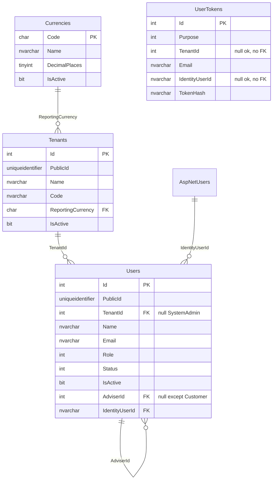

# Database design

This document owns **accepted tables, keys, indexes, constraints, and script order**. Scripts themselves live in `database/schema/`. Aggregates and invariants live in [domain-model.md](domain-model.md). Scope lives in [function-plan.md](function-plan.md). Field rules for Instruments live in [features/instruments.md](features/instruments.md). Field rules for Accounts live in [features/accounts.md](features/accounts.md). Field rules for Transactions live in [features/posting.md](features/posting.md). Boolean catalog flags are `IsActive` (renamed 2026-09-21, script `0011`).

**Product:** MyWealthV2.

Phase 1 scripts create the platform base. Phase 2 accepted and landed: `Instruments` (`0010`), `Accounts` (`0012`), posting (`0013_transactions.sql`, `79129eb`), holdings (`0014`, `0015`), the StockIn / StockOut type check (`0016`), and the Split / Bonus / Scrip type check (`0017`). Do **not** create a second Journal / CashLedger table. There is no custom `RefreshTokens` table; refresh lives in the OpenIddict token store. Demo rows are `TestSeed`, not the schema script.

Every tenant-scoped child row carries its own `TenantId`, and FKs between tenant rows are tenant composite keys `(TenantId, <column>)` → `(TenantId, Id)` ([fixes/tenant-composite-keys.md](fixes/tenant-composite-keys.md), scripts `0027_child_tenant_ids.sql` and `0028_tenant_composite_keys.sql`).

---

## 1. Platform

| Item | Choice |
| --- | --- |
| Engine | SQL Server (Aspire container `dbserver`) |
| Database | `MyWealthDbV2` |
| Access | EF Core 10 `UseSqlServer` |
| Schema truth | Versioned SQL under `database/schema/NNNN_description.sql` |
| Version ledger | `SchemaVersions(Id, ScriptName, AppliedAt)` |
| EF | Fluent mapping only. No EF migrations. Domain is not scaffolded from the database. |
| Naming | Pascal-case tables aligned with CLR. OpenIddict and Identity keep package names. |
| Context | `ApplicationDbContext` includes Identity **user** store + OpenIddict EF stores. Shared by `identity` and `webapi`. Do not use `IdentityRole`. |

Identity password seed goes through `UserManager`. OpenIddict clients may be inserted in SQL or in a startup seed.

---

## 2. Lifecycle

- Startup: schema applicator runs scripts not yet in `SchemaVersions`. The default path does **not** drop the database.
- Local reset: explicit drop → all scripts → seed (`UserManager` for passwords; OpenIddict clients in SQL or startup).
- CI: empty database applies the full script set; mapping and FK tests run against that database.

---

## 3. Conventions

| Topic | Convention |
| --- | --- |
| Primary key | `Id int` identity, clustered. Internal only. |
| Public id | `PublicId uniqueidentifier NOT NULL` unique on resources that appear in HTTP. Default `NEWSEQUENTIALID()` or an app-generated UUID. Not the PK. |
| Tables with PublicId | `Tenants`, `Users`, `Instruments`, `Accounts`, `Transactions` |
| Tables without PublicId | `Currencies` (natural key `Code`), `SchemaVersions`, `UserTokens` (caller holds the raw token; store stores the hash), Identity string keys, OpenIddict package keys |
| Tenancy | Business tables carry `TenantId`. Null only on `Users` for SystemAdmin. FK `Users.TenantId` → `Tenants`. Child tables of a tenant row carry `TenantId` too (`0027`). Every reference between two tenant rows is a tenant composite FK `(TenantId, XId)` → `(TenantId, Id)` (`0028`). See [fixes/tenant-composite-keys.md](fixes/tenant-composite-keys.md). |
| Instants | Every `datetimeoffset` column holds offset `+00:00` (UTC). The application converts before it writes; `0029` converted existing `Transactions.BookedAt` rows. Date-only columns (`AsOfDate`, `RateAsOfDate`) are `date`, UTC business dates. See [fixes/utc-instants.md](fixes/utc-instants.md). |
| Audit | `Created datetimeoffset`, `CreatedBy nvarchar(450)`, `LastModified datetimeoffset`, `LastModifiedBy nvarchar(450)` on `Tenants`, `Users`, `Instruments`, `Accounts`, `Transactions`, and `TransactionCashLegs`. `CreatedBy` stores the actor’s Identity id or a system name. |
| Concurrency | `RowVersion rowversion` on `Tenants`, `Users`, `Instruments`, `Accounts`, `Transactions`, and `TransactionCashLegs`. Transaction reverse does not require a client `rowVersion`. |
| Soft delete | Not used. |
| Status + IsActive | Rows that have a **status machine** store both: `Status` (source of truth) and `IsActive` (filter bit). `IsActive` is **derived**, never written by HTTP. Preferred SQL: persisted computed column from `Status`. Catalog rows (Tenant, Currency, Instrument) have `IsActive` only — no status machine. Never `IsEnabled`. |
| Money | No money columns in Phase 1. When the ledger exists: `decimal(18,4)` + `char(3)` FK to `Currencies`. |
| Strings | `nvarchar` + explicit max length. Email / Name / Code uniqueness is case-insensitive (`SQL_Latin1_General_CP1_CI_AS` or an equivalent CI collation). |
| Enums | `int` on `Users.Role`, `Users.Status`, `UserTokens.Purpose`, `Accounts.Type`, `Accounts.Status`, `Transactions.Type`. Also `Accounts.CustodyMode` (`0031`). |
| Delete | `RESTRICT` (no cascade) on Phase-1 business FKs. |

---

## 4. Phase 1 table list

```text
SchemaVersions
Currencies
AspNetUsers / AspNetUserClaims / AspNetUserLogins / AspNetUserTokens
  (Identity user store only — no AspNetRoles / AspNetUserRoles / AspNetRoleClaims)
OpenIddictApplications / OpenIddictAuthorizations / OpenIddictScopes / OpenIddictTokens
  (plus any extra table the chosen OpenIddict EF package maps, e.g. Sessions — follow the package)
Tenants
Users
UserTokens
Instruments                  -- Phase 2 instruments slice (`0010`)
```

Not in Phase 1:

- Custom `RefreshTokens`
- `AspNetRoles` and related role tables
- Ledger tables
- Empty placeholder Journal / CashLedger tables

---

## 5. Relationships



`AspNetUsers.TenantId` is a projection column. It is **not** drawn as an FK.

---

## 6. Columns

### 6.1 SchemaVersions

| Column | Type | Null | Notes |
| --- | --- | --- | --- |
| Id | int identity | no | PK |
| ScriptName | nvarchar(200) | no | Unique. File name of the applied script |
| AppliedAt | datetimeoffset | no | |

### 6.2 Currencies

Platform catalog. No audit, no `RowVersion`, no `PublicId`.

| Column | Type | Null | Notes |
| --- | --- | --- | --- |
| Code | char(3) | no | PK, ISO 4217 upper case |
| Name | nvarchar(100) | no | |
| DecimalPlaces | tinyint | no | ISO minor units for display / validation (JPY = 0, NZD = 2). Not the Phase-2 money-column scale (`decimal(18,4)`) |
| IsActive | bit | no | Default 1. **Platform** flag. Not per tenant. Disable does not rewrite `Tenants.ReportingCurrency`. Renamed from `IsEnabled` in `0011`. |

Seed: NZD, AUD, USD, EUR, GBP, JPY.

No `NumericCode` column (not required by the catalog ADR).

### 6.3 Identity user store (`AspNetUsers` + siblings)

Use the ASP.NET Identity schema for a **user-only** store (`IdentityUserContext<ApplicationUser>` / equivalent). Do not create role tables.

`ApplicationUser` maps to `AspNetUsers` and adds **one** business column:

| Column | Type | Null | Notes |
| --- | --- | --- | --- |
| TenantId | int | yes | Projection. Null for SystemAdmin. **No FK** to `Tenants` |

Do **not** add on `AspNetUsers`:

- `DomainUserId` — reverse pointer. Lookup is `Users.IdentityUserId` (unique). A reverse FK would cycle with `Users.IdentityUserId → AspNetUsers`.
- `Role` — truth is `Users.Role`. Login already loads `Users` for `Status` and tenant.
- `DisplayName` — truth is `Users.Name`.
- `AdviserId` / `Status` — Domain only.

Identity’s own `Email` column stays (framework). Turn **off** `RequireUniqueEmail`. Uniqueness is on `Users`.

`AspNetUserTokens` is Identity’s authenticator / provider token table. It is **not** `UserTokens`.

### 6.4 OpenIddict stores

Library-owned. Register with `UseEntityFrameworkCore()` and keep package column names.

Default tables:

| Table | Holds |
| --- | --- |
| `OpenIddictApplications` | Clients. Phase 1 row: public client `adviser-portal` |
| `OpenIddictAuthorizations` | Grants |
| `OpenIddictScopes` | `openid`, `profile`, `offline_access`, `api` |
| `OpenIddictTokens` | Authorization codes, access tokens, **refresh tokens** |

Do not add business columns to these tables. Do not replace `OpenIddictTokens` with a custom refresh table.

Client seed: SQL insert or startup seed. Both are allowed.

### 6.5 Tenants

| Column | Type | Null | Notes |
| --- | --- | --- | --- |
| Id | int identity | no | PK |
| PublicId | uniqueidentifier | no | Unique |
| Name | nvarchar(200) | no | Unique CI |
| Code | nvarchar(50) | no | Login code, unique CI, `[a-z0-9-]{2,50}` |
| ReportingCurrency | char(3) | no | Added by the currencies slice (`0009`). FK → `Currencies.Code`. No column default after apply |
| IsActive | bit | no | Default 1. Renamed from `IsEnabled` in `0011`. |
| AllowsExternalAccounts | bit | no | Named DEFAULT 1, kept (`0033`). [features/tenant-custody-modes.md](features/tenant-custody-modes.md) §6 |
| AllowsCustodialAccounts | bit | no | Named DEFAULT 1, kept (`0033`). `CK_Tenants_AllowedCustodyModes`: at least one of the two is 1 |
| BrokerConnection | nvarchar(50) | yes | The name of the Tenant's broker connection in configuration (`0051`, existing rows `'simulator'`). No FK: the name is checked against configuration when it is set. [features/orders.md](features/orders.md) §6.1 |
| RowVersion | rowversion | no | |
| Created / CreatedBy / LastModified / LastModifiedBy | audit | | |

No rule ties `Accounts.CustodyMode` to the two allowed-mode columns, because narrowing the setting leaves existing accounts alone.

`Code` is treated as immutable after create by the Tenants slice (no update API). The column itself is ordinary.

identity-auth created `Tenants` **without** `ReportingCurrency`. Login only needs `Code` and the active flag. The currencies slice adds the catalog (`0008`) and then `Tenants.ReportingCurrency` (`0009`). `0011` renames `IsEnabled` → `IsActive` on `Currencies`, `Tenants`, and `Instruments`. Do not back-fill `0002` / `0005` / `0008` / `0010`.

### 6.6 Users

One table for all five roles. Credentials live on `AspNetUsers`.

| Column | Type | Null | Notes |
| --- | --- | --- | --- |
| Id | int identity | no | PK |
| PublicId | uniqueidentifier | no | Unique. JWT subject uses this |
| TenantId | int | yes | FK → `Tenants`. Null only for SystemAdmin and SimulatorOperator |
| Name | nvarchar(200) | no | |
| Email | nvarchar(256) | no | Unique inside a tenant; platform-level people (SystemAdmin, SimulatorOperator) unique among themselves (`UQ_Users_SystemAdmin_Email`, `WHERE TenantId IS NULL`) |
| Role | int | no | 0 SystemAdmin, 1 TenantAdmin, 2 Adviser, 3 Customer, 4 SimulatorOperator (`0036`) |
| Status | int | no | 0 PendingActivation, 1 Active, 2 Disabled. Source of truth |
| IsActive | bit | no | Derived. `1` iff `Status = Active`. `0011` persisted computed column (landed `bbd0f26`) |
| AdviserId | int | yes | Required for Customer. FK → `Users.Id` |
| IdentityUserId | nvarchar(450) | no | FK → `AspNetUsers.Id`. Unique. One-to-one |
| RowVersion | rowversion | no | |
| Created / CreatedBy / LastModified / LastModifiedBy | audit | | |

Uniqueness:

- Filtered unique `(TenantId, Email)` WHERE `TenantId IS NOT NULL`
- Unique `Email` WHERE `TenantId IS NULL` (SystemAdmin)
- Unique `IdentityUserId`
- Unique `PublicId`

CHECK (in SQL; tests cover the same):

- `Role = SystemAdmin` → `TenantId IS NULL AND AdviserId IS NULL`
- `Role IN (TenantAdmin, Adviser)` → `TenantId IS NOT NULL AND AdviserId IS NULL`
- `Role = Customer` → `TenantId IS NOT NULL AND AdviserId IS NOT NULL`

Same-tenant Adviser for a Customer is enforced by the tenant composite FK `(TenantId, AdviserId)` → `Users (TenantId, Id)` since `0028` ([fixes/tenant-composite-keys.md](fixes/tenant-composite-keys.md)). The application checks it too.

**One-way FK only:** `Users.IdentityUserId` → `AspNetUsers.Id`. No `AspNetUsers` → `Users` FK.

### 6.7 UserTokens

Reserved seam for invite / password-reset. Phase 1 **creates the table and has no write API**.

The token follows the **login principal** (`AspNetUsers.Id`), which is the usual shape for reset and matches Phase-1 create (Identity row already exists when a person is created). `IdentityUserId` is nullable so an email-first invite can be stored later without a migration that changes meaning.

| Column | Type | Null | Notes |
| --- | --- | --- | --- |
| Id | int identity | no | PK |
| Purpose | int | no | 0 Invite, 1 PasswordReset |
| TenantId | int | yes | Null for SystemAdmin reset. **No FK** |
| Email | nvarchar(256) | no | Denormalised; login key with tenant |
| IdentityUserId | nvarchar(450) | yes | Logical pointer to `AspNetUsers.Id`. **No FK** |
| TokenHash | nvarchar(128) | no | Store hash only. Unique |
| ExpiresAt | datetimeoffset | no | |
| ConsumedAt | datetimeoffset | yes | Null = unused |
| Created | datetimeoffset | no | |
| CreatedBy | nvarchar(450) | no | |

No `PublicId`, no `RowVersion`, no `LastModified`. Consume sets `ConsumedAt`.

Why no FK on `IdentityUserId` / `TenantId`: this is a seam table. A reverse or extra FK would couple token rows to Identity / tenant delete order before any write use case exists. Lookup is by hash (unique) or `(TenantId, Email)`.

---

## 7. Foreign keys and delete (Phase 1)

| Parent → child | Child column | On delete |
| --- | --- | --- |
| `Currencies` → `Tenants` | `ReportingCurrency` | RESTRICT (added in `0009`) |
| `Currencies` → `Instruments` | `QuoteCurrency` | RESTRICT (`0010`) |
| `Tenants` → `Instruments` | `TenantId` | RESTRICT |
| `Tenants` → `Users` | `TenantId` | RESTRICT |
| `Users` → `Users` | `TenantId`, `AdviserId` (tenant composite FK since `0028`) | RESTRICT |
| `AspNetUsers` → `Users` | `IdentityUserId` | RESTRICT |
| OpenIddict package FKs | as shipped | as shipped |
| Identity package FKs | as shipped | as shipped |

Since `0028`, every FK from one tenant row to another is a tenant composite FK. The full list is in [fixes/tenant-composite-keys.md](fixes/tenant-composite-keys.md). FKs to `Tenants`, `Currencies`, `Reports` and `AspNetUsers` stay single-column.

No FK:

- `AspNetUsers.TenantId`
- `UserTokens.TenantId`
- `UserTokens.IdentityUserId`

---

## 8. Indexes (Phase 1)

Beyond PK / unique constraints already listed:

- `Tenants(Code)`, `Tenants(Name)`, `Tenants(PublicId)`, `Tenants(IsActive)`
- `Users(TenantId, Email)`, `Users(TenantId, Role)`, `Users(AdviserId)`, `Users(PublicId)`, `Users(IdentityUserId)`, `Users(Status)`, `Users(TenantId, IsActive)`
- `UserTokens(TokenHash)`, `UserTokens(TenantId, Email)`, `UserTokens(IdentityUserId)`
- OpenIddict / Identity: keep package indexes
- `Instruments(PublicId)`, `Instruments(TenantId, Symbol)` CI unique, `Instruments(TenantId, IsActive)`
- `Accounts(PublicId)`, `Accounts(TenantId, CustomerId)`, `Accounts(TenantId, IsActive)`
- `Transactions(PublicId)`, `Transactions(TenantId, BookedAt)`, unique filtered `Transactions(ReversedByTransactionId)` where not null (`0018`)
- `TransactionCashLegs(AccountId)` INCLUDE `Amount`, unique `TransactionCashLegs(TransactionId, AccountId)` (`0024`)
- `TransactionSecurityLegs(AccountId, InstrumentId)` INCLUDE `Quantity, CostAmount`, unique `TransactionSecurityLegs(TransactionId, AccountId, InstrumentId)` (`0024`)

---

## 9. Script order

```text
0001_schema_versions.sql
0003_identity.sql            -- user store only; AspNetUsers.TenantId
0004_openiddict.sql          -- package tables
0005_tenants.sql             -- no ReportingCurrency
0006_users.sql               -- FKs to Tenants and AspNetUsers
0007_user_tokens.sql
0008_currencies.sql          -- platform catalog + seed
0009_tenants_reporting_currency.sql  -- ALTER Tenants.ReportingCurrency + FK
0010_instruments.sql         -- tenant catalog; no demo rows; shipped as IsEnabled
0011_rename_is_enabled_to_is_active.sql  -- catalog IsEnabled → IsActive; add Users.IsActive derived from Status
0012_accounts.sql            -- Account container; no demo rows; Status + derived IsActive
0013_transactions.sql        -- Transactions + TransactionCashLegs + IdempotencyRecords; no demo rows
0014_holdings.sql            -- TransactionSecurityLegs + Holdings
0015_transaction_type_opening_holdings.sql  -- CK_Transactions_Type widened to 0–9
0016_transaction_type_stock_in_out.sql      -- CK_Transactions_Type widened to 0–11
0017_transaction_type_split.sql             -- CK_Transactions_Type widened to 0–14
0018_transaction_reversed_by.sql            -- ALTER Transactions.ReversedByTransactionId + FK + unique filtered index
...
0024_leg_accounts.sql                       -- AccountId onto both leg tables (back-filled); drop Transactions.AccountId
0025_transaction_type_internal_transfer.sql -- CK_Transactions_Type widened to 0–15
0026_fx_conversions.sql                     -- CK_Transactions_Type widened to 0–16; TransactionFxDetails
0027_child_tenant_ids.sql                   -- TenantId onto leg tables, TransactionFxDetails, PortfolioLines (back-filled)
0028_tenant_composite_keys.sql              -- read-only pre-check; UNIQUE (TenantId, Id) on parents; tenant composite FKs replace single-column FKs
0029_transactions_booked_at_utc.sql         -- SWITCHOFFSET(BookedAt, '+00:00') on rows with a non-zero offset; instant unchanged
0030_trade_fees.sql                         -- TransactionCashLegs.Role; TradeFeeSchedules, TradeFeeBands, TransactionFeeDetails
0031_accounts_custody_mode.sql              -- Accounts.CustodyMode (existing rows 0 = External); CHECK 0–1; no default left
0032_remove_external_portfolio_assignments.sql -- data only; Active assignments on External accounts become Removed
0033_tenants_allowed_custody_modes.sql      -- Tenants.AllowsExternalAccounts / AllowsCustodialAccounts (DEFAULT 1 kept); CHECK at least one
0034_entered_trade_fees.sql                 -- drop CK_TransactionFeeDetails_BrokerageSchedule (a Brokerage fee may have no schedule)
0035_transaction_source.sql                 -- Transactions.SourceKind / SourcePublicId, back-filled; rebalance trades lose the rb: reference
0036_users_role_simulator_operator.sql      -- CK_Users_RoleShape lets Role 4 (SimulatorOperator) have no tenant and no adviser
0037_adjustments.sql                        -- CK_Transactions_Type 0–17 (Adjustment); TransactionAdjustmentDetails
0038_client_money_accounts.sql              -- ClientMoneyAccounts; one active per (TenantId, Currency); account number unique among active rows
0039_accounts_deposit_reference.sql         -- Accounts.DepositReference char(9), back-filled on Custodial rows; CHECK iff Custodial; unique filtered index
0040_client_money_accounts_bank_connection.sql -- ClientMoneyAccounts.BankConnection nvarchar(50), existing rows 'simulator'
0041_bank_statement_lines.sql               -- BankFeedCursors, BankStatementLines, TransactionBankReceiptDetails; CK_Transactions_SourceKind 0–3
0042_nominated_bank_accounts.sql            -- NominatedBankAccounts
0043_withdrawals.sql                        -- Withdrawals, OutgoingPayments, TransactionPaymentDetails; BankStatementLines payout columns; CK_Transactions_SourceKind 0–4
0044_bank_returns.sql                       -- OutgoingPayments.Kind and ReturnOfLineId; BankStatementLines statuses 0–6, reasons 0–11, methods 0–4, new Matched CHECK
0045_bank_reconciliations.sql               -- ALLOW_SNAPSHOT_ISOLATION; BankFeedCursors balance columns; BankReconciliations, BankReconciliationItems; CK_Reports_Scope adds Tenant; report bank-reconciliation
0046_account_closures.sql                   -- AccountClosures; BankStatementLines reasons 0–12; CK_Transactions_SourceKind 0–5
0047_customer_tax_profiles.sql              -- CustomerTaxProfiles
0048_interest.sql                           -- InterestRateSchedules, InterestRateBands, InterestAccruals, InterestRuns, TransactionTaxDetails, TransactionInterestDetails; Accounts.InterestAccruedThrough; cash leg Role 0–2; CK_Transactions_SourceKind 0–6; BankStatementLines.Kind; reconciliation item kinds 0–14
0049_market_data_feeds.sql                  -- MarketDataFeeds (platform data, PK (Connection, Kind))
0050_corporate_actions.sql                  -- CorporateActionAnnouncements (platform data), CorporateActions, CorporateActionEntitlements, TransactionCorporateActionDetails; CK_Transactions_SourceKind 0–7; MarketDataFeeds Kind 0–1, LastFailure 0–5
0051_orders.sql                             -- Orders, OrderFills, ExecutionReports (platform data), BrokerFeeds (platform data), TransactionExecutionDetails; Tenants.BrokerConnection (back-filled 'simulator'); CK_Transactions_SourceKind 0–8
0052_trade_settlement.sql                   -- TradeSettlements; settlement columns on Orders, OrderFills, ExecutionReports, OutgoingPayments, BankStatementLines; BankReconciliations open settlements
0053_rebalances.sql                         -- Rebalances, RebalanceTargets, RebalanceLines; Orders.RebalanceId; UQ_AccountPortfolioAssignments_TenantId_Id; drops the three LastRebalance columns of AccountPortfolioAssignments
0054_migration_batches.sql                  -- MigrationBatches, MigrationBatchControlTotals, MigrationBatchEntries, MigrationBatchHoldings, TransactionMigrationDetails; BankStatementLines.MigrationBatchId; source kind 9, match method 6, reconciliation item kind 19
0055_custodian.sql                          -- SafekeepingAccounts, CustodianFeedCursors, CustodianPositions, CustodyMovements, InKindTransfers, TransactionInKindTransferDetails; Orders safekeeping account columns; UQ_OrderFills_TenantId_Id; source kind 10
0056_custodian_reconciliations.sql          -- CustodianReconciliations, CustodianReconciliationLines
0057_dividends.sql                          -- dividend terms, receipt, payment and election on CorporateActions and the terms on CorporateActionAnnouncements (ratio nullable, kind 3); dividend fields on CorporateActionEntitlements; TransactionDividendDetails; cash leg role 3, tax kind 2; Accounts.ReinvestDividends; BankStatementLines.CorporateActionId, match method 7, unmatched reason 14; reconciliation item kinds 20–21
0058_adjustment_requests.sql                -- AdjustmentRequests; source kind 11 (AdjustmentRequest)
0059_stored_valuations.sql                  -- ValuationRuns, StoredValuations, StoredValuationLines; Accounts.ValuedThrough
0060_external_income.sql                    -- TransactionDividendDetails.AmountPerShare and ExDate nullable; CK_TransactionDividendDetails_AmountPerShare allows NULL
0061_instrument_tax_attributes.sql          -- Instruments.IssuerCountry char(2) NULL + CHECK; InstrumentFifTreatments (tenant composite FK to Instruments)
```

Do **not** back-fill `0002_currencies.sql`. identity-auth stopped at `0007`. Currencies scripts are forward-only `0008` / `0009`.

OpenIddict client / scope seed may sit in `0004` or in a later seed script / startup. Identity users are **not** inserted as raw password hashes in SQL.

---

## 10. Dual-write rules (not extra columns)

Creating any login-capable person, one transaction:

1. Insert `AspNetUsers` (`TenantId` projection set or null).
2. Insert `Users` with `IdentityUserId`.
3. Do not write a reverse key on Identity.

Login: resolve `Users` by `tenantCode + email` (SystemAdmin: email only), then verify the password on that `IdentityUserId`. Do not `FindByEmail` across tenants.

Name, Role, Status, AdviserId change only on `Users`. After password change, disable, or logout, revoke OpenIddict tokens for that subject — no extra business table.

---

## 11. Phase 2 tables

### 11.1 Instruments (accepted)

Script `0010_instruments.sql`. Columns and uniqueness: [features/instruments.md](features/instruments.md) §6. No ISIN / Exchange / Kind / price. No seed in the script — `TestSeed` only.

Tax attributes (`0061_instrument_tax_attributes.sql`, [features/instrument-tax-attributes.md](features/instrument-tax-attributes.md) §6):

- `Instruments.IssuerCountry char(2) NULL`. `CK_Instruments_IssuerCountry`: `NULL` or two upper-case letters `A`–`Z` (a binary collation, so `nz` is refused). No back-fill.
- `InstrumentFifTreatments` — `Id` (internal PK, no `PublicId`), `TenantId`, `InstrumentId`, `TaxYear smallint` (CHECK 2008–2199), `Treatment tinyint` (CHECK 1–5: `NotClassified` is never stored), `Note nvarchar(500) NULL` (CHECK not `NULL` when `Treatment = 3`), audit. No `RowVersion`: the Instrument's guards the write. Unique `(InstrumentId, TaxYear)`. Tenant composite FK `(TenantId, InstrumentId)` → `Instruments (TenantId, Id)` RESTRICT; FK `TenantId` → `Tenants` RESTRICT. The agreement of the rows with the issuer country spans two tables and is held by `Instrument.SetTaxAttributes`.

### 11.2 Naming amendment `IsEnabled` → `IsActive` + Users derived bit

Script `0011_rename_is_enabled_to_is_active.sql`. **Landed** in GitHub master `bbd0f26` (2026-09-20). Forward ALTER only. Do not edit `0005` / `0006` / `0008` / `0010`.

As shipped: `sp_rename` on `Currencies` / `Tenants` / `Instruments` columns, defaults, and indexes. `Users.IsActive` is a persisted computed column:

```sql
ALTER TABLE [Users] ADD [IsActive] AS ISNULL(CAST(CASE WHEN [Status] = 1 THEN 1 ELSE 0 END AS bit), 0) PERSISTED;
CREATE INDEX [IX_Users_TenantId_IsActive] ON [Users] ([TenantId], [IsActive]);
```

| Table | Change |
| --- | --- |
| `Currencies` | `IsEnabled` → `IsActive` |
| `Tenants` | `IsEnabled` → `IsActive`; index `Tenants(IsActive)` |
| `Instruments` | `IsEnabled` → `IsActive`; index `(TenantId, IsActive)` |
| `Users` | add `IsActive` derived from `Status`: `Active` → 1; `PendingActivation` and `Disabled` → 0. Prefer persisted computed column. Index `(TenantId, IsActive)` |

`IsActive` on Users is a filter projection. Login and disable still use `UserStatus`. HTTP disable / enable do not accept `isActive` in the body.

People list items may include `isActive` alongside `status` after `0011`. Filter stays `enabledOnly` (true = `IsActive = 1`).

### 11.3 Accounts (accepted)

Script `0012_accounts.sql`. Columns: [features/accounts.md](features/accounts.md) §6. `Status` Open=0 / Closed=1. `IsActive` persisted computed (`Status = 0` → 1). No balance, institution or account-number column. No seed in the script — `TestSeed` only.

Columns added by later scripts, each forward only (`0012` is not edited):

| Column | Script | Notes |
| --- | --- | --- |
| `CustodyMode int NOT NULL` | `0031` | 0 External, 1 Custodial; CHECK 0–1. Existing rows became External. No default is left: an insert that does not name the column fails. No index, no FK. [features/account-custody-mode.md](features/account-custody-mode.md) §6 |
| `DepositReference char(9) NULL` | `0039` | `CK_Accounts_DepositReference`: not null iff `CustodyMode = 1`. Unique `UX_Accounts_DepositReference` WHERE not null. The script gave every existing Custodial row a reference (random, Luhn mod 32 check symbol, redrawn while used). [features/client-money-accounts.md](features/client-money-accounts.md) §6.2 |
| `InterestAccruedThrough date NULL` | `0048` | The last UTC day the account was accrued through, set under the Account lock (§11.14). No index, no back-fill. [features/interest-run.md](features/interest-run.md) §6.2 |
| `ReinvestDividends bit NOT NULL` | `0057` | Default 0. `CK_Accounts_ReinvestDividends`: 1 only on a Custodial account. With `ReinvestDividendsChangedByUserId` (tenant composite FK → `Users`) and `ReinvestDividendsChangedAt`. [features/dividends.md](features/dividends.md) §6.1 |
| `ValuedThrough date NULL` | `0059` | The last UTC day a stored valuation exists for, set under the Account lock one day at a time (§11.22). `CK_Accounts_ValuedThrough`: null unless `CustodyMode = 1`. No index, no back-fill. [features/valuation-run.md](features/valuation-run.md) §6.1 |

The closures of an Account are rows of `AccountClosures` (§11.13), not a column; the account item's `closure` is the latest of them.

### 11.4 Transactions (accepted spec; landed)

Rules: [features/posting.md](features/posting.md) §6. Idempotency table in `0013` ([ADR 0015](adr/0015-idempotency-keys.md)). No `Accounts.Balance`. No seed in the scripts — `TestSeed` only. Every script below is forward only and edits no earlier script.

`Transactions` (`0013`) — the header. It has `TenantId` and no Account or Customer: `0024` dropped `AccountId` with its FK and index, and the header index is `(TenantId, BookedAt)`.

| Column or constraint | Script | Notes |
| --- | --- | --- |
| `ReversedByTransactionId` NULL | `0018` | FK → `Transactions` RESTRICT; unique filtered index `WHERE ReversedByTransactionId IS NOT NULL`. The original stores it; the Reversal stores `OriginalTransactionId` |
| `CK_Transactions_Type` | `0037` | 0–17. Widened by `0015` (9), `0016` (11), `0017` (14), `0025` (15), `0026` (16) and `0037` (17) |
| `UNIQUE (TenantId, Id)` | `0028` | The target of every tenant composite FK from a leg or a detail |
| `BookedAt` | `0029` | Every row holds `+00:00` |
| `SourceKind int NOT NULL` | `0035` | `CK_Transactions_SourceKind` 0–11, widened by `0041` (3), `0043` (4), `0046` (5), `0048` (6), `0050` (7), `0051` (8), `0054` (9), `0055` (10) and `0058` (11). No default is left. [features/transaction-source.md](features/transaction-source.md) §6 |
| `SourcePublicId uniqueidentifier NULL` | `0035` | No FK, no index. `CK_Transactions_SourcePublicId`: null for kinds 0 and 1 (`Manual`, `Seed`), set for kinds 2–11 |

`0035` back-filled the source once: rebalance trades (reference `rb:{32 hex}:{B|S}:{digits}`) became `Rebalance` with the parsed handle and a null `Reference`, rows with a listed seed reference became `Seed`, the rest `Manual`. No later script back-fills a source: an adjustment posted before `0058` keeps `SourceKind` 0.

`TransactionCashLegs` (`0013`):

| Column or constraint | Script | Notes |
| --- | --- | --- |
| `AccountId int NOT NULL` | `0024` | FK → `Accounts` RESTRICT, back-filled from the header |
| `TenantId int NOT NULL` | `0027` | FK → `Tenants` RESTRICT, back-filled from the header; the Domain copies the header's `TenantId` onto every leg and detail. `UNIQUE (TenantId, Id)` (`0030`) |
| `Role int NOT NULL` | `0030` | Default 0 = `Principal`. `CK_TransactionCashLegs_Role` 0–3: `Fee` (`0030`), `Tax` (`0048`), `Reinvestment` (`0057`) |
| Unique `(TransactionId, AccountId) WHERE Role = 0` | `0030` | Replaces the unique `(TransactionId, AccountId)` of `0024` |

`TransactionSecurityLegs` (`0014`, §11.5) has the same `AccountId` (`0024`) and `TenantId` (`0027`); unique `(TransactionId, AccountId, InstrumentId)`.

Detail tables. Each row is part of an immutable Transaction: no `PublicId`, no `RowVersion`, no back-fill, all FKs RESTRICT. Unless the row says otherwise the key is `TransactionId` (PK; at most one row per Transaction) with `TenantId` and FK `(TenantId, TransactionId)` → `Transactions (TenantId, Id)`. Which Transactions carry a detail is held by the Domain ([domain-model.md](domain-model.md) §8.6).

| Table | Script | Columns and CHECKs |
| --- | --- | --- |
| `TransactionFxDetails` | `0026` | `BaseCurrency char(3)` and `QuoteCurrency char(3)` (FK → `Currencies.Code`; CHECK `BaseCurrency <> QuoteCurrency`), `Rate decimal(18,8)` (CHECK `> 0`), `RateAsOfDate date`, `RateSource nvarchar(50)` (`'Caller'` for a rate the caller entered). `TenantId` from `0027`. [features/fx-conversions.md](features/fx-conversions.md) §6 |
| `TransactionFeeDetails` | `0030` | One row per `Fee` cash leg: PK and FK `CashLegId`. `TenantId`, `TransactionId`, `Kind int` (CHECK 0–0, `Brokerage`), `TradeFeeScheduleId NULL` (FK; null on a fee the caller entered on an External account: `0034` dropped `CK_TransactionFeeDetails_BrokerageSchedule`, and no CHECK replaces it, because which fees may lack a schedule depends on the Account), `BasisAmount` and `FeeAmount decimal(18,4)` (CHECK `> 0`), `Currency char(3)`. UQ `(TransactionId, Kind)`. [features/trade-fees.md](features/trade-fees.md) §6 |
| `TransactionAdjustmentDetails` | `0037` | `Reason int` (CHECK 0–3: `EntryError`, `CorporateAction`, `ReconciliationBreak`, `Other`). Index on `TenantId`. [features/adjustments.md](features/adjustments.md) §6 |
| `TransactionBankReceiptDetails` | `0041` | `ValueDate date`, `Reference nvarchar(140) NULL`, `PayerName nvarchar(140) NULL`, `PayerAccount nvarchar(40) NULL` (masked). [features/deposit-matching.md](features/deposit-matching.md) §6.2 |
| `TransactionPaymentDetails` | `0043` | `ValueDate date NOT NULL`, `Reference nvarchar(18) NULL`, `PayeeName nvarchar(140) NULL`, `PayeeAccount nvarchar(40) NULL` (masked). [features/withdrawals.md](features/withdrawals.md) §6.2 |
| `TransactionTaxDetails` | `0048` | One row per `Tax` cash leg: PK `CashLegId`, FK `(TenantId, CashLegId)` → `TransactionCashLegs`. `TenantId`, `TransactionId`, `Kind int` (CHECK 0–2: `Rwt`, `Nrwt`, and `ForeignWithholding` from `0057`), `RatePercent decimal(5,2)` (CHECK `> 0` and `≤ 100`), `BasisAmount` and `TaxAmount decimal(18,4)` (CHECK `> 0`), `Currency char(3)` (FK). UQ `(TransactionId, Kind)`. [features/interest-run.md](features/interest-run.md) §6.2 |
| `TransactionInterestDetails` | `0048` | `PeriodFrom` and `PeriodTo date` (CHECK from `≤` to), `Days int` (CHECK `≥ 1`), `AccruedAmount decimal(18,8)` and `GrossAmount decimal(18,4)` (CHECK `> 0`) |
| `TransactionCorporateActionDetails` | `0050` | `Kind int` (CHECK 0–2), `RatioNew int`, `RatioHeld int` (CHECK `≥ 1`), `ExDate date`, `RecordDate date NULL`, `PaymentDate date NULL`, `QuantityBefore decimal(18,8)`, `QuantityAfter decimal(18,8)` (CHECK both `> 0`). [features/corporate-actions.md](features/corporate-actions.md) §6.1 |
| `TransactionExecutionDetails` | `0051` | `FillPublicId uniqueidentifier`, `Price decimal(18,8)` (CHECK `> 0`), `TradeDate date`, `SettlementDate date` (CHECK `≥ TradeDate`), `BrokerReference nvarchar(50) NULL`. No `Buy` or `Sell` posted before `0051` has a row. [features/orders.md](features/orders.md) §6.1 |
| `TransactionMigrationDetails` | `0054` | `AsOfDate date`, `PreviousProvider nvarchar(100)`. [features/migration-batches.md](features/migration-batches.md) §6 |
| `TransactionInKindTransferDetails` | `0055` | `TransferPublicId`, `CounterpartyName nvarchar(100)`, `CounterpartyAccountMasked nvarchar(34)`, `ChangesBeneficialOwner bit`, `AcquiredOn date NULL`, `SettlementDate date`, `CustodianReference nvarchar(100)`. No audit columns. [features/in-kind-transfers.md](features/in-kind-transfers.md) §6.1 |
| `TransactionDividendDetails` | `0057` | `InstrumentId` (tenant composite FK), `Quantity decimal(18,8)` (CHECK `> 0`), `AmountPerShare decimal(18,8) NULL` (CHECK `NULL` or `> 0`, nullable from `0060`), `Currency char(3)` (FK), `TaxSource int`, `ImputationCredit decimal(18,4)`, `ReinvestedQuantity` and `ReinvestmentPrice decimal(18,8) NULL`, `ExDate date NULL` (nullable from `0060`), `RecordDate date NULL`, `PaymentDate date NULL`. A corporate action's dividend has both the amount per share and the ex-date; a hand-entered one may have neither ([features/dividends.md](features/dividends.md) §6.1, [features/external-income.md](features/external-income.md) §6) |

### 11.5 Holdings (accepted, landed)

Scripts `0014_holdings.sql` and `0015_transaction_type_opening_holdings.sql`. Columns: [features/holdings.md](features/holdings.md) §6. `0016_transaction_type_stock_in_out.sql` widens `CK_Transactions_Type` to 0–11 for `StockIn` (10) and `StockOut` (11). `0017_transaction_type_split.sql` widens that check to 0–14 for `Split` (12), `Bonus` (13), and `Scrip` (14). No new column. No seed in the scripts — `TestSeed` only.

---


### 11.6 Portfolios (accepted)

Feature spec: [features/portfolios.md](features/portfolios.md) (accepted 2026-11-02).

Script `0023_portfolios.sql`:

- `Portfolios` — TenantId, Name, BaseCurrency (immutable), IsActive, drift / minimum-trade / cash-residual settings, PublicId, audit, RowVersion
- `PortfolioLines` — PortfolioId, InstrumentId, TargetWeight (decimal 2 places), SortOrder. `TenantId` (copied from the Portfolio) since `0027_child_tenant_ids.sql`, [fixes/tenant-composite-keys.md](fixes/tenant-composite-keys.md).
- `AccountPortfolioAssignments` — TenantId, AccountId, PortfolioId, Status (Active/Removed), AssignedAt, AssignedBy; filtered unique on AccountId where Status = Active; `UQ_AccountPortfolioAssignments_TenantId_Id` on `(TenantId, Id)` for the tenant composite FK from `Rebalances` (`0053`). The outcome of a rebalance is on its `Rebalances` row (§11.18): `0053` dropped `LastRebalanceAt`, `LastRebalanceStatus` and `LastRebalanceMessage` with no back-fill ([features/rebalances.md](features/rebalances.md) §6).

No seed in the script. Development / TestAppHost `TestSeed` adds one demo portfolio and one assignment, on the Custodial demo account, and posts no rebalance trades.

An Active assignment exists only on a Custodial account. That is kept by Application, not by a constraint. Script `0032_remove_external_portfolio_assignments.sql` changed data only: every row with `Status = 0` (Active) whose Account had `CustodyMode = 0` (External) got `Status = 1` (Removed), with `LastModified` and `LastModifiedBy` filled. One `UPDATE`, safe to run again; holdings and transactions were not touched ([features/custody-modes.md](features/custody-modes.md) §6).

### 11.7 Trade fee schedules (accepted)

Feature spec: [features/trade-fees.md](features/trade-fees.md) (accepted 2026-11-15). Script `0030_trade_fees.sql`:

- `TradeFeeSchedules` — TenantId, PublicId, QuoteCurrency (FK `Currencies`), EffectiveFrom (`date`), MinimumAmount, CapAmount (nullable), audit, RowVersion. UQ `(TenantId, QuoteCurrency, EffectiveFrom)`. CHECK minimum `≥ 0`; cap null or `> 0` and `≥` minimum.
- `TradeFeeBands` — TenantId, TradeFeeScheduleId (tenant composite FK), FromAmount, RatePercent `decimal(7,4)`. UQ `(TradeFeeScheduleId, FromAmount)`. CHECK from `≥ 0`, rate 0–100.

No seed in the script. Development / TestAppHost `TestSeed` adds one schedule.

### 11.8 Client money accounts (accepted, landed)

Feature spec: [features/client-money-accounts.md](features/client-money-accounts.md) (accepted, landed 2026-11-20). Script `0038_client_money_accounts.sql`:

- `ClientMoneyAccounts` — TenantId (FK `Tenants`), PublicId (unique), Currency (FK `Currencies`), BankName `nvarchar(100)`, AccountName `nvarchar(140)`, AccountNumber `nvarchar(34)`, `BankConnection nvarchar(50) NOT NULL` (the name of a bank connection in configuration; `0040_client_money_accounts_bank_connection.sql`, existing rows `'simulator'`; [features/deposit-matching.md](features/deposit-matching.md) §6.1), IsActive, audit, RowVersion. Unique `(TenantId, Currency)` WHERE `IsActive = 1`; unique `(AccountNumber)` WHERE `IsActive = 1`; index `(TenantId)`. No column changes after insert except `IsActive`.

No seed in the script. Development / TestAppHost `TestSeed` adds a USD and an NZD row per firm.

### 11.9 Bank statement lines (accepted)

Feature spec: [features/deposit-matching.md](features/deposit-matching.md) (accepted and landed 2026-11-20) §6.2. Script `0041_bank_statement_lines.sql`, with columns and CHECKs from the later scripts named below.

- `BankFeedCursors` — PK and FK `ClientMoneyAccountId` → `ClientMoneyAccounts` RESTRICT; `Cursor nvarchar(500) NULL` (opaque); `LastSucceededAt`, `LastFailedAt`; `LastFailure int NULL` (CHECK 0–6); RowVersion. One row per client money account, written by the `worker` only. From `0045` ([features/bank-reconciliation.md](features/bank-reconciliation.md) §6.1): `Balance decimal(18,4) NULL` and `BalanceAt datetimeoffset NULL` (both null or both set, `CK_BankFeedCursors_Balance`) and `OpeningBalance decimal(18,4) NULL` (set whenever `Balance` is, `CK_BankFeedCursors_Opening`). No back-fill: the first page after the script set them.
- `BankStatementLines` — the bank's inbound records ([ADR 0021](adr/0021-outside-parties-behind-ports.md) rule 7). TenantId, PublicId (unique), ClientMoneyAccountId, `Connection nvarchar(50)`, `OutsideId nvarchar(100)`; unique `(Connection, OutsideId)`. ValueDate, Direction (CHECK 0–1), `Amount decimal(18,4)` (CHECK `> 0`), Currency (FK), PayerName, `PayerAccountMasked nvarchar(40)`, ReferenceText, ReceivedAt. Status, UnmatchedReason, the match columns, the last action columns (action, note, person, time), audit, RowVersion. FKs RESTRICT. Indexes `(TenantId, Status, ReceivedAt DESC)` and `(Connection, Status, ReceivedAt)`. The columns from the port never change after insert.
- `TransactionBankReceiptDetails` — §11.4.

Columns of `BankStatementLines` added after `0041`. Existing lines kept null, or the default, in each:

| Column | Script | Notes |
| --- | --- | --- |
| `EndToEndId nvarchar(100) NULL`, `ReturnOfOutsideId nvarchar(100) NULL`, `ReturnReason nvarchar(140) NULL` | `0043` | From the port. Filtered indexes on `(Connection, EndToEndId)` and `(Connection, ReturnOfOutsideId)`. [features/withdrawals.md](features/withdrawals.md) §6.2 |
| `RelatedLineId int NULL` | `0043` | FK `(TenantId, RelatedLineId)` → `BankStatementLines` RESTRICT |
| `WithdrawalId int NULL` | `0043` | FK `(TenantId, WithdrawalId)` → `Withdrawals` RESTRICT |
| `Kind int NOT NULL` | `0048` | Default 0 `Transfer`; 1 is `Interest`; CHECK 0–1. [features/interest-run.md](features/interest-run.md) §6.2 |
| `TradeSettlementId int NULL` | `0052` | FK `(TenantId, TradeSettlementId)` → `TradeSettlements` RESTRICT. [features/trade-settlement.md](features/trade-settlement.md) §6.1 |
| `MigrationBatchId int NULL` | `0054` | FK `(TenantId, MigrationBatchId)` → `MigrationBatches` RESTRICT; filtered index where set. [features/migration-batches.md](features/migration-batches.md) §6 |
| `CorporateActionId int NULL` | `0057` | The dividend a line is the receipt of. [features/dividends.md](features/dividends.md) §6.1 |

CHECKs of `BankStatementLines` as they are now:

| CHECK | Range or rule | Last widened by |
| --- | --- | --- |
| `Status` | 0–6 | `0044` ([features/bank-returns.md](features/bank-returns.md) §6.1) |
| `UnmatchedReason` | 0–14 | `0057`; before it `0043` (7), `0044` (11), `0046` (12), `0052` (13) |
| `MatchMethod` | 0–7 | `0057`; before it `0043` (3), `0044` (4), `0052` (5), `0054` (6) |
| `CK_BankStatementLines_Match` | `Status = 1` needs `MatchMethod`, `MatchedAt` and exactly one of five targets: an Account and a Transaction; a related line with no Account; a trade settlement; a migration batch; a corporate action. Any other status has no match column | `0057`; replaced before by `0044`, `0052` and `0054` |

Unmatched receipts are not in any ledger table (roadmap D7). No seed.

### 11.10 Nominated bank accounts (accepted)

Feature spec: [features/withdrawals.md](features/withdrawals.md) (accepted 2026-11-20, landed 2026-11-21) §6.1. Script `0042_nominated_bank_accounts.sql`:

- `NominatedBankAccounts` — TenantId, PublicId (unique), `CustomerId` (FK `(TenantId, CustomerId)` → `Users`), `Currency char(3)` (FK → `Currencies`), `BankName nvarchar(100)`, `AccountName nvarchar(140)`, `AccountNumber nvarchar(34)` (full, as entered), `AccountNumberKey nvarchar(34)` (upper case, no spaces or hyphens), `Status int` (CHECK 0–3); added by and at; reviewed by, at and note (set together, CHECK by status); removed by, at and note (all set iff `Status = 3`); audit; RowVersion. Every user FK is a tenant composite key, RESTRICT. Unique filtered `UX_NominatedBankAccounts_Customer_Number` on `(TenantId, CustomerId, AccountNumberKey, Currency) WHERE Status IN (0, 1)`. No seed in the script.

### 11.11 Withdrawals and outgoing payments (accepted)

Feature spec: [features/withdrawals.md](features/withdrawals.md) (accepted 2026-11-20, landed 2026-11-21) §6.2. Script `0043_withdrawals.sql`:

- `Withdrawals` — TenantId, PublicId (unique), AccountId, NominatedBankAccountId, `Amount decimal(18,4)` (CHECK `> 0`), Currency, `Reference nvarchar(18)`, `Memo nvarchar(200) NULL`, `Status int` (CHECK 0–7), requested by and at, decision (action CHECK 0–2, by, at, note; all null or all but the note set), `PayoutTransactionId` (set iff `Status IN (3, 7)`), `ReturnTransactionId` (set iff `Status = 7`), `FailureReason` (set iff `Status = 6`), `ReturnReason nvarchar(140) NULL`, audit, RowVersion. Tenant composite FKs, RESTRICT. Index `(TenantId, AccountId, Status)` for reserved cash.
- `OutgoingPayments` — TenantId, PublicId (unique), ClientMoneyAccountId, `Connection nvarchar(50)`, `InstructionPublicId uniqueidentifier` (unique), `Kind int NOT NULL` (CHECK 0–2: `Withdrawal`, `ReceiptReturn`, `TradeSettlement`), the target, Amount, Currency, `Reference nvarchar(18) NULL`, `Status int` (CHECK 0–5), `Attempts int`, `LastAttemptAt`, `LastFailure int NULL` (CHECK 0–5), `BankPaymentId nvarchar(100) NULL`, `AcceptedAt`, `RejectReason int NULL` (CHECK 0–4), audit, RowVersion. Index `(Connection, Status, Id)` for the send step.
- `TransactionPaymentDetails` — §11.4. The `BankStatementLines` columns — §11.9.

The target of an `OutgoingPayments` row is one of three nullable columns, and `CK_OutgoingPayments_Target` requires exactly the one of its `Kind`:

| Kind | Column | Script | Notes |
| --- | --- | --- | --- |
| 0 `Withdrawal` | `WithdrawalId` | `0043` | NULL since `0044` |
| 1 `ReceiptReturn` | `ReturnOfLineId` | `0044` | FK `(TenantId, ReturnOfLineId)` → `BankStatementLines` RESTRICT. Unique filtered `UX_OutgoingPayments_ReturnOfLineId_Open` on `ReturnOfLineId WHERE Kind = 1 AND Status IN (0, 1)`. [features/bank-returns.md](features/bank-returns.md) §6.1 |
| 2 `TradeSettlement` | `TradeSettlementId` | `0052` | FK → `TradeSettlements` RESTRICT. Filtered unique `WHERE Kind = 2 AND Status IN (0, 1)`. [features/trade-settlement.md](features/trade-settlement.md) §6.1 |

Reserved cash is computed from `Withdrawals`, not stored. No seed in the script.

### 11.12 Bank reconciliations (accepted)

Feature spec: [features/bank-reconciliation.md](features/bank-reconciliation.md) (accepted 2026-11-21) §6.1. Script `0045_bank_reconciliations.sql`:

- The database allows `SNAPSHOT` isolation (`ALTER DATABASE CURRENT SET ALLOW_SNAPSHOT_ISOLATION ON`); only the reconciliation read uses it. Existing reads keep `READ COMMITTED`.
- `BankReconciliations` — one stored run: TenantId, PublicId (unique), ClientMoneyAccountId (FK RESTRICT), Currency, `Trigger int` (CHECK 0–1), RanAt, `RanByUserId` (FK `(TenantId, RanByUserId)` → `Users`; null iff `Trigger = 0`), `Status int` (CHECK 0–2), `BankBalance`, `BalanceAt`, `OpeningBalance`, `StatementLinesTotal`, `Difference` (all null iff `Status = 2`), `CustodialCash`, counts and totals per class, `ReservedCash`, payments in flight, feed status, `OpenSettlementsCount int NOT NULL` and `OpenSettlementsAmount decimal(18,4) NOT NULL` (`0052`, default 0 for existing rows); audit, written once. Unique `(TenantId, Id)`. Indexes `(TenantId, ClientMoneyAccountId, RanAt DESC)` and `(TenantId, RanAt DESC)`.
- `BankReconciliationItems` — `(TenantId, ReconciliationId)` FK → `BankReconciliations`, `Position` (unique with the run), `Kind int`, `Class int` (CHECK 0–2), signed `Amount decimal(18,4)`, `Count`; the line snapshot (`StatementLineId` FK `(TenantId, StatementLineId)` → `BankStatementLines`; `Direction`, `LineStatus`, `UnmatchedReason`, `ValueDate`, `Note`); `OtherClientMoneyAccountId` (FK, set iff `Kind = 11`).

CHECKs of `BankReconciliationItems` as they are now:

| CHECK | Rule | Widened by |
| --- | --- | --- |
| `CK_BankReconciliationItems_Kind` | 0–21 | `0048` (14), `0052` (18), `0054` (19), `0057` (21) |
| `CK_BankReconciliationItems_Line` | The line snapshot is set iff `Kind IN (2, 3, 4, 6, 12, 19)` | `0048` (12), `0054` (19) |

No back-fill. A run and its items are never updated or deleted; no purge.

### 11.13 Account closures (accepted)

Feature spec: [features/account-closure.md](features/account-closure.md) (accepted 2026-11-22) §6. Script `0046_account_closures.sql`:

- `AccountClosures` — TenantId, PublicId (unique), `(TenantId, AccountId)` FK → `Accounts`, `Status int` (CHECK 0–2), `CancelReason int NULL` (CHECK 0–3, set iff `Status = 2`), `Memo nvarchar(200)`, `RequestedByUserId` (FK `(TenantId, RequestedByUserId)` → `Users`), `RequestedAt`, `Currency char(3)`, `CashBalanceAtRequest` and `PayoutAmount` (`decimal(18,4)`, CHECK `≥ 0`), `NominatedBankAccountId` and `WithdrawalId` (FKs to `NominatedBankAccounts` and `Withdrawals`, both set iff `PayoutAmount > 0`), `WriteOffAmount decimal(18,4) NULL` (CHECK `> 0`) with `WriteOffTransactionId` (FK → `Transactions`, set together), `CompletedAt` (set iff `Status = 1`), `EndedAt` (set iff `Status = 2`), audit, `RowVersion`. All FKs RESTRICT. Unique filtered `UX_AccountClosures_InProgress` on `(TenantId, AccountId) WHERE Status = 0`; unique filtered `UX_AccountClosures_Withdrawal` on `WithdrawalId WHERE WithdrawalId IS NOT NULL`; index `(TenantId, Status, RequestedAt DESC)`.

No back-fill: Accounts closed before the script have no closure.

### 11.14 Tax profiles and interest (accepted)

Feature spec: [features/interest-run.md](features/interest-run.md) (accepted 2026-11-22) §6. Scripts `0047_customer_tax_profiles.sql` and `0048_interest.sql`:

- `CustomerTaxProfiles` (`0047`) — PK `UserId` (the Customer), `TenantId`, `TaxResidency int` (CHECK 0–1), `IrdNumberHeld bit`, `RwtRatePercent decimal(5,2) NULL` (CHECK `IN (10.5, 17.5, 30, 33, 39)`; CHECK null unless `TaxResidency = 0 AND IrdNumberHeld = 1`), `UpdatedByUserId`, `UpdatedAt`, audit, `RowVersion`. FKs `(TenantId, UserId)` and `(TenantId, UpdatedByUserId)` → `Users (TenantId, Id)` RESTRICT. No back-fill: a Customer without a row is "not provided".
- `InterestRateSchedules` — `Id`, `PublicId` (unique), `TenantId`, `Currency char(3)` (FK `Currencies`), `EffectiveFrom date`, audit, `RowVersion`. UQ `(TenantId, Currency, EffectiveFrom)`, UQ `(TenantId, Id)`.
- `InterestRateBands` — `TenantId`, `InterestRateScheduleId` (tenant composite FK), `FromAmount decimal(18,4)` (CHECK `≥ 0`), `RatePercent decimal(7,4)` (CHECK 0–100). UQ `(InterestRateScheduleId, FromAmount)`.
- `InterestAccruals` — `Id bigint`, `TenantId`, `AccountId`, `AccrualDate date`, `Balance decimal(18,4)` (CHECK `> 0`), `InterestRateScheduleId`, `EffectiveRatePercent decimal(7,4)`, `Amount decimal(18,8)` (CHECK `> 0`), `PostedTransactionId NULL` (set once). Tenant composite FKs to `Accounts`, `InterestRateSchedules` and `Transactions`, RESTRICT. UQ `(AccountId, AccrualDate)`; filtered index `(AccountId, AccrualDate) WHERE PostedTransactionId IS NULL`; index `(PostedTransactionId)`. Rows are never deleted; the only update is the stamp.
- `InterestRuns` — `Id`, `PublicId` (unique, the source id of its Transactions), `TenantId`, `AsOfDate date`, `Trigger int` (CHECK 0–2), `RanByUserId NULL` (FK `Users (Id)`, not composite: a SystemAdmin has no tenant; null iff `Trigger = 0`), `AccountId NULL` (FK `(TenantId, AccountId)` → `Accounts`; set iff `Trigger = 2`), `StartedAt`, `CompletedAt NULL`, `AccountsProcessed`, `AccountsFailed`, `PostingCount`, audit. Index `(TenantId, StartedAt DESC)`. Never changed after it ends.
- `Accounts.InterestAccruedThrough` (§11.3); `TransactionTaxDetails`, `TransactionInterestDetails`, the cash leg role and the source kind (§11.4); `BankStatementLines.Kind` (§11.9); the reconciliation item kinds (§11.12).

No back-fill: no account was accrued before `0048`.

### 11.15 Corporate actions (accepted)

Feature spec: [features/corporate-actions.md](features/corporate-actions.md) (accepted 2026-11-22) §6.1. Script `0050_corporate_actions.sql`:

- `CorporateActionAnnouncements` — platform data, no `TenantId`. `Id`, `PublicId` (unique), `Connection nvarchar(50)`, `OutsideId nvarchar(100)`, `PartyActionId nvarchar(100)`, `Version int` (CHECK `≥ 1`), `PartyStatus int` (CHECK 0–2), `Symbol nvarchar(32)`, `Currency char(3)` (no FK: the party's text), `Kind int NULL` (CHECK 0–2), `RatioNew`, `RatioHeld int` (CHECK `≥ 1`), `ExDate date`, `RecordDate`, `PaymentDate date NULL`, `ReceivedAt`, `Status int` (CHECK 0–2), `SkipReason int NULL` (CHECK 0–4, set iff `Status = 2`), `ProcessedAt NULL`, `RowVersion`. UQ `(Connection, OutsideId)`; index `(Connection, Status, ReceivedAt)`.
- `CorporateActions` — `Id`, `PublicId` (unique, the source id of its Transactions), `TenantId`, `InstrumentId` (tenant composite FK, immutable), `Kind int` (CHECK 0–2), `RatioNew`, `RatioHeld int` (CHECK 1–10000), `ExDate date`, `RecordDate`, `PaymentDate date NULL`, `Origin int` (CHECK 0–1), `Connection`, `PartyActionId`, `FeedVersion` (set iff `Origin = 1`), `Status int` (CHECK 0–3), `Memo nvarchar(200) NULL`, `EffectiveAt` (set iff `Status IN (1, 2)`), `EffectiveByUserId NULL`, `AppliedAt` (set iff `Status = 2`), `CancelledAt` (set iff `Status = 3`), `CancelledByUserId NULL`, `CancelNote nvarchar(200) NULL`, audit, `RowVersion`. Filtered UQ `(InstrumentId, Connection, PartyActionId) WHERE Origin = 1`; filtered UQ `(InstrumentId, Kind, ExDate) WHERE Origin = 0 AND Status <> 3`; index `(TenantId, ExDate DESC)`; index `(Status, EffectiveAt)`.
- `CorporateActionEntitlements` — `Id bigint`, `TenantId`, `CorporateActionId`, `AccountId` (tenant composite FKs), `Status int` (CHECK 0–2), `Reason int NULL` (CHECK 0–1, set iff `Status = 2`), `QuantityBefore`, `QuantityAfter decimal(18,8) NULL` and `TransactionId NULL` (set iff `Status = 1`), `PostedAt NULL`, `RowVersion`. UQ `(CorporateActionId, AccountId)`; filtered index `WHERE Status = 0`.
- `TransactionCorporateActionDetails` and the source kind (§11.4); `MarketDataFeeds` Kind 0–1 and LastFailure 0–5 (§14.3).

No back-fill: no corporate action exists before `0050`.

Dividends ([features/dividends.md](features/dividends.md) §6.1, script `0057_dividends.sql`) changed the three tables:

- `CorporateActions` and `CorporateActionAnnouncements` have nullable ratios, `Kind` 0–3 and the five term columns (`AmountPerShare`, `TaxSource`, `ImputationCreditPerShare`, `ForeignTaxRatePercent`, `ReinvestmentPrice`); a dividend has terms and no ratio, any other kind a ratio and no terms.
- `CorporateActions` also has the receipt (`ReceiptLineId`, filtered unique; `ReceivedAmount`), `PaidAt` and the election columns (status, quantity, safekeeping account, attempts, reason, shares movement and quantity, release).
- `CorporateActionEntitlements` has `EntitledQuantity`, `GrossAmount`, `ImputationCredit`, `ForeignTax`, `Reinvests`, `ParticipatingQuantity`, `ReinvestedQuantity`, `NetAmount`, `NetCurrency`, `Reason` 0–2, and a `Posted` CHECK that takes either both quantities or the dividend's net.
- `TransactionDividendDetails` (§11.4), `Accounts.ReinvestDividends` (§11.3) and `BankStatementLines.CorporateActionId` (§11.9).

### 11.16 Orders and execution reports (accepted)

Feature spec: [features/orders.md](features/orders.md) (accepted 2026-11-23) §6.1. Script `0051_orders.sql`:

- `Orders` — `Id`, `PublicId` (unique; the client order id and the source id of its Transactions), `TenantId`, `AccountId`, `InstrumentId` (tenant composite FKs, immutable), `Side int` (CHECK 0–1), `Type int`, `TimeInForce int` (CHECK `= 0` each), `Quantity decimal(18,8)` (CHECK `> 0`), `Currency char(3)`, `ReferencePrice`, `PriceLimit decimal(18,8)` (CHECK `> 0`), `ReferencePriceDate date`, `TradeFeeScheduleId NULL` (tenant composite FK), `Connection nvarchar(50)`, `Status int` (CHECK 0–6), `FilledQuantity decimal(18,8)` (CHECK `≥ 0` and `≤ Quantity`), `PostedGross`, `FeeCharged decimal(18,4)`, `ReservedCash decimal(18,4)`, `ReservedQuantity decimal(18,8)` (CHECK `≥ 0` each), `Memo nvarchar(200) NULL`, `PlacedByUserId`, `PlacedAt`, `Attempts`, `LastAttemptAt NULL`, `AcceptedAt NULL`, `LastFailure int NULL` (CHECK 0–4), `BrokerOrderId nvarchar(100) NULL`, `RejectReason int NULL` (CHECK 0–3, set iff `Status = 5`), `CancelRequestedAt`, `CancelRequestedByUserId`, `CancelNote nvarchar(200)`, `CancelAnsweredAt` (all NULL; the person is `NULL` for the platform's request), `ClosedAt` (set iff `Status IN (3, 4, 5, 6)`), `CloseReason nvarchar(140) NULL`, audit, `RowVersion`. UQ `(TenantId, Id)`; index `(TenantId, PlacedAt DESC)`; index `(AccountId, Status)`; filtered index `(Connection, Id) WHERE Status IN (0, 1, 2)`.
- `OrderFills` — `Id bigint`, `PublicId` (unique), `TenantId`, `OrderId` (tenant composite FK), `ExecutionReportId` (FK, unique: one fill per report), `Quantity`, `Price decimal(18,8)` (CHECK `> 0` each), `TradeDate`, `SettlementDate date`, `BrokerReference nvarchar(50) NULL`, `Status int` (CHECK 0–1), `HoldReason int NULL` (CHECK 0–3, `NULL` when `Status = 1`), `TransactionId NULL` (tenant composite FK) and `NetCash decimal(18,4) NULL` (set iff `Status = 1`), `PostedAt NULL`, `SettledAt`, `SettledDate` (both or neither), `RowVersion`. Index `(OrderId)`; filtered index `WHERE Status = 0`; filtered index `(TenantId, OrderId) WHERE Status = 1 AND SettledAt IS NULL`.
- `ExecutionReports` — platform data, no `TenantId`. `Id bigint`, `PublicId` (unique), `Connection nvarchar(50)`, `OutsideId nvarchar(100)`, `Kind int NULL` (CHECK 0–3), `ClientOrderId`, `BrokerOrderId nvarchar(100) NULL`, `Quantity`, `Price decimal(18,8) NULL`, `TradeDate`, `SettlementDate`, `SettledDate date NULL`, `ContractNote nvarchar(50) NULL`, `FillOutsideId nvarchar(100) NULL`, `Reason nvarchar(140) NULL`, `ReceivedAt`, `Status int` (CHECK 0–2), `SkipReason int NULL` (CHECK 0–4, set iff `Status = 2`), `ProcessedAt NULL`, `RowVersion`. UQ `(Connection, OutsideId)`; index `(Connection, Status, ReceivedAt)`.
- `BrokerFeeds` — platform data. `Connection nvarchar(50)` (PK), `Cursor nvarchar(500) NULL`, `LastSucceededAt NULL`, `LastFailedAt NULL`, `LastFailure int NULL` (CHECK 0–5), `RowVersion`. One row per broker connection.
- `TransactionExecutionDetails` and the source kind (§11.4); `Tenants.BrokerConnection` (§6.5).

Reserved cash, reserved quantity, unsettled cash and withdrawable cash of an Account are sums over `Orders`, `OrderFills` and `Withdrawals`; no column on `Accounts` or `Holdings` stores them. No back-fill: no order exists before `0051`.

Columns added after `0051`. No back-fill; existing orders have none of them:

| Table | Script | Columns |
| --- | --- | --- |
| `Orders` | `0052` | `ClientMoneyAccountId` and `SettlementAccountNumber` (both or neither). [features/trade-settlement.md](features/trade-settlement.md) §6.1 |
| `OrderFills` | `0052` | The broker settlement id, the trade settlement and the break columns; `Status` CHECK 0–2; the `TransactionId` CHECK replaced |
| `ExecutionReports` | `0052` | The five settlement fields; `Kind` CHECK 0–5; `SkipReason` CHECK 0–7 |
| `Orders` | `0053` | `RebalanceId int NULL`: FK `(TenantId, RebalanceId)` → `Rebalances` RESTRICT; filtered index `WHERE RebalanceId IS NOT NULL`. [features/rebalances.md](features/rebalances.md) §6 |
| `Orders` | `0055` | `SafekeepingAccountId int NULL` and `SafekeepingAccountNumber nvarchar(34) NULL` (CHECK both or neither; FK `(TenantId, SafekeepingAccountId)` → `SafekeepingAccounts` RESTRICT). [features/in-kind-transfers.md](features/in-kind-transfers.md) §6.1 |
| `OrderFills` | `0055` | `UQ_OrderFills_TenantId_Id` |

### 11.17 Trade settlements (accepted)

Feature spec: [features/trade-settlement.md](features/trade-settlement.md) (accepted 2026-11-23) §6.1. Script `0052_trade_settlement.sql`:

- `TradeSettlements` — `Id`, `PublicId` (unique), `TenantId`, `ClientMoneyAccountId` (tenant composite FK), `Connection nvarchar(50)`, `BrokerSettlementId nvarchar(100)`, `Currency`, `SettledDate`, the platform's `FillCount` and `NetAmount decimal(18,4)`, the broker's `BrokerFillCount`, `BrokerNetAmount` and `BrokerSettlementAccount nvarchar(34)`, `ExecutionReportId` (FK), `Status int` (CHECK 0–5), `Failure int NULL` (CHECK 0–2, set iff `Status = 3`), `FailureDetail nvarchar(140) NULL`, `CompletedAt` (set iff `Status = 2`), set aside by, at and note (all set iff `Status = 5`), audit columns, `RowVersion`. Unique `(Connection, BrokerSettlementId, ClientMoneyAccountId)`; index `(TenantId, Status, Id DESC)`.

A trade settlement writes no Transaction. No back-fill.

### 11.18 Rebalances (accepted)

Feature spec: [features/rebalances.md](features/rebalances.md) (accepted 2026-11-23) §6. Script `0053_rebalances.sql`:

- `Rebalances` — `Id`, `PublicId` (unique; the `handle` of the 202 body), `TenantId`, `AccountId`, `PortfolioId`, `AssignmentId` (tenant composite FKs, RESTRICT), `Trigger` (CHECK 0–3), `Status` (CHECK 0–7), `BaseCurrency char(3)`, `TotalValue` and `Cash decimal(18,4) NULL` (`NULL` on a `Failed` rebalance), `MinimumTrade decimal(18,4)`, `CashResidualPercent decimal(5,2)`, `Connection nvarchar(50) NULL`, `Waves`, `BuyWaves` (CHECK `BuyWaves <= 2 AND BuyWaves <= Waves`), `FailureCode nvarchar(50)` and `FailureMessage nvarchar(500)` (both set iff `Status IN (4, 7)`), proposed by and at, `ExpiresAt`, confirmed by and at (both or neither; required when `Status IN (1, 2, 3, 4)`), cancel requested at, by and note, `CancelReason` (CHECK 0–2, set iff `Status = 5`), `FollowUp bit`, `EndedAt` (set iff `Status >= 3`), audit columns, `RowVersion`. The three user columns have tenant composite FKs to `Users`. Filtered unique `(AccountId) WHERE Status IN (0, 1, 2)`; index `(TenantId, ProposedAt DESC)`; index `(PortfolioId, Status)`; filtered index `(Connection, Id) WHERE Status IN (1, 2)`.
- `RebalanceTargets` — `Id`, `TenantId`, `RebalanceId`, `InstrumentId` (tenant composite FKs), `TargetWeight decimal(5,2)`, `SortOrder`. Unique `(RebalanceId, InstrumentId)`.
- `RebalanceLines` — `Id`, `TenantId`, `RebalanceId`, `InstrumentId` (tenant composite FKs), `Quantity decimal(18,8)`, `Weight decimal(5,2)`, `TargetWeight decimal(5,2) NULL`, `Side int NULL` (CHECK 0–1), `TradeQuantity decimal(18,8) NULL`, `ReferencePrice decimal(18,8) NULL`, `ReferencePriceDate date NULL`, `EstimatedGross` and `EstimatedFee decimal(18,4) NULL` (the five trade columns set iff `Side` is set), `Currency char(3)`. Unique `(RebalanceId, InstrumentId)`.

A rebalance writes no Transaction. No back-fill: no rebalance is created for a run before `0053`, and existing Transactions keep source `Rebalance`. No simulator script.

### 11.19 Migration batches (accepted)

Feature spec: [features/migration-batches.md](features/migration-batches.md) (accepted 2026-11-24) §6. Script `0054_migration_batches.sql`:

- `MigrationBatches` — `Id`, `PublicId` (unique), `TenantId`, `Status` (CHECK 0–3), `Name` and `PreviousProvider nvarchar(100)`, `AsOfDate date`, `ControlAccountCount int` (CHECK `≥ 0`), submitted by and at (both set when `Status` is 1 or 2, both null when 0), returned by, at and note (all or none), posted by and at (set iff `Status = 2`, poster ≠ submitter), cancelled by, at and note (set iff `Status = 3`), audit columns, `RowVersion`. The user columns have tenant composite FKs to `Users`. Unique `(TenantId, Id)`; index `(TenantId, Status, Created DESC)`.
- `MigrationBatchControlTotals` — `Id`, `TenantId`, `MigrationBatchId` (CASCADE), `Kind` (CHECK 0–2: `Cash`, `Quantity`, `Cost`), `Currency char(3) NULL`, `InstrumentId int NULL` (currency for kinds 0 and 2, instrument for kind 1), `Amount decimal(26,8)` (CHECK `≥ 0`). Unique `(MigrationBatchId, Kind, Currency, InstrumentId)`.
- `MigrationBatchEntries` — `Id`, `TenantId`, `MigrationBatchId` (CASCADE), `Position`, `AccountId`, `ExternalReference nvarchar(100) NULL`, `CashAmount decimal(18,4) NULL` (CHECK `> 0`), `OpeningTransactionId` and `OpeningHoldingsTransactionId int NULL` (FKs to `Transactions`). Unique `(MigrationBatchId, AccountId)` and `(MigrationBatchId, Position)`; index `(TenantId, AccountId)`.
- `MigrationBatchHoldings` — `Id`, `TenantId`, `MigrationBatchEntryId` (CASCADE), `InstrumentId`, `Quantity decimal(18,8)` (CHECK `> 0`), `Cost decimal(18,4)` (CHECK `≥ 0`). Unique `(MigrationBatchEntryId, InstrumentId)`.

The rule "at least cash or one holding" spans two tables and is held by the aggregate. No back-fill. No simulator script.

### 11.20 Safekeeping accounts, custody movements, in-kind transfers and custodian reconciliations (accepted)

Feature spec: [features/in-kind-transfers.md](features/in-kind-transfers.md) (accepted 2026-11-24) §6. Script `0055_custodian.sql`:

- `SafekeepingAccounts` — `Id`, `PublicId` (unique), `TenantId`, `Currency char(3)`, `CustodianName nvarchar(100)`, `AccountName nvarchar(140)`, `AccountNumber nvarchar(34)`, `CustodianConnection nvarchar(50)`, `IsActive`, audit, `RowVersion`. Unique `(TenantId, Id)`; filtered unique `(TenantId, Currency) WHERE IsActive = 1` and `(AccountNumber) WHERE IsActive = 1`.
- `CustodianFeedCursors` — `SafekeepingAccountId` (PK), `TenantId`, `Cursor nvarchar(500) NULL`, `LastSucceededAt`, `LastFailedAt`, `PositionsAt`, `LastFailure int NULL` (CHECK 0–6), `RowVersion`.
- `CustodianPositions` — `Id`, `TenantId`, `SafekeepingAccountId`, `Symbol nvarchar(32)`, `Quantity decimal(18,8)`. Unique `(SafekeepingAccountId, Symbol)`.
- `CustodyMovements` — the custodian's inbound records; unique `(Connection, OutsideId)`; status, match method and unmatched reason with CHECKs that tie each method to its links; filtered unique `(OrderFillId)` where set.
- `InKindTransfers` — the instructions; CHECKs: cost iff `In`, no acquired on for `Out`, the decision maker is not the requester on an approve or reject, a safekeeping account from the approval on, a failure reason iff `Failed`, set aside iff `SetAside`, a Transaction and a completion time iff `Completed`.

Script `0056_custodian_reconciliations.sql`:

- `CustodianReconciliations` — `Id`, `PublicId`, `TenantId`, `SafekeepingAccountId`, `Currency`, `Trigger` (CHECK 0–1), `RanAt`, `RanByUserId` (null iff `Scheduled`), `Status` (CHECK 0–2), `PositionsAt` (null iff `NoPositions`), the line counts, `TransfersInFlight`, `FillsNotDelivered`, the feed status, audit.
- `CustodianReconciliationLines` — `Id`, `TenantId`, `ReconciliationId`, `Position`, `Symbol`, `InstrumentId NULL`, the quantities and the five components (`decimal(26,8)`), `Class` (CHECK 0–2). CHECKs: `Difference = CustodianQuantity − PlatformQuantity`; the five components add up to `Difference`.

No back-fill.

### 11.21 Adjustment requests (accepted)

Feature spec: [features/adjustment-review.md](features/adjustment-review.md) (accepted 2026-11-25) §6. Script `0058_adjustment_requests.sql`:

- `AdjustmentRequests` — `Id`, `PublicId` (unique), `TenantId`, `AccountId`, `Reason` (CHECK 0–3), `Memo nvarchar(200)`, `Reference nvarchar(100) NULL`, `CashAmount decimal(18,4) NULL`, `InstrumentId NULL`, `QuantityChange decimal(18,8) NULL`, `CostChange decimal(18,4) NULL`, `Status` (CHECK 0–3), `RequestedByUserId`, `RequestedAt`, `DecisionAction NULL` (CHECK 1–3), `DecisionByUserId NULL`, `DecisionAt NULL`, `DecisionNote nvarchar(200) NULL`, `TransactionId NULL`, audit, `RowVersion`. Unique `(TenantId, Id)`. FKs with `TenantId` to `Accounts`, `Instruments`, `Transactions` and `Users` (twice), RESTRICT. CHECKs: a cash amount or an instrument, the amount not 0; the instrument and its two changes all null or all set, not both changes 0; a decision exactly when `Status` is not 0, with `DecisionAction = Status`; a Transaction exactly when `Status = 1`; the decision maker is not the requester on an approve or reject. Index `(TenantId, RequestedAt DESC)`; index `(AccountId, Status)`; filtered unique `(TransactionId) WHERE TransactionId IS NOT NULL`.

No back-fill.

### 11.22 Stored valuations and valuation runs (accepted)

Feature spec: [features/valuation-run.md](features/valuation-run.md) (accepted 2026-11-26) §6. Script `0059_stored_valuations.sql`:

- `ValuationRuns` — `Id`, `PublicId` (unique), `TenantId`, `ThroughDate date`, `Trigger` (CHECK 0–1), `RanByUserId NULL` (null iff `Trigger = 0`; FK → `Users (Id)`, no composite key because a SystemAdmin has no tenant), `StartedAt`, `CompletedAt NULL`, `AccountsProcessed`, `AccountsFailed`, `DaysValued`, `DaysIncomplete` (CHECK ≥ 0, `DaysIncomplete ≤ DaysValued`), audit. Unique `(TenantId, Id)`. Index `(TenantId, StartedAt DESC)`.
- `StoredValuations` — `Id bigint`, `TenantId`, `AccountId`, `ValuationDate date`, `Currency char(3)`, `Cash`, `HoldingsValue`, `Total` (`decimal(18,4)`; CHECK `Total = Cash + HoldingsValue`), `Complete bit`, `UnvaluedCount` (CHECK complete iff the count is 0), `ValuationRunId`, `ValuedAt`. No audit columns. Unique `(AccountId, ValuationDate)` and `(TenantId, Id)`. FKs with `TenantId` to `Accounts` and `ValuationRuns`; `Currency` → `Currencies`; RESTRICT. Index `(TenantId, ValuationDate)` INCLUDE `(AccountId, Currency, Total, Complete)` for funds under management of a past day.
- `StoredValuationLines` — `Id bigint`, `TenantId`, `StoredValuationId`, `InstrumentId`, `Quantity`, `LedgerQuantity` (`decimal(18,8)`), `Status` (CHECK 0–6), `PriceAmount decimal(18,8)`, `PriceCurrency char(3)`, `PriceDate date`, `PriceSource nvarchar(50)` (all four set or all null), `MarketValue decimal(18,4) NULL`, `FxRate decimal(18,8)`, `FxDate date`, `FxSource nvarchar(50)` (all three set or all null), `Value decimal(18,4) NULL` (set iff `Status = 0`). Unique `(StoredValuationId, InstrumentId)`. FKs with `TenantId` to `StoredValuations` and `Instruments`; `PriceCurrency` → `Currencies`; RESTRICT.

No back-fill: `ValuedThrough` starts null and the first run values the past. No row is updated or deleted by the platform.

## 12. Still not a schema decision

These stay open in the function plan and do not change tables:

- Default list page size

Locked in identity-auth (do not reopen here): `AspNetUsers.UserName` = Domain `Users.PublicId` string; hosted login is Razor Pages at `/login`; login failures are uniform; access 15 minutes; refresh 14 days absolute.

---

## 13. Change log

One row per change. §9 lists what each script did. The text of each change is in git (`git log -p -- docs/database-design.md`); the last commit of the amendment form is the tag `docs-pre-consolidation`.

| Date | Scripts | Change |
| --- | --- | --- |
| 2026-09-11 – 09-13 | `0001`–`0009` | First draft: identity and OpenIddict stores, `Tenants`, `Users`, `UserTokens`; currencies |
| 2026-09-20 – 09-21 | `0010`–`0012` | `Instruments`; `IsEnabled` → `IsActive`; `Accounts` |
| 2026-09-25 | `0013` | `Transactions`, `TransactionCashLegs`, the idempotency table |
| 2026-10-11 – 10-13 | `0014`–`0018` | Holdings; the type checks for the security types; the reverse link |
| 2026-11-02 | `0023` | Portfolios |
| 2026-11-10 – 11-11 | `0024`–`0026` | Leg accounts; `InternalTransfer`; FX conversions |
| 2026-11-13 – 11-14 | `0027`–`0029` | Child tenant ids and tenant composite keys; UTC instants |
| 2026-11-15 | `0030` | Trade fees |
| 2026-11-17 – 11-18 | `0031`–`0034` | Account custody mode; custody modes; tenant custody modes; entered trade fees |
| 2026-11-19 | `0035`–`0037` | Transaction source; role `SimulatorOperator` and the simulator database (§15); adjustments. `worker` also runs the applicator (ADR 0008) |
| 2026-11-20 – 11-21 | `0038`–`0045` | Client money accounts; bank statement lines; nominated bank accounts and withdrawals; bank returns; bank reconciliations |
| 2026-11-22 | `0046`–`0050` | Account closures; tax profiles and interest; market data feeds; corporate actions |
| 2026-11-23 | `0051`–`0053` | Orders; trade settlements; rebalances |
| 2026-11-24 | `0054`–`0057` | Migration batches; the custodian tables and reconciliations; dividends |
| 2026-11-25 | `0058` | Adjustment requests |
| 2026-11-26 | — | The amendments were folded into §6.5, §11 and §14. No table changed |
| 2026-11-26 | `0059` | Stored valuations and valuation runs (§11.22); `Accounts.ValuedThrough` (§11.3) |
| 2026-11-27 | `0060` | Income on External accounts: `TransactionDividendDetails.AmountPerShare` and `ExDate` nullable |
| 2026-11-27 | `0061` | Tax attributes of an Instrument (§11.1): `Instruments.IssuerCountry`, `InstrumentFifTreatments` |

---

## 14. Phase 3 tables — Reports (accepted)

Script `0019_reports.sql`. Field rules: [features/reports.md](features/reports.md) §6.

| Table | Notes |
| --- | --- |
| `Reports` | Platform catalog. No TenantId and no audit. `PublicId` unique, `Code` nvarchar(64) unique, `Name` nvarchar(200), `Function` nvarchar(500), `Scope` nvarchar(20) check `Customer` \| `Book` \| `Tenant` (`Tenant` from `0045`), `AllowedTriggers` nvarchar(200) JSON array, `IsActive` bit default 1. Seed `customer-transactions` (`8c4e1a20-7b3d-4f6a-9e15-2d0c6b8a4f11`) and `adviser-balances` (`5a9d3c70-2e84-4b1f-8c36-7f1e0a9d5b22`), both `["manual","scheduled"]`. |
| `TenantReports` | `TenantId` + `ReportId` unique. Presence = configured for that tenant. No auto-grant. No audit. Development / TestAppHost `TestSeed` grants both seeded reports to the demo tenant. Idempotent on that pair. |
| `ReportSchedules` | `PublicId` unique, `ReportId`, `TenantId`, `ParametersJson` nvarchar(max), `IsActive`, `Cron` nvarchar(100). Index `(TenantId, ReportId)`. RowVersion + audit. |
| `ReportExecutions` | `PublicId` unique, `ReportId`, `ScheduleId` nullable, `TenantId`, `TriggerKind` nvarchar(20) check `Manual` \| `Scheduled` \| `Event`, `Status` nvarchar(20) check `Queued` \| `Running` \| `Succeeded` \| `Failed`, `ParametersJson` nvarchar(max), `AsOf` nullable, `TriggeredByUserId` nullable, `ResultStorageKey` nvarchar(500) nullable, `ErrorMessage` nvarchar(2000) nullable. Index `(TenantId, ReportId)`. RowVersion + audit. FKs do not cascade. |

`ResultStorageKey` is the relative file key `{tenantPublicId}/{executionPublicId}.pdf`. PDF bytes live on the Aspire-mounted volume shared by `worker` and `webapi`, not in SQL.

Hangfire tables are created by Hangfire in schema `Hangfire` (documented exception to script-only schema).

### 14.1 Outbox (accepted — ADR 0018, features/outbox.md)

Script `0020_outbox.sql`. Table `OutboxMessages` in the application schema (not `Hangfire`).

| Column | Notes |
| --- | --- |
| `Id` | uniqueidentifier |
| `Type` | `nvarchar(200)`. Event class full name |
| `Payload` | `nvarchar(max)`. Serialised domain event |
| `OccurredAt` | datetimeoffset |
| `TenantId` | nullable |
| `Status` | `nvarchar(20)` check `Pending` \| `Processing` \| `Processed` \| `Failed` \| `DeadLettered` |
| `ProcessedAt` | nullable |
| `Error` | `nvarchar(2000)` nullable |
| `RetryCount` | int |
| audit + `RowVersion` | `RowVersion` used when claiming |

Index `(Status, OccurredAt)`. No FK. No `JobId`, `CorrelationId`, or `AggregateId`.

### 14.2 FX Rates (accepted — ADR 0019, features/fx-rates.md)

Script `0021_fx_rates.sql`. Table `FxRates` in the application schema. Platform data, no `TenantId`.

| Column | Notes |
| --- | --- |
| `BaseCurrency` | `char(3)` FK → `Currencies.Code` (RESTRICT) |
| `QuoteCurrency` | `char(3)` FK → `Currencies.Code` (RESTRICT) |
| `Rate` | `decimal(18,8)`. How many QuoteCurrency per 1 BaseCurrency |
| `AsOfDate` | `date`. Date the source published |
| `Source` | `nvarchar(50)`. `'Frankfurter'` |
| `FetchedAt` | `datetimeoffset`. When the job wrote the row |

PK `(BaseCurrency, QuoteCurrency, AsOfDate)`. Index on `FetchedAt`. No PublicId. No RowVersion. No audit columns beyond `FetchedAt`. No seed in the script — the hourly job populates it. Development / TestAppHost uses `TestSeed` with round, obviously-fake rates.

Hourly Hangfire job (UTC) fetches actual directed pairs for active catalog currencies when today's UTC date is not already stored for every pair. One Frankfurter call per base (`/v2/rates?base=X&quotes=...`). On the same `AsOfDate`, update `Rate` and `FetchedAt`. Fetch failure logs and leaves previous rows. `IFxRate` reads the table: same currency = 1; no row for the pair → `FxRateNotFoundException` (carries base, quote, as-of).

### 14.3 Instrument Prices (accepted — features/instrument-prices.md)

Script `0022_instrument_prices.sql`. Table `InstrumentPrices` in the application schema. Platform data, no `TenantId`.

| Column | Notes |
| --- | --- |
| `InstrumentId` | `int` FK → `Instruments.Id` (RESTRICT) |
| `Price` | `decimal(18,8)`. In the instrument’s QuoteCurrency |
| `AsOfDate` | `date`. Date the source published |
| `Source` | `nvarchar(50)`. `'EODHD'`, or the adapter name of a market data connection (`'Simulator'`) |
| `FetchedAt` | `datetimeoffset`. When the job wrote the row |

PK `(InstrumentId, AsOfDate)`. Index on `FetchedAt`. No PublicId. No RowVersion. No audit columns beyond `FetchedAt`. No seed in the script — the daily job populates it. Development / TestAppHost uses `TestSeed` with round, obviously-fake prices (several instruments per seed currency).

Daily Hangfire job at 12:00 UTC fetches EOD prices from EODHD for instruments that are active in at least one tenant when today's UTC date is not already stored for every active instrument. Same symbol + quote currency across tenants is fetched once and written to every matching `InstrumentId`. On the same `AsOfDate`, update `Price` and `FetchedAt`. Fetch failure logs and leaves previous rows. `IMarketData` reads the table: latest row with `AsOfDate` ≤ requested date (or today if omitted); no row → empty (not 0).

History ([features/market-data-history.md](features/market-data-history.md) §6): `InstrumentPrices` and `FxRates` hold a row for every source date from the history floor date (`MarketDataHistory:FloorDate` on `worker`), not only from the first run. A row whose `AsOfDate` is two or more days before the platform's UTC date is final: it is never updated or deleted, and a missing one may be inserted. `FetchedAt` of a final row is the time it was last written. No script; both primary keys serve the range reads. Growth: about 250 price rows per instrument and 365 rate rows per directed pair a year.

Simulated instruments ([features/simulated-instruments.md](features/simulated-instruments.md) §6.1): an instrument whose symbol ends with a market data connection's suffix gets its rows from that connection's `worker` job, not from EODHD: `Source` = the adapter name (`Simulator`), `AsOfDate` = the platform's UTC date at the run (never the party's date). The table does not change. Script `0049_market_data_feeds.sql` adds `MarketDataFeeds`, platform data with no `TenantId`:

| Column | Notes |
| --- | --- |
| `Connection` | `nvarchar(50)`. The configured connection name |
| `Kind` | `int`. `MarketDataFeedKind`, CHECK 0–1 (`Prices`, `CorporateActions`; `0050`) |
| `Cursor` | `nvarchar(500) NULL`. Not used by `Prices`; the party's cursor of the `CorporateActions` feed |
| `LastSucceededAt`, `LastFailedAt` | `datetimeoffset NULL` |
| `LastFailure` | `int NULL`. `MarketDataFailure`, CHECK 0–5 (`InvalidItem` = 5; `0050`) |
| `RowVersion` | `rowversion` |

PK `(Connection, Kind)`. No FK: a connection lives in configuration.

### Change log

| Date | Change |
| --- | --- |
| 2026-10-14 | Reports tables accepted (`0019_reports.sql`). |
| 2026-10-15 | `0019_reports.sql` landed. AllowedTriggers is a JSON array. No grant rows in the script. |
| 2026-10-16 | Demo tenant grants for both seeded reports live in `TestSeed`, not in `0019_reports.sql`. |
| 2026-11-01 | Proposed `OutboxMessages` columns recorded (ADR 0018). No script yet. |
| 2026-11-01 | Outbox feature accepted. Script name `0020_outbox.sql`. Lengths and index locked. |
| 2026-11-02 | FX rates accepted. Script name `0021_fx_rates.sql`. Table `FxRates`. ADR 0019. |
| 2026-11-02 | `0021_fx_rates.sql` landed. No seed rows in the script. |
| 2026-11-02 | Instrument prices accepted. Script name `0022_instrument_prices.sql`. Table `InstrumentPrices`. Source Twelve Data. |
| 2026-11-08 | Source switched to EODHD. Column value `'EODHD'`. |
| 2026-11-08 | Instrument price sync runs daily at 12:00 UTC. |
| 2026-11-02 | `0022_instrument_prices.sql` landed. No seed rows in the script. TestSeed writes the fake prices. |
| 2026-11-21 | `CK_Reports_Scope` accepts `Tenant`; `0045` inserts the third catalog row `bank-reconciliation` ([features/bank-reconciliation.md](features/bank-reconciliation.md)). |
| 2026-11-22 | Simulated instruments (`0049`): `MarketDataFeeds`; `InstrumentPrices.Source` also holds `Simulator` ([features/simulated-instruments.md](features/simulated-instruments.md)). |

---

## 15. Simulator database

Owner: [features/simulator.md](features/simulator.md) §6.2, [ADR 0021](adr/0021-outside-parties-behind-ports.md) rule 22.

- Database `MyWealthSimulatorDb` on the same SQL Server as `MyWealthDbV2`. Connection string `ConnectionStrings:MyWealthSimulatorDb`, given only to `simulator`.
- Scripts in `database/simulator/NNNN_*.sql`, numbered from `0001`, recorded in that database's own `SchemaVersions`. Applied only by `simulator` at its start-up, with the same schema applicator (moved to `src/Schema`). Never applied to `MyWealthDbV2`; platform scripts are never applied to it.
- No platform host connects to it, and the simulator does not connect to `MyWealthDbV2`. No cross-database query, view or synonym.
- S0 tables: `World` (one row, `CHECK (Id = 1)`) and `ControlLog`. Each party (S1–S4) adds its tables with its own amendment.
- S1 receipts ([features/deposit-matching.md](features/deposit-matching.md) §6.3, accepted and landed 2026-11-20; `0003_bank.sql`): `BankAccounts` (account number unique), `BankLines` (outside id unique; available-at instant), `BankFeedPlaces` (one row per place in an account's feed, two for a line delivered twice), and `World.NextLineNumber`. A reset empties the three bank tables.
- S1 payments ([features/withdrawals.md](features/withdrawals.md) §6.3, accepted 2026-11-20, landed 2026-11-21; `0004_bank_payments.sql`): `BankPayments` (payment id unique; `(BankAccountId, InstructionId)` unique, with the request hash), `BankLines` gains `EndToEndId`, `ReturnOfLineId` and `ReturnReason`, and `World` gains `NextPaymentNumber`, `BankPaymentMode` and `BankPaymentRejectReason`. A reset empties `BankPayments` and sets the mode to `Execute`.
- S1 returns and recalls ([features/bank-returns.md](features/bank-returns.md) §6.2, accepted and landed 2026-11-21; `0005_bank_returns.sql`): `BankPayments.PayeeAccountNumber` and `PayeeName` become NULL and `BankPayments` gains `ReturnOf` (the outside id as sent) and `ReturnOfLineId` (FK `BankLines`, the line when the account has it), with a CHECK of exactly one of a payee and `ReturnOf`. A recall is a `BankLines` row with `ReturnOfLineId`. A reset is unchanged.
- S1 balances ([features/bank-reconciliation.md](features/bank-reconciliation.md) §6.2, accepted and landed 2026-11-21; `0006_bank_balances.sql`): `BankLines.OmitFromFeed bit NOT NULL DEFAULT 0`. The feed's `balance` and the account list's `statementBalance` are computed from the lines and their places, not stored. A reset is unchanged.
- S1 trust interest ([features/interest-run.md](features/interest-run.md) §6.3, accepted 2026-11-22; `0007_bank_line_kind.sql`): `BankLines.Kind int NOT NULL DEFAULT 0` (`0` transfer, `1` interest), CHECK 0–1. Existing lines are transfers. A reset is unchanged.
- S4 market, data vendor half ([features/simulated-instruments.md](features/simulated-instruments.md) §6.2, accepted 2026-11-22; `0008_market.sql`): `MarketInstruments` (symbol unique, ending in `.SIM`; currency; `DailyMovePercent decimal(5,2)` CHECK 0–20; the current `Price decimal(18,4)` CHECK `> 0` and its `PriceDate`; RowVersion) and `MarketPrices` (PK `(InstrumentId, PriceDate)`, FK `MarketInstruments`, `Price` CHECK `> 0`, `IsSet bit` for a price the operator typed). A reset empties both and adds the standing instruments again.
- S4 market, issuer half ([features/corporate-actions.md](features/corporate-actions.md) §6.2, accepted 2026-11-22; `0009_market_corporate_actions.sql`): `MarketCorporateActions` (`Number` unique, the `n` of the party action id; FK `MarketInstruments`; `Kind` CHECK 0–2; ratio; dates; `Status` CHECK 0–2; current `Version`; `RowVersion`) and `MarketCorporateActionVersions` (`Id bigint` identity, the place in the feed; FK the action; `Version`, `Status`, ratio and dates; UQ `(ActionId, Version)`). A reset empties both.
- S2 broker ([features/orders.md](features/orders.md) §6.2, accepted 2026-11-23; `0010_broker.sql`): `BrokerSettings` (one row: order mode, fill percent, reject reason, slippage percent, settlement days), `BrokerOrders` (`Number` unique, the `n` of the broker order id; `ClientOrderId` unique; body hash; symbol, currency, side, quantity, price limit, reference price; `Status` CHECK 0–4; filled quantity; accepted day), `BrokerFills` (`Number` unique, the `n` of the contract note; FK the order; quantity, price, trade date, settlement date, settled flag) and `BrokerReports` (`Id bigint` identity, the place in the feed; kind; FK the order and the fill). A reset empties the three and restores the settings.
- S2 broker settlements and broken trades ([features/trade-settlement.md](features/trade-settlement.md) §6.2, accepted 2026-11-23; `0011_broker_settlement.sql`): `BrokerSettings.SettlementMode` (CHECK 0–1, default `Pay`), `BrokerOrders.SettlementAccount`, `BrokerSettlements` (`Number` unique, the `n` of the settlement id; settlement account, currency, settlement date, net, fill count, paid amount), `BrokerFills.Broken` and `SettlementId`, `BrokerReports.SettlementId`, and the `Kind` CHECK widened to the two new kinds.
- S3 custodian ([features/in-kind-transfers.md](features/in-kind-transfers.md) §6.3, accepted 2026-11-24; `0012_custodian.sql`): `CustodianAccounts` (account number unique), `CustodianMovements` (`Number`, its place in the account's feed, `OmitFromFeed`), `CustodianTransfers` (`InstructionId` unique with the account, the body and its hash, status, mode at receipt), `CustodianSettings` (one row: transfer mode, reject reason, rounding mode); `BrokerOrders.SafekeepingAccount nvarchar(34) NULL`.
- S3 and S4 dividends ([features/dividends.md](features/dividends.md) §6.2, accepted 2026-11-24; `0014_dividends.sql`): `MarketCorporateActions` and `MarketCorporateActionVersions` get nullable ratios, `Kind` 0–3 and the five term columns, and `MarketCorporateActions.PaidOn`; `CustodianAccounts.IncomeAccountNumber`; `CustodianDividendPayments` (one per dividend and custodian account: entitled position, election, shares, cash, status `Due`, `Held`, `Paid`, the bank line and movement); `CustodianRejectedElections`; `CustodianSettings.IncomeMode`.
- Development: Aspire creates the database. VPS: created by hand once, like `MyWealthDbV2` ([deployment.md](deployment.md) §15).

