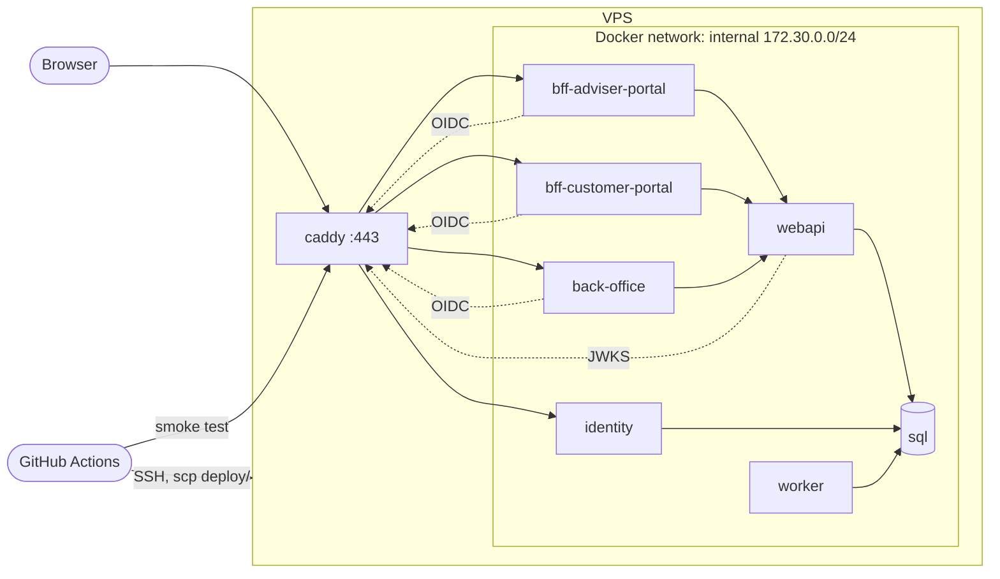

# Deployment

How MyWealthV2 runs on one VPS as a public showcase, and how GitHub Actions delivers it. This doc is `draft`. It is not a build contract. Code changes listed in §13 are built from their own spec or amendment, unless they are config or wiring with no logic.

The owner keeps a private operator runbook with the exact shell commands. It follows this doc. When the two disagree, this doc wins and the runbook is updated.

---

## 1. Summary

GitHub Actions builds one container image per .NET host and pushes it to GHCR. It then copies the `deploy/` folder to the VPS over SSH and runs `deploy.sh`, which pulls the images and starts them with `docker compose`. A reverse proxy (Caddy) is the only public entry. It terminates TLS, rate-limits hosted login, and forwards to the hosts on an internal Docker network. SQL Server runs in the same compose project. After each deploy, a post-deploy smoke test signs in to both portals as the smoke tenant's accounts. A failed smoke test rolls back the image tag and fails the deploy.

There is no database backup. Every piece of state can be rebuilt from an empty VPS (§12).

---

## 2. Scope

**In**

- Target topology on one VPS: containers, networks, volumes, public hostnames
- Image build and delivery from GitHub Actions
- Production configuration of each host
- Where each secret lives
- Post-deploy smoke test and the smoke tenant
- Security baseline for the public internet
- Rebuild runbook
- List of code changes required before the first deploy

**Out**

- Database backup and restore
- High availability, more than one instance of any host, zero-downtime deploy
- A staging environment
- Azure Container Apps (the AppHost still declares an ACA environment; this deployment does not use it)
- Email delivery (`NoOpEmailSender` stays; invite and activation do not work in production)
- Demo data for visitors (deferred, [future-plans.md](future-plans.md) §5)
- Monitoring and alerting beyond container logs

---

## 3. Topology

| Container | Image | Public | Hostname | Notes |
| --- | --- | --- | --- | --- |
| `caddy` | Caddy with the `caddy-ratelimit` module, built on the VPS | Yes (80, 443) | all below | TLS, routing, rate limit. Only container with published ports |
| `identity` | `mywealth-identity` | Through Caddy | `id.<domain>` | OpenIddict + hosted login |
| `bff-adviser-portal` | `mywealth-bff-adviser-portal` | Through Caddy | `adviser.<domain>` | Serves the Adviser Portal SPA build and `/bff/*` |
| `bff-customer-portal` | `mywealth-bff-customer-portal` | Through Caddy | `customer.<domain>` | Serves the Customer Portal SPA build and `/bff/*` |
| `back-office` | `mywealth-back-office` | Through Caddy | `admin.<domain>` | SystemAdmin only |
| `webapi` | `mywealth-webapi` | No | — | Called by the BFFs and Back Office. Runs the schema applicator on start |
| `worker` | `mywealth-worker` | No | — | Hangfire. Outbox, FX rates, instrument prices, reports. Dashboard stays Development-only |
| `sql` | SQL Server 2022, Express edition | No | — | `MSSQL_PID=Express`, `MSSQL_MEMORY_LIMIT_MB=2048` |

`<domain>` is the showcase domain. It is not chosen yet.

**Ports.** Every .NET host listens on `8080` for traffic and on the health port `8081` for `/health` and `/alive` ([features/production-hosting.md](features/production-hosting.md)). Caddy forwards only to `8080`.

**Network.** One Docker network `internal` with the fixed subnet `172.30.0.0/24`. The public hosts trust forwarded headers only from that subnet.

**Issuer and authority.** Tokens carry the public issuer `https://id.<domain>/`, set explicitly on `identity`. Every host that validates tokens or runs OIDC (`webapi`, both BFFs, `back-office`) uses that public URL as `Authentication__Authority` / `Identity__Authority`, not the internal container name, so the issuer always matches. Inside the Docker network, `caddy` carries the network alias `id.<domain>`, so these calls stay on the VPS and still go through TLS.

**Sizing.** About 1–1.5 GB for the six .NET hosts, 2 GB for SQL Server (capped), 0.5 GB for the OS, Docker and Caddy. A 6 GB, 2 vCPU VPS fits with headroom. Add 2 GB of swap.

---

## 4. Images and build

- Each .NET host is built with the SDK container target (`dotnet publish -c Release /t:PublishContainer`). No Dockerfile. The tag is the commit SHA.
- Base image: the .NET 10 ASP.NET chiseled runtime (`ContainerFamily=noble-chiseled`). It has no shell, `curl` or `wget`, and runs as the non-root user `app`, UID 1654.
- The deploy workflow passes the registry and repository on the command line (`-p:ContainerRegistry=ghcr.io -p:ContainerRepository=<owner>/<image>`). The project files do not set `ContainerRepository`. Image names are in §3.
- Each portal is built with `npm ci && npm run build` in CI. The workflow copies the `dist/` output into the BFF project's `wwwroot/` before `dotnet publish`, so the files end up in the BFF image, and the BFF serves them ([bff-adviser-portal.md](features/bff-adviser-portal.md) amendment 2026-11-12). `wwwroot/` in the BFF projects is not committed. Caddy does not hold SPA files, so each portal origin has one upstream.
- Images go to GHCR under the repository owner. The VPS pulls with a read-only token.
- Nothing secret is passed as a build argument. Secrets enter only at run time (§6).

---

## 5. Configuration

Every host runs with `ASPNETCORE_ENVIRONMENT=Production` and `ASPNETCORE_HTTP_PORTS=8080;8081`. Development seeders, the Hangfire dashboard and the dev SPA proxy therefore stay off.

The table lists the keys the compose file sets. Keys marked † are introduced by [features/production-hosting.md](features/production-hosting.md) and ‡ by the [identity-auth.md](features/identity-auth.md) amendment 2026-11-12. production-hosting.md and that amendment are `accepted`, so the † and ‡ names are final.

| Host | Keys |
| --- | --- |
| `webapi` | `ConnectionStrings__MyWealthDbV2`, `Identity__Authority`, `Reports__StorageRoot`, `Bootstrap__SystemAdmin__Email` ‡, `Bootstrap__SystemAdmin__Password` ‡ |
| `identity` | `ConnectionStrings__MyWealthDbV2`, `Identity__AdviserPortalClientSecret`, `Identity__CustomerPortalClientSecret`, `Identity__BackOfficeClientSecret`, `Identity__PortalOrigins__0`, `Identity__CustomerPortalOrigins__0`, `Identity__BackOfficeOrigin`, `Identity__Issuer` †, `Identity__SigningCertificatePath` †, `Identity__EncryptionCertificatePath` †, `Identity__CertificatePassword` †, `DataProtection__KeysPath` †, `ForwardedHeaders__KnownNetworks__0` † |
| `bff-adviser-portal` | `Authentication__Authority`, `Authentication__ClientSecret`, `Authentication__PublicOrigin`, `Api__BaseAddress`, `DataProtection__KeysPath` †, `ForwardedHeaders__KnownNetworks__0` † |
| `bff-customer-portal` | same keys as `bff-adviser-portal`, with its own secret and origin |
| `back-office` | same keys as `bff-adviser-portal`, with its own secret and origin |
| `worker` | `ConnectionStrings__MyWealthDbV2`, `Reports__StorageRoot`, `Eodhd__ApiKey` |

- `Api__BaseAddress` is `http://webapi:8080`. Traffic between containers on the internal network is plain HTTP.
- Each origin key is the public `https://` origin of that host. `Identity__Issuer` is `https://id.<domain>/`.
- `ForwardedHeaders__KnownNetworks__0` is `172.30.0.0/24` (§3).
- `DataProtection__KeysPath` is `/keys`. Each host mounts its own folder there (§7).
- `webapi` and `worker` share the `reports` folder, mounted at the same `Reports__StorageRoot`.

**Repository folder `deploy/`.** Holds everything the VPS needs that is not secret:

| File | Purpose |
| --- | --- |
| `deploy/compose.yml` | The compose project. Values come from `.env` on the VPS |
| `deploy/.env.example` | Every `.env` key with an empty value and a comment. No values |
| `deploy/caddy/Dockerfile` | Caddy with the `caddy-ratelimit` module |
| `deploy/caddy/Caddyfile` | Routing, TLS, rate limits, HSTS (§11) |
| `deploy/deploy.sh` | Deploy one image tag and wait until healthy (§9) |
| `deploy/rollback.sh` | Deploy the previous image tag |

The deploy job copies this folder to `/opt/mywealth` on the VPS on every deploy, so the compose file always comes from the same commit as the images. `.env`, `certs/` and `data/` live only on the VPS and are never in `deploy/`. Because the job overwrites these files, nothing is edited by hand in them on the VPS; anything that differs per server comes from `.env`.

`deploy/.env.example` names every `.env` key, secrets included. Besides the secrets in §6, `.env` holds: `IMAGE_TAG` and `PREVIOUS_IMAGE_TAG` (written by `deploy.sh`), `GHCR_OWNER`, `DOMAIN`, `ACME_EMAIL`, and `ACME_CA`. `ACME_CA` is empty for the production ACME issuer and set to the Let's Encrypt staging directory for a first start (§12).

---

## 6. Secrets

| Secret | Used by | Lives in |
| --- | --- | --- |
| Three OIDC client secrets | `identity` and the matching client host | `.env` on the VPS |
| SQL `sa` password | `sql`, and the connection string of `webapi`, `identity`, `worker` | `.env` on the VPS |
| EODHD API key | `worker` | `.env` on the VPS |
| OpenIddict signing and encryption certificates | `identity` | `certs/` on the VPS: `signing.pfx`, `encryption.pfx` |
| OpenIddict certificate password (one password for both PFX files) | `identity` | `.env` on the VPS |
| Bootstrap SystemAdmin email and password | `webapi`, first start only | `.env` on the VPS. Removed after the first sign-in (§12) |
| Data Protection keys | `identity`, both BFFs, `back-office` | `data/dataprotection/<host>/` on the VPS, written by the hosts |
| VPS SSH private key, host, user, host key | deploy job | GitHub environment `production` secrets `VPS_SSH_KEY`, `VPS_HOST`, `VPS_USER`, `VPS_KNOWN_HOSTS` |
| GHCR read token | VPS `docker login` | VPS, set once. Classic personal access token with `read:packages` only |
| Smoke account passwords | post-deploy smoke test | GitHub environment `production` secrets ([smoke-test.md](smoke-test.md) §5) |

GitHub environment `production` also holds two variables that are not secret: `SMOKE_ADVISER_PORTAL_URL` and `SMOKE_CUSTOMER_PORTAL_URL` ([smoke-test.md](smoke-test.md) §5).

- `.env` is created by hand on the VPS from `deploy/.env.example`, `chmod 600`, owned by the deploy user. GitHub does not hold the runtime secrets. To change one, edit `.env` and run `docker compose up -d`.
- Values in `.env` use letters and digits only. `$` triggers compose interpolation, and quotes or `;` break the SQL connection string.
- SystemAdmin credentials never leave the owner. CI never signs in as SystemAdmin.
- Aspire user secrets are for local Development only. They are not a deployment source.
- The OpenIddict certificates are self-signed and generated on the VPS: RSA 3072, valid 730 days, key usage `digitalSignature` for signing and `keyEncipherment` for encryption. Only the PFX files are kept.

---

## 7. Persistent state

Everything lives under `/opt/mywealth` on the VPS, owned by the deploy user, except the named Docker volumes.

| Path or volume | Kind | Content | If lost |
| --- | --- | --- | --- |
| `sql-data` | Named volume | `MyWealthDbV2` | Rebuild (§12). Smoke data is recreated |
| `data/reports/` | Bind mount | Generated report files | Reports re-run on schedule or on request |
| `data/dataprotection/<host>/` | Bind mount, one folder per host | ASP.NET Core Data Protection key ring of that host | Everyone signs in again |
| `certs/` | Bind mount, read-only | OpenIddict PFX files | Generate new ones; tokens issued earlier stop validating; everyone signs in again |
| `caddy-data`, `caddy-config` | Named volumes | TLS certificates from the ACME issuer, Caddy state | Caddy requests new ones |

- The `<host>` folders are `identity`, `bff-adviser-portal`, `bff-customer-portal` and `back-office`. Each host mounts only its own folder at `/keys`, so no host can read another host's keys.
- The .NET hosts run as UID 1654. `data/reports/`, every `data/dataprotection/<host>/` and `certs/` must belong to UID 1654, or the host fails on first read or write.
- SQL Server runs as UID 10001. Docker sets the ownership of a new named volume, so `sql-data` needs no `chown`.

No backup is taken. A weekly `BACKUP DATABASE` to the VPS disk is a cheap later option, not part of this doc.

---

## 8. Database

- SQL Server 2022 Express in a container. Express is free for production use. Its limits (about 1.4 GB buffer pool, 10 GB per database) fit this project.
- The database `MyWealthDbV2` is created by hand once, with `CREATE DATABASE`, before the first start of `webapi` (§12). The schema applicator creates tables, not the database.
- `webapi` applies pending `database/schema/` scripts on start (ADR 0008). It is the only host that does. Only one `webapi` instance runs. It starts listening only after the scripts are applied.
- Every .NET container has a compose health check that runs the host with `--healthcheck` ([features/production-hosting.md](features/production-hosting.md)). Start order: `sql` healthy → `webapi` healthy → `identity`, `worker` → the BFFs and `back-office` once `identity` and `webapi` are healthy → `caddy`.

---

## 9. CD pipeline

Trigger: push to `master` after the CI workflow passes, or manual dispatch.

1. Build and test (existing CI workflow).
2. Build the portals, copy each `dist/` into its BFF `wwwroot/`, publish the six images, push them to GHCR with tag `<sha>`.
3. Deploy job, GitHub environment `production`, `concurrency: production` (no two deploys at once):
   1. Check out the same commit. Write `VPS_SSH_KEY` and `VPS_KNOWN_HOSTS` to the runner's SSH folder.
   2. `scp -r deploy/.` to `/opt/mywealth` on the VPS. This overwrites `compose.yml`, `caddy/`, `deploy.sh`, `rollback.sh` and `.env.example`, and nothing else.
   3. Run `deploy.sh <sha>` over SSH. The script:
      - writes the current `IMAGE_TAG` to `PREVIOUS_IMAGE_TAG` and the new SHA to `IMAGE_TAG` in `.env`;
      - runs `docker compose build caddy`, so a changed Caddy Dockerfile takes effect;
      - runs `docker compose pull` and `docker compose up -d --remove-orphans --wait`, which returns only when every container with a health check is healthy, and fails otherwise;
      - reloads the Caddyfile (`caddy reload`), so a changed Caddyfile takes effect even when the Caddy container is not recreated;
      - removes dangling image layers, and `mywealth-*` app images whose tag is neither `IMAGE_TAG` nor `PREVIOUS_IMAGE_TAG`. The Caddy builder and base images stay, so the next `build caddy` is a cache hit, and the previous tag stays, so a rollback starts without a pull.
4. Post-deploy smoke test (§10): the deploy workflow calls `.github/workflows/smoke.yml` as a reusable workflow.
5. If the smoke test fails, a rollback job runs `rollback.sh` over SSH. It deploys `PREVIOUS_IMAGE_TAG` with the same script. The workflow still ends red, so the failure is visible.

A rollback does not undo schema scripts. A script must stay compatible with the previous image for one deploy, or the rollback is manual. A rollback also keeps the `deploy/` files of the newer commit. A change to `compose.yml` must therefore work with the previous image for one deploy as well.

---

## 10. Post-deploy smoke test

Playwright, run from the GitHub runner against the public hostnames. The cases, the smoke tenant, the test project and its secrets are owned by [smoke-test.md](smoke-test.md).

| # | Account | Proves |
| --- | --- | --- |
| S1 | Smoke Adviser sees the Dashboard with its net-worth section | TLS, Caddy routing, OIDC through `bff-adviser-portal`, `webapi`, SQL |
| S2 | Smoke Customer sees their Account | The second OIDC client and Customer scope |

- Both cases only read. They post nothing.
- In production the smoke tenant is created by hand after the first deploy (§12), with the TenantCode, emails and rows fixed in [smoke-test.md](smoke-test.md) §3. It stays enabled.
- Toggling the smoke tenant on and off around each run was considered and rejected: it needs SystemAdmin credentials in CI, and a cancelled job leaves the tenant enabled anyway.

---

## 11. Security baseline

- Caddy is the only container with published ports. `webapi`, `worker` and `sql` are never reachable from outside. Scalar on `webapi` is therefore not public.
- Health endpoints answer only on the health port `8081`, which Caddy never forwards to. On port `8080` they return 404.
- Caddy rate-limits `POST /login` and `/connect/token` on `id.<domain>` per client IP (about 10 per minute), plus a loose global limit per IP on every host (about 300 per minute). The stock Caddy image has no rate limiting, so `deploy/caddy/Dockerfile` builds Caddy with the `caddy-ratelimit` module. Rate limiting is not added inside the hosts in this deploy.
- HSTS on every public hostname, set by Caddy. The hosts do not redirect to HTTPS themselves; Caddy redirects HTTP to HTTPS.
- Docker writes its own firewall rules, so a published container port bypasses the host firewall. No service except `caddy` has `ports:`.
- Firewall on the VPS: allow 22, 80, 443 only. SSH by key only; password login is off for every user, root included. The deploy user is in the `docker` group, which is root-equivalent, and has no `sudo`.

Known gaps, accepted for the showcase (record them in [known-issues/](known-issues/README.md) when this doc is accepted):

- Hosted login has no account lockout. `Login.cshtml.cs` uses `UserManager.CheckPasswordAsync`, which does not count failures. A per-IP limit does not stop attempts spread over many IPs. Lockout interacts with the uniform failure rule (identity-auth R3) and needs its own amendment.
- A refresh grant does not re-check user status or the tenant flag. Revocation after disable or password change waits for the outbox ([identity-auth.md](features/identity-auth.md), amendment 2026-11-11). A dead-lettered event leaves a refresh token valid for up to 14 days.
- Data Protection keys are stored unencrypted at rest in `data/dataprotection/`. Anyone with root or `docker` access on the VPS can read them, which already gives full control of the hosts.

---

## 12. Rebuild runbook (empty VPS)

The operator runbook holds the commands. This list is the order and the outcome of each step.

1. Install the OS updates, create the deploy user with key-only SSH, turn off password login, configure the firewall (§11) and 2 GB of swap.
2. Install Docker from Docker's own package repository, with the compose plugin. Add the deploy user to the `docker` group. Cap container logs (`json-file`, 20 MB × 5).
3. Point the four hostnames at the VPS. Wait until all four resolve before Caddy starts; failed ACME validations count against the issuer's rate limit.
4. Create `/opt/mywealth` with `certs/`, `data/reports/` and one `data/dataprotection/<host>/` per host (§7). Give `certs/` and `data/` to UID 1654.
5. Create `.env` from `deploy/.env.example` (§6). Keep a copy in the owner's password manager.
6. Generate the OpenIddict certificates into `certs/` (§6).
7. `docker login ghcr.io` with the read token.
8. Run the deploy workflow once by hand with the smoke test skipped. It copies `deploy/` to the VPS. Its first health wait fails because the database does not exist yet; the images and files are in place.
9. Start `sql` alone and create the database `MyWealthDbV2` (§8).
10. Set `ACME_CA` in `.env` to the staging issuer. Run `deploy.sh` with the current `master` SHA on the VPS. Once all four hostnames serve a staging certificate, clear `ACME_CA`, remove the `caddy-data` volume and start Caddy again, so it requests production certificates.
11. Sign in to Back Office as the bootstrap SystemAdmin ([identity-auth.md](features/identity-auth.md) amendment 2026-11-12). Remove the `Bootstrap__SystemAdmin__*` values from `.env` and run `docker compose up -d webapi`.
12. Create the smoke tenant and the asserted data ([smoke-test.md](smoke-test.md) §3). Store the Adviser and Customer passwords as GitHub secrets `SMOKE_ADVISER_PASSWORD` and `SMOKE_CUSTOMER_PASSWORD`, and the two portal URLs as variables, in environment `production`.
13. Run the deploy workflow by hand with the smoke test on. It must go green end to end.

The runbook is the restore plan. Run it once on a throwaway VPS before the real deploy.

---

## 13. Code changes required before the first deploy

Found while writing this doc (2026-11-11). Updated 2026-11-12 with the decisions made in discussion.

| # | Gap today | Needed | Owner |
| --- | --- | --- | --- |
| 1 | `src/IdentityHost/Program.cs` always calls `AddDevelopmentEncryptionCertificate()` / `AddDevelopmentSigningCertificate()` and `DisableTransportSecurityRequirement()`. `architecture.md` already requires a production certificate | Landed: outside Development, load `signing.pfx` and `encryption.pfx` from `certs/`, set the issuer from `Identity__Issuer`, keep the transport security requirement on ([production-hosting.md](features/production-hosting.md) R1–R5) | Done |
| 2 | No host persists Data Protection keys | Landed: `identity`, both BFFs and `back-office` persist keys to their own folder and set an explicit application name ([production-hosting.md](features/production-hosting.md) R9, R10) | Done |
| 3 | Forwarded headers are applied only in Development (both BFFs, `back-office`). `identity` has none. `identity` and `webapi` call `UseHttpsRedirection` outside Development, which loops behind a TLS-terminating proxy and redirects the BFFs' plain-HTTP calls to `webapi` | Landed: outside Development, the public hosts trust `X-Forwarded-Proto` and `X-Forwarded-For` from the internal subnet only. `X-Forwarded-Host` is not needed: Caddy keeps the original `Host`. `identity` and `webapi` stop redirecting to HTTPS; `webapi` stops sending HSTS ([production-hosting.md](features/production-hosting.md) R6–R8, R11) | Done |
| 4 | The BFFs serve the SPA only through `DevelopmentSpaProxy` | Serve the built SPA from `wwwroot` outside Development, with fallback to `index.html` for client routes | Amendments 2026-11-12 to [bff-adviser-portal.md](features/bff-adviser-portal.md) and [bff-customer-portal.md](features/bff-customer-portal.md) |
| 5 | `MapDefaultEndpoints` maps `/health` and `/alive` only in Development. Chiseled images cannot run `curl` for a compose health check | Landed: outside Development they are mapped on the health port only, matched on the connection's local port. Each host accepts `--healthcheck`, calls its own `/health` and exits ([production-hosting.md](features/production-hosting.md) R12–R15) | Done |
| 6 | The SystemAdmin exists only through `DevelopmentIdentitySeeder`. Production has no SystemAdmin | Landed: on start, `webapi` creates one SystemAdmin from `Bootstrap__SystemAdmin__*` when none exists, and fails before it listens when that configuration is incomplete or invalid ([identity-auth.md](features/identity-auth.md) amendment 2026-11-12, A25–A31) | Done |
| 7 | `TestSeed` runs only in Development. [tenants.md](features/tenants.md) R17 allows seeding only in Development | Decided 2026-11-12: no demo data for the first deploy. Recorded in [future-plans.md](future-plans.md) §5 | — |
| 8 | The AppHost is Azure-shaped (`AddAzureContainerAppEnvironment`, `AddAzureSqlServer`) | Landed: the `deploy/` folder (§5): `compose.yml`, `.env.example`, `caddy/Dockerfile`, `caddy/Caddyfile`, `deploy.sh`, `rollback.sh`. The AppHost stays the Development orchestrator | Done |
| 9 | No Playwright project | Landed: `tests/Smoke.Tests`, its Development seed and `.github/workflows/smoke.yml` ([smoke-test.md](smoke-test.md) §8) | Done |
| 10 | No image publish or deploy workflow | Landed: `.github/workflows/deploy.yml` (§9), SPA copy into `wwwroot/`, `wwwroot/` of both BFFs in `.gitignore`. Serving that build still waits on item 4 | Done |

Suggested build order: 1, 3, 2, 5 (all in host start-up, mostly ServiceDefaults), then 4, then 6, then 8 and 10, then a rehearsal of §12 on a throwaway VPS.

---

## 14. Open decisions

- **Domain name** and the four hostnames. The compose file and the Caddyfile take it from `DOMAIN` in `.env`, so nothing in the repository waits for it.
