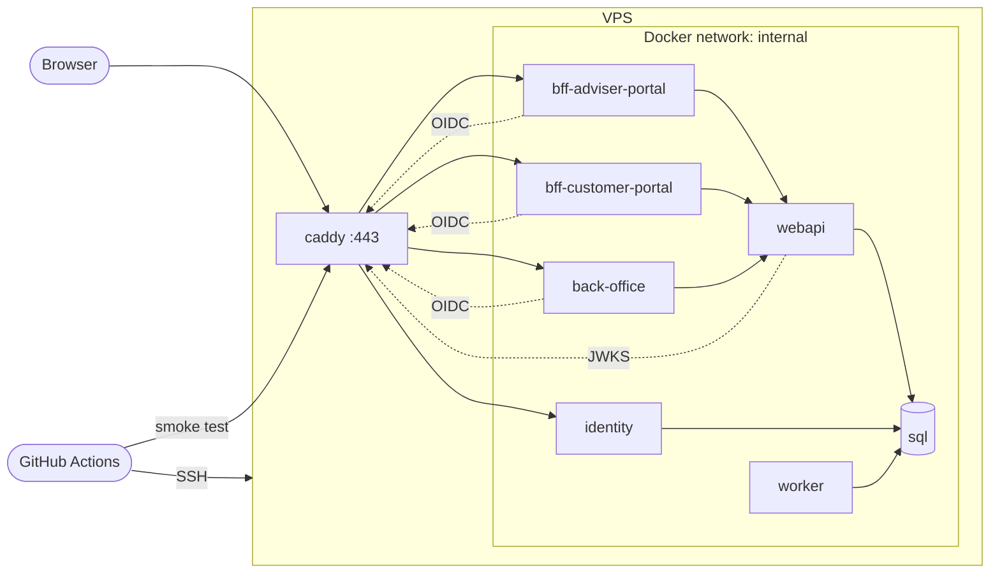

# Deployment

How MyWealthV2 runs on one VPS as a public showcase, and how GitHub Actions delivers it. This doc is `draft`. It is not a build contract. Code changes listed in §13 need their own spec or amendment before they are built, unless they are config or wiring with no logic.

---

## 1. Summary

GitHub Actions builds one container image per .NET host and pushes it to GHCR. It then connects to the VPS over SSH and runs `docker compose pull` and `docker compose up -d`. A reverse proxy (Caddy) is the only public entry. It terminates TLS, rate-limits hosted login, and forwards to the hosts on an internal Docker network. SQL Server runs in the same compose project. After each deploy, a post-deploy smoke test signs in to both portals as the smoke tenant's accounts. A failed smoke test fails the deploy.

There is no database backup. Every piece of state can be rebuilt from an empty VPS (§12).

---

## 2. Scope

**In**

- Target topology on one VPS: containers, networks, volumes, public hostnames
- Image build and delivery from GitHub Actions
- Production configuration of each host
- Where each secret lives
- Post-deploy smoke test and the smoke tenant
- Security baseline for the public internet
- Rebuild runbook
- List of code changes required before the first deploy

**Out**

- Database backup and restore
- High availability, more than one instance of any host, zero-downtime deploy
- A staging environment
- Azure Container Apps (the AppHost still declares an ACA environment; this deployment does not use it)
- Email delivery (`NoOpEmailSender` stays; invite and activation do not work in production)
- Monitoring and alerting beyond container logs

---

## 3. Topology

| Container | Image | Public | Hostname | Notes |
| --- | --- | --- | --- | --- |
| `caddy` | Caddy | Yes (80, 443) | all below | TLS, routing, rate limit. Only container with published ports |
| `identity` | `IdentityHost` | Through Caddy | `id.<domain>` | OpenIddict + hosted login |
| `bff-adviser-portal` | `BffAdviserPortal` | Through Caddy | `adviser.<domain>` | Serves the Adviser Portal SPA build and `/bff/*` |
| `bff-customer-portal` | `BffCustomerPortal` | Through Caddy | `customer.<domain>` | Serves the Customer Portal SPA build and `/bff/*` |
| `back-office` | `BackOffice` | Through Caddy | `admin.<domain>` | SystemAdmin only |
| `webapi` | `Web` | No | — | Called by the BFFs and Back Office. Runs the schema applicator on start |
| `worker` | `Worker` | No | — | Hangfire. Outbox, FX rates, instrument prices, reports. Dashboard stays Development-only |
| `sql` | SQL Server 2022, Express edition | No | — | `MSSQL_PID=Express`, `MSSQL_MEMORY_LIMIT_MB=2048` |

`<domain>` is the showcase domain. It is not chosen yet.

**Issuer and authority.** Tokens carry the public issuer `https://id.<domain>/`. Every host that validates tokens or runs OIDC (`webapi`, both BFFs, `back-office`) uses that public URL as `Authentication__Authority` / `Identity__Authority`, not the internal container name, so the issuer always matches. Inside the Docker network, `caddy` carries the network alias `id.<domain>`, so these calls stay on the VPS and still go through TLS.

**Sizing.** About 1–1.5 GB for the six .NET hosts, 2 GB for SQL Server (capped), 0.5 GB for the OS, Docker and Caddy. A 6 GB, 2 vCPU VPS fits with headroom. Add 2 GB of swap.

---

## 4. Images and build

- Each .NET host is built with the SDK container target (`dotnet publish -c Release /t:PublishContainer`). No Dockerfile. Each project sets `ContainerRepository`. The tag is the commit SHA.
- Base image: the .NET 10 ASP.NET chiseled runtime.
- Each portal is built with `npm ci && npm run build` in CI. The output goes into its BFF image, and the BFF serves it (§13 item 4). Caddy does not hold SPA files, so each portal origin has one upstream.
- Images go to GHCR under the repository owner. The VPS pulls with a read-only token.
- Nothing secret is passed as a build argument. Secrets enter only at run time (§6).

---

## 5. Configuration

Every host runs with `ASPNETCORE_ENVIRONMENT=Production`. Development seeders, the Hangfire dashboard and the dev SPA proxy therefore stay off.

Configuration keys below are the ones the AppHost sets today. The compose file sets the same keys.

| Host | Keys |
| --- | --- |
| `webapi` | `ConnectionStrings__MyWealthDbV2`, `Identity__Authority`, `Reports__StorageRoot` |
| `identity` | `ConnectionStrings__MyWealthDbV2`, `Identity__AdviserPortalClientSecret`, `Identity__CustomerPortalClientSecret`, `Identity__BackOfficeClientSecret`, `Identity__PortalOrigins__0`, `Identity__CustomerPortalOrigins__0`, `Identity__BackOfficeOrigin` |
| `bff-adviser-portal` | `Authentication__Authority`, `Authentication__ClientSecret`, `Authentication__PublicOrigin`, `Api__BaseAddress` |
| `bff-customer-portal` | same keys as `bff-adviser-portal`, with its own secret and origin |
| `back-office` | same keys as `bff-adviser-portal`, with its own secret and origin |
| `worker` | `ConnectionStrings__MyWealthDbV2`, `Reports__StorageRoot`, `Eodhd__ApiKey` |

- `Api__BaseAddress` is `http://webapi:8080`. Traffic between containers on the internal network is plain HTTP.
- Each origin key is the public `https://` origin of that host.
- `webapi` and `worker` share the `reports` volume, mounted at the same `Reports__StorageRoot`.

The compose file and a `.env.example` (names only, no values) live in the repository. Their folder is chosen when §13 is built.

---

## 6. Secrets

| Secret | Used by | Lives in |
| --- | --- | --- |
| Three OIDC client secrets | `identity` and the matching client host | `.env` on the VPS |
| SQL `sa` password | `sql`, and the connection string of `webapi`, `identity`, `worker` | `.env` on the VPS |
| EODHD API key | `worker` | `.env` on the VPS |
| OpenIddict signing and encryption certificates | `identity` | `certs` volume on the VPS |
| Data Protection keys | `identity`, both BFFs, `back-office` | `dataprotection` volume on the VPS, written by the hosts |
| VPS SSH private key | deploy job | GitHub environment secret `production` |
| GHCR read token | VPS `docker login` | VPS, set once |
| Smoke account passwords | post-deploy smoke test | GitHub environment secret `production` ([smoke-test.md](smoke-test.md) §5) |

- `.env` is created by hand on the VPS, `chmod 600`, owned by the deploy user. GitHub does not hold the runtime secrets. To change one, edit `.env` and run `docker compose up -d`.
- SystemAdmin credentials never leave the owner. CI never signs in as SystemAdmin.
- Aspire user secrets are for local Development only. They are not a deployment source.

---

## 7. Persistent state

| Volume | Content | If lost |
| --- | --- | --- |
| `sql-data` | `MyWealthDbV2` | Rebuild (§12). Demo and smoke data are recreated |
| `reports` | Generated report files | Reports re-run on schedule or on request |
| `dataprotection` | ASP.NET Core Data Protection key ring | Everyone signs in again |
| `certs` | OpenIddict certificates | Generate new ones; tokens issued earlier stop validating; everyone signs in again |
| `caddy-data` | TLS certificates from the ACME issuer | Caddy requests new ones |

No backup is taken. A weekly `BACKUP DATABASE` to the VPS disk is a cheap later option, not part of this doc.

---

## 8. Database

- SQL Server 2022 Express in a container. Express is free for production use. Its limits (about 1.4 GB buffer pool, 10 GB per database) fit this project.
- `webapi` applies pending `database/schema/` scripts on start (ADR 0008). It is the only host that does. Only one `webapi` instance runs.
- Compose start order: `sql` healthy → `webapi` healthy → `identity`, `worker` → the BFFs and `back-office`. Health needs an endpoint in Production (§13 item 5).

---

## 9. CD pipeline

Trigger: push to `master` after the CI workflow passes, or manual dispatch.

1. Build and test (existing CI workflow).
2. Build the portals, publish the six images, push them to GHCR with tag `<sha>`.
3. Deploy job, GitHub environment `production`, `concurrency: production` (no two deploys at once):
   1. SSH to the VPS.
   2. Write `IMAGE_TAG=<sha>` into the compose environment. Keep the previous tag.
   3. `docker compose pull && docker compose up -d`.
   4. Wait until every container is healthy.
4. Post-deploy smoke test (§10).
5. If the smoke test fails, set `IMAGE_TAG` back to the previous tag and run `docker compose up -d`. The job still fails, so the failure is visible.

A rollback does not undo schema scripts. A script must stay compatible with the previous image for one deploy, or the rollback is manual.

---

## 10. Post-deploy smoke test

Playwright, run from the GitHub runner against the public hostnames. The cases, the smoke tenant, the test project and its secrets are owned by [smoke-test.md](smoke-test.md).

| # | Account | Proves |
| --- | --- | --- |
| S1 | Smoke Adviser sees the Dashboard with its net-worth section | TLS, Caddy routing, OIDC through `bff-adviser-portal`, `webapi`, SQL |
| S2 | Smoke Customer sees their Account | The second OIDC client and Customer scope |

- Both cases only read. They post nothing.
- In production the smoke tenant is created by hand after the first deploy (§12). It stays enabled.
- Toggling the smoke tenant on and off around each run was considered and rejected: it needs SystemAdmin credentials in CI, and a cancelled job leaves the tenant enabled anyway.

---

## 11. Security baseline

- Caddy is the only container with published ports. `webapi`, `worker` and `sql` are never reachable from outside. Scalar on `webapi` is therefore not public.
- Caddy rate-limits `POST /login` and `/connect/token` on `id.<domain>` per client IP (about 10 per minute), plus a loose global limit per IP on every host. Rate limiting is not added inside the hosts in this deploy.
- HSTS on every public hostname.
- Firewall on the VPS: allow 22, 80, 443 only. SSH by key only.

Known gaps, accepted for the showcase (record them in [known-issues/](known-issues/README.md) when this doc is accepted):

- Hosted login has no account lockout. `Login.cshtml.cs` uses `UserManager.CheckPasswordAsync`, which does not count failures. A per-IP limit does not stop attempts spread over many IPs. Lockout interacts with the uniform failure rule (identity-auth R3) and needs its own amendment.
- A refresh grant does not re-check user status or the tenant flag. Revocation after disable or password change waits for the outbox ([identity-auth.md](features/identity-auth.md), amendment 2026-11-11). A dead-lettered event leaves a refresh token valid for up to 14 days.

---

## 12. Rebuild runbook (empty VPS)

1. Install Docker. Configure the firewall and swap.
2. Point the four hostnames at the VPS.
3. Copy the compose file. Create `.env` from `.env.example`.
4. Generate the OpenIddict certificates into the `certs` volume (§13 item 1).
5. `docker login ghcr.io` with the read token.
6. Set `IMAGE_TAG` to the current `master` SHA. `docker compose up -d`.
7. Sign in to Back Office as the bootstrap SystemAdmin (§13 item 6).
8. Create the smoke tenant and the asserted data ([smoke-test.md](smoke-test.md) §3). Store the Adviser and Customer passwords as GitHub secrets `SMOKE_ADVISER_PASSWORD` and `SMOKE_CUSTOMER_PASSWORD` in environment `production`.
9. Run the smoke test workflow by hand.

The runbook is the restore plan. Run it once on a throwaway VPS before the real deploy.

---

## 13. Code changes required before the first deploy

Found while writing this doc (2026-11-11). Each item needs a Feature Spec or amendment, unless marked wiring.

| # | Gap today | Needed |
| --- | --- | --- |
| 1 | `src/IdentityHost/Program.cs` always calls `AddDevelopmentEncryptionCertificate()` / `AddDevelopmentSigningCertificate()`. `architecture.md` already requires a production certificate | Load certificates from the `certs` volume outside Development. Set the issuer explicitly to the public URL. Review `DisableTransportSecurityRequirement` once forwarded headers work |
| 2 | No host persists Data Protection keys | `identity`, both BFFs and `back-office` persist keys to the `dataprotection` volume, with one shared application name per host. Wiring |
| 3 | Forwarded headers are applied only in Development (both BFFs). `identity`, `back-office`, `webapi` have none. `identity` and `webapi` call `UseHttpsRedirection` outside Development, which loops behind a TLS-terminating proxy | Trust `X-Forwarded-Proto` and `X-Forwarded-Host` from the internal network in every public host, in Production |
| 4 | The BFFs serve the SPA only through `DevelopmentSpaProxy` | Serve the built SPA from the BFF in Production, with fallback to `index.html` for client routes. Amendment to [bff-adviser-portal.md](features/bff-adviser-portal.md) and [bff-customer-portal.md](features/bff-customer-portal.md) |
| 5 | `MapDefaultEndpoints` maps `/health` and `/alive` only in Development | Map them in Production on the internal port only, not routed by Caddy. Wiring |
| 6 | The SystemAdmin exists only through `DevelopmentIdentitySeeder`. Production has no SystemAdmin | A production bootstrap: create one SystemAdmin from configuration when none exists. Amendment to [identity-auth.md](features/identity-auth.md) |
| 7 | `TestSeed` runs only in Development. [tenants.md](features/tenants.md) R17 allows seeding only in Development | Demo data for visitors. Open decision (§14) |
| 8 | The AppHost is Azure-shaped (`AddAzureContainerAppEnvironment`, `AddAzureSqlServer`) | Hand-written compose file for the VPS. The AppHost stays the Development orchestrator. Config |
| 9 | No Playwright project | Add the smoke test project, its Development seed and its workflow ([smoke-test.md](smoke-test.md) §8) |

---

## 14. Open decisions

- **Demo data.** Whether visitors get shared demo accounts, whether those accounts can write, and whether a job resets the demo tenant on a schedule. This decides item 7 and needs a spec before any production seeding.
- **Domain name** and the four hostnames.
- **Compose folder** in the repository.
