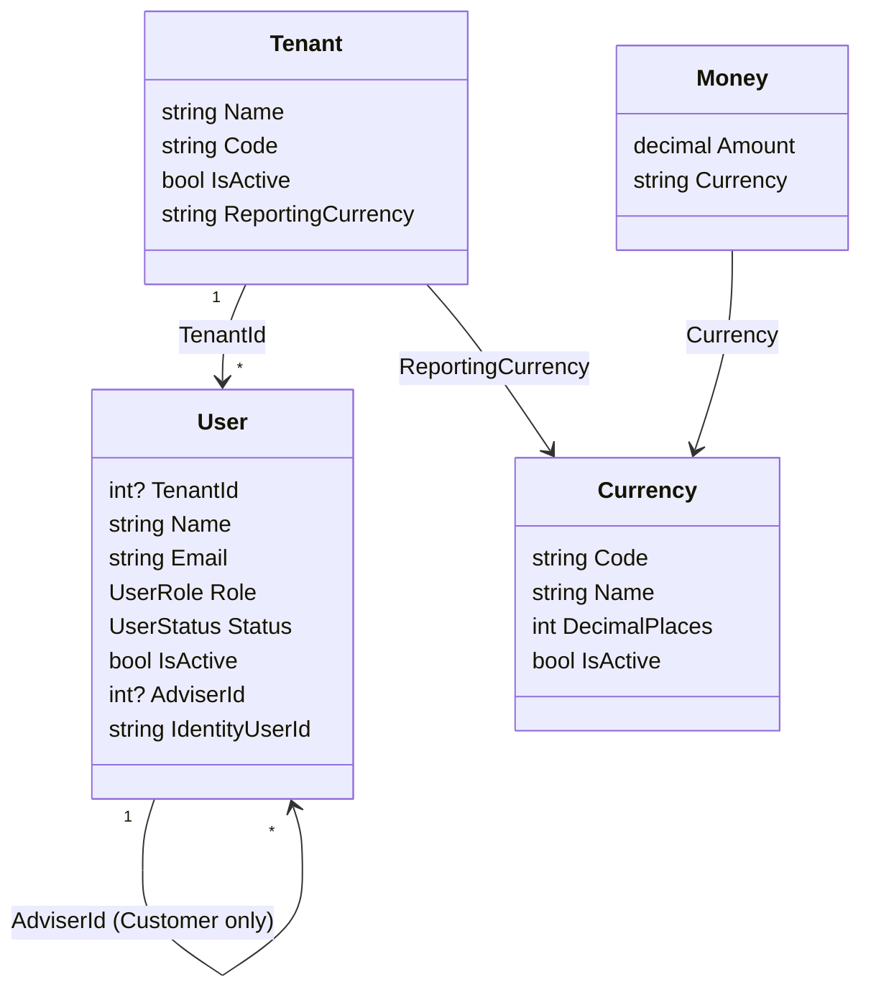

# Domain model

This document owns **aggregates, value objects, invariants, and domain events**. Scope and phasing live in the function plan. Tables live in database design. HTTP lives in API design.

**Product:** MyWealthV2.

Same rule as the function plan: if a later phase will use it and today's model would have to change, write the final model now. If later use or shape is not decided, wait. Write now: a complete `UserStatus` machine whose invite transition has no Phase-1 entry; Customer as a login principal; `Money` with no balance column. Wait: a single `Transactions.Type` that pretends to be both cash and securities; ledger tables whose storage is still open.

The session protocol (OpenIddict, authorization code + PKCE, refresh) lives on the authorization server / in Infrastructure. It is **not** a domain aggregate. The domain only answers whether a person may be issued a session (tenant enabled, `UserStatus`, role, identity link).

---

## 1. Modelling rules

- Entities inherit `BaseEntity` (`int Id`) or `BaseAuditableEntity`. APIs expose `PublicId` (UUID). Internal keys do not appear in routes or JSON.
- Tenant-scoped business entities carry `TenantId`. Isolation is shared database + database FK + application dual check + EF global query filter (safety net) + isolation tests. The filter is engaged only when a tenant id is known. SystemAdmin has no tenant, so the filter stays disengaged.
- A currency code must exist in the platform catalog and, when used as a **new** reference, be enabled. Access is through `ICurrencyCatalog`. The hot path does not JOIN.
- `Money` is a domain value object (amount + currency). Never persist a bare `decimal`. Phase 1 has no balance column; the type still lives in Domain so the ledger does not invent a second amount shape.
- Invariants live on entities / domain services, not only in FluentValidation.
- Identity stays in Infrastructure. Domain `User.IdentityUserId` points at the login principal. The link is one-way. There is no reverse domain association and no reverse database FK.
- Five roles share one Domain `Users` table and one `ApplicationUser` table (the fifth, `SimulatorOperator`, from ADR 0013 amendment 2026-11-19). Role is immutable. A Customer is a login principal from day one. No Customer Portal client in Phase 1 does not mean no identity.
- The `UserStatus` machine is written once. Phase 1 create may set a password and land in `Active`. `PendingActivation` + `UserTokens` + `IEmailSender` are the invitation seams, not a half-boolean.
- OpenIddict clients, token stores, and the hosted login page are **not** Domain types.
- The Phase-2 ledger is thought as sub-ledgers (cash leg / security leg). §8 records the conceptual model and locked tendencies. It does **not** lock undecided storage (journal header, one vs two physical rows for a buy, Opening columns, close-and-liquidate, daily snapshots).

---

## 2. Phase 1 type diagram



- `Currency` is platform master data. It does not belong to a tenant.
- For SystemAdmin, `TenantId` and `AdviserId` are empty.
- `ApplicationUser` and OpenIddict stores sit outside this diagram.
- `UserToken` is an infrastructure seam (invite / reset hash). Phase 1 has no domain behaviour on it; it is not an aggregate on the diagram.

---

## 3. Aggregates and responsibilities (Phase 1)

| Type | Kind | Responsibility |
| --- | --- | --- |
| Tenant | Aggregate | Firm; login code; reporting currency; enabled flag |
| User | Aggregate | Person in any of the four roles; status machine; adviser assignment; link to Identity |
| Currency | Platform entity | ISO catalog; read through `ICurrencyCatalog` |
| Money | Value object | Amount + currency; equality is currency+amount; no cross-currency arithmetic |
| UserToken | Infrastructure entity | Reserved for invite / reset; no Phase-1 write use case and no domain methods |

Authorization (named policies, `RolePermissions`, handler scope checks) is not a domain object. The domain supplies Role / TenantId / AdviserId / Status for the application layer to apply.

---

## 4. Invariants (Phase 1)

### 4.1 Tenant

- `Tenant.Code` is globally unique, case-insensitive, and used at login. Character class `[a-z0-9-]`, length 2–50 (shape-compatible with a later subdomain label; Phase 1 does not parse Host).
- `Tenant.Name` is globally unique, CI.
- `ReportingCurrency` ∈ enabled rows in `Currencies` when **newly set**. identity-auth created Tenant without this column; the currencies slice adds it. Phase 1 may change reporting currency (no ledger balances keyed on it yet). A later disable of that catalog row does not rewrite this field.
- After `IsActive = false`, that Code must not complete login; existing refresh must fail. The check runs in the authorization server / resource pipeline against this invariant.
- A tenant may be re-enabled. Login with that Code works again only if the person’s `Status` is still `Active`.
- `RowVersion` conflict → HTTP 409.
- `Rename` changes `Name` (non-empty; uniqueness is application). `Enable` / `Disable` flip `IsActive` and raise `TenantEnabled` / `TenantDisabled` only when the flag actually changes. `Create` raises `TenantCreated`.
- (tenant custody modes) A Tenant has **allowed custody modes**, `External`, `Custodial` or both, never none. `Create` allows both and keeps its signature. `SetAllowedCustodyModes` replaces the set and refuses an empty one; `Allows(CustodyMode)` reads it. No event. An account is opened only in a mode its Tenant allows at the time of open; Application holds that check, and narrowing the setting changes no existing account ([features/tenant-custody-modes.md](features/tenant-custody-modes.md)).
- (orders) A Tenant may name a **broker connection** (`BrokerConnection`, a name from configuration, or none). `SetBrokerConnection(name)` sets it; it is not cleared. An order keeps the connection it was placed on ([features/orders.md](features/orders.md) R3).

### 4.2 Person

Role shape (CHECK-level, not a transition accident):

- SystemAdmin: `TenantId` empty, `AdviserId` empty. Email unique **globally**.
- SimulatorOperator: `TenantId` empty, `AdviserId` empty. Email unique among platform-level people (shared with SystemAdmin). No permission; never a `webapi` caller ([features/simulator.md](features/simulator.md), landed 2026-11-19).
- TenantAdmin / Adviser: `TenantId` required, `AdviserId` empty.
- Customer: `TenantId` required, `AdviserId` required; target is same-tenant, Role=Adviser, not Disabled.
- All five roles have a login principal: `IdentityUserId` required, points at an existing Identity user, one-to-one.

Uniqueness and immutability:

- Email is unique inside a tenant (filtered unique where `TenantId IS NOT NULL`). Login resolves Domain `User` by `tenantCode + email`, then verifies the password.
- `Role`, `TenantId`, and `Email` cannot change. `Name` can.
- A Customer’s `AdviserId` may be reassigned to another non-disabled Adviser in the same tenant. Method: `User.ReassignAdviser`. Pointer change raises `CustomerAdviserReassigned`. Same id is a no-op. Create does not raise that event.

Status machine (written once):

```text
create ──password path──► Active
create ──no password / invite seam──► PendingActivation ──set password──► Active
Active ──disable──► Disabled
Disabled ──re-enable──► Active
PendingActivation ──disable──► Disabled
```

- Only `Active` may complete authorization-server login. `PendingActivation` and `Disabled` may not.
- `Users.IsActive` is derived from that machine (`Active` → 1; otherwise 0). List `enabledOnly=true` uses the bit. Login still reads `Status`, not the bit alone.
- Phase 1 admin APIs may create with a password and land in `Active` (invitation delivery is not built; that is not an excuse to collapse the machine to a boolean).
- Disable, re-enable, and password change run on the resource API. The authorization server reads Status and tenant enabled at login. Password change / disable / logout revoke that subject's OpenIddict tokens — an application consequence driven by domain events. The User aggregate does not hold tokens.

Disable guards:

- Disable Adviser: reject while assigned Customers are not Disabled; reassign or disable them first. Method: `User.DisableAdviser(bool hasNonDisabledAssignedCustomers)`. `Disable()` stays for TenantAdmin / Customer.
- Disable Customer: reject while any Account for that person is still active (`IsActive`). Closed-only Customers may be disabled. Do not bulk-close. Guard lives on `DisableCustomer`, not on `User.Disable()`.
- Disabling the last TenantAdmin is allowed (known gap).
- Disabling a tenant does **not** bulk-update `User.Status`. Person status is independent; login checks both.

### 4.3 Currency

- Code is ISO 4217, three letters, upper case.
- `DecimalPlaces` is the ISO minor-unit count for input / display / validation (JPY = 0, NZD = 2). It is not the SQL scale of a money column. Phase-2 amount columns stay `decimal(18,4)` for every currency.
- `IsActive` is a **platform** flag on the catalog row. It is not bound to a tenant. One change is visible to every tenant's picker; existing `ReportingCurrency` values are left alone.
- A disabled currency cannot be used as a **new** `ReportingCurrency`. Tenants that already reference it keep the historical value.
- Phase 1 has no currency write API. The catalog is read-only. Seed: NZD, AUD, USD, EUR, GBP, JPY.
- `Money` does not look up the catalog and does not round to `DecimalPlaces`.

### 4.4 Session boundary (not an aggregate)

The domain does **not** contain: OIDC client, authorization code, refresh token, hosted login page.

The domain **does** supply the login gate:

- Non-SystemAdmin must resolve to an enabled Tenant by Code.
- The User for that email in that tenant must exist, `Status = Active`, and `IdentityUserId` must be valid.
- A Customer passing the gate does not receive adviser-management policies. A portal is an OIDC client plus a role gate, not a second kind of person.

---

## 5. Enumerations (Phase 1)

**UserRole:** `SystemAdmin`, `TenantAdmin`, `Adviser`, `Customer`, `SimulatorOperator` (value 4; ADR 0013 amendment 2026-11-19, landed)  
**UserStatus:** `PendingActivation`, `Active`, `Disabled`

Phase 1 added no fifth role; `SimulatorOperator` comes from [ADR 0021](adr/0021-outside-parties-behind-ports.md). Do not add a role inside a tenant. Ledger permission names are registered when the ledger domain opens. Do not hang empty policies in Phase 1.

---

## 6. Domain events (Phase 1)

Raise even if there is no subscriber yet. The application uses these events to revoke tokens and write audit.

Events are written to `OutboxMessages` in the same database transaction as the business changes (ADR 0018, accepted). Implementation follows [features/outbox.md](features/outbox.md). `Payload` is the serialised domain event. `TenantId` is also stored as a column. Delivery is at-least-once from the background worker via MediatR. A handler failure does not roll back the original change; the side effect is eventually consistent and retryable. Token revocation after a user disable, a password change, or a tenant disable is one of those side effects. See [adr/0018-transactional-outbox.md](adr/0018-transactional-outbox.md) and [fixes/domain-event-dispatch.md](fixes/domain-event-dispatch.md).

| Event | When |
| --- | --- |
| `TenantCreated` | New firm |
| `TenantEnabled` / `TenantDisabled` | Enabled flag changes |
| `UserCreated` | After the dual write for any role |
| `UserActivated` | Entered Active (create-as-Active, invite activation, or re-enable from Disabled) |
| `UserDisabled` | Entered Disabled |
| `UserPasswordChanged` | Resource-API password change succeeded (revoke tokens for the subject) |
| `CustomerAdviserReassigned` | `ReassignAdviser` actually changed the pointer. Payload: `CustomerId`, `TenantId`, `PreviousAdviserId`, `NewAdviserId`. No handler in the customers slice |

Do not model OpenIddict token revocation itself as a domain event.

---

## 7. Explicitly out of the Phase 1 model

Do not create entities, tables, or empty aggregate roots for:

- Account, Holding, CashEntry, Journal, Transaction
- Household / KYC / an invitation domain service (`UserTokens` table may exist with no behaviour)
- Account balances, holding quantities, net worth
- Refresh tokens, OIDC clients, authorization codes

`Instrument` and `IMarketData` ship with the instruments slice (§8.4). `IMarketData` is implemented by the instrument-prices slice ([features/instrument-prices.md](features/instrument-prices.md), accepted 2026-11-02): local `InstrumentPrices` table, EODHD daily job at 12:00 UTC, missing → empty. `IFxRate` is implemented by the fx-rates slice ([features/fx-rates.md](features/fx-rates.md), accepted 2026-11-02): local `FxRates` table, Frankfurter hourly job, same currency = 1, missing pair → `FxRateNotFoundException`.

The `Money` value object **does** live in the Domain assembly, even with no balance column in Phase 1.

---

## 8. Phase 2 ledger — conceptual model (tendencies; invariants when that phase opens)

The ledger is **one domain, several slices**, not an extension of a throwaway Phase-1 transaction table. Slice order (function plan): Instruments → Account container → posting (`Transaction` + cash legs) → holdings / securities → net-worth read model.

Session stack, four roles, and User / Tenant invariants do not change in Phase 2. Add ledger policy names and ledger invariants only.

### 8.1 Locked way of thinking

- **Cash and securities are two legs, not two values of one `Type` column.** A buy/sell has a cash leg and a security leg. Transfer / interest / dividend may be cash-only. Split / Bonus / Scrip is a security leg, no cash, total cost unchanged; the write takes the new total quantity ([features/split.md](features/split.md)). Do not ship a single-row catch-all `Transactions` table and split it later.
- **Do not create ledger tables while storage shape is still open.** `Transaction` + `TransactionCashLeg` are locked in [features/posting.md](features/posting.md). Holdings and security legs are locked in [features/holdings.md](features/holdings.md). No standalone Journal / CashLedger table.
- **Booked postings are not `UPDATE` / `DELETE`**, except a single write of `ReversedByTransactionId` on the original when a Reversal is created. After that write the original is immutable again. Economic legs are never updated. Correction is a full opposite posting; the Reversal points at the original, and the original points at the Reversal.
- **After a posting, cash must not go negative on non-Credit accounts. Credit may be negative** (liability).
- **Day-to-day holding quantity and cost are not edited by hand.** The only entry that may write quantity and cost directly is Opening — lock the shape when that slice opens; keep the name.
- Instruments are a **tenant catalog**. Adviser may create and read; update / disable is TenantAdmin or SystemAdmin. `QuoteCurrency` locks after create. Cost currency = quote currency.
- An Account is a value container under a Customer. `Account.Currency` is the cash-ledger booking currency and is immutable after open. `Account.Type` is immutable after open. Openable in Phase 2: Bank / Cash / Brokerage / Other. Reserved, not selectable in Phase 2: Property / Credit. Type does **not** replace the cash ledger: balance comes from cash postings, not from summing rows because `AccountType == Bank`.
- Bank, Cash, and Credit accounts must not hold Instruments. Brokerage, Property, and Other may. “No holdings” is any Instrument, not only listed equities. Phase 2 must not open Property or Credit.
- Credit counts as a liability in net worth. Closed accounts are excluded. Net worth returns per-currency arrays; no FX fold into one number. Current point-in-time read model accepted and landed in [features/net-worth.md](features/net-worth.md) (`GET /net-worth`, `GET /users/customers/{id}/net-worth`, `af422c2`).
- Market data goes through the `IMarketData` port, implemented by the instrument-prices slice (local table, not a live call). Missing → empty. FX goes through `IFxRate`, implemented by the fx-rates slice (local table, not a live call). Same currency = 1. Cross-currency is never silently 1. Missing pair throws `FxRateNotFoundException`.

### 8.2 Conceptual objects (not a table design)

```text
Tenant
  └── Customer (User)
        └── Account                    container: type, booking currency, status
              ├── Transaction          business-event header (append-only)
              │     ├── Cash leg       signed amount in Account.Currency
              │     └── Security leg   OpeningHoldings; Buy/Sell/StockIn/StockOut; Split/Bonus/Scrip accepted
              └── Holding              projection per (Account, Instrument)
        Portfolio                  target-weight model (base currency + lines)   [accepted]
        AccountPortfolioAssignment links Account to one Active Portfolio         [accepted]
        Rebalance                  one run towards the targets, through orders   [accepted]
```

A Transaction may carry security legs on the same header. `OpeningHoldings` / `StockIn` / `StockOut` are security only. `Buy` / `Sell` are cash plus security ([features/buy-sell.md](features/buy-sell.md)). `Split` / `Bonus` / `Scrip` are security only: the client sends the new total quantity, the leg stores the signed delta at cost `0`, and holding total cost does not move ([features/split.md](features/split.md)). Reversal is a new Transaction. The Reversal points at the original (`OriginalTransactionId`); the original points at the Reversal (`ReversedByTransactionId`, single write, then immutable again). Quantity 0 deletes the `Holdings` row. A split reverse that would leave quantity `≤ 0` is rejected.

Locked in [features/holdings.md](features/holdings.md), landed `676e77a`:

- `TransactionSecurityLegs` and `Holdings`
- `OpeningHoldings`: quantity `> 0`, cost `≥ 0`, no cash leg, one per `(Account, Instrument)`
- Close also requires no holdings rows

Still not decided — do not turn these into entity fields now:

- Whether a daily snapshot is stored

Lock those when the matching slice opens.

### 8.3 Join to Phase-1 people (said now so Phase 2 does not reshape User)

- An Account belongs to a Customer, and through that Customer to a Tenant. Adviser visibility stays the `AdviserId` scope. Do not add a second adviser FK on Account unless a slice proves it needs one.
- Disable Customer: reject if an Account is still open (guard added in Phase 2).
- A Customer who can obtain tokens does not receive ledger-write policies. TenantAdmin and SystemAdmin receive manage policies; Adviser receives create/read where the spec says so.

### 8.4 Instrument (accepted — instruments slice)

| Type | Kind | Notes |
| --- | --- | --- |
| `Instrument` | Aggregate | Tenant catalog row. Not a holding. |
| `InstrumentCreated` / `InstrumentDisabled` / `InstrumentEnabled` | Event | Rename raises nothing. |

Invariants:

- `TenantId` required. No platform row.
- `Symbol` is the instrument code: upper case, unique CI per tenant including disabled.
- `Name` is the display name. Duplicates allowed.
- `QuoteCurrency` set on create from an enabled `ICurrencyCatalog` code, then immutable.
- Cost currency = quote currency. No second currency field.
- `IsActive` only. Not a `UserStatus` machine. HTTP disable / enable flip the bit.
- No ISIN / Exchange / Kind / price on the aggregate. Price is `IMarketData.TryGetPrice`. FX is `IFxRate.GetRate` (same currency = 1; missing cross pair → `FxRateNotFoundException`).

Field rules: [features/instruments.md](features/instruments.md). Landed in repo 2026-09-20 `9ea2f2a`.

Amendment 2026-11-22 (simulated instruments, accepted; [features/simulated-instruments.md](features/simulated-instruments.md) §5): where an instrument's price comes from is a fact about its symbol and the configuration, not a field on the aggregate. `Instrument` does not change.

| Type | Kind | Notes |
| --- | --- | --- |
| `MarketDataConnection` | Value (from configuration) | `Name`, `Adapter`, `SymbolSuffix`. `Serves(symbol)`: the symbol ends with the suffix, compared without regard to case |
| `MarketDataConnections` | Service | The configured connections. `For(symbol)` → the connection that serves it, or none. Refuses two connections with the same suffix |
| `MarketDataFeed` | Entity | Platform data, no `TenantId`. One per connection and feed kind: `LastSucceededAt`, `LastFailedAt`, `LastFailure`, `Cursor` (unused by `Prices`). `Succeeded(at)`, `Failed(failure, at)` |
| `MarketDataFeedKind` | Enum | `Prices = 0`, `CorporateActions = 1` (a feed with a cursor; [features/corporate-actions.md](features/corporate-actions.md)) |
| `MarketDataFailure` | Enum | `Unreachable = 0`, `Timeout = 1`, `Unauthorized = 2`, `Unavailable = 3`, `BadResponse = 4` |

Invariants: an instrument is served by at most one connection; a price row written from a connection has the platform's UTC date; a served instrument is never sent to EODHD.

### 8.5 Account (accepted, landed)

| Type | Kind | Notes |
| --- | --- | --- |
| `Account` | Aggregate | Container under a Customer. Not a cash row. |
| `AccountStatus` | Enum | `Open`, `Closed` |
| `AccountType` | Enum | `Bank`, `Cash`, `Brokerage`, `Other`, `Property`, `Credit` |
| `CustodyMode` | Enum | `External`, `Custodial`. [features/account-custody-mode.md](features/account-custody-mode.md), ADR 0020. |
| `AccountOpened` / `AccountClosed` / `AccountReopened` | Event | Rename raises nothing. |

Invariants:

- `TenantId` and `CustomerId` required. No second adviser FK.
- `Type` and `Currency` immutable after create.
- Phase 2 create may select Bank / Cash / Brokerage / Other only.
- `Status` is the machine. `IsActive` is derived (`Open` → 1, `Closed` → 0), persisted computed.
- HTTP close / reopen. No physical delete.
- Disable Customer rejects while any account is active.
- `CustodyMode` is set on create and immutable, like `Type` and `Currency`.
- A Custodial account is a `Brokerage` account: `Create` refuses `Custodial` with any other type, and Application lets a caller select it. An External account may have any openable type. An Active `AccountPortfolioAssignment` is on a Custodial account (held by Application; [features/custody-modes.md](features/custody-modes.md)).
- (client money accounts) A Custodial account has a `DepositReference` and an External account has none: `Create` takes an optional `DepositReference` and refuses a Custodial account without one or an External account with one. The reference never changes. Uniqueness on the platform is held by Application and a unique index. A Custodial account is opened only in a currency with an active client money account at the time of open; Application holds that check, and reopen does not repeat it ([features/client-money-accounts.md](features/client-money-accounts.md)).

- (Withdrawals) A Custodial account has **reserved cash**, the sum of its open withdrawals, and **available cash**, the cash `SUM` minus reserved cash. Every write that lowers cash on a Custodial account keeps available cash `≥ 0`, except a payout, which releases its own reservation. Held by Application under the Account lock (`AccountCash` with the Domain static `AvailableCash`); External accounts have no reserved cash ([features/withdrawals.md](features/withdrawals.md)).

Field rules: [features/accounts.md](features/accounts.md). Landed in the repo 2026-09-21. Custody mode: [features/account-custody-mode.md](features/account-custody-mode.md) (landed 2026-11-17). Custodial account rules: [features/custody-modes.md](features/custody-modes.md) (accepted 2026-11-17).

Close requires cash `SUM = 0` and no `Holdings` rows ([features/holdings.md](features/holdings.md)).

- (Account closure) A Custodial account is closed only by an `AccountClosure` (§8.13); the plain close is refused for it in Application. While a closure is `InProgress` the Account is **closing**: it stays Open but accepts no hand write and no portfolio assignment, and deposit matching sends its receipts to suspense ([features/account-closure.md](features/account-closure.md)).
- (Interest run) An Account has `InterestAccruedThrough` (`DateOnly?`): the last UTC day its daily accrual was worked out for. `MarkInterestAccrued(through)` only moves it forward and is refused on an External account. Only Open Custodial accounts that are not closing are accrued (§8.14, [features/interest-run.md](features/interest-run.md)).
- (Orders) Reserved cash of a Custodial account also counts its live buy orders, each for the most that what is left of it can still cost. A holding has a **reserved quantity** (live sell orders) and an **available quantity**. **Unsettled cash** is the net cash of posted sell fills that are not settled; **withdrawable cash** is available cash minus unsettled cash, never below 0, and is what a withdrawal, a transfer out or a conversion out may take (`AvailableCash.Withdrawable`, `AvailableQuantity`). None of these is stored on the Account. A Custodial account with a live order or an unsettled fill is not closed and gets no portfolio assignment while the order is live ([features/orders.md](features/orders.md) R39–R47, R49).
- (In-kind transfers) The reserved quantity of a holding also counts the Account's open in-kind transfers `Out`. The **unsettled quantity** is the quantity of posted buy fills not settled and not broken; the **transferable quantity** is available quantity minus unsettled quantity, never below 0 (`TransferableQuantity`), and is what a transfer out may take. A Custodial account with an open in-kind transfer is not closed and gets no portfolio assignment ([features/in-kind-transfers.md](features/in-kind-transfers.md) R24, R43–R45).

### 8.6 Transaction (accepted — posting slice; landed)

| Type | Kind | Notes |
| --- | --- | --- |
| `Transaction` | Aggregate | Business-event header in a tenant. Has no Account and no Customer; it belongs to its leg accounts. Not a capture row that later copies into a journal. |
| `TransactionCashLeg` | Entity | Cash accounting line on one Account (`AccountId`). Has a role: `Principal` (one on a cash header, and on `Buy` / `Sell`; at most one per `(Transaction, Account)`), `Fee` (a trade fee on `Buy` / `Sell` and their Reversals, with one fee detail; [features/trade-fees.md](features/trade-fees.md)) or `Tax` (withholding tax on an interest posting and its Reversal, always negative, with one tax detail; [features/interest-run.md](features/interest-run.md)). Absent on `OpeningHoldings`, `StockIn`, `StockOut`, `Split`, `Bonus`, and `Scrip`. |
| `TransactionSecurityLeg` | Entity | Security accounting line on one Account (`AccountId`). Exactly one on `Buy`, `Sell`, `StockIn`, `StockOut`, `Split`, `Bonus`, and `Scrip`. Quantity is signed. |
| `TransactionFxDetail` | Entity (child of `Transaction`) | The rate a Transaction used: base and quote currency, rate (quote per 1 base), as-of date, source. 0..1 per Transaction, immutable. Exactly one on `FxConversion`; a Reversal of a Transaction with one gets a copy ([features/fx-conversions.md](features/fx-conversions.md)). |
| `AppliedFxRate` | Value object | Base ≠ quote currency, rate `> 0`, as-of date, source. Input to `Transaction.PostFxConversion`. |
| `TransactionFeeDetail` | Entity (child of a `Fee` cash leg) | How the fee was computed: kind, schedule, basis amount, fee, currency. Exactly one per `Fee` leg, at most one per `(Transaction, kind)`, immutable, copied to the Reversal's matching leg. |
| `TransactionTaxDetail` | Entity (child of a `Tax` cash leg) | How the withholding tax was computed: tax kind, rate percent, basis amount (the gross), tax amount, currency. Exactly one per `Tax` leg, at most one per `(Transaction, kind)`, immutable, copied to the Reversal's matching leg ([features/interest-run.md](features/interest-run.md)). |
| `TransactionInterestDetail` | Entity (child of `Transaction`) | The period an interest posting pays: first and last day, number of days, accrued amount (8 decimals), gross. Exactly one on an interest posting and on its Reversal, none elsewhere, immutable, copied by `Reverse`. |
| `CashLegRole` / `FeeKind` / `TaxKind` | Enums | `Principal` / `Fee` / `Tax`. `Brokerage` is the only fee kind so far. `Rwt`, `Nrwt` are the tax kinds. |
| `TransactionAdjustmentDetail` | Entity (child of `Transaction`) | Why an adjustment was entered: `AdjustmentReason` (`EntryError`, `CorporateAction`, `ReconciliationBreak`, `Other`). Exactly one on an `Adjustment` and on its Reversal, none elsewhere, immutable, copied by `Reverse` ([features/adjustments.md](features/adjustments.md)). |
| `TransactionBankReceiptDetail` | Entity (child of `Transaction`) | The bank's data on a deposit: value date, reference text, payer name, masked payer account. Exactly one on a deposit (a `TransferIn` with source `BankFeed`) and on its Reversal, none elsewhere, immutable, copied by `Reverse` ([features/deposit-matching.md](features/deposit-matching.md)). |
| `TransactionType` | Enum | Cash set plus `OpeningHoldings`, `Buy`, `Sell`, `StockIn` (10), `StockOut` (11), `Split` (12), `Bonus` (13), `Scrip` (14), `InternalTransfer` (15), `FxConversion` (16), `Adjustment` (17), and `Reversal`. |
| `TransactionPosted` / `TransactionReversed` | Event | Side effects only. Must not write the books. |

Invariants:

- `TenantId` required on the header; `AccountId` required on every leg. Every leg and the FX detail carry the header's `TenantId` ([fixes/tenant-composite-keys.md](fixes/tenant-composite-keys.md)). Every leg account is in the header's tenant. At least one leg. Write = posted. No `Created` / draft status.
- Every existing type builds all its legs on the one `accountId` of the create body. A Reversal builds one opposite leg per original leg, on that leg's Account, and is all-or-nothing across leg accounts ([features/leg-accounts.md](features/leg-accounts.md)).
- Cash `SUM` of the cash legs on an Account is its cash balance. Not stored on `Account`.
- After insert, `SUM ≥ 0` for Phase 2 openable types.
- Posted header and legs are not `UPDATE`d / `DELETE`d, **except** a single write of `ReversedByTransactionId` on the original when a Reversal is created. After that write the original is immutable again. Economic legs are never updated. Reversal is a new row with the opposite cash amount and the opposite security quantity and cost. The Reversal stores `OriginalTransactionId`; the original stores `ReversedByTransactionId`.
- `Buy` security cost is `quantity × price` in the quote currency. Cash is that cost times FX, negative, in the account currency. With a trade fee, cost is `quantity × price + fee`, and a separate negative `Fee` leg carries the fee times FX ([features/trade-fees.md](features/trade-fees.md) R14–R16).
- `Sell` and `StockOut` store the released average cost on the security leg (`Round(oldCost × qty / oldQty, 4, AwayFromZero)`; the full quantity releases the whole cost). `Sell` cash is `quantity × price × FX`, positive; a trade fee is a separate negative `Fee` leg and does not change the release. `StockOut` has no cash leg.
- `StockIn` stores the client cost and has no cash leg.
- `Split`, `Bonus`, and `Scrip` store the signed quantity delta and cost `0`. Holding total cost is unchanged. They do not call average-cost release and they do not create a holding.
- Cash `Opening`: at most one per account; only while no other transaction exists; `amount > 0`.
- Closed account rejects new transactions. `Account.Close()` does not write cash.
- A Transaction with a security leg can be reversed only while it is the latest security activity on each of its holdings: no live later security leg on the same `(Account, Instrument)`. Application passes that fact to `Reverse`, which refuses otherwise. A cash-only Transaction is not affected ([fixes/ledger-write-guards.md](fixes/ledger-write-guards.md)).
- Every leg account of a Transaction has the same custody mode. `PostInternalTransfer` and `PostFxConversion` take both Accounts' custody modes and refuse different ones; every other type has one leg account, and `Reverse` copies each leg's Account. `CustodyRules.AllowsManualEntry(custodyMode, type)` holds the manual entry matrix: what a caller may enter on an Account of each custody mode. Application calls it; the factories do not, and they keep their `bookedAt` parameter, so the server-set booking time of a Custodial account is an Application rule ([features/custody-modes.md](features/custody-modes.md)).
- (External caller numbers) `PostBuy` / `PostSell` take an optional entered fee (quote currency, `≥ 0`) in place of a schedule, never both; its fee detail has no schedule. They take an optional `AppliedFxRate`, stored as the trade's FX detail; its base is the price currency, its quote the Account currency and its rate the one the cash legs used. `PostFxConversionWithAmounts` builds an `FxConversion` from both amounts: legs equal to them, rate `Round(buy ÷ sell, 8, AwayFromZero)`, FX detail source `Caller`. The factories do not read the custody mode to choose where a number comes from; Application does (External: the caller, Custodial: the server) ([features/external-caller-numbers.md](features/external-caller-numbers.md)).
- (Transaction source) Every Transaction has a `TransactionSource`: a kind (`Manual`, `Seed`, `Rebalance`) and an optional PublicId. `Manual` and `Seed` have no id; `Rebalance` has the rebalance handle. Every factory and `Reverse` take it as a required parameter; it never changes. A Reversal has the source passed to `Reverse`, not the original's. `CustodyRules.AllowsHandReverse(custodyMode, sourceKind)`: on a Custodial account a person reverses only a `Manual` or `Rebalance` Transaction; Application calls it, `Reverse` does not ([features/transaction-source.md](features/transaction-source.md)).
- (Adjustments) `PostAdjustment` builds an `Adjustment` on one Account: at most one `Principal` cash leg and at most one security leg, at least one of them, a required memo and an adjustment detail. The security leg stores the signed quantity and cost changes as given (no price, no release). Cash `SUM ≥ 0`; the holding after it has quantity `≥ 0`, cost `≥ 0`, and no cost on a zero quantity. The factory does not read the custody mode; Application holds the Custodial-only rule and the `transactions.adjust` permission, on create and on reverse ([features/adjustments.md](features/adjustments.md)).
- (Deposit matching) Source kind `BankFeed` (3) has the statement line's PublicId as its id and is not hand-reversible. `PostBankDeposit` builds a deposit: one `Principal` `TransferIn` cash leg, `amount > 0`, source `BankFeed`, a bank receipt detail. A deposit is undone only by its flow, through `Reverse` with source `BankFeed`. `CustodyRules.AllowsManualEntry(Custodial, TransferIn)` is `false`: no person enters a `TransferIn` on a Custodial account ([features/deposit-matching.md](features/deposit-matching.md)).

- (Withdrawals) Source kind `Payment` (4) has the withdrawal's PublicId as its id and is not hand-reversible. `PostPayout` builds a payout: one `Principal` `TransferOut` cash leg, the amount given positive and posted negative, source `Payment`, a payment detail (`TransactionPaymentDetail`: value date, reference sent, payee name, masked payee account; 0..1 per Transaction, copied by `Reverse`). A payout is undone only by its flow (a returned payout), through `Reverse` with source `Payment`. `CustodyRules` refuses a hand `TransferOut` on a Custodial account, allows a hand `CloseOut` there only for a remainder below the currency's minor unit, and allows an `InternalTransfer` between Custodial accounts of the same Customer only ([features/withdrawals.md](features/withdrawals.md)).
- (Account closure) Source kind `AccountClosure` (5) has the closure's PublicId as its id and is not hand-reversible. `PostRemainderWriteOff` builds the remainder write-off: one `Principal` `CloseOut` cash leg of minus the cash `SUM`, where `0 < SUM <` one minor unit, source `AccountClosure`. On a Custodial account no person enters a `CloseOut` (`CustodyRules`).
- (Interest run) Source kind `InterestRun` (6) has the run's PublicId as its id and is not hand-reversible. `PostInterest` builds an interest posting: one `Principal` `Interest` cash leg of `+gross` (the accrued amount rounded to the minor unit, above 0), a `Tax` cash leg of `−tax` with its tax detail when the withholding tax is above 0, and an interest detail; source `InterestRun`. A cash leg has a tax detail if and only if its role is `Tax`; every factory other than `PostInterest` and `Reverse` refuses a `Tax` leg. `Reverse` copies the `Tax` leg, its tax detail and the interest detail. On a Custodial account no person enters an `Interest` (`CustodyRules`, unchanged) ([features/interest-run.md](features/interest-run.md)).
- (Corporate actions) Source kind `CorporateAction` (7) has the corporate action's PublicId as its id and is not hand-reversible. `PostCorporateAction` builds an entitlement posting: type `Split` (split or consolidation) or `Bonus`, one security leg of `quantityAfter − quantityBefore` with cost `0` in the quote currency, no cash leg, source `CorporateAction`, and a corporate action detail (`TransactionCorporateActionDetail`: kind, ratio, ex-date, record date, payment date, quantity before and after; 0..1 per Transaction, copied by `Reverse`). It refuses another source kind and a `quantityAfter` that is 0 or equal to `quantityBefore`. It is built outside the manual entry matrix; on a Custodial account a hand `Split`, `Bonus` or `Scrip` stays refused.
- (Orders) Source kind `OrderFill` (8) has the order's PublicId as its id and is not hand-reversible. A fill is posted with `PostBuy` / `PostSell` at the broker's price, with the fee of its order and an execution detail (`TransactionExecutionDetail`: the fill's PublicId, price, trade date, settlement date, broker reference; 0..1 per Transaction, required with source `OrderFill` and refused with any other, copied by `Reverse`). The legs and the cost rules are those of any `Buy` / `Sell`. On a Custodial account a hand `Buy` or `Sell` is refused by `CustodyRules`; rebalance still builds them with source `Rebalance`.
- (Migration batches) Source kind `Migration` (9) has the migration batch's PublicId as its id and is not hand-reversible. `PostMigratedCash` builds an `Opening` with one `Principal` cash leg of `+amount` (`> 0`); `PostMigratedHoldings` builds an `OpeningHoldings` with the legs of `PostOpeningHoldings`. Both need source `Migration`, set the memo `Opening balance` and carry a migration detail (`TransactionMigrationDetail`: as-of date, previous provider; 0..1 per Transaction, copied by `Reverse`). They are built outside the manual entry matrix; on a Custodial account a hand `Opening` or `OpeningHoldings` stays refused ([features/migration-batches.md](features/migration-batches.md)).
- (In-kind transfers) Source kind `InKindTransfer` (10) has the in-kind transfer's PublicId as its id and is not hand-reversible. `PostTransferIn` builds a `StockIn` with one security leg of `+quantity` and the transfer's cost; `PostTransferOut` a `StockOut` with one leg of `−quantity` at the holding's average cost. Both need source kind `InKindTransfer` and a `TransactionInKindTransferDetail` (transfer PublicId, counterparty name, masked counterparty account, `changesBeneficialOwner`, `acquiredOn`, settlement date, custodian reference); `Reverse` copies the detail. On a Custodial account a `StockIn` or `StockOut` is written only by this flow ([features/in-kind-transfers.md](features/in-kind-transfers.md) R37, R38, R41).
- (Dividends) `Dividend` (6) is active, written only by `PostDividend` with source `CorporateAction`: one `Principal` leg of the gross; `Tax` legs of kind `ForeignWithholding` (new, 2), `Rwt` or `Nrwt`, each with its tax detail; with a reinvestment one `Reinvestment` leg (`CashLegRole` 3, new) and one security leg whose cost equals it; a `TransactionDividendDetail` (Instrument, entitled quantity, amount per share and currency, tax source, imputation credit, the dates, the reinvested quantity and price). The legs add up to the net less the reinvested amount, never below 0. `Reverse` copies the detail ([features/dividends.md](features/dividends.md)).

Field rules: [features/posting.md](features/posting.md), [features/holdings.md](features/holdings.md), [features/buy-sell.md](features/buy-sell.md), [features/split.md](features/split.md), [features/leg-accounts.md](features/leg-accounts.md), and [features/adjustments.md](features/adjustments.md).

### 8.7 Trade fee schedule (accepted — trade-fees slice)

| Type | Kind | Notes |
| --- | --- | --- |
| `TradeFeeSchedule` | Aggregate | Tenant, quote currency (immutable), effective-from date, minimum, optional cap, `FeeBands`. `FeeFor(gross, decimalPlaces)` computes the fee. Only a pending row (effective-from after the cut-off date) may be updated or deleted. |
| `FeeBands` | Value object | Marginal `(from, ratePercent)` steps; first `from` is 0, ascending. Reused by later fee kinds. |

Invariant: no schedule write changes which row applies to a posted `Buy` / `Sell`, or that row's values. Field rules: [features/trade-fees.md](features/trade-fees.md).

### 8.8 Client money account (accepted — client-money-accounts slice)

| Type | Kind | Notes |
| --- | --- | --- |
| `ClientMoneyAccount` | Aggregate | Tenant, currency, bank name, account name, account number (all immutable), `IsActive`. `Create`, `Disable`, `Enable` (idempotent). No event. |
| `DepositReference` | Value object | Nine characters from `0123456789ABCDEFGHJKMNPQRSTVWXYZ`, first a letter, last a Luhn mod 32 check symbol. `Generate`, `TryParse`, `IsValid`. |

Invariants: at most one active client money account per (Tenant, currency), and an account number is active on at most one row on the platform. Both span rows, so Application holds them, with filtered unique indexes as the backstop; the aggregate does not. Field rules: [features/client-money-accounts.md](features/client-money-accounts.md).

Amendment 2026-11-20 (deposit matching, accepted): `ClientMoneyAccount` gains `BankConnection`, the name of a configured bank connection, required and immutable like the other details ([features/deposit-matching.md](features/deposit-matching.md)).

### 8.9 Bank statement line (accepted — deposit-matching slice)

| Type | Kind | Notes |
| --- | --- | --- |
| `BankStatementLine` | Aggregate | One line of a client money account's statement, stored once per (connection, outside id). Tenant, client money account, value date, direction, amount, currency, payer, masked payer account, reference text (all immutable); status (`Received`, `Matched`, `Unmatched`, `Ignored`, `ReturnRequested`), unmatched reason, the current match, the last action. Methods for the platform (`MarkMatched`, `MarkUnmatched`) and the TenantAdmin (`MatchByHand`, `Ignore`, `RequestReturn`, `Reopen`, `Unmatch`). Debit lines refuse every method. No event. |
| `BankFeedCursor` | Entity | Per client money account: the opaque cursor and the feed status (last success, last failure and its kind). |
| `DepositReferenceScanner` | Domain service | Deposit reference candidates in a free-text reference (tokens and the whole text, Crockford mapping, check symbol). |

Invariants: a `Matched` line has exactly one Account and one deposit; no other status has one. The economic fields never change. Uniqueness on (connection, outside id) spans rows, so Application holds it with a unique index as the backstop. Field rules: [features/deposit-matching.md](features/deposit-matching.md).


Amendment 2026-11-20 (withdrawals, accepted): `BankStatementLine` gains `EndToEndId`, `ReturnOfOutsideId`, `RelatedLineId` (the stored line it returns), `ReturnReason` and `WithdrawalId`; `Receive` takes the three new wire fields. New methods `MarkPayout`, `MarkPaymentReturn` and `MarkPaymentMismatch`; unmatched reason `PaymentMismatch` (7); match methods `Payment` (2) and `PaymentReturn` (3). A `Matched` line still has one Account and one Transaction ([features/withdrawals.md](features/withdrawals.md)).

Amendment 2026-11-21 (bank returns, accepted): statuses `ReturnSent` and `Returned`; unmatched reasons `UnknownPayment` (8), `UnknownReturn` (9), `RecallNotCovered` (10), `ReturnRejected` (11); match method `Recall` (4). New methods `MarkReturnSent`, `ReturnRejected`, `MarkReturned`, `MarkRecall`, `MarkReturnPaid` and `MarkUnknown`. A debit line accepts `Ignore` (from `Unmatched`) and `Reopen` (from `Ignored`) and refuses the other hand methods; `Reopen` from `ReturnRequested` is refused once the return payment was attempted. A `Matched` line has either one Account and one Transaction, or neither and a related line (the debit of a receipt return, the recall of a receipt never credited). A `Returned` line has no match and never changes again ([features/bank-returns.md](features/bank-returns.md)).

Amendment 2026-11-21 (bank reconciliation, accepted): `BankFeedCursor` gains the statement balance the bank sent with the last stored page, its time, and the opening balance, set once by the first page with a balance (`StorePage`). A page without a balance clears the balance and keeps the opening ([features/bank-reconciliation.md](features/bank-reconciliation.md)).

Amendment 2026-11-22 (account closure, accepted): unmatched reason `AccountClosing` (12), after `AccountClosed`: the reference names an Account with a closure `InProgress`; a returned payout of such an Account gets it too ([features/account-closure.md](features/account-closure.md)).

Amendment 2026-11-22 (interest run, accepted): `BankStatementLine` gains `Kind` (`StatementLineKind`: `Transfer` = 0, `Interest` = 1; immutable, from the port). `SetAsideAsBankInterest(at)`: a `Received` credit line of kind `Interest` → `Ignored` with the note `Bank interest` and no person; `Reopen` works on it as on any ignored line ([features/interest-run.md](features/interest-run.md)).

Amendment 2026-11-23 (trade settlement and broken trades, accepted): `BankStatementLine` gains `TradeSettlementId`; `MarkSettlement(tradeSettlementId, at)`; `MarkPaymentReturn` accepts a trade settlement in place of an Account and a Transaction. Match method `Settlement` (5); unmatched reason `SettlementMismatch` (13). A `Matched` line has an Account and a Transaction, or a related line, or a trade settlement ([features/trade-settlement.md](features/trade-settlement.md)).

Amendment 2026-11-24 (migration batches, accepted): `BankStatementLine` gains `MigrationBatchId`; `MatchToMigrationBatch(batchId, note, by, at)`; `Unmatch` and the recall of a funding line clear it. Match method `Migration` (6). A `Matched` line has an Account and a Transaction, or a related line, or a trade settlement, or a migration batch ([features/migration-batches.md](features/migration-batches.md)).

### 8.10 Nominated bank account (accepted — withdrawals slice)

| Type | Kind | Notes |
| --- | --- | --- |
| `NominatedBankAccount` | Aggregate | A Customer's own bank account that withdrawals may be paid to: Customer, currency, bank name, account name, full account number (all immutable); status (`Pending`, `Verified`, `Rejected`, `Removed`); who added it, who reviewed it (with a note) and who removed it (with a note). `Add`, `Verify`, `Reject`, `Remove`. |
| `NominatedBankAccountStatus` | Enum | `Pending`, `Verified`, `Rejected`, `Removed` |

Invariants: the details never change; a correction is a new row. Verify and reject only from `Pending`, by someone other than the person who added it. Remove from `Pending` or `Verified`. `Rejected` and `Removed` are final. At most one `Pending` or `Verified` row per (Customer, account number key, currency) spans rows, so Application holds it with a filtered unique index as the backstop. Field rules: [features/withdrawals.md](features/withdrawals.md).

### 8.11 Withdrawal and outgoing payment (accepted — withdrawals slice)

| Type | Kind | Notes |
| --- | --- | --- |
| `Withdrawal` | Aggregate | An instruction to pay cash from a Custodial account to a verified nominated bank account of the same Customer (roadmap D3: an instruction is its own aggregate, not a Transaction). Account, nominated bank account, amount, currency, reference, memo, status (`Requested`, `Approved`, `Sent`, `Paid`, `Rejected`, `Cancelled`, `Failed`, `Returned`), requester, decision (`Approved`, `Rejected`, `Cancelled`, by, at, note), payout and return Transactions, failure and return reasons. Open while `Requested`, `Approved` or `Sent`. |
| `OutgoingPayment` | Aggregate | One payment the platform asks a bank to make from a client money account: connection, instruction PublicId (the withdrawal's), amount, reference, status (`Pending`, `Accepted`, `Rejected`, `Cancelled`, `Paid`, `Returned`), attempts, last attempt and failure, the bank's payment id, reject reason. |
| `PaymentRejectReason` | Enum | `InvalidAccount`, `AccountClosed`, `InsufficientFunds`, `Refused` |

Invariants: a withdrawal is approved or rejected by someone other than its requester. It is cancelled only while `Requested`, or `Approved` with an outgoing payment that has no send attempt. A withdrawal has at most one payout and at most one return Reversal. An outgoing payment is unique on its instruction PublicId (a unique index). No domain event. Field rules: [features/withdrawals.md](features/withdrawals.md).

Amendment 2026-11-21 (bank returns, accepted): `OutgoingPaymentKind` (`Withdrawal`, `ReceiptReturn`); `OutgoingPayment` gains `Kind` and `ReturnOfLineId`, and `WithdrawalId` becomes optional: exactly one of the two, by kind. `ForReceiptReturn(line, clientMoneyAccount)` creates a return with its own PublicId as instruction id, the line's amount and currency, no reference and no payee. A line has at most one open (`Pending` or `Accepted`) return payment, held by a filtered unique index. `PaymentRejectReason` gains `UnknownLine` ([features/bank-returns.md](features/bank-returns.md)).

Amendment 2026-11-23 (trade settlement and broken trades, accepted): `OutgoingPaymentKind` gains `TradeSettlement` (2); `OutgoingPayment` gains `TradeSettlementId`, and exactly one of a withdrawal, a returned line and a trade settlement is set, by kind. `ForTradeSettlement(settlement, payee, reference?)` creates a payment with its own PublicId as instruction id. A trade settlement has at most one `Pending` or `Accepted` payment ([features/trade-settlement.md](features/trade-settlement.md)).

### 8.12 Bank reconciliation (accepted — bank-reconciliation slice)

| Type | Kind | Notes |
| --- | --- | --- |
| `BankReconciliation` | Aggregate | One run for one client money account at one instant: the bank side (statement balance with its time, opening balance, total of the stored lines), the platform side (cash of every Custodial account of the Tenant in the currency), the difference, the items, totals per class, status (`Agreed`, `Breaks`, `NoBankBalance`), trigger (`Scheduled`, `Manual`), who ran it, and information (reserved cash, payments in flight, feed status). Built by `Compute(inputs, …)`; no other method. |
| `BankReconciliationItem` | Entity (child) | Kind, class, signed amount (its effect on bank minus platform), count, and the statement line as it was at the run, or the other client money account. |
| `ReconciliationItemKind` | Enum | `Unexplained`, `StatementDifference`, `Suspense`, `NotProcessed`, `ReturnInProgress`, `OpeningBalance`, `Ignored`, `Trades`, `FxConversions`, `Adjustments`, `OtherLedgerCash`, `OtherClientMoneyAccount`, and (interest run) `BankInterest` (12), `InterestCredited` (13), `TaxWithheld` (14), class Known |
| `ReconciliationItemClass` | Enum | `Break`, `Timing`, `Known`; one fixed class per kind |

Invariants: the items of an `Agreed` or `Breaks` run add up to bank balance minus Custodial cash; a run is `Agreed` exactly when it has no Break item; a run and its items never change; a run counts only its own Tenant's accounts and lines. No domain event. Field rules: [features/bank-reconciliation.md](features/bank-reconciliation.md).

Amendment 2026-11-23 (trade settlement and broken trades, accepted): `ReconciliationItemKind` gains `UnsettledTrades` (15, Timing), `TradesNeedingAction` (16, Break), `UnbookedFills` (17, Break) and `TradeFees` (18, Known). `ReconciliationInputs` gains the four sums with their counts and the open trade settlements (count, amount), which the run records without an item ([features/trade-settlement.md](features/trade-settlement.md)).

Amendment 2026-11-24 (migration batches, accepted): `ReconciliationItemKind` gains `MigrationNotPosted` (19, Timing), an item with a line. `ReconciliationInputs` gains each line's match to a batch that is not posted and the migration cash per funding client money account ([features/migration-batches.md](features/migration-batches.md)).

### 8.13 Account closure (accepted — account-closure slice)

| Type | Kind | Notes |
| --- | --- | --- |
| `AccountClosure` | Aggregate | The flow that closes one Custodial account: requester and time, memo, cash balance at request, payout (the balance rounded down to the minor unit), nominated bank account and withdrawal (with a payout), write-off amount and Transaction, status, cancel reason, completed or ended time. `StartWithPayout` → `InProgress`; `CompleteAtOnce` → `Completed`; `Complete`; `Cancel(reason)`. |
| `AccountClosureStatus` | Enum | `InProgress`, `Completed`, `Cancelled` |
| `AccountClosureCancelReason` | Enum | `WithdrawalRejected`, `WithdrawalCancelled`, `PaymentFailed`, `NotClosable` |
| `ClosureAmounts` | Static | `Split(cashSum, decimalPlaces)` → payout and remainder |

Invariants: an Account has at most one closure `InProgress` (filtered unique index, Account lock); a closure with a payout has exactly one withdrawal of that amount, created with it, and one without a payout is never `InProgress`; a closure is `Completed` only together with `Account.Close()` in one database transaction; it follows its withdrawal (rejected, cancelled, failed → `Cancelled`). No domain event of its own. Field rules: [features/account-closure.md](features/account-closure.md).

Amendment 2026-11-22 (interest run, accepted): before the payout is worked out, the request posts the interest accrued through yesterday (§8.14); a closing account is not accrued ([features/interest-run.md](features/interest-run.md)).

### 8.14 Tax profile and interest (accepted — interest-run slice)

| Type | Kind | Notes |
| --- | --- | --- |
| `CustomerTaxProfile` | Entity, one per Customer | Tax residency, IRD number held, chosen RWT rate (or none), who changed it and when. `Set(residency, irdNumberHeld, rwtRatePercent, by, at)` refuses a rate outside the five, a rate without a held IRD number, and a rate with `Overseas`. `NotProvided` is the profile of a Customer with no row. `Withholding` returns the kind, rate and basis. No history; no event. |
| `TaxResidency` | Enum | `NewZealand`, `Overseas` |
| `WithholdingRates` | Static | The five RWT rates (10.5, 17.5, 30, 33, 39), `Default` 33, `NonDeclaration` 45, `NonResident` 15; `For(profile)` → `Withholding(kind, ratePercent, basis)` |
| `WithholdingBasis` | Enum | `Elected`, `Default`, `NonDeclaration`, `NonResident`. Shown, not stored |
| `InterestRateSchedule` | Aggregate | Tenant, currency (immutable), `EffectiveFrom`, `FeeBands` of annual rates (marginal). `AccrualFor(dayBalance)` → `Round(bands.Apply(balance) / 365, 8, AwayFromZero)` and the effective rate. Update and delete take the cut-off date and refuse a row in effect |
| `InterestAccrual` | Entity | One per Account and UTC day: day balance, schedule used, effective annual rate, amount (8 decimals), the Transaction that paid it. Written once; `MarkPosted(transaction)` once |
| `InterestRun` | Aggregate | One execution for one Tenant and as-of date: trigger (`Scheduled`, `Manual`, `AccountClosure`), the person (none for `Scheduled`), the account (only for `AccountClosure`), start and end, counts of accounts processed, failed and Transactions posted. `Complete(counts, at)` once. `PostingDate` is the last day of the latest month that ended on or before the as-of date |
| `InterestRunTrigger` | Enum | `Scheduled`, `Manual`, `AccountClosure` |

Invariants: an `(Account, day)` has at most one accrual row, never after the account's `InterestAccruedThrough` (unique index, Account lock); an accrual row is posted at most once, by exactly one Transaction; the gross of an interest detail is the rounded sum of the rows stamped with its Transaction and equals the `Principal` leg; a tax detail's tax amount is the opposite of its leg's amount and its basis is the gross; an interest rate schedule row in effect never changes; a Customer's withholding is one of the four rows of `WithholdingRates`. No domain event of its own; an interest posting raises `TransactionPosted`. Field rules: [features/interest-run.md](features/interest-run.md).

### 8.15 Corporate actions (accepted — corporate-actions slice)

| Type | Kind | Notes |
| --- | --- | --- |
| `CorporateAction` | Aggregate | One Instrument of one Tenant: kind, ratio, ex-date, record date, payment date, origin (`Manual` or `Feed` with connection, party action id and feed version), status, memo, who made it effective or cancelled it and when. `Enter`, `Announce` (feed), `Change` (Manual only), `Amend(version)` (Feed only, a later version), `Cancel`, `MakeEffective(at, by?)`, `MarkApplied(at)`. Status moves only forward |
| `CorporateActionKind` | Enum | `Split`, `Consolidation`, `Bonus` |
| `CorporateActionOrigin` | Enum | `Manual`, `Feed` |
| `CorporateActionStatus` | Enum | `Announced`, `Effective`, `Applied`, `Cancelled` |
| `CorporateActionRatio` | Value object | `New`, `Held` (1–10 000). `IsValidFor(kind)`: a split needs `New > Held`, a consolidation `New < Held`. `Apply(kind, quantity)` → `RoundDown(quantity × factor, 8)`, multiply first. `Text` → `2 for 1` |
| `CorporateActionEntitlement` | Entity | One per corporate action and Custodial account that held the instrument when the action took effect: `Pending`, then `Posted` (quantities and the Transaction) or `NotApplied` (`NoHolding`, `TooSmall`), once |
| `CorporateActionAnnouncement` | Aggregate (platform data) | One version of one event at a party, unique per (connection, outside id): party action id, version, party status, symbol, currency, kind (none when unknown), ratio, dates. `Received`, then `Processed` or `Skipped` with a reason |

Invariants: a `Feed` action is unique per (Instrument, connection, party action id); a live `Manual` action per (Instrument, kind, ex-date); an account has at most one entitlement per action; an entitlement is `Posted` iff it has a Transaction with source `CorporateAction`; an entitlement posting never changes a holding's total cost. Field rules: [features/corporate-actions.md](features/corporate-actions.md).

Amendment 2026-11-24 (dividends, accepted): `CorporateActionKind` gains `Dividend` (3). A dividend has `DividendTerms` (amount per share, `DividendTaxSource` `NewZealand` or `Foreign`, imputation credit per share, foreign tax rate, optional reinvestment price) and no ratio; the receipt (statement line and amount), `PaidAt`, and the election (`ReinvestmentElectionStatus` `None`, `Pending`, `Accepted`, `Rejected`, `Lapsed`, its quantity, safekeeping account, attempts, `ElectionRejectReason`, the shares received and the release). `TryPay` makes it paid once it has its receipt, its election is not `Pending`, and with `Accepted` it has its shares or was released; `Allocate` shares the delivered shares out exactly. Its entitlements store the entitled quantity, gross, imputation credit, foreign tax, `Reinvests`, the participating and reinvested quantities and the net; `EntitlementReason` gains `NothingToPay`. `DividendWithholding` and the dividend rates of `WithholdingRates` decide the New Zealand tax. `Account` gains `ReinvestDividends`. Invariants: a corporate action has a ratio iff its kind is not `Dividend`; a dividend entitlement is posted only when its dividend is paid; the reinvested quantities add up to the shares received ([features/dividends.md](features/dividends.md) §5).

### 8.16 Orders and execution reports (accepted — orders slice)

| Type | Kind | Notes |
| --- | --- | --- |
| `Order` | Aggregate | An instruction to buy or sell a quantity of one Instrument for one Custodial account at the Tenant's broker: side, `Market`, `Day`, quantity, reference price and its date, price limit, the trade fee schedule of the day it was placed, the broker connection, status, filled quantity, posted gross and charged fee, what it reserves, the send attempts, a cancel request, how it ended. `Place`, `Accept`, `Reject`, `RecordFailure`, `CancelUnsent`, `RequestCancel`, `AnswerCancel`, `EndAsUnknown`, `AddFill`, `End`, `RecordPostedFill`. Open while `Placed`, `Working` or `PartlyFilled`; live while open or with a fill not posted |
| `OrderFill` | Entity (child of `Order`) | One fill the broker reported: quantity, price, trade date, settlement date, broker reference. `Pending` (with a hold reason when it cannot be posted yet) then `Posted` with its Transaction and net cash, once. `Settle(date, at)` once |
| `OrderSide`, `OrderType`, `TimeInForce` | Enums | `Buy`, `Sell`; `Market`; `Day` |
| `OrderStatus`, `OrderRejectReason` | Enums | `Placed`, `Working`, `PartlyFilled`, `Filled`, `Cancelled`, `Rejected`, `Expired`; `UnknownInstrument`, `InvalidOrder`, `MarketClosed`, `Refused` |
| `OrderFillStatus`, `FillHoldReason` | Enums | `Pending`, `Posted`; `InsufficientCash`, `InsufficientHolding`, `AccountClosed`, `NoFxRate` |
| `OrderRules` | Static | `CollarPercent = 5`, `ReferencePriceMaxAgeDays = 4`; `PriceLimit(side, referencePrice)`; `MaximumGross(quantity, priceLimit)` |
| `ExecutionReport` | Aggregate (platform data) | One thing a broker says about one order, unique per (connection, outside id): kind (`Fill`, `Cancelled`, `Expired`, `Settled`, or none when unknown), client order id and the kind's fields. `Received`, then `Processed` or `Skipped` with a reason (`UnsupportedKind`, `UnknownOrder`, `UnknownFill`, `Overfill`, `Repeated`) |
| `BrokerFeed` | Entity (platform data) | One per broker connection: the feed cursor, last success, last failure (`BrokerFailure`) |

Invariants: a report is the source of at most one fill; an order's filled quantity never exceeds its quantity; a fill is `Posted` iff it has a Transaction with source `OrderFill`, its order's PublicId and an execution detail naming the fill; a buy order reserves `Round(q × PriceLimit, 4)` plus the schedule's fee on the posted gross with that amount added, minus the fee charged, and a sell order reserves `q`, with `q` the open quantity plus the fills not posted; the fee of a fill is the schedule's fee on the posted gross including it, minus the fee charged. Field rules: [features/orders.md](features/orders.md).

---

Amendment 2026-11-23 (trade settlement and broken trades, accepted): `Order` gains `ClientMoneyAccountId` and `SettlementAccountNumber`, both or neither, set by `Place`; `BreakFill(fill, …)` takes a broken fill out of the filled quantity (and, when reversed, out of the posted gross and charged fee), gives an open order its quantity back and makes a `Filled` order `Cancelled`. `OrderFill` gains `BrokerSettlementId`, `TradeSettlementId` and a break (`BrokenAt`, report, reason, `FillBreakOutcome` `Reversed`/`NotPosted`/`NotApplied`/`ResolvedByHand`, `FillBreakHoldReason` `AccountClosed`/`LaterActivity`/`InsufficientCash`, the Reversal, who resolved it). `OrderFillStatus` gains `Broken` (2). `ExecutionReportKind` gains `Broken` (4) and `Settlement` (5); `ExecutionReportSkipReason` gains `FillSettled` (5), `FillBroken` (6) and `UnknownSettlement` (7); `ExecutionReport` gains the settlement fields. A fill is broken at most once and never after it settled ([features/trade-settlement.md](features/trade-settlement.md)).

Amendment 2026-11-24 (in-kind transfers, accepted): `Order` gains `SafekeepingAccountId` and `SafekeepingAccountNumber`, both or neither, set by `Place` when the Tenant has an active safekeeping account in the Instrument's quote currency and never changed; the place call carries the number. A fill is **delivered** once a `Trade` custody movement is matched to it ([features/in-kind-transfers.md](features/in-kind-transfers.md) R16, R46, R47).

### 8.17 Trade settlements (accepted — trade-settlement slice)

| Type | Kind | Notes |
| --- | --- | --- |
| `TradeSettlement` | Aggregate | The platform's record of one broker settlement for one client money account: connection, broker settlement id, currency, settled date, the platform's fill count and net, the broker's fill count, net and settlement account, the `Settlement` report, status, failure, completion, set aside (by, at, note). `Create` decides the first status; `Complete`, `FailPayment`, `PayAgain`, `SetAside`. Writes no Transaction |
| `TradeSettlementStatus` | Enum | `AwaitingPayment`, `AwaitingReceipt`, `Completed`, `PaymentFailed`, `Disputed`, `SetAside` |
| `TradeSettlementFailure` | Enum | `PaymentRejected`, `PaymentReturned`, `NoBrokerAccount` |

Invariants: a trade settlement is unique on (connection, broker settlement id, client money account); a fill is in at most one; a settlement has at most one open outgoing payment; it is `Completed` by exactly one statement line or by a net of 0; `SetAside` is final. No domain event. Field rules: [features/trade-settlement.md](features/trade-settlement.md).

Amendment 2026-11-23 (rebalance through orders, accepted): `Order` gains `RebalanceId`, set by `Place`; a person's `RequestCancel` is refused for an order with a rebalance, the platform's is not. `AccountPortfolioAssignment` loses `LastRebalanceAt`, `LastRebalanceStatus`, `LastRebalanceMessage` and `RecordRebalance`. `CustodyRules.AllowsHandReverse(Custodial, Rebalance)` is `false`; `TransactionSource.Rebalance(handle)` stays for reading existing rows and nothing calls it to write. `RebalancePlanner` takes the targets and settings it is given (a portfolio's or a rebalance's own), checks `instrument_inactive`, `stale_price` and `currency_mismatch`, and can cost each buy at its reservation; its outcome enum is renamed `RebalancePlanOutcome` ([features/rebalances.md](features/rebalances.md)).

### 8.18 Rebalances (accepted — rebalances slice)

| Type | Kind | Notes |
| --- | --- | --- |
| `Rebalance` | Aggregate | One run that brings one assigned Custodial account towards its portfolio's targets through orders: account, portfolio, assignment, trigger, status, base currency, `V` and the cash it was planned with, its own minimum trade and cash residual, the broker connection it was confirmed with, the waves and buy waves placed, failure code and message, proposed (by, at, expires), confirmed (by, at), cancel request (by, at, note), cancel reason, follow-up, ended at. `Propose`, `NoChange`, `Fail`, `Confirm`, `StartWave`, `Complete`, `EndIncomplete`, `RequestCancel`, `Cancel`, `MarkFollowUp`; `IsOpen`, `IsInProgress`. Moves nothing in the ledger |
| `RebalanceTarget` | Entity (child) | Instrument, target weight, sort order: the rebalance's own copy of the portfolio's lines |
| `RebalanceLine` | Entity (child) | One per Instrument held or targeted when proposed: quantity, weight now, target weight, and the proposed trade (side, quantity, reference price and date, estimated gross and fee, currency). Never changed |
| `RebalanceStatus` | Enum | `Proposed`, `Selling`, `Buying`, `Completed`, `Incomplete`, `Cancelled`, `NoChange`, `Failed`; open while one of the first three, in progress while `Selling` or `Buying` |
| `RebalanceTrigger`, `RebalanceCancelReason` | Enums | `Assign`, `Account`, `Portfolio`, `FollowUp`; `Requested`, `Superseded`, `Unassigned` |
| `RebalanceRules` | Static | `ProposalValidHours = 24`, `MaxBuyWaves = 2` |

Invariants: an Account has at most one open rebalance (Application and a filtered unique index); a rebalance has orders only after it was confirmed, each on its Account and its connection; a buy wave is placed only while no order of the rebalance is live and never reserves more than the available cash; on an Account with an Active assignment every order has a rebalance; on a Custodial account a person reverses only a `Manual` source. No domain event: `PortfolioWeightsChanged` still starts the job. Field rules: [features/rebalances.md](features/rebalances.md).

### 8.19 Migration batches (accepted — migration-batches slice)

| Type | Kind | Notes |
| --- | --- | --- |
| `MigrationBatch` | Aggregate | A Tenant's load of opening positions from a previous provider: name, previous provider, as-of date, control totals, entries, status; submitted (by, at), returned (by, at, note), posted (by, at), cancelled (by, at, note). `Create`, `Replace`, `Touch`, `Submit`, `Return`, `Cancel`, `MarkPosted`. Holds the shape and limits of the body (500 entries, 5 000 holdings) and the four-eyes rule. Writes nothing to the ledger by itself |
| `MigrationBatchEntry` | Entity (child) | Position, Account, external reference, cash, holdings, and the `Opening` and `OpeningHoldings` Transactions once posted |
| `MigrationBatchHolding` | Entity (child of the entry) | Instrument, quantity, cost |
| `MigrationControlTotals` | Value object | Account count; cash per currency; quantity per Instrument; cost per currency |
| `MigrationBatchStatus` | Enum | `Draft`, `Submitted`, `Posted`, `Cancelled` |
| `MigrationBatchValidation` | Static | `Compute(inputs)`: the computed totals, the funding totals and the issues; a pure function over the batch and the state of its Accounts, Instruments and funding lines |
| `MigrationIssueCode` | Enum | `NoEntries`, `AccountNotCustodial`, `AccountNotOpen`, `CustomerDisabled`, `AccountNotEmpty`, `CashPrecision`, `InstrumentInactive`, `InstrumentCurrencyMismatch`, `ControlTotalMismatch`, `FundingMismatch` |

Invariants: a batch is posted only from `Submitted`, by a person other than its submitter, and only with no issue under the locks of its Accounts; every Transaction of a batch is written in the database transaction that sets it `Posted`; a Transaction with source `Migration` is an `Opening` or `OpeningHoldings` on an Account that had no Transaction before; per currency the funding lines of a `Posted` batch equal its `Opening` cash; a statement line funds at most one batch, and only a `Draft` batch gains or loses a funding line. No domain event. Field rules: [features/migration-batches.md](features/migration-batches.md).

### 8.20 Safekeeping accounts, custody movements, in-kind transfers and custodian reconciliations (accepted — in-kind-transfers slice)

| Type | Kind | Notes |
| --- | --- | --- |
| `SafekeepingAccount` | Aggregate | A Tenant's pooled account at a custodian for the securities quoted in one currency: currency, custodian name, account name, account number, custodian connection, `IsActive`. `Create`, `Disable`, `Enable`. Never edited. At most one active per Tenant and currency; an active account number is unique on the platform (Application and filtered unique indexes) |
| `CustodianFeedCursor` | Entity | One per safekeeping account: cursor, last success, last failure and its kind, `PositionsAt`. `StorePage`, `RecordFailure` |
| `CustodianPosition` | Entity | The custodian's quantity per symbol in a safekeeping account; replaced as a set with every page of the feed |
| `CustodyMovement` | Aggregate | The custodian's inbound record of one change of its position: outside id (unique per connection), direction, kind, symbol, currency, Instrument, quantity, settlement date, instruction id, trade reference, corporate action reference, counterparty, status (`Received`, `Matched`, `Unmatched`, `Ignored`), match method (`Transfer`, `Trade`, `CorporateAction`) with its links, or the unmatched reason; last action. `Receive`, `MatchToTransfer`, `MatchToFill`, `MatchToCorporateAction`, `Leave`, `Ignore`, `Reopen`; `SignedQuantity` |
| `InKindTransfer` | Aggregate | An instruction to move a quantity of one Instrument between one Custodial account and a counterparty: direction, quantity, currency, cost and acquired on (`In` only), `ChangesBeneficialOwner`, counterparty, memo, status (`Requested`, `Approved`, `Sent`, `Completed`, `Rejected`, `Cancelled`, `Failed`, `SetAside`), requested, decision, safekeeping account (from the approval), send attempts, failure reason, set aside, Transaction. `Request`, `Approve`, `Reject`, `Cancel`, `RecordAttempt`, `Accept`, `Fail`, `RecordFailure`, `SetAside`, `Complete`; `IsOpen`, `ReservedQuantity` |
| `CustodianReconciliation` | Aggregate | A stored run per safekeeping account: trigger, ran at and by, status (`Agreed`, `Breaks`, `NoPositions`), positions at, line counts per class, transfers in flight, fills not delivered, feed status, lines. `Compute(inputs, trigger, ranBy, at)`; no other method |
| `CustodianReconciliationLine` | Entity (child) | Per symbol: custodian quantity, platform quantity, difference and the five components `notProcessed`, `unsettledTrades`, `suspense`, `unbookedFills`, `unexplained`; class `Break`, `Timing` or `Agreed` |
| `TransferableQuantity` | Static | `Of(quantity, reserved, unsettled)` and `Allows` |

Invariants: a transfer is approved or rejected by a person other than its requester; it is `Completed` if and only if it has a Transaction with source `InKindTransfer` and an in-kind transfer detail, written in the database transaction that matched a custody movement to it; a fill has at most one movement matched to it; the five components of a reconciliation line add up to its difference, and a run never changes. No domain event is added. Field rules: [features/in-kind-transfers.md](features/in-kind-transfers.md).


## 9. Value objects (Domain assembly; may exist in Phase 1)

| Object | Rules |
| --- | --- |
| `Money` | `Amount` (decimal) + `Currency` (three-letter code). Add/subtract only when currencies match. Cross-currency arithmetic must go through the FX port (no Phase-1 caller). The VO does not depend on `ICurrencyCatalog` and does not round to `DecimalPlaces`. Phase 1 has no money column and no Money HTTP. |
| Currency code | Must resolve in `ICurrencyCatalog`. Entities store the code string, not an enum. |

Phase-1 currency field: `Tenant.ReportingCurrency`. Phase-2 currency field on Instrument: `QuoteCurrency`.

---

## 10. Change log

| Date | Change |
| --- | --- |
| 2026-09-11 | First English draft, aligned with function-plan 2026-09-11: once-not-twice; session outside the domain; full UserStatus machine; Money defined early; ledger as sub-ledgers without locking undecided tables |
| 2026-09-12 | identity-auth Tenant has no ReportingCurrency; currencies slice adds the catalog and the column. |
| 2026-09-13 | Currencies spec: platform `IsEnabled`; `DecimalPlaces` = minor units; `Money` in Domain without catalog/rounding. |
| 2026-09-17 | Account.Type immutable after open; Bank / Cash / Credit must not hold Instruments. Property / Credit reserved, not Phase-2 selectable. |
| 2026-09-20 | Instrument aggregate accepted (instruments slice). SystemAdmin may manage tenant catalog rows. Ports `IMarketData` / `IFxRate` locked. |
| 2026-09-21 | Instruments landed in repo `9ea2f2a`. Account container Feature Spec opened as `draft`. Boolean flags unified to `IsActive` (script `0011`). |
| 2026-09-21 | Account aggregate landed. Disable Customer rejects while any account is active. |
| 2026-09-25 | Transaction + cash leg accepted (posting spec). Close requires cash SUM = 0. No capture/journal two-step. |
| 2026-10-12 | Net-worth current point-in-time read model accepted and landed (`af422c2`). Per-currency arrays. No new Domain types. [features/net-worth.md](features/net-worth.md). |
| 2026-11-02 | FX rates accepted. `IFxRate` implemented by local `FxRates` table + Frankfurter hourly job. Missing pair → `FxRateNotFoundException`. [features/fx-rates.md](features/fx-rates.md), ADR 0019. |
| 2026-11-02 | Instrument prices accepted. `IMarketData` implemented by local `InstrumentPrices` table + Twelve Data hourly job. Missing → empty. [features/instrument-prices.md](features/instrument-prices.md). |
| 2026-11-08 | Instrument price source switched to EODHD. |
| 2026-11-08 | Instrument price sync runs daily at 12:00 UTC. |
| 2026-11-11 | FX conversions accepted and landed. `TransactionType.FxConversion = 16`. `Transaction.PostFxConversion` takes an `AppliedFxRate` and the side the caller fixed (`Money` in the sell or buy currency), computes the other side with `Round(…, decimalPlaces, AwayFromZero)` (`ComputeFxConversionAmounts`), and builds two cash legs (`−sell` on the from Account, `+buy` on the to Account) and one `TransactionFxDetail`. Different Accounts, different currencies, rate pair equal to the Account currencies, computed amount not 0, from balance not negative. `Reverse` copies the FX detail. The Domain does not read `Currencies`; Application passes the decimal places. [features/fx-conversions.md](features/fx-conversions.md). |
| 2026-11-10 | Internal transfers accepted. `TransactionType.InternalTransfer = 15`. `Transaction.PostInternalTransfer` builds exactly two cash legs, `−amount` on the from Account and `+amount` on the to Account: different Accounts, same currency, positive amount, sum zero, from balance not negative. `Reverse` is unchanged. [features/internal-transfers.md](features/internal-transfers.md). |

| 2026-11-02 | Portfolios draft. Model portfolios with base currency and target weights. Full Rebalance (async) on assign and weight change. While assigned, manual security trades rejected. One Active assignment per account. [features/portfolios.md](features/portfolios.md). |
| 2026-11-02 | Portfolios accepted. `Portfolio`, `PortfolioLine`, `AccountPortfolioAssignment`. Assign is synchronous. Weight change and bulk rebalance are asynchronous. [features/portfolios.md](features/portfolios.md). |
| 2026-11-15 | Trade fees accepted. `CashLegRole`, `FeeKind`, `TransactionFeeDetail`, `TradeFeeSchedule`, `FeeBands`. [features/trade-fees.md](features/trade-fees.md). |
| 2026-11-16 | Ledger write guards accepted. `Transaction.Reverse` refuses a Transaction with a security leg that is not the latest security activity on each of its holdings. [fixes/ledger-write-guards.md](fixes/ledger-write-guards.md). |
| 2026-11-17 | Account custody mode in `review`. `CustodyMode` enum (`External`, `Custodial`) and immutable `Account.CustodyMode`; no behaviour depends on it. Recorded in §8.5 with a `review` mark. [features/account-custody-mode.md](features/account-custody-mode.md), ADR 0020. |
| 2026-11-17 | Account custody mode accepted, with ADR 0020. The `review` marks in §8.5 are dropped. |
| 2026-11-17 | Account custody mode landed: `CustodyMode` enum and `Account.CustodyMode`. |
| 2026-11-17 | Custody modes in `review`: the rules for Custodial accounts. A Custodial account is `Brokerage`; `CustodyRules` holds the manual entry matrix; every leg account of a Transaction has the same custody mode. Recorded in §8.5 and §8.6 with a `review` mark. [features/custody-modes.md](features/custody-modes.md). |
| 2026-11-17 | Custody modes accepted. The `review` marks in §8.5 and §8.6 are dropped; the Custodial rules replace the line that kept `Custodial` reserved. |
| 2026-11-17 | Custody modes landed: `Account.Create` refuses Custodial with a type other than Brokerage, `CustodyRules` in Domain, and the custody modes on `PostInternalTransfer` and `PostFxConversion`. |
| 2026-11-18 | Tenant custody modes in `review`: allowed custody modes on the Tenant, checked when an account is opened. Recorded in §4.1 with a `review` mark. [features/tenant-custody-modes.md](features/tenant-custody-modes.md). |
| 2026-11-18 | Tenant custody modes accepted. The `review` mark in §4.1 is dropped. |
| 2026-11-18 | Tenant custody modes landed: `Tenant.SetAllowedCustodyModes`, `Allows` and `AllowedCustodyModes`; `CreateAccount` checks the setting. |
| 2026-11-18 | External caller numbers in `review`: entered fee and `AppliedFxRate` on `PostBuy` / `PostSell`; `PostFxConversionWithAmounts`. Recorded in §8.6 with a `review` mark. [features/external-caller-numbers.md](features/external-caller-numbers.md). |
| 2026-11-18 | External caller numbers accepted. The `review` mark in §8.6 is dropped. |
| 2026-11-18 | External caller numbers landed: `enteredFee` and `appliedRate` on `PostBuy` / `PostSell`, `PostFxConversionWithAmounts`, `AppliedFxRate.CallerSource`. |
| 2026-11-19 | Transaction source in `review`: `TransactionSourceKind`, `TransactionSource` on every Transaction, `CustodyRules.AllowsHandReverse`. Recorded in §8.6 with a `review` mark. [features/transaction-source.md](features/transaction-source.md). |
| 2026-11-19 | Transaction source accepted. The `review` mark in §8.6 is dropped. |
| 2026-11-19 | Simulator accepted: fifth role `SimulatorOperator` in §1, §4 and §5. The simulator's own types are not platform Domain types ([features/simulator.md](features/simulator.md) §5). |
| 2026-11-20 | Client money accounts accepted: `ClientMoneyAccount` and `DepositReference` (§8.8); `Account` holds a deposit reference on Custodial accounts only (§8.5). [features/client-money-accounts.md](features/client-money-accounts.md). |
| 2026-11-20 | Deposit matching accepted: `BankStatementLine`, `BankFeedCursor`, `DepositReferenceScanner` (§8.9); source kind `BankFeed`, `PostBankDeposit` and `TransactionBankReceiptDetail` (§8.6); `ClientMoneyAccount.BankConnection` (§8.8). [features/deposit-matching.md](features/deposit-matching.md). |
| 2026-11-20 | Withdrawals accepted: `NominatedBankAccount` (§8.10); `Withdrawal`, `OutgoingPayment` (§8.11); reserved and available cash on a Custodial account (§8.5); source kind `Payment`, `PostPayout`, `TransactionPaymentDetail` and the Custodial `TransferOut`, `CloseOut` and `InternalTransfer` rules (§8.6); the payout fields of `BankStatementLine` (§8.9). [features/withdrawals.md](features/withdrawals.md). |
| 2026-11-21 | Bank reconciliation accepted: `BankReconciliation`, `BankReconciliationItem` and their enums (§8.12); `BankFeedCursor` statement balance and opening balance (§8.9); report scope `Tenant` (§11). [features/bank-reconciliation.md](features/bank-reconciliation.md) |
| 2026-11-22 | Account closure accepted: `AccountClosure`, its enums and `ClosureAmounts` (§8.13); the closing account (§8.5); source kind `AccountClosure` and `PostRemainderWriteOff`, hand `CloseOut` refused on Custodial (§8.6); unmatched reason `AccountClosing` (§8.9). [features/account-closure.md](features/account-closure.md) |
| 2026-11-22 | Interest run accepted: `CustomerTaxProfile`, `WithholdingRates`, `InterestRateSchedule`, `InterestAccrual`, `InterestRun` and their enums (§8.14); `Account.InterestAccruedThrough` (§8.5); cash leg role `Tax`, `TransactionTaxDetail`, `TransactionInterestDetail`, source kind `InterestRun` and `PostInterest` (§8.6); statement line kind (§8.9); three reconciliation item kinds (§8.12). [features/interest-run.md](features/interest-run.md) |
| 2026-11-22 | Simulated instruments accepted: `MarketDataConnection`, `MarketDataConnections`, `MarketDataFeed`, `MarketDataFeedKind`, `MarketDataFailure` (§8.4). `Instrument` unchanged. [features/simulated-instruments.md](features/simulated-instruments.md) |
| 2026-11-22 | Corporate actions accepted: `CorporateAction`, `CorporateActionRatio`, `CorporateActionEntitlement`, `CorporateActionAnnouncement` and their enums (§8.15); source kind `CorporateAction`, `TransactionCorporateActionDetail` and `PostCorporateAction` (§8.6); `MarketDataFeedKind.CorporateActions` (§8.4). [features/corporate-actions.md](features/corporate-actions.md) |
| 2026-11-23 | Orders and settlement accepted: `Order`, `OrderFill`, `OrderRules`, `ExecutionReport`, `BrokerFeed` and their enums (§8.16); source kind `OrderFill`, `TransactionExecutionDetail` and `PostBuy` / `PostSell` with it (§8.6); reserved quantity, unsettled and withdrawable cash (§8.5); `Tenant.BrokerConnection` (§4.1). [features/orders.md](features/orders.md) |
| 2026-11-23 | Rebalance through orders accepted: `Rebalance`, `RebalanceTarget`, `RebalanceLine`, its enums and `RebalanceRules` (§8.18); `Order.RebalanceId`; the assignment loses its last-rebalance fields; `Rebalance` is no longer hand-reversible on a Custodial account. [features/rebalances.md](features/rebalances.md). |
| 2026-11-24 | In-kind transfers accepted: `SafekeepingAccount`, `CustodianFeedCursor`, `CustodianPosition`, `CustodyMovement`, `InKindTransfer`, `CustodianReconciliation` and their enums, `TransferableQuantity` (§8.20); source kind `InKindTransfer`, `PostTransferIn` / `PostTransferOut` and `TransactionInKindTransferDetail` (§8.6); reserved, unsettled and transferable quantity (§8.5); `Order.SafekeepingAccountId` (§8.16). [features/in-kind-transfers.md](features/in-kind-transfers.md) |
| 2026-11-24 | Dividends accepted: `CorporateActionKind.Dividend`, `DividendTerms`, `DividendTaxSource`, `DividendWithholding`, the receipt, payment and election of a dividend, the dividend fields of the entitlement (§8.15); `Dividend` active with `PostDividend`, `TaxKind.ForeignWithholding`, `CashLegRole.Reinvestment`, `TransactionDividendDetail` (§8.6); `Account.ReinvestDividends`; statement line method `Dividend` and reason `DividendMismatch`; reconciliation kinds `DividendsNotPosted`, `DividendDifference` |

---

## 11. Phase 3 — Reports (accepted)

Field rules: [features/reports.md](features/reports.md). Not landed.

| Type | Kind | Notes |
| --- | --- | --- |
| `Report` | Entity (platform catalog) | No TenantId. PublicId + stable Code. Name, Function, Scope (`Customer` \| `Book` \| `Tenant`, nvarchar; `Tenant` from [features/bank-reconciliation.md](features/bank-reconciliation.md)), AllowedTriggers (nvarchar), IsActive. |
| `TenantReport` | Entity | Grant. TenantId + ReportId. Presence of the row configures the report for that tenant. |
| `ReportSchedule` | Entity | Recurring definition. ReportId + TenantId + ParametersJson. IsActive. Cron. |
| `ReportExecution` | Entity | One run. ReportId, optional ScheduleId, TriggerKind, Status, ParametersJson, AsOf (nullable), TriggeredByUserId, ResultStorageKey, ErrorMessage. |

Invariants:

- A tenant can run a report only when `Report.IsActive` is true **and** a `TenantReport` row exists.
- A platform-inactive report is not offered for tenant grant. The tenant grant list omits it. Granting it is rejected.
- Disabling a catalog report (`IsActive` false) revokes every `TenantReport` row for that report (Hangfire recurring jobs removed; schedule and execution rows stay; schedule `IsActive` is unchanged). Re-enabling the catalog does not recreate any grants.
- Removing `"scheduled"` from `AllowedTriggers` disables every `ReportSchedule` for that report (IsActive false + Hangfire RemoveIfExists). Rows stay. Grants are not revoked. Adding `"scheduled"` does not re-enable those schedules.
- Scope selects the policy pair (`reports.customer.*`, `reports.book.*` or `reports.tenant.*`).
- AllowedTriggers gates manual / scheduled / event.
- A schedule and an execution each reference exactly one Report.
- ParametersJson is a bound snapshot (max 8 KB, known fields only).
- ResultStorageKey is a relative key (`{tenantPublicId}/{executionPublicId}.pdf`) or null. Absolute paths are not stored.
- Adviser Balances `asOf` is server-set when the execution is created. Not a client field.
- Platform IsActive is writable by SystemAdmin (`PUT /reports/{id}`, `tenants.manage`). Disable cascades a full revoke of tenant grants.

Generator registry maps Report Code / PublicId to `IReportGenerator`. Hangfire entry point is fixed. PDF is QuestPDF. Shared volume via Aspire.

---

## 12. Change log (Reports)

| Date | Change |
| --- | --- |
| 2026-10-26 | Catalog IsActive write + cascade revoke. Disable removes all TenantReports for the report (Hangfire cleaned; schedule/execution rows stay). Re-enable restores no grants. |
| 2026-10-26 | Tenant grant list omits platform-inactive reports. Granting an inactive catalog report is rejected. `GET /reports/catalog` lists every catalog row for SystemAdmin. |
| 2026-11-21 | Third report scope `Tenant` (policies `reports.tenant.*`, TenantAdmin only) and report `bank-reconciliation` ([features/bank-reconciliation.md](features/bank-reconciliation.md)). |
