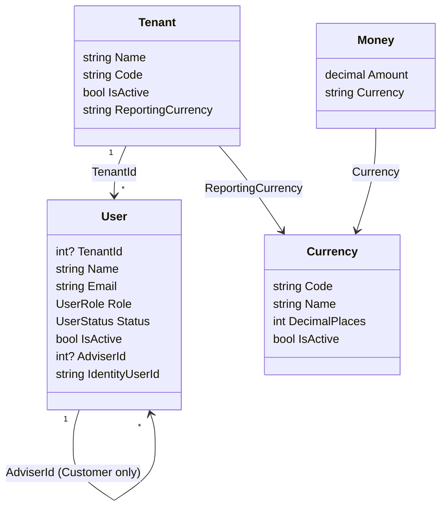

# Domain model

This document owns **aggregates, value objects, invariants, and domain events**. Scope and phasing live in the function plan. Tables live in database design. HTTP lives in API design.

**Product:** MyWealthV2.

Same rule as the function plan: if a later phase will use it and today's model would have to change, write the final model now. If later use or shape is not decided, wait. Write now: a complete `UserStatus` machine whose invite transition has no Phase-1 entry; Customer as a login principal; `Money` with no balance column. Wait: a single `Transactions.Type` that pretends to be both cash and securities; ledger tables whose storage is still open.

The session protocol (OpenIddict, authorization code + PKCE, refresh) lives on the authorization server / in Infrastructure. It is **not** a domain aggregate. The domain only answers whether a person may be issued a session (tenant enabled, `UserStatus`, role, identity link).

---

## 1. Modelling rules

- Entities inherit `BaseEntity` (`int Id`) or `BaseAuditableEntity`. APIs expose `PublicId` (UUID). Internal keys do not appear in routes or JSON.
- Tenant-scoped business entities carry `TenantId`. Isolation is shared database + database FK + application dual check + EF global query filter (safety net) + isolation tests. The filter is engaged only when a tenant id is known. SystemAdmin has no tenant, so the filter stays disengaged.
- A currency code must exist in the platform catalog and, when used as a **new** reference, be enabled. Access is through `ICurrencyCatalog`. The hot path does not JOIN.
- `Money` is a domain value object (amount + currency). Never persist a bare `decimal`. Phase 1 has no balance column; the type still lives in Domain so the ledger does not invent a second amount shape.
- Invariants live on entities / domain services, not only in FluentValidation.
- Identity stays in Infrastructure. Domain `User.IdentityUserId` points at the login principal. The link is one-way. There is no reverse domain association and no reverse database FK.
- Five roles share one Domain `Users` table and one `ApplicationUser` table (the fifth, `SimulatorOperator`, from ADR 0013 amendment 2026-11-19). Role is immutable. A Customer is a login principal from day one. No Customer Portal client in Phase 1 does not mean no identity.
- The `UserStatus` machine is written once. Phase 1 create may set a password and land in `Active`. `PendingActivation` + `UserTokens` + `IEmailSender` are the invitation seams, not a half-boolean.
- OpenIddict clients, token stores, and the hosted login page are **not** Domain types.
- The Phase-2 ledger is thought as sub-ledgers (cash leg / security leg). §8 records the conceptual model and locked tendencies. It does **not** lock undecided storage (journal header, one vs two physical rows for a buy, Opening columns, close-and-liquidate, daily snapshots).

---

## 2. Phase 1 type diagram



- `Currency` is platform master data. It does not belong to a tenant.
- For SystemAdmin, `TenantId` and `AdviserId` are empty.
- `ApplicationUser` and OpenIddict stores sit outside this diagram.
- `UserToken` is an infrastructure seam (invite / reset hash). Phase 1 has no domain behaviour on it; it is not an aggregate on the diagram.

---

## 3. Aggregates and responsibilities (Phase 1)

| Type | Kind | Responsibility |
| --- | --- | --- |
| Tenant | Aggregate | Firm; login code; reporting currency; enabled flag |
| User | Aggregate | Person in any of the five roles; status machine; adviser assignment; link to Identity |
| Currency | Platform entity | ISO catalog; read through `ICurrencyCatalog` |
| Money | Value object | Amount + currency; equality is currency+amount; no cross-currency arithmetic |
| UserToken | Infrastructure entity | Reserved for invite / reset; no Phase-1 write use case and no domain methods |

Authorization (named policies, `RolePermissions`, handler scope checks) is not a domain object. The domain supplies Role / TenantId / AdviserId / Status for the application layer to apply.

---

## 4. Invariants (Phase 1)

### 4.1 Tenant

- `Tenant.Code` is globally unique, case-insensitive, and used at login. Character class `[a-z0-9-]`, length 2–50 (shape-compatible with a later subdomain label; Phase 1 does not parse Host).
- `Tenant.Name` is globally unique, CI.
- `ReportingCurrency` ∈ enabled rows in `Currencies` when **newly set**. identity-auth created Tenant without this column; the currencies slice adds it. Phase 1 may change reporting currency (no ledger balances keyed on it yet). A later disable of that catalog row does not rewrite this field.
- After `IsActive = false`, that Code must not complete login; existing refresh must fail. The check runs in the authorization server / resource pipeline against this invariant.
- A tenant may be re-enabled. Login with that Code works again only if the person’s `Status` is still `Active`.
- `RowVersion` conflict → HTTP 409.
- `Rename` changes `Name` (non-empty; uniqueness is application). `Enable` / `Disable` flip `IsActive` and raise `TenantEnabled` / `TenantDisabled` only when the flag actually changes. `Create` raises `TenantCreated`.
- A Tenant has **allowed custody modes**, `External`, `Custodial` or both, never none. `Create` allows both and keeps its signature. `SetAllowedCustodyModes` replaces the set and refuses an empty one; `Allows(CustodyMode)` reads it. No event. An account is opened only in a mode its Tenant allows at the time of open; Application holds that check, and narrowing the setting changes no existing account ([features/tenant-custody-modes.md](features/tenant-custody-modes.md)).
- A Tenant may name a **broker connection** (`BrokerConnection`, a name from configuration, or none). `SetBrokerConnection(name)` sets it; it is not cleared. An order keeps the connection it was placed on ([features/orders.md](features/orders.md) R3).

### 4.2 Person

Role shape (CHECK-level, not a transition accident):

- SystemAdmin: `TenantId` empty, `AdviserId` empty. Email unique **globally**.
- SimulatorOperator: `TenantId` empty, `AdviserId` empty. Email unique among platform-level people (shared with SystemAdmin). No permission; never a `webapi` caller ([features/simulator.md](features/simulator.md), landed 2026-11-19).
- TenantAdmin / Adviser: `TenantId` required, `AdviserId` empty.
- Customer: `TenantId` required, `AdviserId` required; target is same-tenant, Role=Adviser, not Disabled.
- All five roles have a login principal: `IdentityUserId` required, points at an existing Identity user, one-to-one.

Uniqueness and immutability:

- Email is unique inside a tenant (filtered unique where `TenantId IS NOT NULL`). Login resolves Domain `User` by `tenantCode + email`, then verifies the password.
- `Role`, `TenantId`, and `Email` cannot change. `Name` can.
- A Customer’s `AdviserId` may be reassigned to another non-disabled Adviser in the same tenant. Method: `User.ReassignAdviser`. Pointer change raises `CustomerAdviserReassigned`. Same id is a no-op. Create does not raise that event.

Status machine (written once):

```text
create ──password path──► Active
create ──no password / invite seam──► PendingActivation ──set password──► Active
Active ──disable──► Disabled
Disabled ──re-enable──► Active
PendingActivation ──disable──► Disabled
```

- Only `Active` may complete authorization-server login. `PendingActivation` and `Disabled` may not.
- `Users.IsActive` is derived from that machine (`Active` → 1; otherwise 0). List `enabledOnly=true` uses the bit. Login still reads `Status`, not the bit alone.
- Phase 1 admin APIs may create with a password and land in `Active` (invitation delivery is not built; that is not an excuse to collapse the machine to a boolean).
- Disable, re-enable, and password change run on the resource API. The authorization server reads Status and tenant enabled at login. Password change / disable / logout revoke that subject's OpenIddict tokens — an application consequence driven by domain events. The User aggregate does not hold tokens.

Disable guards:

- Disable Adviser: reject while assigned Customers are not Disabled; reassign or disable them first. Method: `User.DisableAdviser(bool hasNonDisabledAssignedCustomers)`. `Disable()` stays for TenantAdmin / Customer.
- Disable Customer: reject while any Account for that person is still active (`IsActive`). Closed-only Customers may be disabled. Do not bulk-close. Guard lives on `DisableCustomer`, not on `User.Disable()`.
- Disabling the last TenantAdmin is allowed (known gap).
- Disabling a tenant does **not** bulk-update `User.Status`. Person status is independent; login checks both.

### 4.3 Currency

- Code is ISO 4217, three letters, upper case.
- `DecimalPlaces` is the ISO minor-unit count for input / display / validation (JPY = 0, NZD = 2). It is not the SQL scale of a money column. Phase-2 amount columns stay `decimal(18,4)` for every currency.
- `IsActive` is a **platform** flag on the catalog row. It is not bound to a tenant. One change is visible to every tenant's picker; existing `ReportingCurrency` values are left alone.
- A disabled currency cannot be used as a **new** `ReportingCurrency`. Tenants that already reference it keep the historical value.
- Phase 1 has no currency write API. The catalog is read-only. Seed: NZD, AUD, USD, EUR, GBP, JPY.
- `Money` does not look up the catalog and does not round to `DecimalPlaces`.

### 4.4 Session boundary (not an aggregate)

The domain does **not** contain: OIDC client, authorization code, refresh token, hosted login page.

The domain **does** supply the login gate:

- Non-SystemAdmin must resolve to an enabled Tenant by Code.
- The User for that email in that tenant must exist, `Status = Active`, and `IdentityUserId` must be valid.
- A Customer passing the gate does not receive adviser-management policies. A portal is an OIDC client plus a role gate, not a second kind of person.

---

## 5. Enumerations (Phase 1)

**UserRole:** `SystemAdmin`, `TenantAdmin`, `Adviser`, `Customer`, `SimulatorOperator` (value 4; ADR 0013 amendment 2026-11-19, landed)  
**UserStatus:** `PendingActivation`, `Active`, `Disabled`

Phase 1 added no fifth role; `SimulatorOperator` comes from [ADR 0021](adr/0021-outside-parties-behind-ports.md). Do not add a role inside a tenant. Ledger permission names are registered when the ledger domain opens. Do not hang empty policies in Phase 1.

---

## 6. Domain events (Phase 1)

Raise even if there is no subscriber yet. The application uses these events to revoke tokens and write audit.

Events are written to `OutboxMessages` in the same database transaction as the business changes (ADR 0018, accepted). Implementation follows [features/outbox.md](features/outbox.md). `Payload` is the serialised domain event. `TenantId` is also stored as a column. Delivery is at-least-once from the background worker via MediatR. A handler failure does not roll back the original change; the side effect is eventually consistent and retryable. Token revocation after a user disable, a password change, or a tenant disable is one of those side effects. See [adr/0018-transactional-outbox.md](adr/0018-transactional-outbox.md) and [fixes/domain-event-dispatch.md](fixes/domain-event-dispatch.md).

| Event | When |
| --- | --- |
| `TenantCreated` | New firm |
| `TenantEnabled` / `TenantDisabled` | Enabled flag changes |
| `UserCreated` | After the dual write for any role |
| `UserActivated` | Entered Active (create-as-Active, invite activation, or re-enable from Disabled) |
| `UserDisabled` | Entered Disabled |
| `UserPasswordChanged` | Resource-API password change succeeded (revoke tokens for the subject) |
| `CustomerAdviserReassigned` | `ReassignAdviser` actually changed the pointer. Payload: `CustomerId`, `TenantId`, `PreviousAdviserId`, `NewAdviserId`. No handler in the customers slice |

Do not model OpenIddict token revocation itself as a domain event.

---

## 7. Explicitly out of the Phase 1 model

Do not create entities, tables, or empty aggregate roots for:

- Account, Holding, CashEntry, Journal, Transaction
- Household / KYC / an invitation domain service (`UserTokens` table may exist with no behaviour)
- Account balances, holding quantities, net worth
- Refresh tokens, OIDC clients, authorization codes

`Instrument` and `IMarketData` ship with the instruments slice (§8.4). `IMarketData` is implemented by the instrument-prices slice ([features/instrument-prices.md](features/instrument-prices.md), accepted 2026-11-02): local `InstrumentPrices` table, EODHD daily job at 12:00 UTC, missing → empty. `IFxRate` is implemented by the fx-rates slice ([features/fx-rates.md](features/fx-rates.md), accepted 2026-11-02): local `FxRates` table, Frankfurter hourly job, same currency = 1, missing pair → `FxRateNotFoundException`. Since [features/market-data-history.md](features/market-data-history.md) (accepted 2026-11-25) both tables hold a row for every source date from the history floor date; a row two or more days old is final (`MarketDataRow.IsFinal`, `src/Domain/MarketData`). `IMarketData.TryGetPriceDetail` returns the price with its date and source; `IMarketData.ListPricesAsync` and `IFxRate.ListRatesAsync` list stored rows. A price or rate row is still not a domain entity.

The `Money` value object **does** live in the Domain assembly, even with no balance column in Phase 1.

---

## 8. Phase 2 ledger — conceptual model (tendencies; invariants when that phase opens)

The ledger is **one domain, several slices**, not an extension of a throwaway Phase-1 transaction table. Slice order (function plan): Instruments → Account container → posting (`Transaction` + cash legs) → holdings / securities → net-worth read model.

Session stack, four roles, and User / Tenant invariants do not change in Phase 2. Add ledger policy names and ledger invariants only.

### 8.1 Locked way of thinking

- **Cash and securities are two legs, not two values of one `Type` column.** A buy/sell has a cash leg and a security leg. Transfer / interest / dividend may be cash-only. Split / Bonus / Scrip is a security leg, no cash, total cost unchanged; the write takes the new total quantity ([features/split.md](features/split.md)). Do not ship a single-row catch-all `Transactions` table and split it later.
- **Do not create ledger tables while storage shape is still open.** `Transaction` + `TransactionCashLeg` are locked in [features/posting.md](features/posting.md). Holdings and security legs are locked in [features/holdings.md](features/holdings.md). No standalone Journal / CashLedger table.
- **Booked postings are not `UPDATE` / `DELETE`**, except a single write of `ReversedByTransactionId` on the original when a Reversal is created. After that write the original is immutable again. Economic legs are never updated. Correction is a full opposite posting; the Reversal points at the original, and the original points at the Reversal.
- **After a posting, cash must not go negative on non-Credit accounts. Credit may be negative** (liability).
- **Day-to-day holding quantity and cost are not edited by hand.** The only entry that may write quantity and cost directly is Opening — lock the shape when that slice opens; keep the name.
- Instruments are a **tenant catalog**. Adviser may create and read; update / disable is TenantAdmin or SystemAdmin. `QuoteCurrency` locks after create. Cost currency = quote currency.
- An Account is a value container under a Customer. `Account.Currency` is the cash-ledger booking currency and is immutable after open. `Account.Type` is immutable after open. Openable in Phase 2: Bank / Cash / Brokerage / Other. Reserved, not selectable in Phase 2: Property / Credit. Type does **not** replace the cash ledger: balance comes from cash postings, not from summing rows because `AccountType == Bank`.
- Bank, Cash, and Credit accounts must not hold Instruments. Brokerage, Property, and Other may. “No holdings” is any Instrument, not only listed equities. Phase 2 must not open Property or Credit.
- Credit counts as a liability in net worth. Closed accounts are excluded. Net worth returns per-currency arrays; no FX fold into one number. Current point-in-time read model accepted and landed in [features/net-worth.md](features/net-worth.md) (`GET /net-worth`, `GET /users/customers/{id}/net-worth`, `af422c2`).
- Market data goes through the `IMarketData` port, implemented by the instrument-prices slice (local table, not a live call). Missing → empty. FX goes through `IFxRate`, implemented by the fx-rates slice (local table, not a live call). Same currency = 1. Cross-currency is never silently 1. Missing pair throws `FxRateNotFoundException`.

### 8.2 Conceptual objects (not a table design)

```text
Tenant
  └── Customer (User)
        └── Account                    container: type, booking currency, status
              ├── Transaction          business-event header (append-only)
              │     ├── Cash leg       signed amount in Account.Currency
              │     └── Security leg   OpeningHoldings; Buy/Sell/StockIn/StockOut; Split/Bonus/Scrip accepted
              └── Holding              projection per (Account, Instrument)
        Portfolio                  target-weight model (base currency + lines)   [accepted]
        AccountPortfolioAssignment links Account to one Active Portfolio         [accepted]
        Rebalance                  one run towards the targets, through orders   [accepted]
```

A Transaction may carry security legs on the same header. `OpeningHoldings` / `StockIn` / `StockOut` are security only. `Buy` / `Sell` are cash plus security ([features/buy-sell.md](features/buy-sell.md)). `Split` / `Bonus` / `Scrip` are security only: the client sends the new total quantity, the leg stores the signed delta at cost `0`, and holding total cost does not move ([features/split.md](features/split.md)). Reversal is a new Transaction. The Reversal points at the original (`OriginalTransactionId`); the original points at the Reversal (`ReversedByTransactionId`, single write, then immutable again). Quantity 0 deletes the `Holdings` row. A split reverse that would leave quantity `≤ 0` is rejected.

Locked in [features/holdings.md](features/holdings.md), landed `676e77a`:

- `TransactionSecurityLegs` and `Holdings`
- `OpeningHoldings`: quantity `> 0`, cost `≥ 0`, no cash leg, one per `(Account, Instrument)`
- Close also requires no holdings rows

Still not decided — do not turn these into entity fields now:

- Whether a daily snapshot is stored

Lock those when the matching slice opens.

### 8.3 Join to Phase-1 people (said now so Phase 2 does not reshape User)

- An Account belongs to a Customer, and through that Customer to a Tenant. Adviser visibility stays the `AdviserId` scope. Do not add a second adviser FK on Account unless a slice proves it needs one.
- Disable Customer: reject if an Account is still open (guard added in Phase 2).
- A Customer who can obtain tokens does not receive ledger-write policies. TenantAdmin and SystemAdmin receive manage policies; Adviser receives create/read where the spec says so.

### 8.4 Instrument (accepted — instruments slice)

| Type | Kind | Notes |
| --- | --- | --- |
| `Instrument` | Aggregate | Tenant catalog row. Not a holding. |
| `InstrumentCreated` / `InstrumentDisabled` / `InstrumentEnabled` | Event | Rename raises nothing. |

Invariants:

- `TenantId` required. No platform row.
- `Symbol` is the instrument code: upper case, unique CI per tenant including disabled.
- `Name` is the display name. Duplicates allowed.
- `QuoteCurrency` set on create from an enabled `ICurrencyCatalog` code, then immutable.
- Cost currency = quote currency. No second currency field.
- `IsActive` only. Not a `UserStatus` machine. HTTP disable / enable flip the bit.
- No ISIN / Exchange / Kind / price on the aggregate. Price is `IMarketData.TryGetPrice`. FX is `IFxRate.GetRate` (same currency = 1; missing cross pair → `FxRateNotFoundException`).

Field rules: [features/instruments.md](features/instruments.md). Landed in repo 2026-09-20 `9ea2f2a`.

Tax attributes ([features/instrument-tax-attributes.md](features/instrument-tax-attributes.md) §5, accepted 2026-11-27):

| Type | Kind | Notes |
| --- | --- | --- |
| `FifTreatment` | Enum | `NotClassified = 0`, `NotForeign = 1`, `ExemptAsxListed = 2`, `ExemptOther = 3`, `Attributing = 4`, `AttributingNoFdr = 5`. `IsExemption` for 2 and 3; `IsAttributing` for 4 and 5. `NotClassified` is an answer, never stored |
| `InstrumentFifTreatment` | Entity, child of `Instrument` | `TenantId`, `InstrumentId`, `TaxYear`, `Treatment`, `Note?`, audit. Built only by `Instrument`, which passes its `TenantId` down |
| `Countries` | Static | The officially assigned ISO 3166-1 alpha-2 codes with their English short names. `IsKnown(code)`, `All`, `NewZealand = "NZ"`, `Australia = "AU"`. Changes only with a spec amendment |
| `Instrument.IssuerCountry`, `Instrument.FifTreatments` | Members | The issuer's country of tax residence (optional, one per Instrument) and the FIF treatment rows, one per tax year |
| `Instrument.SetTaxAttributes(issuerCountry, rows, latestTaxYear)` | Method | Replaces the country and every row (update, add and remove by tax year). Raises no event |
| `Instrument.FifTreatmentFor(taxYear)`, `FifTreatmentRowFor(taxYear)` | Methods | The treatment of a tax year: the latest row not after it; an exemption row stands for its own year only; none → `NotClassified`. The row variant returns the row chosen, or none |

Invariants of the tax attributes:

- At most one row per tax year and at most 50 rows; a tax year is 2008 to the calendar year of the UTC date plus 1 (passed in by Application).
- An Instrument with a row has an issuer country, which is a code of `Countries`.
- An issuer country `NZ` has only `NotForeign` rows; no other Instrument has a `NotForeign` row.
- An `ExemptAsxListed` row needs issuer country `AU`. An `ExemptOther` row has a note.
- A row belongs to the Tenant of its Instrument.

Where an instrument's price comes from is a fact about its symbol and the configuration, not a field on the aggregate ([features/simulated-instruments.md](features/simulated-instruments.md) §5):

| Type | Kind | Notes |
| --- | --- | --- |
| `MarketDataConnection` | Value (from configuration) | `Name`, `Adapter`, `SymbolSuffix`. `Serves(symbol)`: the symbol ends with the suffix, compared without regard to case |
| `MarketDataConnections` | Service | The configured connections. `For(symbol)` → the connection that serves it, or none. Refuses two connections with the same suffix |
| `MarketDataFeed` | Entity | Platform data, no `TenantId`. One per connection and feed kind: `LastSucceededAt`, `LastFailedAt`, `LastFailure`, `Cursor` (unused by `Prices`). `Succeeded(at)`, `Failed(failure, at)` |
| `MarketDataFeedKind` | Enum | `Prices = 0`, `CorporateActions = 1` (a feed with a cursor; [features/corporate-actions.md](features/corporate-actions.md)) |
| `MarketDataFailure` | Enum | `Unreachable = 0`, `Timeout = 1`, `Unauthorized = 2`, `Unavailable = 3`, `BadResponse = 4` |

Invariants: an instrument is served by at most one connection; a price row written from a connection has the platform's UTC date; a served instrument is never sent to EODHD.

### 8.5 Account (accepted, landed)

| Type | Kind | Notes |
| --- | --- | --- |
| `Account` | Aggregate | Container under a Customer. Not a cash row. |
| `AccountStatus` | Enum | `Open`, `Closed` |
| `AccountType` | Enum | `Bank`, `Cash`, `Brokerage`, `Other`, `Property`, `Credit` |
| `CustodyMode` | Enum | `External`, `Custodial`. [features/account-custody-mode.md](features/account-custody-mode.md), ADR 0020. |
| `AccountOpened` / `AccountClosed` / `AccountReopened` | Event | Rename raises nothing. |

Invariants of every Account:

- `TenantId` and `CustomerId` required. No second adviser FK.
- `Type`, `Currency` and `CustodyMode` are set on create and immutable.
- Create may select Bank / Cash / Brokerage / Other only.
- `Status` is the machine. `IsActive` is derived (`Open` → 1, `Closed` → 0), persisted computed.
- HTTP close / reopen. No physical delete. Close requires cash `SUM = 0` and no `Holdings` rows ([features/holdings.md](features/holdings.md)).
- Disable Customer rejects while any account is active.
- An Account has `ReinvestDividends`, with who changed it and when ([features/dividends.md](features/dividends.md)).

Invariants of a Custodial account ([features/custody-modes.md](features/custody-modes.md)):

- It is a `Brokerage` account: `Create` refuses `Custodial` with any other type. An External account may have any openable type.
- It has a `DepositReference`, and an External account has none: `Create` takes an optional `DepositReference` and refuses a Custodial account without one or an External account with one. The reference never changes. Uniqueness on the platform is held by Application and a unique index. A Custodial account is opened only in a currency with an active client money account at the time of open; Application holds that check, and reopen does not repeat it ([features/client-money-accounts.md](features/client-money-accounts.md)).
- An Active `AccountPortfolioAssignment` is on a Custodial account (held by Application).
- It is closed only by an `AccountClosure` (§8.13); the plain close is refused for it in Application. While a closure is `InProgress` the Account is **closing**: it stays Open but accepts no hand write and no portfolio assignment, and deposit matching sends its receipts to suspense ([features/account-closure.md](features/account-closure.md)).
- It has `InterestAccruedThrough` (`DateOnly?`): the last UTC day its daily accrual was worked out for. `MarkInterestAccrued(through)` only moves it forward and is refused on an External account. Only Open Custodial accounts that are not closing are accrued (§8.14, [features/interest-run.md](features/interest-run.md)).
- It has `ValuedThrough` (`DateOnly?`): the last UTC day a stored valuation exists for. `MarkValued(day)` moves it to the day after it (or sets the first day) and nothing else, and is refused on an External account, which never has one (§8.23, [features/valuation-run.md](features/valuation-run.md)).
- With a live order, an unsettled fill or an open in-kind transfer it is not closed, and with a live order or an open in-kind transfer it gets no portfolio assignment ([features/orders.md](features/orders.md) R47, R49; [features/in-kind-transfers.md](features/in-kind-transfers.md) R24).

Figures of a Custodial account. None is stored on the Account; Application works them out under the Account lock (`AccountCash`) with the Domain statics named below. An External account has no reservation: its available and withdrawable cash are its cash `SUM`.

| Figure | Is | Used for |
| --- | --- | --- |
| Reserved cash | The amounts of its open withdrawals, plus for each live buy order the most that what is left of it can still cost | — |
| Available cash | Cash `SUM` minus reserved cash (`AvailableCash`) | Every write that lowers cash keeps it `≥ 0`, except a payout, which releases its own reservation ([features/withdrawals.md](features/withdrawals.md) R36) |
| Unsettled cash | The net cash of posted sell fills that are not settled | — |
| Withdrawable cash | Available cash minus unsettled cash, never below 0 (`AvailableCash.Withdrawable`) | What a withdrawal, a transfer out or a conversion out may take ([features/orders.md](features/orders.md) R39–R46) |
| Reserved quantity (per holding) | The open quantity of its live sell orders, plus its open in-kind transfers `Out` | — |
| Available quantity | Quantity minus reserved quantity (`AvailableQuantity`) | A sell order and an adjustment that lowers the holding keep it `≥ 0` ([features/orders.md](features/orders.md) R13, R40) |
| Unsettled quantity | The quantity of posted buy fills not settled and not broken | — |
| Transferable quantity | Available quantity minus unsettled quantity, never below 0 (`TransferableQuantity`) | What an in-kind transfer out may take ([features/in-kind-transfers.md](features/in-kind-transfers.md) R43–R45) |

Field rules: [features/accounts.md](features/accounts.md), [features/account-custody-mode.md](features/account-custody-mode.md), [features/custody-modes.md](features/custody-modes.md).

### 8.6 Transaction (accepted — posting slice; landed)

| Type | Kind | Notes |
| --- | --- | --- |
| `Transaction` | Aggregate | Business-event header in a tenant. Has no Account and no Customer; it belongs to its leg accounts. Not a capture row that later copies into a journal. Has no status. |
| `TransactionCashLeg` | Entity | Cash accounting line on one Account (`AccountId`). Has a role (`CashLegRole`). At most one `Principal` leg per `(Transaction, Account)`. Absent on `OpeningHoldings`, `StockIn`, `StockOut`, `Split`, `Bonus`, and `Scrip`. |
| `TransactionSecurityLeg` | Entity | Security accounting line on one Account (`AccountId`). Exactly one on `Buy`, `Sell`, `StockIn`, `StockOut`, `Split`, `Bonus`, and `Scrip`; at most one on an `Adjustment`; one on a `Dividend` with a reinvestment. Quantity is signed. |
| `TransactionType` | Enum | `TransferIn` (0), `TransferOut` (1), `Interest` (2), `CloseOut` (3), `Opening` (4), `Reversal` (5), `Dividend` (6), `Buy` (7), `Sell` (8), `OpeningHoldings` (9), `StockIn` (10), `StockOut` (11), `Split` (12), `Bonus` (13), `Scrip` (14), `InternalTransfer` (15), `FxConversion` (16), `Adjustment` (17). |
| `CashLegRole` | Enum | `Principal` (0); `Fee` (1), a trade fee on `Buy` / `Sell`, with one fee detail ([features/trade-fees.md](features/trade-fees.md)); `Tax` (2), withholding tax on an interest posting or a `Dividend`, always negative, with one tax detail; `Reinvestment` (3), the reinvested part of a `Dividend` ([features/dividends.md](features/dividends.md)). |
| `FeeKind` / `TaxKind` | Enums | `Brokerage` is the only fee kind. Tax kinds: `Rwt` (0), `Nrwt` (1), `ForeignWithholding` (2). |
| `TransactionSource` | Value object | Who wrote the Transaction: a `TransactionSourceKind` and an optional PublicId. Every factory and `Reverse` take it as a required parameter; it never changes. A Reversal has the source passed to `Reverse`, not the original's ([features/transaction-source.md](features/transaction-source.md)). |
| `TransactionSourceKind` | Enum | The "Sources" table below. |
| `AppliedFxRate` | Value object | Base ≠ quote currency, rate `> 0`, as-of date, source. Input to `Transaction.PostFxConversion` and, as the rate of a trade across currencies, to `PostBuy` / `PostSell`. |
| `CustodyRules` | Static | The manual entry matrix: what a person may enter or reverse on an Account of each custody mode. Application calls it; the factories and `Reverse` do not. The matrix itself is [features/custody-modes.md](features/custody-modes.md) §4.2. |
| `TransactionPosted` / `TransactionReversed` | Event | Side effects only. Must not write the books. |

Details. Each is immutable, a child of the `Transaction` unless the row says otherwise, and copied by `Reverse` to the Reversal (a leg's detail to the matching leg):

| Detail | On | Holds |
| --- | --- | --- |
| `TransactionFxDetail` | 0..1 per Transaction. Exactly one on `FxConversion`; on a trade or a `Dividend` across currencies | Base and quote currency, rate (quote per 1 base), as-of date, source ([features/fx-conversions.md](features/fx-conversions.md)) |
| `TransactionFeeDetail` | Child of a `Fee` cash leg. Exactly one per `Fee` leg, at most one per `(Transaction, kind)` | Kind, schedule (none for an entered fee), basis amount, fee, currency |
| `TransactionTaxDetail` | Child of a `Tax` cash leg. Exactly one per `Tax` leg, at most one per `(Transaction, kind)`. A cash leg has one if and only if its role is `Tax` | Tax kind, rate percent, basis amount (the gross), tax amount, currency ([features/interest-run.md](features/interest-run.md)) |
| `TransactionInterestDetail` | Exactly one on an interest posting | First and last day, number of days, accrued amount (8 decimals), gross |
| `TransactionAdjustmentDetail` | Exactly one on an `Adjustment`. `Reverse` refuses an `Adjustment`, so no new Reversal carries one | `AdjustmentReason`: `EntryError`, `CorporateAction`, `ReconciliationBreak`, `Other` ([features/adjustments.md](features/adjustments.md)) |
| `TransactionBankReceiptDetail` | Exactly one on a deposit (a `TransferIn` with source `BankFeed`) | Value date, reference text, payer name, masked payer account ([features/deposit-matching.md](features/deposit-matching.md)) |
| `TransactionPaymentDetail` | Exactly one on a payout (a `TransferOut` with source `Payment`) | Value date, reference sent, payee name, masked payee account ([features/withdrawals.md](features/withdrawals.md)) |
| `TransactionCorporateActionDetail` | Exactly one on an entitlement posting | Kind, ratio, ex-date, record date, payment date, quantity before and after ([features/corporate-actions.md](features/corporate-actions.md)) |
| `TransactionExecutionDetail` | Required with source `OrderFill`, refused with any other | The fill's PublicId, price, trade date, settlement date, broker reference ([features/orders.md](features/orders.md)) |
| `TransactionMigrationDetail` | Exactly one on a migrated `Opening` or `OpeningHoldings` | As-of date, previous provider ([features/migration-batches.md](features/migration-batches.md)) |
| `TransactionInKindTransferDetail` | Exactly one on the `StockIn` / `StockOut` of an in-kind transfer | Transfer PublicId, counterparty name, masked counterparty account, `changesBeneficialOwner`, `acquiredOn`, settlement date, custodian reference ([features/in-kind-transfers.md](features/in-kind-transfers.md) R38) |
| `TransactionDividendDetail` | Exactly one on a `Dividend` | Instrument, entitled quantity, amount per share and currency, tax source, imputation credit, the dates, the reinvested quantity and price ([features/dividends.md](features/dividends.md)). The amount per share and the ex-date are optional on a hand-entered dividend ([features/external-income.md](features/external-income.md)) |

Invariants:

- `TenantId` required on the header; `AccountId` required on every leg. Every leg and the FX detail carry the header's `TenantId` ([fixes/tenant-composite-keys.md](fixes/tenant-composite-keys.md)). Every leg account is in the header's tenant. At least one leg. Write = posted. No `Created` / draft status.
- `InternalTransfer` and `FxConversion` have legs on two Accounts; every other type builds all its legs on one Account. A Reversal builds one opposite leg per original leg, on that leg's Account, and is all-or-nothing across leg accounts ([features/leg-accounts.md](features/leg-accounts.md)).
- Every leg account of a Transaction has the same custody mode. `PostInternalTransfer` and `PostFxConversion` take both Accounts' custody modes and refuse different ones; `Reverse` copies each leg's Account.
- Cash `SUM` of the cash legs on an Account is its cash balance. Not stored on `Account`. After insert, `SUM ≥ 0`.
- Posted header and legs are not `UPDATE`d / `DELETE`d, **except** a single write of `ReversedByTransactionId` on the original when a Reversal is created. After that write the original is immutable again. Economic legs are never updated. Reversal is a new row with the opposite cash amount and the opposite security quantity and cost. The Reversal stores `OriginalTransactionId`; the original stores `ReversedByTransactionId`.
- A Transaction with a security leg can be reversed only while it is the latest security activity on each of its holdings: no live later security leg on the same `(Account, Instrument)`. Application passes that fact to `Reverse`, which refuses otherwise. A cash-only Transaction is not affected ([fixes/ledger-write-guards.md](fixes/ledger-write-guards.md)).
- `Reverse` refuses an `Adjustment`, whatever its source ([features/adjustment-review.md](features/adjustment-review.md)).
- The factories keep their `bookedAt` parameter and do not read the custody mode: the server-set booking time of a Custodial account, and where a number comes from (External: the caller; Custodial: the server or the outside party), are Application rules.
- Closed account rejects new transactions. `Account.Close()` does not write cash.

What each type builds:

- Cash `Opening`: at most one per account; only while no other transaction exists; `amount > 0`.
- `Buy` security cost is `quantity × price` in the quote currency. Cash is that cost times FX, negative, in the account currency. With a trade fee, cost is `quantity × price + fee`, and a separate negative `Fee` leg carries the fee times FX ([features/trade-fees.md](features/trade-fees.md) R14–R16).
- `Sell` and `StockOut` store the released average cost on the security leg (`Round(oldCost × qty / oldQty, 4, AwayFromZero)`; the full quantity releases the whole cost). `Sell` cash is `quantity × price × FX`, positive; a trade fee is a separate negative `Fee` leg and does not change the release. `StockOut` has no cash leg.
- `PostBuy` / `PostSell` take an optional entered fee (quote currency, `≥ 0`) in place of a schedule, never both; its fee detail has no schedule. They take an optional `AppliedFxRate`, stored as the trade's FX detail; its base is the price currency, its quote the Account currency and its rate the one the cash legs used. `PostFxConversionWithAmounts` builds an `FxConversion` from both amounts: legs equal to them, rate `Round(buy ÷ sell, 8, AwayFromZero)`, FX detail source `Caller` ([features/external-caller-numbers.md](features/external-caller-numbers.md)).
- `PostEnteredDividend` builds a hand-entered `Dividend` on an External account from the caller's numbers in the Instrument's quote currency: each amount converted with the caller's `fxRate` as `Round(amount × fxRate, dp, AwayFromZero)` when the quote currency differs from the Account's (an FX detail with source `Caller`); one `Principal` leg of the gross; one `Tax` leg per `EnteredTax` with its tax detail (basis the gross, plus the imputation credit for `Rwt`); a tax that converts to 0 books no leg; a dividend detail with an optional amount per share and ex-date; no security leg. `PostEnteredInterest` builds an `Interest` with one `Principal` leg of the gross (`> 0`) and one `Tax` leg per `EnteredTax`. Both take only source `Manual`, refuse taxes above the gross, and refuse `Rwt` with `Nrwt` and a kind twice (`EnteredTaxes`) ([features/external-income.md](features/external-income.md))
- `StockIn` stores the client cost and has no cash leg.
- `Split`, `Bonus`, and `Scrip` store the signed quantity delta and cost `0`. Holding total cost is unchanged. They do not call average-cost release and they do not create a holding.
- `PostInternalTransfer` builds exactly two cash legs, `−amount` on the from Account and `+amount` on the to Account: different Accounts, same currency, positive amount, sum zero, from balance not negative ([features/internal-transfers.md](features/internal-transfers.md)).
- `PostFxConversion` takes an `AppliedFxRate` and the side the caller fixed (`Money` in the sell or buy currency), computes the other side with `Round(…, decimalPlaces, AwayFromZero)`, and builds two cash legs (`−sell` on the from Account, `+buy` on the to Account) and one FX detail. Different Accounts, different currencies, rate pair equal to the Account currencies, computed amount not 0, from balance not negative. The Domain does not read `Currencies`; Application passes the decimal places ([features/fx-conversions.md](features/fx-conversions.md)).
- `PostAdjustment` builds an `Adjustment` on one Account: at most one `Principal` cash leg and at most one security leg, at least one of them, a required memo and an adjustment detail. The security leg stores the signed quantity and cost changes as given (no price, no release). Cash `SUM ≥ 0`; the holding after it has quantity `≥ 0`, cost `≥ 0`, and no cost on a zero quantity. The factory does not read the custody mode; Application holds the Custodial-only rule and the `transactions.adjust` permission ([features/adjustments.md](features/adjustments.md)).

Sources. A person's entry has source `Manual`. Every other kind is written by the platform through the factory named here, outside the manual entry matrix, and on a Custodial account is not reversed by hand: the flow undoes its own write through `Reverse` with its own source.

| `TransactionSourceKind` | Id | Factory | Builds |
| --- | --- | --- | --- |
| `Manual` (0) | none | The factory of the type; `PostEnteredDividend`, `PostEnteredInterest` | What a person enters; a hand-entered `Dividend` or `Interest` with tax on an External account ([features/external-income.md](features/external-income.md)) |
| `Seed` (1) | none | The factory of the type | The test seed's history |
| `Rebalance` (2) | The rebalance handle | None. Kept for reading rows written before rebalances went through orders ([features/rebalances.md](features/rebalances.md) R26) | — |
| `BankFeed` (3) | The statement line | `PostBankDeposit` | A deposit: one `Principal` `TransferIn` cash leg, `amount > 0`, a bank receipt detail. Undone by an undo match ([features/deposit-matching.md](features/deposit-matching.md)) |
| `Payment` (4) | The withdrawal | `PostPayout` | A payout: one `Principal` `TransferOut` cash leg, the amount given positive and posted negative, a payment detail. Undone by a returned payout ([features/withdrawals.md](features/withdrawals.md)) |
| `AccountClosure` (5) | The account closure | `PostRemainderWriteOff` | One `Principal` `CloseOut` cash leg of minus the cash `SUM`, where `0 < SUM <` one minor unit ([features/account-closure.md](features/account-closure.md)) |
| `InterestRun` (6) | The interest run | `PostInterest` | One `Principal` `Interest` cash leg of `+gross` (the accrued amount rounded to the minor unit, above 0), a `Tax` cash leg of `−tax` with its tax detail when the withholding tax is above 0, and an interest detail ([features/interest-run.md](features/interest-run.md)) |
| `CorporateAction` (7) | The corporate action | `PostCorporateAction` | An entitlement posting: type `Split` (split or consolidation) or `Bonus`, one security leg of `quantityAfter − quantityBefore` with cost `0` in the quote currency, no cash leg, a corporate action detail. Refuses a `quantityAfter` that is 0 or equal to `quantityBefore` ([features/corporate-actions.md](features/corporate-actions.md)) |
| `CorporateAction` (7) | The corporate action | `PostDividend` | A `Dividend`: one `Principal` leg of the gross; `Tax` legs of kind `ForeignWithholding`, `Rwt` or `Nrwt`, each with its tax detail; with a reinvestment one `Reinvestment` leg and one security leg whose cost equals it; a dividend detail. The legs add up to the net less the reinvested amount, never below 0 ([features/dividends.md](features/dividends.md)) |
| `OrderFill` (8) | The order | `PostBuy` / `PostSell` | A fill, at the broker's price, with the fee of its order and an execution detail. The legs and the cost rules are those of any `Buy` / `Sell`. A rebalance trade is such a fill ([features/orders.md](features/orders.md)) |
| `Migration` (9) | The migration batch | `PostMigratedCash` / `PostMigratedHoldings` | An `Opening` with one `Principal` cash leg of `+amount` (`> 0`); an `OpeningHoldings` with the legs of `PostOpeningHoldings`. Memo `Opening balance`, a migration detail ([features/migration-batches.md](features/migration-batches.md)) |
| `InKindTransfer` (10) | The in-kind transfer | `PostTransferIn` / `PostTransferOut` | A `StockIn` with one security leg of `+quantity` and the transfer's cost; a `StockOut` with one leg of `−quantity` at the holding's average cost. An in-kind transfer detail ([features/in-kind-transfers.md](features/in-kind-transfers.md) R37, R41) |
| `AdjustmentRequest` (11) | The adjustment request | `PostAdjustment` | An `Adjustment`, only from the approval of a request ([features/adjustment-review.md](features/adjustment-review.md)) |

Every factory other than `PostInterest`, `PostDividend`, `PostEnteredInterest`, `PostEnteredDividend` and `Reverse` refuses a `Tax` leg.

Field rules: [features/posting.md](features/posting.md), [features/holdings.md](features/holdings.md), [features/buy-sell.md](features/buy-sell.md), [features/split.md](features/split.md), [features/leg-accounts.md](features/leg-accounts.md), and the specs named above.

### 8.7 Trade fee schedule (accepted — trade-fees slice)

| Type | Kind | Notes |
| --- | --- | --- |
| `TradeFeeSchedule` | Aggregate | Tenant, quote currency (immutable), effective-from date, minimum, optional cap, `FeeBands`. `FeeFor(gross, decimalPlaces)` computes the fee. Only a pending row (effective-from after the cut-off date) may be updated or deleted. |
| `FeeBands` | Value object | Marginal `(from, ratePercent)` steps; first `from` is 0, ascending. Reused by later fee kinds. |

Invariant: no schedule write changes which row applies to a posted `Buy` / `Sell`, or that row's values. Field rules: [features/trade-fees.md](features/trade-fees.md).

### 8.8 Client money account (accepted — client-money-accounts slice)

| Type | Kind | Notes |
| --- | --- | --- |
| `ClientMoneyAccount` | Aggregate | Tenant, currency, bank name, account name, account number, and `BankConnection`, the name of a configured bank connection ([features/deposit-matching.md](features/deposit-matching.md)); all immutable. `IsActive`. `Create`, `Disable`, `Enable` (idempotent). No event. |
| `DepositReference` | Value object | Nine characters from `0123456789ABCDEFGHJKMNPQRSTVWXYZ`, first a letter, last a Luhn mod 32 check symbol. `Generate`, `TryParse`, `IsValid`. |

Invariants: at most one active client money account per (Tenant, currency), and an account number is active on at most one row on the platform. Both span rows, so Application holds them, with filtered unique indexes as the backstop; the aggregate does not. Field rules: [features/client-money-accounts.md](features/client-money-accounts.md).

### 8.9 Bank statement line (accepted — deposit-matching slice)

| Type | Kind | Notes |
| --- | --- | --- |
| `BankStatementLine` | Aggregate | One line of a client money account's statement, stored once per (connection, outside id). Tenant, client money account, kind, value date, direction, amount, currency, payer, masked payer account, reference text, end-to-end id, the outside id it returns (all immutable, from the port); status, unmatched reason, the current match, the last action. No event. |
| `BankStatementLineStatus` | Enum | `Received`, `Matched`, `Unmatched`, `Ignored`, `ReturnRequested`, `ReturnSent`, `Returned` |
| `StatementLineKind` | Enum | `Transfer` (0), `Interest` (1) |
| `StatementLineMatchMethod` | Enum | `Reference` (0), `Manual` (1), `Payment` (2), `PaymentReturn` (3), `Recall` (4), `Settlement` (5), `Migration` (6), `Dividend` (7) |
| `UnmatchedReason` | Enum | `NoReference` (0), `UnknownReference` (1), `SeveralReferences` (2), `CurrencyMismatch` (3), `AccountClosed` (4), `CustomerDisabled` (5), `AmountPrecision` (6), `PaymentMismatch` (7), `UnknownPayment` (8), `UnknownReturn` (9), `RecallNotCovered` (10), `ReturnRejected` (11), `AccountClosing` (12), `SettlementMismatch` (13), `DividendMismatch` (14) |
| `BankFeedCursor` | Entity | Per client money account: the opaque cursor and the feed status (last success, last failure and its kind); the statement balance the bank sent with the last stored page, its time, and the opening balance, set once by the first page with a balance (`StorePage`). A page without a balance clears the balance and keeps the opening ([features/bank-reconciliation.md](features/bank-reconciliation.md)). |
| `DepositReferenceScanner` | Domain service | Deposit reference candidates in a free-text reference (tokens and the whole text, Crockford mapping, check symbol). |

What a `Matched` line is matched to, and the methods that do it:

| Match method | The line has | Platform method | By hand | Spec |
| --- | --- | --- | --- | --- |
| `Reference`, `Manual` | An Account and its deposit | `MarkMatched` | `MatchByHand`; `Unmatch` undoes it | [features/deposit-matching.md](features/deposit-matching.md) |
| `Payment` | An Account, the payout and the withdrawal; or, on the debit of a receipt return, the line it returns | `MarkPayout`; `MarkReturnPaid` | — | [features/withdrawals.md](features/withdrawals.md), [features/bank-returns.md](features/bank-returns.md) |
| `PaymentReturn` | The line it returns, with an Account, a Transaction and the withdrawal, or with a trade settlement | `MarkPaymentReturn`; `MarkSettlementReturn` | — | [features/withdrawals.md](features/withdrawals.md), [features/trade-settlement.md](features/trade-settlement.md) |
| `Recall` | The receipt it recalls, with an Account and a Transaction when that receipt had been credited | `MarkRecall` | — | [features/bank-returns.md](features/bank-returns.md) |
| `Settlement` | A trade settlement | `MarkSettlement` | — | [features/trade-settlement.md](features/trade-settlement.md) |
| `Migration` | A migration batch | — | `MatchToMigrationBatch`; `Unmatch` and the recall of a funding line clear it | [features/migration-batches.md](features/migration-batches.md) |
| `Dividend` | A dividend, as its receipt | `MarkDividendReceipt` | `MatchToDividend` | [features/dividends.md](features/dividends.md) |

Other methods: `MarkUnmatched`, `MarkPaymentMismatch`, `MarkDividendMismatch` and `MarkUnknown` leave a line `Unmatched` with its reason. `Ignore`, `Reopen` and `RequestReturn` are the TenantAdmin's. `MarkReturnSent`, `MarkReturnRejected` and `MarkReturned` follow a receipt return. `SetAsideAsBankInterest(at)` moves a `Received` credit line of kind `Interest` to `Ignored` with the note `Bank interest` and no person; `Reopen` works on it as on any ignored line ([features/interest-run.md](features/interest-run.md)).

Invariants:

- A `Matched` line has exactly one of the rows of the table above; no other status has a match. A `Returned` line has no match and never changes again.
- The fields from the port never change.
- A debit line accepts `Ignore` (from `Unmatched`) and `Reopen` (from `Ignored`) and refuses the other hand methods. `Reopen` from `ReturnRequested` is refused once the return payment was attempted.
- Uniqueness on (connection, outside id) spans rows, so Application holds it with a unique index as the backstop.
- `AccountClosing`: the reference names an Account with a closure `InProgress`; a returned payout of such an Account gets it too ([features/account-closure.md](features/account-closure.md)).

Field rules: [features/deposit-matching.md](features/deposit-matching.md) and the specs in the table.

### 8.10 Nominated bank account (accepted — withdrawals slice)

| Type | Kind | Notes |
| --- | --- | --- |
| `NominatedBankAccount` | Aggregate | A Customer's own bank account that withdrawals may be paid to: Customer, currency, bank name, account name, full account number (all immutable); status (`Pending`, `Verified`, `Rejected`, `Removed`); who added it, who reviewed it (with a note) and who removed it (with a note). `Add`, `Verify`, `Reject`, `Remove`. |
| `NominatedBankAccountStatus` | Enum | `Pending`, `Verified`, `Rejected`, `Removed` |

Invariants: the details never change; a correction is a new row. Verify and reject only from `Pending`, by someone other than the person who added it. Remove from `Pending` or `Verified`. `Rejected` and `Removed` are final. At most one `Pending` or `Verified` row per (Customer, account number key, currency) spans rows, so Application holds it with a filtered unique index as the backstop. Field rules: [features/withdrawals.md](features/withdrawals.md).

### 8.11 Withdrawal and outgoing payment (accepted — withdrawals slice)

| Type | Kind | Notes |
| --- | --- | --- |
| `Withdrawal` | Aggregate | An instruction to pay cash from a Custodial account to a verified nominated bank account of the same Customer (roadmap D3: an instruction is its own aggregate, not a Transaction). Account, nominated bank account, amount, currency, reference, memo, status (`Requested`, `Approved`, `Sent`, `Paid`, `Rejected`, `Cancelled`, `Failed`, `Returned`), requester, decision (`Approved`, `Rejected`, `Cancelled`, by, at, note), payout and return Transactions, failure and return reasons. Open while `Requested`, `Approved` or `Sent`. |
| `OutgoingPayment` | Aggregate | One payment the platform asks a bank to make from a client money account: kind, connection, instruction PublicId, amount, reference, status (`Pending`, `Accepted`, `Rejected`, `Cancelled`, `Paid`, `Returned`), attempts, last attempt and failure, the bank's payment id, reject reason. Exactly one of a withdrawal, a returned statement line and a trade settlement is set, by kind. |
| `OutgoingPaymentKind` | Enum | `Withdrawal` (0): the instruction PublicId is the withdrawal's. `ReceiptReturn` (1): `ForReceiptReturn(line, clientMoneyAccount)`, its own PublicId as instruction id, the line's amount and currency, no reference and no payee ([features/bank-returns.md](features/bank-returns.md)). `TradeSettlement` (2): `ForTradeSettlement(settlement, payee, reference?)`, its own PublicId as instruction id ([features/trade-settlement.md](features/trade-settlement.md)). |
| `PaymentRejectReason` | Enum | `InvalidAccount`, `AccountClosed`, `InsufficientFunds`, `Refused`, `UnknownLine` |

Invariants: a withdrawal is approved or rejected by someone other than its requester. It is cancelled only while `Requested`, or `Approved` with an outgoing payment that has no send attempt. A withdrawal has at most one payout and at most one return Reversal. An outgoing payment is unique on its instruction PublicId (a unique index). A statement line has at most one open (`Pending` or `Accepted`) return payment, and a trade settlement at most one open payment, each held by a filtered unique index. No domain event. Field rules: [features/withdrawals.md](features/withdrawals.md).

### 8.12 Bank reconciliation (accepted — bank-reconciliation slice)

| Type | Kind | Notes |
| --- | --- | --- |
| `BankReconciliation` | Aggregate | One run for one client money account at one instant: the bank side (statement balance with its time, opening balance, total of the stored lines), the platform side (cash of every Custodial account of the Tenant in the currency), the difference, the items, totals per class, status (`Agreed`, `Breaks`, `NoBankBalance`), trigger (`Scheduled`, `Manual`), who ran it, and information (reserved cash, payments in flight, feed status, the open trade settlements). Built by `Compute(inputs, …)` from `ReconciliationInputs`; no other method. |
| `BankReconciliationItem` | Entity (child) | Kind, class, signed amount (its effect on bank minus platform), count, and the statement line as it was at the run, or the other client money account. |
| `ReconciliationItemClass` | Enum | `Break`, `Timing`, `Known`; one fixed class per kind |
| `ReconciliationItemKind` | Enum | The table below |

| Class | Kinds |
| --- | --- |
| Break | `Unexplained` (0), `StatementDifference` (1), `Suspense` (2), `TradesNeedingAction` (16), `UnbookedFills` (17) |
| Timing | `NotProcessed` (3), `ReturnInProgress` (4), `UnsettledTrades` (15), `MigrationNotPosted` (19), `DividendsNotPosted` (20) |
| Known | `OpeningBalance` (5), `Ignored` (6), `Trades` (7), `FxConversions` (8), `Adjustments` (9), `OtherLedgerCash` (10), `OtherClientMoneyAccount` (11), `BankInterest` (12), `InterestCredited` (13), `TaxWithheld` (14), `TradeFees` (18), `DividendDifference` (21) |

Kinds 12–14 come from [features/interest-run.md](features/interest-run.md), 15–18 from [features/trade-settlement.md](features/trade-settlement.md), 19 from [features/migration-batches.md](features/migration-batches.md), 20–21 from [features/dividends.md](features/dividends.md).

Invariants: the items of an `Agreed` or `Breaks` run add up to bank balance minus Custodial cash; a run is `Agreed` exactly when it has no Break item; a run and its items never change; a run counts only its own Tenant's accounts and lines. No domain event. Field rules: [features/bank-reconciliation.md](features/bank-reconciliation.md).

### 8.13 Account closure (accepted — account-closure slice)

| Type | Kind | Notes |
| --- | --- | --- |
| `AccountClosure` | Aggregate | The flow that closes one Custodial account: requester and time, memo, cash balance at request, payout (the balance rounded down to the minor unit), nominated bank account and withdrawal (with a payout), write-off amount and Transaction, status, cancel reason, completed or ended time. `StartWithPayout` → `InProgress`; `CompleteAtOnce` → `Completed`; `Complete`; `Cancel(reason)`. |
| `AccountClosureStatus` | Enum | `InProgress`, `Completed`, `Cancelled` |
| `AccountClosureCancelReason` | Enum | `WithdrawalRejected`, `WithdrawalCancelled`, `PaymentFailed`, `NotClosable` |
| `ClosureAmounts` | Static | `Split(cashSum, decimalPlaces)` → payout and remainder |

Invariants: an Account has at most one closure `InProgress` (filtered unique index, Account lock); a closure with a payout has exactly one withdrawal of that amount, created with it, and one without a payout is never `InProgress`; a closure is `Completed` only together with `Account.Close()` in one database transaction; it follows its withdrawal (rejected, cancelled, failed → `Cancelled`). No domain event of its own. Field rules: [features/account-closure.md](features/account-closure.md).

Before the payout is worked out, the request posts the interest accrued through yesterday (§8.14); a closing account is not accrued ([features/interest-run.md](features/interest-run.md)).

### 8.14 Tax profile and interest (accepted — interest-run slice)

| Type | Kind | Notes |
| --- | --- | --- |
| `CustomerTaxProfile` | Entity, one per Customer | Tax residency, IRD number held, chosen RWT rate (or none), who changed it and when. `Set(residency, irdNumberHeld, rwtRatePercent, by, at)` refuses a rate outside the five, a rate without a held IRD number, and a rate with `Overseas`. `NotProvided` is the profile of a Customer with no row. `Withholding` returns the kind, rate and basis. No history; no event. |
| `TaxResidency` | Enum | `NewZealand`, `Overseas` |
| `WithholdingRates` | Static | The five RWT rates (10.5, 17.5, 30, 33, 39), `Default` 33, `NonDeclaration` 45, `NonResident` 15; `For(profile)` → `Withholding(kind, ratePercent, basis)` |
| `WithholdingBasis` | Enum | `Elected`, `Default`, `NonDeclaration`, `NonResident`. Shown, not stored |
| `InterestRateSchedule` | Aggregate | Tenant, currency (immutable), `EffectiveFrom`, `FeeBands` of annual rates (marginal). `AccrualFor(dayBalance)` → `Round(bands.Apply(balance) / 365, 8, AwayFromZero)` and the effective rate. Update and delete take the cut-off date and refuse a row in effect |
| `InterestAccrual` | Entity | One per Account and UTC day: day balance, schedule used, effective annual rate, amount (8 decimals), the Transaction that paid it. Written once; `MarkPosted(transaction)` once |
| `InterestRun` | Aggregate | One execution for one Tenant and as-of date: trigger (`Scheduled`, `Manual`, `AccountClosure`), the person (none for `Scheduled`), the account (only for `AccountClosure`), start and end, counts of accounts processed, failed and Transactions posted. `Complete(counts, at)` once. `PostingDate` is the last day of the latest month that ended on or before the as-of date |
| `InterestRunTrigger` | Enum | `Scheduled`, `Manual`, `AccountClosure` |

Invariants: an `(Account, day)` has at most one accrual row, never after the account's `InterestAccruedThrough` (unique index, Account lock); an accrual row is posted at most once, by exactly one Transaction; the gross of an interest detail is the rounded sum of the rows stamped with its Transaction and equals the `Principal` leg; a tax detail's tax amount is the opposite of its leg's amount and its basis is the gross; an interest rate schedule row in effect never changes; a Customer's withholding is one of the four rows of `WithholdingRates`. No domain event of its own; an interest posting raises `TransactionPosted`. Field rules: [features/interest-run.md](features/interest-run.md).

### 8.15 Corporate actions (accepted — corporate-actions slice)

| Type | Kind | Notes |
| --- | --- | --- |
| `CorporateAction` | Aggregate | One Instrument of one Tenant: kind, ratio (none on a dividend), ex-date, record date, payment date, origin (`Manual` or `Feed` with connection, party action id and feed version), status, memo, who made it effective or cancelled it and when. `Enter`, `Announce` (feed), `Change` (Manual only), `Amend(version)` (Feed only, a later version), `Cancel`, `MakeEffective(at, by?)`, `MarkApplied(at)`. Status moves only forward |
| `CorporateActionKind` | Enum | `Split` (0), `Consolidation` (1), `Bonus` (2), `Dividend` (3) |
| `CorporateActionOrigin` | Enum | `Manual`, `Feed` |
| `CorporateActionStatus` | Enum | `Announced`, `Effective`, `Applied`, `Cancelled` |
| `CorporateActionRatio` | Value object | `New`, `Held` (1–10 000). `IsValidFor(kind)`: a split needs `New > Held`, a consolidation `New < Held`. `Apply(kind, quantity)` → `RoundDown(quantity × factor, 8)`, multiply first. `Text` → `2 for 1` |
| `CorporateActionEntitlement` | Entity | One per corporate action and Custodial account that held the instrument when the action took effect: `Pending`, then `Posted` (quantities and the Transaction) or `NotApplied` (`EntitlementReason`: `NoHolding`, `TooSmall`, `NothingToPay`), once. On a dividend it also stores the entitled quantity, gross, imputation credit, foreign tax, `Reinvests`, the participating and reinvested quantities and the net |
| `CorporateActionAnnouncement` | Aggregate (platform data) | One version of one event at a party, unique per (connection, outside id): party action id, version, party status, symbol, currency, kind (none when unknown), ratio, dates. `Received`, then `Processed` or `Skipped` with a reason |
| `DividendTerms` | Value object | On a dividend: amount per share, `DividendTaxSource` (`NewZealand` or `Foreign`), imputation credit per share, foreign tax rate, optional reinvestment price |
| `ReinvestmentElectionStatus` / `ElectionRejectReason` | Enums | `None`, `Pending`, `Accepted`, `Rejected`, `Lapsed`; `UnknownCorporateAction`, `NoPlan`, `NotEntitled`, `TooLate`, `Other` |
| `DividendWithholding` | Static | With the dividend rates of `WithholdingRates` (§8.14), decides the New Zealand tax on a dividend |

A dividend ([features/dividends.md](features/dividends.md) §5) also holds its receipt (statement line and amount), `PaidAt`, and its election: the status, its quantity, safekeeping account, attempts, reject reason, the shares received and the release. `TryPay` makes it paid once it has its receipt, its election is not `Pending`, and with `Accepted` it has its shares or was released. `Allocate` shares the delivered shares out exactly.

Invariants: a `Feed` action is unique per (Instrument, connection, party action id); a live `Manual` action per (Instrument, kind, ex-date); a corporate action has a ratio if and only if its kind is not `Dividend`; an account has at most one entitlement per action; an entitlement is `Posted` iff it has a Transaction with source `CorporateAction`; an entitlement posting of a split, consolidation or bonus never changes a holding's total cost; a dividend entitlement is posted only when its dividend is paid; the reinvested quantities add up to the shares received. Field rules: [features/corporate-actions.md](features/corporate-actions.md), [features/dividends.md](features/dividends.md).

### 8.16 Orders and execution reports (accepted — orders slice)

| Type | Kind | Notes |
| --- | --- | --- |
| `Order` | Aggregate | An instruction to buy or sell a quantity of one Instrument for one Custodial account at the Tenant's broker: side, `Market`, `Day`, quantity, reference price and its date, price limit, the trade fee schedule of the day it was placed, the broker connection, status, filled quantity, posted gross and charged fee, what it reserves, the send attempts, a cancel request, how it ended. Set by `Place` and never changed: the client money account and its settlement account number (both or neither); the safekeeping account and its number (both or neither; set when the Tenant has an active safekeeping account in the Instrument's quote currency, and carried on the place call); the rebalance it belongs to, or none. `Place`, `Accept`, `Reject`, `RecordFailure`, `CancelUnsent`, `RequestCancel`, `AnswerCancel`, `EndAsUnknown`, `AddFill`, `End`, `RecordPostedFill`, `BreakFill`. Open while `Placed`, `Working` or `PartlyFilled`; live while open or with a fill not posted |
| `OrderFill` | Entity (child of `Order`) | One fill the broker reported: quantity, price, trade date, settlement date, broker reference, the broker settlement id and the trade settlement it is in. `Pending` (with a hold reason when it cannot be posted yet) then `Posted` with its Transaction and net cash, once. `Settle(date, at)` once. A break: `BrokenAt`, the report, the reason, the outcome, a hold reason, the Reversal, who resolved it |
| `OrderSide`, `OrderType`, `TimeInForce` | Enums | `Buy`, `Sell`; `Market`; `Day` |
| `OrderStatus`, `OrderRejectReason` | Enums | `Placed`, `Working`, `PartlyFilled`, `Filled`, `Cancelled`, `Rejected`, `Expired`; `UnknownInstrument`, `InvalidOrder`, `MarketClosed`, `Refused` |
| `OrderFillStatus`, `FillHoldReason` | Enums | `Pending`, `Posted`, `Broken`; `InsufficientCash`, `InsufficientHolding`, `AccountClosed`, `NoFxRate` |
| `FillBreakOutcome`, `FillBreakHoldReason` | Enums | `Reversed`, `NotPosted`, `NotApplied`, `ResolvedByHand`; `AccountClosed`, `LaterActivity`, `InsufficientCash` |
| `OrderRules` | Static | `CollarPercent = 5`, `ReferencePriceMaxAgeDays = 4`; `PriceLimit(side, referencePrice)`; `MaximumGross(quantity, priceLimit)` |
| `ExecutionReport` | Aggregate (platform data) | One thing a broker says about one order, unique per (connection, outside id): kind (`Fill`, `Cancelled`, `Expired`, `Settled`, `Broken`, `Settlement`, or none when unknown), client order id and the kind's fields. `Received`, then `Processed` or `Skipped` with a reason (`UnsupportedKind`, `UnknownOrder`, `UnknownFill`, `Overfill`, `Repeated`, `FillSettled`, `FillBroken`, `UnknownSettlement`) |
| `BrokerFeed` | Entity (platform data) | One per broker connection: the feed cursor, last success, last failure (`BrokerFailure`) |

Invariants:

- A report is the source of at most one fill; an order's filled quantity never exceeds its quantity.
- A fill is `Posted` iff it has a Transaction with source `OrderFill`, its order's PublicId and an execution detail naming the fill.
- A buy order reserves `Round(q × PriceLimit, 4)` plus the schedule's fee on the posted gross with that amount added, minus the fee charged, and a sell order reserves `q`, with `q` the open quantity plus the fills not posted. The fee of a fill is the schedule's fee on the posted gross including it, minus the fee charged.
- A fill is broken at most once and never after it settled. `BreakFill` takes a broken fill out of the filled quantity (and, when reversed, out of the posted gross and charged fee), gives an open order its quantity back and makes a `Filled` order `Cancelled` ([features/trade-settlement.md](features/trade-settlement.md)).
- A fill is **delivered** once a `Trade` custody movement is matched to it ([features/in-kind-transfers.md](features/in-kind-transfers.md) R16, R46, R47).
- A person's `RequestCancel` is refused for an order with a rebalance; the platform's is not ([features/rebalances.md](features/rebalances.md)).

Field rules: [features/orders.md](features/orders.md).

### 8.17 Trade settlements (accepted — trade-settlement slice)

| Type | Kind | Notes |
| --- | --- | --- |
| `TradeSettlement` | Aggregate | The platform's record of one broker settlement for one client money account: connection, broker settlement id, currency, settled date, the platform's fill count and net, the broker's fill count, net and settlement account, the `Settlement` report, status, failure, completion, set aside (by, at, note). `Create` decides the first status; `Complete`, `FailPayment`, `PayAgain`, `SetAside`. Writes no Transaction |
| `TradeSettlementStatus` | Enum | `AwaitingPayment`, `AwaitingReceipt`, `Completed`, `PaymentFailed`, `Disputed`, `SetAside` |
| `TradeSettlementFailure` | Enum | `PaymentRejected`, `PaymentReturned`, `NoBrokerAccount` |

Invariants: a trade settlement is unique on (connection, broker settlement id, client money account); a fill is in at most one; a settlement has at most one open outgoing payment; it is `Completed` by exactly one statement line or by a net of 0; `SetAside` is final. No domain event. Field rules: [features/trade-settlement.md](features/trade-settlement.md).

### 8.18 Rebalances (accepted — rebalances slice)

| Type | Kind | Notes |
| --- | --- | --- |
| `Rebalance` | Aggregate | One run that brings one assigned Custodial account towards its portfolio's targets through orders: account, portfolio, assignment, trigger, status, base currency, `V` and the cash it was planned with, its own minimum trade and cash residual, the broker connection it was confirmed with, the waves and buy waves placed, failure code and message, proposed (by, at, expires), confirmed (by, at), cancel request (by, at, note), cancel reason, follow-up, ended at. `Propose`, `NoChange`, `Fail`, `Confirm`, `StartWave`, `Complete`, `EndIncomplete`, `RequestCancel`, `Cancel`, `MarkFollowUp`; `IsOpen`, `IsInProgress`. Moves nothing in the ledger |
| `RebalanceTarget` | Entity (child) | Instrument, target weight, sort order: the rebalance's own copy of the portfolio's lines |
| `RebalanceLine` | Entity (child) | One per Instrument held or targeted when proposed: quantity, weight now, target weight, and the proposed trade (side, quantity, reference price and date, estimated gross and fee, currency). Never changed |
| `RebalanceStatus` | Enum | `Proposed`, `Selling`, `Buying`, `Completed`, `Incomplete`, `Cancelled`, `NoChange`, `Failed`; open while one of the first three, in progress while `Selling` or `Buying` |
| `RebalanceTrigger`, `RebalanceCancelReason` | Enums | `Assign`, `Account`, `Portfolio`, `FollowUp`; `Requested`, `Superseded`, `Unassigned` |
| `RebalanceRules` | Static | `ProposalValidHours = 24`, `MaxBuyWaves = 2` |
| `RebalancePlanner` | Static | Takes the targets and settings it is given (a portfolio's or a rebalance's own), checks `instrument_inactive`, `stale_price` and `currency_mismatch`, and can cost each buy at its reservation. Its outcome is `RebalancePlanOutcome` |

Invariants: an Account has at most one open rebalance (Application and a filtered unique index); a rebalance has orders only after it was confirmed, each on its Account and its connection; a buy wave is placed only while no order of the rebalance is live and never reserves more than the available cash; on an Account with an Active assignment every order has a rebalance; on a Custodial account a person reverses only a `Manual` source. No domain event: `PortfolioWeightsChanged` still starts the job. Field rules: [features/rebalances.md](features/rebalances.md).

### 8.19 Migration batches (accepted — migration-batches slice)

| Type | Kind | Notes |
| --- | --- | --- |
| `MigrationBatch` | Aggregate | A Tenant's load of opening positions from a previous provider: name, previous provider, as-of date, control totals, entries, status; submitted (by, at), returned (by, at, note), posted (by, at), cancelled (by, at, note). `Create`, `Replace`, `Touch`, `Submit`, `Return`, `Cancel`, `MarkPosted`. Holds the shape and limits of the body (500 entries, 5 000 holdings) and the four-eyes rule. Writes nothing to the ledger by itself |
| `MigrationBatchEntry` | Entity (child) | Position, Account, external reference, cash, holdings, and the `Opening` and `OpeningHoldings` Transactions once posted |
| `MigrationBatchHolding` | Entity (child of the entry) | Instrument, quantity, cost |
| `MigrationControlTotals` | Value object | Account count; cash per currency; quantity per Instrument; cost per currency |
| `MigrationBatchStatus` | Enum | `Draft`, `Submitted`, `Posted`, `Cancelled` |
| `MigrationBatchValidation` | Static | `Compute(inputs)`: the computed totals, the funding totals and the issues; a pure function over the batch and the state of its Accounts, Instruments and funding lines |
| `MigrationIssueCode` | Enum | `NoEntries`, `AccountNotCustodial`, `AccountNotOpen`, `CustomerDisabled`, `AccountNotEmpty`, `CashPrecision`, `InstrumentInactive`, `InstrumentCurrencyMismatch`, `ControlTotalMismatch`, `FundingMismatch` |

Invariants: a batch is posted only from `Submitted`, by a person other than its submitter, and only with no issue under the locks of its Accounts; every Transaction of a batch is written in the database transaction that sets it `Posted`; a Transaction with source `Migration` is an `Opening` or `OpeningHoldings` on an Account that had no Transaction before; per currency the funding lines of a `Posted` batch equal its `Opening` cash; a statement line funds at most one batch, and only a `Draft` batch gains or loses a funding line. No domain event. Field rules: [features/migration-batches.md](features/migration-batches.md).

### 8.20 Safekeeping accounts, custody movements, in-kind transfers and custodian reconciliations (accepted — in-kind-transfers slice)

| Type | Kind | Notes |
| --- | --- | --- |
| `SafekeepingAccount` | Aggregate | A Tenant's pooled account at a custodian for the securities quoted in one currency: currency, custodian name, account name, account number, custodian connection, `IsActive`. `Create`, `Disable`, `Enable`. Never edited. At most one active per Tenant and currency; an active account number is unique on the platform (Application and filtered unique indexes) |
| `CustodianFeedCursor` | Entity | One per safekeeping account: cursor, last success, last failure and its kind, `PositionsAt`. `StorePage`, `RecordFailure` |
| `CustodianPosition` | Entity | The custodian's quantity per symbol in a safekeeping account; replaced as a set with every page of the feed |
| `CustodyMovement` | Aggregate | The custodian's inbound record of one change of its position: outside id (unique per connection), direction, kind, symbol, currency, Instrument, quantity, settlement date, instruction id, trade reference, corporate action reference, counterparty, status (`Received`, `Matched`, `Unmatched`, `Ignored`), match method (`Transfer`, `Trade`, `CorporateAction`) with its links, or the unmatched reason; last action. `Receive`, `MatchToTransfer`, `MatchToFill`, `MatchToCorporateAction`, `Leave`, `Ignore`, `Reopen`; `SignedQuantity` |
| `InKindTransfer` | Aggregate | An instruction to move a quantity of one Instrument between one Custodial account and a counterparty: direction, quantity, currency, cost and acquired on (`In` only), `ChangesBeneficialOwner`, counterparty, memo, status (`Requested`, `Approved`, `Sent`, `Completed`, `Rejected`, `Cancelled`, `Failed`, `SetAside`), requested, decision, safekeeping account (from the approval), send attempts, failure reason, set aside, Transaction. `Request`, `Approve`, `Reject`, `Cancel`, `RecordAttempt`, `Accept`, `Fail`, `RecordFailure`, `SetAside`, `Complete`; `IsOpen`, `ReservedQuantity` |
| `CustodianReconciliation` | Aggregate | A stored run per safekeeping account: trigger, ran at and by, status (`Agreed`, `Breaks`, `NoPositions`), positions at, line counts per class, transfers in flight, fills not delivered, feed status, lines. `Compute(inputs, trigger, ranBy, at)`; no other method |
| `CustodianReconciliationLine` | Entity (child) | Per symbol: custodian quantity, platform quantity, difference and the five components `notProcessed`, `unsettledTrades`, `suspense`, `unbookedFills`, `unexplained`; class `Break`, `Timing` or `Agreed` |
| `TransferableQuantity` | Static | `Of(quantity, reserved, unsettled)` and `Allows` |

Invariants: a transfer is approved or rejected by a person other than its requester; it is `Completed` if and only if it has a Transaction with source `InKindTransfer` and an in-kind transfer detail, written in the database transaction that matched a custody movement to it; a fill has at most one movement matched to it; the five components of a reconciliation line add up to its difference, and a run never changes. No domain event is added. Field rules: [features/in-kind-transfers.md](features/in-kind-transfers.md).

### 8.21 Adjustment requests (accepted — adjustment-review slice)

| Type | Kind | Notes |
| --- | --- | --- |
| `AdjustmentRequest` | Aggregate | One adjustment a TenantAdmin asks for on a Custodial account: reason, memo, reference, an optional cash amount, an optional holding change (Instrument, quantity change, cost change), status, requested (by, at), decision (action, by, at, note) and the Transaction once approved. `Request`, `Approve`, `Reject`, `Cancel`. Its fields never change after it is stored |
| `AdjustmentRequestStatus` | Enum | `Requested`, `Approved`, `Rejected`, `Cancelled` |

Invariants: a request has a cash part, a holding part or both; it is approved or rejected by a person other than its requester, and only from `Requested`; it is `Approved` if and only if it has a Transaction of type `Adjustment` with source `AdjustmentRequest`, written in the database transaction that approved it; an open request reserves nothing. Field rules: [features/adjustment-review.md](features/adjustment-review.md).

### 8.22 Valuation of a day (accepted — account-valuation slice)

A read model, not an entity: nothing is stored and no event is raised. Types in `src/Domain/Valuations`.

| Type | Kind | Notes |
| --- | --- | --- |
| `LedgerDay` | Static rule | `End(day)`: 00:00 UTC of the next day. `Of(instant)`: the UTC date. The one place that says which day a `bookedAt` belongs to |
| `AccountPosition` | Value | A day, the cash, and one ledger quantity per Instrument with a quantity other than 0: the cash legs and the security legs booked before the day ended. `CutAt` is the instant the position was cut at, which the ex-date rule compares a posting's `bookedAt` with: the end of the day for a position of a day; the start or end of a tax year for the tax year read (§8.24) |
| `ValuationRules` | Static | `MaxAgeDays = 4`; `IsFresh(asOfDate, day)` |
| `ValuationLineStatus` | Enum | `Valued`, `NoPrice`, `StalePrice`, `NoRate`, `StaleRate`, `PriceBeforeCorporateAction`, `NegativeQuantity` |
| `BasisChange` | Value | One entitlement posting of a `Manual` corporate action on the Account: Instrument, ex-date, `bookedAt`, kind and ratio |
| `AccountValuation` | Value | Day, currency, cash, lines, `HoldingsValue`, `Total`, `Complete`, `UnvaluedCount`. `Compute(position, accountCurrency, decimalPlaces, prices, rates, basisChanges)` reads no clock and no store |

Invariants: a line has a value if and only if it is `Valued`; the total is the cash plus the value of every `Valued` line; a price or rate more than 4 days older than the day never produces a value; the quantity differs from the ledger quantity only on a day a corporate action's price is on the new basis and its entitlement is not booked yet. Field rules: [features/account-valuation.md](features/account-valuation.md).

The FX fold of a day ([features/valuation-history.md](features/valuation-history.md)) sits beside it, also a read with no store and no event:

| Type | Kind | Notes |
| --- | --- | --- |
| `FxFold` | Static | `Compute(totals, reportingCurrency, decimalPlaces, rates, day)` → `FoldedTotal`: each currency's total times the `StoredRate` of the directed pair into the reporting currency, rounded to the reporting currency's places (`AwayFromZero`). The reporting currency needs no rate. Reads no clock and no store |
| `FoldLine` | Value | Currency, total, `FoldLineStatus`, the rate row or none, value or none |
| `FoldedTotal` | Value | Reporting currency, lines sorted by currency, `Total`, `Complete` |
| `FoldLineStatus` | Enum | `Folded`, `NoRate`, `StaleRate` |

Invariants: a fold line has a value if and only if it is `Folded`; the folded total is the sum of the values of the `Folded` lines; a rate more than 4 days older than the day never produces a value; the fold is complete only when every line is `Folded`.

### 8.23 Stored valuation and valuation run (accepted — valuation-run slice)

Types in `src/Domain/Valuations` and `src/Domain/Entities`. No domain event: a stored valuation is not posted and nothing listens to it.

| Type | Kind | Notes |
| --- | --- | --- |
| `StoredValuation` | Entity | The valuation of one Custodial account for one day as the run stored it: day, the Account's currency, `Cash`, `HoldingsValue`, `Total`, `Complete`, `UnvaluedCount`, the run that stored it, `ValuedAt` and its lines. `From(tenantId, accountId, valuation, runId, at)` copies an `AccountValuation` (§8.22); no method changes one. `long` id, no audit columns |
| `StoredValuationLine` | Entity | One line of the valuation: Instrument, quantity, ledger quantity, status, the price row (amount, currency, date, source), market value, the rate row (rate, date, source), value |
| `ValuationRun` | Aggregate | One execution for one Tenant and a through date: trigger, the person (none for `Scheduled`), start and end, `AccountsProcessed`, `AccountsFailed`, `DaysValued`, `DaysIncomplete`. `Start(...)`, `Complete(...)` once |
| `ValuationRunTrigger` | Enum | `Scheduled`, `Manual` |
| `ValuationRules.LastFinalDay` | Static | `today` minus 2 days: the latest day a stored valuation may be made for |

Invariants: an `(Account, day)` has at most one stored valuation; an account's stored valuations cover every day from its first day to `ValuedThrough` without a gap; no stored valuation is of a day after the last final day of the moment it was stored; a stored valuation has the invariants of an `AccountValuation` and is never changed; only Custodial accounts have stored valuations. Field rules: [features/valuation-run.md](features/valuation-run.md).

### 8.24 Tax year of a Customer (accepted — tax-year-events slice)

A read model, not an entity: nothing is stored and no event is raised. Types in `src/Domain/Tax`. Field rules: [features/tax-year-events.md](features/tax-year-events.md); the tax cost and the threshold test: [features/tax-cost-threshold.md](features/tax-cost-threshold.md).

| Type | Kind | Notes |
| --- | --- | --- |
| `TaxYear` | Static rule | `Start(Y)`: 11:00 UTC on 31 March `Y − 1`; `End(Y) = Start(Y + 1)`; `Of(instant)`; `OpeningDay` and `ClosingDay`, the two 31 March dates; `FirstReadable = 2009`. The one place that says which tax year a `bookedAt` belongs to |
| `LedgerFact` | Value | What the walk needs of one Transaction: its ordering key, `bookedAt`, type, whether it is reversed, its legs with their Account, custody mode, role, amount and currency, and its dividend and in-kind transfer detail. Application fills it |
| `TaxEventKind` | Enum | `Acquisition`, `Disposal`, `Dividend`, `Reorganisation`, `Arrival`, `Departure`, `Move`, `Correction` |
| `TaxEvent` | Value | One event: kind, Transaction, Instrument, Account, quantity, the figures in the Account's currency, and for a move its two legs |
| `TaxLedger` | Static | `Build(facts)`: the tax events of a Customer in the order `bookedAt`, then the internal Transaction id, over every tax year; reversed Transactions and Reversals left out; moves paired. Reads no clock and no store |
| `TaxHolding` | Value | One Instrument in one tax year: treatment, opening and closing, events with NZD figures and quantities, peak, reasons and notices |
| `CustomerTaxYear` | Value | The result. `Compute(taxYear, events, treatments, rates, values, decimalPlaces, earlierTreatments)` turns amounts into NZD and works out the comparable quantities, the peak, the reasons and the notices; it calls `TaxCostLedger.Walk` and `ThresholdTest.Compute` and carries `Threshold`, a `TaxCost` on each tax holding and the cost figures on each event |
| `FifThreshold` | Static rule | `For(taxYear)`: the threshold in NZD, or none. NZ$50,000 for tax years 2009 to 2026; no value from 2027 until amended |
| `TaxCostLedger` | Static | `Walk(events, costed, rates, decimalPlaces)`: the tax cost in NZD of each tax holding after each event, from the Customer's first event on: an acquisition adds principal and fee, a disposal or a departure removes the average, an arrival adds its carried cost, a correction its two deltas; or the cause it is unknown. Reads no clock and no store |
| `TaxCost` | Value | The cost of one tax holding in one tax year: status (`Known`, `Unknown`, `NotRequired`), opening, closing and the first unknown point (`TaxCostUnknownCause`: `NoCarriedCost`, `NoRate`, `StaleRate`, `NegativeQuantity`, `NegativeCost`) |
| `ThresholdTest` | Value | `Compute(...)`: over the `Attributing` and `AttributingNoFdr` tax holdings of the year, the opening, peak and closing totals, the steps, the outcome (`ThresholdOutcome`: `NotAbove`, `Above`, `Unknown`) and the reasons it is incomplete (`ThresholdIncompleteReason`: `NotClassified`, `CostUnknown`, `TreatmentChanged`, `NoThreshold`) |
| `TaxIncompleteReason`, `TaxNotice` | Enums | `NotClassified`, `OpeningNotValued`, `ClosingNotValued`, `AmountMissing`, `NegativeQuantity`, `NoComparableQuantity`; `ExternalFigures`, `ArrivalAtMarketValue`, `DepartureAtMarketValue`, `Move`, `Scrip`, `Correction`, `DividendTaxSourceDisagrees`, `CarriedCost` |

Invariants: a reversed Transaction and a Reversal give no event and count in no quantity; the closing quantity and value of tax year `Y` equal the opening of `Y + 1`; a `Dividend` and a `Move` never change a quantity; an event has an amount only when every figure it is made of could be worked out; a tax holding is complete if and only if it lists no reason; the comparable quantity at the closing equals the quantity. A tax cost is `≥ 0` or unknown, and 0.00 whenever the quantity is 0; a `Reorganisation`, a `Dividend` and a `Move` never change it; the closing tax cost of `Y` equals the opening of `Y + 1`; the highest total is never below the opening or the closing total; `NotAbove` comes only from a complete test; the test never changes `complete` of a tax holding or of the tax year.

## 9. Value objects (Domain assembly; may exist in Phase 1)

| Object | Rules |
| --- | --- |
| `Money` | `Amount` (decimal) + `Currency` (three-letter code). Add/subtract only when currencies match. Cross-currency arithmetic must go through the FX port (no Phase-1 caller). The VO does not depend on `ICurrencyCatalog` and does not round to `DecimalPlaces`. Phase 1 has no money column and no Money HTTP. |
| Currency code | Must resolve in `ICurrencyCatalog`. Entities store the code string, not an enum. |

Phase-1 currency field: `Tenant.ReportingCurrency`. Phase-2 currency field on Instrument: `QuoteCurrency`.

---

## 10. Change log

One row per change. The text of each change is in git (`git log -p -- docs/domain-model.md`); the last commit of the amendment form is the tag `docs-pre-consolidation`.

| Date | Change |
| --- | --- |
| 2026-09-11 | First English draft, aligned with function-plan 2026-09-11 |
| 2026-09-12 – 09-13 | Currencies: the catalog, `Tenant.ReportingCurrency`, `DecimalPlaces`, `Money` in Domain (§4.3, §9) |
| 2026-09-17 | `Account.Type` immutable; which types hold Instruments (§8.1) |
| 2026-09-20 – 09-21 | Instrument aggregate and the ports `IMarketData` / `IFxRate` (§8.4). Account aggregate (§8.5). Boolean flags unified to `IsActive` |
| 2026-09-25 | Transaction + cash leg, [features/posting.md](features/posting.md) (§8.6) |
| 2026-10-12 | Net worth read model, [features/net-worth.md](features/net-worth.md). No Domain type |
| 2026-11-02 | FX rates and instrument prices implement the two ports (§7). Portfolios: `Portfolio`, `PortfolioLine`, `AccountPortfolioAssignment` (§8.2), [features/portfolios.md](features/portfolios.md) |
| 2026-11-08 | Instrument prices come from EODHD, daily at 12:00 UTC (§7) |
| 2026-11-10 | Internal transfers: `InternalTransfer`, `PostInternalTransfer` (§8.6). Leg accounts: the Account is on each leg (§8.6) |
| 2026-11-11 | FX conversions: `FxConversion`, `PostFxConversion`, `TransactionFxDetail`, `AppliedFxRate` (§8.6) |
| 2026-11-15 | Trade fees: `CashLegRole`, `FeeKind`, `TransactionFeeDetail` (§8.6); `TradeFeeSchedule`, `FeeBands` (§8.7) |
| 2026-11-16 | Ledger write guards: `Reverse` and the latest security activity (§8.6) |
| 2026-11-17 | Account custody mode: `CustodyMode` (§8.5). Custody modes: a Custodial account is `Brokerage`, `CustodyRules`, one custody mode per Transaction (§8.5, §8.6) |
| 2026-11-18 | Tenant custody modes (§4.1). External caller numbers: entered fee, `AppliedFxRate` on trades, `PostFxConversionWithAmounts` (§8.6) |
| 2026-11-19 | Transaction source: `TransactionSource`, `TransactionSourceKind` (§8.6). Adjustments: `PostAdjustment`, `TransactionAdjustmentDetail` (§8.6). Simulator: fifth role `SimulatorOperator` (§1, §4, §5) |
| 2026-11-20 | Client money accounts (§8.8, §8.5). Deposit matching (§8.9, §8.6, §8.8). Withdrawals (§8.10, §8.11, §8.5, §8.6, §8.9) |
| 2026-11-21 | Bank returns (§8.9, §8.11). Bank reconciliation (§8.12, §8.9); report scope `Tenant` (§11) |
| 2026-11-22 | Account closure (§8.13, §8.5, §8.6, §8.9). Interest run (§8.14, §8.5, §8.6, §8.9, §8.12). Simulated instruments (§8.4). Corporate actions (§8.15, §8.6, §8.4) |
| 2026-11-23 | Orders (§8.16, §8.6, §8.5, §4.1). Trade settlement (§8.17, §8.9, §8.11, §8.12, §8.16). Rebalances (§8.18, §8.16, §8.6) |
| 2026-11-24 | Migration batches (§8.19, §8.6, §8.9, §8.12). In-kind transfers (§8.20, §8.6, §8.5, §8.16). Dividends (§8.15, §8.6, §8.5, §8.9, §8.12) |
| 2026-11-25 | Adjustment review (§8.21, §8.6). Market data history: `MarketDataRow.IsFinal`, `MarketDataHistoryWindow` (§7) |
| 2026-11-26 | The amendments were folded into §4–§8. No rule changed |
| 2026-11-26 | Account valuation: `LedgerDay`, `AccountPosition`, `ValuationRules`, `ValuationLineStatus`, `BasisChange`, `AccountValuation` (§8.22). No entity or event. [features/account-valuation.md](features/account-valuation.md) |
| 2026-11-26 | Valuation run: `StoredValuation`, `StoredValuationLine`, `ValuationRun`, `ValuationRunTrigger`, `ValuationRules.LastFinalDay` (§8.23); `Account.ValuedThrough` and `MarkValued` (§8.5). No event. [features/valuation-run.md](features/valuation-run.md) |
| 2026-11-26 | Valuation history: `FxFold`, `FoldLine`, `FoldedTotal`, `FoldLineStatus` (§8.22). No entity or event. [features/valuation-history.md](features/valuation-history.md) |
| 2026-11-27 | Income on External accounts: `EnteredTax`, `EnteredTaxes`, `Transaction.PostEnteredDividend` and `PostEnteredInterest`; the dividend detail's amount per share and ex-date optional; `CustodyRules` allows `Dividend` on an External account. No event. [features/external-income.md](features/external-income.md) |
| 2026-11-28 | Tax year events in NZD: `TaxYear`, `LedgerFact`, `TaxEventKind`, `TaxEvent`, `TaxLedger`, `TaxHolding`, `CustomerTaxYear`, `TaxIncompleteReason`, `TaxNotice` (§8.24); `AccountPosition.CutAt` (§8.22). No entity or event. [features/tax-year-events.md](features/tax-year-events.md) |
| 2026-11-28 | Cost in NZD and the threshold test: `FifThreshold`, `TaxCostLedger`, `TaxCost`, `TaxCostStatus`, `TaxCostUnknownCause`, `ThresholdTest`, `ThresholdOutcome`, `ThresholdIncompleteReason`; `TaxNotice.CarriedCost`; `CustomerTaxYear.Threshold` (§8.24). No entity or event. [features/tax-cost-threshold.md](features/tax-cost-threshold.md) |

---

## 11. Phase 3 — Reports (accepted)

Field rules: [features/reports.md](features/reports.md). Not landed.

| Type | Kind | Notes |
| --- | --- | --- |
| `Report` | Entity (platform catalog) | No TenantId. PublicId + stable Code. Name, Function, Scope (`Customer` \| `Book` \| `Tenant`, nvarchar; `Tenant` from [features/bank-reconciliation.md](features/bank-reconciliation.md)), AllowedTriggers (nvarchar), IsActive. |
| `TenantReport` | Entity | Grant. TenantId + ReportId. Presence of the row configures the report for that tenant. |
| `ReportSchedule` | Entity | Recurring definition. ReportId + TenantId + ParametersJson. IsActive. Cron. |
| `ReportExecution` | Entity | One run. ReportId, optional ScheduleId, TriggerKind, Status, ParametersJson, AsOf (nullable), TriggeredByUserId, ResultStorageKey, ErrorMessage. |

Invariants:

- A tenant can run a report only when `Report.IsActive` is true **and** a `TenantReport` row exists.
- A platform-inactive report is not offered for tenant grant. The tenant grant list omits it. Granting it is rejected.
- Disabling a catalog report (`IsActive` false) revokes every `TenantReport` row for that report (Hangfire recurring jobs removed; schedule and execution rows stay; schedule `IsActive` is unchanged). Re-enabling the catalog does not recreate any grants.
- Removing `"scheduled"` from `AllowedTriggers` disables every `ReportSchedule` for that report (IsActive false + Hangfire RemoveIfExists). Rows stay. Grants are not revoked. Adding `"scheduled"` does not re-enable those schedules.
- Scope selects the policy pair (`reports.customer.*`, `reports.book.*` or `reports.tenant.*`).
- AllowedTriggers gates manual / scheduled / event.
- A schedule and an execution each reference exactly one Report.
- ParametersJson is a bound snapshot (max 8 KB, known fields only).
- ResultStorageKey is a relative key (`{tenantPublicId}/{executionPublicId}.pdf`) or null. Absolute paths are not stored.
- Adviser Balances `asOf` is server-set when the execution is created. Not a client field.
- Platform IsActive is writable by SystemAdmin (`PUT /reports/{id}`, `tenants.manage`). Disable cascades a full revoke of tenant grants.

Generator registry maps Report Code / PublicId to `IReportGenerator`. Hangfire entry point is fixed. PDF is QuestPDF. Shared volume via Aspire.

---

## 12. Change log (Reports)

| Date | Change |
| --- | --- |
| 2026-10-26 | Catalog IsActive write + cascade revoke. Disable removes all TenantReports for the report (Hangfire cleaned; schedule/execution rows stay). Re-enable restores no grants. |
| 2026-10-26 | Tenant grant list omits platform-inactive reports. Granting an inactive catalog report is rejected. `GET /reports/catalog` lists every catalog row for SystemAdmin. |
| 2026-11-21 | Third report scope `Tenant` (policies `reports.tenant.*`, TenantAdmin only) and report `bank-reconciliation` ([features/bank-reconciliation.md](features/bank-reconciliation.md)). |
