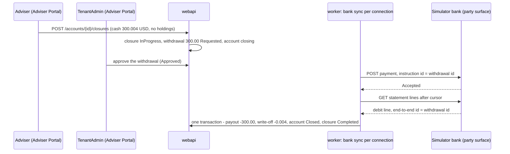

# Account closure

Step 8 of [custodial-roadmap.md](../custodial-roadmap.md) §13. It covers roadmap item **B8** (account closure flow). It needs no outside party of its own: the money leaves through the withdrawal of [withdrawals.md](withdrawals.md), and the flow follows [ADR 0021](../adr/0021-outside-parties-behind-ports.md) rules 12–14 through it. It amends [accounts.md](accounts.md), [posting.md](posting.md), [custody-modes.md](custody-modes.md), [transaction-source.md](transaction-source.md), [withdrawals.md](withdrawals.md), [deposit-matching.md](deposit-matching.md), [portfolios.md](portfolios.md), [adjustments.md](adjustments.md), [internal-transfers.md](internal-transfers.md), [fx-conversions.md](fx-conversions.md) and the Adviser Portal and Customer Portal contracts.

An Adviser or TenantAdmin requests an **account closure** for a Custodial account that holds nothing and has nothing in progress. The platform splits the cash balance into the **payout**, the part that is a whole number of the currency's minor unit, and the **remainder** below it. When there is a payout, the closure creates an ordinary withdrawal of it to a verified nominated bank account of the Customer, and the account is **closing**: it accepts no new activity until the closure ends. When the bank statement shows the payment, the platform posts the payout, writes off the remainder, and closes the account, in one database transaction. When there is no payout, the platform writes off the remainder and closes the account at once. From this slice on, no person enters a `CloseOut` on a Custodial account, and `POST /accounts/{id}/close` no longer closes one.

New: permissions `account-closures.read` and `account-closures.request`; routes `POST /accounts/{accountId}/closures`, `GET /accounts/{accountId}/closures` and `GET /accounts/{accountId}/closures/{id}` (a sub-resource of the Account, §8); source kind `AccountClosure`; unmatched reason `AccountClosing`; item fields `closure` (account) and `accountClosureId` (withdrawal). Script `0046_account_closures.sql`. No new `TransactionType`, problem code, domain event, port, job or simulator change.

**Status is `accepted` (2026-11-22), landed 2026-11-22.** It depends on [withdrawals.md](withdrawals.md) and [bank-returns.md](bank-returns.md), which landed 2026-11-21. The thirteen points of §11 were confirmed on 2026-11-22, every one as recommended, and are written into the rules. The amendments to accepted docs listed in §12 were made when it was accepted.

Notes from landing:

- §5: `Transaction.PostRemainderWriteOff` takes the Account's id, currency and the currency's decimal places (`tenantId, accountId, accountCurrency, decimalPlaces, cashSum, bookedAt, source`), because the Domain reads the minor unit from the currency, not from the Account. `ClosureAmounts.MinorUnit` is the one minor-unit computation; `CustodyRules` uses it.
- R23: `CustodyRules.RefusalMessage(Custodial, CloseOut)` returns the R23 message as well as `CloseOutRefusal`, so the matrix cell is refused (`AllowsManualEntry` is false) and `POST /transactions` answers at `errors.Type` before reading the cash.
- R2: a body `accountId` → 400 `errors.AccountId` (`AccountId cannot be set; the account is the path's.`); `tenantId` → 400 `errors.TenantId`. Any other field the command does not define (`status`, an amount, `id`) is refused by the JSON reader (400, no `errors`).
- R3: a Disabled Customer → 400 `disabled` / `target=user` with `Cannot close the account while the customer is disabled. Enable the customer first.`
- R7, R17: the decimal places come from the currency catalog. R17 reads the cash `SUM` and the holdings after the payout is saved, inside the line's transaction.
- R12: the check is `AccountClosing.EnsureNotClosingAsync`, which reads the closure rows (not an Account entity loaded before the lock). In `ReverseTransaction` the Closed-account check still runs before the locks, as before; the closing check runs directly after the locks and before the hand-reverse source check. `POST /transactions/fx/quote` takes no lock; its check runs directly after its Closed-account check. Match and undo match get the check through `StatementLinePosting.EnsureCanPostAsync`.
- R13: only a closing account gets the new `account_not_eligible` message; a Closed or External account keeps the custody-modes R14 message. Assign takes no Account lock, as before.
- R17–R20: the completion and the end live in `AccountClosureCompletion`: `AfterPayoutAsync`, called from the payout of withdrawals R40 before the line's last save, and `EndWithWithdrawalAsync`, called by reject, cancel and the send step's rejection before their save. R19 logs at Error level with the closure, the account, the cash and whether a holding remains.
- R22: the refusal runs after the row-version check, so a stale `rowVersion` is still 409 first.
- `0046`: the CHECKs are `CK_AccountClosures_Status`, `_CancelReason`, `_CashBalanceAtRequest`, `_PayoutAmount`, `_WriteOffAmount`, `_Cancel` (reason iff Cancelled), `_Completed`, `_Ended`, `_Payout` (bank account and withdrawal iff a payout) and `_WriteOff` (amount and Transaction together). The composite FKs are named `FK_AccountClosures_<parent>_TenantId_<column>`; the index is `IX_AccountClosures_TenantId_Status_RequestedAt`.
- §10 fan-out: `CustodialHttp.CloseAsync` closes a Custodial account through an account closure (the Adviser requests, a TenantAdmin approves, the fake bank pays) and an External account through `POST /accounts/{id}/close`. `CustodialHttp.WithdrawAsync` shares its payee and approval steps.
- D53: the type selector offers CloseOut on no account (it already did not on an External one), and the portal's copy of the matrix lists CloseOut as refused on Custodial. D54: the links are the account page (holdings), `/portfolios/:id` and `/withdrawals/:id`. D55: the Portfolio section and the Reverse buttons are hidden too, as actions. D56: Cancel on a closure's withdrawal opens a confirm dialog with the sentence (Cancel had no dialog before); Reject puts it in the note dialog. The Bank receipts reason label (D34) of `AccountClosing` is "Account being closed".
- C26: the payout is shown with the currency's minor unit; the bank account number is the masked number of the closure's withdrawal. C27: the activity item reads `source`.

---

## 1. Summary



| | After step 7 | After this slice |
| --- | --- | --- |
| Closing a Custodial account with cash | Request a withdrawal, wait for the payout, enter a hand `CloseOut` of the remainder, press Close | One account closure; the platform pays out, writes off the remainder and closes when the bank has paid |
| Closing a Custodial account with no payout | Hand `CloseOut` of a remainder, then Close | Account closure, completed at once |
| Hand `CloseOut` on a Custodial account | Allowed for a remainder below the minor unit | Refused (400). External accounts unchanged |
| `POST /accounts/{id}/close` on a Custodial account | Closes a flat account | Refused (400). External accounts unchanged |
| Activity while the payout is on its way | Anything the rules allow | Refused on the closing account; receipts wait in suspense |
| Record of a Custodial close | The `AccountClosed` event only | An account closure: who, when, why, what was paid out and written off |

The rule that distinguishes this slice: a Custodial account closes only through a flow that pays its whole balance to the Customer's verified bank account, and nothing can change the account between the moment the payout is fixed and the moment the bank pays it.

---

## 2. Scope

**In**

- Domain: `AccountClosure` aggregate; `AccountClosureStatus`, `AccountClosureCancelReason`; `ClosureAmounts` (payout and remainder); `TransactionSourceKind.AccountClosure` and `TransactionSource.AccountClosure(closurePublicId)`; factory `Transaction.PostRemainderWriteOff`; `UnmatchedReason.AccountClosing`; `CustodyRules`: `CloseOut` / Custodial refused
- Application: `RequestAccountClosure`; `GetAccountClosures`, `GetAccountClosureById`; the closing check in every hand write on an Account (R12); `ProcessStatementLines` completes a closure with its payout and sends receipts to a closing account to suspense; `RejectWithdrawal`, `CancelWithdrawal` and `SendBankPayments` end the closure of their withdrawal; `CloseAccount` refuses a Custodial account; account and withdrawal reads map the new fields
- Infrastructure: EF mapping of the new table
- Script: `database/schema/0046_account_closures.sql`
- Security: two permissions (R1)
- HTTP (`webapi`): `/accounts/{accountId}/closures` (three routes), the new item fields, the closing refusals, the close route and matrix refusals
- Adviser Portal: the Close account page, the closing account header, the closure's withdrawal, the write-off on the transaction page; no BFF change (both BFFs already proxy `/accounts`)
- Customer Portal: the closing and closed account notes, the write-off label
- Tests listed in §10

**Out**

- Selling or moving holdings as part of the closure. The account must hold nothing (R6); selling waits for orders (roadmap O1) and moving shares out for in-kind transfer (roadmap T1)
- A final advisory fee (future-plans §1 step 4). It adds its step to the closure in its own spec (§11 point 1). Interest to the closing date is the step of [interest-run.md](interest-run.md) R33
- Closing every account of a Customer, or ending the Customer relationship (offboarding)
- A closure statement or report for the Customer
- A reason list for a closure (§11 point 11). The memo says why
- A cancel route on the closure (R20). A closure ends with its withdrawal
- Approval of a closure with no payout (R9)
- Notifying the Customer, the Adviser or the TenantAdmin
- A Customer acting in the Customer Portal (roadmap D6). The Customer sees the closure, never requests one
- Any change to the simulator, the bank feed, the payment port or the bank reconciliation computation (R30)
- A Back Office page. SystemAdmin has none of the new permissions
- Any change to External accounts: they keep hand `CloseOut` and `POST /accounts/{id}/close`

---

## 3. Stories

1. As an Adviser I close my Customer's Custodial account in one step: the platform pays the balance to the Customer's verified bank account and closes the account when the bank has paid.
2. As an Adviser I am told what stops the closure (a holding, a portfolio, an open withdrawal, no verified bank account) before anything is written.
3. As a TenantAdmin I approve the closure's payment like any withdrawal, and never one I requested myself.
4. As an Adviser or TenantAdmin I stop a closure by cancelling or rejecting its withdrawal before the bank was asked to pay.
5. As the platform I keep a closing account unchanged until its payout is posted, so the balance paid out is the balance the account had.
6. As a TenantAdmin I find a receipt that arrived for a closing account in suspense, and return it or place it.
7. As a Customer I see that my account is being closed, what is being paid to which bank account, and later that it is closed.
8. As an Adviser I can no longer write off a remainder by hand or close a Custodial account with the plain Close button.

---

## 4. Rules

### 4.1 Access

| ID | Rule |
| --- | --- |
| R1 | **Access.** New permissions: `account-closures.read` (TenantAdmin, Adviser, Customer) and `account-closures.request` (TenantAdmin, Adviser). SystemAdmin has neither → 403. Missing / dead Bearer → 401, never 302. A disabled current tenant → 403. Scope is the Account's, as withdrawals R17: TenantAdmin any Account of the tenant; Adviser Accounts of assigned Customers; Customer own Accounts. An Account in the path outside scope, of another tenant, or missing → 404; a closure id that is not a closure of that Account → 404. No caller names a tenant; a `tenantId` in a query or body → 400. |

### 4.2 Request

| ID | Rule |
| --- | --- |
| R2 | **Request.** `POST /accounts/{accountId}/closures` with optional `nominatedBankAccountId` and `memo` → 201 `{ "id" }`. `memo` is why the account is closed: trimmed, 1–200 characters, required (400 `errors.Memo`). Requires `Idempotency-Key` (posting R21, ADR 0015): replay with the same hash → the original 201; same key, other hash → 409; missing → 400. The body must not carry `accountId` (the Account is the path's), `status`, an amount, `tenantId` or `id` (400). |
| R3 | **Account.** The Account of the path must be in scope (else 404), Custodial (else 400 `errors.AccountId`, `Only a Custodial account is closed with an account closure.`), Open (400, the posting R6 message) and its Customer not Disabled (400 `disabled` / `target=user`). |
| R4 | **Under the Account lock.** The request locks the Account row as every posting does (posting R22). R5–R7 are checked and R8 or R9 is written in one database transaction under that lock, so no posting, withdrawal request or flow on the Account sees the state between them. |
| R5 | **Nothing in progress.** Each refusal is 400 `errors.AccountId`. A closure `InProgress` on the Account → `This account is already being closed.` An open withdrawal (withdrawals R24) → `Open withdrawals must be paid, rejected or cancelled before the account can be closed.` An Active portfolio assignment → `Unassign the portfolio before closing the account.` Withdrawals are the only instructions today; a later instruction kind (an order, roadmap O1; an in-kind transfer, T1) adds itself to this rule in its own spec. Refusals added by later specs, each 400 `errors.AccountId`: a live order (an open order, or one with a fill not posted yet) → `Open orders must be filled, cancelled or expired before the account can be closed.`; a fill that is not settled → `Trades must settle before the account can be closed.` (orders R47); a fill with a break of outcome `NotApplied` → `A broken trade on this account waits for a decision.` (trade-settlement R33); an open in-kind transfer → `Open transfers of securities must be completed, rejected, cancelled or set aside before the account can be closed.` (in-kind-transfers R45); a `Pending` entitlement of a dividend → `A dividend is still to be paid on this account. Close it after the payment.` (dividends R46); an open adjustment request → `Open adjustment requests must be approved, rejected or cancelled before the account can be closed.` (adjustment-review R17). An Account with an open rebalance has an Active assignment, so it is refused already; unassign cancels the open rebalance (rebalances R22), and the closure then waits for its open orders. |
| R6 | **No holdings.** Any holding on the Account → 400 `errors.AccountId`, `Sell every holding before closing the account.` The closure does not sell or move holdings. Since in-kind transfers the message reads `Sell or transfer out every holding before closing the account.` |
| R7 | **Payout and remainder.** Let `S` be the cash `SUM` of the Account (`≥ 0` on a Custodial account; R5 means no cash is reserved, so available cash is `S`) and `u = 10^−DecimalPlaces` the currency's minor unit. The **payout** `P` is `S` rounded down to a multiple of `u`; the **remainder** is `S − P`, so `0 ≤ S − P < u`. A remainder exists only because a `Buy` / `Sell` cash leg is rounded to 4 decimals (custody-modes §4.2). Before the payout is worked out, after the checks of R3, R5 and R6, under the same Account lock and in the same database transaction, the platform accrues the account through yesterday (UTC) and posts every accrual row not yet posted, whatever its month. When that posts a Transaction it also stores an interest run with trigger `AccountClosure`, that one account and the requester, which is the Transaction's source. The payout and `cashBalanceAtRequest` then include the net interest (interest-run R33). With no live order and no unsettled fill the cash `SUM` is all withdrawable. |
| R8 | **With a payout (`P > 0`).** `nominatedBankAccountId` is required (400 `errors.NominatedBankAccountId`, `The account has 300.00 USD to pay out. Choose a verified bank account.`) and is checked as withdrawals R20: another Customer's, another tenant's or a missing one → 404; not `Verified` or in another currency → 400 `errors.NominatedBankAccountId`. In the same database transaction the platform creates the closure, `InProgress`, and a withdrawal of `P` to that bank account (withdrawals R18–R24): requested by the caller at the same time, reference the Account's deposit reference (withdrawals R23), memo the closure's memo, linked to the closure. `P` is reserved; available cash is the remainder. From then on the withdrawal is an ordinary withdrawal: a TenantAdmin other than the requester approves it (withdrawals R28), the `worker` sends it, and its payout is posted from the debit line (withdrawals R40). |
| R9 | **Without a payout (`P = 0`).** No withdrawal and no approval: nothing leaves the trust account. A `nominatedBankAccountId` in the body is not used, checked or stored. In the same database transaction the platform posts the remainder write-off when the remainder is not 0 (R18), closes the Account (`Account.Close()`, which raises `AccountClosed` as today) and creates the closure `Completed`. The Account is Closed when the 201 is sent. |
| R10 | **The record.** A closure stores the Account, the requester and time, the memo, the cash balance at request, the payout, the nominated bank account and the withdrawal (with a payout), the write-off amount and its Transaction (when there was one), the status, the cancel reason and the time it completed or ended. It has no domain event of its own. |

### 4.3 A closing account

| ID | Rule |
| --- | --- |
| R11 | **Closing.** An Account is **closing** while it has a closure `InProgress`. Only R8 makes one; a closure without a payout is never `InProgress`. A closing account is not accrued. When the closure ends with its withdrawal, the next interest run accrues the days in between; when it completes, the account is Closed and earns nothing more. The day of the request and the days the payout is on its way earn no interest. |
| R12 | **No new hand activity.** On a closing account each of these is refused → 400 with the message `This account is being closed and accepts no new activity.` under the empty `errors` key (where posting R6 puts the Closed-account message), for every caller: `POST /transactions` (any type); `POST /transactions/transfer`, `POST /transactions/fx` and `POST /transactions/fx/quote` with the account on either side; `POST /transactions/adjustment`; `POST /transactions/{id}/reverse` of a Transaction with a leg on the account; `POST /withdrawals` for the account; `POST /statement-lines/{id}/match` to the account and `POST /statement-lines/{id}/unmatch` of a deposit on it. The check runs under the Account lock directly after the Closed-account check, so it comes before the manual entry matrix (custody-modes R6) and every later check. No idempotency record is written. The routes a closing account refuses also include `POST /orders` and `POST /orders/preview` (orders R7), `POST /in-kind-transfers`, and `POST /adjustment-requests`, which took the place of `POST /transactions/adjustment`; the approval of a request checks the same, but no open request can be left on a closing account (R5). |
| R13 | **Portfolios.** Assigning a portfolio to a closing account → 400 `account_not_eligible` with the message `Only an open Custodial account that is not being closed can be assigned a portfolio.` (custody-modes R14). A closing account has no Active assignment (R5), so no rebalance reaches it. |
| R14 | **Receipts wait in suspense.** A credit line that deposit matching would post to a closing account (deposit-matching R15–R20) becomes `Unmatched` with the new reason `AccountClosing`, checked directly after `AccountClosed` in the order of deposit-matching R18; nothing is posted. A returned payout of an earlier withdrawal of a closing account (withdrawals R42) becomes `Unmatched` with `AccountClosing` too. The TenantAdmin returns such a line to the payer (bank-returns), or matches it by hand once the closure has ended (to an Account that is Open again; a Closed one needs a reopen first). |
| R15 | **Flows that lower cash: unchanged.** They keep available cash `≥ 0` (withdrawals R36). A closing account's available cash is its remainder, so a recall of one of its receipts is not covered and waits in suspense (bank-returns R3), as on any account whose cash is reserved for a withdrawal. |
| R16 | **Why the payout empties the account.** With R5, R6 and R12–R15, while an account is closing no write raises its cash or changes a holding, and no write lowers its cash below `P`. So when the payout of `P` is posted, the cash left is at most the remainder and the account holds nothing. |

### 4.4 Completion and end

| ID | Rule |
| --- | --- |
| R17 | **Completion with the payout.** When withdrawals R40 posts the payout of a closure's withdrawal, then in the same database transaction, with the Account still locked and after the payout: let `s` be the cash `SUM` left. When `0 ≤ s < u` and the Account holds nothing, the platform posts the remainder write-off when `s > 0` (R18), closes the Account (`Account.Close()`, `AccountClosed` through the outbox as today) and sets the closure `Completed` with the time. The withdrawal is `Paid` as in withdrawals R40. |
| R18 | **Remainder write-off.** A Transaction of type `CloseOut` with one `Principal` cash leg on the Account, amount `−s` (posting R17; exempt from the `DecimalPlaces` rule, posting R8); source `AccountClosure` (5) with the closure's PublicId as source id; `bookedAt` = platform time (ADR 0021 rule 10); memo `Account closure remainder`; `reference` `null`. Built by `Transaction.PostRemainderWriteOff` without the manual entry matrix (custody-modes R7). `CreatedBy` is the requester when it is posted with the request (R9), the worker's system name when it is posted with the payout (R17). |
| R19 | **Not closable.** If, against R16, `s ≥ u` or a holding exists when the payout is posted, the payout is still posted (the bank has paid, withdrawals R40), nothing is written off, the Account stays Open, and the closure becomes `Cancelled` with reason `NotClosable`. The worker logs an error. A TenantAdmin corrects the account (an adjustment) and a new closure closes it. |
| R20 | **End without a payout.** A closure follows its withdrawal, in the same database transaction as the withdrawal's change: `Rejected` → closure `Cancelled` with `WithdrawalRejected`; `Cancelled` → `Cancelled` with `WithdrawalCancelled`; `Failed` → `Cancelled` with `PaymentFailed`. The Account is no longer closing and stays Open with its cash. The closure has no cancel route of its own: it is stopped by cancelling its withdrawal, which is possible only before the first send attempt (withdrawals R30), or by a TenantAdmin rejecting it. After the first attempt the closure waits for the bank. |
| R21 | **After completion.** A payout of the closure's withdrawal that the payee's bank returns arrives on a Closed account: withdrawals R42 applies (the line becomes `Unmatched` with `AccountClosed`, nothing is posted). The closure stays `Completed`. Reopen is unchanged (accounts R6, R11; client-money-accounts R18); a later closure of the same Account is a new row. |

| Status | Means | Account | Next |
| --- | --- | --- | --- |
| `InProgress` | The payout waits for approval, the bank or the statement | Open, closing | `Completed`, `Cancelled` |
| `Completed` | Paid out (or nothing to pay), remainder written off, Account Closed | Closed | final |
| `Cancelled` | Ended without closing the Account (`WithdrawalRejected`, `WithdrawalCancelled`, `PaymentFailed`, `NotClosable`) | Open | final |

### 4.5 The close route and the manual entry matrix

| ID | Rule |
| --- | --- |
| R22 | **`POST /accounts/{id}/close` on a Custodial account.** On an Open Custodial account → 400 with the message `A Custodial account is closed with an account closure.` under the empty `errors` key, for every caller, SystemAdmin included. An already Closed account → 204, as accounts R12. External accounts unchanged (accounts R16, posting R12). |
| R23 | **Hand `CloseOut` refused on a Custodial account.** The manual entry matrix cell `CloseOut` / Custodial becomes **refused** for every amount: `POST /transactions` → 400 `errors.Type` with the message `The remainder of a Custodial account is written off by its account closure. Request an account closure.`, for every caller. This replaces withdrawals R46. External accounts unchanged. A `CloseOut` entered by hand before this slice keeps source `Manual` and can still be reversed by hand on an Open account. |
| R24 | **Source kind.** `AccountClosure = 5`, with the closure's PublicId as source id (required). Not hand-reversible (transaction-source R12, R13): `POST /transactions/{id}/reverse` of a write-off → 400. |

### 4.6 Reads

| ID | Rule |
| --- | --- |
| R25 | **Item.** `{ id, accountId, customerId, status, cancelReason, memo, requestedBy, requestedAt, currency, cashBalanceAtRequest, payoutAmount, nominatedBankAccount, withdrawalId, writeOffAmount, writeOffTransactionId, completedAt, endedAt }`. `nominatedBankAccount` is `{ id, bankName, accountName, accountNumber }` with the number masked as `****1234` (withdrawals R25), `null` without a payout. `writeOffAmount` is the amount written off (positive), `null` when nothing was. A Customer sees every field except `memo` (`null` for a Customer). No `rowVersion`: a closure has no action. |
| R26 | **List.** `GET /accounts/{accountId}/closures` → list envelope of that Account's closures, newest requested first. Optional filter `status` (one or more names, comma-separated; unknown → 400 `errors.Status`). `GET /accounts/{accountId}/closures/{id}` → the item. There is no list across Accounts: the TenantAdmin's queue is the withdrawals list (R8, R28), and both portals read the account item (R27). |
| R27 | **On the account item.** The account item on list and get gains `closure`: the Account's latest closure as `{ id, status, payoutAmount, withdrawalId, requestedAt, completedAt }`, or `null` when it has none. Always `null` on an External account. Every caller who can read the Account sees it, the Customer included. |
| R28 | **On the withdrawal item.** The withdrawal item gains `accountClosureId`: the PublicId of the closure that created it, else `null`. |
| R29 | **On the transaction item.** A write-off has `source: { kind: "AccountClosure", id: <closure PublicId> }`. No new detail. |
| R30 | **Bank reconciliation: unchanged.** The payout is in the ledger through its debit line (bank-reconciliation R10). The write-off is cash that never passed through the trust account, of type `CloseOut`, so it falls in `OtherLedgerCash` (Known); it only undoes the sub-unit part a trade left, which is in `Trades`. |

Policies: the two of R1 (new). Grants: as R1.

---

## 5. Domain

| Type | Kind | Change |
| --- | --- | --- |
| `AccountClosure` | Aggregate (new) | `TenantId`, `PublicId`, `AccountId`, `Status`, `CancelReason`, `Memo`, requested (`ByUserId`, `At`), `Currency`, `CashBalanceAtRequest`, `PayoutAmount`, `NominatedBankAccountId`, `WithdrawalId`, `WriteOffAmount`, `WriteOffTransactionId`, `CompletedAt`, `EndedAt`, `RowVersion`. `StartWithPayout(...)` → `InProgress`; `CompleteAtOnce(...)` → `Completed`; `Complete(writeOff?, at)`; `Cancel(reason, at)`; `IsInProgress`. Holds R8–R10, R17, R19, R20 |
| `AccountClosureStatus` | Enum (new) | `InProgress = 0`, `Completed = 1`, `Cancelled = 2` |
| `AccountClosureCancelReason` | Enum (new) | `WithdrawalRejected = 0`, `WithdrawalCancelled = 1`, `PaymentFailed = 2`, `NotClosable = 3` |
| `ClosureAmounts` | Static (new) | `Split(cashSum, decimalPlaces)` → `(payout, remainder)` (R7); `IsRemainder(cashSum, decimalPlaces)` for `0 ≤ cashSum < u` |
| `TransactionSourceKind` | Enum (existing) | Add `AccountClosure = 5`. Not hand-reversible |
| `TransactionSource` | VO (existing) | `TransactionSource.AccountClosure(Guid closurePublicId)`; the id must not be empty |
| `Transaction` | Aggregate (existing) | `PostRemainderWriteOff(tenantId, account, cashSum, bookedAt, source)`: one `CloseOut` `Principal` leg of `−cashSum`; `0 < cashSum < u`; source kind must be `AccountClosure` |
| `UnmatchedReason` | Enum (existing) | Add `AccountClosing = 12` |
| `CustodyRules` | Static (existing) | `CloseOutRefusal(Custodial, …)` returns the R23 message for every amount; the remainder branch of withdrawals R46 goes. The matrix still lives in one Domain class |

```text
AccountClosure.StartWithPayout(account, by, at, memo, cash, payout, nominated, withdrawal)   -> InProgress
AccountClosure.CompleteAtOnce(account, by, at, memo, cash, writeOff?)                       -> Completed
  Complete(writeOff?, at)     InProgress -> Completed
  Cancel(reason, at)          InProgress -> Cancelled
  IsInProgress = InProgress
```

Invariants:

- An Account has at most one closure `InProgress`. Held by a filtered unique index and the Account lock (R4).
- A closure with a payout has exactly one withdrawal of that amount, created with it; a closure without one has none and is never `InProgress`.
- A closure is `Completed` only together with `Account.Close()` in one database transaction.
- A remainder write-off has source `AccountClosure` and brings the cash `SUM` to exactly 0. Held by `PostRemainderWriteOff`.
- On a Custodial account no person enters a `CloseOut`. Held by `CustodyRules`, called by Application.

Domain events: none new. `AccountClosed` is raised by `Account.Close()` as today.

Recorded in [domain-model.md](../domain-model.md) §8.5 (closing account), §8.6 (source kind, write-off), §8.9 (unmatched reason) and §8.13 (account closure).

---

## 6. Database

Script: `database/schema/0046_account_closures.sql`. Forward only. Do not add EF migrations.

| Table | Change | Index / FK |
| --- | --- | --- |
| `AccountClosures` | Add | PK `Id`. Unique `PublicId`. FK `TenantId` → `Tenants`; `(TenantId, AccountId)` → `Accounts`; `(TenantId, RequestedByUserId)` → `Users`; `(TenantId, NominatedBankAccountId)` → `NominatedBankAccounts`; `(TenantId, WithdrawalId)` → `Withdrawals` (`UQ_Withdrawals_TenantId_Id`); `(TenantId, WriteOffTransactionId)` → `Transactions`; all RESTRICT. Unique filtered `UX_AccountClosures_InProgress` on `(TenantId, AccountId) WHERE Status = 0`. Unique filtered `UX_AccountClosures_Withdrawal` on `(WithdrawalId) WHERE WithdrawalId IS NOT NULL`. Index `(TenantId, Status, RequestedAt DESC)` |
| `BankStatementLines` | Drop and re-add the `UnmatchedReason` CHECK as 0–12 | none |
| `Transactions` | Drop and re-add `CK_Transactions_SourceKind` (`BETWEEN 0 AND 5`) and `CK_Transactions_SourcePublicId` (`(SourceKind IN (0, 1) AND SourcePublicId IS NULL) OR (SourceKind IN (2, 3, 4, 5) AND SourcePublicId IS NOT NULL)`) | none |

| Column | Type | Null | Notes |
| --- | --- | --- | --- |
| Id | int identity | no | |
| PublicId | uniqueidentifier | no | |
| TenantId | int | no | Tenant query filter |
| AccountId | int | no | |
| Status | int | no | CHECK 0–2 |
| CancelReason | int | yes | CHECK 0–3; set iff `Status = 2` |
| Memo | nvarchar(200) | no | |
| RequestedByUserId, RequestedAt | int, datetimeoffset | no | |
| Currency | char(3) | no | The Account's |
| CashBalanceAtRequest | decimal(18,4) | no | CHECK `≥ 0` |
| PayoutAmount | decimal(18,4) | no | CHECK `≥ 0` |
| NominatedBankAccountId, WithdrawalId | int, int | yes | Both set iff `PayoutAmount > 0` (CHECK) |
| WriteOffAmount | decimal(18,4) | yes | CHECK `> 0`; set together with `WriteOffTransactionId` (CHECK) |
| WriteOffTransactionId | int | yes | |
| CompletedAt | datetimeoffset | yes | Set iff `Status = 1` |
| EndedAt | datetimeoffset | yes | Set iff `Status = 2` |
| Created, CreatedBy, LastModified, LastModifiedBy | audit | | |
| RowVersion | rowversion | no | Guards the completion and end races (R17, R20) |

No back-fill: Accounts closed before this slice have no closure, and no Transaction has source `AccountClosure`.

Recorded in [database-design.md](../database-design.md) §9, §11.3, §11.4, §11.9 and §11.13.

---

## 7. Application use cases

| Kind | Name | Change |
| --- | --- | --- |
| Command | `RequestAccountClosure` (new) | R1–R10; `Idempotency-Key`; under the Account lock; creates the withdrawal (R8) or closes at once (R9) |
| Query | `GetAccountClosures`, `GetAccountClosureById` (new) | R1, R25, R26 |
| Service | `AccountClosing` (new, Application) | `IsClosingAsync(accountId)` under the lock; the R12 refusal |
| Command | `CreateTransaction`, `CreateInternalTransfer`, `CreateFxConversion`, `CreateAdjustment`, `ReverseTransaction`, `RequestWithdrawal`, `MatchStatementLine`, `UnmatchStatementLine` | R12 |
| Query | `GetFxConversionQuote` | R12 |
| Command | `AssignPortfolio` | R13 |
| Service | `ProcessStatementLines` (existing) | R14 (`AccountClosing`); R17–R19 after a closure's payout |
| Command / Service | `RejectWithdrawal`, `CancelWithdrawal`, `SendBankPayments` (existing) | R20: end the closure in the same transaction |
| Command | `CloseAccount` (existing) | R22 |
| Command | `CreateTransaction` | R23 (`CustodyRules`) |
| Query | `GetAccounts`, `GetAccountById` | Map `closure` (R27) |
| Query | `GetWithdrawals`, `GetWithdrawalById` | Map `accountClosureId` (R28) |
| Query | `GetTransactions`, `GetTransactionById` | Source kind `AccountClosure` (R29) |

Where each rule lives:

| Rule | Where |
| --- | --- |
| Payout and remainder (R7) | `ClosureAmounts` |
| Closure transitions (R17, R19, R20) | `AccountClosure`, called in the transaction of the payout or the withdrawal change |
| The closing refusal (R12) | `AccountClosing`, under the Account lock in each handler |
| Matrix (R23) | `CustodyRules` |
| Write-off shape (R18) | `Transaction.PostRemainderWriteOff` |

---

## 8. API

| Method | Route | Policy | Success | Failure |
| --- | --- | --- | --- | --- |
| GET | `/accounts/{accountId}/closures` | `account-closures.read` | 200 envelope | 400 / 401 / 403 / 404 |
| GET | `/accounts/{accountId}/closures/{id}` | `account-closures.read` | 200 item | 401 / 403 / 404 |
| POST | `/accounts/{accountId}/closures` | `account-closures.request` | 201 `{ id }` | 400 / 401 / 403 / 404 / 409 |
| GET | `/accounts`, `/accounts/{id}` | unchanged | item has `closure` | — |
| POST | `/accounts/{id}/close` | unchanged | — | adds 400 on an Open Custodial account (R22) |
| POST | `/transactions` | unchanged | — | adds 400 `errors.Type` for any `CloseOut` on Custodial (R23); R12 |
| POST | `/transactions/transfer`, `/transactions/fx`, `/transactions/fx/quote`, `/transactions/adjustment`, `/transactions/{id}/reverse`, `/withdrawals`, `/statement-lines/{id}/match`, `/statement-lines/{id}/unmatch` | unchanged | — | R12 |
| POST | `/accounts/{id}/portfolio` (assign, portfolios §8) | unchanged | — | R13 |
| GET | `/withdrawals`, `/withdrawals/{id}` | unchanged | item has `accountClosureId` | — |
| GET | `/transactions`, `/transactions/{id}` | unchanged | `source.kind` may be `AccountClosure` | — |
| GET | `/statement-lines[/{id}]` | unchanged | `unmatchedReason` may be `AccountClosing` | — |

### 8.1 Bodies

Request, `POST /accounts/{accountId}/closures` (`Idempotency-Key` header):

```json
{
  "nominatedBankAccountId": "<nominated bank account publicId>",
  "memo": "Customer is moving to another provider, asked by email 2026-11-22"
}
```

Item, in progress:

```json
{
  "id": "<closure publicId>",
  "accountId": "<account publicId>",
  "customerId": "<customer publicId>",
  "status": "InProgress",
  "cancelReason": null,
  "memo": "Customer is moving to another provider, asked by email 2026-11-22",
  "requestedBy": { "id": "<user publicId>", "name": "Alex Adviser" },
  "requestedAt": "2026-11-22T03:00:00Z",
  "currency": "USD",
  "cashBalanceAtRequest": 300.004,
  "payoutAmount": 300.00,
  "nominatedBankAccount": { "id": "<publicId>", "bankName": "ANZ", "accountName": "J Smith", "accountNumber": "****8900" },
  "withdrawalId": "<withdrawal publicId>",
  "writeOffAmount": null,
  "writeOffTransactionId": null,
  "completedAt": null,
  "endedAt": null
}
```

Completed: `status: "Completed"`, `writeOffAmount: 0.004`, `writeOffTransactionId` set, `completedAt` set.

Account item (other fields unchanged):

```json
{
  "status": "Open",
  "cashBalance": 300.004,
  "reservedCash": 300.00,
  "availableCash": 0.004,
  "closure": { "id": "<closure publicId>", "status": "InProgress", "payoutAmount": 300.00, "withdrawalId": "<withdrawal publicId>", "requestedAt": "2026-11-22T03:00:00Z", "completedAt": null }
}
```

Transaction item of a write-off:

```json
{
  "id": "<transaction publicId>",
  "type": "CloseOut",
  "bookedAt": "2026-11-22T03:12:40Z",
  "memo": "Account closure remainder",
  "reference": null,
  "source": { "kind": "AccountClosure", "id": "<closure publicId>" },
  "cash": [ { "accountId": "<account publicId>", "amount": -0.004, "currency": "USD", "...": "..." } ],
  "...": "..."
}
```

### 8.2 Errors

All refusals are ordinary validation (400 with `errors`, no problem `code`) except where named.

| Case | Response |
| --- | --- |
| Caller without the permission of the route | 403 |
| An Account or nominated bank account outside scope, of another Tenant, or missing; a closure id of another Account | 404 |
| `tenantId` in a query or body; `accountId` in the request body | 400 |
| Missing memo | 400 `errors.Memo` |
| External account; a closure in progress; an open withdrawal; an Active assignment; a holding | 400 `errors.AccountId` |
| A payout and no, an unverified or another currency's nominated bank account | 400 `errors.NominatedBankAccountId` |
| Closed Account | 400 (posting R6) |
| Disabled Customer | 400 `disabled` / `target=user` |
| Missing `Idempotency-Key` / same key other body | 400 / 409 |
| A hand write on a closing account | 400 (R12) |
| Assigning a portfolio to a closing account | 400 `account_not_eligible` |
| `POST /accounts/{id}/close` on an Open Custodial account | 400 (R22) |
| Hand `CloseOut` on a Custodial account | 400 `errors.Type` |
| Hand reverse of a write-off | 400 (transaction-source R13) |
| Unknown `status` on the list | 400 `errors.Status` |

Cross-tenant or wrong-collection id → **404**, not 403. Keep the resource catalog in [api-design.md](../api-design.md) pointing here for these rules.

---

## 9. UI

Page contracts: [adviser-portal-dashboard.md](../adviser-portal/adviser-portal-dashboard.md) (D53–D57) and [customer-portal.md](../customer-portal/customer-portal.md) (C26, C27), amended and accepted together with this spec. The routes sit under `/accounts`, which both BFFs already proxy ([bff-adviser-portal.md](bff-adviser-portal.md) R20, [bff-customer-portal.md](bff-customer-portal.md) R20), so neither BFF changes. The Customer Portal reads the account item and the withdrawals it already reads, and calls no closure route. Back Office: none.

**Adviser Portal**

| ID | Behaviour |
| --- | --- |
| D53 | On an Open Custodial account the Close action opens `/accounts/:id/close` instead of calling `POST /accounts/{id}/close`. External accounts unchanged. The type selector (D18, D39) no longer offers CloseOut on a Custodial account. |
| D54 | `/accounts/:id/close`: a checklist from the account, its holdings, its assignment and `GET /withdrawals?accountId=&status=Requested,Approved,Sent`: "No holdings", "No portfolio", "No open withdrawals", each ticked or with its R5 / R6 sentence and a link (holdings, the portfolio, the withdrawal). Then "Cash balance", "To pay out" (`P`) and, when not 0, "Written off" (the remainder). With a payout: To (the Customer's Verified bank accounts in the currency; none → "No verified bank account in USD. Add one on the customer page." with a link). Memo (required). Review: with a payout, "Pay 300.00 USD to ANZ J Smith ****8900 and close the account when the bank has paid. A firm administrator must approve the payment. Until then the account accepts no new activity."; without, "Close the account now." with "0.004 USD is written off." when there is a remainder. Confirm posts `POST /accounts/{id}/closures` with one `Idempotency-Key` per form open and returns to the account page. Confirm is disabled while a check fails. A 400 is shown at its field. The checklist also has "No open adjustment requests". |
| D55 | The account page of a closing account (`closure.status` `InProgress`) shows a banner: "Being closed. 300.00 USD is being paid out (<withdrawal status label, D46>). The account accepts no new activity." with a link to `/withdrawals/:closure.withdrawalId`. Every action button is hidden, Withdraw included. A Closed account whose latest closure is `Completed` shows "Closed by account closure on <date>". A `Cancelled` closure shows nothing on the account. |
| D56 | On the withdrawals list (D46) a closure's withdrawal shows "Account closure" under To. `/withdrawals/:id` of one shows "This withdrawal pays out an account closure." Reject and Cancel on it ask in their dialog: "This also stops the account closure. The account stays open." |
| D57 | `/transactions/:id` of a write-off: the Source line (D26) shows "Account closure" with a link to the account page. The type is shown as "Close out (rounding)". Reverse is not offered (D27). |

**Customer Portal**

| ID | Given | When | Then |
| --- | --- | --- | --- |
| C26 | Customer with a closing Custodial account | Account page | A note above the balance: "This account is being closed. 300.00 USD is being paid to your bank account ****8900." (amount from `closure.payoutAmount`, the number from the withdrawal). A Closed account whose latest closure is `Completed` shows "Closed on <date>." |
| C27 | Customer with a write-off on a Custodial account | Account page activity | The row is labelled "Rounding write-off" instead of the `CloseOut` label. A `CloseOut` with another source keeps today's label. |

### 9.1 Seeds and hosting

- `TestSeed`, `DevelopmentSmokeSeeder`, demo seed: no change.
- AppHost, TestAppHost, VPS: no change. No new key, job or port.

---

## 10. Tests

The tests are the executable form of §4. Where they live:

| Project | Where |
| --- | --- |
| Domain.UnitTests | `Entities/AccountClosureTests.cs`, `RemainderWriteOffTests.cs` |
| Application.FunctionalTests | Folder `AccountClosures/`; `Interest/AccountClosureInterestTests.cs` |
| Infrastructure.IntegrationTests | `AppliedSchema/AccountClosuresSchemaTests.cs` |

---

## 11. Locked in this spec

No new ADR. The closure uses the outgoing call of [ADR 0021](../adr/0021-outside-parties-behind-ports.md) rules 12–14 only through its withdrawal. Roadmap P6 (a person reverses only what a person entered), P7 (instructions are their own aggregates) and P8 (committed cash is reserved) apply as written.

| Item | Lock |
| --- | --- |
| Account closure | Its own record, a sub-resource of the Account: `/accounts/{accountId}/closures`; requested by an Adviser or TenantAdmin; `InProgress` only with a payout; `Completed` together with the Account's close; `Cancelled` with its withdrawal |
| Payout | The cash balance rounded down to the minor unit, as an ordinary withdrawal created with the closure and approved by a second person |
| Remainder | Written off by the platform as a `CloseOut` with source `AccountClosure` (5), with the payout or at once |
| Closing | No hand write on the Account and no portfolio assignment; receipts and returned payouts wait in suspense (`AccountClosing`) |
| Preconditions | No holding, no Active assignment, no open withdrawal, no other closure in progress |
| Close route and matrix | `POST /accounts/{id}/close` refused on an Open Custodial account; hand `CloseOut` refused on Custodial (both for every caller) |
| Permissions | `account-closures.read`, `account-closures.request` |
| Script | `0046_account_closures.sql` |
| Problem codes, events, ports, jobs, simulator, BFF prefixes | None added |

### Confirmed in review (2026-11-22)

Each point was confirmed on 2026-11-22 as recommended, and is written into the rules above as stated here. The alternatives are kept for the record.

1. **A closure is its own record** (R2, R10). Decided: every Custodial close leaves one row that says who closed the account, why, what was paid out and what was written off, and the later steps a closure needs (interest to the closing date with roadmap I2, a final advisory fee, moving shares out with T1) get one place to add themselves. Alternatives: a flag `closeAccount` on the withdrawal, which closes the account when the payout posts (smaller, but each later step would have to move into a closure record then); or only the remainder write-off on `POST /accounts/{id}/close`, with the person withdrawing the balance first (no automation, no freeze).
2. **The closure's payout is an ordinary withdrawal, and its approval is the only approval** (R8). Decided: the four-eyes rule, the payment, the send step, the payout from the debit line, the cancel window and the return are all reused as they are; the TenantAdmin approves closures on the page where they approve every withdrawal. Alternative: a separate approval of the closure, which creates an already approved withdrawal.
3. **A closure with nothing to pay out completes at once, without approval** (R9). Decided: no money leaves the trust account, the write-off is below the minor unit (what a hand `CloseOut` did until now), and a flat account could be closed with one click before. Alternative: a second person also for these.
4. **Preconditions refuse, they do not act** (R5, R6). Decided: the closure does not sell holdings, unassign the portfolio or cancel withdrawals; each is a decision a person makes before. Selling needs unassign anyway (portfolios R18), and an automatic sale waits for orders (roadmap O1). Alternatives: unassign and cancel automatically; sell everything at the server's price with a rebalance-like step.
5. **The account is frozen while closing, and its receipts go to suspense** (R12–R16). Decided: the payout is fixed at request, so a deposit, a trade, a transfer or an adjustment in between would leave cash the closure cannot pay or write off. Receipts in suspense are the existing tool for money the platform cannot place. Alternatives: credit receipts and pay them out with a second withdrawal (more states, and the account may never become flat); recompute the payout at approval (the approver would see the amount change).
6. **The remainder is a `CloseOut` written by the flow, not an `Adjustment`** (R18). This refines roadmap B8 ("as a rounding adjustment"). Decided: `CloseOut` already means "bring the balance to exactly 0 before close" (posting R17) and is already exempt from the minor-unit rule (posting R8), while an adjustment is a hand correction with its own permission, and adjustments §11 point 5 left out a `Rounding` reason because `CloseOut` covers it. The source `AccountClosure` tells it apart from a hand `CloseOut`. Alternative: an `Adjustment` with a new reason `Rounding` and source `AccountClosure`, which needs adjustments R9 to allow sub-unit cash for that one source.
7. **`POST /accounts/{id}/close` refuses a Custodial account** (R22). Decided: every Custodial close goes through a closure, so the record of point 1 has no gaps, and there is one Close path in the Adviser Portal per custody mode. Alternative: keep the close route for a Custodial account with cash exactly 0 and no holdings.
8. **The closure completes in the payout's database transaction** (R17). Decided: the payout, the write-off and the close are one fact (the bank paid the whole balance); no state exists where the cash is gone and the account is still closing. Alternative: a completion step in the bank sync job after processing, which can retry but leaves a window.
9. **No cancel route on the closure** (R20). Decided: whether a closure can still stop is exactly whether its withdrawal can (before the first send attempt), so the withdrawal's cancel and reject are the controls, and the Adviser Portal says so in their dialogs. Alternative: `POST /accounts/{accountId}/closures/{id}/cancel`, which cancels the withdrawal in the same transaction.
10. **Two new permissions, SystemAdmin none** (R1). Decided: as withdrawals §11 point 6; a closure moves money, and SystemAdmin has no withdrawal permission either, so it also loses `POST /accounts/{id}/close` on Custodial accounts (R22). Alternative: `accounts.manage` together with `withdrawals.request` for the request, `accounts.read` for the reads.
11. **A memo, no reason list** (R2). Decided: a free-text memo is enough until a report or a rule reads the reason. Alternative: a reason (`CustomerRequest`, `Deceased`, `FirmDecision`, `Other`) as adjustments have.
12. **A defensive end `NotClosable`** (R19). Decided: the rules make it unreachable, but if it happens the payout must still follow the bank, and the account must not close with cash or a holding. Alternative: roll back the line's processing, which leaves the bank's debit line unprocessed until a person fixes the account.

13. **The routes are a sub-resource of the Account, `/accounts/{accountId}/closures`** (R2, R26). Decided: in this API a resource sits at the root when it is a work queue read across Accounts (`/withdrawals`, `/statement-lines`, `/transactions`), and under its parent when it belongs to one parent and is reached through it (`/accounts/{id}/portfolio`, `/tenants/{tenantId}/client-money-accounts`). A closure belongs to one Account, is requested from the account page, and has no queue of its own (its approval is on the withdrawals list). A collection, not a singleton, keeps every closure of an Account readable after a reopen and a second closure, which the write-off's source id and the withdrawal's `accountClosureId` point to. The routes need no BFF change. The name stays `closures`, the glossary's term, without the custody mode: no other route names it (withdrawals and deposit instructions are Custodial-only too), and the path already scopes it to one Account. Alternatives: a root collection `/account-closures` with an `accountId` filter, like withdrawals; a singleton `/accounts/{id}/closure` (as `/accounts/{id}/portfolio`) that shows only the latest; starting the flow from `POST /accounts/{id}/close`, which would give one accepted route two behaviours and two response codes by custody mode.

Still open, not this slice:

- The final advisory fee, as a step of the closure before the payout (interest to the closing date: [interest-run.md](interest-run.md) R33)
- Selling holdings through orders (O1) or moving them out in kind (T1) as part of a closure
- Closing every account of a Customer, and disabling the Customer with it
- A closure statement for the Customer
- What happens to a recall that arrives while an account is closing, beyond suspense (bank-returns R3), and the shortfall it leaves in the trust account

---

## 12. Docs changed when this spec was accepted

[accounts.md](accounts.md) (R16 and close: a Custodial account closes through an account closure; `closure` on the item), [posting.md](posting.md) (R12, R16, R17: `CloseOut` on a Custodial account is written only by the closure flow), [custody-modes.md](custody-modes.md) (R5 matrix: `CloseOut` refused on Custodial; §4.2.1 message; the `CloseOut` paragraph of §4.2), [transaction-source.md](transaction-source.md) (kind `AccountClosure` = 5, not hand-reversible, check widened), [withdrawals.md](withdrawals.md) (R46 replaced; R40 completes a closure; R27–R30 and R33 end it; R42 `AccountClosing`; `accountClosureId` on the item), [deposit-matching.md](deposit-matching.md) (R18 reason `AccountClosing`; R26 and R30 refused on a closing account), [bank-returns.md](bank-returns.md) (R3 on a closing account, unchanged rule, note), [portfolios.md](portfolios.md) (assign refused while closing), [adjustments.md](adjustments.md) (refused while closing; §2 Out on the B8 write-off), [internal-transfers.md](internal-transfers.md) and [fx-conversions.md](fx-conversions.md) (refused with a closing account on either side), [api-design.md](../api-design.md) (§3.1 two permission rows, the `/accounts` catalog row and §7.6 gain the `closures` sub-resource, change log), [domain-model.md](../domain-model.md), [database-design.md](../database-design.md), [adviser-portal-dashboard.md](../adviser-portal/adviser-portal-dashboard.md) (D53–D57, D18, D39, D46, D47), [customer-portal.md](../customer-portal/customer-portal.md) (C26, C27), [known-issues/custodial-account-gaps.md](../known-issues/custodial-account-gaps.md) (the `CloseOut` row notes this spec; it is removed when the slice lands), [glossary.md](../glossary.md) (the review terms become accepted), [function-plan.md](../function-plan.md) §5, [features/README.md](README.md) row status, the roadmap §5 B8 and §13 status.

---

## 13. History

What changed in this file after it was accepted. The text of each change is in git (`git log -p -- docs/features/account-closure.md`).

| Date | With | Change here |
| --- | --- | --- |
| 2026-11-22 | [interest-run.md](interest-run.md) | R7, R11: interest to the closing date |
| 2026-11-23 | [orders.md](orders.md), [trade-settlement.md](trade-settlement.md), [rebalances.md](rebalances.md) | R5, R12: live orders, unsettled fills and broken trades |
| 2026-11-24 | [in-kind-transfers.md](in-kind-transfers.md), [dividends.md](dividends.md) | R5, R6, R12: open in-kind transfers; a pending dividend |
| 2026-11-25 | [adjustment-review.md](adjustment-review.md) | R5, R12, D54: open adjustment requests |
| 2026-11-26 | — | The changes above were folded into the body. No rule changed |
