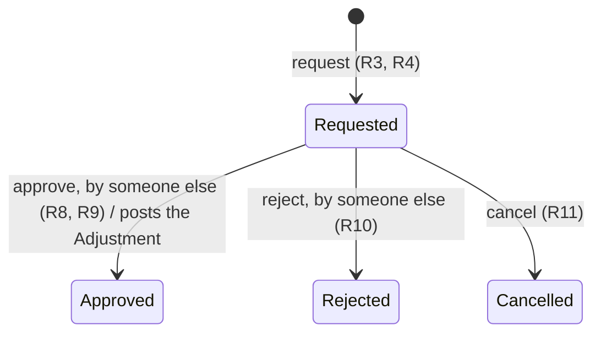

# Adjustment review

A second person approves every adjustment on `webapi`. It is step 17 of [custodial-roadmap.md](../roadmaps/custodial-roadmap.md) §13 and covers roadmap item **X1**. It amends [adjustments.md](adjustments.md), [posting.md](posting.md) §1, [transaction-source.md](transaction-source.md), [custody-modes.md](custody-modes.md), [account-closure.md](account-closure.md) and the Adviser Portal page contract.

One new record (the **adjustment request**, `/adjustment-requests`), one new source kind (`AdjustmentRequest`), one script (`0058_adjustment_requests.sql`). The route `POST /transactions/adjustment` goes away, and an `Adjustment` can no longer be reversed by hand. No new permission, `TransactionType`, problem code, job or event. No simulator change.

**Status is `accepted` (2026-11-25), landed 2026-11-25.** The nine points of §11 were confirmed as recommended.

Notes from landing:

- §5: the one shared rule is `AdjustmentPosting` in the Application layer. The request builds the `Adjustment` the approval would post, so that `Transaction.PostAdjustment` runs its own checks, and stores the request instead of the Transaction. Its available cash check reads the cash `SUM` plus the request's amount.
- R7–R9: approve locks the Account and reads the clock, then checks the status and the second person before the Account, its Customer and the Instrument. Reject and cancel take no Account lock (R12).
- R15: the refusal runs after the leg locks and the closing-account check, directly before transaction-source R13. An Adviser who reverses an `Adjustment` now gets this 400 in place of the 403 of adjustments R17.
- §5: `TransactionAdjustmentDetail` no longer has a copy for a Reversal. The Reversal of an adjustment posted before this slice keeps its detail and reads as before. The Customer Transactions Report test no longer reverses an adjustment, because none can be reversed now.
- §9.1: the second TenantAdmin is an optional pair of fields on the Development firm entry, set for the demo firm only.
- D103: the nav item "Adjustments" sits before "Custody movements". The table shows the cash as "−0.60 USD" and "—" for a part the request does not have.
- D104: the actions share one optional note field; Cancel is "Cancel adjustment", and Reject opens the note dialog.
- D105: the account page section is "Adjustments waiting for approval", under the open withdrawals and above the activity. The Close account page adds the check "No open adjustment requests" with "View the adjustment" for a TenantAdmin. An Adviser cannot read the requests and sees the server's refusal.
- D106: the link on `/transactions/:id` reads "Adjustment request".

---

## 1. Summary

A TenantAdmin no longer posts an adjustment. They **request** one: the same fields as today, stored as an adjustment request that changes nothing in the ledger. A TenantAdmin **other than the requester** approves it, and the approval posts the `Adjustment` Transaction in the same database transaction. A request can also be rejected or cancelled, and then it posts nothing.

Why now: every flow of the roadmap has landed, and an adjustment is the one write a person still types on a Custodial account with numbers of their own. It is also the fix for every break the flows cannot repair (a fill that cannot be reversed, a movement in suspense, a wrong migration entry), so its use grows with each flow. Roadmap target 2 asks for a second person's approval of it.

The rule that distinguishes this slice: the review happens **before** the Transaction exists, on a record of its own. The ledger gets no status. A Transaction is still posted in one step and is never pending (posting §1 "write = posted" stays true). This is the pattern of withdrawals, migration batches and in-kind transfers, and it replaces the plan of roadmap X1 and posting §1 to put a status on the Transaction row (§11 point 1).

---

## 2. Scope

**In**

- Domain: `AdjustmentRequest` aggregate and `AdjustmentRequestStatus`; `TransactionSourceKind.AdjustmentRequest` (11); `Reverse` refuses an `Adjustment`
- Application: `RequestAdjustment`, `ApproveAdjustmentRequest`, `RejectAdjustmentRequest`, `CancelAdjustmentRequest`, the two reads; `CreateAdjustment` is removed; `ReverseTransaction` refuses an `Adjustment`; account closure refuses while a request is open
- Infrastructure: EF mapping of the new table
- Script `database/schema/0058_adjustment_requests.sql` (new table, source kind check 0–11; forward only)
- HTTP: `/adjustment-requests` routes; `POST /transactions/adjustment` removed
- Adviser Portal: the Adjust form requests; an "Adjustments" page with approve, reject and cancel; BFF prefix `/adjustment-requests`
- Development seed: a second TenantAdmin in the demo firm (§9.1)
- Tests listed in §10

**Out**

- A status on the Transaction, and any change to how balances, holdings, net worth or reports read the ledger
- A change to what an adjustment is: its shape, reason list, memo, Custodial-only rule and trade lock exemption stay as [adjustments.md](adjustments.md) has them
- A new permission or an operations role (roadmap D5). Request and approval both take `transactions.adjust`
- A request by an Adviser (§11 point 3)
- A reservation of cash or quantity for an open request (§11 point 5)
- Editing a request. A wrong one is cancelled and requested again
- Review of the other hand writes on a Custodial account (`InternalTransfer`, `FxConversion` and their reverse)
- A link from a request to a reconciliation break, a broken fill or a movement in suspense
- Adjustments on External accounts
- Any change to the Customer Portal or the Customer Transactions Report

---

## 3. Stories

1. As a TenantAdmin I request an adjustment on a Custodial account with a reason and a memo, and I am told at once when it cannot be posted as things stand.
2. As a TenantAdmin I approve an adjustment another TenantAdmin requested, and the Transaction is posted at that moment. I cannot approve my own.
3. As a TenantAdmin I reject a request someone else made, with a note that says why.
4. As a TenantAdmin I cancel a request, my own or another's, that is no longer wanted.
5. As a TenantAdmin I see the requests that wait for approval, and on a posted adjustment I see who requested it and who approved it.
6. As a TenantAdmin I correct a wrong adjustment with a new request for the opposite change, because an adjustment is not reversed.
7. As an Adviser or a Customer I see an adjustment only once it is posted, as today.

---

## 4. Rules

### 4.1 Access

| ID | Rule |
| --- | --- |
| R1 | **Access.** Every `/adjustment-requests` route requires the existing permission `transactions.adjust`, which only TenantAdmin holds (adjustments R2, roadmap D5). Adviser, Customer and SystemAdmin → 403, checked before anything is read. Missing / dead Bearer → 401, never 302. A disabled current tenant → 403. A request of another Tenant, or a missing one → 404. No caller names a tenant; a `tenantId` in a query or body → 400. Path `{id}` and every id in JSON are PublicIds. |

### 4.2 The request

| ID | Rule |
| --- | --- |
| R2 | **What it is.** An adjustment request is a Tenant's record of one adjustment a person asks for: the fields of an adjustment (adjustments R6–R10), the person who asked, and a status. It is not a Transaction. It changes no balance, holding or reservation until it is approved (R9). |
| R3 | **Request.** `POST /adjustment-requests` → 201 `{ "id" }` with `Location: /adjustment-requests/{id}`, status `Requested`. The body is the body `POST /transactions/adjustment` took (adjustments §8.1): `accountId`, `reason`, `memo`, optional `reference`, optional `amount`, optional `security: { instrumentId, quantityChange, costChange }`. `Idempotency-Key` is required, with the rules of adjustments R20. |
| R4 | **Checked when requested.** The request runs every check of adjustments R3 and R5–R15 as amended (available cash, reserved quantity, a closing account), in the order of adjustments §4.2, on the state at that moment and with the Account row locked. Each refusal has the response it has today (adjustments §8.2), and a refused request stores nothing. The check tells the requester early what cannot be posted. It promises nothing about the approval, which checks again (R9). |
| R5 | **No reservation.** An open request reserves no cash and no quantity. Available cash, withdrawable cash, available quantity and transferable quantity do not count it. |
| R6 | **Statuses.** `Requested` → `Approved`, `Rejected` or `Cancelled`. A request is **open** while it is `Requested`. The three end statuses never change, and the fields of a request never change after it is stored. An Account may have several open requests. |



### 4.3 Decisions

| ID | Rule |
| --- | --- |
| R7 | **Every action.** Body with `rowVersion`; missing → 400, stale → 409 `stale_row_version`. A request that is not `Requested` → 400 `errors.Status` with the message `This adjustment request is <status> and cannot be <approved / rejected / cancelled>.` Success → 204. No `Idempotency-Key`: the status and `rowVersion` make a repeat a 400 or a 409. `note`: trimmed, 1–200; required on reject (400 `errors.Note`), optional on approve and cancel. |
| R8 | **Approve and reject, by a second person.** `POST /adjustment-requests/{id}/approve` and `…/reject` are refused when the caller requested the adjustment → 400 `errors.Status` with the message `An adjustment must be approved by someone other than the person who requested it.` This holds for every Tenant, also one with a single TenantAdmin: such a firm keeps a second TenantAdmin login (withdrawals R28). |
| R9 | **Approval posts.** Approve runs in one database transaction on `webapi`. It locks the Account, reads the clock after the lock (custody-modes R12), and runs the checks of R4 again on the locked state, except the request shape. A refusal answers as it would on the request (for example 400 with `Available cash cannot become negative: …`), nothing is written, and the request stays `Requested`: it can be approved later, rejected or cancelled. Otherwise the platform posts one `Adjustment` with `Transaction.PostAdjustment`: the request's reason, memo, reference, cash amount and holding change; `bookedAt` = that clock reading; source `AdjustmentRequest` with the request's PublicId (R13); `CreatedBy` = the approver. The holdings projection follows in the same transaction (holdings R14), and the Transaction raises `TransactionPosted` as today. The request becomes `Approved` with the person, the time, the note and the Transaction. |
| R10 | **Reject.** The request becomes `Rejected` with the person, the time and the note. Nothing is posted. |
| R11 | **Cancel.** `POST /adjustment-requests/{id}/cancel`, by any holder of the permission, the requester included. The request becomes `Cancelled` with the person, the time and the note. Nothing is posted. |
| R12 | **Reject and cancel need no Account check.** They are allowed whatever the state of the Account, its Customer or the Instrument, so that a request can always be ended. |

### 4.4 The Transaction and the ledger

| ID | Rule |
| --- | --- |
| R13 | **Source kind.** `AdjustmentRequest = 11`, with the request's PublicId as source id (required). Not hand-reversible (transaction-source R12). An `Adjustment` posted before this slice keeps source `Manual` with no id; nothing is back-filled. This replaces adjustments R4 for new adjustments. |
| R14 | **One way in.** The route `POST /transactions/adjustment` and its command `CreateAdjustment` are removed. `POST /transactions` keeps refusing `type: "Adjustment"` (adjustments R19). An `Adjustment` is written only by R9. |
| R15 | **No reverse.** `POST /transactions/{id}/reverse` of a Transaction of type `Adjustment` → 400, ordinary `errors` like the other reverse refusals (posting R11), with the message `An adjustment cannot be reversed. Request a new adjustment that corrects it.` It holds for every caller and every row, also an `Adjustment` posted before this slice with source `Manual`. The check runs where transaction-source R13 runs and before it (transaction-source R14), so every adjustment gets this message. A Transaction the caller cannot see is still 404. This replaces adjustments R17 and R18. A wrong adjustment is corrected by a request for the opposite change, which a second person approves. |
| R16 | **Matrix.** The cell `Adjustment` / Custodial of the manual entry matrix (custody-modes R5) becomes: **allowed through an adjustment request that a second person approves, with `transactions.adjust`**. The Reverse row gains: never for an `Adjustment`. External stays refused. |
| R17 | **Account closure.** An account closure is refused while the Account has an open adjustment request: 400 `errors.AccountId` with the message `Open adjustment requests must be approved, rejected or cancelled before the account can be closed.` (a new refusal in account-closure R5). A closing account already takes no adjustment (adjustments R15 as amended), so R4 refuses a request on it, and no open request can be left on a closing or closed account. |
| R18 | **What does not change.** The shape, the reason list, the memo, the Custodial-only rule and the trade lock exemption of an adjustment (adjustments R5–R16). `adjustment: { reason }` on the transaction item. Cash balance, holdings, net worth and both reports add the legs as today, and the Customer Transactions Report shows the reason (adjustments R22, R23). The bank reconciliation groups the cash legs under `Adjustments` by the type of the Transaction (bank-reconciliation R10). `POST /orders/{id}/fills/{fillId}/resolve-break` still takes `transactions.adjust` (trade-settlement R1). External accounts are unchanged. |

### 4.5 Reads

| ID | Rule |
| --- | --- |
| R19 | **Item.** `{ id, accountId, customerId, reason, memo, reference, amount, currency, security, status, requestedBy, requestedAt, decision, transactionId, rowVersion }`. `amount` is `null` with no cash part; `currency` is the Account currency. `security` is `{ instrument: { id, symbol, name }, quantityChange, costChange, costCurrency }` or `null`. `decision` is `{ action, by, at, note }` with `action` `Approved`, `Rejected` or `Cancelled`, else `null`. Each person is `{ id, name }`. `transactionId` is the posted `Adjustment` on an `Approved` request, else `null`. |
| R20 | **List.** `GET /adjustment-requests` → list envelope, newest requested first, then newest `Id`. Optional filters: `status` (one or more names, comma-separated; unknown → 400 `errors.Status`), `accountId` and `customerId` (unknown or another Tenant's → an empty list). `GET /adjustment-requests/{id}` → the item. |
| R21 | **On the transaction item.** An `Adjustment` posted by R9 has `source: { "kind": "AdjustmentRequest", "id": "<request PublicId>" }`. Every caller who can read the Transaction sees it, the Customer included. An Adviser or a Customer cannot read the request itself (403). |

Policies: none new. Grants: unchanged.

---

## 5. Domain

| Type | Kind | Change |
| --- | --- | --- |
| `AdjustmentRequest` | Aggregate (new) | `TenantId`, `AccountId`, `Reason`, `Memo`, `Reference`, `CashAmount` (0..1), `InstrumentId` with `QuantityChange` and `CostChange` (all three or none), `Status`, `RequestedBy`, `RequestedAt`, the decision (`Action`, `By`, `At`, `Note`), `TransactionId` (0..1), `RowVersion`. Factory `Request`; methods `Approve(by, at, note, transactionId)`, `Reject(by, at, note)`, `Cancel(by, at, note)`. |
| `AdjustmentRequestStatus` | Enum (new) | `Requested = 0`, `Approved = 1`, `Rejected = 2`, `Cancelled = 3`. |
| `TransactionSourceKind` | Enum (existing) | New `AdjustmentRequest = 11`; needs a source id; not hand-reversible. |
| `Transaction` | Aggregate (existing) | `PostAdjustment` is unchanged; its caller passes the new source. `Reverse` refuses an `Adjustment` (R15) and no longer copies an adjustment detail. |

Invariants:

- A request has a cash part, a holding part or both, a reason and a memo that is not blank.
- `Approve`, `Reject` and `Cancel` are allowed only from `Requested`. `Approve` and `Reject` throw when the person is the requester.
- A request is `Approved` exactly when it has a Transaction.
- An `Adjustment` is never reversed.

The checks on the cash balance and the holding stay in `PostAdjustment`. `RequestAdjustment` runs the same checks without storing a Transaction (R4), from one shared rule, so the request and the approval cannot disagree about what is allowed.

Domain events: none new. `TransactionPosted` is raised by the approval, as it was by the create route.

[domain-model.md](../domain-model.md) §8.6 and §8.21 were updated when this spec was accepted.

---

## 6. Database

Script: `database/schema/0058_adjustment_requests.sql`. Forward only. Do not add EF migrations.

| Table | Change | Index / FK |
| --- | --- | --- |
| `AdjustmentRequests` | Add (columns below) | PK `Id`. UQ `PublicId`. UQ `(TenantId, Id)`. FK `TenantId` → `Tenants`; `(TenantId, AccountId)` → `Accounts`; `(TenantId, InstrumentId)` → `Instruments`; `(TenantId, TransactionId)` → `Transactions`; `(TenantId, RequestedByUserId)` and `(TenantId, DecisionByUserId)` → `Users`; all RESTRICT. Index `(TenantId, RequestedAt DESC)`; index `(AccountId, Status)`; filtered unique `(TransactionId) WHERE TransactionId IS NOT NULL` |
| `Transactions` | Drop and re-add `CK_Transactions_SourceKind` as `SourceKind BETWEEN 0 AND 11`, and `CK_Transactions_SourcePublicId` with `11` among the kinds that need a source id | none |
| `TransactionAdjustmentDetails` | none | none |

`AdjustmentRequests`: `Id int IDENTITY`, `PublicId uniqueidentifier`, `TenantId int`, `AccountId int`, `Reason int` (CHECK 0–3), `Memo nvarchar(200)`, `Reference nvarchar(100) NULL`, `CashAmount decimal(18, 4) NULL`, `InstrumentId int NULL`, `QuantityChange decimal(18, 8) NULL`, `CostChange decimal(18, 4) NULL`, `Status int` (CHECK 0–3), `RequestedByUserId int`, `RequestedAt datetimeoffset`, `DecisionAction int NULL` (CHECK 1–3, the status it led to), `DecisionByUserId int NULL`, `DecisionAt datetimeoffset NULL`, `DecisionNote nvarchar(200) NULL`, `TransactionId int NULL`, audit, `RowVersion rowversion`.

Checks on the row:

- `CashAmount` is not null or `InstrumentId` is not null; `CashAmount <> 0` when present.
- `InstrumentId`, `QuantityChange` and `CostChange` are all null or all not null; when present, not both changes are `0`.
- `Status = 0` exactly when the four decision columns are null; otherwise `DecisionAction = Status` and the person and the time are not null.
- `TransactionId` is not null exactly when `Status = 1`.
- `DecisionAction IN (1, 2)` → `DecisionByUserId <> RequestedByUserId` (R8).

Existing data: none changes. No back-fill (R13).

[database-design.md](../database-design.md) §9, §11.4 and §11.21 were updated when this spec was accepted.

---

## 7. Application use cases

| Kind | Name | Change |
| --- | --- | --- |
| Command | `RequestAdjustment` (new) | R1–R6. The checks of `CreateAdjustment`, then stores the request. |
| Command | `ApproveAdjustmentRequest` (new) | R7–R9. Posts the `Adjustment` and updates the request in one database transaction. |
| Command | `RejectAdjustmentRequest`, `CancelAdjustmentRequest` (new) | R7, R8, R10–R12. |
| Query | `GetAdjustmentRequests`, `GetAdjustmentRequestById` (new) | R19, R20. |
| Command | `CreateAdjustment` | Removed (R14). |
| Command | `ReverseTransaction` | R15 replaces the permission check of adjustments R17. |
| Command | `RequestAccountClosure` | R17. |
| Query | `GetTransactions`, `GetTransactionById` | Map the new source kind (R21). |

---

## 8. API

| Method | Route | Policy | Success | Failure |
| --- | --- | --- | --- | --- |
| POST | `/adjustment-requests` | `transactions.adjust` | 201 `{ "id" }`, `Location` | 400 / 401 / 403 / 404 / 409 |
| GET | `/adjustment-requests` | `transactions.adjust` | 200 list envelope | 400 / 401 / 403 |
| GET | `/adjustment-requests/{id}` | `transactions.adjust` | 200 item | 401 / 403 / 404 |
| POST | `/adjustment-requests/{id}/approve` | `transactions.adjust` | 204 | 400 / 401 / 403 / 404 / 409 |
| POST | `/adjustment-requests/{id}/reject` | `transactions.adjust` | 204 | 400 / 401 / 403 / 404 / 409 |
| POST | `/adjustment-requests/{id}/cancel` | `transactions.adjust` | 204 | 400 / 401 / 403 / 404 / 409 |
| POST | `/transactions/adjustment` | — | removed (R14) | — |
| POST | `/transactions/{id}/reverse` | `transactions.create` (unchanged) | — | 400 for an `Adjustment` (R15), in place of the 403 of adjustments R17 |

The Adviser Portal BFF gains the prefix `/adjustment-requests` ([bff-adviser-portal.md](bff-adviser-portal.md)). The Customer Portal BFF does not change.

### 8.1 Bodies

Request: the body of adjustments §8.1, unchanged.

Approve, reject, cancel:

```json
{ "rowVersion": "<base64>", "note": "Checked against the broker's contract note" }
```

Item, approved:

```json
{
  "id": "<request publicId>",
  "accountId": "<account publicId>",
  "customerId": "<customer publicId>",
  "reason": "EntryError",
  "memo": "Buy of 2026-11-18 was filled at 25.40, not 25.10",
  "reference": null,
  "amount": -0.60,
  "currency": "USD",
  "security": {
    "instrument": { "id": "<instrument publicId>", "symbol": "ACME.SIM", "name": "Acme" },
    "quantityChange": 0,
    "costChange": 0.60,
    "costCurrency": "USD"
  },
  "status": "Approved",
  "requestedBy": { "id": "<user publicId>", "name": "Tessa Admin" },
  "requestedAt": "2026-11-25T02:00:00Z",
  "decision": {
    "action": "Approved",
    "by": { "id": "<user publicId>", "name": "Tom Admin" },
    "at": "2026-11-25T02:10:00Z",
    "note": "Checked against the broker's contract note"
  },
  "transactionId": "<transaction publicId>",
  "rowVersion": "<base64>"
}
```

The Transaction it posted (other fields as in adjustments §8.1):

```json
{
  "type": "Adjustment",
  "source": { "kind": "AdjustmentRequest", "id": "<request publicId>" },
  "adjustment": { "reason": "EntryError" },
  "bookedAt": "2026-11-25T02:10:00Z"
}
```

### 8.2 Errors

| Case | Response |
| --- | --- |
| Caller without `transactions.adjust` on any `/adjustment-requests` route | 403 |
| Every refusal of adjustments §8.2, on the request and again on the approval | as there (R4, R9) |
| Missing `rowVersion` / stale | 400 / 409 `stale_row_version` |
| Action on a request that is not `Requested` | 400 `errors.Status` (R7) |
| Approve or reject by the requester | 400 `errors.Status` (R8) |
| Reject without a note | 400 `errors.Note` |
| Unknown or other-tenant request id | 404 |
| Reverse of an `Adjustment` | 400, ordinary `errors` (R15) |
| Account closure with an open request | 400 `errors.AccountId` (R17) |

No new problem code. Keep the resource catalog in [api-design.md](../api-design.md) pointing here for these rules.

---

## 9. UI

Page contract: [adviser-portal-dashboard.md](../adviser-portal/adviser-portal-dashboard.md), amended in the same change that accepted this spec. The reason labels of adjustments §9 are unchanged.

**Adviser Portal**

| ID | Behaviour |
| --- | --- |
| D102 | The Adjust form (D29) posts `POST /adjustment-requests` in place of `POST /transactions/adjustment`, with one `Idempotency-Key` per form open. Review adds "Another firm administrator must approve this adjustment before it is posted." Confirm opens `/adjustments/:id`. Field 400s are shown as today. |
| D103 | A TenantAdmin sees a nav item "Adjustments" (`/adjustments`), with the number of requests waiting for approval beside it. The page lists `GET /adjustment-requests`: Requested, Customer, Account, Reason, Cash, Holding ("AAPL quantity +10, cost +250.00 USD"), Status, Requested by. Status filter, default "Waiting for approval" (Requested); options Waiting for approval, Approved, Rejected, Cancelled, All. An Adviser gets "Only a firm administrator can see adjustments." |
| D104 | `/adjustments/:id` shows every field, the memo with "The customer sees this memo", the decision with its note, and a link to the Transaction once approved. Actions on a `Requested` request: Approve and Reject, disabled for the requester with "Someone else must approve this adjustment."; Cancel. Reject asks for a note. A 400 from approve shows its sentence and leaves the request as it is; a 409 reloads with "This adjustment has changed." |
| D105 | `/accounts/:id` of a Custodial account shows a TenantAdmin the account's open requests above the activity, each linking to `/adjustments/:id`. The Close account page (D54) shows the refusal of R17 with its other blockers. |
| D106 | `/transactions/:id` of an `Adjustment` posted from a request: the Source line (D26) shows "Adjustment request", for a TenantAdmin with a link to the request. Reverse is never offered on an `Adjustment`; D31 is removed. |

**Customer Portal**

None. An adjustment appears when it is posted, labelled as today.

**Back Office**

None.

### 9.1 Seeds

`TestSeed` and `DevelopmentSmokeSeeder` add no request.

The Development seed has one TenantAdmin per firm today, so nobody could approve a request there (and nobody can post a migration batch without adding a person first). `DevelopmentIdentitySeeder` adds a second TenantAdmin to the demo firm, `tenant-admin-b@localhost` ("Tenant Admin B"), with the Development password (§11 point 9). The demo seed (`webapi --seed-demo`) seeds no people and does not change.

---

## 10. Tests

The tests are the executable form of §4. Where they live:

| Project | Where |
| --- | --- |
| Domain.UnitTests | Folder `AdjustmentRequests/` |
| Application.FunctionalTests | Folder `AdjustmentRequests/` |
| Infrastructure.IntegrationTests | `AppliedSchema/AdjustmentRequestsSchemaTests.cs` |

---

## 11. Locked in this spec

No new ADR. Roadmap X1, target 2, principle P7 and decisions D3 and D5 gave the direction. D3 and posting §1 are amended (point 1).

| Item | Lock |
| --- | --- |
| Record | `AdjustmentRequest` at `/adjustment-requests`; `Requested` → `Approved`, `Rejected`, `Cancelled` |
| Review | Before the Transaction exists; no status on a Transaction |
| Permission | `transactions.adjust` for every route; approve and reject by someone other than the requester |
| Posting | The approval posts the `Adjustment` in one database transaction, checked again under the Account lock |
| Source | `AdjustmentRequest = 11`, the request's PublicId as source id |
| Routes removed | `POST /transactions/adjustment` |
| Reverse | An `Adjustment` is never reversed by hand |
| Reservation | None |
| Script | `0058_adjustment_requests.sql`, forward only |

### Confirmed when this spec was accepted (2026-11-25)

Each point was confirmed as recommended and is written into the rules above as stated here. The alternatives are kept for the record.

1. **The review is on a request, not a status on the Transaction** (R2, R9). Decided: a record of its own, approved before anything is posted. Every balance, holding, reservation, report and reconciliation reads the ledger as "every row counts", and a pending row would have to be left out in each of them. Three flows already put the second person on their own record (withdrawals, migration batches, in-kind transfers). This amends posting §1 ("future maker-checker is a status on this same row … not a second resource") and roadmap D3 and X1. Alternative: the status on the row as posting §1 planned, which shows a pending adjustment in the account's activity and costs a change to every read of the ledger.
2. **One permission** (R1, R8). Decided: `transactions.adjust` for request and approval, with the rule that the approver is not the requester, as `migration-batches.manage` does. Both sides are TenantAdmin only (D5), so two permissions would have the same grants. Alternative: a second permission `adjustment-requests.approve` now, ready for an operations role.
3. **Only a TenantAdmin requests** (R1). Decided: as adjustments §11 point 2. A firm with one TenantAdmin keeps a second TenantAdmin login, as for a migration batch. Alternative: an Adviser may request and a TenantAdmin approves, as for a withdrawal, which gives a small firm its second person but lets an Adviser propose numbers on a Custodial account.
4. **The source is `AdjustmentRequest` with the request's id** (R13). Decided: every other record that posts has its own kind and id (`Migration`, `InKindTransfer`, `AccountClosure`), and the id is how a reader gets from the Transaction to who asked and who approved. This takes back adjustments §11 point 4 for new adjustments. Alternative: keep `Manual` and add the request to the adjustment detail.
5. **No reservation** (R5). Decided: a request is a correction, not money or shares on their way out, and the approval checks again under the lock. A request that can no longer be posted stays open until a person decides. Alternative: reserve a negative cash amount or quantity from the request on (roadmap P8), which keeps the approval from failing and holds a Customer's cash for a correction that may be rejected.
6. **An adjustment is never reversed** (R15). Decided: otherwise one person undoes what two approved. The opposite request corrects it, as an adjustment corrects every flow that has no reverse. Rows posted before this slice are covered too, so there is one rule. Alternative: a reverse that itself needs a second person (a request of a second kind), or keep the hand reverse with `transactions.adjust`.
7. **Reject by a second person, cancel by anyone** (R8, R11). Decided: as withdrawals and in-kind transfers. Alternative: one "decline" action for every holder.
8. **Account closure waits for open requests** (R17). Decided: an open request says the balance may be wrong, and the closure pays the balance out. Alternative: no rule; a request left on a closed account can only be rejected or cancelled.
9. **A second TenantAdmin in the Development seed** (§9.1). Decided: an adjustment is the fix for every break, so it is used often when the flows are tried by hand with the simulator, and each use now needs two people. Alternative: no seed change; a second TenantAdmin is added by hand in each Development database, as for a migration batch today.

Still open, not this slice:

- An operations role when one TenantAdmin doing everything breaks the four-eyes rule (roadmap D5)
- Review of a hand `InternalTransfer` or `FxConversion` on a Custodial account
- Linking a request to the break it corrects (roadmap B7, T3)

---

## 12. Docs changed when this spec was accepted

[adjustments.md](adjustments.md) (amendment note: R2, R4, R17, R18, R20, §8, §9, §11), [posting.md](posting.md) (§1 and an amendment note), [transaction-source.md](transaction-source.md) (kind 11, the reverse of an `Adjustment`), [custody-modes.md](custody-modes.md) (matrix rows `Adjustment` and Reverse), [account-closure.md](account-closure.md) (R5, R12, D54), [withdrawals.md](withdrawals.md), [orders.md](orders.md) and [in-kind-transfers.md](in-kind-transfers.md) (where the available cash and reserved quantity checks of an adjustment run), [bff-adviser-portal.md](bff-adviser-portal.md) (prefix), [api-design.md](../api-design.md) (§3.1, §6, §7.7, §7.15, change log), [domain-model.md](../domain-model.md) (§8.6, §8.21), [database-design.md](../database-design.md) (§9, §11.4, §11.21), [adviser-portal-dashboard.md](../adviser-portal/adviser-portal-dashboard.md) (D102–D106, D26, D27, D31), [glossary.md](../glossary.md) (Adjustment, Adjustment request), [function-plan.md](../function-plan.md) §9 item, [features/README.md](README.md) row status, the roadmap (§2 matrix, §4 F3, §10 X1, §12 D3, §13, §14).

Not amended, because what they say stays true: [trade-settlement.md](trade-settlement.md), [migration-batches.md](migration-batches.md), [dividends.md](dividends.md), [corporate-actions.md](corporate-actions.md), [bank-reconciliation.md](bank-reconciliation.md) and [reports.md](reports.md). Where they say a break is corrected with an adjustment, that adjustment is now requested and approved.
