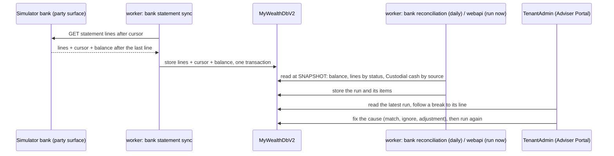

# Bank reconciliation

Step 7 of [custodial-roadmap.md](../custodial-roadmap.md) §13. It covers roadmap item **B7** (bank reconciliation) with the balances of the simulator bank (**S1 balances**). It follows [ADR 0021](../adr/0021-outside-parties-behind-ports.md) rules 1–20 and does not re-decide them. It builds on the statement lines of [deposit-matching.md](deposit-matching.md), the outgoing payments and available cash of [withdrawals.md](withdrawals.md) and the debit lines of [bank-returns.md](bank-returns.md). It amends [deposit-matching.md](deposit-matching.md), [reports.md](reports.md), [simulator.md](simulator.md) and the Adviser Portal contract.

The bank sends its **statement balance** with every page of the bank feed: the balance of the trust account after the last line of that page. The platform stores it with the lines it covers. A **bank reconciliation** compares that balance with the cash of every Custodial account of the Tenant in the client money account's currency, and lists every **reconciliation item** that explains the difference: lines in suspense, lines not processed yet, ignored lines, cash on the platform that never passed through the trust account, and any difference the platform cannot explain. Each item is a **break** (someone must act), a **timing** difference (it clears by itself) or a **known difference** (explained and accepted). A run is computed from local tables only, stored, and never edited. It runs once a day for every active client money account, and a TenantAdmin can run it at any time. A new Tenant-scoped report renders a run as a PDF.

New: permission `bank-reconciliations.manage` (TenantAdmin only); routes under `/bank-reconciliations`; report scope `Tenant` with policies `reports.tenant.read` and `reports.tenant.create` (TenantAdmin only); report `bank-reconciliation`; recurring job `bank-reconciliation`; field `balance` on the bank feed page; the simulator's bank charge and a line left out of the feed. Scripts `0045_bank_reconciliations.sql`; simulator script `database/simulator/0006_bank_balances.sql`. No new `TransactionType`, source kind, problem code or domain event.

**Status is `accepted` (2026-11-21), landed 2026-11-21.** It depends on [bank-returns.md](bank-returns.md), which landed 2026-11-21. The thirteen points of §11 were confirmed on 2026-11-21, every one as recommended, and are written into the rules. The amendments to accepted docs listed in §12 were made when it was accepted.

Notes from landing:

- R6: `IApplicationDbContext.ExecuteInTransactionAsync` gains an overload that takes the isolation level; the reconciliation read uses `Snapshot`, every other caller keeps `ReadCommitted`. The service reads with the tenant filter off and names the client money account's Tenant in every query, so it runs the same on `webapi` and `worker`. A run's `CreatedBy` is the worker's system name, also for "Run now"; `RanByUserId` names the person.
- R10: the legs are summed per Transaction in SQL and grouped by (type, original type of a Reversal, client money account of the source) in memory. A `BankFeed` source belongs to the client money account of its statement line; a `Payment` source to the client money account of the withdrawal's outgoing payment of kind `Withdrawal`. Cash legs count by the leg's currency on the Tenant's Custodial accounts.
- R13: within a class and kind, `OtherClientMoneyAccount` items are ordered by the other account's internal `Id`.
- R1: a query key a `/bank-reconciliations` route does not define is refused with 400 and the key in `errors`, by an endpoint filter (`KnownQueryKeysFilter`); `tenantId` stays a named field with its own message. A body field the command does not define is refused by the JSON reader (400, no `errors`).
- `0045`: the composite FKs are named `FK_<child>_<parent>_TenantId_<column>`; the item CHECKs are `CK_BankReconciliationItems_Line`, `_UnmatchedReason` (a reason only on an `Unmatched` line), `_OtherClientMoneyAccount`, `_Position` (from 1) and `_Count` (at least 1); the run CHECKs are `CK_BankReconciliations_RanBy` and `_BankFigures`. Items have a unique index `UX_BankReconciliationItems_ReconciliationId_Position`.
- R16: the daily job's tests are in `Infrastructure.IntegrationTests` (`BankReconciliationJobTests`), on a worker host, because the functional host is `webapi`. The job gives each account its own DI scope.
- R22: the scope→policy choice lives in one place, `ReportScopes`; a schedule of a Tenant-scoped report needs no scope check beyond the TenantAdmin policy. R25: the PDF prints `No bank balance yet.` for a `NoBankBalance` run, and the item labels of D51.
- R26–R28 (simulator): a feed page passes over lines left out of the feed; when no delivered line follows, its cursor moves to the last place, so a page of only left-out lines does not stall. `BankStatementBalance` computes the balance at a place.
- D51, D52: the history is `/bank-reconciliations/history?clientMoneyAccountId=`. The Firm reports section shows only catalog rows of scope `Tenant`, with its own schedules and history, and the report picker is labelled "Firm report".

---

## 1. Summary



| | After step 6b | After this slice |
| --- | --- | --- |
| The bank's balance of a trust account | Not known to the platform | Sent with every feed page and stored with the lines it covers |
| Does Custodial cash agree with the trust account? | Nobody can tell | A daily run per client money account, and a "Run now" for the TenantAdmin |
| A line in suspense, a bank fee, a missing line | Visible one line at a time on the Bank receipts pages | Listed as items of the run, each with its class and amount |
| Cash on a Custodial account that never passed through the bank (trades, FX, adjustments, hand entries) | Not visible as such | Listed as known differences, by cause |
| A daily record that the books agree | None | Stored runs, the Bank reconciliation pages and the `bank-reconciliation` PDF report |

The rule that distinguishes this slice: every run's items add up exactly to the difference between the bank's balance and the Custodial cash. Whatever the platform cannot attribute to a line or a cause is itself an item, `Unexplained`, and it is a break.

---

## 2. Scope

**In**

- Domain: `BankReconciliation` aggregate and its items; enums `BankReconciliationStatus`, `ReconciliationTrigger`, `ReconciliationItemKind`, `ReconciliationItemClass`; `BankReconciliation.Compute(...)` (R8–R13); `BankFeedCursor` gains the statement balance and the opening balance (R3, R4)
- Application: the bank feed page gains `Balance`; `PullBankStatements` stores it (R2–R5); service `ReconcileClientMoneyAccount` (R6–R15); command `RunBankReconciliation`; queries `GetBankReconciliationOverview`, `GetBankReconciliations`, `GetBankReconciliationById`; report generator `BankReconciliationReport`; report scope `Tenant` in the shared pipeline
- Infrastructure: `SimulatorBankFeed` reads `balance`; recurring job `bank-reconciliation`; EF mappings; SNAPSHOT read
- Scripts: `database/schema/0045_bank_reconciliations.sql`; `database/simulator/0006_bank_balances.sql`
- Security: permissions `bank-reconciliations.manage`, `reports.tenant.read`, `reports.tenant.create`, TenantAdmin only
- HTTP (`webapi`): four `/bank-reconciliations` routes; report scope `Tenant` on the existing `/reports` routes
- Simulator: the statement balance on the feed; a bank charge; a line left out of the feed; the statement balance on the control surface
- Adviser Portal: Bank reconciliation pages for TenantAdmin; Tenant-scoped reports on the Reports tab; BFF prefix `/bank-reconciliations`
- Tests listed in §10

**Out**

- A balance as of a past date, or a closing balance by value date (§11 point 1)
- A position reconciliation against a custodian (roadmap T3)
- Settling trades or FX conversions through the trust account (roadmap O1, O2, O5). Until then they are known differences (R10)
- Interest the bank pays on the trust account as its own item. A TenantAdmin ignores such a receipt (deposit-matching R27); it is then an `Ignored` known difference (roadmap B7 "Open", I2). Amended 2026-11-22: it is the item `BankInterest` of [interest-run.md](interest-run.md) R41
- A client money surplus or shortfall figure (what the firm must top up), and the firm's own money as a separate figure
- Any action on an item: accept, resolve, assign, comment (§11 point 2)
- Notifications of a break (email, outbox event)
- A Back Office page. SystemAdmin has no reconciliation permission
- A Customer Portal change
- Purging old runs
- Named scenarios and the scenario library (§11 point 12)
- A real bank adapter

---

## 3. Stories

1. As a TenantAdmin I open Bank reconciliation and see, for each of my firm's client money accounts, whether yesterday's run agreed with the bank, and the bank balance, the Custodial cash and the difference.
2. As a TenantAdmin I open a run and see every item that explains the difference, grouped into breaks, timing and known differences, and I follow a break to its statement line.
3. As a TenantAdmin I fix a break with its flow (match a receipt, ignore a bank fee, request a return) or with an adjustment, then press "Run now" and see the break gone.
4. As a TenantAdmin I schedule the bank reconciliation report so the firm keeps a PDF of each day's run.
5. As the platform I run the reconciliation of every active client money account once a day, also when the bank is down, against the last balance the bank sent.
6. As the simulator operator I add a bank charge, leave a line out of the feed, and see the platform's reconciliation show each as the item it is.

---

## 4. Rules

### 4.1 Access

| ID | Rule |
| --- | --- |
| R1 | **Access.** Every `/bank-reconciliations` route requires the new permission `bank-reconciliations.manage`, which only TenantAdmin holds (roadmap D5). Adviser, Customer and SystemAdmin → 403, checked before anything is read. Missing / dead Bearer → 401, never 302. A disabled current tenant → 403. A run or client money account of another Tenant, or a missing one → 404. No caller names a tenant; a `tenantId` in a query or body → 400. |

### 4.2 The bank's balance

Amendment to [deposit-matching.md](deposit-matching.md) R7–R10, R44, R45 and R49.

| ID | Rule |
| --- | --- |
| R2 | **Statement balance on the feed page.** A page of the bank feed carries `balance`: the bank's balance of the trust account after the last line up to the page's `cursor`, every line the bank booked up to that point counted once, including lines the feed does not deliver. A page with no items carries the balance at the cursor it returns. It is a decimal with at most 4 decimal places and may be negative. The port returns it as `Balance` (`null` when the party sends none). The platform never computes it from the lines. |
| R3 | **Stored with the page.** The balance and the time of the commit (`BalanceAt`) are written to the client money account's feed cursor in the same database transaction as the page's lines and cursor (deposit-matching R8). A page the platform refuses (deposit-matching R10) stores no balance. The **statement balance** of a client money account is therefore always the bank's balance for exactly the lines the platform has stored for it. |
| R4 | **Opening balance.** The first time a cursor stores a balance, it also stores the **opening balance**: that balance minus the signed sum (credits plus, debits minus) of every statement line stored for the client money account so far, including the page's. It never changes afterwards. It is the money in the trust account before the first line the platform holds for that account (`0` for a new simulator account). Lines stored before this slice are covered: the first page after it lands sets the opening balance against all of them. |
| R5 | **A page without a balance.** A page whose balance is `null` stores its lines and cursor as before and sets the stored balance and `BalanceAt` to `null`. The opening balance stays. Until a page with a balance arrives, a run has no bank figure (R12 `NoBankBalance`). |

### 4.3 A run

| ID | Rule |
| --- | --- |
| R6 | **What a run is.** A bank reconciliation of one client money account (account A, Tenant T, currency K) at one instant: a stored record of the bank side, the platform side and the items between them. It reads local tables only and calls no outside party (ADR 0021 rule 4), so it can run on `webapi` as well as on `worker`. Every input is read in one database transaction at `SNAPSHOT` isolation, so a line's status and the Transaction its flow wrote are seen together or not at all; the run is then stored in its own transaction (§11 point 7). |
| R7 | **Bank side.** `bankBalance` = the stored statement balance of A (R3), with its `balanceAt`. `openingBalance` = the stored opening balance (R4). `statementLinesTotal` = the signed sum of every statement line stored for A, whatever its status. |
| R8 | **Platform side.** `custodialCash` = the sum of every cash leg, of every role, on every Custodial account of Tenant T in currency K, whatever the account's status. External accounts are never counted. `difference` = `bankBalance − custodialCash`. |
| R9 | **Statement line items.** One item per statement line of A in one of the statuses below, with `amount` = the line's amount, positive for a credit and negative for a debit. Lines in `Matched` and `Returned` are not items: a matched line is in the ledger through its flow, and a returned receipt and the debit line that returned it cancel out (bank-returns R3, R7). |

| Line status | Item kind | Class |
| --- | --- | --- |
| `Unmatched` (credit or debit, any reason) | `Suspense` | Break |
| `Received` (not processed yet) | `NotProcessed` | Timing |
| `ReturnRequested`, `ReturnSent` | `ReturnInProgress` | Timing |
| `Ignored` (credit or debit) | `Ignored` | Known |

| ID | Rule |
| --- | --- |
| R10 | **Ledger items.** The cash legs of R8 are split by the source of their Transaction. Legs of a Transaction with source `BankFeed` or `Payment` whose source belongs to A (the statement line of A named by a `BankFeed` source id; the withdrawal whose outgoing payment is from A, named by a `Payment` source id) are in the ledger through a line of A and make no item. Legs whose `BankFeed` or `Payment` source belongs to another client money account make one item `OtherClientMoneyAccount` (Known) per such account. Every other leg is cash that never passed through the trust account, grouped by the type of the Transaction (for a Reversal, the type of its original): `Buy`, `Sell` → `Trades`; `FxConversion` → `FxConversions`; `Adjustment` → `Adjustments`; any other type → `OtherLedgerCash`; all Known. A ledger item's `amount` is minus the sum of its legs (a `Buy` lowers Custodial cash and leaves the bank balance as it was, so it explains a positive difference) and its `count` is the number of Transactions. A ledger item whose sum is `0` (for example `InternalTransfer` between two Custodial accounts) is left out. |
| R11 | **Checks.** `OpeningBalance` (Known) = `openingBalance`. `StatementDifference` (Break) = `bankBalance − openingBalance − statementLinesTotal`: the bank's balance moved by something the platform holds no line for (a line the feed never delivered, the same line stored for another client money account, a bank that rewrote its books, a reset of the simulator world). `Unexplained` (Break) = `difference` minus the sum of every other item: what is left when every line and every leg has been attributed. It is `0` unless a matched line and the Transaction of its flow disagree, so it is a defect to report, not a state to work with. An item of these three kinds whose amount is `0` is left out. |
| R12 | **Status.** `Agreed` when the run has no item of class Break. `Breaks` when it has at least one. `NoBankBalance` when A's cursor has no stored balance (never read, or the last page carried none, R5): the run stores `custodialCash` and no bank figures, totals or items. By construction the items of an `Agreed` or `Breaks` run add up exactly to `difference`. |
| R13 | **Totals and order.** A run stores the sum and the count of its items per class (`breaks`, `timing`, `known`). Items are ordered by class (Break, Timing, Known), then by kind in the order of §5, then line items by value date and line `Id`. Amounts are stored as computed (`decimal(18,4)`) and shown with the currency's `DecimalPlaces`. |
| R14 | **Information, not items.** A run also records, without making them items: `reservedCash` (the reserved cash of every Custodial account of T in K, withdrawals R35); `paymentsInFlight` (count and sum of the outgoing payments of A of kind `Withdrawal` that are `Accepted`, or `Pending` with an attempt, and not yet `Paid`); and the feed status of A (`lastSucceededAt`, `lastFailedAt`, `lastFailure`, deposit-matching R4). A payment sent but not yet on the statement changes neither side, because the payout is posted only from the bank's debit line (withdrawals R40), so it is not a reconciling item (§11 point 5). |
| R15 | **A run never changes.** A stored run and its items are never updated or deleted. A break is fixed only by its cause: a flow (match, ignore, return, the bank's own lines) or an adjustment ([adjustments.md](adjustments.md), reason `ReconciliationBreak`), never by editing a run, a line's amount or a cursor. The next run shows the result. |

### 4.4 When a run happens

| ID | Rule |
| --- | --- |
| R16 | **Daily job.** `worker` registers the recurring job `bank-reconciliation` on queue `bank`, daily at 17:00 UTC (cron `0 17 * * *`, before the business day in New Zealand). It runs R6–R15 for every **active** client money account of every Tenant, also a disabled Tenant (the books follow the bank, deposit-matching R19), in `Id` order, each in its own transactions, with trigger `Scheduled` and no person. It reads stored data only, so it runs also when the bank is unreachable; the run then shows an older `balanceAt` and the feed failure (R14). A failure of one account is logged with the client money account PublicId and does not stop the others; a job in which any account failed is reported to Hangfire as failed after every account was tried. No automatic Hangfire retries: the next day, or "Run now", is the retry. The job does not wait for or start a bank statement sync. |
| R17 | **Run now.** `POST /bank-reconciliations` with `{ "clientMoneyAccountId" }` runs R6–R15 at once on `webapi` with trigger `Manual` and the caller as `ranBy`, and answers 201 `{ "id" }` with `Location` on the item route. The client money account must be one of the current Tenant's (else 404); an inactive one is allowed (R18). The body must not carry `tenantId` or other fields (400). No `Idempotency-Key`: a repeat makes a second run, which harms nothing. |
| R18 | **Inactive client money accounts.** The daily job skips them. "Run now" works on them, so the last lines of a replaced account can still be reconciled. Their cursor keeps its last balance (deposit-matching R5: an inactive account is not read). |

### 4.5 Reads

| ID | Rule |
| --- | --- |
| R19 | **Overview.** `GET /bank-reconciliations/overview` → list envelope, one entry per client money account of the Tenant that is active or has at least one run, sorted by currency, then active before inactive, then newest first (client-money-accounts R9): `{ clientMoneyAccount, bankFeed, latest }`. `clientMoneyAccount` is `{ id, currency, bankName, accountName, accountNumber, isActive }`; the TenantAdmin sees the full trust account number, as every Customer of the firm does on deposit instructions. `latest` is the newest run's list item (R20), or `null`. Every entry is on page 1. |
| R20 | **List.** `GET /bank-reconciliations` → list envelope, newest `ranAt` first, then newest `Id`. Optional filters: `clientMoneyAccountId`, `status` (one or more names, comma-separated; unknown → 400 `errors.Status`), `from` and `to` (UTC days on `ranAt`, `from ≤ ranAt < to + 1 day`; `to` before `from` → 400 `errors.To`). `page` and `pageSize` as everywhere. A list item is the run without `items`, `feed` and `paymentsInFlight`. |
| R21 | **Item.** `GET /bank-reconciliations/{id}` → the run with its items (§8.1). A line item carries the line as it was at the run (`id`, `direction`, `valueDate`, `status`, `unmatchedReason`, `lastAction` note) and links to `GET /statement-lines/{id}`; its current status may differ. `ranBy` is `{ id, name }` or `null` for the daily job. |

### 4.6 The report

Amendment to [reports.md](reports.md).

| ID | Rule |
| --- | --- |
| R22 | **Report scope `Tenant`.** A third report scope, beside `Customer` and `Book`: a report that runs across the whole Tenant. Its policies are the new `reports.tenant.read` and `reports.tenant.create`, which only TenantAdmin holds (reports R4: the coarse policy is chosen by the scope). Adviser and Customer → 403 on a Tenant-scoped request, schedule or execution; SystemAdmin has none of the `reports.*` policies (reports R6). `GET /reports?scope=Tenant`, `GET /reports/schedules?scope=Tenant` and `GET /reports/executions?scope=Tenant` filter as the two scopes do. A Tenant-scoped execution is visible to every TenantAdmin of the Tenant. |
| R23 | **Catalog row.** Report `bank-reconciliation` (PublicId `3e7b9d14-6c2a-4f58-b0e1-9a4d2c7f8e33`), name "Bank reconciliation", scope `Tenant`, triggers `manual` and `scheduled`, active, inserted by `0045`. A SystemAdmin grants it per Tenant like any report (reports R3). `webapi --seed-demo` and `TestSeed` grant it to the demo tenant, as the other two (reports amendment 2026-11-14). |
| R24 | **Parameters and generation.** `{ "clientMoneyAccountId": "uuid", "reconciliationId": "uuid"? }`. `CheckScope`: the client money account is the Tenant's (else 404) and `reconciliationId`, when given, is a run of that account (else 404). `Generate` renders the given run, or without `reconciliationId` the newest run of the account at generation time; with no run the execution fails with the message `No bank reconciliation has been run for this account.` The report never starts a run, so a schedule a few minutes after the daily job (R16) renders that day's run. |
| R25 | **PDF.** Header (reports §9.3): report name, Tenant, generation time, the client money account (bank, account name, account number, currency), the run's `ranAt`, trigger and status. Then the two sides (bank balance with `balanceAt`, opening balance, Custodial cash, difference), the items in R13 order under the class headings with the R21 line fields, the class totals, and the information of R14. A `NoBankBalance` run prints that sentence and the Custodial cash only. |

### 4.7 The simulator bank, balances (S1 balances)

Amendment to [simulator.md](simulator.md), [deposit-matching.md](deposit-matching.md) §4.6, [withdrawals.md](withdrawals.md) §4.7 and [bank-returns.md](bank-returns.md) §4.5.

| ID | Rule |
| --- | --- |
| R26 | **Balance on the feed.** The feed route (deposit-matching R44) answers `{ items, cursor, hasMore, balance }`. `balance` = the signed sum of the account's lines that have a place at or before the returned cursor's place, each line counted once (a line delivered twice has two places, deposit-matching R43), lines left out of the feed (R28) included. Before the first place, `0`. It is a JSON number. |
| R27 | **Bank charge.** `POST /control/bank/charges` → 201 `{ id }`. Body: `accountNumber` (an open account, else 400 `errors.AccountNumber`); `amount` (`> 0`, at most 4 decimal places); optional `reference` (≤ 140); optional `valueDate` and `availableAfter` as receipts (deposit-matching R41); optional `omitFromFeed` (R28). It adds a **debit** line with no payee, no `endToEndId` and no `returnOf`: a fee the bank takes from the trust account, which the platform puts in suspense (bank-returns R4). Log action `BankChargeAdded`. Interest the bank pays is a receipt (`POST /control/bank/receipts`, payer name for example `Bank interest`). |
| R28 | **A line left out of the feed.** `POST /control/bank/receipts` and `POST /control/bank/charges` take optional `omitFromFeed` (default `false`). Such a line is in the bank's books and takes its place in the feed order as any other (deposit-matching R43), but the feed never returns it, and it counts in `balance` from that place on (R26). It shows on the platform as a `StatementDifference`. `omitFromFeed` with `deliverTwice` → 400 `errors.OmitFromFeed`. |
| R29 | **Its own books.** `GET /control/bank/accounts` gains `statementBalance`: the `balance` the feed would answer at the account's last place. `balance` (deposit-matching R46) stays the sum of every line, placed or not. `GET /control/bank/accounts/{accountNumber}/statement-lines` shows `omitFromFeed` on each line. |
| R30 | **Reset.** Unchanged (simulator R24, deposit-matching R47). A reset starts a new world with empty accounts, so the platform's next run shows the old world's lines as a `StatementDifference` (R11). That is correct: the bank's books changed. Recovery on the platform is a replacement client money account (client-money-accounts R7), which starts a new cursor and a new opening balance; the old account's deposits then show as `OtherClientMoneyAccount` (§11 point 13). |

### 4.8 The platform adapter

| ID | Rule |
| --- | --- |
| R31 | **`SimulatorBankFeed`.** Reads `balance` as a JSON number or `null`. A string, or a number with more than 4 decimal places → `BadResponse` (deposit-matching R49). Its own wire types, as before. |

Policies: `bank-reconciliations.manage`, `reports.tenant.read`, `reports.tenant.create` (new). Grants: TenantAdmin only.

---

## 5. Domain

| Type | Kind | Change |
| --- | --- | --- |
| `BankReconciliation` | Aggregate (new) | `TenantId`, `PublicId`, `ClientMoneyAccountId`, `Currency`, `Trigger`, `RanAt`, `RanByUserId?`, `Status`, `BankBalance?`, `BalanceAt?`, `OpeningBalance?`, `StatementLinesTotal?`, `CustodialCash`, `Difference?`, totals per class, `ReservedCash`, `PaymentsInFlightCount`, `PaymentsInFlightAmount`, feed status, `Items`. `Compute(ReconciliationInputs, trigger, ranBy, at)` builds the items (R9–R11), the status (R12) and the totals (R13). No other method: a run never changes (R15) |
| `ReconciliationInputs` | Value object (new) | What Application read at SNAPSHOT: client money account and currency; statement balance, `BalanceAt`, opening balance (all optional); statement lines total; the lines in item statuses (id, direction, value date, amount, status, reason, note); Custodial cash; ledger sums per R10 group with counts; reserved cash; payments in flight; feed status |
| `BankReconciliationItem` | Entity (new, child) | `Position`, `Kind`, `Class`, `Amount`, `Count`, line snapshot (`StatementLineId?`, `Direction?`, `ValueDate?`, `LineStatus?`, `UnmatchedReason?`, `Note?`), `OtherClientMoneyAccountId?` |
| `BankReconciliationStatus` | Enum (new) | `Agreed = 0`, `Breaks = 1`, `NoBankBalance = 2` |
| `ReconciliationTrigger` | Enum (new) | `Scheduled = 0`, `Manual = 1` |
| `ReconciliationItemKind` | Enum (new) | `Unexplained = 0`, `StatementDifference = 1`, `Suspense = 2`, `NotProcessed = 3`, `ReturnInProgress = 4`, `OpeningBalance = 5`, `Ignored = 6`, `Trades = 7`, `FxConversions = 8`, `Adjustments = 9`, `OtherLedgerCash = 10`, `OtherClientMoneyAccount = 11` |
| `ReconciliationItemClass` | Enum (new) | `Break = 0`, `Timing = 1`, `Known = 2`. Each kind has one fixed class (R9–R11) |
| `BankFeedCursor` | Entity (existing) | `Balance?`, `BalanceAt?`, `OpeningBalance?`. `StorePage(cursor, balance, signedLinesTotal, at)` sets the balance (R3, R5) and, the first time a balance is not `null`, the opening balance (R4) |
| `BankFeedPage` | Application record (existing) | Gains `Balance` (`decimal?`) |

```text
BankReconciliation.Compute(inputs, trigger, ranBy, at)
  no statement balance           -> NoBankBalance (custodialCash only, no items)
  else items:
    line items       (R9)  one per line in Unmatched | Received | ReturnRequested | ReturnSent | Ignored
    ledger items     (R10) OtherClientMoneyAccount per account; Trades, FxConversions, Adjustments, OtherLedgerCash
    OpeningBalance   (R11) = opening
    StatementDifference    = bank − opening − linesTotal
    Unexplained            = (bank − custodialCash) − Σ all other items
    zero-amount kinds of R10, R11 left out
  status: any Break item -> Breaks, else Agreed
```

Invariants:

- For an `Agreed` or `Breaks` run, the sum of its items equals `bankBalance − custodialCash`. Held by `Compute`.
- Each item kind has one class; a run is `Agreed` exactly when it has no Break item. Held by `Compute`.
- A run and its items never change after they are stored.
- The opening balance of a cursor is set once, by the first page that carries a balance. Held by `BankFeedCursor`.
- A run counts only the Custodial accounts and statement lines of its own Tenant. Held by Application (tenant filter and the explicit Tenant of the client money account).

Domain events: none.

Recorded in [domain-model.md](../domain-model.md) §8.9 (cursor balance), §8.12 (bank reconciliation) and §11 (report scope).

---

## 6. Database

Forward only. Do not add EF migrations.

### 6.1 Script `0045_bank_reconciliations.sql`

| Table | Change | Index / FK |
| --- | --- | --- |
| database | `ALTER DATABASE CURRENT SET ALLOW_SNAPSHOT_ISOLATION ON` (R6). The schema applicator runs a script as one batch outside a transaction, so the statement is allowed. Existing reads keep `READ COMMITTED`; only the reconciliation read asks for `SNAPSHOT` | none |
| `BankFeedCursors` | Add `Balance decimal(18,4) NULL`, `BalanceAt datetimeoffset NULL`, `OpeningBalance decimal(18,4) NULL`. CHECK `CK_BankFeedCursors_Balance`: `Balance` and `BalanceAt` both null or both set. CHECK `CK_BankFeedCursors_Opening`: `Balance IS NULL OR OpeningBalance IS NOT NULL` | none |
| `BankReconciliations` | Add | PK `Id`. Unique `PublicId`. Unique `UQ_BankReconciliations_TenantId_Id`. FK `TenantId` → `Tenants`, `ClientMoneyAccountId` → `ClientMoneyAccounts`, `(TenantId, RanByUserId)` → `Users (TenantId, Id)`, all RESTRICT. Index `(TenantId, ClientMoneyAccountId, RanAt DESC)`; index `(TenantId, RanAt DESC)` |
| `BankReconciliationItems` | Add | PK `Id`. FK `(TenantId, ReconciliationId)` → `BankReconciliations (TenantId, Id)`, `(TenantId, StatementLineId)` → `BankStatementLines (TenantId, Id)`, `OtherClientMoneyAccountId` → `ClientMoneyAccounts`, all RESTRICT. Index `(ReconciliationId, Position)` |
| `Reports` | Drop and re-add `CK_Reports_Scope` as `Scope IN (N'Customer', N'Book', N'Tenant')`. Insert the `bank-reconciliation` row (R23) when its code is not there | none |

`BankReconciliations`:

| Column | Type | Null | Notes |
| --- | --- | --- | --- |
| Id | int identity | no | |
| PublicId | uniqueidentifier | no | |
| TenantId | int | no | From the client money account; tenant query filter |
| ClientMoneyAccountId | int | no | |
| Currency | char(3) | no | FK `Currencies.Code` |
| Trigger | int | no | CHECK 0–1 |
| RanAt | datetimeoffset | no | Platform time when the read was taken |
| RanByUserId | int | yes | Null for `Scheduled` (CHECK: null iff `Trigger = 0`) |
| Status | int | no | CHECK 0–2 |
| BankBalance, OpeningBalance, StatementLinesTotal, Difference | decimal(18,4) | yes | All null iff `Status = 2` (CHECK) |
| BalanceAt | datetimeoffset | yes | Null iff `Status = 2` |
| CustodialCash | decimal(18,4) | no | |
| BreakCount, TimingCount, KnownCount | int | no | `0` on `NoBankBalance` |
| BreakTotal, TimingTotal, KnownTotal | decimal(18,4) | no | `0` on `NoBankBalance` |
| ReservedCash | decimal(18,4) | no | R14 |
| PaymentsInFlightCount | int | no | R14 |
| PaymentsInFlightAmount | decimal(18,4) | no | R14 |
| FeedLastSucceededAt, FeedLastFailedAt | datetimeoffset | yes | R14 |
| FeedLastFailure | int | yes | `BankFeedFailure`, CHECK 0–6 |
| Created, CreatedBy, LastModified, LastModifiedBy | audit | | Written once |

`BankReconciliationItems`:

| Column | Type | Null | Notes |
| --- | --- | --- | --- |
| Id | int identity | no | |
| TenantId | int | no | |
| ReconciliationId | int | no | |
| Position | int | no | R13 order, from 1; unique with `ReconciliationId` |
| Kind | int | no | CHECK 0–11 |
| Class | int | no | CHECK 0–2 |
| Amount | decimal(18,4) | no | Signed: its effect on bank minus platform |
| Count | int | no | `1` for a line item; Transactions for a ledger item; `1` for a check |
| StatementLineId | int | yes | Set iff `Kind IN (2, 3, 4, 6)` (CHECK) |
| Direction, LineStatus, UnmatchedReason | int | yes | The line at the run; set with `StatementLineId` (the reason only on `Unmatched`) |
| ValueDate | date | yes | Set with `StatementLineId` |
| Note | nvarchar(200) | yes | The line's last action note at the run |
| OtherClientMoneyAccountId | int | yes | Set iff `Kind = 11` (CHECK) |

No back-fill. Existing cursors get their balance and opening balance from the first page after this script (R4). Existing reports and grants are unchanged.

### 6.2 Simulator script `database/simulator/0006_bank_balances.sql`

| Table | Content |
| --- | --- |
| `BankLines` | Add `OmitFromFeed bit NOT NULL DEFAULT 0` (R28). Existing lines are delivered as before |

A reset is unchanged: it deletes the lines with the other bank tables.

Recorded in [database-design.md](../database-design.md) §9, §11.9, §11.12, §14 and §15.

---

## 7. Application use cases

| Kind | Name | Change |
| --- | --- | --- |
| Port | `IBankFeed` (existing) | `BankFeedPage` gains `Balance` (R2) |
| Service | `PullBankStatements` (existing) | Stores the balance and the opening balance with each page (R3–R5) |
| Service | `ReconcileClientMoneyAccount` (new) | `RunAsync(clientMoneyAccountId, trigger, ranBy)`: reads `ReconciliationInputs` at SNAPSHOT across the Tenant of the client money account, calls `BankReconciliation.Compute`, stores the run (R6–R15). Used by the job and the command |
| Job | `BankReconciliationJob` (new, Infrastructure) | R16: the active client money accounts, one `RunAsync` each |
| Command | `RunBankReconciliation` (new) | `bank-reconciliations.manage`; R17, R18 |
| Query | `GetBankReconciliationOverview`, `GetBankReconciliations`, `GetBankReconciliationById` (new) | `bank-reconciliations.manage`; R19–R21 |
| Report | `BankReconciliationReport` (new `IReportGenerator`) | R23–R25; registered against the catalog row |
| Pipeline | Report requests, schedules, executions (existing) | Scope `Tenant` selects `reports.tenant.*` (R22) |

Where each rule lives:

| Rule | Where |
| --- | --- |
| Balance and opening on store (R3–R5) | `PullBankStatements` with `BankFeedCursor.StorePage` |
| Which lines and legs are read, and the R10 grouping (R7–R10, R14) | `ReconcileClientMoneyAccount` (SQL sums; the ledger split joins `Transactions.SourcePublicId` to `BankStatementLines.PublicId` and, through `Withdrawals.PublicId`, to `OutgoingPayments.ClientMoneyAccountId`) |
| Items, checks, classes, status, totals (R9–R13) | `BankReconciliation.Compute` |
| Snapshot read (R6) | `ReconcileClientMoneyAccount` opens the transaction with `IsolationLevel.Snapshot` |
| Scope `Tenant` (R22) | The report pipeline's scope → policy map |

---

## 8. API

| Method | Route | Policy | Success | Failure |
| --- | --- | --- | --- | --- |
| GET | `/bank-reconciliations/overview` | `bank-reconciliations.manage` | 200 envelope | 401 / 403 |
| GET | `/bank-reconciliations` | `bank-reconciliations.manage` | 200 envelope | 400 / 401 / 403 |
| GET | `/bank-reconciliations/{id}` | `bank-reconciliations.manage` | 200 item | 401 / 403 / 404 |
| POST | `/bank-reconciliations` | `bank-reconciliations.manage` | 201 `{ "id" }` | 400 / 401 / 403 / 404 |
| GET / POST / PUT | `/reports…` (existing) | `reports.tenant.read` / `.create` for a Tenant-scoped report | as reports §8 | as reports §8 |

### 8.1 Bodies

Run now: `{ "clientMoneyAccountId": "<client money account publicId>" }`.

Run item:

```json
{
  "id": "<run publicId>",
  "clientMoneyAccount": {
    "id": "<client money account publicId>",
    "currency": "USD",
    "bankName": "Simulator Bank",
    "accountName": "Demo Firm Client Funds Trust Account",
    "accountNumber": "SIM-DEMO-USD",
    "isActive": true
  },
  "trigger": "Scheduled",
  "ranAt": "2026-11-22T17:00:03Z",
  "ranBy": null,
  "status": "Breaks",
  "bankBalance": 12512.40,
  "balanceAt": "2026-11-22T16:59:07Z",
  "openingBalance": 0.00,
  "statementLinesTotal": 12512.40,
  "custodialCash": 10824.80,
  "difference": 1687.60,
  "totals": {
    "breaks": { "count": 1, "amount": 500.00 },
    "timing": { "count": 0, "amount": 0.00 },
    "known": { "count": 2, "amount": 1187.60 }
  },
  "reservedCash": 300.00,
  "paymentsInFlight": { "count": 1, "amount": 300.00 },
  "feed": { "lastSucceededAt": "2026-11-22T16:59:07Z", "lastFailedAt": null, "lastFailure": null },
  "items": [
    {
      "kind": "Suspense",
      "class": "Break",
      "amount": 500.00,
      "count": 1,
      "statementLine": {
        "id": "<line publicId>",
        "direction": "Credit",
        "valueDate": "2026-11-22",
        "status": "Unmatched",
        "unmatchedReason": "UnknownReference",
        "note": null
      },
      "clientMoneyAccountId": null
    },
    {
      "kind": "Ignored",
      "class": "Known",
      "amount": 12.40,
      "count": 1,
      "statementLine": {
        "id": "<line publicId>",
        "direction": "Credit",
        "valueDate": "2026-11-21",
        "status": "Ignored",
        "unmatchedReason": null,
        "note": "Bank interest November"
      },
      "clientMoneyAccountId": null
    },
    { "kind": "Trades", "class": "Known", "amount": 1175.20, "count": 4, "statementLine": null, "clientMoneyAccountId": null }
  ]
}
```

A `NoBankBalance` run has `bankBalance`, `balanceAt`, `openingBalance`, `statementLinesTotal` and `difference` `null`, zero totals and `"items": []`. A list item (R20) has every field above except `items`, `feed` and `paymentsInFlight`. An overview entry:

```json
{
  "clientMoneyAccount": { "id": "…", "currency": "USD", "bankName": "…", "accountName": "…", "accountNumber": "SIM-DEMO-USD", "isActive": true },
  "bankFeed": { "lastSucceededAt": "…", "lastFailedAt": null, "lastFailure": null },
  "latest": { "id": "…", "status": "Agreed", "ranAt": "…", "bankBalance": 12000.00, "custodialCash": 10812.40, "difference": 1187.60, "...": "..." }
}
```

Report request:

```json
{ "reportId": "3e7b9d14-6c2a-4f58-b0e1-9a4d2c7f8e33", "parameters": { "clientMoneyAccountId": "<publicId>" } }
```

Simulator, party port: the feed answer gains `"balance": 12512.40`. Control: `POST /control/bank/charges` `{ "accountNumber": "SIM-DEMO-USD", "amount": 15.00, "reference": "Account fee November" }`; `POST /control/bank/receipts` takes `"omitFromFeed": true`. Control log actions gain `BankChargeAdded`.

### 8.2 Errors

All refusals are ordinary validation (400 with `errors`, no problem `code`) except where named.

| Case | Response |
| --- | --- |
| Caller without `bank-reconciliations.manage` | 403 |
| A run or client money account of another Tenant, or a missing one | 404 |
| `tenantId` or an unknown field in a query or body | 400 |
| Unknown `status` filter | 400 `errors.Status` |
| `to` before `from` | 400 `errors.To` |
| Tenant-scoped report request, schedule or execution without `reports.tenant.*` | 403 |
| Report parameters naming another Tenant's client money account or run | 404 |

Keep the resource catalog in [api-design.md](../api-design.md) pointing here for these rules.

---

## 9. UI

Page contract: [adviser-portal-dashboard.md](../adviser-portal/adviser-portal-dashboard.md) (D51) and [adviser-portal-reports.md](../adviser-portal/adviser-portal-reports.md) (D52), amended and accepted together with this spec. The Adviser Portal BFF gains the prefix `/bank-reconciliations` ([bff-adviser-portal.md](bff-adviser-portal.md) R20); it does not filter by role, so an Adviser gets the 403 from `webapi`.

| ID | Behaviour |
| --- | --- |
| D51 | A TenantAdmin sees a nav item "Bank reconciliation" (`/bank-reconciliations`); an Adviser does not, and a 403 shows "Only a firm administrator can see bank reconciliations." The page lists the overview: Currency, Bank account (bank name and account number; "Inactive" on an inactive one), Last run, Status (Agreed "Agreed", Breaks "<n> breaks", NoBankBalance "No bank balance yet", no run "Not run yet"), Bank balance, Custodial cash, Difference, Statement read (`balanceAt`; with "Bank feed failing since <time>" when `bankFeed.lastFailedAt` is after `lastSucceededAt`), and "Run now", which posts and opens the new run. A row opens its latest run. `/bank-reconciliations/:id` shows the header (account, ran at, by "Daily run" or the person, status), the two sides and the difference, then the items under "Breaks", "Timing" and "Known differences" with their totals. Kind labels: Unexplained "Not explained", StatementDifference "Bank balance differs from the statement lines", Suspense "In suspense", NotProcessed "Not processed yet", ReturnInProgress "Being returned to the payer", OpeningBalance "Balance before the first statement line", Ignored "Ignored", Trades "Trades not settled through the trust account", FxConversions "FX conversions not settled through the trust account", Adjustments "Adjustments", OtherLedgerCash "Other cash entered on the platform", OtherClientMoneyAccount "Cash from another client money account". A line item shows direction, value date, the status and reason labels of D34, D49 and D50, the note, and links to `/statement-lines/:id` (also a `Received` line, which the Bank receipts list does not show). Under the items: reserved cash and payments in flight, with the sentence "Payments sent to the bank appear on both sides when the statement shows them." An Unexplained item adds "This should not happen. Report it to the platform team." A "History" link lists `GET /bank-reconciliations?clientMoneyAccountId=` with the status filter. |
| D52 | The Reports tab (`/reports`) also lists Tenant-scoped reports for a TenantAdmin (`GET /reports?scope=Tenant`), under the heading "Firm reports". For `bank-reconciliation` the generate and schedule forms ask for the client money account (from the overview of D51) and send no `reconciliationId`. An Adviser does not see the heading. The run page of D51 has no PDF button. |

Customer Portal: none. Back Office: none.

---

## 10. Tests

| Project | Assert |
| --- | --- |
| Domain.UnitTests | `BankReconciliation.Compute`: every line status gives its kind and class (R9), `Matched` and `Returned` give none; each R10 group; Reversals counted under their original's type; zero-sum ledger groups left out; `OpeningBalance`, `StatementDifference` and `Unexplained` (R11); the items always add up to the difference; status `Agreed` / `Breaks` / `NoBankBalance`; totals and order (R13). `BankFeedCursor.StorePage`: balance stored, opening set once and never again, a `null` balance clears balance and `BalanceAt` and keeps the opening |
| Application.FunctionalTests | With fakes for `IBankFeed` and `IBankPayments`, the fake page carrying a balance. A matched deposit and a paid withdrawal → `Agreed`, no items. An unmatched receipt → `Suspense` break; matched by hand and run again → `Agreed`. A `Received` line → `NotProcessed`; a receipt return requested and sent → `ReturnInProgress`, then nothing once `Returned`. A recall reversed → no item; a `RecallNotCovered` → `Suspense`; after an adjustment (`ReconciliationBreak`) and ignore → `Ignored` and `Adjustments`, `Agreed`. A bank fee debit ignored → `Ignored` (negative). A Custodial `Buy` with fee → `Trades`; a Custodial `FxConversion` → `FxConversions` on both currencies' runs; a seeded or hand-entered `TransferIn` → `OtherLedgerCash`; an `InternalTransfer` → no item. A balance that includes a line the fake never delivers → `StatementDifference`. A replacement client money account → `OtherClientMoneyAccount` on the new one. The first balanced page after older lines sets the opening balance. A page without a balance → `NoBankBalance`. A payment `Accepted` but not paid → `paymentsInFlight`, no item. External accounts never counted. `POST /bank-reconciliations` → 201 and the stored run; Adviser, Customer, SystemAdmin → 403; no token → 401; an inactive client money account → 201. Reads, filters, overview with a client money account that has no run. Daily job: every active account, inactive skipped, one failing account does not stop the next. Report: request and schedule for a TenantAdmin, 403 for an Adviser, renders the newest run, fails without a run, `reconciliationId` of another account → 404. Two-tenant: tenant B's TenantAdmin → 404 on tenant A's run, client money account and report parameters; tenant B's Custodial accounts in the same currency and its lines on the shared connection never appear in tenant A's run |
| Infrastructure.IntegrationTests | `0045`: snapshot isolation on; the cursor CHECKs; the run CHECKs (bank figures null iff `NoBankBalance`, `RanByUserId` null iff `Scheduled`, item line columns iff a line kind); scope CHECK accepts `Tenant`; the catalog row. `SimulatorBankFeed`: reads `balance`, `null`; a string → `BadResponse`; five decimals → `BadResponse`. A SNAPSHOT read does not see a statement line and its deposit written by a concurrent transaction until both are committed |
| Simulator.Tests | `0006` applies. `balance` on the feed: after receipts, payments, returns and recalls; a line delivered twice counted once; before the first place `0`; on an empty page the balance at the cursor. Charge → debit line with no payee or ids, in suspense on the platform side by its shape. `omitFromFeed` → never in `items`, counted in `balance`; with `deliverTwice` → 400. `statementBalance` on the account list. Control log row for a charge; a 400 writes none |
| Adviser Portal | D51: nav item for TenantAdmin only, the 403 sentence, overview columns and labels, Run now, the run page groups and labels, links to statement lines, the feed failing note, history. D52: "Firm reports" for TenantAdmin only, the client money account picker |

---

## 11. Locked in this spec

No new ADR. It follows [ADR 0021](../adr/0021-outside-parties-behind-ports.md) rules 1–20: the bank's balance arrives through the existing bank feed and is stored before it is used (rule 7), and the run is a processing step on stored records (rule 8).

| Item | Lock |
| --- | --- |
| Bank figure | The statement balance sent with each feed page, stored with the lines it covers; an opening balance set once |
| Run | One client money account at one instant; local tables only; read at SNAPSHOT; stored and never changed |
| Platform figure | All cash legs on the Tenant's Custodial accounts in the currency, whatever their status |
| Items | Line items by status (R9); ledger items by source and type (R10); opening, statement difference and unexplained (R11); the items add up to the difference |
| Classes | Break, Timing, Known, fixed per kind; `Agreed` = no Break item |
| When | Daily at 17:00 UTC for every active client money account; "Run now" for any |
| Report | Scope `Tenant`, `reports.tenant.read` / `.create`, report `bank-reconciliation`, renders a stored run |
| Simulator | `balance` on the feed page; bank charge; `omitFromFeed` |
| Scripts | `0045_bank_reconciliations.sql`; simulator `0006_bank_balances.sql` |
| Permissions, routes | `bank-reconciliations.manage`; four `/bank-reconciliations` routes; no new problem code or event |

### Confirmed in review (2026-11-21)

Each point was confirmed on 2026-11-21 as recommended, and is written into the rules above as stated here. The alternatives are kept for the record.

1. **Reconcile at the feed cursor, against a balance the bank sends with each page** (R2–R4). Decided: the balance commits in the same transaction as the lines it covers, so the bank figure and the platform's copy of the statement always describe the same set of lines, and a run can be taken at any instant. The roadmap's "per day" is the daily job (R16). Alternative: a balance port that returns the bank's closing balance per value date, reconciled against the ledger as of the end of that day. Rejected for now: the simulator's dates follow its own clock (roadmap D9), so a value date and the platform's `bookedAt` do not share a calendar; and the platform does not store a line's status as of a past instant (deposit-matching R31 keeps only the last action), so the suspense of a past day cannot be rebuilt.
2. **A break is computed, not stored as an object with its own status** (R15). Decided: a break disappears from the next run when its cause is fixed by a flow or an adjustment (roadmap B7 "never by editing"); there is no accept, resolve or comment action, which would be a way to hide a difference. The history of runs is the record. Alternative: a break table with an open / resolved status and a note.
3. **The platform side is every Custodial account of the Tenant in the currency** (R8, R10). Decided: a firm has one active client money account per currency (client-money-accounts R4), and every Custodial cash movement in that currency is the firm's obligation to its Customers, whichever process wrote it. Cash that never passed through the trust account is split by cause instead of being left out, so the run explains the whole difference. Alternative: count only the Transactions of bank flows (`BankFeed`, `Payment`); simpler, but it would agree while trades had moved Customer cash the bank never paid out.
4. **Suspense lines are breaks; lines not processed and returns in progress are timing; ignored lines and ledger-only cash are known** (R9–R12). Decided: an unmatched receipt is Customer money the firm has not placed, and an unknown debit is money gone from the trust account, so each needs a decision; a TenantAdmin's ignore note is the explanation of an ignored line. Alternative: suspense as timing until it is some days old.
5. **A payment sent but not yet on the statement is not a reconciling item** (R14). This refines roadmap B7 ("minus payments sent but not yet on the statement"), written before withdrawals R40 decided that the payout is posted from the bank's debit line: until that line arrives, neither the bank balance nor the Custodial cash has moved. The run shows such payments as information next to reserved cash.
6. **Trades and FX conversions are known differences until orders and settlement exist** (R10). Decided: a Custodial `Buy` today is filled at once (custody-modes R10–R13) and moves no money out of the trust account; listing it as a break would make every firm that trades permanently `Breaks`. Roadmap O1, O2 and O5 turn these into bank-driven flows, and the items then shrink to zero. Alternative: a break.
7. **Read at SNAPSHOT isolation, enabled by `0045`** (R6). Decided: the processing step writes a line's status and its Transaction in one transaction (ADR 0021 rule 8), and a manual match, a trade or a payout can commit while the run reads several tables; SNAPSHOT gives the run one consistent view without blocking any writer. Alternative: `SERIALIZABLE` (blocks postings on the Tenant while it reads) or the connection's application lock (does not stop `webapi` writes).
8. **Permission `bank-reconciliations.manage`, TenantAdmin only** (R1). As `statement-lines.manage` (roadmap D5). SystemAdmin none. Alternative: a read permission for Advisers.
9. **The PDF is a report of a new scope `Tenant`** (R22–R25). Decided: roadmap B7 asks for a report in the existing framework, granted per Tenant, and neither `Customer` nor `Book` fits a firm-wide report only a TenantAdmin may see. The scope is general, so later firm-wide reports (custodian reconciliation T3, interest runs I2) reuse it. The report renders a stored run, so the PDF and the page always show the same figures. Alternative: no report in this slice (the stored runs and the page are the record), or a `Book` report whose generator refuses an Adviser.
10. **Daily at 17:00 UTC, fixed in code** (R16), like the FX and price jobs. 17:00 UTC is 06:00 in New Zealand in summer and 05:00 in winter: after the day's bank activity and before the next business day. Alternative: a cron per Tenant.
11. **The simulator reports the balance at each place, counting a line left out of the feed** (R26, R28), and gains a bank charge (R27). Decided: these are the smallest additions that let a demo show each item: a charge for an unknown debit and an ignore, `omitFromFeed` for a statement difference. Interest on the trust account is an ordinary receipt.
12. **No scenario library in this slice.** [bank-returns.md](bank-returns.md) proposed it for B7 (roadmap §11 S1). Decided: the reconciliation tests are fed by the existing fakes, and the simulator bank is complete without named scenarios; a scenario library is its own small item when a demo needs a scripted day. Alternative: one named scenario ("a reconciliation day") shared by the simulator and the fakes (ADR 0021 rule 20).
13. **A simulator reset shows as a statement difference** (R30). Decided: the bank's books really changed, and hiding it would teach the reconciliation to trust the feed over the balance. A showcase recovers by replacing the client money account. Alternative: let a SystemAdmin set a new opening balance on a cursor, which is an edit of the bank side.

Still open, not this slice:

- A client money surplus or shortfall figure, and what the firm must top up
- The bank's interest on the trust account as its own item (roadmap I2, D12). Answered 2026-11-22 by [interest-run.md](interest-run.md) R39–R42
- A position reconciliation against the custodian (roadmap T3)
- A real bank adapter, and whether it can send a statement balance per page

---

## 12. Suggested commits

The repository should build after each commit. Agents split each behaviour into red then green. Start after [bank-returns.md](bank-returns.md) has landed (it has, 2026-11-21).

1. Script `0045`, the reconciliation enums, `BankFeedCursor` balance and opening (R3–R5) + Domain unit tests and the `0045` integration tests.
2. The statement balance on the feed: `BankFeedPage.Balance`, `SimulatorBankFeed` (R31), `PullBankStatements` (R2–R5) + functional and integration tests.
3. `BankReconciliation.Compute` (R9–R13) + Domain unit tests.
4. `ReconcileClientMoneyAccount` at SNAPSHOT, `POST /bank-reconciliations`, the reads, the permission (R1, R6–R8, R14, R15, R17–R21) + functional tests, two-tenant.
5. The daily job (R16) + functional tests.
6. Report scope `Tenant`, its policies, the `bank-reconciliation` report (R22–R25) + functional tests.
7. Simulator: script `0006`, the balance, charges, `omitFromFeed`, `statementBalance` (R26–R29) + `Simulator.Tests`.
8. BFF prefix, Adviser Portal D51 and D52 + frontend tests.
9. Repo docs: mark this file landed; roadmap §13 step 7.

### Docs amended when this spec was accepted

[deposit-matching.md](deposit-matching.md) (R7, R8: the balance stored with the page; R44, R45: `balance` on the page; R49: the adapter reads it), [simulator.md](simulator.md) (R26–R29, script `0006`), [reports.md](reports.md) (scope `Tenant`, its policies in R4–R6 and §8, the third catalog row in §6.1), [api-design.md](../api-design.md) (§3.1 three permissions, §6 resource row, §7.8 scope `Tenant`, change log), [domain-model.md](../domain-model.md) (§8.9, new §8.12, §11 report scope), [database-design.md](../database-design.md) (§9, §11.9, new §11.12, §14, §15), [adviser-portal-dashboard.md](../adviser-portal/adviser-portal-dashboard.md) (D51), [adviser-portal-reports.md](../adviser-portal/adviser-portal-reports.md) (D52), [bff-adviser-portal.md](bff-adviser-portal.md) (prefix), [glossary.md](../glossary.md) (status of the terms added in review; Report and Book gain the third scope), [features/README.md](README.md) row status, [function-plan.md](../function-plan.md) §5, [architecture.md](../architecture.md) (the `worker` job), and the roadmap §5 B7, §11 S1 and §13 status.

---

## Amendment 2026-11-22 (interest run) — accepted

Status of this amendment: `accepted` (2026-11-22), together with [interest-run.md](interest-run.md). Rules R41 and R42 live there; this section records what changes here.

- R9: an `Ignored` **credit** line of kind `Interest` is an item of the new kind `BankInterest` (Known) with the line's amount, in place of the `Ignored` item.
- R10: the cash legs of Transactions with source `InterestRun` on the Tenant's Custodial accounts in the currency become two items: `InterestCredited` (Known) = minus the sum of their `Principal` legs, `count` = the Transactions; `TaxWithheld` (Known) = minus the sum of their `Tax` legs, `count` = the Transactions with a `Tax` leg. These legs no longer count in `OtherLedgerCash`. An item whose amount is `0` is left out; the items still add up to the difference.
- §5: `ReconciliationItemKind` gains `BankInterest = 12`, `InterestCredited = 13`, `TaxWithheld = 14`; `ReconciliationInputs` gains the two ledger sums with their counts and each line's kind. `0048` widens `CK_BankReconciliationItems_Kind` to 0–14 and `CK_BankReconciliationItems_Line` to the kinds `2, 3, 4, 6, 12`.
- §2 Out and "Still open": the bank's interest on the trust account as its own item is no longer out; it is `BankInterest`. The platform still computes no margin (interest-run R42).
