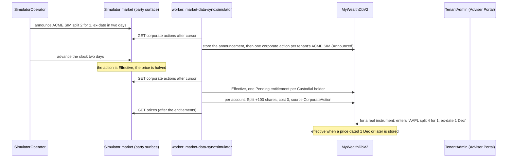

# Corporate actions

Step 10b of [custodial-roadmap.md](../custodial-roadmap.md) §13. It covers roadmap item **C1** (corporate action events: split, consolidation, non-taxable bonus) and the issuer half of **S4** (the simulator announces, amends and cancels them). It builds on [simulated-instruments.md](simulated-instruments.md) (step 10a): the market data connection, the simulator market and its prices. It follows [ADR 0021](../adr/0021-outside-parties-behind-ports.md) rules 1–20 and does not re-decide them. It amends [split.md](split.md), [holdings.md](holdings.md), [posting.md](posting.md), [custody-modes.md](custody-modes.md), [transaction-source.md](transaction-source.md), [portfolios.md](portfolios.md), [simulated-instruments.md](simulated-instruments.md), [simulator.md](simulator.md) and the Adviser Portal, Customer Portal and Back Office contracts.

A **corporate action** is an event of one Instrument: a split, a consolidation or a bonus issue, with a ratio and its dates. It reaches the platform in one of two ways. The `worker` reads **corporate action announcements** through a new port, the **corporate action feed**, on a market data connection, and turns each into a corporate action on every Tenant's instrument with that symbol. Or a TenantAdmin enters the announcement by hand, for an instrument no connection serves. Entering the event is not entering a result: nobody types a quantity. When the corporate action becomes **effective**, the platform gives every Custodial account that holds the instrument an **entitlement** and posts it as one `Split` or `Bonus` Transaction with source `CorporateAction`: the quantity changes by the ratio and the total cost stays.

New: permissions `corporate-actions.read` and `corporate-actions.manage`; routes under `/corporate-actions`, `GET /corporate-action-announcements`; port `ICorporateActionFeed` with adapter `SimulatorCorporateActionFeed`; source kind `CorporateAction`; a corporate action detail on the Transaction; `worker` job `corporate-action-apply`; the feed kind `CorporateActions` on a market data connection. Script `0050_corporate_actions.sql`; simulator script `database/simulator/0009_market_corporate_actions.sql`. No new `TransactionType`, problem code or domain event.

**Status is `accepted` (2026-11-22), landed 2026-11-22.** The eighteen points of §11 were confirmed on 2026-11-22, every one as recommended, and are written into the rules. It builds on [simulated-instruments.md](simulated-instruments.md) (accepted and landed 2026-11-22). The amendments to accepted docs listed in §12 were made when it was accepted.

Notes from landing:

- R1, R15–R21: the routes are `src/Web/Endpoints/CorporateActions.cs`; the commands and reads are in `src/Application/CorporateActions`. An unknown `kind` is 400 at `errors.Kind`; a missing `ratioHeld` is reported at `errors.RatioNew`; a blank or too long memo is 400 at `errors.Memo`; an unknown `origin` filter is 400 at `errors.Origin`. R17's message uses the kind in lower case (`A consolidation of AAPL with this ex-date already exists.`). R21: the origin, then the status, then the `rowVersion` are checked, so a repeat of an action that already succeeded is 400 at `errors.Status`, not 409.
- R22: `CorporateActionEffect.MakeEffectiveAsync` is the one place an action becomes effective, for Apply now, the apply step and the feed processing.
- R23: the due-by-price check is `IInstrumentPriceStore.HasPriceFromAsync`, one call per `Manual` action that is `Announced`.
- R24, R25: `ApplyCorporateActions` (Application) is registered on both hosts; `CorporateActionApplyJob` (Infrastructure) reuses `SqlRunLock` and throws `CorporateActionApplyFailedException` when an item was left for the next run. The posting's `CreatedBy` is `SystemActor.Name`. The functional test of a failing account adds a temporary `WITH NOCHECK` CHECK constraint on `TransactionSecurityLegs`: SQL Server refuses EF Core's `OUTPUT` inserts on a table with a trigger.
- R8: the run order lives in `SyncMarketDataConnection` (Application), which `MarketDataSyncJob` calls under its run lock: pull, process, apply the connection's instruments, then the price read unless the pull failed. The run is also reported as failed when an announcement or an entitlement was left for the next run (`MarketDataSyncOutcome.Failed`).
- R9, R48: the adapter dispatch is `CorporateActionFeedDispatcher` over `ICorporateActionFeedAdapter` (`SimulatorCorporateActionFeed`), as for prices. The `CorporateActions` feed keeps the party's cursor through `MarketDataFeed.Advance`; a page without a cursor keeps the one stored. A `status` sent as a number is read as unknown.
- R11, R12: an announcement that changes nothing and finds no action that is past `Announced` is skipped as `Superseded`; that covers a `Cancelled` version with no action yet and a version of another kind than its action.
- R35: `createdBy` is read from the audit `CreatedBy` (the person's identity user id); a feed action, written by the platform, shows `null`. R37: `corporateAction.id` is the posting's source id, or the original's on a Reversal.
- R42, R43: the rebase is in `MarketPricePath.BringUpToDateAsync`, before the day's step; several actions of one instrument due on the same day apply in ex-date, then number order. The number of a new action is the highest number plus one; the unique index answers a race with 409. An unknown kind on announce is 400 at `errors.Kind`.
- R44: the feed cursor reuses `BankFeedCursor`'s `{WorldId:N}:{place}` format; the place is the version's `Id`.
- D66: the instrument search lists up to ten matches of the symbol or name as buttons; a served instrument is a disabled button marked "(From market data)". D67: Apply now is shown when the browser's UTC date is on or after the ex-date; the server still decides. D68: the list and the account activity show the corporate action label only on an entitlement posting; other rows keep their type.
- BO25: the status filter is a set of links (`/market-data?status=…`).
- The schema tests that said source kind 7 or feed kind 1 is refused now refuse 8 and 2; the role grant unit test and the 401 and 403 route tests passed already in their red commits, as the policy grants and route shells carry them.

---

## 1. Summary



| | Today | After this slice |
| --- | --- | --- |
| A held instrument splits, Custodial account | The quantity stays while the price falls; market value, net worth and the next rebalance are wrong ([known issue](../known-issues/custodial-account-gaps.md)) | The platform changes the quantity of every holder from the announced event |
| Who types the new quantity | Nobody can (`Split` is refused by hand) | Nobody: a person enters at most the event (kind, ratio, dates) |
| A simulated instrument splits | Not possible | The simulator announces it, the feed delivers it, quantity and price change in the same job run |
| External accounts | Hand `Split` / `Bonus` / `Scrip` with a new total quantity | Unchanged |

The rule that distinguishes this slice: a corporate action is entered or announced once per instrument, and the platform works out each account's quantity from its holding at the moment the action takes effect. A person enters the event, never a result.

---

## 2. Scope

**In**

- Domain: `CorporateAction` aggregate (kind, ratio, dates, origin, status, transitions); `CorporateActionEntitlement`; `CorporateActionAnnouncement` (the inbound record); `CorporateActionRatio` (factor and rounding); enums; `TransactionSourceKind.CorporateAction` and `TransactionSource.CorporateAction(publicId)`; `TransactionCorporateActionDetail`; factory `Transaction.PostCorporateAction`; `Reverse` copies the detail; `MarketDataFeedKind.CorporateActions`
- Application: port `ICorporateActionFeed`; services `PullCorporateActions(connection)`, `ProcessCorporateActionAnnouncements(connection)`, `ApplyCorporateActions`; hand entry commands (create, update, cancel, apply now); reads of corporate actions, entitlements and announcements; the transaction reads map `corporateAction`
- Infrastructure: `SimulatorCorporateActionFeed` adapter; the announcement steps in `market-data-sync:{connection}`; recurring job `corporate-action-apply`; EF mappings
- Scripts: `database/schema/0050_corporate_actions.sql`; `database/simulator/0009_market_corporate_actions.sql`
- Security: two permissions (R1)
- HTTP (`webapi`): the routes of §8
- Simulator: announce, amend and cancel a corporate action on a simulated instrument; effective when the simulator clock reaches the ex-date, with the price rebased; the feed on the party surface
- Adviser Portal: Corporate actions pages; the corporate action on the transaction page; BFF prefix `/corporate-actions`
- Customer Portal: the activity row of an entitlement
- Back Office: the corporate action feed on the Market data page, with the newest announcements
- Tests listed in §10

**Out**

- Cash dividends, dividend reinvestment and taxable bonus issues (roadmap C2, C3). `Dividend` stays reserved and `Scrip` stays unwritten. A feed item of a kind this slice does not know is stored and skipped (R9, R12)
- Rights issues, mergers, spin-offs, symbol changes, delistings and any action that needs an election by the holder
- Cash in lieu of fractions, and rounding to whole shares (R28)
- Applying a corporate action to External accounts. They keep hand `Split` / `Bonus` / `Scrip` (roadmap C1)
- A flow that reverses an applied corporate action, and acting on a feed cancellation that arrives after the action was applied (R32)
- A second person's approval of a hand-entered corporate action
- A real vendor adapter (for example EODHD's splits data). Real instruments are entered by hand
- Adjusting stored prices. A price is the vendor's; the platform changes quantities only
- Entitlement by record date, and quantity as of a past instant (§11 point 6)
- Notifying the Customer or the Adviser, and a corporate action report
- Tax lots and cost per lot (roadmap §10)
- Named scenarios and the scenario library

---

## 3. Stories

1. As the platform I read the corporate actions a market data connection announces and apply each one to every Custodial account that holds the instrument, once, without a person typing a quantity.
2. As a TenantAdmin I enter a split, a consolidation or a bonus issue of a real instrument with its ratio and ex-date, correct or cancel it while it is only announced, and see it take effect when the first price from the ex-date arrives.
3. As a TenantAdmin I apply a hand-entered corporate action myself when the ex-date has come and no price arrives for the instrument.
4. As a TenantAdmin or Adviser I see every corporate action of my firm's instruments, its status, and which accounts it changed from which quantity to which.
5. As a Customer I see in my account's activity that my 100 shares became 200 in a 2 for 1 split, with the ex-date.
6. As an Adviser I still cannot type a `Split` on a Custodial account.
7. As the simulator operator I announce a split of a simulated instrument, amend or cancel it before its ex-date, and move the clock to make it effective and halve the price.
8. As a SystemAdmin I see when each connection's corporate actions were last read, why the last read failed, and the announcements the platform skipped.

---

## 4. Rules

### 4.1 Access

| ID | Rule |
| --- | --- |
| R1 | **Access.** New permissions: `corporate-actions.read` (TenantAdmin, Adviser) and `corporate-actions.manage` (TenantAdmin). SystemAdmin has neither (roadmap D5, as the bank stage); `GET /corporate-action-announcements` takes `tenants.manage`. Customer → 403 on every route of this slice; the Customer sees an entitlement through its Transaction (R37). Missing / dead Bearer → 401, never 302. Policy fail → 403. A disabled current tenant → 403. No caller on `/corporate-actions` names a tenant: a `tenantId` in a query or body → 400. A corporate action of another Tenant, or a missing one → 404. |

### 4.2 A corporate action

| ID | Rule |
| --- | --- |
| R2 | **What it is.** A corporate action belongs to one Instrument of one Tenant. When it takes effect it changes the quantity of every holding of that Instrument on the Tenant's Custodial accounts by one factor and leaves each holding's total cost as it is. The same market event on the same symbol in two Tenants is two corporate actions. |
| R3 | **Kind and ratio.** A ratio is two whole numbers, `ratioNew` and `ratioHeld`, each from 1 to 10 000, read as "`ratioNew` for `ratioHeld`". The numbers are stored as given, not reduced. A ratio that breaks the "Requires" column → 400 `errors.RatioNew` on hand entry, and a skipped announcement on the feed (R12). |

| Kind | The ratio means | Factor | Requires | Posted as |
| --- | --- | --- | --- | --- |
| `Split` | `ratioNew` new shares replace every `ratioHeld` held | `ratioNew / ratioHeld` | `ratioNew > ratioHeld` | `Split` |
| `Consolidation` | `ratioNew` new shares replace every `ratioHeld` held | `ratioNew / ratioHeld` | `ratioNew < ratioHeld` | `Split` |
| `Bonus` | `ratioNew` new shares are added for every `ratioHeld` held | `(ratioHeld + ratioNew) / ratioHeld` | — | `Bonus` |

| ID | Rule |
| --- | --- |
| R4 | **Dates.** `exDate` (required), `recordDate` and `paymentDate` (optional). They are the market's or the party's dates, stored as given and shown. The platform never compares them with each other (markets order them differently), and compares only `exDate` with anything else (R15, R17, R20, R23). |
| R5 | **Origin.** `Feed`: created from an announcement; it keeps the connection, the party's action id and the version it was last changed by, and no person can change it. `Manual`: entered by a TenantAdmin. |
| R6 | **Status.** `Announced` → `Effective` → `Applied`, or `Announced` → `Cancelled`. `Announced`: known, changes nothing yet, and may still be changed or cancelled by its origin. `Effective`: the action took effect at `effectiveAt` (platform time) and its entitlements exist (R22). `Applied`: no entitlement is `Pending` any more. `Cancelled`: withdrawn before it took effect. No status ever goes back. |

### 4.3 The corporate action feed (C1)

| ID | Rule |
| --- | --- |
| R7 | **Port.** `ICorporateActionFeed` returns the announcements of one market data connection after a cursor, one page at a time. One feed per connection, for every instrument the party covers. An **announcement** is one version of one event at the party: an outside id (unique per connection, for ever), the party's id of the event, a version (`≥ 1`, rising), the party's status (`Announced`, `Effective`, `Cancelled`), symbol, currency, kind, ratio and the dates. |
| R8 | **Read in the connection's job.** `market-data-sync:{connection}` (simulated-instruments R7) gains three steps before its price read: (1) pull the announcements after the feed's cursor, 100 at a time, until the party says there are no more or 20 pages were read; (2) process the stored announcements (R11); (3) apply the corporate actions of the connection's instruments (R24). Then the price read (simulated-instruments R8). When step 1 fails, nothing more is stored for the feed, its cursor stays, `lastFailedAt` and `lastFailure` are set on the connection's `CorporateActions` feed, steps 2 and 3 still run on what is already stored, and the price read of that run is **skipped**: a price on the new basis must not arrive before its corporate action. The run is then reported to Hangfire as failed. |
| R9 | **A page the platform can store.** The new announcements of one page, the new cursor and `lastSucceededAt` are written in one database transaction (ADR 0021 rule 7). An announcement whose (connection, outside id) is already stored is skipped and not changed; the unique index is the backstop. Every item needs: outside id and party action id of 1–100 characters; version `≥ 1`; one of the three statuses; symbol 1–32 characters; a three-letter currency; `ratioNew` and `ratioHeld` `≥ 1`; an `exDate`. A page with any item outside this → nothing of that page is stored, the cursor stays, `lastFailure` = `InvalidItem`. A kind the adapter does not know is not a reason to refuse a page: it is stored with no kind. |
| R10 | **New announcement.** A stored announcement has status `Received` and `receivedAt` = platform time. It is platform data with no Tenant, like a price. |
| R11 | **Processing.** Every `Received` announcement of the connection is processed, oldest `receivedAt` first, then `Id`, each in one database transaction that also sets its status (ADR 0021 rule 8). It becomes `Processed` when it created or changed at least one corporate action (R12), otherwise `Skipped` with the first reason that applies: `UnsupportedKind` (no kind); `Invalid` (the ratio breaks R3, or the connection does not serve the symbol); `NoInstrument` (no Tenant has an Instrument with that symbol and that quote currency); `AlreadyEffective` (an action it would change is `Effective`, `Applied` or `Cancelled`); `Superseded` (every action already has this version or a later one). An announcement left `Received` by a crash is processed by the next run. |
| R12 | **What an announcement does.** It is applied to every Instrument, of any Tenant, active or not, whose symbol equals the announcement's (without regard to case) and whose `QuoteCurrency` equals its currency. For each such Instrument the platform looks for the corporate action with the same connection and party action id, and acts by the table below. The kind and the Instrument of a corporate action never change; an announcement with another kind than its action changes nothing. An Instrument added to a catalog after the `Effective` announcement was processed gets no corporate action: nobody could hold it before. |

| Party status | No corporate action yet | `Announced`, with a lower version | Any other status, or the same or a higher version |
| --- | --- | --- | --- |
| `Announced` | Create it, `Announced` | Replace the ratio and the dates | Nothing |
| `Effective` | Create it, then make it effective (R22) | Replace the ratio and the dates, then make it effective (R22) | Nothing |
| `Cancelled` | Nothing | Cancel it | Nothing |

| ID | Rule |
| --- | --- |
| R13 | **The books follow the outside.** A disabled Tenant's instruments and accounts, and a Disabled Customer's accounts, are treated like any other (deposit-matching R19). |
| R14 | **Announcement read.** `GET /corporate-action-announcements` (`tenants.manage`) → list envelope, newest `receivedAt` first, then newest `Id`. Optional filters: `connection`, `status` (one or more names, comma-separated; unknown → 400 `errors.Status`). Item: `{ id, connection, outsideId, partyActionId, version, partyStatus, symbol, currency, kind, ratioNew, ratioHeld, exDate, recordDate, paymentDate, receivedAt, status, skipReason, processedAt }`. `kind` is `null` for a kind the adapter did not know. TenantAdmin, Adviser, Customer → 403. |

### 4.4 Entering a corporate action by hand (C1)

| ID | Rule |
| --- | --- |
| R15 | **Create.** `POST /corporate-actions` (`corporate-actions.manage`) with `instrumentId`, `kind`, `ratioNew`, `ratioHeld`, `exDate`, optional `recordDate`, `paymentDate` and `memo` (trimmed, 1–200) → 201 `{ id }` with `Location`. The Instrument must be in the caller's Tenant (else 404); a disabled Instrument is allowed, because it may still be held. `exDate` more than 366 days after the platform's UTC date → 400 `errors.ExDate`. The corporate action is `Manual` and `Announced`. No `Idempotency-Key`: R17 refuses a second copy. |
| R16 | **Not for a served instrument.** An Instrument served by a market data connection (simulated-instruments R4) takes no hand entry: 400 `errors.InstrumentId` with the message `Corporate actions of ACME.SIM come from its market data connection.` Its corporate actions come from the feed only. |
| R17 | **One per instrument, kind and ex-date.** A second `Manual` corporate action with the same Instrument, kind and `exDate` as one that is not `Cancelled` → 400 `errors.ExDate` with the message `A split of AAPL with this ex-date already exists.` A filtered unique index is the backstop. |
| R18 | **Update.** `PUT /corporate-actions/{id}` (`corporate-actions.manage`) with `kind`, `ratioNew`, `ratioHeld`, `exDate`, `recordDate`, `paymentDate`, `memo` and `rowVersion` → 204. Only a `Manual` corporate action that is `Announced`. The Instrument never changes. R3, R15 and R17 apply to the new values. Stale `rowVersion` → 409 `stale_row_version`. |
| R19 | **Cancel.** `POST /corporate-actions/{id}/cancel` with `rowVersion` and `note` (trimmed, 1–200, required) → 204. Only a `Manual` corporate action that is `Announced`. It becomes `Cancelled` and keeps the note, the person and the time. |
| R20 | **Apply now.** `POST /corporate-actions/{id}/apply` with `rowVersion` → 204. Only a `Manual` corporate action that is `Announced`, and only when the platform's UTC date is on or after its `exDate` (else 400 `errors.ExDate`, `A corporate action cannot be applied before its ex-date.`). It makes the action effective in the request (R22) with the caller as the person; the job posts the entitlements (R24). It is for an instrument whose price does not arrive (R23). |
| R21 | **Refusals on the three actions.** A `Feed` corporate action → 400 `errors.Origin` with the message `This corporate action comes from a market data connection and cannot be changed by hand.` A status other than `Announced` → 400 `errors.Status` with the message `This corporate action is <status> and cannot be <changed, cancelled, applied>.` A refused action writes nothing. No `Idempotency-Key`: the status and `rowVersion` make a repeat a 400 or a 409. |

### 4.5 Taking effect

| ID | Rule |
| --- | --- |
| R22 | **Making it effective.** In one database transaction: the status becomes `Effective`, `effectiveAt` is set to platform time, and one `Pending` **entitlement** is stored for every Custodial account of the Tenant that has a holding of the Instrument at that moment (a `Holdings` row with quantity `> 0`). External accounts get none. An account that gets its first holding of the Instrument later gets none either. The set of entitled accounts is fixed here and never grows. |
| R23 | **When.** A `Feed` corporate action becomes effective when the announcement with party status `Effective` is processed: the party's signal, not the platform's calendar (ADR 0021 rule 11, roadmap D9). A `Manual` corporate action becomes effective by itself when `InstrumentPrices` holds a row for its Instrument with `AsOfDate` on or after its `exDate`, checked by the apply job (R24), or by R20. The first price dated from the ex-date is the first price on the new basis, so the quantity and the price a holding is valued at change together. A hand-entered `exDate` is a real date and a vendor's `AsOfDate` is a real date, so the two can be compared; a simulated price is stored under the platform's date (simulated-instruments R10), which is why a served instrument takes no hand entry (R16). |

### 4.6 Entitlements and the posting (C1)

Amendment to [split.md](split.md), [holdings.md](holdings.md), [posting.md](posting.md), [custody-modes.md](custody-modes.md), [transaction-source.md](transaction-source.md) and [portfolios.md](portfolios.md).

| ID | Rule |
| --- | --- |
| R24 | **Apply step and job.** The apply step does two things: it makes every due `Manual` corporate action effective (R23), then, for every `Effective` corporate action, oldest `effectiveAt` first, it posts each `Pending` entitlement in account `Id` order (R25); a corporate action with no `Pending` entitlement left becomes `Applied` with `appliedAt`. `worker` registers the recurring job `corporate-action-apply` on queue `market`, every minute (cron `* * * * *`), for every Tenant, a disabled one included. A market data connection's job runs the same step for the instruments it serves, between processing the announcements and reading prices (R8). No automatic Hangfire retries; the next run is the retry. A run that starts while another is going ends at once. |
| R25 | **One entitlement.** Each entitlement is its own database transaction with the Account row locked as on every posting (posting R22). The platform reads the entitlement again (two jobs may meet; only a `Pending` one is posted) and the holding. No holding now → `NotApplied` with reason `NoHolding`. Otherwise `quantityBefore` is the holding's quantity and `quantityAfter` is R28; when `quantityAfter` is `0` or equals `quantityBefore` → `NotApplied` with reason `TooSmall`. Otherwise the platform posts the Transaction of R26 and the entitlement becomes `Posted` with both quantities and the Transaction. A failure on one account is logged with the account PublicId, rolls back that account only and leaves its entitlement `Pending` for the next run; the other accounts go on. A run in which any entitlement failed is reported to Hangfire as failed after every entitlement was tried. |
| R26 | **The Transaction.** Type `Split` for a split or a consolidation, `Bonus` for a bonus; one security leg on the Account for the Instrument with quantity `quantityAfter − quantityBefore` (negative for a consolidation) and cost `0` in the quote currency (split R12); no cash leg; source `CorporateAction` (7) with the corporate action's PublicId as source id; `bookedAt` = platform time when it is posted (ADR 0021 rule 10); memo `Split 2 for 1`, `Consolidation 1 for 10` or `Bonus 1 for 5`; `reference` `null`; and a corporate action detail (R27). Built by `Transaction.PostCorporateAction` without the manual entry matrix (custody-modes R7). `CreatedBy` is the worker's system name. |
| R27 | **Corporate action detail.** Every Transaction with source `CorporateAction` has exactly one: kind, `ratioNew`, `ratioHeld`, `exDate`, `recordDate`, `paymentDate`, `quantityBefore` and `quantityAfter`. No other Transaction has one. `Transaction.Reverse` copies it, so a later flow can undo its own posting. |
| R28 | **Quantity and fractions.** `quantityAfter = RoundDown(quantityBefore × factor, 8)`, with the factor of R3 worked out as a fraction (multiply first, then divide) and 8 decimals the scale of a quantity (holdings R13). There is no cash in lieu and no rounding to whole shares: a Custodial holding may already be a fraction, and it stays one. What the registry or custodian rounds on the firm's whole position is a matter for the custodian reconciliation (roadmap T3). |
| R29 | **Cost.** The holding's total cost is unchanged; its average cost becomes total cost / `quantityAfter` (split R12, R13). The holdings projection is updated in the same transaction (holdings R14). |
| R30 | **Not a trade.** The portfolio trade lock (portfolios R18) does not apply to an entitlement posting; an Active assignment stays and no rebalance is enqueued, because the holding's value and weight do not change. No cash moves, so available cash is unchanged (withdrawals R36). A closing account has no holding (account-closure R5) and so no entitlement. |
| R31 | **Later activity.** An entitlement posting is a security activity on its holding. A hand reverse of an earlier `Buy` or `Sell` on that holding is therefore refused by [ledger-write-guards](../fixes/ledger-write-guards.md) Decision 1, which is what a changed share basis requires. |
| R32 | **No reversal by hand, none by the flow.** `CorporateAction` is not a hand-reversible source (transaction-source R12): `POST /transactions/{id}/reverse` of an entitlement posting → 400 by transaction-source R13. No flow of this slice reverses an applied corporate action. A `Manual` action applied with a wrong ratio is corrected by a second `Manual` action of the inverse ratio with the same `exDate`, which becomes effective at the next run when a price from that date is already stored, and otherwise by R20: a consolidation `m for n` undoes a split `n for m` and the other way round, and a consolidation `h for (h + n)` undoes a bonus `n for h`. One account is corrected with an adjustment with reason `CorporateAction` ([adjustments.md](adjustments.md)). A feed cancellation that arrives after the action took effect is skipped as `AlreadyEffective` (R11) and shown in the Back Office (BO25). |
| R33 | **Matrix.** The manual entry matrix cell `Split` / `Bonus` / `Scrip` on a Custodial account stays **refused** (custody-modes R5); its "written by" is now corporate actions for `Split` and `Bonus`. `Scrip` waits for roadmap C3. External accounts are unchanged: a hand `Split`, `Bonus` or `Scrip` there sends the new total quantity (split R9) and has no corporate action detail. |

### 4.7 Reads

| ID | Rule |
| --- | --- |
| R34 | **List.** `GET /corporate-actions` (`corporate-actions.read`) → list envelope of the Tenant's corporate actions, latest `exDate` first, then newest `Id`. Optional filters: `status` (one or more names, comma-separated; unknown → 400 `errors.Status`), `instrumentId` (unknown or another Tenant's → an empty list), `origin`. An Adviser sees every corporate action of the Tenant, as an Adviser sees the whole catalog (instruments R5). |
| R35 | **Item.** `{ id, instrument: { id, symbol, name }, kind, ratioNew, ratioHeld, exDate, recordDate, paymentDate, origin, status, memo, createdBy, createdAt, effectiveAt, effectiveBy, appliedAt, cancelledAt, cancelledBy, cancelNote, entitlements: { total, posted, pending, notApplied }, rowVersion }`. `createdBy`, `effectiveBy` and `cancelledBy` are `{ id, name }` or `null` (the platform). `entitlements` counts the entitlements the caller can see (R36), all `0` before the action is effective. |
| R36 | **Entitlements.** `GET /corporate-actions/{id}/entitlements` → list envelope, account `Id` order. Optional filter `status`. Item: `{ accountId, accountName, customerId, customerName, status, reason, quantityBefore, quantityAfter, transactionId, postedAt }`; the quantities and `transactionId` are `null` unless `Posted`. A TenantAdmin sees every entitlement; an Adviser only those of assigned Customers' accounts (the scope of `accounts.read`). |
| R37 | **Transaction item.** Gains `corporateAction`: `{ id, kind, ratioNew, ratioHeld, exDate, recordDate, paymentDate, quantityBefore, quantityAfter }` on an entitlement posting (and a Reversal of one), `null` on every other Transaction. `source` is `{ "kind": "CorporateAction", "id": "<corporate action PublicId>" }`. Every caller who can read the Transaction sees both, the Customer included. Holdings, net worth and both reports read the posting like any `Split` or `Bonus`. |
| R38 | **Feed state.** The item of `GET /market-data-connections` (simulated-instruments R5) gains `corporateActions`: `{ lastSucceededAt, lastFailedAt, lastFailure }`, `null` until the first read was tried. `lastFailure` may also be `InvalidItem`. |

### 4.8 The simulator issuer (S4)

Amendment to [simulated-instruments.md](simulated-instruments.md) R17 and R18 and to [simulator.md](simulator.md).

| ID | Rule |
| --- | --- |
| R39 | **Announce.** `POST /control/market/corporate-actions` → 201 `{ id }` (the party action id). Body: `symbol` (a simulated instrument, else 400 `errors.Symbol`); `kind` (`Split`, `Consolidation`, `Bonus`) with `ratioNew` and `ratioHeld` as R3 (else 400 `errors.RatioNew`); `exDate` (after the current simulator day, else 400 `errors.ExDate`); optional `recordDate` and `paymentDate`. The action is `Announced`. Log action `CorporateActionAnnounced`. |
| R40 | **Amend.** `POST /control/market/corporate-actions/{id}/amend` with `ratioNew`, `ratioHeld`, `exDate`, `recordDate` and `paymentDate` → 200 with the action. Only while `Announced` (else 400 `errors.Status`); the kind and the symbol never change. Log action `CorporateActionAmended`. |
| R41 | **Cancel.** `POST /control/market/corporate-actions/{id}/cancel` → 200. Only while `Announced`. Log action `CorporateActionCancelled`. An effective action cannot be amended or cancelled in this slice. |
| R42 | **Effective, and the price.** When the market is brought up to date (simulated-instruments R18) and steps to a day on or after the `exDate` of an `Announced` action of the instrument, the action becomes `Effective` and the price is rebased before that day's move: the price of the day before is multiplied by `ratioHeld / ratioNew` (split, consolidation) or `ratioHeld / (ratioHeld + ratioNew)` (bonus), then the move of simulated-instruments R17 applies. So a 2 for 1 split halves the price on its ex-date. The operator makes an action effective by advancing the clock (simulator R22). |
| R43 | **Versions and ids.** Every announce, amend, cancel and effective appends one version of the action to the feed, in the order they happen. The party action id is `{WorldId:N}-CA{n}`, `n` counting the actions of the world from 1; the outside id of a version is `{WorldId:N}-CA{n}-V{v}`, `v` counting from 1. Neither repeats after a reset (simulator R25). |
| R44 | **Feed route.** Party port: `GET /party/market/corporate-actions?after={cursor}&limit={n}` → 200 `{ items, cursor, hasMore }`, the versions after the cursor, oldest first. `limit`, a missing or foreign-world cursor, an unreadable cursor (400), the key and the outage follow deposit-matching R44. The market is brought up to date first, so a version made by a clock advance is in the answer. |
| R45 | **Wire item.** `{ "id", "actionId", "version", "status", "symbol", "currency", "kind", "ratioNew", "ratioHeld", "exDate", "recordDate", "paymentDate" }`. `status` is `Announced`, `Effective` or `Cancelled`; `ratioNew` and `ratioHeld` are JSON numbers; the dates are `yyyy-MM-dd` or `null`. |
| R46 | **Its own books.** `GET /control/market/corporate-actions` lists the actions, newest first, with status and current version; optional `symbol` and `status`. `GET /control/market/corporate-actions/{id}` shows one with its versions. |
| R47 | **Reset and platform knowledge.** A reset empties the actions and versions with the rest of the market (simulated-instruments R23). The simulator never learns who holds an instrument or what the platform posted (simulator R33). |

### 4.9 The platform adapter

| ID | Rule |
| --- | --- |
| R48 | **`SimulatorCorporateActionFeed`.** The Infrastructure adapter for `Adapter = Simulator` calls R44 at the connection's `BaseUrl` with `X-Api-Key` and the connection's timeout. Its own wire types. `kind`: `Split`, `Consolidation`, `Bonus` → that kind; any other text → no kind (R9). A field it cannot read (an unknown `status`, a date that is not `yyyy-MM-dd`, a ratio that is not a whole number) comes through empty, so the pull refuses the page with `InvalidItem`. Failures as simulated-instruments R25; a cursor over 500 characters is `BadResponse`. |

Policies: `corporate-actions.read`, `corporate-actions.manage` (new). Grants: as R1.

---

## 5. Domain

| Type | Kind | Change |
| --- | --- | --- |
| `CorporateAction` | Aggregate (new) | `TenantId`, `PublicId`, `InstrumentId`, `Kind`, `RatioNew`, `RatioHeld`, `ExDate`, `RecordDate?`, `PaymentDate?`, `Origin`, `Connection?`, `PartyActionId?`, `FeedVersion?`, `Status`, `Memo?`, `EffectiveAt?`, `EffectiveByUserId?`, `AppliedAt?`, cancel (`At`, `ByUserId`, `Note`), `RowVersion`. `Enter(...)`, `Announce(...)` (feed), `Change(...)`, `Amend(version, ...)` (feed), `Cancel(...)`, `MakeEffective(at, by?)`, `MarkApplied(at)`. Holds R3, R5, R6, R21 |
| `CorporateActionKind` | Enum (new) | `Split = 0`, `Consolidation = 1`, `Bonus = 2`. Roadmap C2 and C3 add theirs |
| `CorporateActionOrigin` | Enum (new) | `Manual = 0`, `Feed = 1` |
| `CorporateActionStatus` | Enum (new) | `Announced = 0`, `Effective = 1`, `Applied = 2`, `Cancelled = 3` |
| `CorporateActionRatio` | Value object (new) | `New`, `Held`. `IsValidFor(kind)` (R3); `Apply(kind, quantity)` → `quantityAfter` (R28); `Text` → `2 for 1` |
| `CorporateActionEntitlement` | Entity (new) | `TenantId`, `CorporateActionId`, `AccountId`, `Status`, `Reason?`, `QuantityBefore?`, `QuantityAfter?`, `TransactionId?`, `PostedAt?`. `MarkPosted(...)`, `MarkNotApplied(reason)`, each once and only from `Pending` |
| `EntitlementStatus`, `EntitlementReason` | Enums (new) | `Pending = 0`, `Posted = 1`, `NotApplied = 2`; `NoHolding = 0`, `TooSmall = 1` |
| `CorporateActionAnnouncement` | Aggregate (new, platform data) | `PublicId`, `Connection`, `OutsideId`, `PartyActionId`, `Version`, `PartyStatus`, `Symbol`, `Currency`, `Kind?`, `RatioNew`, `RatioHeld`, the dates, `ReceivedAt`, `Status`, `SkipReason?`, `ProcessedAt?`. `Receive(...)`, `MarkProcessed(at)`, `Skip(reason, at)` |
| `PartyActionStatus`, `AnnouncementStatus`, `AnnouncementSkipReason` | Enums (new) | `Announced = 0`, `Effective = 1`, `Cancelled = 2`; `Received = 0`, `Processed = 1`, `Skipped = 2`; `UnsupportedKind = 0`, `Invalid = 1`, `NoInstrument = 2`, `AlreadyEffective = 3`, `Superseded = 4` |
| `MarketDataFeedKind` | Enum (existing) | Add `CorporateActions = 1`; this feed has a cursor |
| `MarketDataFailure` | Enum (existing) | Add `InvalidItem = 5` |
| `TransactionSourceKind` | Enum (existing) | Add `CorporateAction = 7`. Not hand-reversible |
| `TransactionSource` | VO (existing) | `TransactionSource.CorporateAction(Guid corporateActionPublicId)`; the id must not be empty |
| `TransactionCorporateActionDetail` | Entity (new, child of `Transaction`) | R27. 0..1 per Transaction |
| `Transaction` | Aggregate (existing) | `PostCorporateAction(tenantId, accountId, instrumentId, quoteCurrency, kind, ratio, dates, quantityBefore, quantityAfter, bookedAt, source)`: R26; the source kind must be `CorporateAction`; `quantityAfter > 0` and `≠ quantityBefore`. `Reverse` copies the detail. `PostSplit` is unchanged and stays the hand entry of External accounts |
| `CustodyRules` | Static (existing) | Unchanged: `Split`, `Bonus`, `Scrip` stay refused by hand on a Custodial account; `AllowsHandReverse` unchanged |

```text
CorporateAction
  Enter(...)                      -> Announced (Manual)
  Announce(connection, id, v, ..) -> Announced (Feed)
  Change(...) / Amend(v, ...)     Announced -> Announced     Manual only / Feed only, v above FeedVersion
  Cancel(...)                     Announced -> Cancelled
  MakeEffective(at, by?)          Announced -> Effective     entitlements stored in the same transaction
  MarkApplied(at)                 Effective -> Applied       when no entitlement is Pending
  any other From status           -> DomainException

quantityAfter (R28)
  Split, Consolidation:  RoundDown(quantityBefore x ratioNew / ratioHeld, 8)
  Bonus:                 RoundDown(quantityBefore x (ratioHeld + ratioNew) / ratioHeld, 8)
```

Invariants:

- An announcement is unique on (connection, outside id). Held by Application (R9) and a unique index.
- A `Feed` corporate action is unique on (Instrument, connection, party action id); a `Manual` one that is not `Cancelled` is unique on (Instrument, kind, ex-date). Held by Application and two filtered unique indexes.
- An account has at most one entitlement per corporate action, and entitlements exist only for a corporate action that is `Effective` or `Applied`. Held by R22 and a unique index.
- An entitlement is `Posted` if and only if it has a Transaction, and that Transaction has source `CorporateAction` with the action's PublicId. Held by R25 and a CHECK.
- An entitlement posting never changes a holding's total cost. Held by `PostCorporateAction`.
- On a Custodial account no person enters a `Split`, `Bonus` or `Scrip`. Held by `CustodyRules` (unchanged).

Domain events: none new. An entitlement posting raises `TransactionPosted` as every Transaction does.

Recorded in [domain-model.md](../domain-model.md) §8.6 (source kind, the detail, `PostCorporateAction`) and a new §8.15 when accepted.

---

## 6. Database

Forward only. Do not add EF migrations.

### 6.1 Script `0050_corporate_actions.sql`

| Table | Change | Index / FK |
| --- | --- | --- |
| `CorporateActionAnnouncements` | Add (columns below) | PK `Id`. UQ `PublicId`. UQ `UX_CorporateActionAnnouncements_Connection_OutsideId`. Index `(Connection, Status, ReceivedAt)`. No `TenantId` |
| `CorporateActions` | Add (columns below) | PK `Id`. UQ `PublicId`. UQ `(TenantId, Id)`. FK `TenantId` → `Tenants`, `(TenantId, InstrumentId)` → `Instruments`, `(TenantId, EffectiveByUserId)` and `(TenantId, CancelledByUserId)` → `Users`, all RESTRICT. Filtered UQ `(InstrumentId, Connection, PartyActionId) WHERE Origin = 1`. Filtered UQ `(InstrumentId, Kind, ExDate) WHERE Origin = 0 AND Status <> 3`. Index `(TenantId, ExDate DESC)`; index `(Status, EffectiveAt)` for the apply step |
| `CorporateActionEntitlements` | Add (columns below) | PK `Id`. UQ `(CorporateActionId, AccountId)`. FK `(TenantId, CorporateActionId)` → `CorporateActions`, `(TenantId, AccountId)` → `Accounts`, `(TenantId, TransactionId)` → `Transactions`, all RESTRICT. Filtered index `(CorporateActionId, AccountId) WHERE Status = 0` |
| `TransactionCorporateActionDetails` | Add: `TransactionId` (PK), `TenantId`, `Kind int`, `RatioNew int`, `RatioHeld int`, `ExDate date`, `RecordDate date NULL`, `PaymentDate date NULL`, `QuantityBefore decimal(18,8)`, `QuantityAfter decimal(18,8)` | FK `(TenantId, TransactionId)` → `Transactions`; CHECK `Kind` 0–2; CHECK both ratios `≥ 1`; CHECK `QuantityBefore > 0`, `QuantityAfter > 0`. No `PublicId`, no `RowVersion` (part of an immutable Transaction) |
| `Transactions` | Drop and re-add `CK_Transactions_SourceKind` (`BETWEEN 0 AND 7`) and `CK_Transactions_SourcePublicId` (`(SourceKind IN (0, 1) AND SourcePublicId IS NULL) OR (SourceKind IN (2, 3, 4, 5, 6, 7) AND SourcePublicId IS NOT NULL)`) | none |
| `MarketDataFeeds` | Drop and re-add the `Kind` CHECK as 0–1 and the `LastFailure` CHECK as 0–5 | none |

`CorporateActionAnnouncements`:

| Column | Type | Null | Notes |
| --- | --- | --- | --- |
| Id | int identity | no | |
| PublicId | uniqueidentifier | no | |
| Connection | nvarchar(50) | no | |
| OutsideId | nvarchar(100) | no | |
| PartyActionId | nvarchar(100) | no | |
| Version | int | no | CHECK `≥ 1` |
| PartyStatus | int | no | CHECK 0–2 |
| Symbol | nvarchar(32) | no | |
| Currency | char(3) | no | No FK: the party's text |
| Kind | int | yes | CHECK 0–2; `NULL` for a kind the adapter did not know |
| RatioNew, RatioHeld | int | no | CHECK `≥ 1` |
| ExDate | date | no | |
| RecordDate, PaymentDate | date | yes | |
| ReceivedAt | datetimeoffset | no | Platform time |
| Status | int | no | CHECK 0–2 |
| SkipReason | int | yes | CHECK 0–4; set iff `Status = 2` (CHECK) |
| ProcessedAt | datetimeoffset | yes | |
| RowVersion | rowversion | no | |

`CorporateActions`:

| Column | Type | Null | Notes |
| --- | --- | --- | --- |
| Id | int identity | no | |
| PublicId | uniqueidentifier | no | The source id of its Transactions |
| TenantId | int | no | Tenant query filter |
| InstrumentId | int | no | Immutable |
| Kind | int | no | CHECK 0–2 |
| RatioNew, RatioHeld | int | no | CHECK 1–10000 |
| ExDate | date | no | |
| RecordDate, PaymentDate | date | yes | |
| Origin | int | no | CHECK 0–1 |
| Connection | nvarchar(50) | yes | Set iff `Origin = 1` (CHECK, with the next two) |
| PartyActionId | nvarchar(100) | yes | |
| FeedVersion | int | yes | The version that last changed it |
| Status | int | no | CHECK 0–3 |
| Memo | nvarchar(200) | yes | |
| EffectiveAt | datetimeoffset | yes | Set iff `Status IN (1, 2)` (CHECK) |
| EffectiveByUserId | int | yes | The person of R20; `NULL` for the platform |
| AppliedAt | datetimeoffset | yes | Set iff `Status = 2` (CHECK) |
| CancelledAt, CancelledByUserId, CancelNote | datetimeoffset, int, nvarchar(200) | yes | `CancelledAt` set iff `Status = 3` (CHECK); the person and note are `NULL` for a feed cancellation |
| Created, CreatedBy, LastModified, LastModifiedBy | audit | | |
| RowVersion | rowversion | no | |

`CorporateActionEntitlements`:

| Column | Type | Null | Notes |
| --- | --- | --- | --- |
| Id | bigint identity | no | |
| TenantId | int | no | Tenant query filter |
| CorporateActionId | int | no | |
| AccountId | int | no | |
| Status | int | no | CHECK 0–2 |
| Reason | int | yes | CHECK 0–1; set iff `Status = 2` (CHECK) |
| QuantityBefore, QuantityAfter | decimal(18,8) | yes | Set iff `Status = 1` |
| TransactionId | int | yes | Set iff `Status = 1` (CHECK) |
| PostedAt | datetimeoffset | yes | When it left `Pending` |
| RowVersion | rowversion | no | |

No back-fill: no corporate action exists before this slice, and no Transaction has source `CorporateAction`. A `Split` entered by hand on an External account keeps source `Manual` and gets no detail row.

### 6.2 Simulator script `database/simulator/0009_market_corporate_actions.sql`

| Table | Content |
| --- | --- |
| `MarketCorporateActions` | `Id int` identity PK, `Number int` (the `n` of R43, unique), `InstrumentId` FK → `MarketInstruments`, `Kind int` CHECK 0–2, `RatioNew int`, `RatioHeld int`, `ExDate date`, `RecordDate date NULL`, `PaymentDate date NULL`, `Status int` CHECK 0–2, `Version int`, `RowVersion rowversion` |
| `MarketCorporateActionVersions` | `Id bigint` identity PK (the place in the feed), `ActionId` FK, `Version int`, `Status int`, `RatioNew int`, `RatioHeld int`, `ExDate date`, `RecordDate date NULL`, `PaymentDate date NULL`; unique `(ActionId, Version)` |

Recorded in [database-design.md](../database-design.md) §9, §11.4, a new §11.15 and §15 when accepted.

---

## 7. Application use cases

| Kind | Name | Change |
| --- | --- | --- |
| Port | `ICorporateActionFeed` (new) | `GetAnnouncementsAsync(connection, cursor, limit)` → a page (items, cursor, has more) or a `MarketDataFailure` |
| Service | `PullCorporateActions` (new) | `RunAsync(connection)`: R8 step 1, R9, R10 |
| Service | `ProcessCorporateActionAnnouncements` (new) | `RunAsync(connection)`: R11–R13 |
| Service | `ApplyCorporateActions` (new) | `RunAsync(connection?)`: R22–R25. With a connection, only the instruments it serves; without, everything. The one place an entitlement is posted |
| Job | `MarketDataSyncJob` (existing, Infrastructure) | Runs the three services in order before `SyncMarketPrices`, and skips that one when the pull failed (R8) |
| Job | `CorporateActionApplyJob` (new, Infrastructure) | R24 |
| Command | `CreateCorporateAction`, `UpdateCorporateAction`, `CancelCorporateAction`, `ApplyCorporateAction` (new) | R15–R21 |
| Query | `GetCorporateActions`, `GetCorporateActionById`, `GetCorporateActionEntitlements` (new) | R34–R36 |
| Query | `GetCorporateActionAnnouncements` (new) | R14 |
| Query | `GetMarketDataConnections` (existing) | Map `corporateActions` (R38) |
| Query | `GetTransactions`, `GetTransactionById` | Map `corporateAction` and the source kind (R37) |
| Command | `CreateTransaction`, `ReverseTransaction` | No change in code: the matrix and the source rule already refuse (R32, R33) |

Where each rule lives:

| Rule | Where |
| --- | --- |
| Kind, ratio, factor and rounding (R3, R28) | `CorporateActionRatio` |
| Status moves and origin (R5, R6, R21) | `CorporateAction` |
| Fan-out to instruments, version order (R12) | `ProcessCorporateActionAnnouncements`, reading past the tenant query filter and naming each Tenant itself |
| Served or not (R16) | `MarketDataConnections.For(symbol)` (simulated-instruments §5) |
| Due by price (R23) | `ApplyCorporateActions`: one query of `Manual`, `Announced` actions joined to `InstrumentPrices` |
| Entitled accounts (R22) | `ApplyCorporateActions` and `ApplyCorporateAction`, from `Holdings` joined to Custodial `Accounts` |
| Post once (R25) | `ApplyCorporateActions` under the Account lock; the unique index is the backstop |
| The Transaction's shape (R26, R27) | `Transaction.PostCorporateAction` |

---

## 8. API

| Method | Route | Policy | Success | Failure |
| --- | --- | --- | --- | --- |
| GET | `/corporate-actions` | `corporate-actions.read` | 200 envelope | 400 / 401 / 403 |
| GET | `/corporate-actions/{id}` | `corporate-actions.read` | 200 item | 401 / 403 / 404 |
| GET | `/corporate-actions/{id}/entitlements` | `corporate-actions.read` | 200 envelope | 400 / 401 / 403 / 404 |
| POST | `/corporate-actions` | `corporate-actions.manage` | 201 `{ "id" }` | 400 / 401 / 403 / 404 |
| PUT | `/corporate-actions/{id}` | `corporate-actions.manage` | 204 | 400 / 401 / 403 / 404 / 409 |
| POST | `/corporate-actions/{id}/cancel` | `corporate-actions.manage` | 204 | 400 / 401 / 403 / 404 / 409 |
| POST | `/corporate-actions/{id}/apply` | `corporate-actions.manage` | 204 | 400 / 401 / 403 / 404 / 409 |
| GET | `/corporate-action-announcements` | `tenants.manage` | 200 envelope | 400 / 401 / 403 |
| GET | `/market-data-connections` | unchanged | item has `corporateActions` | — |
| GET | `/transactions`, `/transactions/{id}` | unchanged | item has `corporateAction`; `source.kind` may be `CorporateAction` | — |

List envelope: `{ items, page, pageSize, totalCount }`; page default 1, pageSize default 20, max 100. `{id}` routes under `/corporate-actions` take a GUID only.

Simulator, control port (session):

| Method | Route | Success | Failure |
| --- | --- | --- | --- |
| GET | `/control/market/corporate-actions` | 200 list | 401 |
| GET | `/control/market/corporate-actions/{id}` | 200 action with versions | 401, 404 |
| POST | `/control/market/corporate-actions` | 201 `{ id }` | 400, 401, 415 |
| POST | `/control/market/corporate-actions/{id}/amend` | 200 action | 400, 401, 404, 415 |
| POST | `/control/market/corporate-actions/{id}/cancel` | 200 action | 400, 401, 404, 415 |

Simulator, party port (machine credential):

| Method | Route | Success | Failure |
| --- | --- | --- | --- |
| GET | `/party/market/corporate-actions` | 200 | 400, 401, 503 |

### 8.1 Bodies

Create (update: the same without `instrumentId`, plus `rowVersion`):

```json
{
  "instrumentId": "<instrument publicId>",
  "kind": "Split",
  "ratioNew": 4,
  "ratioHeld": 1,
  "exDate": "2026-12-01",
  "recordDate": null,
  "paymentDate": null,
  "memo": "Announced by the issuer on 20 Nov"
}
```

Cancel: `{ "rowVersion": "<base64>", "note": "Entered for the wrong instrument" }`. Apply now: `{ "rowVersion": "<base64>" }`.

Corporate action item:

```json
{
  "id": "<corporate action publicId>",
  "instrument": { "id": "<instrument publicId>", "symbol": "ACME.SIM", "name": "Acme Simulated Holdings" },
  "kind": "Split",
  "ratioNew": 2,
  "ratioHeld": 1,
  "exDate": "2026-11-24",
  "recordDate": null,
  "paymentDate": null,
  "origin": "Feed",
  "status": "Applied",
  "memo": null,
  "createdBy": null,
  "createdAt": "2026-11-22T03:15:02Z",
  "effectiveAt": "2026-11-22T03:41:01Z",
  "effectiveBy": null,
  "appliedAt": "2026-11-22T03:41:03Z",
  "cancelledAt": null,
  "cancelledBy": null,
  "cancelNote": null,
  "entitlements": { "total": 3, "posted": 3, "pending": 0, "notApplied": 0 },
  "rowVersion": "<base64>"
}
```

Entitlement: `{ "accountId": "<account publicId>", "accountName": "Demo custodial brokerage", "customerId": "<customer publicId>", "customerName": "Casey Customer", "status": "Posted", "reason": null, "quantityBefore": 100.00000000, "quantityAfter": 200.00000000, "transactionId": "<transaction publicId>", "postedAt": "2026-11-22T03:41:02Z" }`.

Transaction item of that entitlement:

```json
{
  "id": "<transaction publicId>",
  "type": "Split",
  "bookedAt": "2026-11-22T03:41:02Z",
  "memo": "Split 2 for 1",
  "reference": null,
  "source": { "kind": "CorporateAction", "id": "<corporate action publicId>" },
  "corporateAction": {
    "id": "<corporate action publicId>", "kind": "Split", "ratioNew": 2, "ratioHeld": 1,
    "exDate": "2026-11-24", "recordDate": null, "paymentDate": null,
    "quantityBefore": 100.00000000, "quantityAfter": 200.00000000
  },
  "cash": [],
  "security": [
    { "accountId": "<account publicId>", "customerId": "<customer publicId>", "instrumentId": "<instrument publicId>", "quantity": 100.00000000, "cost": 0.00, "costCurrency": "USD" }
  ]
}
```

A bonus of 1 for 5 on 12.34567891 shares gives `RoundDown(12.34567891 × 6 / 5, 8)` = `14.81481469`; a consolidation of 1 for 10 on 105 shares gives `10.5`.

Connection item (other fields unchanged): `"corporateActions": { "lastSucceededAt": "2026-11-22T03:41:00Z", "lastFailedAt": null, "lastFailure": null }`.

Simulator, announce: `{ "symbol": "ACME.SIM", "kind": "Split", "ratioNew": 2, "ratioHeld": 1, "exDate": "2026-11-24" }`. Party port, the feed item of its first version:

```json
{
  "id": "0f8fad5bd9cb469fa16570867728950e-CA1-V1",
  "actionId": "0f8fad5bd9cb469fa16570867728950e-CA1",
  "version": 1,
  "status": "Announced",
  "symbol": "ACME.SIM",
  "currency": "USD",
  "kind": "Split",
  "ratioNew": 2,
  "ratioHeld": 1,
  "exDate": "2026-11-24",
  "recordDate": null,
  "paymentDate": null
}
```

Control log actions gain `CorporateActionAnnounced`, `CorporateActionAmended` and `CorporateActionCancelled`.

### 8.2 Errors

All refusals are ordinary validation (400 with `errors`, no problem `code`) except where named.

| Case | Response |
| --- | --- |
| Caller without the permission of the route; a Customer; a SystemAdmin on `/corporate-actions` | 403 |
| A corporate action or an Instrument of another Tenant, or a missing one | 404 |
| `tenantId` in a query or body on `/corporate-actions` | 400 |
| A ratio outside 1–10 000 or one that does not fit the kind | 400 `errors.RatioNew` |
| `exDate` missing or more than 366 days ahead; a second `Manual` action of the same instrument, kind and ex-date; apply before the ex-date | 400 `errors.ExDate` |
| Hand entry for an instrument served by a market data connection | 400 `errors.InstrumentId` |
| Update, cancel or apply of a `Feed` corporate action | 400 `errors.Origin` |
| Update, cancel or apply of a corporate action that is not `Announced` | 400 `errors.Status` |
| Stale `rowVersion` | 409 `stale_row_version` |
| Unknown `status` filter | 400 `errors.Status` |
| Hand `Split`, `Bonus` or `Scrip` on a Custodial account | 400 `errors.Type` (custody-modes R5, unchanged) |
| Hand reverse of an entitlement posting | 400 (transaction-source R13) |

Cross-tenant or wrong-collection id → **404**, not 403. Keep the resource catalog in [api-design.md](../api-design.md) pointing here for these rules.

---

## 9. UI

Page contracts: [adviser-portal-dashboard.md](../adviser-portal/adviser-portal-dashboard.md) (D64–D68), [customer-portal.md](../customer-portal/customer-portal.md) (C31) and [back-office.md](../backoffice/back-office.md) (BO24, BO25), amended and accepted together with this spec. The Adviser Portal BFF gains the prefix `/corporate-actions` ([bff-adviser-portal.md](bff-adviser-portal.md) R20). The Customer Portal BFF does not change.

**Adviser Portal**

| ID | Behaviour |
| --- | --- |
| D64 | TenantAdmin and Adviser see a nav item "Corporate actions" (`/corporate-actions`). The page lists `GET /corporate-actions` with a status filter (default All): Instrument (symbol and name), Kind (Split "Share split", Consolidation "Share consolidation", Bonus "Bonus issue"), Ratio ("2 for 1"), Ex-date, Source (Feed "Market data", Manual "Entered by hand"), Status (Announced "Announced", Effective "Being applied", Applied "Applied", Cancelled "Cancelled") and Accounts (`posted` of `total`, with "<n> not applied" in amber when above 0). |
| D65 | `/corporate-actions/:id` shows the item, a sentence for the ratio (Split and Consolidation "Every <held> shares become <new>."; Bonus "<new> new shares for every <held> held."), the dates, who entered, applied or cancelled it ("The platform" for `null`), and the entitlements table from `GET /corporate-actions/{id}/entitlements`: Customer, Account, Before, After, Status (Pending "Waiting", Posted "Done", NotApplied with the reason: NoHolding "No longer held", TooSmall "Holding too small to change") and a link to the Transaction. An Adviser sees: "Only your customers' accounts are listed." |
| D66 | A TenantAdmin sees "New corporate action" (`/corporate-actions/new`): Instrument (a search over `GET /instruments`; an instrument with a `marketDataConnection` is listed as disabled with "From market data"), Kind, the two ratio numbers with the D65 sentence as a live preview, Ex-date, Record date, Payment date, Memo. Under the ex-date: "The change is applied when the first price from this date arrives." When the ex-date is before today (UTC): "This date has passed. The change is applied to today's holdings. Check trades booked since then." A 400 is shown at its field. An Adviser sees no button, and the form route renders `/forbidden`. |
| D67 | On a `Manual` corporate action that is `Announced`, a TenantAdmin sees Edit (the D66 form with `rowVersion`), Cancel (a dialog with a required note) and, once the ex-date has come (UTC), "Apply now" with the confirmation "Apply this to every holding now? Use this only when no price arrives for the instrument." A 400 shows its sentence; a 409 reloads with "Someone else changed this corporate action." A `Feed` corporate action offers none of the three. |
| D68 | `/transactions/:id` of an entitlement posting shows "<Kind label> <ratio>", "Ex-date <exDate>", "<quantityBefore> → <quantityAfter> shares" and a link to the corporate action; the Source line (D26) shows "Corporate action". Reverse is not offered (D27). The transactions list and account activity show the kind label and ratio in place of the plain type. The new transaction form of a Custodial account still does not offer `Split`, `Bonus` or `Scrip`. |

**Customer Portal**

| ID | Given | When | Then |
| --- | --- | --- | --- |
| C31 | A Customer with an entitlement posting | Account page activity | The row is labelled "Share split 2 for 1", "Share consolidation 1 for 10" or "Bonus issue 1 for 5", with "<quantityBefore> → <quantityAfter> shares" and "Ex-date <exDate>". No cash amount. A hand-entered `Split` on an External account keeps today's row. |

**Back Office**

| ID | Behaviour |
| --- | --- |
| BO24 | The Market data page (BO23) gains a "Corporate actions" column from `corporateActions`, with the same three states as the Prices column; InvalidItem is labelled "The party sent a record that cannot be read". |
| BO25 | Under the connections, the newest twenty announcements from `GET /corporate-action-announcements`: Received, Connection, Symbol, Kind ("Unknown" for `null`), Ratio, Ex-date, Party status, Version, Status and Reason (UnsupportedKind "Kind not supported", Invalid "Not valid", NoInstrument "No firm lists this instrument", AlreadyEffective "Already applied", Superseded "An older version"). A status filter (default All). A row skipped as `AlreadyEffective` is shown in red: it needs a person. |

### 9.1 Seeds and hosting

- `TestSeed`: no change. The demo Custodial account gets a simulated holding and a corporate action by hand in Development.
- AppHost, TestAppHost and VPS: no new configuration, secret or container. The market data connection of [simulated-instruments.md](simulated-instruments.md) carries the feed. `worker` runs the new job `corporate-action-apply` on the queue `market`.

---

## 10. Tests

| Project | Assert |
| --- | --- |
| Domain.UnitTests | `CorporateActionRatio`: each kind's "Requires"; 2 for 1 on 100 → 200; 1 for 10 on 105 → 10.5; bonus 1 for 5 on 12.34567891 → 14.81481469 (rounded down); a result of 0 and an unchanged result are reported. `CorporateAction`: every move of §5 and each refused one; `Change` on `Feed` and `Amend` on `Manual` throw; `Amend` with a version not above `FeedVersion` changes nothing. `CorporateActionEntitlement`: posted once, only from `Pending`. `Transaction.PostCorporateAction`: one security leg of the difference with cost 0, no cash leg, type by kind, the detail's fields, the memo; a source other than `CorporateAction`, `quantityAfter` 0 or equal → throws. `Reverse` copies the detail. `TransactionSource.CorporateAction(Guid.Empty)` → throws. `CustodyRules.AllowsHandReverse(Custodial, CorporateAction)` false; `AllowsManualEntry(Custodial, Split)` still false |
| Application.FunctionalTests — hand entry | No Bearer → 401; Customer and SystemAdmin → 403; Adviser reads, each write → 403. TenantAdmin creates, updates, cancels. Each R3 refusal; an ex-date too far ahead; a duplicate of instrument, kind and ex-date → 400, and allowed again after a cancel; a served instrument → 400 `errors.InstrumentId`; a disabled instrument is accepted. Update or cancel of a `Feed` action → 400 `errors.Origin`; of an `Applied` one → 400 `errors.Status`; stale `rowVersion` → 409. Apply now before the ex-date → 400; on the ex-date → 204 and the action is `Effective`. Two-tenant: tenant B's corporate action id → 404 on every route; tenant B's instrument id on create → 404 |
| Application.FunctionalTests — taking effect | A `Manual` split with a price row dated before the ex-date stays `Announced` after an apply run; with a row dated on the ex-date it becomes `Effective`, then `Applied`. Two Custodial accounts and one External account hold the instrument: the two get a `Split` with source `CorporateAction`, the detail and cost 0; holdings show the new quantity and the old total cost; the External holding is unchanged. A second apply run posts nothing. An account that buys after the action is effective gets no entitlement. A holding sold between effective and posting → `NotApplied` `NoHolding`. A consolidation that rounds a tiny holding to 0 → `NotApplied` `TooSmall`. One account made to fail → the others are posted, the action stays `Effective`, and the next run completes it. An assigned account is posted in spite of the trade lock, its assignment stays, and no rebalance is enqueued. A Disabled Customer's account and a disabled Tenant are applied. Hand reverse of the posting → 400; hand reverse of the `Buy` before it → 400 (later activity); hand `Split` on the Custodial account → 400 still. The inverse consolidation with the same ex-date brings the quantity back. Reads: list filters; the item's counts; entitlements for a TenantAdmin and only the assigned Customers' for an Adviser; the Customer reads the Transaction with `corporateAction`. Two-tenant: applying tenant A's action never touches tenant B's accounts |
| Application.FunctionalTests — feed | With a fake `ICorporateActionFeed` and a configured connection. An `Announced` item creates one `Announced` corporate action in each Tenant that lists the symbol in that currency, a disabled instrument included, and none for another currency. A second version replaces the ratio and dates; an older version → `Superseded`. `Cancelled` cancels. `Effective` makes it effective and the same run posts the entitlements before the fake price source is read. `Effective` with no action yet creates and applies it. An unknown kind → `UnsupportedKind`; a split of 1 for 2 → `Invalid`; a symbol no Tenant lists → `NoInstrument`; `Cancelled` after `Applied` → `AlreadyEffective` and nothing changes. The same outside id twice is stored once. A page with a bad item stores nothing, keeps the cursor and sets `InvalidItem`. A failed pull keeps the cursor, still applies stored announcements, and does not read prices in that run. `GET /corporate-action-announcements`: SystemAdmin with filters; TenantAdmin → 403. `corporateActions` on the connection item |
| Infrastructure.IntegrationTests | `0050`: a second announcement with the same (connection, outside id) violates; a second `Feed` action for the same (instrument, connection, party action id) violates; a second live `Manual` action for the same (instrument, kind, ex-date) violates and inserts after a cancel; a second entitlement for the same (action, account) violates; the status, origin, reason and "set iff" CHECKs; `SourceKind = 7` needs a `SourcePublicId`, `8` violates; feed `Kind = 1` allowed, `2` violates. EF round-trips. `SimulatorCorporateActionFeed` against canned responses: a good page; an unknown kind → no kind; an unknown status, a bad date, a ratio that is not a whole number → `InvalidItem` on the pull; 401, 503, timeout, an unreadable body. `CorporateActionApplyJob` on a worker host: registered every minute; a second run at once does nothing |
| Simulator.Tests | `0009` applies. Announce → version 1 on the feed; an unknown symbol, a ratio that does not fit the kind, an ex-date not after the simulator day → 400. Amend → a new version with the new values; cancel → a `Cancelled` version; amend or cancel of an effective action → 400. Advancing the clock to the ex-date makes the action `Effective`, appends a version and rebases that day's price (2 for 1 → half, bonus 1 for 4 → four fifths, before the day's move; with `dailyMovePercent` 0 exactly). Outside ids and action ids contain the world id and do not repeat after a reset. The feed route: paging, cursor, a foreign-world cursor, 401, 503. The control log rows |
| Adviser Portal | D64 columns, labels, filter; D65 the sentence, the entitlements table, the Adviser note; D66 the form, the disabled served instrument, the two ex-date notes, TenantAdmin only; D67 the three actions, their refusals, none on a `Feed` action; D68 the block, the Source line, no Reverse, the list label |
| Customer Portal | C31 |
| Back Office | BO24, BO25 |

Fan-out in the tests:

- Tests that read `source.kind` or the market data feed kinds as closed lists gain the new values.
- The Adviser Portal and Customer Portal `Transaction` types gain `corporateAction`.

---

## 11. Locked in this spec

No new ADR. ADR 0021 applies as written: rule 1 (port `ICorporateActionFeed`), 5–8 (pull, cursor, inbound record, processing as its own step), 9 (source), 10 (book at processing time, the party's dates in a detail row), 11 (the party's signal makes a feed action effective), 15–19. Roadmap P3–P6 apply; P6's "a cancelled corporate action" is limited to cancelling before the action takes effect (point 10).

| Item | Lock |
| --- | --- |
| Corporate action | One Instrument of one Tenant; kind `Split`, `Consolidation` or `Bonus`; a ratio of two whole numbers; ex-date, record date, payment date; origin `Feed` or `Manual`; `Announced` → `Effective` → `Applied`, or `Cancelled` |
| Announcement | Platform data, one version of a party's event, unique on (connection, outside id), fanned out to every Tenant's instrument with the symbol and currency |
| Taking effect | Feed: the party's `Effective` version. Manual: the first price dated from the ex-date, or Apply now |
| Entitlement | One per Custodial account holding the instrument when the action takes effect; posted once on the holding at that moment |
| The Transaction | `Split` or `Bonus`, one security leg of the difference, cost 0, a corporate action detail, source `CorporateAction` (7) |
| Fractions | Rounded down to 8 decimals; no cash in lieu |
| Hand entry | TenantAdmin; not for a served instrument; one per instrument, kind and ex-date |
| Matrix | `Split` / `Bonus` / `Scrip` stay refused by hand on a Custodial account |
| Simulator | Announce, amend, cancel; effective when the clock reaches the ex-date, price rebased; versions on the feed |
| Scripts | `0050_corporate_actions.sql`; simulator `0009_market_corporate_actions.sql` |
| Permissions | `corporate-actions.read`, `corporate-actions.manage` |
| Jobs | The announcement steps in `market-data-sync:{connection}`; `corporate-action-apply` every minute |
| Problem codes, events, `TransactionType` | None added |

### Points confirmed

Each point states the decision, written into the rules above, and the alternative. All eighteen were confirmed on 2026-11-22 as recommended.

1. **Two specs for step 10; this one carries C1 and the issuer of S4.** Recommended: the flow and its simulator party in one spec, as in every earlier step, on top of [simulated-instruments.md](simulated-instruments.md). Alternative: one spec for the whole step.
2. **A corporate action is a Tenant's row on a Tenant's instrument; an announcement is platform data fanned out by symbol and quote currency** (R2, R12). Recommended: instruments are tenant rows, the ledger and every read are tenant-scoped, and prices already fan out the same way (instrument-prices R15). Alternative: one platform-level corporate action with entitlements in many Tenants.
3. **Three kinds and a ratio of two whole numbers read "new for held"; a consolidation is its own kind posted as `Split`; `Scrip` is not used** (R3, R26). Recommended: the roadmap asks for the ratio as two integers; a person should not have to know that a reverse split is a `Split` with a smaller number; split.md already books both as `Split`. `Scrip` is a dividend paid in shares (roadmap C3). Alternative: one kind `Split` for both directions.
4. **No new `TransactionType`; source `CorporateAction` (7) and a corporate action detail** (R26, R27). Recommended: the leg is exactly what split.md books, and roadmap P4 puts the party's dates in a detail row. The Customer reads the event from the detail without access to `/corporate-actions`. Alternative: only the source id, with every read joining the corporate action.
5. **A corporate action takes effect by a signal: the party's `Effective` version, or, for a hand-entered one, the first price dated from the ex-date** (R23). Recommended: ADR 0021 rule 11 and roadmap D9 forbid the platform calendar for a simulator date; for a real instrument the vendor's ex-date close is the first price on the new basis, so applying then keeps quantity and price together. Applying at 00:00 UTC of the ex-date would leave the new quantity valued at the old price for a day or more, and a rebalance in that time would sell most of the holding. "Apply now" covers an instrument with no price. Alternatives: the platform's UTC date reaching the ex-date; only a person's "Apply".
6. **The entitlement is worked out on the holding when it is posted, for the accounts that held the instrument when the action took effect** (R22, R25). This refines the roadmap's "quantity as of a date". Recommended: the party's dates are not platform instants (two clocks); the holding under the Account lock is exact; the steps run within one job run. A trade booked between the price change and the posting is on the wrong basis for up to one polling interval; it is listed under "Still open". Alternative: the sum of the security legs as of an instant, which also needs the cost to be replayed (roadmap X2).
7. **Fractions: round down to 8 decimals, no cash in lieu** (R28). This answers the roadmap's "Fractions". Recommended: a Custodial holding can already be a fraction of a share, so there is nothing to pay out, and cash in lieu needs a price and a cash leg the firm must fund. Alternatives: round down to whole shares; cash in lieu at the reference price.
8. **A TenantAdmin enters, changes, cancels and applies; an Adviser reads; no second person** (R1, R15–R20). Recommended: roadmap D5; the action moves no cash out of the firm and a wrong one is undone by its inverse (R32). Alternatives: a SystemAdmin enters it once for every Tenant; a second TenantAdmin confirms before it can take effect.
9. **No hand entry for an instrument a market data connection serves, and no hand change of a feed action** (R16, R21). Recommended: one source of truth per instrument, and a simulated price cannot be compared with a hand-entered ex-date (R23). Alternative: allow both, with "Apply now" only.
10. **No flow reverses an applied corporate action** (R32). Recommended: the inverse action undoes a wrong ratio for every account in one step, because the posting is a pure change of quantity; a reversing flow would have to refuse every account that traded since (ledger-write-guards Decision 1) and leave a mixed result. A feed cancellation after the fact is rare and is shown to the platform team. Alternative: an undo that posts the Reversal for each account still untouched and lists the rest for an adjustment.
11. **Custodial accounts only** (R22, R33). Recommended: the roadmap leaves External accounts for a later question; their quantities are the caller's record. Alternative: an option on the action to apply it to External holdings too.
12. **Not subject to the trade lock, and no rebalance** (R30). Recommended: as the roadmap says for C1 and as adjustments decided (adjustments R16); a split changes no weight.
13. **The announcement steps run in the connection's job before its price read, the price read is skipped when the announcement read failed, and one more job applies due actions every minute** (R8, R24). Recommended: on a simulated instrument the quantity changes before the price in the same run; a broken feed leaves stale prices, which are visible, and not a new price on old quantities; the minute job serves hand-entered actions and retries. Alternative: separate jobs with no order.
14. **A kind the platform does not know is stored and skipped** (R9, R11). Recommended: roadmap C2 and C3 add dividends to the same feed, and an unknown kind must not block the cursor. Alternative: refuse the page.
15. **The simulator makes an action effective when its clock reaches the ex-date and rebases the price; amend and cancel only before that; no scenario library** (R39–R42). Recommended: the smallest addition (roadmap P11), driven by the clock like everything else in the simulator. Alternative: a control call "make effective now"; cancelling an effective action.
16. **The Customer sees a corporate action only through the Transaction, and nobody is notified** (R1, R37). Recommended: the Customer Portal is read-only and has no instrument pages. Alternative: an upcoming corporate actions list for the Customer.
17. **An action entered after its ex-date is applied to today's holdings** (D66). Recommended: the simple rule, with a warning on the form; trades booked since the ex-date at new prices are multiplied too and are corrected by an adjustment. Alternative: refuse an ex-date in the past.
18. **Announcements are read by a SystemAdmin in the Back Office only** (R14, BO25). Recommended: an announcement has no Tenant. A TenantAdmin sees the corporate actions it produced. Alternative: a Tenant view of the announcements for its symbols.

Still open, not this slice:

- Cash dividends, reinvestment and taxable bonus issues (roadmap C2, C3), and the `Scrip` name
- A flow that reverses an applied corporate action, and what the platform does with a cancellation after the fact
- Entitlement by record date and positions as of a past instant (roadmap X2); the trade booked between the price change and the posting (point 6)
- A halt on trades and rebalances of an instrument between its ex-date and the posting, once orders exist (roadmap O1)
- External accounts
- A real corporate action feed (for example EODHD's splits data) behind `ICorporateActionFeed`
- Whole-share rounding at the registry or custodian, and the break it causes in the custodian reconciliation (roadmap T3)
- Telling the Tenant about a skipped announcement that needs a person (`AlreadyEffective`)
- Corporate actions in performance figures and a corporate action report

---

## 12. Suggested commits

The repository should build after each commit. Agents split each behaviour into red then green. Start after [simulated-instruments.md](simulated-instruments.md) has landed.

1. `CorporateActionRatio`, `CorporateActionKind` (R3, R28) + Domain unit tests.
2. Script `0050`; `CorporateAction`, `CorporateActionEntitlement` and their enums (R5, R6, R21) + Domain unit tests and the `0050` integration tests.
3. Source kind `CorporateAction`, the corporate action detail, `Transaction.PostCorporateAction`, `Reverse` copies (R26, R27, R32) + Domain unit tests.
4. The permissions; create, update, cancel and the reads of corporate actions (R1, R15–R19, R21, R34, R35) + functional tests, two-tenant.
5. Making an action effective and Apply now (R20, R22) + functional tests.
6. `ApplyCorporateActions`: due by price, the entitlements and the posting, `Applied` (R23–R25, R28–R31) + functional tests through a test-only call of the service.
7. `CorporateActionApplyJob` (R24) + integration tests on a worker host.
8. Entitlement and transaction reads (R36, R37) + functional tests.
9. `CorporateActionAnnouncement`, port `ICorporateActionFeed`, `PullCorporateActions` (R7–R10) + functional tests with the fake port.
10. `ProcessCorporateActionAnnouncements` (R11–R13) + functional tests, two-tenant.
11. The steps in `MarketDataSyncJob` and the skipped price read (R8); `SimulatorCorporateActionFeed` (R48) + functional and integration tests.
12. `GET /corporate-action-announcements` and `corporateActions` on the connection item (R14, R38) + functional tests.
13. Simulator: script `0009`, announce, amend, cancel, effective with the rebased price (R39–R43, R46, R47) + `Simulator.Tests`.
14. Simulator: the feed route (R44, R45) + `Simulator.Tests`.
15. BFF prefix, Adviser Portal D64–D68 + frontend tests.
16. Customer Portal C31 + frontend tests.
17. Back Office BO24, BO25 + tests.
18. Repo docs: mark this file landed; roadmap §13 step 10b and the §2 matrix; remove the "A split cannot be recorded" known-issue row.

Do not put dividends, a reversing flow, External accounts or a real vendor adapter in these commits.

### Docs amended when this spec was accepted

[split.md](split.md) (R8 and §13: on a Custodial account `Split` and `Bonus` are written by corporate actions from a ratio; hand entry stays for External accounts), [holdings.md](holdings.md) (the type table: an entitlement posting), [posting.md](posting.md) (the type table and R20: `Split` / `Bonus` on a Custodial account are written by the platform), [custody-modes.md](custody-modes.md) (R5 matrix: "written by" corporate actions; the known issue of §11 point 3 closes when this lands), [transaction-source.md](transaction-source.md) (kind `CorporateAction` = 7, not hand-reversible, check widened), [portfolios.md](portfolios.md) (R18: the trade lock does not apply to an entitlement posting), [adjustments.md](adjustments.md) (a note: reason `CorporateAction` corrects one account after a corporate action), [instruments.md](instruments.md) (a disabled instrument may still get a corporate action), [simulated-instruments.md](simulated-instruments.md) (R8: the steps before the price read and the skipped read; R17 and R18: the rebased price; the feed kind and failure), [simulator.md](simulator.md) (R39–R47, script `0009`, the routes and log actions), [bff-adviser-portal.md](bff-adviser-portal.md) (prefix `/corporate-actions`), [api-design.md](../api-design.md) (§3.1 two permission rows, §6 resource rows, a new §7.11 Corporate actions, §7.7 note, change log), [domain-model.md](../domain-model.md), [database-design.md](../database-design.md), [architecture.md](../architecture.md) (port `ICorporateActionFeed`, the job `corporate-action-apply`), [adviser-portal-dashboard.md](../adviser-portal/adviser-portal-dashboard.md) (D64–D68), [customer-portal.md](../customer-portal/customer-portal.md) (C31), [back-office.md](../backoffice/back-office.md) (BO24, BO25), [known-issues/custodial-account-gaps.md](../known-issues/custodial-account-gaps.md) (the "A split cannot be recorded" row notes this spec; it is removed when the slice lands), [glossary.md](../glossary.md) (the review terms become accepted; Transaction source gains its new value), [function-plan.md](../function-plan.md) §5 (the roadmap step; §5.2: a split on a Custodial account comes from a corporate action), [features/README.md](README.md) row status, [future-plans.md](../future-plans.md) §9, and the roadmap §2 matrix, §7 C1, §11 S4, §13 status and §14.

---

## Amendment 2026-11-23 (orders and settlement) — accepted

Status of this amendment: `accepted` (2026-11-23), together with [orders.md](orders.md). Rules R50 and R62 live there; this section records what changes here.

- R22: when a corporate action is made effective, in the same database transaction every open order of the Tenant in that Instrument that has no cancel request gets one from the platform (no person, note `Corporate action`); a `Placed` order with no send attempt becomes `Cancelled` at once (orders R50). The order's quantity and price limit are on the old share basis.
- R25: a sell fill that arrives after a consolidation made the holding smaller than the fill waits with `InsufficientHolding` until the account is corrected (orders R36).
- R42: when a corporate action of a simulated instrument becomes effective, the simulator broker cancels every working order in that symbol (orders R62).
- "Still open": the halt on trades between the ex-date and the posting is answered for orders by the two points above. A trade the broker made before the action and the platform posts after it stays open (§11 point 6).

---

## Amendment 2026-11-23 (rebalance through orders) — accepted

Status of this amendment: `accepted` (2026-11-23), together with [rebalances.md](rebalances.md). Rule R21 lives there; this section records what changes here.

- A note: R22 requests the cancel of the open orders in the Instrument, a rebalance order included. Its wave then has an order that is not `Filled`, and the rebalance ends `Incomplete` with `order_not_filled` (rebalances R17 b, R21).

---

## Amendment 2026-11-24 (in-kind transfers) — accepted

Status of this amendment: `accepted` (2026-11-24), together with [in-kind-transfers.md](in-kind-transfers.md). Rules R17, R53 and R68 live there; this section records what changes here.

- R28 and its open point on custodian rounding: answered. The custodian applies the event to its pooled position by its own rule and reports a `CorporateAction` custody movement, matched to the platform's `Feed` corporate action by its party action id (R17). A difference between the custodian's change and the sum of the entitlements is `unexplained` in the custodian reconciliation (R53).
- R42 (simulator): when an action becomes effective, the simulator first settles every open fill in the symbol, then changes each custodian position in it by the factor, rounded by the custodian's rounding mode (`Fractional` or `WholeShares`).
