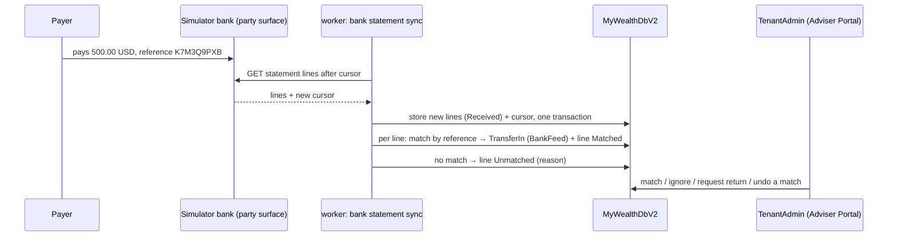

# Bank feed and deposit matching

The first platform-side flow driven by an outside party. It is step 5 of [custodial-roadmap.md](../custodial-roadmap.md) §13 and covers roadmap items **B3** (bank feed port and statement lines) and **B4** (deposit matching and suspense), with the receipts side of the simulator bank (**S1 receipts**). It follows [ADR 0021](../adr/0021-outside-parties-behind-ports.md) rules 1–20 and does not re-decide them. It amends [client-money-accounts.md](client-money-accounts.md), [transaction-source.md](transaction-source.md), [custody-modes.md](custody-modes.md), [posting.md](posting.md), [accounts.md](accounts.md), [simulator.md](simulator.md) and the Back Office, Adviser Portal and Customer Portal contracts.

The `worker` reads the bank statement of every active client money account through a new port, the **bank feed**, and stores each **bank statement line** once. A receipt that quotes the deposit reference of a Custodial account in the same Tenant and currency is posted as a **deposit**: a `TransferIn` with source `BankFeed` and a bank receipt detail. Any other receipt waits **unmatched** in suspense, where a TenantAdmin matches it to an account by hand, ignores it, or marks it for return. From this slice on, a person can no longer enter a `TransferIn` on a Custodial account.

New: source kind `BankFeed`, permission `statement-lines.manage` (TenantAdmin only), routes under `/statement-lines`, `GET /bank-connections`, the `depositReference` filter on `GET /accounts`, item fields `bankConnection` and `bankFeed` (client money account) and `bankReceipt` (transaction). Scripts `0040_client_money_accounts_bank_connection.sql` and `0041_bank_statement_lines.sql`; simulator script `database/simulator/0003_bank.sql`. No new `TransactionType`, problem code or domain event.

**Status is `accepted` (2026-11-20), landed 2026-11-20.** The nineteen points of §11 were confirmed as recommended; point 5 was changed before acceptance to make the polling interval a setting of each connection (`PollMinutes`) and to record the scale limit of reading each account on its own. The amendments to accepted docs listed in §12 are in force from the same change.

Notes from landing:

- `PullBankStatements` and `ProcessStatementLines` (§7) are Application services with `RunAsync(connection)`, not MediatR requests: the `worker` has no MediatR pipeline, and the existing jobs (`FxRateSyncJob`, `RebalanceJob`) call plain classes too. `BankStatementSyncJob` runs them in order; the functional tests resolve them from the `webapi` host's services.
- A flow's write sets `CreatedBy` to the system name (`system`) itself, so a match by `Reference` carries it also when the processing runs outside the `worker` (R32).
- One run at a time (R6) is a SQL Server application lock (`sp_getapplock`, session owner, no wait) named after the job id, held on its own connection for the run. A recurring job of a connection that is no longer configured is removed when the `worker` starts.
- `TransactionBankReceiptDetails` has a `TenantId` and the tenant composite key to `Transactions`, as `TransactionFxDetails` (§6.2, amended when `0041` was written). The match and last-action keys of `BankStatementLines` are tenant composite keys too.
- `SimulatorBankFeed` refuses a JSON string where R45 has a number (`amount`), and a field it cannot read (an unknown direction, a value date that is not `yyyy-MM-dd`) comes through empty, so the pull refuses the page with `InvalidLine` (R10). A cursor over 500 characters is `BadResponse`.
- Reopen refuses a `note` (400 `errors.Note`), since R25 says it takes none. The status words of the R24 message are the status names, and the actions read `matched`, `ignored`, `returned`, `reopened` and `unmatched`. A debit line answers `This line is a payment out and cannot be <action>.`
- R39 standing accounts: in Development they come from the AppHost (the simulator resource's environment), not from `appsettings.Development.json`, because the in-memory test host would otherwise load them into the test database. On the VPS, `compose.yml` sets two (USD and NZD) from `.env` (deployment.md §5). Every start opens a configured account that is not open yet; one already open is left as it is.
- The simulator places available lines on each feed read, under a lock on the account row, so two reads at once place a line once (R43).
- BO19 "a 400 is shown at its field" is proven as for BO16: the page passes `ValidationErrors.From` to the select's error text; the page tests render only.
- D34: `/statement-lines` admits TenantAdmin and Adviser in the portal's router, so an Adviser who opens it sees the 403 sentence from the route; the nav item is TenantAdmin only. D36's two ways to pick the account are buttons ("By deposit reference", "By customer"); D37's dialog refuses an empty note on the client with "Enter a note.". A Custodial new transaction form opened with `?type=TransferIn` starts on the first type the account offers (D39).
- `CustodialHttp.FundAsync` returns a synthesized 201 with the deposit id for a Custodial account (§10 fan-out), so its callers keep their signature; a test that reverses a hand `TransferIn` on a Custodial account now inserts a `Manual` one directly.

---

## 1. Summary



| | Today | After this slice |
| --- | --- | --- |
| A deposit to a Custodial account | A person types a `TransferIn` with any amount | The bank statement shows a receipt; the platform posts it, or a TenantAdmin matches it from suspense |
| Hand `TransferIn` on a Custodial account | Allowed (transitional) | Refused (400). External accounts unchanged |
| Money the platform cannot place | Not seen | An unmatched statement line, in suspense, not in the ledger (roadmap D7) |
| A wrong match | — | Undone by the flow (a Reversal with source `BankFeed`) while the cash is still there; otherwise an adjustment |

The rule that distinguishes this slice: a Custodial account's cash now comes in only through a statement line the platform stored first. Every deposit points at that line, and nobody can type one.

---

## 2. Scope

**In**

- Configuration: named **bank connections** (`BankConnections:{name}`), adapter `Simulator`
- Domain: `BankStatementLine` aggregate (statuses, transitions); `BankFeedCursor` entity; `DepositReferenceScanner` (candidates from free text); `TransactionSourceKind.BankFeed` and `TransactionSource.BankFeed(linePublicId)`; `TransactionBankReceiptDetail` (child of `Transaction`); factory `Transaction.PostBankDeposit`; `Reverse` copies the detail; `ClientMoneyAccount.BankConnection`; the matrix cell `TransferIn` / Custodial → refused
- Application: port `IBankFeed`; commands `PullBankStatements(connection)` and `ProcessStatementLines(connection)`; the five line actions; the line reads; `GET /bank-connections`; `CreateClientMoneyAccount` takes `bankConnection`; the client money account item gains `bankConnection` and `bankFeed`; `GetAccounts` takes `depositReference`; the transaction reads map `bankReceipt`
- Infrastructure: `SimulatorBankFeed` adapter (HTTP, `X-Api-Key`); recurring job `bank-statement-sync:{connection}` on queue `bank`; EF mappings
- Scripts: `database/schema/0040_client_money_accounts_bank_connection.sql`, `database/schema/0041_bank_statement_lines.sql`; `database/simulator/0003_bank.sql`
- Security: permission `statement-lines.manage`, TenantAdmin only
- HTTP (`webapi`): seven `/statement-lines` routes, `GET /bank-connections`, `GET /accounts?depositReference=`, the new item fields, the matrix refusal
- Simulator: bank accounts, receipts, statement feed on the party surface, control routes, standing accounts from configuration
- Back Office: connection and feed status on the client money accounts section
- Adviser Portal: Bank receipts pages for TenantAdmin; bank receipt on the transaction page; `TransferIn` no longer offered on a Custodial account; BFF prefix `/statement-lines`
- Customer Portal: a deposit is labelled "Deposit" with its value date
- AppHost and deploy entries for the connection
- Tests listed in §10

**Out**

- Debit lines (payments out of the trust account). They are stored and wait (R14); withdrawals (roadmap B6) process them
- A recalled or dishonoured receipt after it was credited. On a statement it is a debit line, so it comes with B6 (§11 point 11). The manual undo of a wrong match (R30) is in
- Sending a return payment. R28 only marks a receipt for return; B6 sends it
- Nominated bank accounts, withdrawals, available cash, reservations (B5, B6). Hand `TransferOut` and `CloseOut` on a Custodial account stay allowed
- Bank reconciliation, the bank's closing balance, break lists (B7). The simulator keeps its own balance (R46) for B7 to read later
- Interest the bank pays on the trust account (B7, I2). Until then such a receipt is ignored by hand (R27)
- A push from the bank (ADR 0021 rule 5)
- A manual "pull now" trigger. The job runs every `PollMinutes` (R6), one minute by default
- Named scenarios and the scenario library (§11 point 16)
- A real bank adapter
- Notifying the Customer or the Adviser of a deposit
- A history table of line actions. The last action is on the line (R31); the ledger holds every deposit and its Reversal
- A feed status page in the Adviser Portal. The Back Office shows it (BO18)
- Any change to External accounts beyond the new item field
- The deposit in the Customer Transactions Report beyond what a `TransferIn` row shows today

---

## 3. Stories

1. As a Customer I pay into my firm's client money account with my deposit reference, and the money appears on my Custodial account without anybody typing it, with the date the bank received it.
2. As a SystemAdmin I choose which bank connection a client money account is read through, and I see when its statement was last read and why the last read failed.
3. As a TenantAdmin I see every receipt the platform could not place, with the reason, and I match it to the right Custodial account by its deposit reference or by Customer.
4. As a TenantAdmin I mark a receipt that is not Customer money (bank interest, a test payment) as ignored, or one that must go back to the payer as to be returned, with a note; and I reopen either if I was wrong.
5. As a TenantAdmin I undo a match that put a receipt on the wrong account, while the account still holds the cash, and match it again.
6. As an Adviser I can no longer type a deposit on a Custodial account; I give the Customer the deposit instructions instead.
7. As the platform I survive a bank that is down or unreachable: the read fails, the cursor stays, the next run continues.
8. As the simulator operator I open trust accounts in the simulator bank and inject receipts with a right, wrong, missing or duplicate reference, late or twice, so the platform's matching and suspense can be shown.

---

## 4. Rules

### 4.1 Bank connections

| ID | Rule |
| --- | --- |
| R1 | **Configured, not stored.** A **bank connection** is a named entry in configuration: `BankConnections:{name}:Adapter` (only `Simulator` in this slice) on `webapi` and `worker`; on `worker` also `BaseUrl`, `ApiKey`, optional `TimeoutSeconds` (integer 1–60, default 10) and optional `PollMinutes` (one of 1, 2, 3, 4, 5, 6, 10, 12, 15, 20, 30, 60, so every run starts on the same minutes of each hour; default 1). A name is 1–50 characters, a lower-case letter followed by lower-case letters, digits and hyphens. The secret is only on `worker` (ADR 0021 rule 17). A host whose configuration has a bad name, an unknown adapter, or (on `worker`) a missing `BaseUrl` or `ApiKey` or a `TimeoutSeconds` or `PollMinutes` outside its values fails at start-up, before it listens. The rule reads the configuration, not the environment name (ADR 0021 rule 3). No connections configured is valid: nothing is read. |
| R2 | **A client money account names its connection.** `POST /tenants/{tenantId}/client-money-accounts` requires `bankConnection`, a name configured on `webapi`; missing or unknown → 400 `errors.BankConnection` (`Unknown bank connection.`). It never changes, like the other details (client-money-accounts R7). The item gains `bankConnection`. Script `0040` sets `simulator` on every existing row (roadmap D19). |
| R3 | **Connection list.** `GET /bank-connections` (`tenants.manage`) → list envelope of `{ name, adapter }`, sorted by name, every entry on page 1. No URL, key or timeout. TenantAdmin, Adviser, Customer → 403. |
| R4 | **Feed status.** The client money account item gains `bankFeed`: `{ lastSucceededAt, lastFailedAt, lastFailure }`, `null` until the first read of that account was tried. `lastFailure` is one of `Unreachable`, `Timeout`, `Unauthorized`, `Unavailable`, `UnknownAccount`, `BadResponse`, `InvalidLine` (R7, R10, R49), or `null`. It never carries a message from the party. |
| R5 | **Which accounts are read.** Every **active** client money account whose connection is configured on `worker` is read, whatever the Tenant's state. An inactive one is not read; its cursor is kept, and enabling it again continues from there. A row whose connection is no longer configured on `worker` is skipped with a warning in the log. |

### 4.2 Reading the statement (B3)

| ID | Rule |
| --- | --- |
| R6 | **One recurring job per connection.** `worker` registers `bank-statement-sync:{connection}` for each configured connection, on queue `bank`, every `PollMinutes` of that connection (UTC; cron `*/{PollMinutes} * * * *`, `0 * * * *` for 60). The job count is the number of connections, not of client money accounts. No automatic Hangfire retries; the schedule is the retry (ADR 0021 rule 15). A run that starts while another run of the same connection is still going ends at once and does nothing. |
| R7 | **A run.** For each client money account of the connection (R5), in `Id` order, the job asks the port for statement lines after that account's cursor, 100 at a time, until the party says there are no more or 20 pages were read. Each account is read on its own: a failed call stores nothing more for that account, keeps its cursor, sets `lastFailedAt` and `lastFailure`, and the run goes on with the next account. A run in which any account failed is reported to Hangfire as failed after every account was tried, and logged with the connection, the client money account PublicId and the failure. |
| R8 | **Store a page.** The new lines of one page, the new cursor and `lastSucceededAt` are written in one database transaction (ADR 0021 rule 7). A line whose (connection, outside id) is already stored, by this or another client money account, or earlier in the same page, is skipped and not changed. The unique index `UX_BankStatementLines_Connection_OutsideId` is the backstop. |
| R9 | **Cursor.** One cursor per client money account in `BankFeedCursors`, an opaque string of at most 500 characters that the platform never parses. The first read sends none. A replacement client money account (same account number, client-money-accounts R7) starts without a cursor; the lines its predecessor already stored are skipped by R8. |
| R10 | **A line the platform can store.** Outside id 1–100 characters; a value date; direction `Credit` or `Debit`; amount `> 0` with at most 4 decimal places; currency equal to the client money account's. A page with any line outside this → nothing of that page is stored, the cursor stays, `lastFailure` = `InvalidLine`. Free text is not a reason to refuse: payer name and reference text are trimmed and cut to 140 characters. |
| R11 | **Payer account masked on store.** The platform keeps only the last four letters or digits of the payer's account number, as `****1234`; fewer than five → `****`. The full number is never stored or logged. A return (B6) is sent against the line's outside id, not to a typed account number. |
| R12 | **New line.** A stored line has status `Received`, `ReceivedAt` = platform time, and the Tenant of its client money account. |
| R13 | **Process after the pull.** When every account of the connection has been read, the same run processes every `Received` **credit** line of that connection, oldest `ReceivedAt` first, then `Id` (ADR 0021 rule 8). Each line is one database transaction: the ledger write, if any, and the line's new status. The line's `RowVersion` guards it; a conflict skips that line until the next run. A line left `Received` by a crash is processed by the next run. A failed read does not stop the processing of lines already stored. |
| R14 | **Debit lines wait.** A debit line is stored and stays `Received`. No rule of this slice processes it or lets a person act on it. Withdrawals (B6) process debit lines. The simulator bank sends none in this slice. |

### 4.3 Matching a receipt (B4)

| ID | Rule |
| --- | --- |
| R15 | **Candidates.** The reference text is split at every character that is not an ASCII letter or digit. Each part, and the whole text with those characters removed, is a candidate when it has nine characters. A candidate is upper-cased, `O` becomes `0`, and `I` and `L` become `1`; it is kept when it passes `DepositReference.IsValid`. Duplicates are dropped. So `K7M 3Q9 PXB`, `k7m-3q9-pxb` and `Dep K7M3Q9PXB` all give `K7M3Q9PXB`; a mistyped character fails the check symbol and gives nothing. |
| R16 | **Accounts.** Each candidate is looked up among the Accounts of the line's Tenant. A candidate that names no Account there is dropped. An Account in another Tenant is treated exactly as no Account, and nothing tells the operator it exists. |
| R17 | **Match.** When exactly one Account remains, and it is Open, its Customer is not Disabled, its currency is the line's currency, and the line's amount has no more decimal places than that currency's `DecimalPlaces`, the platform posts the deposit (R32) and the line becomes `Matched` with method `Reference`. |
| R18 | **Unmatched.** Otherwise the line becomes `Unmatched` with the first reason that applies: `NoReference` (no candidate passes the check), `UnknownReference` (candidates pass, none names an Account in the Tenant), `SeveralReferences` (more than one Account), `CurrencyMismatch`, `AccountClosed`, `CustomerDisabled`, `AmountPrecision`. Nothing is written to the ledger (roadmap D7). |
| R19 | **The books follow the bank.** A disabled Tenant's lines are read and matched like any other. The portfolio trade lock does not apply (portfolios R18 allows cash in), and a deposit enqueues no rebalance. No amount limit applies. |
| R20 | **Once.** The platform matches a line once, when it processes it. A later change (an account reopened, a Customer enabled) does not match it again; a TenantAdmin matches it by hand. |

### 4.4 Suspense: the TenantAdmin's actions (B4)

| ID | Rule |
| --- | --- |
| R21 | **Access.** Every `/statement-lines` route requires the new permission `statement-lines.manage`, which only TenantAdmin holds (roadmap D5). Adviser, Customer and SystemAdmin → 403, checked before the line is read. Missing / dead Bearer → 401, never 302. A disabled current tenant → 403. A line of another Tenant, or a missing one → 404. No caller names a tenant; a `tenantId` in a query or body → 400. |
| R22 | **List.** `GET /statement-lines` → list envelope, newest `ReceivedAt` first, then newest `Id`. Optional filters: `status` (one or more names, comma-separated), `currency`, `clientMoneyAccountId`. An unknown status name → 400 `errors.Status`. `page` and `pageSize` as everywhere. `GET /statement-lines/{id}` → the item. |
| R23 | **Transitions.** Credit lines only; on a debit line every action → 400 `errors.Status`. |

| Action | Route | From | To |
| --- | --- | --- | --- |
| Match | `POST /statement-lines/{id}/match` | `Unmatched` | `Matched` |
| Ignore | `POST /statement-lines/{id}/ignore` | `Unmatched` | `Ignored` |
| Request return | `POST /statement-lines/{id}/request-return` | `Unmatched` | `ReturnRequested` |
| Reopen | `POST /statement-lines/{id}/reopen` | `Ignored`, `ReturnRequested` | `Unmatched` |
| Undo match | `POST /statement-lines/{id}/unmatch` | `Matched` | `Unmatched` |

| ID | Rule |
| --- | --- |
| R24 | **Every action.** Body with `rowVersion` of the line; missing → 400, stale → 409 `stale_row_version`. A line not in a "From" status of its action → 400 `errors.Status` with the message `This receipt is <status> and cannot be <action>.` Success → 204. No `Idempotency-Key`: the status change and `rowVersion` make a repeat a 400 or a 409, never a second write. A refused action writes nothing. |
| R25 | **Note.** `note`: trimmed, 1–200 characters. Required on ignore, request return and undo match (400 `errors.Note`); optional on match; not taken on reopen. |
| R26 | **Match by hand.** Body `{ accountId, rowVersion, note? }`. The Account must be visible to the caller in the Tenant (else 404), Custodial (else 400 `errors.AccountId`, `A receipt can be matched only to a Custodial account.`), in the line's currency (else 400 `errors.AccountId`, `The account's currency is NZD; this receipt is USD.`), Open (400, posting R6) and its Customer not Disabled (400 `disabled` / `target=user`). The amount precision of R17 → 400 `errors.AccountId`. Then the deposit is posted (R32) with the TenantAdmin in `CreatedBy`, and the line becomes `Matched` with method `Manual`. |
| R27 | **Ignore.** For money that is not a Customer's, for example interest the bank pays on the trust account or a test payment by the firm. Nothing is written to the ledger. |
| R28 | **Request return.** For money that must go back to the payer. Nothing is written to the ledger and no payment is sent in this slice; withdrawals (B6) send the return and close the line. |
| R29 | **Reopen.** Puts an ignored or to-be-returned line back into suspense. |
| R30 | **Undo match.** The flow undoes its own write (roadmap P6): it posts the Reversal of the line's deposit (R33) and the line becomes `Unmatched`. The Account must be Open (400, posting R6) and its Customer not Disabled (400 `disabled` / `target=user`), and the cash balance after the Reversal must be `≥ 0` (posting R9); otherwise 400 with the message `The account no longer holds this cash, so the deposit cannot be undone. Correct it with an adjustment.` and nothing changes. Works for a match by `Reference` and by `Manual`. The line keeps its `unmatchedReason` from processing (`null` if it was matched at once). |
| R31 | **Last action.** Every action records on the line its name, note, the person and the time, replacing the previous one. The line keeps the deposit it was last matched to until an undo; the ledger keeps every deposit and Reversal. No domain event, no outbox row. |

### 4.5 The deposit on the ledger

| ID | Rule |
| --- | --- |
| R32 | **Deposit.** A Transaction of type `TransferIn` with one `Principal` cash leg on the Account, amount = the line's amount; source `BankFeed` (3) with the line's PublicId as source id (transaction-source R2, R3); `bookedAt` = platform time when it is posted (ADR 0021 rule 10); memo `Bank deposit`; `reference` `null`; and a **bank receipt detail**: the line's value date, reference text, payer name and masked payer account. Built by `Transaction.PostBankDeposit` without the manual entry matrix (custody-modes R7), with the Account row locked as on every posting. `CreatedBy` is the worker's system name for a match by `Reference`, the TenantAdmin for a match by hand. |
| R33 | **Reversal by the flow.** An undo (R30) posts `Transaction.Reverse` with source `BankFeed` and the same line PublicId (transaction-source R7). The Reversal copies the bank receipt detail. `CreatedBy` is the TenantAdmin. A line matched again after an undo gets a new deposit with the same source id. |
| R34 | **No hand reverse.** `BankFeed` is not a hand-reversible source (transaction-source R12). `POST /transactions/{id}/reverse` of a deposit → 400 by transaction-source R13. Only R30 undoes it. |
| R35 | **Hand `TransferIn` refused on a Custodial account.** The manual entry matrix (custody-modes R5) cell `TransferIn` / Custodial becomes **refused**: `POST /transactions` → 400 `errors.Type` with the message `Deposits to a Custodial account come from the bank statement. The customer pays in with the account's deposit instructions.`, for every caller, SystemAdmin included. External accounts unchanged. A `TransferIn` entered by hand before this slice keeps source `Manual` and can still be reversed by hand. `TransferOut` and `CloseOut` stay allowed until B6 and B8. |
| R36 | **Item.** The transaction item gains `bankReceipt`: `{ valueDate, reference, payerName, payerAccount }` on a deposit and on its Reversal, `null` on every other Transaction. `source` is `{ "kind": "BankFeed", "id": "<statement line PublicId>" }`. Every caller who can read the Transaction sees both, the Customer included. |
| R37 | **Find an account by reference.** `GET /accounts` takes an optional `depositReference`, matched exactly after trim and upper-casing, with the visibility of the list (accounts.read). It returns at most one Account. A value that is not a valid deposit reference returns an empty list, not a 400. |

Balances, holdings, net worth and both reports add a deposit like any other `TransferIn`.

### 4.6 The simulator bank, receipts side (S1)

Amendment to [simulator.md](simulator.md). The party routes add under `/party/bank/…` (simulator R32).

| ID | Rule |
| --- | --- |
| R38 | **Bank accounts.** The simulator holds its own bank accounts: account number (1–34 characters of letters, digits, spaces and hyphens, no two spaces in a row, unique without regard to case), currency (three letters, upper case; the simulator holds no currency catalog) and name (1–140). It never reads the platform's client money accounts (ADR 0021 rule 22); the operator opens the same account numbers in both. |
| R39 | **Standing accounts.** Configuration `Simulator:Bank:StandingAccounts` lists accounts (`AccountNumber`, `Currency`, `Name`) that the simulator opens when the world is created and after every reset; one already open is left as it is. A bad entry stops the host before it listens. Development settings list `SIM-DEMO-USD`, `SIM-DEMO-NZD`, `SIM-DEMO2-USD` and `SIM-DEMO2-NZD`, the numbers `TestSeed` gives its client money accounts (client-money-accounts §9.1). |
| R40 | **Open an account.** `POST /control/bank/accounts` `{ accountNumber, currency, name }` → 201 with the bank account. A number already open → 400 `errors.AccountNumber`. Log action `BankAccountOpened`. |
| R41 | **Add a receipt.** `POST /control/bank/receipts` → 201 `{ id }` (the outside id). Body: `accountNumber` (an open account, else 400 `errors.AccountNumber`); `amount` (`> 0`, at most 4 decimal places); optional `reference` (≤ 140), `payerName` (≤ 140), `payerAccount` (≤ 34); optional `valueDate` (default: the simulator clock's UTC date; not after it, else 400 `errors.ValueDate`); optional `availableAfter` (ISO 8601 duration, `PT0S` to `P30D`, default `PT0S`): the line enters the feed that long after the simulator now; optional `deliverTwice` (default `false`): the line appears at two places in the feed with the same id. The currency is the account's. Log action `BankReceiptAdded` with the body. |
| R42 | **Outside id.** `{WorldId:N}-L{n}`, `n` counting the lines of the world from 1. It never repeats, also after a reset (simulator R25). |
| R43 | **Feed order.** A line takes the next place in its account's feed when the simulator now reaches its `availableAt` (the first read at or after that instant places it). A line with `deliverTwice` takes two consecutive places. A place never moves, so a cursor never skips a line that arrived late. |
| R44 | **Feed route.** Party port: `GET /party/bank/accounts/{accountNumber}/statement-lines?after={cursor}&limit={n}` → 200 `{ items, cursor, hasMore }`, the lines placed after the cursor, oldest place first. `limit` 1–100, default 100; outside that range it is clamped, like the control log (simulator R28). No `after` → from the first place. A cursor from another world → from the first place of the current world (simulator R25). A cursor that cannot be read → 400. Unknown account number → 404. The key (simulator R30) and the outage (simulator R27) apply as to every party route. `cursor` is the place of the last item returned; when no item is returned it is the request's cursor, or a cursor before the first place of the current world. |
| R45 | **Wire item.** `{ "id", "valueDate", "direction": "Credit", "amount", "currency", "payerName", "payerAccount", "reference" }`. `amount` is a JSON number. Every line in this slice is a credit. The payer account is sent in full; the platform masks it (R11). |
| R46 | **Its own books.** `GET /control/bank/accounts` lists the accounts with `balance`, the sum of all their lines, placed or not (the bank holds the money before the statement shows it). `GET /control/bank/accounts/{accountNumber}/statement-lines` lists every line with its `availableAt` and places. |
| R47 | **Reset.** A reset empties the bank accounts and lines (simulator R24), then opens the standing accounts again (R39). |
| R48 | **No platform knowledge.** The simulator does not read or check deposit references; a reference is free text (simulator R33). |

### 4.7 The platform adapter

| ID | Rule |
| --- | --- |
| R49 | **`SimulatorBankFeed`.** The Infrastructure adapter for `Adapter = Simulator` calls R44 at `BaseUrl` with header `X-Api-Key` = the connection's `ApiKey` and the connection's timeout. Its own wire types (ADR 0021, no shared contracts). Failures: no connection → `Unreachable`; timeout → `Timeout`; 401 → `Unauthorized`; 503 → `Unavailable`; 404 → `UnknownAccount`; any other status or a body it cannot read → `BadResponse`. The port reports a failure as a result, not as an exception the job must parse. |

Policies: `statement-lines.manage` (new). Grants: TenantAdmin only. `tenants.manage` reads `GET /bank-connections`.

---

## 5. Domain

| Type | Kind | Change |
| --- | --- | --- |
| `BankStatementLine` | Aggregate (new) | `TenantId`, `PublicId`, `ClientMoneyAccountId`, `Connection`, `OutsideId`, `ValueDate`, `Direction`, `Amount`, `Currency`, `PayerName`, `PayerAccountMasked`, `ReferenceText`, `ReceivedAt`, `Status`, `UnmatchedReason`, match (`AccountId`, `TransactionId`, `Method`, `At`), last action (`Action`, `Note`, `ByUserId`, `At`), `RowVersion`. `Receive(...)`, `MarkMatched`, `MarkUnmatched(reason)`, `MatchByHand`, `Ignore`, `RequestReturn`, `Reopen`, `Unmatch`. Holds R23–R25, R31 |
| `BankStatementLineStatus` | Enum (new) | `Received = 0`, `Matched = 1`, `Unmatched = 2`, `Ignored = 3`, `ReturnRequested = 4` |
| `BankLineDirection` | Enum (new) | `Credit = 0`, `Debit = 1` |
| `UnmatchedReason` | Enum (new) | `NoReference = 0`, `UnknownReference = 1`, `SeveralReferences = 2`, `CurrencyMismatch = 3`, `AccountClosed = 4`, `CustomerDisabled = 5`, `AmountPrecision = 6` |
| `StatementLineMatchMethod` | Enum (new) | `Reference = 0`, `Manual = 1` |
| `StatementLineAction` | Enum (new) | `Matched = 0`, `Ignored = 1`, `ReturnRequested = 2`, `Reopened = 3`, `Unmatched = 4` |
| `BankFeedCursor` | Entity (new) | `ClientMoneyAccountId`, `Cursor`, `LastSucceededAt`, `LastFailedAt`, `LastFailure` (`BankFeedFailure` enum, R4) |
| `DepositReferenceScanner` | Domain service (new) | `IReadOnlyList<DepositReference> Candidates(string? referenceText)` (R15) |
| `PayerAccountMask` | Static (new) | R11 |
| `TransactionSourceKind` | Enum (existing) | Add `BankFeed = 3`. Not hand-reversible (`CustodyRules.AllowsHandReverse` unchanged: only `Manual`, `Rebalance`) |
| `TransactionSource` | VO (existing) | `TransactionSource.BankFeed(Guid statementLinePublicId)`; the id must not be empty |
| `TransactionBankReceiptDetail` | Entity (new, child of `Transaction`) | `ValueDate`, `Reference`, `PayerName`, `PayerAccount`. 0..1 per Transaction |
| `Transaction` | Aggregate (existing) | `PostBankDeposit(tenantId, account, amount, bookedAt, source, receiptDetail)`: one `TransferIn` cash leg, `amount > 0`, source kind must be `BankFeed`. `Reverse` copies the receipt detail |
| `ClientMoneyAccount` | Aggregate (existing) | `BankConnection` (required, immutable); `Create` takes it |
| `CustodyRules` | Static (existing) | `AllowsManualEntry(Custodial, TransferIn)` → `false`; `RefusalMessage` returns the R35 message |

```text
BankStatementLine.Receive(...)                 -> Received
  credit:
    MarkMatched(accountId, transactionId, at)  Received  -> Matched (Reference)
    MarkUnmatched(reason)                      Received  -> Unmatched
    MatchByHand(accountId, txId, note?, by, at) Unmatched -> Matched (Manual)
    Ignore(note, by, at)                       Unmatched -> Ignored
    RequestReturn(note, by, at)                Unmatched -> ReturnRequested
    Reopen(by, at)                             Ignored | ReturnRequested -> Unmatched
    Unmatch(note, by, at)                      Matched   -> Unmatched (match cleared)
  debit: every method -> DomainException
  any other From status -> DomainException
```

Invariants:

- A statement line is unique on (connection, outside id). Held by Application (R8) and `UX_BankStatementLines_Connection_OutsideId`.
- A `Matched` line has an Account and a deposit Transaction; no other status has one. Held by the aggregate and a CHECK.
- A line's amount, date, payer and reference never change after it is stored.
- A deposit has source `BankFeed` with the PublicId of the line it came from, and a bank receipt detail. Held by `PostBankDeposit`.
- A deposit is undone only by its flow (R30), never by hand. Held by `CustodyRules.AllowsHandReverse`.
- On a Custodial account no person enters a `TransferIn`. Held by `CustodyRules`, called by Application.

Domain events: none.

Recorded in [domain-model.md](../domain-model.md) §8.6, §8.8 and §8.9.

---

## 6. Database

Forward only. Do not add EF migrations.

### 6.1 Script `0040_client_money_accounts_bank_connection.sql`

| Table | Change | Index / FK |
| --- | --- | --- |
| `ClientMoneyAccounts` | Add `BankConnection nvarchar(50) NOT NULL` with a temporary default `'simulator'` (every existing row, roadmap D19), then drop the default | none |

### 6.2 Script `0041_bank_statement_lines.sql`

| Table | Change | Index / FK |
| --- | --- | --- |
| `BankFeedCursors` | Add | PK `ClientMoneyAccountId`, FK → `ClientMoneyAccounts` RESTRICT |
| `BankStatementLines` | Add | PK `Id`. Unique `PublicId`. Unique `UX_BankStatementLines_Connection_OutsideId` on `(Connection, OutsideId)`. FK `TenantId` → `Tenants`, `ClientMoneyAccountId` → `ClientMoneyAccounts`, `MatchedAccountId` → `Accounts`, `MatchedTransactionId` → `Transactions`, `LastActionByUserId` → `Users`, all RESTRICT. Index `(TenantId, Status, ReceivedAt DESC)`; index `(Connection, Status, ReceivedAt)` for processing |
| `TransactionBankReceiptDetails` | Add | PK `TransactionId`; `TenantId` FK → `Tenants`; FK `(TenantId, TransactionId)` → `Transactions (TenantId, Id)` RESTRICT, as `TransactionFxDetails` and `TransactionAdjustmentDetails` |
| `Transactions` | Drop and re-add `CK_Transactions_SourceKind` (`SourceKind BETWEEN 0 AND 3`) and `CK_Transactions_SourcePublicId` (`(SourceKind IN (0, 1) AND SourcePublicId IS NULL) OR (SourceKind IN (2, 3) AND SourcePublicId IS NOT NULL)`) | none |

`BankFeedCursors`:

| Column | Type | Null | Notes |
| --- | --- | --- | --- |
| ClientMoneyAccountId | int | no | PK, FK |
| Cursor | nvarchar(500) | yes | `NULL` until the first page is stored |
| LastSucceededAt | datetimeoffset | yes | |
| LastFailedAt | datetimeoffset | yes | |
| LastFailure | int | yes | `BankFeedFailure`, CHECK 0–6 |
| RowVersion | rowversion | no | |

`BankStatementLines`:

| Column | Type | Null | Notes |
| --- | --- | --- | --- |
| Id | int identity | no | |
| PublicId | uniqueidentifier | no | HTTP id; the deposit's source id |
| TenantId | int | no | From the client money account; tenant query filter |
| ClientMoneyAccountId | int | no | |
| Connection | nvarchar(50) | no | Copied from the client money account at store |
| OutsideId | nvarchar(100) | no | |
| ValueDate | date | no | |
| Direction | int | no | CHECK 0–1 |
| Amount | decimal(18,4) | no | CHECK `> 0` |
| Currency | char(3) | no | FK `Currencies.Code` |
| PayerName | nvarchar(140) | yes | |
| PayerAccountMasked | nvarchar(40) | yes | R11 |
| ReferenceText | nvarchar(140) | yes | |
| ReceivedAt | datetimeoffset | no | |
| Status | int | no | CHECK 0–4 |
| UnmatchedReason | int | yes | CHECK 0–6 |
| MatchedAccountId, MatchedTransactionId | int | yes | Both set iff `Status = 1` (CHECK) |
| MatchMethod | int | yes | CHECK 0–1; set iff `Status = 1` |
| MatchedAt | datetimeoffset | yes | Set iff `Status = 1` |
| LastAction | int | yes | CHECK 0–4 |
| LastActionNote | nvarchar(200) | yes | |
| LastActionByUserId | int | yes | |
| LastActionAt | datetimeoffset | yes | |
| Created, CreatedBy, LastModified, LastModifiedBy | audit | | |
| RowVersion | rowversion | no | |

`TransactionBankReceiptDetails`: `TransactionId int` PK, `TenantId int NOT NULL`, `ValueDate date NOT NULL`, `Reference nvarchar(140) NULL`, `PayerName nvarchar(140) NULL`, `PayerAccount nvarchar(40) NULL`.

The match and last-action foreign keys of `BankStatementLines` (`MatchedAccountId`, `MatchedTransactionId`, `LastActionByUserId`) are tenant composite keys `(TenantId, …)` → `(TenantId, Id)`, as every other tenant-scoped reference since script `0028`. Amended 2026-11-20 when `0041` was written: the first wording said CASCADE without `TenantId`, which `TransactionFxDetails` no longer is.

No back-fill: no Transaction has source `BankFeed` before this slice. Hand `TransferIn` rows keep source `Manual` and get no receipt detail.

### 6.3 Simulator script `database/simulator/0003_bank.sql`

| Table | Content |
| --- | --- |
| `BankAccounts` | `Id int` identity PK, `AccountNumber nvarchar(34)` unique, `Currency char(3)`, `Name nvarchar(140)`, `OpenedAt datetimeoffset` (simulator time) |
| `BankLines` | `Id bigint` identity PK, `OutsideId nvarchar(100)` unique, `BankAccountId` FK, `Direction int`, `Amount decimal(18,4)`, `ValueDate date`, `PayerName`, `PayerAccount nvarchar(34)`, `Reference nvarchar(140)` (all three nullable), `PostedAt` and `AvailableAt datetimeoffset` (simulator time), `DeliverTwice bit` |
| `BankFeedPlaces` | `Place bigint` identity PK, `BankAccountId` FK, `BankLineId` FK; index `(BankAccountId, Place)`. One row per place (R43); two for `deliverTwice` |

A reset deletes from all three in the reset transaction (simulator R24). The world counter for `n` in R42 is a column `NextLineNumber bigint` added to `World` by the same script, reset to 1.

Recorded in [database-design.md](../database-design.md) §9, §11.4, §11.8, §11.9 and §15.

---

## 7. Application use cases

| Kind | Name | Change |
| --- | --- | --- |
| Port | `IBankFeed` (new) | `Task<BankFeedResult> GetStatementLinesAsync(BankFeedRequest request, CancellationToken)`. `BankFeedRequest(Connection, AccountNumber, Cursor?, Limit)`. `BankFeedResult` is a page (`Lines`, `Cursor`, `HasMore`) or a `BankFeedFailure`. Infrastructure dispatches to the adapter of the connection (R1, R49) |
| Port | `IBankConnections` (new) | The configured names and adapters, for R2 and R3 |
| Command | `PullBankStatements(connection)` (new) | R5, R7–R12. Runs as the worker's system user and reads across tenants explicitly (as client-money-accounts R17 does) |
| Command | `ProcessStatementLines(connection)` (new) | R13, R15–R20, R32 |
| Job | `BankStatementSyncJob` (new, Infrastructure) | R6: sends the two commands in order |
| Query | `GetStatementLines`, `GetStatementLineById` (new) | `statement-lines.manage`; R21, R22 |
| Command | `MatchStatementLine`, `IgnoreStatementLine`, `RequestStatementLineReturn`, `ReopenStatementLine`, `UnmatchStatementLine` (new) | `statement-lines.manage`; R23–R31, R33 |
| Query | `GetBankConnections` (new) | `tenants.manage`; R3 |
| Command | `CreateClientMoneyAccount` | Validator: `bankConnection` required; handler: configured (R2) |
| Query | `GetClientMoneyAccounts`, `GetClientMoneyAccountById` | Map `bankConnection` and `bankFeed` (R4) |
| Command | `CreateTransaction` | The matrix refuses `TransferIn` on Custodial (R35); no other change |
| Query | `GetAccounts` | `depositReference` filter (R37) |
| Query | `GetTransactions`, `GetTransactionById` | Map `bankReceipt` (R36) and source kind `BankFeed` |

Where each rule lives:

| Rule | Where |
| --- | --- |
| Line shape (R10), masking (R11) | `PullBankStatements` with `PayerAccountMask`; the aggregate re-checks the shape |
| Idempotent store (R8) | `PullBankStatements` query, unique index as backstop |
| Candidates (R15) | `DepositReferenceScanner` |
| Match conditions (R16–R18) | `ProcessStatementLines` |
| Transitions (R23–R25) | `BankStatementLine` |
| Account checks of a hand match and undo (R26, R30) | The two command handlers, with the posting checks they reuse |
| Matrix (R35) | `CustodyRules` |

---

## 8. API

| Method | Route | Policy | Success | Failure |
| --- | --- | --- | --- | --- |
| GET | `/statement-lines` | `statement-lines.manage` | 200 envelope | 400 / 401 / 403 |
| GET | `/statement-lines/{id}` | `statement-lines.manage` | 200 item | 401 / 403 / 404 |
| POST | `/statement-lines/{id}/match` | `statement-lines.manage` | 204 | 400 / 401 / 403 / 404 / 409 |
| POST | `/statement-lines/{id}/ignore` | `statement-lines.manage` | 204 | 400 / 401 / 403 / 404 / 409 |
| POST | `/statement-lines/{id}/request-return` | `statement-lines.manage` | 204 | 400 / 401 / 403 / 404 / 409 |
| POST | `/statement-lines/{id}/reopen` | `statement-lines.manage` | 204 | 400 / 401 / 403 / 404 / 409 |
| POST | `/statement-lines/{id}/unmatch` | `statement-lines.manage` | 204 | 400 / 401 / 403 / 404 / 409 |
| GET | `/bank-connections` | `tenants.manage` | 200 envelope | 401 / 403 |
| POST | `/tenants/{tenantId}/client-money-accounts` | `tenants.manage` (unchanged) | — | adds 400 `errors.BankConnection` |
| GET | `/tenants/{tenantId}/client-money-accounts[/{id}]` | unchanged | item has `bankConnection`, `bankFeed` | — |
| GET | `/accounts` | `accounts.read` (unchanged) | adds `depositReference` filter | — |
| POST | `/transactions` | unchanged | — | adds 400 `errors.Type` for `TransferIn` on Custodial |
| GET | `/transactions`, `/transactions/{id}` | unchanged | item has `bankReceipt`; `source.kind` may be `BankFeed` | — |

### 8.1 Bodies

Statement line item:

```json
{
  "id": "<line publicId>",
  "clientMoneyAccountId": "<client money account publicId>",
  "currency": "USD",
  "direction": "Credit",
  "amount": 500.00,
  "valueDate": "2026-11-20",
  "payerName": "J SMITH",
  "payerAccount": "****4200",
  "reference": "K7M3Q9PXB",
  "receivedAt": "2026-11-20T02:01:07Z",
  "status": "Matched",
  "unmatchedReason": null,
  "match": {
    "accountId": "<account publicId>",
    "customerId": "<customer publicId>",
    "transactionId": "<transaction publicId>",
    "method": "Reference",
    "at": "2026-11-20T02:01:08Z"
  },
  "lastAction": null,
  "rowVersion": "<base64>"
}
```

An unmatched line has `"match": null` and an `unmatchedReason`. `lastAction`, when set: `{ "action": "Ignored", "note": "Bank interest", "by": { "id": "<user publicId>", "name": "Ana Admin" }, "at": "…" }`.

Match: `{ "accountId": "<account publicId>", "rowVersion": "<base64>", "note": "Paid without reference; confirmed by phone" }`.

Ignore, request return, undo match: `{ "note": "…", "rowVersion": "<base64>" }`. Reopen: `{ "rowVersion": "<base64>" }`.

Bank connections: `{ "items": [ { "name": "simulator", "adapter": "Simulator" } ], "page": 1, "pageSize": 20, "totalCount": 1 }`.

Client money account item (other fields as in [client-money-accounts.md](client-money-accounts.md) §8.1):

```json
{
  "id": "<publicId>",
  "currency": "USD",
  "bankConnection": "simulator",
  "bankFeed": {
    "lastSucceededAt": "2026-11-20T02:01:07Z",
    "lastFailedAt": "2026-11-19T22:14:00Z",
    "lastFailure": "Unavailable"
  },
  "...": "..."
}
```

Transaction item of a deposit (other fields as in [posting.md](posting.md) and its amendments):

```json
{
  "id": "<transaction publicId>",
  "type": "TransferIn",
  "bookedAt": "2026-11-20T02:01:08Z",
  "memo": "Bank deposit",
  "reference": null,
  "source": { "kind": "BankFeed", "id": "<line publicId>" },
  "bankReceipt": {
    "valueDate": "2026-11-20",
    "reference": "K7M3Q9PXB",
    "payerName": "J SMITH",
    "payerAccount": "****4200"
  },
  "cash": [ { "accountId": "<account publicId>", "amount": 500.00, "currency": "USD", "...": "..." } ],
  "...": "..."
}
```

Simulator, control port:

```json
{ "accountNumber": "SIM-DEMO-USD", "currency": "USD", "name": "Demo Firm Client Funds Trust Account" }
```

```json
{
  "accountNumber": "SIM-DEMO-USD",
  "amount": 500.00,
  "reference": "K7M 3Q9 PXB",
  "payerName": "J SMITH",
  "payerAccount": "12-3456-7890042-00",
  "availableAfter": "PT0S",
  "deliverTwice": false
}
```

Simulator, party port, `GET /party/bank/accounts/SIM-DEMO-USD/statement-lines?after=<cursor>`:

```json
{
  "items": [
    {
      "id": "3f2c…e1-L7",
      "valueDate": "2026-11-20",
      "direction": "Credit",
      "amount": 500.00,
      "currency": "USD",
      "payerName": "J SMITH",
      "payerAccount": "12-3456-7890042-00",
      "reference": "K7M 3Q9 PXB"
    }
  ],
  "cursor": "3f2c…e1:12",
  "hasMore": false
}
```

Control log actions gain `BankAccountOpened` and `BankReceiptAdded`.

### 8.2 Errors

All refusals are ordinary validation (400 with `errors`, no problem `code`) except where named.

| Case | Response |
| --- | --- |
| Caller without `statement-lines.manage` on a `/statement-lines` route | 403 |
| A line of another Tenant, or a missing one | 404 |
| `tenantId` in a `/statement-lines` query or body | 400 |
| Unknown `status` filter | 400 `errors.Status` |
| Action on a debit line, or from a status not in R23 | 400 `errors.Status` |
| Missing / stale `rowVersion` | 400 / 409 `stale_row_version` |
| Missing note where R25 requires it | 400 `errors.Note` |
| Match to an account the caller cannot see | 404 |
| Match to an External account, another currency, or an amount with too many decimals | 400 `errors.AccountId` |
| Match or undo on a Closed account | 400 (posting R6) |
| Match or undo on a Disabled Customer | 400 `disabled` / `target=user` |
| Undo when the cash is gone | 400 (R30) |
| Reverse of a deposit by hand | 400 (transaction-source R13) |
| `POST /transactions` `TransferIn` on a Custodial account | 400 `errors.Type` (R35) |
| Create a client money account without a configured `bankConnection` | 400 `errors.BankConnection` |

Cross-tenant or wrong-collection id → **404**, not 403. Keep the resource catalog in [api-design.md](../api-design.md) pointing here for these rules.

---

## 9. UI

Page contracts: [back-office.md](../backoffice/back-office.md) (BO18, BO19), [adviser-portal-dashboard.md](../adviser-portal/adviser-portal-dashboard.md) (D34–D39) and [customer-portal.md](../customer-portal/customer-portal.md) (C21), amended and accepted together with this spec. The Adviser Portal BFF's prefix allow-list ([bff-adviser-portal.md](bff-adviser-portal.md) R20) gains `/statement-lines`. The Customer Portal BFF does not change.

**Back Office**

| ID | Behaviour |
| --- | --- |
| BO18 | The client money accounts table (BO16) gains a "Connection" column (`bankConnection`) and a "Statement" column from `bankFeed`: `null` → "Not read yet"; `lastFailedAt` later than `lastSucceededAt` (or no success) → "Failing since <lastFailedAt>: <failure label>"; otherwise "Read <lastSucceededAt>". Failure labels: Unreachable "Bank not reachable", Timeout "Bank did not answer in time", Unauthorized "Bank refused the key", Unavailable "Bank unavailable", UnknownAccount "Bank does not know this account", BadResponse "Bank answer not understood", InvalidLine "Statement line rejected". |
| BO19 | The add form gains a required "Bank connection" select from `GET /bank-connections`. With one connection it is preselected. With none the form shows "No bank connection is configured." and cannot be submitted. A 400 `errors.BankConnection` is shown at the select. |

**Adviser Portal**

| ID | Behaviour |
| --- | --- |
| D34 | A TenantAdmin sees a nav item "Bank receipts" (`/statement-lines`). An Adviser does not; a 403 on the route shows "Only a firm administrator can see bank receipts." The page lists `GET /statement-lines` with a status filter (default Unmatched; options Unmatched, Matched, Ignored, To be returned, and All, which sends those four statuses): Value date, Received, Amount, Currency, Payer, Reference, Status, Reason. Reason labels: NoReference "No valid reference", UnknownReference "Reference not found", SeveralReferences "More than one reference", CurrencyMismatch "Account in another currency", AccountClosed "Account closed", CustomerDisabled "Customer disabled", AmountPrecision "Amount has too many decimals". `Received` lines (debit lines waiting for B6, and credit lines not yet processed) are not shown. |
| D35 | `/statement-lines/:id` shows every field of the item, the reason, the last action (action, note, person, time) and, on a Matched line, the account (link to `/accounts/:id`), the Customer and the deposit (link to `/transactions/:id`) with "Matched by reference" or "Matched by hand". Actions follow R23: Unmatched → Match, Ignore, Return to payer; Ignored or To be returned → Reopen; Matched → Undo match. |
| D36 | Match opens a form with two ways to pick the account: "Deposit reference" (calls `GET /accounts?depositReference=`) or a Customer picker followed by the Customer's Open Custodial accounts in the line's currency (`GET /accounts?customerId=&custodyMode=Custodial`). An optional note. Review: "Credit 500.00 USD to <account name> of <customer name>." A 400 is shown at its field; a 409 reloads the line with "This receipt changed. Check it and try again." |
| D37 | Ignore, Return to payer and Undo match ask for a required note in a dialog. Undo match warns "This posts a reversal of the deposit on <account name>." Reopen asks for confirmation only. The R30 400 message is shown as returned. |
| D38 | `/transactions/:id` of a deposit or its Reversal shows a "Bank receipt" section: Value date, Reference, Payer, Payer account. The Source line (D26) shows "Bank feed" for `BankFeed`; a TenantAdmin also sees a link "Statement line" to `/statement-lines/:source.id`. Reverse is not offered (D27 already hides it for every source other than `Manual` and `Rebalance`). |
| D39 | D18 changes: on a Custodial account the action buttons and the type selector no longer offer TransferIn. The deposit instructions panel (D32) gains the line "Deposits are credited from the bank statement when the customer pays in with this reference." External accounts unchanged. |

**Customer Portal**

| ID | Given | When | Then |
| --- | --- | --- | --- |
| C21 | Customer with a deposit (a `TransferIn` with `bankReceipt`) on a Custodial account | Account page activity | The row is labelled "Deposit" instead of the `TransferIn` label and shows "Value date <date>" on a line under it. Payer details are not shown. Its Reversal stays "Reversal". A `TransferIn` without `bankReceipt` keeps today's label. |

### 9.1 Seeds and hosting

- `TestSeed`: its client money accounts get `bankConnection: "simulator"`. Its existing `Seed` funding of `Demo custodial brokerage` stays; the simulator bank does not know it (§11, still open).
- `DevelopmentSmokeSeeder`, demo seed: no change.
- AppHost: `webapi` gets `BankConnections__simulator__Adapter=Simulator`; `worker` gets the same plus `BaseUrl` = the simulator's `party` endpoint and `ApiKey` = parameter `simulator-party-api-key`. `worker` does not wait for `simulator` (ADR 0021 rule 15). The simulator gets the four standing accounts of R39 as environment variables of its AppHost resource (its Development settings). This changes simulator §9.2 "No platform host receives the party key in this slice".
- TestAppHost: no connection configured for the hosts; functional tests replace `IBankFeed` and `IBankConnections` (§10).
- VPS ([deployment.md](../deployment.md) §5, amended 2026-11-20): `.env` keys `BankConnections__simulator__Adapter` for `webapi` and `worker`, `BankConnections__simulator__BaseUrl=http://simulator:8082`, `BankConnections__simulator__ApiKey` (the party key) and optional `BankConnections__simulator__PollMinutes` for `worker`; `Simulator__Bank__StandingAccounts__N__*` for `simulator`, matching the client money accounts SystemAdmin adds for the demo tenant. With the simulator's compose profile off, the job fails every minute with `Unreachable` and stores nothing, which is the intended state (ADR 0021 rule 15, roadmap D10).

---

## 10. Tests

| Project | Assert |
| --- | --- |
| Domain.UnitTests | `DepositReferenceScanner`: `K7M3Q9PXB`, `k7m-3q9-pxb`, `K7M 3Q9 PXB`, `Dep K7M3Q9PXB` and a valid reference typed with `O` for `0` or `L` for `1` → one candidate; a changed character → none; two valid references → two; empty / null → none; a ten-character token → none. `PayerAccountMask`: `12-3456-7890042-00` → `****4200`, four characters → `****`, null → null. `BankStatementLine`: every allowed transition; every other From status → throws; every method on a debit line → throws; note limits; match fields set only on Matched and cleared by `Unmatch`. `Transaction.PostBankDeposit`: one `TransferIn` leg, amount > 0, source must be `BankFeed`, detail kept; `Reverse` copies the detail. `TransactionSource.BankFeed(Guid.Empty)` → throws. `CustodyRules`: `TransferIn` refused on Custodial with the R35 message, allowed on External; `AllowsHandReverse(Custodial, BankFeed)` false. `ClientMoneyAccount.Create` requires a connection |
| Application.FunctionalTests — pull and match | With a fake `IBankFeed`: a receipt with a valid reference of an Open Custodial account in the Tenant and currency → one `TransferIn`, source `(BankFeed, line id)`, `bankReceipt` with value date, reference, payer and `****` payer account, memo `Bank deposit`, `CreatedBy` system, cash balance up, line Matched (Reference). Each R18 reason with its own case, in the R18 order (a reference of another Tenant's account → `UnknownReference`). Two references of two accounts → `SeveralReferences`. The same outside id twice in one page, in two pages, and from a replacement client money account → one line. A page with a wrong-currency line, an amount `≤ 0` or a missing id → nothing stored, cursor unchanged, `lastFailure` `InvalidLine`. Each failure of the fake → stored nothing, cursor unchanged, `lastFailedAt` and `lastFailure` set; the next account of the run is still read; lines stored earlier are still processed. More than one page → all stored, cursor of the last page. An inactive client money account → not read; enabled again → continues from its cursor. A disabled Tenant → matched as usual. A debit line → stored, stays Received. Processing twice → one deposit. A matched deposit on an account with an Active portfolio assignment → allowed, no rebalance enqueued |
| Application.FunctionalTests — suspense | No Bearer → 401 not 302; Adviser, Customer, SystemAdmin → 403 on all seven routes. TenantAdmin: list filters and order; unknown status → 400; `tenantId` → 400. Match by hand → 204, deposit with `CreatedBy` the TenantAdmin, line Matched (Manual), last action set; to an External account, another currency, a Closed account → 400; Disabled Customer → 400 `disabled` / `target=user`; an unknown account id → 404. Ignore, request return without a note → 400 `errors.Note`; with → 204. Reopen from both → Unmatched. Each action from a wrong status → 400 `errors.Status`. Stale `rowVersion` → 409; missing → 400. Undo match → 204, Reversal with source `BankFeed`, receipt detail copied, balance back, line Unmatched; then match again → a second deposit with the same source id. Undo after the cash was moved out → 400 with the R30 message, nothing written. Hand reverse of a deposit → 400 (transaction-source R13). Two-tenant: tenant B's line id → 404 on get and every action; tenant A's TenantAdmin matching to tenant B's account → 404 |
| Application.FunctionalTests — other routes | `POST /transactions` `TransferIn` on Custodial → 400 `errors.Type` with the R35 message for TenantAdmin, Adviser and SystemAdmin; on External → 201. An existing `Manual` `TransferIn` on Custodial can still be reversed. `GET /accounts?depositReference=` → the one account, lower case works, unknown → empty, invalid → empty, an Adviser does not see an unassigned Customer's account, another tenant's reference → empty. `GET /bank-connections` → names for SystemAdmin, 403 for TenantAdmin. Create client money account without / with an unknown `bankConnection` → 400; item has `bankConnection` and `bankFeed: null` before any read. Customer reads a deposit with `bankReceipt` |
| Infrastructure.IntegrationTests | `0040` on a scratch database with client money accounts: every row gets `simulator`, an insert without the column fails. `0041`: the unique (connection, outside id) index; the Matched CHECK (match columns set iff Status 1); a Transaction with `SourceKind = 3` needs a `SourcePublicId`; `SourceKind = 4` violates. EF round-trip of the three tables. `SimulatorBankFeed` against canned HTTP: a page maps to lines and cursor; the `X-Api-Key` header is sent; 401, 404, 503, 500, a timeout, an unreadable body and a refused connection map to R49. Start-up: a bad connection name, an unknown adapter, a `worker` connection without `ApiKey`, a `PollMinutes` of 7 → the host does not start. `BankStatementSyncJob` with the Worker's services and a fake feed: both commands run in order, no automatic retry attribute, a second concurrent run does nothing; a connection with `PollMinutes: 5` is registered as `*/5 * * * *`, one with none as every minute |
| Simulator.Tests | `0003` applies. Standing accounts opened on first start and after a reset; a second start opens nothing new; a bad entry stops start-up. Open account: 201, duplicate number (other case) → 400. Receipt: each field limit; unknown account → 400; a future value date → 400; default value date is the simulator date. Feed: no key → 401; outage → 503; unknown account → 404; order by place; `limit` clamped; `hasMore`; cursor of the last item; a cursor from before a reset → from the start of the new world; an unreadable cursor → 400. `availableAfter`: not in the feed before the simulator clock reaches it, then placed after lines already read, and a cursor taken before it does not skip it. `deliverTwice`: two places, one id. Outside ids contain the world id and never repeat across a reset. Balance includes lines not yet placed. Control log rows for both actions; a 400 writes none |
| Back Office | BO18 the two columns and every `bankFeed` state; BO19 the select, preselection, none configured, the 400 |
| Adviser Portal | D34 nav for TenantAdmin only, the filter, the labels, the 403 sentence; D35 actions per status; D36 both pickers, review sentence, 400 and 409; D37 dialogs and the R30 message; D38 the section, the label and the link for TenantAdmin only; D39 no TransferIn on Custodial, the line under the deposit instructions |
| Customer Portal | C21 |

Fan-out in the tests:

- `CustodialHttp.FundAsync` (26 files) cannot post a hand `TransferIn` on a Custodial account any more. For a Custodial account it reads the account's `depositReference`, adds a receipt with it to the functional host's fake `IBankFeed` and sends `PullBankStatements` and `ProcessStatementLines` through the host's services, then returns the deposit. Callers keep their signature; those that read the 201 body of the old call change to the returned id. External funding is unchanged.
- The functional host registers the fake `IBankFeed` and a fake `IBankConnections` with one connection `simulator`; `AccountHttp`'s client money account helper sends `bankConnection: "simulator"`.
- Tests that assert a hand `TransferIn` on Custodial is allowed (custody-modes matrix tests) change to the R35 refusal.
- Raw-SQL inserts into `ClientMoneyAccounts` on a database at `0040` or later add `BankConnection`.
- The Adviser Portal and Customer Portal `Transaction` types gain `bankReceipt`; the Back Office `IPlatformApi` gains `GetBankConnections` and the two item fields.

---

## 11. Locked in this spec

No new ADR. It follows [ADR 0021](../adr/0021-outside-parties-behind-ports.md) rules 1–20 and amends the wording of rule 15 (point 5). Roadmap D4 (keep `TransferIn`, add a source), D5 (new permissions to TenantAdmin first) and D7 (unmatched receipts only on the statement line) are written as rules here.

| Item | Lock |
| --- | --- |
| Bank connection | A configured name (`BankConnections:{name}`), adapter `Simulator`; named by each client money account, immutable; secret on `worker` only |
| Port | `IBankFeed`, one page after a cursor per client money account; adapter `SimulatorBankFeed` |
| Job | `bank-statement-sync:{connection}`, one per connection, queue `bank`, every `PollMinutes` of the connection (default 1), no automatic retries, one run at a time |
| Inbound records | `BankStatementLines`, unique (connection, outside id); payer account masked; `BankFeedCursors` per client money account |
| Matching | Deposit reference candidates from the text (R15) in the line's Tenant; exactly one Open account, same currency, Active Customer |
| Deposit | `TransferIn`, source `BankFeed` (3) with the line id, bank receipt detail, server `bookedAt` |
| Suspense | `/statement-lines`, permission `statement-lines.manage` (TenantAdmin); match, ignore, request return, reopen, undo match |
| Matrix | Hand `TransferIn` on a Custodial account refused |
| Scripts | `0040_client_money_accounts_bank_connection.sql`, `0041_bank_statement_lines.sql`; simulator `0003_bank.sql` |
| Problem codes, events | None added |

### Confirmed when this spec was accepted (2026-11-20)

Each point was confirmed as recommended and is written into the rules above as stated here. The alternatives are kept for the record.

1. **A bank connection is a configured name on the client money account** (R1–R3). Decided: the account names a connection; the URL and key live in `worker` configuration; `webapi` knows only the names, to refuse a typo, and lists them for the Back Office. This is what ADR 0021 rule 3 and client-money-accounts §11 point 9 asked for. Alternative: one platform-wide bank connection with no column, which a second bank (or a second simulator) would force a script to change.
2. **The feed is addressed by the trust account number** (R7, R44). Decided: the platform already stores the full number (client-money-accounts R3), and the simulator keys its accounts by it. Alternative: a separate party account id issued by the bank, a column a real bank adapter can add when it needs it.
3. **One cursor row per client money account** (R9). Decided: `BankFeedCursors`, keyed by the client money account, with the feed status of ADR 0021 rule 16. Alternative: one generic cursor table for every later feed (broker, custodian), keyed by a string, with no foreign key.
4. **Only active client money accounts are read** (R5). Decided: disabling is how the operator says "this account is no longer used", and a replacement row reads the same bank account again without duplicates (R8, R9). Alternative: read every row, active or not, which reads a replaced account twice for ever.
5. **One recurring job per connection, accounts read independently, polling interval per connection** (R1, R6, R7). ADR 0021 rule 15 says "each feed is its own recurring job, so one party's failure never stops another feed". Decided: a connection is one party, so it is one job; within it each account's failure is recorded on that account and the run continues, which keeps the rule's purpose. The number of Hangfire jobs is the number of connections (one today), about 1 440 runs a day each at the default; Hangfire expires succeeded runs after a day. The interval is `PollMinutes` per connection: 1 for the simulator, so a demo receipt appears quickly without a manual trigger; a real bank's connection takes what its terms allow (often 5–15 minutes). ADR 0021 rule 15 is amended to say this (2026-11-20). Alternative: one Hangfire job per client money account, registered and removed as rows are added and disabled.
   Scale limit, recorded on purpose: a run reads its accounts one after another, one call each at least. Client money accounts are the firms' trust accounts, one per Tenant and currency, so they stay few (two on the showcase per Tenant); at several hundred per connection a run approaches its interval and later runs are skipped (R6). A bank that delivers one statement file per connection for all its accounts (for example CAMT.052 intraday and CAMT.053 end of day over host-to-host) fits a cursor per connection, not per account (points 2 and 3). That change belongs to the spec of that bank's adapter and is not designed now.
6. **The payer's account number is masked on store** (R11). Decided: the platform needs it only to show who paid; a return (B6) goes back against the bank's line id, as banks return a payment. Alternative: store the full number for a later return payment, which puts a third party's bank details in the platform.
7. **How a reference is found in the text** (R15). Decided: tokens and the whole text without separators, with the Crockford mapping of `O`, `I`, `L`, and only values that pass the check symbol. This answers the open point of client-money-accounts §11. Alternative: the whole reference field only, exactly as typed, which sends "Dep K7M3Q9PXB" to suspense.
8. **A reference of another Tenant's account is "not found"** (R16). Decided: money in Tenant A's trust account can never credit Tenant B, and Tenant A's operator must not learn that Tenant B has that reference. Alternative: a distinct reason for the platform operator, which needs a SystemAdmin view this slice does not have.
9. **`statement-lines.manage` for TenantAdmin only** (R21, roadmap D5). Decided: the receipts carry third parties' names and money not yet anybody's; the TenantAdmin already holds `transactions.adjust`. Alternative: an Adviser may read suspense to recognise a Customer's payment.
10. **No `Idempotency-Key` on the line actions** (R24). Decided: each action is a status change guarded by `rowVersion`, like close and reopen, so a repeat cannot post twice. Alternative: require the key on match and undo because they write a Transaction.
11. **Undo by the flow, refused when the cash is gone; recalls wait for B6** (R30, roadmap B4 "Open"). Decided: a wrong match is undone by a Reversal with source `BankFeed` while the balance allows it; otherwise the TenantAdmin corrects with adjustments, so no balance goes negative (posting R9 holds for flows too). A recalled or dishonoured receipt is a debit line on the statement, so it is handled with the other debit lines in B6, by the same rule. Alternative: let a recall make the balance negative.
12. **Request return is a status only** (R28). Decided: it records the decision now, and B6 sends the payment for every `ReturnRequested` line. Alternative: no return action until B6, leaving such lines Unmatched with a note nobody can record.
13. **A disabled Tenant's receipts are still matched** (R19). Decided: the books must follow the bank whatever the Tenant's state. Alternative: leave them Unmatched with a reason `TenantDisabled`.
14. **Debit lines are stored and wait** (R14). Decided: the statement is stored whole, so B6 and B7 see it from the start. Alternative: drop debit lines until B6, which loses them past the cursor.
15. **Hand `TransferIn` on a Custodial account is refused for every caller** (R35). Decided: this is the cell step 5 closes; SystemAdmin has no reason to bypass it, and the test seed builds Transactions directly. Existing hand deposits stay reversible. Alternative: keep it allowed for SystemAdmin as a break-glass write; an adjustment already is that write.
16. **No scenario library yet** (§2 Out). Simulator §11 point 7 put the library with S1. Decided: the receipts side needs only one-off injections (R40, R41); a named scenario earns its place when it combines parties or steps, from B6 (pay in, withdraw, return). The functional test fakes are fed by the tests, as ADR 0021 rule 19 allows. Alternative: add the library now with three step kinds (open account, receipt, advance clock).
17. **Standing accounts from configuration** (R39). Decided: a reset would otherwise remove the trust accounts the platform reads, and every demo would start with four control calls. This answers the open point of client-money-accounts §11 on resets. Alternative: open them by hand after each reset.
18. **A bank receipt detail on the Transaction** (R32, R36). Decided: ADR 0021 rule 10 puts outside dates on a detail row, and the Customer can then see the value date without a statement line route. Alternative: read the value date through the source id from the line.
19. **`FundAsync` goes through the fake feed** (§10 fan-out). Decided: the 26 callers keep their signature and every Custodial test exercises the real path. Alternative: a helper that inserts a `TransferIn` directly, which tests a path production no longer has.

Still open, not this slice:

- Debit lines: payments, returns, recalls and dishonours (B6)
- The simulator bank's books do not contain the `TestSeed` funding of `Demo custodial brokerage`; B7 decides whether the seed funds through the simulator or reconciliation starts after it
- Interest on the trust account (B7, I2)
- A pull-now trigger, if a demo needs one faster than a minute
- A feed status page in the Adviser Portal, and alerts on a failing feed
- A real bank adapter and its party account id (point 2)

---

## 12. Suggested commits

The repository should build after each commit. Agents split each behaviour into red then green.

1. Bank connections in configuration and on the client money account (R1–R3): `IBankConnections`, start-up checks, script `0040`, `bankConnection` on create and item, `GET /bank-connections` + unit, integration and functional tests. The client money account helpers change here.
2. Store statement lines and cursors (R8–R12, R14): Domain types, script `0041`, EF mappings + Domain unit tests and the `0041` integration tests.
3. The bank feed port and the pull (R4, R5, R7, R10, R11): `IBankFeed`, `PullBankStatements`, the fake for functional tests, `bankFeed` on the item + functional tests.
4. The simulator adapter (R49) + canned-HTTP integration tests.
5. Matching and the deposit (R13, R15–R20, R32, R36): `DepositReferenceScanner`, source kind `BankFeed`, `TransactionBankReceiptDetail`, `PostBankDeposit`, `ProcessStatementLines`, `bankReceipt` on the item + unit and functional tests.
6. The recurring job (R6) and its AppHost wiring + integration test.
7. Hand `TransferIn` refused on a Custodial account (R35) + functional tests. `FundAsync` moves to the fake feed here (§10 fan-out).
8. Suspense reads (R21, R22) and permission `statement-lines.manage` + functional tests, two-tenant.
9. Match by hand, ignore, request return, reopen (R23–R29, R31) + functional tests.
10. Undo match (R30, R33, R34) + functional tests.
11. `GET /accounts?depositReference=` (R37) + functional tests.
12. Simulator bank: script `0003`, accounts, standing accounts, receipts, feed route, its own books, reset (R38–R48) + `Simulator.Tests`.
13. Back Office (BO18, BO19) + page tests.
14. Adviser Portal (D34–D39), BFF prefix, Customer Portal (C21) + frontend tests.
15. Deploy: `.env.example` keys, simulator standing accounts (config; exempt from test-first).
16. Repo docs: mark this file landed; roadmap §13 step 5; the known issue row.

Do not put debit-line processing, payments, returns, nominated bank accounts, withdrawals or reconciliation in these commits.

### Docs amended when this spec was accepted

[custody-modes.md](custody-modes.md) (R5 matrix: `TransferIn` / Custodial refused, the refusal message), [transaction-source.md](transaction-source.md) (kind `BankFeed` = 3, not hand-reversible, check widened), [posting.md](posting.md) (a `TransferIn` may carry a bank receipt detail; the flow's Reversal), [client-money-accounts.md](client-money-accounts.md) (`bankConnection`, `bankFeed`, the open points of §11 answered), [accounts.md](accounts.md) (`depositReference` filter), [simulator.md](simulator.md) (S1 receipts amendment: R38–R48, script `0003`, the AppHost party key, §11 point 7), [ADR 0021](../adr/0021-outside-parties-behind-ports.md) rule 15 wording (point 5), [bff-adviser-portal.md](bff-adviser-portal.md) (prefix `/statement-lines`), [api-design.md](../api-design.md) (§3.1 permission row, §7.3, §7.6, §7.7 rows, a `/statement-lines` and `/bank-connections` catalog entry, change log), [domain-model.md](../domain-model.md), [database-design.md](../database-design.md), [architecture.md](../architecture.md) (the first party port and the `bank` queue), [deployment.md](../deployment.md) (§5 keys), [back-office.md](../backoffice/back-office.md) (BO18, BO19), [adviser-portal-dashboard.md](../adviser-portal/adviser-portal-dashboard.md) (D34–D39, D18), [customer-portal.md](../customer-portal/customer-portal.md) (C21), [known-issues/custodial-account-gaps.md](../known-issues/custodial-account-gaps.md) (the deposit half of the first row), [function-plan.md](../function-plan.md) §5, [features/README.md](README.md) row status, the roadmap §5 B3 / B4, §11 S1 and §13 status.

---

## Amendment 2026-11-20 (nominated bank accounts and withdrawals) — accepted

Status of this amendment: `accepted` (2026-11-20), together with [withdrawals.md](withdrawals.md). The other debit lines (receipt returns, recalls, debit lines the platform did not cause) stay as this spec leaves them until [bank-returns.md](bank-returns.md).

- R10: a line may carry three more optional fields from the bank, `endToEndId`, `returnOf` and `returnReason`. `EndToEndId` and `ReturnOfOutsideId` are stored as sent (at most 100 characters each, else the page is refused as `InvalidLine`), `ReturnReason` cut to 140, and `returnOf` resolved to the stored line of the same connection (`RelatedLineId`) when it exists (withdrawals R38).
- R13: the processing step also handles, in the same order and the same way, every `Received` debit line whose `endToEndId` names a withdrawal of the line's Tenant (a payout, withdrawals R40), and every `Received` credit line whose `returnOf` names a payout line (a returned payout, withdrawals R42). Other credit lines go through R15–R20 as before.
- R14: a debit line without a withdrawal's `endToEndId` still stays `Received`.
- R30: on a Custodial account an undo match is refused when it would leave **available cash** below 0, not only the cash `SUM` (withdrawals R36, R37).
- The line item gains `relatedLineId`, `withdrawalId` and `returnReason`; unmatched reason `PaymentMismatch` (7); match methods `Payment` (2) and `PaymentReturn` (3). `GET /statement-lines` takes an optional `direction` (`Credit`, `Debit`; unknown → 400 `errors.Direction`).
- §4.6 (simulator bank): the payments side is in withdrawals §4.7.

---

## Amendment 2026-11-21 (receipt returns, recalls and other debit lines) — accepted

Status of this amendment: `accepted` (2026-11-21), together with [bank-returns.md](bank-returns.md). Rules R2–R11 live there; this section records what changes here.

- R13: the processing step processes every `Received` line of the connection, debit and credit, in the same order and the same way (bank-returns R2). A line named by `returnOf` or `endToEndId` is looked up in the line's Tenant and client money account only.
- R14: debit lines no longer wait. A payout is withdrawals R40; the debit of a receipt return is bank-returns R7; a recall or dishonour of a receipt (a debit whose `returnOf` names a receipt) is bank-returns R3; any other debit line becomes `Unmatched` with reason `UnknownPayment`.
- R18: unmatched reasons gain `UnknownPayment` (8), `UnknownReturn` (9), `RecallNotCovered` (10) and `ReturnRejected` (11). A credit line with a `returnOf` that names no payout to return is `UnknownReturn`, not deposit matching (bank-returns R8).
- R23: on a debit line, ignore (from `Unmatched`) and reopen (from `Ignored`) are allowed; match, request return and undo match stay refused with `errors.Status`. `ReturnSent` and `Returned` lines, and every `Matched` debit line, accept no action (bank-returns R9). A line matched with method `Recall` refuses undo match.
- R28: request return also creates an outgoing payment of kind `ReceiptReturn` in the same database transaction; the bank sends the money back and the line becomes `ReturnSent`, then `Returned` (bank-returns R5–R7). A rejected return puts the line back to `Unmatched` with reason `ReturnRejected`.
- R29: reopen from `ReturnRequested` is allowed only while the return payment has no send attempt, and cancels it; after an attempt → 400 `errors.Status`, `The bank has been asked to return this receipt, so it can no longer be reopened.`
- New statuses `ReturnSent` (5) and `Returned` (6), match method `Recall` (4). A `Matched` line may have no Account and no Transaction (the debit of a receipt return, the recall of a receipt never credited); its `relatedLineId` is then set.
- The item (§8.1): `returnPayment: { status, attempts, lastFailure }` on a credit line with a return payment, else `null`; `match.accountId`, `match.customerId` and `match.transactionId` are `null` on a match with no Transaction. The `status` filter takes the new names.

---

## Amendment 2026-11-21 (bank reconciliation) — accepted

Status of this amendment: `accepted` (2026-11-21), together with [bank-reconciliation.md](bank-reconciliation.md). Rules R2–R5, R26 and R31 live there; this section records what changes here.

- R7, R8: each page of the feed carries the bank's statement balance (`balance`: the trust account's balance after the last line up to the page's cursor). The pull writes it and the commit time to the client money account's feed cursor in the same database transaction as the page's lines and cursor. The first stored balance also sets the cursor's opening balance (that balance minus the signed sum of the lines stored for the account so far), which never changes. A page without a balance stores its lines and cursor and clears the stored balance; the opening balance stays.
- R9: `BankFeedCursors` gains `Balance`, `BalanceAt` and `OpeningBalance` (script `0045_bank_reconciliations.sql`).
- R44, R45: the feed answer is `{ items, cursor, hasMore, balance }`; `balance` is a JSON number, the balance at the returned cursor, every line counted once (a line delivered twice too), lines the feed leaves out included. Before the first place it is `0`.
- R46: the control account list gains `statementBalance`, the balance the feed would answer at the account's last place.
- R49: `SimulatorBankFeed` reads `balance` as a number or `null`; a string, or more than 4 decimal places → `BadResponse`.
- §2 Out "Bank reconciliation": now in [bank-reconciliation.md](bank-reconciliation.md).

---

## Amendment 2026-11-22 (account closure) — accepted

Status of this amendment: `accepted` (2026-11-22), together with [account-closure.md](account-closure.md).

- R18: new unmatched reason `AccountClosing` (12), checked directly after `AccountClosed`: the reference names an Account with an account closure `InProgress`. Nothing is posted; the TenantAdmin returns the line or matches it by hand once the closure has ended (account-closure R14).
- R26, R30: a match by hand to a closing account, and an undo match of a deposit on one → 400 with `This account is being closed and accepts no new activity.` under the empty `errors` key (account-closure R12).
- §6: script `0046_account_closures.sql` widens the `UnmatchedReason` CHECK of `BankStatementLines` to 0–12. The item's `unmatchedReason` may be `AccountClosing`.
