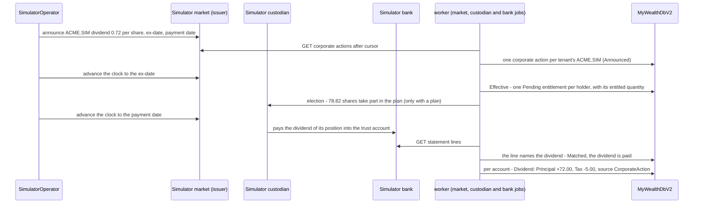

# Dividends and dividend reinvestment

Step 15 of [custodial-roadmap.md](../custodial-roadmap.md) §13, the last planned step. It covers roadmap items **C2** (cash dividends) and **C3** (dividend reinvestment), and the rest of **S4** (the simulator issuer announces dividends and reinvestment plans). It also changes the simulator custodian (S3), which pays the dividend, and uses the simulator bank (S1) as it is. It is where the custodial roadmap meets step 2 of [future-plans.md](../future-plans.md) §1 (income events). It follows [ADR 0021](../adr/0021-outside-parties-behind-ports.md) rules 1–20 and does not re-decide them. It builds on the corporate action, the announcement and the entitlement of [corporate-actions.md](corporate-actions.md), the `Tax` cash leg, the tax detail and the Customer tax profile of [interest-run.md](interest-run.md), the safekeeping account and the custody movement of [in-kind-transfers.md](in-kind-transfers.md), and the statement line of [deposit-matching.md](deposit-matching.md).

Today a Custodial account that holds a share gets nothing when the company pays a dividend: `Dividend` is a reserved `TransactionType` that nothing writes. After this slice a **dividend** is a fourth kind of corporate action. It is announced on the corporate action feed, or entered by a TenantAdmin for an instrument no connection serves, with an amount per share, its **tax source**, an imputation credit or a foreign withholding tax rate, and its dates. When the dividend goes ex, the platform fixes which Custodial accounts are entitled and for how many shares. Nothing is posted yet. On the payment date the custodian pays the dividend for the firm's whole position into the client money account, and that receipt is what lets the platform pay: each entitled account gets one `Dividend` Transaction with the gross dividend as the principal cash leg and the tax as `Tax` cash legs. An Account may carry a standing **reinvestment election**. For a dividend with a **reinvestment plan**, the platform tells the custodian how many of the firm's shares take part, the custodian delivers new shares in place of cash for them, and the platform shares them out to the electing accounts in the same `Dividend` Transaction, at a cost equal to the amount reinvested.

New: corporate action kind `Dividend`; the active `TransactionType` `Dividend` (6); tax kind `ForeignWithholding`; cash leg role `Reinvestment`; a dividend detail on the Transaction; port `ICustodianElections` with adapter `SimulatorCustodianElections`; statement line match method `Dividend` and unmatched reason `DividendMismatch`; two reconciliation item kinds; `corporateActionId` on `POST /statement-lines/{id}/match`; routes `POST /corporate-actions/{id}/pay-in-cash` and `PUT /accounts/{accountId}/dividend-reinvestment`; item fields on the corporate action, the entitlement, the account and the transaction. Script `0057_dividends.sql`; simulator script `database/simulator/0014_dividends.sql`. No new permission, source kind, job, queue, problem code or domain event.

**Status is `accepted` (2026-11-24), landed 2026-11-25.** The twenty-four points of §11 were confirmed on 2026-11-24, every one as recommended, and are written into the rules. The amendments to accepted docs listed in §12 were made when it was accepted. It is a build contract.

Notes from landing:

- R43: a hand `Dividend` passes the type check of the create command and is refused by the manual entry matrix. A Custodial account gets the R43 message; an External account gets `Dividend is reserved and cannot be entered.`, still a 400 on `errors.Type`.
- R29, R40: when a reinvestment gives an account a holding it did not have, the holding is created by the platform, so its creator is the system actor.
- §6.2: `CustodianDividendPayments.BankLineId` is `bigint`, the type of the simulator bank's line id. `MovementId` is `int`.
- R59: the simulator custodian pays a due dividend when a broker or custodian route brings its books up to date, as it applies corporate actions (in-kind-transfers R68). Advancing the clock alone pays nothing until the next such call.
- D94: the kind filter is a select (All, Split, Consolidation, Bonus issue, Dividend). The list also reads `?kind=` from the address, so the links of D101 open it filtered.
- D95, D97: the payment and the reinvestment are sections of the detail page. "Pay in cash" is offered to a TenantAdmin on an `Effective` dividend whose receipt is matched and whose accepted election has no shares yet. The dialog asks for the note with the R48 sentence.
- D98: the match page has a fourth mode, "To a dividend". It lists the `Effective` dividends in the receipt's currency with no receipt yet, as "<symbol> · owed <expected amount> · ex <ex-date>". A receipt that differs from the expected amount shows "The custodian paid <amount> and the customers are owed <expected amount>. Matching pays the customers in full."
- D99: the switch is in a "Dividends" section of the account page, shown on every Custodial account and disabled unless the account is Open.
- D100: the dividend block on `/transactions/:id` is titled with the instrument's name, because the badge already reads "Dividend <symbol>".
- BO33: a plan price follows the amount as "1.00 USD per share, plan 25.00".

Tax figures in this spec were checked against Inland Revenue's guides on 2026-11-24 (roadmap C2, [future-plans.md](../future-plans.md) §1). R33 names them.

---

## 1. Summary



| | Today | After this slice |
| --- | --- | --- |
| A held share pays a dividend, Custodial account | Nothing is recorded. When the custodian pays, the money is a receipt in suspense | Every account that held the share when it went ex is credited its dividend, once the custodian's payment is in the trust account |
| Tax on a dividend | Not recorded | Foreign withholding tax taken at the source, and RWT or NRWT taken by the platform, each a `Tax` cash leg with its tax detail. The imputation credit is recorded |
| Reinvesting a dividend | Not possible | An Account elects once; a dividend with a plan is taken in new shares, with the cost of the new shares equal to the amount reinvested |
| `Dividend` in the manual entry matrix | Reserved | Refused by hand on a Custodial account and written by corporate actions; still not accepted on an External account |
| The simulator | Announces splits, consolidations and bonus issues | Also announces dividends, with or without a plan; its custodian pays them and takes an election |

The rule that distinguishes this slice: a dividend has two moments. Going ex fixes who is entitled and for how many shares; the custodian's payment decides when the Customers are paid. The platform credits no dividend it has not received.

Worked examples, used by the tests (R33, R34):

| Case | Shares | Per share | Credit or foreign tax | Gross | Tax legs | Net |
| --- | --- | --- | --- | --- | --- | --- |
| New Zealand Customer, New Zealand company (the example of IR284) | 1 000 | 2.00 | imputation credit 0.20 | 2 000.00 | `Rwt` 526.00 | 1 474.00 |
| New Zealand Customer, fully imputed | 100 | 0.72 | imputation credit 0.28 | 72.00 | `Rwt` 5.00 | 67.00 |
| New Zealand Customer, foreign company | 100 | 1.00 | foreign tax 15 % | 100.00 | `ForeignWithholding` 15.00, `Rwt` 18.00 | 67.00 |
| Overseas Customer, New Zealand company | 100 | 0.72 | imputation credit 0.28 | 72.00 | `Nrwt` 21.60 | 50.40 |
| Overseas Customer, foreign company | 100 | 1.00 | foreign tax 15 % | 100.00 | `ForeignWithholding` 15.00 | 85.00 |

---

## 2. Scope

**In**

- Domain: `CorporateActionKind.Dividend` with `DividendTerms` and `DividendTaxSource`; the payment and the election on `CorporateAction`; `ReinvestmentElectionStatus`; entitled, participating and reinvested quantity and the source amounts on `CorporateActionEntitlement`; `DividendAmounts` (R32–R35) and `DividendWithholding`; `TransactionType.Dividend` active; `TaxKind.ForeignWithholding`; `CashLegRole.Reinvestment`; `TransactionDividendDetail`; factory `Transaction.PostDividend`; `Reverse` copies the new parts; `Account.ReinvestDividends`; statement line method `Dividend` and reason `DividendMismatch`; two `ReconciliationItemKind` values
- Application: the feed and hand entry take dividend terms; making a dividend effective stores entitled quantities and the election; port `ICustodianElections` and the election step in the custodian job; `ProcessStatementLines` matches a dividend receipt; the hand match of a line to a dividend; `ProcessCustodyMovements` records the new shares; `PayDividend` (payable, allocation); `ApplyCorporateActions` posts dividend entitlements; pay in cash; the account election command; `RequestAccountClosure` refuses on a pending entitlement; `ReconcileClientMoneyAccount` reads the new groups; the reads map the new fields
- Infrastructure: `SimulatorCorporateActionFeed` reads the dividend fields; `SimulatorCustodianElections`; EF mappings
- Scripts: `database/schema/0057_dividends.sql`; `database/simulator/0014_dividends.sql`
- HTTP (`webapi`): the routes of §8
- Simulator: dividends and plans on the market's corporate action routes and feed; at the custodian an income account per safekeeping account, the entitled position, the election route, the dividend payment in cash and shares, an income mode
- Adviser Portal: dividends on the Corporate actions pages, matching a receipt to a dividend, pay in cash, the reinvestment election on the account page, the dividend on the ledger pages, two labels on the bank reconciliation page
- Customer Portal: the dividend row and the election
- Back Office: dividend terms on the announcements list
- Tests listed in §10

**Out**

- A hand-entered `Dividend` on an External account. `Dividend` stays not accepted there; recording dividends and their tax on External accounts is the rest of income events ([future-plans.md](../future-plans.md) §1 step 2)
- Taxable bonus issues, bonus issues in lieu, shares under a profit distribution plan and every other non-cash dividend (roadmap C3 names taxable bonus issues; §11 point 20). `Scrip` stays unwritten on a Custodial account
- A plan price set after the ex-date, a discount shown apart from the price, a plan with a minimum holding, and residual balances carried to the next dividend
- A reinvestment election per Instrument or per dividend, and an election by the Customer in the Customer Portal (roadmap D6)
- Reinvestment of a hand-entered dividend, and on an Account that follows a portfolio or is in another currency than the Instrument (R18)
- Double tax agreement rates of NRWT, the 15 % rate on a fully imputed cash dividend, supplementary dividends, and the 0 % rate of a non-portfolio holder. An overseas Customer is withheld at 30 % on a New Zealand dividend (R33)
- RWT-exempt status, holders that are not individuals, and listed PIE dividends (interest-run §2 leaves the same out)
- Trans-Tasman imputation: an imputation credit on a foreign company's dividend
- The FIF rules. RWT is deducted from a foreign dividend whatever the Customer's FIF method; the refund of [future-plans.md](../future-plans.md) §1 step 6 is not built
- Paying the withheld tax to Inland Revenue, the investment income report, a dividend statement or tax certificate for the Customer
- A second receipt for one dividend (a top-up), sending an excess back, and undoing the match of a receipt to a dividend
- A flow that reverses a paid dividend, and a dividend cancelled after it went ex (corporate-actions R32)
- Special dividends as their own kind, returns of capital, and a dividend paid in a currency other than the Instrument's quote currency
- A list of coming dividends for the Customer, a notification, and a dividend or income report
- A halt on trades of an Instrument around its ex-date, and market claims on trades that settle across it
- A real corporate action vendor and a real custodian adapter
- Named scenarios and the scenario library
- Applying a dividend to External accounts by the flow

---

## 3. Stories

1. As the platform I read the dividends a market data connection announces, fix the entitled accounts when each goes ex, and pay every one of them when the custodian's payment arrives, without a person typing an amount.
2. As a Customer I see each dividend in my account's activity with the shares it was paid on, the gross amount, each tax taken off and the imputation credit that came with it.
3. As an Adviser I switch dividend reinvestment on for my Customer's account, and from then on a dividend with a plan arrives as new shares.
4. As a Customer I see that my dividend of 100.00 became 2.68 new shares at 25.00, after 33.00 of tax.
5. As a TenantAdmin I enter the dividend of a real instrument with its amount, its credit or foreign tax and its dates, and match the custodian's payment to it when it arrives.
6. As a TenantAdmin I see, for each dividend, what the Customers are owed, what the custodian paid, and the difference.
7. As a TenantAdmin I find a payment that names a dividend but does not fit it in suspense, and decide myself whether to accept it.
8. As an Adviser I cannot close an account that is still owed a dividend, and I still cannot type a `Dividend` on a Custodial account.
9. As a TenantAdmin I see in the bank reconciliation the dividends received and not paid out yet, and the tax withheld from dividends next to the tax withheld from interest.
10. As the simulator operator I announce a dividend of a simulated instrument, with or without a plan, move the clock to its ex-date and its payment date, and hold or change the custodian's payment to show a receipt that does not fit.

---

## 4. Rules

### 4.1 Access

| ID | Rule |
| --- | --- |
| R1 | **Access.** No new permission. A dividend is a corporate action: the routes under `/corporate-actions` keep `corporate-actions.read` (TenantAdmin, Adviser) and `corporate-actions.manage` (TenantAdmin), with every refusal of corporate-actions R1. Matching a statement line to a dividend needs `statement-lines.manage` and `corporate-actions.manage` (both TenantAdmin only). The reinvestment election of an Account needs `accounts.manage` with the Account's scope, as `PUT /accounts/{id}` does. Customer → 403 on every write of this slice; the Customer reads a dividend through its Transaction (R50) and the election through the account item (R52). Missing / dead Bearer → 401, never 302. An id of another Tenant, outside scope, or missing → 404. |

### 4.2 A dividend (C2)

Amends [corporate-actions.md](corporate-actions.md) R2–R6.

| ID | Rule |
| --- | --- |
| R2 | **What it is.** A dividend is a corporate action of kind `Dividend` (corporate-actions R2, R3 gain the kind). It does not change a quantity by a factor: it pays cash per share held, and with a plan it may be taken in new shares. It has no ratio; `ratioNew` and `ratioHeld` are `null`, and a body that sends them → 400 `errors.RatioNew`. Everything in corporate-actions that is not said otherwise here applies to a dividend as it does to a split: one row per Tenant and Instrument, origin `Feed` or `Manual`, the dates, the statuses, the entitlement per Custodial account, source `CorporateAction`. |
| R3 | **Dividend terms.** `amountPerShare`: the cash dividend per share before any tax, in the Instrument's quote currency, `> 0`, at most `1 000 000`, at most 8 decimal places. `taxSource`: `NewZealand` (the company is resident in New Zealand and may attach imputation credits) or `Foreign` (the company is not, and its country may have taken tax before the dividend left). `imputationCreditPerShare`: `≥ 0`, at most 8 decimal places, not above `amountPerShare`; above 0 only with `NewZealand`. `foreignTaxRatePercent`: the share of the dividend withheld at the source, `≥ 0` and `< 100`, at most 2 decimal places; above 0 only with `Foreign`. `reinvestmentPrice`: the price per new share under the company's reinvestment plan, `> 0`, at most 8 decimal places, or `null` for a dividend with no plan. A violation → 400 at the field on hand entry (`errors.AmountPerShare`, `errors.TaxSource`, `errors.ImputationCreditPerShare`, `errors.ForeignTaxRatePercent`, `errors.ReinvestmentPrice`), and a skipped announcement on the feed (R9). The terms are per share and never hold an amount for an account. |
| R4 | **Currency.** A dividend is paid in the quote currency of its Instrument. The feed already matches an announcement to an Instrument by symbol and quote currency (corporate-actions R12), and a hand-entered dividend takes the Instrument's. |
| R5 | **Dates.** `exDate` is required. `recordDate` and `paymentDate` are optional and are stored and shown as given (corporate-actions R4). The platform does not pay on its own calendar: the custodian's payment decides (R24). |
| R6 | **Status and the two moments.** `Announced` → `Effective` → `Applied`, or `Announced` → `Cancelled`, as corporate-actions R6. For a dividend `Effective` means it has **gone ex**: the entitlements exist with their quantities (R13) and wait. A dividend is **paid** from the moment `paidAt` is set (R29); only then are its entitlements posted (R36). `Applied`: no entitlement is `Pending` any more. A dividend that goes ex with no entitled account becomes `Applied` in the same step and expects no payment. |
| R7 | **A plan needs a feed.** `reinvestmentPrice` is taken only from the feed. A hand-entered dividend with `reinvestmentPrice` → 400 `errors.ReinvestmentPrice` (`Reinvestment is available only for dividends that come from a market data connection.`): the custodian must be told which event an election is for, and a hand-entered event has no id the custodian knows. |

### 4.3 Dividends on the corporate action feed (C2, S4)

Amends [corporate-actions.md](corporate-actions.md) R7, R9, R11, R12 and R14.

| ID | Rule |
| --- | --- |
| R8 | **The announcement.** An announcement of kind `Dividend` carries the terms of R3 in place of a ratio. Corporate-actions R9 changes with the kind: a `Split`, `Consolidation` or `Bonus` item needs both ratio numbers `≥ 1`, as today; a `Dividend` item needs an `amountPerShare` and a `taxSource` it can read and has no ratio. A page with a dividend item outside this → nothing of that page is stored, `InvalidItem`. A kind the adapter does not know is still stored with no kind. |
| R9 | **Processing.** Corporate-actions R11 and R12 apply. `Invalid` also covers terms that break R3. A later `Announced` version replaces the terms and the dates of an `Announced` dividend. The party's `Effective` version makes the dividend go ex (R13). A version that arrives after the dividend went ex changes nothing and is skipped as `AlreadyEffective`, a cancellation included (corporate-actions R32). |
| R10 | **Reads.** The announcement item (corporate-actions R14) gains `amountPerShare`, `taxSource`, `imputationCreditPerShare`, `foreignTaxRatePercent` and `reinvestmentPrice`, each `null` on another kind; `ratioNew` and `ratioHeld` are `null` on a dividend. |

### 4.4 Entering a dividend by hand (C2)

Amends [corporate-actions.md](corporate-actions.md) R15–R21.

| ID | Rule |
| --- | --- |
| R11 | **Create and update.** `POST /corporate-actions` and `PUT /corporate-actions/{id}` take `kind` `Dividend` with `amountPerShare`, `taxSource`, `imputationCreditPerShare` (default `0`) and `foreignTaxRatePercent` (default `0`) in place of the ratio. The kind of a corporate action still never changes. Corporate-actions R15–R19 and R21 apply as written: only for an Instrument no market data connection serves, one per Instrument, kind and ex-date, change and cancel only while `Announced`. The duplicate message reads `A dividend of AAPL with this ex-date already exists.` |
| R12 | **Going ex by hand entry.** A `Manual` dividend goes ex by corporate-actions R23: when a price of its Instrument dated on or after the ex-date is stored, or by `POST /corporate-actions/{id}/apply` (corporate-actions R20) once the platform's UTC date has reached the ex-date. For a dividend "apply" fixes the entitlements; it pays nothing. |

### 4.5 Going ex: the entitlements (C2)

Amends [corporate-actions.md](corporate-actions.md) R22 and R24, and to its amendment of 2026-11-23 (orders).

| ID | Rule |
| --- | --- |
| R13 | **Entitled accounts and quantities.** When a dividend is made effective (corporate-actions R22), the one `Pending` entitlement stored for every Custodial account of the Tenant that has a holding of the Instrument at that moment also stores its **entitled quantity**: the holding's quantity then, with every posted fill counted, settled or not, and reserved quantity included. The set of entitled accounts and each entitled quantity are fixed here and never change. An account that buys later gets nothing; an account that sells later keeps its entitlement. This is the platform's reading of "held before the ex-date" on its own books (§11 point 6). |
| R14 | **Source amounts.** The same step stores on each entitlement, in the quote currency with its `DecimalPlaces` `dp`: `grossAmount = Round(entitledQuantity × amountPerShare, dp)`, `imputationCredit = Round(entitledQuantity × imputationCreditPerShare, dp)` and `foreignTax = Round(grossAmount × foreignTaxRatePercent / 100, dp)`, each rounded away from zero at the midpoint. They do not depend on the Customer and never change. An entitlement whose `grossAmount` is `0` is stored `NotApplied` with the new reason `NothingToPay`. |
| R15 | **Expected amount.** The **expected amount** of a dividend is what the custodian should pay into the client money account: the sum over its entitlements of `grossAmount − foreignTax`, minus the amount the custodian reinvests under an accepted election (R22). It is in the quote currency and is worked out on read from the stored figures. |
| R16 | **Open orders stay.** A dividend that goes ex does not request the cancel of the open orders in its Instrument: the share basis does not change. The order amendment to corporate-actions R22 and orders R50 apply to `Split`, `Consolidation` and `Bonus` only. The simulator broker likewise cancels nothing (R56). |

### 4.6 The reinvestment election (C3)

Amends [accounts.md](accounts.md) and [in-kind-transfers.md](in-kind-transfers.md) R9 and R34.

| ID | Rule |
| --- | --- |
| R17 | **A standing election on the Account.** A Custodial account has `reinvestDividends`, `false` when it is opened and on every existing account. `PUT /accounts/{accountId}/dividend-reinvestment` (`accounts.manage`) with `{ reinvest, rowVersion }` → 204; an External account → 400 `errors.AccountId` (`Dividends are reinvested only on a Custodial account.`); a Closed account → 400 as posting R6; stale `rowVersion` → 409 `stale_row_version`. The account keeps who last changed it and when. It is a standing instruction of the Customer that the Adviser records (roadmap D6); it applies to every Instrument on the account and to every dividend that goes ex after it is set. `PUT /accounts/{id}` does not take the field (400). |
| R18 | **Which entitlements reinvest.** When a dividend goes ex, an entitlement **reinvests** when all hold at that moment: the dividend has a `reinvestmentPrice`; the Account has `reinvestDividends`; the Account's currency equals the quote currency (roadmap D20); the Account has no Active portfolio assignment (the portfolio decides what its cash buys, portfolios R18); the Tenant has an active safekeeping account in the quote currency; and its participating quantity (R19) is above 0. The answer is stored on the entitlement and never changes. A later change of the Account's election applies from the next dividend. |
| R19 | **Participating quantity.** The custodian reinvests the whole dividend, net of foreign tax, of the shares that take part. The platform still owes Inland Revenue the Customer's RWT or NRWT in cash, so only part of an entitled quantity takes part: `participatingQuantity = RoundDown(entitledQuantity × (netPerShare − taxPerShare) / netPerShare, 8)`, with `netPerShare = amountPerShare × (1 − foreignTaxRatePercent / 100)` and `taxPerShare` the New Zealand tax of R33 worked out per share, unrounded, from the Customer's tax profile at that moment. With no New Zealand tax the whole entitled quantity takes part. |
| R20 | **The election of a dividend.** In the transaction that makes a dividend go ex, its election is set: `quantity` = the sum of the participating quantities of its reinvesting entitlements, the safekeeping account of R18, and status `Pending`; or status `None` when no entitlement reinvests. A dividend with no plan has `None`. |
| R21 | **Port.** `ICustodianElections` sends one election for one safekeeping account of one custodian connection: the instruction id (the corporate action's PublicId, the key on every retry, ADR 0021 rule 13), the issuer's id of the event (the party action id, corporate-actions R5), symbol, currency and the quantity that takes part. The custodian answers `Accepted` or `Rejected` with a reason, or the call fails. One adapter, `SimulatorCustodianElections` (R65). |
| R22 | **The election step.** `custodian-sync:{connection}` (in-kind-transfers R9) sends the `Pending` elections whose safekeeping account is on its connection, oldest first, in its send step, after the in-kind transfers. Per election: record the attempt (attempts + 1, time) and commit, then call the port. `Accepted` → the election is `Accepted`; from then on the custodian reinvests `Round(quantity × netPerShare, dp)` and the expected amount falls by that (R15). `Rejected` → `Rejected` with the reason (`UnknownCorporateAction`, `NoPlan`, `NotEntitled`, `TooLate`, or `Other` for a text the adapter does not know). A failed call leaves it `Pending` for the next run. Before the attempt is recorded, an election whose dividend already has its receipt (R24), or whose safekeeping account is no longer active, becomes `Lapsed` and is not sent. With `Rejected` or `Lapsed` the whole dividend is paid in cash. |
| R23 | **No election by a person.** No route sends, repeats or withdraws an election. The quantity is fixed when the dividend goes ex, so the same election is sent on every retry. |

### 4.7 The custodian's payment

Amends [deposit-matching.md](deposit-matching.md) R13 and R23–R25, [trade-settlement.md](trade-settlement.md) R19 and R21, [migration-batches.md](migration-batches.md) R13 and [in-kind-transfers.md](in-kind-transfers.md) R17.

| ID | Rule |
| --- | --- |
| R24 | **The dividend receipt.** A credit line with no `returnOf` and kind `Transfer`, whose reference text, trimmed and compared without regard to case, equals the party action id of a `Feed` dividend of the line's Tenant whose quote currency is the line's currency, is a dividend receipt and is never matched as a deposit. This check runs after the settlement rule (trade-settlement R19) and before deposit matching. When the dividend is `Effective`, has no receipt yet, and the line's amount is within the **rounding allowance** of the expected amount (R25), the line becomes `Matched` with the new method `Dividend` and the dividend, with no Account and no Transaction, and the dividend stores the line and its amount as `receivedAmount`. Otherwise (a dividend that is `Announced`, `Applied` or `Cancelled`, one that already has a receipt, or an amount outside the allowance) the line becomes `Unmatched` with the new reason `DividendMismatch`, and the dividend does not change. |
| R25 | **Rounding allowance.** The custodian works out the dividend on the firm's whole position and rounds once; the platform rounds each account. The two figures may differ by a few minor units of the currency. A receipt fits when `|amount − expectedAmount|` is at most `2 × (the number of entitlements of the dividend)` minor units. This is the only tolerance on money in the platform, and it lets a line through to its dividend; it does not hide the difference (R44). |
| R26 | **Matching by hand.** `POST /statement-lines/{id}/match` takes `corporateActionId` in place of `accountId` or `migrationBatchId`: exactly one of the three, else 400 `errors.AccountId` (`Give an account, a migration batch or a dividend.`). The caller also needs `corporate-actions.manage` (else 403). The line is a credit line in `Unmatched`, with `rowVersion` and a required `note` (trimmed, 1–200). The corporate action must be one of the Tenant's (else 404), of kind `Dividend`, `Effective` and without a receipt (else 400 `errors.CorporateActionId`, `Only a dividend that waits for its payment can take a receipt.`), and quoted in the line's currency (else 400 `errors.CorporateActionId`, `This dividend is paid in USD and this receipt is in NZD.`). The amount is not checked: a person accepts the difference, and it stays visible (R44, R49). The line becomes `Matched` with method `Dividend`. This is how the receipt of a `Manual` dividend, whose reference names nothing, reaches it, and how a `DividendMismatch` line is accepted. |
| R27 | **A matched receipt stays.** A line matched to a dividend accepts no action: no unmatch, ignore or request return. `POST /statement-lines/{id}/unmatch` → 400 `errors.Status`, `A receipt matched to a dividend cannot be taken out of it.` A wrong match is corrected with adjustments. A `DividendMismatch` line that is not accepted is handled like any receipt in suspense, normally with request return (bank-returns R5). |
| R28 | **The new shares.** A `CorporateAction` custody movement is matched to its corporate action by in-kind-transfers R17, unchanged. When the corporate action is a dividend whose election is `Accepted`, the movement's direction is `In`, and the dividend has no shares recorded yet, the same transaction stores the movement and its quantity on the dividend as `sharesReceived`. Any other movement matched to a dividend is matched and not used: the custodian reconciliation shows it (in-kind-transfers R53). |
| R29 | **Paid.** A dividend becomes paid, with `paidAt` = platform time, in the transaction that completes the last of these: it is `Effective`; it has a receipt; its election is not `Pending`; and, when its election is `Accepted`, it has `sharesReceived` or was released by R31. The bank job, the custodian job and the two routes of R26 and R31 each run this check after their own change. |
| R30 | **Allocation.** In the transaction of R29, a dividend with `sharesReceived` shares the quantity out to its reinvesting entitlements in proportion to their participating quantities: each gets its share rounded down to 8 decimal places, and the units of `0.00000001` left over go one each to the entitlements with the largest remainders, then by account `Id`. The sum of the **reinvested quantities** equals `sharesReceived` exactly, so the Custodial holdings and the custodian's position agree. An entitlement that does not reinvest, and every entitlement of a dividend with no shares, has none. |
| R31 | **Pay in cash.** `POST /corporate-actions/{id}/pay-in-cash` (`corporate-actions.manage`) with `rowVersion` and `note` (trimmed, 1–200, required) → 204: only a dividend that is `Effective`, has its receipt, has an `Accepted` election and no `sharesReceived` (else 400 `errors.Status`, `This dividend does not wait for shares.`). The election becomes `Lapsed` with the person, the time and the note, and the dividend is paid by R29 with no shares. It is for a plan under which the custodian delivered nothing. Stale `rowVersion` → 409 `stale_row_version`. |

### 4.8 The posting (C2, C3)

Amends [corporate-actions.md](corporate-actions.md) R24–R27 and R33, [interest-run.md](interest-run.md) R25, [posting.md](posting.md), [holdings.md](holdings.md), [trade-fees.md](trade-fees.md) (cash leg role), [custody-modes.md](custody-modes.md) and [transaction-source.md](transaction-source.md).

| ID | Rule |
| --- | --- |
| R32 | **Amounts in the Account's currency.** When the Account's currency is the quote currency, the posting uses the entitlement's `grossAmount`, `imputationCredit` and `foreignTax` as stored. Otherwise (roadmap D13) each of the three is converted with `IFxRate` for the UTC date of `bookedAt` and rounded to the Account currency's `DecimalPlaces`, as a sell in another currency is (orders R34), and the Transaction stores the rate in an FX detail. With no rate the entitlement stays `Pending` and is tried again on every run. |
| R33 | **Withholding.** The New Zealand tax on a dividend follows the Customer's `taxResidency` (interest-run R2) when the Transaction is built, and the dividend's `taxSource`. `irdNumberHeld` and `rwtRatePercent` are not used: the RWT rate on dividends is one rate for everyone. The rates are constants in Domain (`WithholdingRates`) and change only with an amendment to this spec. Sources, read 2026-11-24: Inland Revenue, "Resident withholding tax (RWT) on dividends - payer's guide" (IR284, October 2025) for the 33 % rate, the formula `(a × (b + c)) − c` with `c` the imputation credit plus the foreign withholding tax of a company not resident in New Zealand, "if the calculation results in a negative amount, no RWT", and the duty of a custodian that receives dividends without RWT to withhold it; "Using the right resident withholding tax rate" (`ird.govt.nz/rwt-rate`, last updated 23 Sep 2026) for 33 % as the only rate on dividends; "NRWT - payer's guide" (IR291, March 2026) for 30 % of the gross dividend, imputation credits excluded, where no double tax agreement applies. |

| Customer | `taxSource` | New Zealand tax | Rate | Amount |
| --- | --- | --- | --- | --- |
| `NewZealand` | either | `Rwt` | 33 % | `0.33 × (gross + imputationCredit) − imputationCredit − foreignTax`, never below 0 |
| `Overseas` | `NewZealand` | `Nrwt` | 30 % | `0.30 × gross` |
| `Overseas` | `Foreign` | none | — | — |

| ID | Rule |
| --- | --- |
| R34 | **Tax amounts.** The amounts of R33 are worked out from the figures of R32, in the Account's currency, and rounded away from zero at the midpoint to its `DecimalPlaces`; Inland Revenue's guides state no rounding rule (as interest-run R24). `net = gross − foreignTax − newZealandTax`. The net is never below 0. |
| R35 | **Reinvested amount.** For an entitlement with a reinvested quantity `n` (R30): `reinvested = Round(n × reinvestmentPrice, dp)`, and never more than `net`. It is the cost of the new shares. What is left of the net stays on the Account as cash. |
| R36 | **Posting step.** The apply step (corporate-actions R24) posts the `Pending` entitlements of a dividend only once the dividend is paid (R29), oldest `paidAt` first, in account `Id` order, each in its own database transaction with the Account row locked (corporate-actions R25, posting R22). The holding is not read: the entitled quantity decides. The entitlement becomes `Posted` with the Transaction and its `netAmount` and currency. `NoHolding` and `TooSmall` do not apply to a dividend. A failure on one account leaves its entitlement `Pending` for the next run and does not stop the others. The dividend becomes `Applied` when none is `Pending`. The Account is Open: an account cannot be closed while it is owed a dividend (R46). |
| R37 | **The Transaction.** Type `Dividend` (6, active from this slice). Cash legs on the Account, in its currency: one `Principal` leg of `+gross`; a `Tax` leg of `−foreignTax` with kind `ForeignWithholding` when it is above 0; a `Tax` leg of `−newZealandTax` with kind `Rwt` or `Nrwt` when it is above 0; and, with a reinvested amount, one leg with the new role `Reinvestment` of `−reinvested` and one security leg on the Account for the Instrument with `+n` and cost `reinvested` in the quote currency. Source `CorporateAction` (7) with the corporate action's PublicId as source id; `bookedAt` = platform time when it is posted (ADR 0021 rule 10); memo `Dividend ACME.SIM 0.72 per share`; `reference` `null`; a dividend detail (R39); an FX detail with R32. Built by `Transaction.PostDividend` without the manual entry matrix (custody-modes R7). `CreatedBy` is the worker's system name. |
| R38 | **Tax legs.** `TaxKind` gains `ForeignWithholding = 2`: tax another country took from the dividend before it reached the custodian. It is a `Tax` leg like the others (interest-run R25): negative on the Account, with exactly one tax detail, at most one per `(Transaction, kind)`. The tax detail of a `ForeignWithholding` leg has the `foreignTaxRatePercent` and `gross` as basis; of an `Nrwt` leg, 30 and `gross`; of an `Rwt` leg, 33 and `gross + imputationCredit`, with the amount of R33, which is lower than rate × basis by the credits. The Domain allows a `Tax` leg on `Interest` (kinds `Rwt`, `Nrwt`) and on `Dividend` (all three) and on no other type. The foreign tax never reached the trust account; the RWT or NRWT is in it and is owed to Inland Revenue (R45). |
| R39 | **Dividend detail.** Every Transaction of type `Dividend` has exactly one, and no other Transaction has one: the Instrument, the entitled quantity, `amountPerShare` and the quote currency, `taxSource`, the imputation credit in the Account's currency, the three dates, and with a reinvestment the reinvested quantity and the `reinvestmentPrice`. The imputation credit is not money and is on no leg; it is recorded for the Customer's tax return. `Transaction.Reverse` copies the detail. |
| R40 | **`Reinvestment` leg and the holding.** `CashLegRole` gains `Reinvestment = 3`: the part of a dividend taken in new shares, always negative, only on a `Dividend`, at most one, and only together with the one security leg. The security leg adds to the holding like a `Buy` with no fee (buy-sell R11): the quantity rises by `n`, the total cost by `reinvested`, and a holding that was sold since the ex-date is created again. The Instrument may be disabled. A `Dividend` with no reinvestment has no security leg and does not touch a holding. |
| R41 | **Cash, lock and later activity.** A dividend never lowers cash: its legs add up to `net − reinvested ≥ 0`, so available cash only rises (withdrawals R36) and the cash is withdrawable at once. The portfolio trade lock does not apply; no rebalance is enqueued (as a deposit, deposit-matching R19); an Account that follows a portfolio never reinvests (R18). A `Dividend` with a security leg is a security activity on its holding ([ledger-write-guards](../fixes/ledger-write-guards.md) Decision 1); one without is not. A dividend is posted whatever the state of the Tenant or the Customer (corporate-actions R13). |
| R42 | **No reversal by hand, none by the flow.** `CorporateAction` is not a hand-reversible source (transaction-source R12, R13). No flow of this slice reverses a paid dividend. `Transaction.Reverse` copies the `Tax` legs with their details, the `Reinvestment` leg with its role and the dividend detail, so a later flow can undo its own posting. One account is corrected with an adjustment with reason `CorporateAction` ([adjustments.md](adjustments.md)). |
| R43 | **Matrix.** `Dividend` / Custodial: **refused** by hand for every caller, written by corporate actions; the message of custody-modes §4.2.1 for it is `Dividends are paid by the platform from the company's announcement.` `Dividend` / External: still not accepted (400 `errors.Type`, as today), until income events add it. `Scrip` / Custodial stays **refused** and nothing writes it: a dividend taken in shares is a `Dividend` with a reinvestment (§11 point 15). External accounts keep hand `Scrip`. What `CustodyRules` allows does not change; only its Custodial message for `Dividend` does. |

### 4.9 Bank reconciliation

Amends [bank-reconciliation.md](bank-reconciliation.md) R9–R11 and [interest-run.md](interest-run.md) R41.

| ID | Rule |
| --- | --- |
| R44 | **Dividend items.** A line `Matched` to a dividend is not an item, like every matched line. For a run of client money account A (currency K), each dividend with a receipt on A has `received` (the line's amount) and `credited`: the sum of the `Principal`, `Reinvestment` and `ForeignWithholding` legs of its Transactions on accounts in K. These legs no longer count in `OtherLedgerCash`. The rest, `received − credited`, is an item. `DividendsNotPosted` (Timing): one item per run for the dividends with a `Pending` entitlement, `count` = those dividends; the money is in the trust account and not yet on the Customers' accounts. `DividendDifference` (Known): one item per run for every other dividend with a receipt on A, `count` = the dividends whose rest is not 0. It holds the rounding between the custodian's figure and the sum of the accounts (R25), a difference a person accepted (R26), and the dividends credited to accounts in another currency. An item of `0` is left out. The items of a run still add up to its difference. Kinds: `DividendsNotPosted = 20`, `DividendDifference = 21`. |
| R45 | **Tax and other currencies.** `TaxWithheld` (interest-run R41) now also counts the `Rwt` and `Nrwt` legs of every `Dividend` on the Tenant's Custodial accounts in K: the tax is in the trust account until the firm pays it over (interest-run R42). The legs of a `Dividend` on an account in K whose dividend is paid in another currency (R32) are cash that never passed through A; apart from their `Rwt` and `Nrwt` legs they stay in `OtherLedgerCash` (Known), and in the run of the dividend's own currency their money is in `DividendDifference`. Moving that money between the two trust accounts is the firm's own FX at its bank; its lines go to suspense and are ignored with a note, which offsets the two items (as interest-run R42). |

### 4.10 Other flows

Amends [account-closure.md](account-closure.md) R5 and [in-kind-transfers.md](in-kind-transfers.md) R53.

| ID | Rule |
| --- | --- |
| R46 | **Account closure.** Account-closure R5 gains a refusal, 400 `errors.AccountId`: a `Pending` entitlement of a dividend on the Account → `A dividend is still to be paid on this account. Close it after the payment.` An account that sold everything after the ex-date therefore stays open until its dividend is paid. |
| R47 | **In-kind transfers and migration batches.** An entitlement is not moved by a transfer out or changed by a transfer in after the ex-date: the dividend is paid to the account that held the shares when it went ex. A claim against the other broker for a dividend on shares in transit is not handled. |
| R48 | **Custodian reconciliation.** No new component. New shares the custodian delivered are an `unexplained` difference from the time their movement is processed until the entitlements are posted (in-kind-transfers R53), normally one run of the apply job; longer when the cash receipt is late or in suspense. A custodian that issues whole shares only (R59) delivers what it issued, and R30 shares out exactly that. |

### 4.11 Reads

| ID | Rule |
| --- | --- |
| R49 | **Corporate action item.** Corporate-actions R35 gains: `dividend`: `{ amountPerShare, currency, taxSource, imputationCreditPerShare, foreignTaxRatePercent, reinvestmentPrice }`, `null` on another kind; `payment`: `{ expectedAmount, receivedAmount, difference, currency, statementLineId, paidAt }`, `null` until the dividend goes ex, with `receivedAmount`, `difference` (`receivedAmount − expectedAmount`) and `statementLineId` `null` until the receipt, and `statementLineId` `null` for an Adviser; `election`: `{ status, quantity, attempts, reason, sharesReceived, releasedBy, releasedAt, note }`, `null` on a dividend with no plan. `ratioNew` and `ratioHeld` are `null` on a dividend. `entitlements` counts as before. The `kind` filter of the list is new: one or more names, comma-separated; unknown → 400 `errors.Kind`. |
| R50 | **Transaction item.** Gains `dividend`: `{ corporateActionId, instrument: { id, symbol, name }, quantity, amountPerShare, currency, taxSource, imputationCredit, reinvestedQuantity, reinvestmentPrice, exDate, recordDate, paymentDate }` on a `Dividend` (and a Reversal of one), `null` on every other Transaction. `corporateAction` (corporate-actions R37) stays `null` on a `Dividend`. A cash leg's `role` may be `Reinvestment`; a `Tax` leg's `tax.kind` may be `ForeignWithholding`. `source` is `{ "kind": "CorporateAction", "id": "<corporate action PublicId>" }`. Every caller who can read the Transaction sees all of it, the Customer included. |
| R51 | **Entitlement item.** Corporate-actions R36 gains `entitledQuantity`, `grossAmount`, `foreignTax`, `currency` (the quote currency), `reinvests`, `participatingQuantity`, `reinvestedQuantity`, `netAmount` and `netCurrency` (the Account's, set when `Posted`); all `null` on an entitlement of another kind. `reason` may be `NothingToPay`. |
| R52 | **Account item.** Gains `reinvestDividends` and `pendingDividends`, the number of `Pending` dividend entitlements on the Account. On an External account `false` and `0`. Every caller who can read the Account sees them. |
| R53 | **Statement lines, reports and balances.** The statement line item gains `corporateActionId`; `method` may be `Dividend` and `unmatchedReason` `DividendMismatch`. Cash balance, holdings, net worth and the Adviser Balances Report sum the legs and are unchanged. In the Customer Transactions Report a dividend row shows the net in the cash amount column and the sum of its `Tax` legs in the Tax column (interest-run R38); a reinvested dividend also shows its quantity. |

### 4.12 The simulator: issuer and custodian (S4, S3)

Amends [corporate-actions.md](corporate-actions.md) R39–R47, [in-kind-transfers.md](in-kind-transfers.md) R60, R61, R68, R70 and R71, and [simulator.md](simulator.md).

| ID | Rule |
| --- | --- |
| R54 | **Announce a dividend.** `POST /control/market/corporate-actions` takes `kind` `Dividend` with `amountPerShare`, `taxSource`, `imputationCreditPerShare`, `foreignTaxRatePercent` and optional `reinvestmentPrice`, by R3 (else 400 at the field), with no ratio. `exDate` after the current simulator day, as today; `paymentDate` is required for a dividend and not before `exDate` (else 400 `errors.PaymentDate`). The party action id and the versions follow corporate-actions R43. |
| R55 | **Amend and cancel.** Corporate-actions R40 and R41 apply: only while `Announced`; amend also replaces the terms. A dividend that went ex cannot be amended or cancelled. |
| R56 | **Going ex.** When the market steps to a day on or after the `exDate` of an `Announced` dividend, in this order: every fill in that symbol that has not settled settles at once, as in-kind-transfers R68, so the custodian's position is the position that held the share before the ex-date; then, for every safekeeping account whose position in the symbol is above 0, the custodian stores a **dividend payment** with that **entitled position** and status `Due`; then the dividend is `Effective` and one version goes on the feed. The price is not rebased, and the simulator broker cancels no order (orders R62 is for a change of the share basis). |
| R57 | **Income account.** A safekeeping account of the simulator custodian may have an `IncomeAccountNumber`: the bank account the custodian pays income into, which is the firm's client money account in that currency. `Simulator:Custodian:StandingAccounts` entries and `POST /control/custodian/accounts` take it as an optional field (the shape of deposit-matching R38); `POST /control/custodian/accounts/{accountNumber}/income-account` `{ incomeAccountNumber }` sets or clears it (log action `CustodianIncomeAccountChanged`). The custodian stores it as text and does not read the platform. |
| R58 | **Election route.** Party port: `POST /party/custodian/accounts/{accountNumber}/elections` with `{ instructionId, corporateActionId, symbol, currency, quantity }` → 200 `{ "status": "Accepted" }` or 200 `{ "status": "Rejected", "reason" }`. `Rejected` with the first reason that applies: `UnknownCorporateAction` (no dividend of the simulator market with that id and symbol); `NoPlan` (it has no `reinvestmentPrice`); `NotEntitled` (it has not gone ex, the account has no dividend payment for it, or `quantity` is above the entitled position); `TooLate` (the payment is no longer `Due`). An accepted election is stored on the dividend payment. Unknown safekeeping account → 404; a body that breaks the shapes of in-kind-transfers R62 → 400. A second call with the same `instructionId` and the same body → the first answer again; with another body → 409 (ADR 0021 rule 13). Key and outage as every party route. |
| R59 | **Payment.** When the simulator brings its books up to date and its day is on or after the `paymentDate` of an `Effective` dividend, each `Due` dividend payment is paid, with `netPerShare = amountPerShare × (1 − foreignTaxRatePercent / 100)`. `reinvestAmount = Round(electedQuantity × netPerShare, 2)`, `0` with no accepted election. `shares = reinvestAmount / reinvestmentPrice`, rounded by the custodian's rounding mode (in-kind-transfers R68): `Fractional` towards zero to 8 decimals, `WholeShares` towards zero to a whole number. `cash = Round(entitledPosition × netPerShare, 2) − Round(shares × reinvestmentPrice, 2)`. With `shares` above 0 the custodian adds one movement of kind `CorporateAction`, direction `In`, with `corporateActionId` = the party action id and `settlementDate` = the simulator day. With `cash` above 0 and an income account that is open at the simulator bank, the bank gets one credit line there: payer name the safekeeping account's name, reference the party action id, kind `Transfer`. With no such income account no cash is paid and the payment says so. The payment becomes `Paid`. The custodian keeps the foreign tax; it pays no New Zealand tax and knows no Customer. |
| R60 | **Income mode.** `POST /control/custodian/income-mode` `{ "mode": "Pay" | "Hold" }` (default `Pay`; log action `CustodianIncomeModeChanged`). With `Hold` a payment that falls due becomes `Held` and nothing is paid until `POST /control/custodian/dividend-payments/{id}/pay` `{ "amount"? }`: the shares are delivered as in R59 and `amount` (`> 0`, at most 2 decimal places) replaces the cash, so the operator can show a receipt that does not fit its dividend. Log action `CustodianDividendPaid`. An election is accepted for a `Held` payment as for a `Due` one. |
| R61 | **Feed item.** The wire item of the market's corporate action feed (corporate-actions R45) gains `amountPerShare`, `imputationCreditPerShare`, `foreignTaxRatePercent` and `reinvestmentPrice` (JSON numbers or `null`) and `taxSource` (`NewZealand`, `Foreign` or `null`); `kind` may be `Dividend`, and then `ratioNew` and `ratioHeld` are `null`. The payment puts no version on the feed: the platform learns of it from the bank. |
| R62 | **Its own books.** `GET /control/market/corporate-actions` shows the terms. `GET /control/custodian` also shows the income mode. `GET /control/custodian/dividend-payments` lists the dividend payments newest first (envelope as simulator R28): the dividend, the account, the entitled position, the elected quantity, shares, cash, the income account, status (`Due`, `Held`, `Paid`) and the bank line and movement it caused; optional `status` and `accountNumber`. |
| R63 | **Reset.** A reset empties the dividend payments and the elections with the rest of the custodian, sets the income mode to `Pay`, and opens the standing accounts again with their income accounts (in-kind-transfers R71). A dividend the platform holds as `Effective` is then unknown to the simulator and is never paid; a TenantAdmin matches a receipt the operator sends by hand (R26), or leaves it. |
| R64 | **No platform knowledge.** The simulator stores `instructionId` as opaque text and pays on its own positions. It never learns which Account is entitled, who elected, or what the platform posted (simulator R33). Amounts are rounded to 2 decimal places; a currency with another minor unit is not handled. |

### 4.13 The platform adapters

| ID | Rule |
| --- | --- |
| R65 | **`SimulatorCustodianElections`.** The Infrastructure adapter for `Adapter = Simulator` calls R58 at the custodian connection's `BaseUrl` with `X-Api-Key` and the connection's timeout, on `worker` only (ADR 0021 rule 4). Its own wire types. `Accepted` and `Rejected` with a reason map to the port's answers; a reason it does not know → `Other`. 409, 401, 404, 503, a timeout and an unreadable body are failures, as `SimulatorCustodianTransfers` (in-kind-transfers R74). |
| R66 | **`SimulatorCorporateActionFeed`.** Corporate-actions R48 gains: `kind` `Dividend` → that kind; the five new fields are read as numbers and names; a dividend item whose `amountPerShare` or `taxSource` cannot be read, or a number that is not a JSON number, comes through empty, so the pull refuses the page with `InvalidItem` (R8). |

Policies: none new. Grants: unchanged.

---

## 5. Domain

| Type | Kind | Change |
| --- | --- | --- |
| `CorporateActionKind` | Enum (existing) | Add `Dividend = 3` |
| `DividendTaxSource` | Enum (new) | `NewZealand = 0`, `Foreign = 1` |
| `DividendTerms` | Value object (new) | `AmountPerShare`, `TaxSource`, `ImputationCreditPerShare`, `ForeignTaxRatePercent`, `ReinvestmentPrice?`. `RefusalOf(...)` holds R3; `NetPerShare`; `SourceAmounts(quantity, decimalPlaces)` → gross, imputation credit, foreign tax (R14) |
| `DividendWithholding` | Static (new) | `For(taxResidency, taxSource)` → kind and rate, or none (R33); `Amount(...)` (R33, R34); `PerShare(...)` (R19) |
| `WithholdingRates` | Static (existing) | Add `DividendRwt = 33`, `DividendNrwt = 30` |
| `ReinvestmentElectionStatus` | Enum (new) | `None = 0`, `Pending = 1`, `Accepted = 2`, `Rejected = 3`, `Lapsed = 4` |
| `ElectionRejectReason` | Enum (new) | `UnknownCorporateAction = 0`, `NoPlan = 1`, `NotEntitled = 2`, `TooLate = 3`, `Other = 4` |
| `CorporateAction` | Aggregate (existing) | `RatioNew?`, `RatioHeld?` (both `null` on a dividend); `Terms?`; the receipt (`ReceiptLineId?`, `ReceivedAmount?`), `PaidAt?`; the election (`ElectionStatus?`, `ElectionQuantity?`, `SafekeepingAccountId?`, `ElectionAttempts`, `ElectionLastAttemptAt?`, `ElectionReason?`, `SharesMovementId?`, `SharesReceived?`, released by, at and note). `EnterDividend(...)`, `AnnounceDividend(...)`, `SetElection(...)`, `RecordElectionAttempt(at)`, `AcceptElection()`, `RejectElection(reason)`, `LapseElection(...)`, `TakeReceipt(lineId, amount)`, `TakeShares(movementId, quantity)`, `TryPay(at)` (R29), `Allocate(...)` (R30). `MarkApplied` of a dividend needs `PaidAt`, or no entitlement at all |
| `CorporateActionEntitlement` | Entity (existing) | `EntitledQuantity?`, `GrossAmount?`, `ImputationCredit?`, `ForeignTax?`, `Reinvests`, `ParticipatingQuantity?`, `ReinvestedQuantity?`, `NetAmount?`, `NetCurrency?`. `MarkPosted` of a dividend takes the Transaction and the net |
| `EntitlementReason` | Enum (existing) | Add `NothingToPay = 2` |
| `CorporateActionAnnouncement` | Aggregate (existing) | `RatioNew?`, `RatioHeld?`, and the five terms, each nullable |
| `TransactionType` | Enum (existing) | `Dividend = 6` is active: written by `PostDividend` only |
| `TaxKind` | Enum (existing) | Add `ForeignWithholding = 2` |
| `CashLegRole` | Enum (existing) | Add `Reinvestment = 3` |
| `TransactionDividendDetail` | Entity (new, child of `Transaction`) | R39. 0..1 per Transaction |
| `Transaction` | Aggregate (existing) | `PostDividend(tenantId, accountId, accountCurrency, decimalPlaces, instrumentId, quoteCurrency, terms, dates, entitledQuantity, amounts, withholding, reinvestment?, fx?, bookedAt, source)`: R37–R40; the source kind must be `CorporateAction`; gross `> 0`; legs add up to `net − reinvested`; a reinvestment needs the quote currency to be the Account's. `Reverse` copies the detail and the roles |
| `Account` | Aggregate (existing) | `ReinvestDividends`, with who changed it and when. `SetDividendReinvestment(reinvest, by, at)`: Custodial and Open only |
| `StatementLineMatchMethod`, `UnmatchedReason` | Enums (existing) | Add `Dividend = 7`; add `DividendMismatch = 14` |
| `BankStatementLine` | Aggregate (existing) | `CorporateActionId?`. `MarkDividendReceipt(corporateActionId, method, at, by?, note?)`, `MarkDividendMismatch()` |
| `ReconciliationItemKind` | Enum (existing) | Add `DividendsNotPosted = 20` (Timing), `DividendDifference = 21` (Known). `ReconciliationInputs` gains, per dividend with a receipt on the account, the received and credited sums and whether an entitlement is `Pending`, and the dividend tax sums |
| `CustodyRules` | Static (existing) | What is allowed does not change: `Dividend` and `Scrip` stay refused by hand on a Custodial account, `Dividend` on an External one too. `RefusalMessage` gives the message of R43 for `Dividend` on a Custodial account; an External account keeps today's message |

```text
A dividend
  Announced --(the party's Effective version, the first price from the ex-date, or Apply now)--> Effective
      entitlements stored: entitled quantity, source amounts, reinvests, participating quantity
      election: None, or Pending with the sum of the participating quantities
  Effective, not paid
      election Pending  --custodian job--> Accepted | Rejected | Lapsed
      receipt           --bank job or a person--> ReceivedAmount
      shares            --custodian job--> SharesReceived        (only with an Accepted election)
  paid (PaidAt) when: receipt, election not Pending, and with Accepted: shares or released
      allocation of SharesReceived to the reinvesting entitlements
  Effective, paid --(apply step, per account)--> Applied

Amounts of one entitlement (quote currency, then the Account's)
  gross            = Round(entitledQuantity x amountPerShare)
  imputationCredit = Round(entitledQuantity x imputationCreditPerShare)
  foreignTax       = Round(gross x foreignTaxRatePercent / 100)
  newZealandTax    = Rwt:  max(0, Round(0.33 x (gross + imputationCredit) - imputationCredit - foreignTax))
                     Nrwt: Round(0.30 x gross)
  net              = gross - foreignTax - newZealandTax
  reinvested       = min(Round(reinvestedQuantity x reinvestmentPrice), net)
```

Invariants:

- A corporate action has a ratio if and only if its kind is not `Dividend`, and dividend terms if and only if it is. Held by the aggregate and CHECKs.
- An entitlement of a dividend has an entitled quantity and source amounts from the moment it is stored, and they never change. Held by R13, R14.
- A dividend entitlement is posted only when its dividend is paid, and a dividend is paid only with a receipt. Held by `TryPay` and the apply step.
- The reinvested quantities of a dividend add up to its `SharesReceived`. Held by `Allocate`.
- A statement line is the receipt of at most one dividend, and a dividend has at most one receipt. Held by Application and a filtered unique index.
- The legs of a `Dividend` add up to `net − reinvested`, which is never below 0; a `Reinvestment` leg exists if and only if the Transaction has a security leg, and the leg's cost equals the reinvested amount. Held by `PostDividend`.
- A `Tax` leg of kind `ForeignWithholding` appears only on a `Dividend`. Held by the Domain.
- On a Custodial account no person enters a `Dividend`. Held by `CustodyRules` (unchanged).

Domain events: none new. A dividend posting raises `TransactionPosted` as every Transaction does.

Recorded in [domain-model.md](../domain-model.md) §8.6 and §8.15.

---

## 6. Database

Forward only. Do not add EF migrations.

### 6.1 Script `0057_dividends.sql`

| Table | Change | Index / FK |
| --- | --- | --- |
| `CorporateActions` | `RatioNew`, `RatioHeld` become nullable. Add `AmountPerShare decimal(18,8) NULL`, `TaxSource int NULL`, `ImputationCreditPerShare decimal(18,8) NULL`, `ForeignTaxRatePercent decimal(5,2) NULL`, `ReinvestmentPrice decimal(18,8) NULL`, `ReceiptLineId int NULL`, `ReceivedAmount decimal(18,4) NULL`, `PaidAt datetimeoffset NULL`, `ElectionStatus int NULL`, `ElectionQuantity decimal(18,8) NULL`, `SafekeepingAccountId int NULL`, `ElectionAttempts int NOT NULL DEFAULT 0`, `ElectionLastAttemptAt datetimeoffset NULL`, `ElectionReason int NULL` (CHECK 0–4, only with `ElectionStatus = 3`), `SharesMovementId int NULL`, `SharesReceived decimal(18,8) NULL`, `ReleasedByUserId int NULL`, `ReleasedAt datetimeoffset NULL`, `ReleaseNote nvarchar(200) NULL` | Widen the `Kind` CHECK to 0–3. CHECK: `Kind = 3` has `AmountPerShare > 0`, `TaxSource` 0–1 and no ratio; any other kind has both ratio numbers 1–10000 and none of the new columns. CHECK: the receipt columns, `PaidAt` and the election columns only with `Kind = 3`; `PaidAt` needs `ReceiptLineId`; `ElectionStatus` 0–4; `SharesReceived > 0`. FK `(TenantId, ReceiptLineId)` → `BankStatementLines`, `(TenantId, SafekeepingAccountId)` → `SafekeepingAccounts`, `(TenantId, SharesMovementId)` → `CustodyMovements`, `(TenantId, ReleasedByUserId)` → `Users`, all RESTRICT. Filtered UQ `(ReceiptLineId) WHERE ReceiptLineId IS NOT NULL`. Filtered index `(ElectionStatus) WHERE ElectionStatus = 1` |
| `CorporateActionAnnouncements` | `RatioNew`, `RatioHeld` become nullable. Add the five term columns as above | Widen the `Kind` CHECK to 0–3. CHECK: `Kind = 3` has `AmountPerShare` and `TaxSource` and no ratio; `Kind` 0–2 has both ratio numbers `≥ 1`; `Kind IS NULL` has no rule |
| `CorporateActionEntitlements` | Add `EntitledQuantity decimal(18,8) NULL`, `GrossAmount decimal(18,4) NULL`, `ImputationCredit decimal(18,4) NULL`, `ForeignTax decimal(18,4) NULL`, `Reinvests bit NOT NULL DEFAULT 0`, `ParticipatingQuantity decimal(18,8) NULL`, `ReinvestedQuantity decimal(18,8) NULL`, `NetAmount decimal(18,4) NULL`, `NetCurrency char(3) NULL` | Widen the `Reason` CHECK to 0–2. CHECK `EntitledQuantity > 0`; `Reinvests = 1` needs `ParticipatingQuantity > 0`. Replace `CK_CorporateActionEntitlements_Posted`: a `Posted` row has `TransactionId` and `PostedAt`, and either both quantities (a ratio kind) or `EntitledQuantity`, `NetAmount` and `NetCurrency` (a dividend). FK `NetCurrency` → `Currencies` |
| `TransactionDividendDetails` | Add: `TransactionId` (PK), `TenantId`, `InstrumentId int`, `Quantity decimal(18,8)`, `AmountPerShare decimal(18,8)`, `Currency char(3)`, `TaxSource int`, `ImputationCredit decimal(18,4)`, `ReinvestedQuantity decimal(18,8) NULL`, `ReinvestmentPrice decimal(18,8) NULL`, `ExDate date`, `RecordDate date NULL`, `PaymentDate date NULL` | FK `(TenantId, TransactionId)` → `Transactions`, `(TenantId, InstrumentId)` → `Instruments`, `Currency` → `Currencies`; CHECK `Quantity > 0`, `AmountPerShare > 0`, `TaxSource` 0–1, `ImputationCredit ≥ 0`; the two reinvestment columns set together. No `PublicId`, no `RowVersion` (part of an immutable Transaction) |
| `TransactionCashLegs` | Drop and re-add the `Role` CHECK as 0–3 | none |
| `TransactionTaxDetails` | Drop and re-add the `Kind` CHECK as 0–2 | none |
| `Accounts` | Add `ReinvestDividends bit NOT NULL DEFAULT 0`, `ReinvestDividendsChangedByUserId int NULL`, `ReinvestDividendsChangedAt datetimeoffset NULL` | CHECK `ReinvestDividends = 0 OR CustodyMode = 1` (Custodial). FK `(TenantId, ReinvestDividendsChangedByUserId)` → `Users` RESTRICT |
| `BankStatementLines` | Add `CorporateActionId int NULL`. Widen `MatchMethod` to 0–7 and `UnmatchedReason` to 0–14. Replace the Matched CHECK: `Status = 1` needs `MatchMethod` and `MatchedAt` and exactly one of the targets it has today or a corporate action | FK `(TenantId, CorporateActionId)` → `CorporateActions` RESTRICT |
| `BankReconciliationItems` | Widen `CK_BankReconciliationItems_Kind` to 0–21 | none |

`CK_Transactions_Type` already allows 6 (it was reserved inside the range). No back-fill: no dividend exists before this slice, every existing corporate action keeps its ratio, and every existing account has `ReinvestDividends = 0`.

### 6.2 Simulator script `database/simulator/0014_dividends.sql`

| Table | Content |
| --- | --- |
| `MarketCorporateActions`, `MarketCorporateActionVersions` | `RatioNew`, `RatioHeld` become nullable; add `AmountPerShare decimal(18,8) NULL`, `TaxSource int NULL`, `ImputationCreditPerShare decimal(18,8) NULL`, `ForeignTaxRatePercent decimal(5,2) NULL`, `ReinvestmentPrice decimal(18,8) NULL`; widen `Kind` to 0–3. `MarketCorporateActions` also gets `PaidOn date NULL` |
| `CustodianAccounts` | Add `IncomeAccountNumber nvarchar(34) NULL` |
| `CustodianDividendPayments` | `Id int` identity PK, `ActionId` FK → `MarketCorporateActions`, `AccountId` FK → `CustodianAccounts`, `EntitledPosition decimal(18,8)`, `ElectionInstructionId nvarchar(100) NULL`, `ElectionBody nvarchar(max) NULL`, `ElectedQuantity decimal(18,8) NULL`, `Shares decimal(18,8) NULL`, `Cash decimal(18,2) NULL`, `Status int` CHECK 0–2, `BankLineId`, `MovementId` (both nullable), `RowVersion rowversion`; unique `(ActionId, AccountId)`; unique `(AccountId, ElectionInstructionId)` where it is set |
| `CustodianRejectedElections` | `Id int` identity PK, `AccountId`, `InstructionId nvarchar(100)`, `Body nvarchar(max)`, `Reason nvarchar(50)`; unique `(AccountId, InstructionId)`. Keeps the first answer of a rejected election for R58 |
| `CustodianSettings` | Add `IncomeMode int NOT NULL DEFAULT 0` |

Recorded in [database-design.md](../database-design.md) §9, §11.4, §11.15 and §15.

---

## 7. Application use cases

| Kind | Name | Change |
| --- | --- | --- |
| Port | `ICustodianElections` (new) | `SubmitAsync(connection, safekeepingAccountNumber, election)` → `Accepted`, `Rejected(reason)` or a failure (R21) |
| Port | `ICorporateActionFeed` (existing) | The announcement carries the dividend terms (R8) |
| Service | `PullCorporateActions`, `ProcessCorporateActionAnnouncements` (existing) | R8, R9 |
| Service | `CorporateActionEffect.MakeEffectiveAsync` (existing) | For a dividend: entitled quantities, source amounts, reinvests, participating quantities and the election (R13, R14, R18–R20); no cancel of orders (R16); `Applied` at once with no entitlement (R6) |
| Service | `SendReinvestmentElections` (new) | `RunAsync(connection)`: R22. A step of `custodian-sync:{connection}` after the transfers are sent |
| Service | `ProcessStatementLines` (existing) | The dividend receipt rule, between the settlement rule and deposit matching (R24, R25) |
| Service | `ProcessCustodyMovements` (existing) | Records the shares of a dividend (R28) |
| Service | `PayDividend` (new) | `TryAsync(corporateActionId)`: R29, R30. Called by the two services above, the election step and the two commands below, inside their database transaction |
| Service | `ApplyCorporateActions` (existing) | Posts the entitlements of paid dividends (R32–R36). Still the one place an entitlement is posted |
| Command | `CreateCorporateAction`, `UpdateCorporateAction` (existing) | Kind `Dividend` and its terms (R3, R7, R11) |
| Command | `MatchStatementLine` (existing) | `corporateActionId` (R26); `UnmatchStatementLine` refuses (R27) |
| Command | `PayDividendInCash` (new) | R31 |
| Command | `SetAccountDividendReinvestment` (new) | R17 |
| Command | `RequestAccountClosure` (existing) | The refusal of R46 |
| Service | `ReconcileClientMoneyAccount` (existing) | R44, R45 |
| Query | `GetCorporateActions`, `GetCorporateActionById`, `GetCorporateActionEntitlements`, `GetCorporateActionAnnouncements` (existing) | R10, R49, R51 |
| Query | `GetTransactions`, `GetTransactionById`, account and statement line reads, the Customer Transactions Report | R50, R52, R53 |
| Command | `CreateTransaction`, `ReverseTransaction` | No change in code: the matrix and the source rule already refuse (R42, R43) |

Where each rule lives:

| Rule | Where |
| --- | --- |
| Terms and their refusals (R3) | `DividendTerms` |
| Source amounts, tax, net, reinvested (R14, R33–R35) | `DividendTerms`, `DividendWithholding`, `Transaction.PostDividend` |
| Participating quantity (R19) | `DividendWithholding.PerShare`, called when the dividend goes ex |
| Expected amount and the rounding allowance (R15, R25) | `CorporateAction` over its entitlements, read by `ProcessStatementLines` |
| Paid and the allocation (R29, R30) | `CorporateAction.TryPay`, `Allocate`, called by `PayDividend` |
| Post once (R36) | `ApplyCorporateActions` under the Account lock; the unique index of corporate-actions is the backstop |
| The Transaction's shape (R37–R40) | `Transaction.PostDividend` |

---

## 8. API

| Method | Route | Policy | Success | Failure |
| --- | --- | --- | --- | --- |
| POST | `/corporate-actions` | `corporate-actions.manage` | 201 `{ "id" }`; takes kind `Dividend` (R11) | 400 / 401 / 403 / 404 |
| PUT | `/corporate-actions/{id}` | `corporate-actions.manage` | 204; the terms of a dividend (R11) | 400 / 401 / 403 / 404 / 409 |
| POST | `/corporate-actions/{id}/pay-in-cash` | `corporate-actions.manage` | 204 (R31) | 400 / 401 / 403 / 404 / 409 |
| GET | `/corporate-actions`, `/corporate-actions/{id}` | unchanged | item has `dividend`, `payment`, `election`; filter `kind` (R49) | 400 |
| GET | `/corporate-actions/{id}/entitlements` | unchanged | item has the fields of R51 | — |
| GET | `/corporate-action-announcements` | unchanged | item has the terms (R10) | — |
| POST | `/statement-lines/{id}/match` | unchanged, plus `corporate-actions.manage` with a dividend | 204; takes `corporateActionId` (R26) | 400 / 401 / 403 / 404 / 409 |
| POST | `/statement-lines/{id}/unmatch` | unchanged | — | 400 for a dividend receipt (R27) |
| GET | `/statement-lines`, `/statement-lines/{id}` | unchanged | item has `corporateActionId` (R53) | — |
| PUT | `/accounts/{accountId}/dividend-reinvestment` | `accounts.manage` | 204 (R17) | 400 / 401 / 403 / 404 / 409 |
| GET | `/accounts`, `/accounts/{id}` | unchanged | item has `reinvestDividends`, `pendingDividends` (R52) | — |
| POST | `/accounts/{accountId}/closures` | unchanged | — | 400 `errors.AccountId` (R46) |
| GET | `/transactions`, `/transactions/{id}` | unchanged | item has `dividend`; `type` may be `Dividend` (R50) | — |
| GET | `/bank-reconciliations/…` | unchanged | item `kind` may be `DividendsNotPosted`, `DividendDifference` (R44) | — |

`{id}` routes take a GUID only. No `Idempotency-Key` on the new routes: the status and `rowVersion` make a repeat a 400 or a 409, and the election route sets a value.

Simulator, control port (session):

| Method | Route | Success | Failure |
| --- | --- | --- | --- |
| POST | `/control/market/corporate-actions` | 201 `{ id }`; takes kind `Dividend` (R54) | 400, 401, 415 |
| POST | `/control/market/corporate-actions/{id}/amend` | 200; the terms (R55) | 400, 401, 404, 415 |
| POST | `/control/custodian/accounts/{accountNumber}/income-account` | 200 account (R57) | 400, 401, 404, 415 |
| POST | `/control/custodian/income-mode` | 200 (R60) | 400, 401, 415 |
| GET | `/control/custodian/dividend-payments` | 200 list (R62) | 401 |
| POST | `/control/custodian/dividend-payments/{id}/pay` | 200 payment (R60) | 400, 401, 404, 415 |

Simulator, party port (machine credential):

| Method | Route | Success | Failure |
| --- | --- | --- | --- |
| POST | `/party/custodian/accounts/{accountNumber}/elections` | 200 (R58) | 400, 401, 404, 409, 503 |
| GET | `/party/market/corporate-actions` | 200; items may be dividends (R61) | 400, 401, 503 |

### 8.1 Bodies

Create a dividend by hand (update: the same without `instrumentId` and `kind`, plus `rowVersion`):

```json
{
  "instrumentId": "<instrument publicId>",
  "kind": "Dividend",
  "amountPerShare": 0.26,
  "taxSource": "Foreign",
  "imputationCreditPerShare": 0,
  "foreignTaxRatePercent": 15,
  "exDate": "2026-12-08",
  "recordDate": "2026-12-08",
  "paymentDate": "2026-12-15",
  "memo": "Quarterly dividend"
}
```

Corporate action item of a paid dividend with a plan (fields of corporate-actions R35 not shown are unchanged):

```json
{
  "id": "<corporate action publicId>",
  "instrument": { "id": "<instrument publicId>", "symbol": "ACME.SIM", "name": "Acme Simulated Holdings" },
  "kind": "Dividend",
  "ratioNew": null,
  "ratioHeld": null,
  "exDate": "2026-11-26",
  "recordDate": null,
  "paymentDate": "2026-11-30",
  "origin": "Feed",
  "status": "Applied",
  "dividend": {
    "amountPerShare": 1.00, "currency": "USD", "taxSource": "Foreign",
    "imputationCreditPerShare": 0, "foreignTaxRatePercent": 15, "reinvestmentPrice": 25.00
  },
  "payment": {
    "expectedAmount": 103.00, "receivedAmount": 103.00, "difference": 0.00, "currency": "USD",
    "statementLineId": "<statement line publicId>", "paidAt": "2026-11-24T04:10:02Z"
  },
  "election": {
    "status": "Accepted", "quantity": 78.82352941, "attempts": 1, "reason": null,
    "sharesReceived": 2.68, "releasedBy": null, "releasedAt": null, "note": null
  },
  "entitlements": { "total": 2, "posted": 2, "pending": 0, "notApplied": 0 },
  "rowVersion": "<base64>"
}
```

In that example two accounts hold 100 shares each. One reinvests: its 78.82352941 participating shares are worth 67.00 net of foreign tax, which the custodian turns into 2.68 shares at 25.00. The expected amount is `2 × (100.00 − 15.00) − 67.00` = `103.00`.

Transaction item of the reinvesting account (New Zealand Customer):

```json
{
  "id": "<transaction publicId>",
  "type": "Dividend",
  "bookedAt": "2026-11-24T04:10:31Z",
  "memo": "Dividend ACME.SIM 1.00 per share",
  "reference": null,
  "source": { "kind": "CorporateAction", "id": "<corporate action publicId>" },
  "dividend": {
    "corporateActionId": "<corporate action publicId>",
    "instrument": { "id": "<instrument publicId>", "symbol": "ACME.SIM", "name": "Acme Simulated Holdings" },
    "quantity": 100.00000000, "amountPerShare": 1.00, "currency": "USD", "taxSource": "Foreign",
    "imputationCredit": 0.00, "reinvestedQuantity": 2.68000000, "reinvestmentPrice": 25.00,
    "exDate": "2026-11-26", "recordDate": null, "paymentDate": "2026-11-30"
  },
  "cash": [
    { "accountId": "<account publicId>", "role": "Principal", "amount": 100.00, "currency": "USD", "tax": null },
    { "accountId": "<account publicId>", "role": "Tax", "amount": -15.00, "currency": "USD",
      "tax": { "kind": "ForeignWithholding", "ratePercent": 15, "basisAmount": 100.00, "amount": 15.00, "currency": "USD" } },
    { "accountId": "<account publicId>", "role": "Tax", "amount": -18.00, "currency": "USD",
      "tax": { "kind": "Rwt", "ratePercent": 33, "basisAmount": 100.00, "amount": 18.00, "currency": "USD" } },
    { "accountId": "<account publicId>", "role": "Reinvestment", "amount": -67.00, "currency": "USD", "tax": null }
  ],
  "security": [
    { "accountId": "<account publicId>", "customerId": "<customer publicId>", "instrumentId": "<instrument publicId>", "quantity": 2.68000000, "cost": 67.00, "costCurrency": "USD" }
  ]
}
```

The other account takes cash: `Principal` 100.00, `ForeignWithholding` −15.00, `Rwt` −18.00, no `Reinvestment` leg and no security leg; its cash rises by 67.00.

Match a receipt to a dividend: `{ "corporateActionId": "<corporate action publicId>", "rowVersion": "<base64>", "note": "Dividend AAPL, custodian advice of 15 Dec" }`. Pay in cash: `{ "rowVersion": "<base64>", "note": "The registry issued no shares" }`. Election of an Account: `{ "reinvest": true, "rowVersion": "<base64>" }`.

Entitlement of the reinvesting account: `{ "accountId": "…", "accountName": "…", "customerId": "…", "customerName": "…", "status": "Posted", "reason": null, "entitledQuantity": 100.00000000, "grossAmount": 100.00, "foreignTax": 15.00, "currency": "USD", "reinvests": true, "participatingQuantity": 78.82352941, "reinvestedQuantity": 2.68000000, "netAmount": 67.00, "netCurrency": "USD", "quantityBefore": null, "quantityAfter": null, "transactionId": "<transaction publicId>", "postedAt": "2026-11-24T04:10:31Z" }`.

Simulator, announce: `{ "symbol": "ACME.SIM", "kind": "Dividend", "amountPerShare": 1.00, "taxSource": "Foreign", "foreignTaxRatePercent": 15, "reinvestmentPrice": 25.00, "exDate": "2026-11-26", "paymentDate": "2026-11-30" }`. Party port, the election: `{ "instructionId": "<corporate action publicId>", "corporateActionId": "0f8fad5bd9cb469fa16570867728950e-CA3", "symbol": "ACME.SIM", "currency": "USD", "quantity": 78.82352941 }`. The feed item of a dividend is the item of corporate-actions §8.1 with `"kind": "Dividend"`, `"ratioNew": null`, `"ratioHeld": null` and the five fields of R61.

Control log actions gain `CustodianIncomeAccountChanged`, `CustodianIncomeModeChanged` and `CustodianDividendPaid`.

### 8.2 Errors

All refusals are ordinary validation (400 with `errors`, no problem `code`) except where named.

| Case | Response |
| --- | --- |
| A dividend body with a ratio; a ratio kind with dividend terms | 400 `errors.RatioNew`; 400 at the term's field |
| Terms outside R3 | 400 at the field |
| `reinvestmentPrice` on a hand-entered dividend | 400 `errors.ReinvestmentPrice` |
| Match with none or more than one of `accountId`, `migrationBatchId`, `corporateActionId` | 400 `errors.AccountId` |
| Match to a corporate action that is not a dividend waiting for its payment, or in another currency | 400 `errors.CorporateActionId` |
| Match to a dividend without `corporate-actions.manage` | 403 |
| Unmatch, ignore or request return of a dividend receipt | 400 `errors.Status` |
| Pay in cash of a dividend that does not wait for shares | 400 `errors.Status` |
| Reinvestment election on an External account | 400 `errors.AccountId` |
| Closure of an account with a pending dividend | 400 `errors.AccountId` |
| Stale `rowVersion` | 409 `stale_row_version` |
| Unknown `kind` filter | 400 `errors.Kind` |
| Hand `Dividend` on any account; hand `Scrip` on a Custodial account | 400 `errors.Type` (custody-modes R5) |
| Hand reverse of a dividend | 400 (transaction-source R13) |

Cross-tenant or wrong-collection id → **404**, not 403. Keep the resource catalog in [api-design.md](../api-design.md) pointing here for these rules.

---

## 9. UI

Page contracts: [adviser-portal-dashboard.md](../adviser-portal/adviser-portal-dashboard.md) (D94–D101), [customer-portal.md](../customer-portal/customer-portal.md) (C42–C44) and [back-office.md](../backoffice/back-office.md) (BO33), amended when this spec was accepted. Neither BFF gains a prefix: `/corporate-actions`, `/accounts` and `/statement-lines` are already allowed.

**Adviser Portal**

| ID | Behaviour |
| --- | --- |
| D94 | The Corporate actions list (D64) shows a dividend with Kind "Dividend" and, in the Ratio column, "<amountPerShare> <currency> per share". A kind filter is added (default All). The status of a dividend reads: Announced "Announced"; Effective and not paid "Waiting for payment"; Effective and paid "Being paid"; Applied "Paid"; Cancelled "Cancelled". |
| D95 | The page of a dividend (D65) shows the terms (amount per share, "New Zealand company" or "Foreign company", imputation credit per share, foreign tax rate, plan price or "No reinvestment plan"), the dates, and a Payment block from `payment`: "Customers are owed <expectedAmount>", "The custodian paid <receivedAmount>" or "Not received yet", and the difference in amber when it is not 0. With `election`: its status (Pending "To be sent to the custodian", Accepted "Accepted by the custodian", Rejected "Rejected: <reason>", Lapsed "Not used"), the quantity and the shares received. The entitlements table shows Shares, Gross, Foreign tax, Net, and for a reinvesting account "<reinvestedQuantity> new shares". |
| D96 | The new corporate action form (D66) offers Kind "Dividend": Amount per share, Company ("New Zealand" / "Foreign"), Imputation credit per share (New Zealand only), Foreign tax rate (Foreign only), Ex-date, Record date, Payment date, Memo, and no ratio. Under the ex-date: "The customers who hold the shares when the first price from this date arrives are entitled. They are paid when you match the custodian's payment." A 400 is shown at its field. |
| D97 | On a `Manual` dividend that is `Announced` and whose ex-date has come, "Apply now" (D67) reads "Fix the entitlements now". On a dividend that waits for shares (R31) a TenantAdmin sees "Pay in cash", a dialog with a required note and the sentence "No new shares arrived for this dividend. Every customer is paid in cash." |
| D98 | On the Suspense page a credit line offers "Match to a dividend" next to the account and migration batch choices: a list of the Tenant's dividends that wait for their payment in the line's currency, each with its expected amount, and a required note. When the amounts differ: "The custodian paid <amount> and the customers are owed <expectedAmount>. Matching pays the customers in full." A `DividendMismatch` line is labelled "Names a dividend but does not fit it". A line matched to a dividend links to it and offers no action. |
| D99 | The page of a Custodial account shows "Reinvest dividends" with a switch for a caller with `accounts.manage`, and under it "Applies to dividends that offer a reinvestment plan. Tax is still paid in cash." An account that follows a portfolio shows "Not used while the account follows a portfolio." With `pendingDividends` above 0: "<n> dividend(s) to be paid". The closure refusal of R46 is shown as its sentence. |
| D100 | `/transactions/:id` of a `Dividend` shows "Dividend <symbol>", "<quantity> shares × <amountPerShare>", the gross, each tax leg ("Foreign tax <rate> %", "RWT 33 %", "NRWT 30 %"), "Imputation credit <amount>" when above 0, "Reinvested: <reinvestedQuantity> shares at <reinvestmentPrice>" when present, the net cash, the three dates and a link to the corporate action; the Source line (D26) shows "Corporate action". Reverse is not offered (D27). The transactions list and account activity show "Dividend <symbol>" with the net. The new transaction form never offers `Dividend`. |
| D101 | The bank reconciliation page labels `DividendsNotPosted` "Dividends received, not paid to customers yet" and `DividendDifference` "Dividends: difference between the custodian's payment and the customers' credits", each with a link to the Corporate actions list filtered to dividends. |

**Customer Portal**

| ID | Given | When | Then |
| --- | --- | --- | --- |
| C42 | A Customer with a `Dividend` | Account page activity | The row is labelled "Dividend <symbol>", with "<quantity> shares × <amountPerShare>", the gross, one line per tax leg, "Imputation credit <amount>" when above 0, and the net cash amount. |
| C43 | A reinvested dividend | Account page activity | The row also shows "Reinvested in <reinvestedQuantity> shares at <reinvestmentPrice>", and the holding shows the new quantity. |
| C44 | A Custodial account | Account page | "Dividends are reinvested" or "Dividends are paid in cash", read only, with "Ask your adviser to change this." |

**Back Office**

| ID | Behaviour |
| --- | --- |
| BO33 | The announcements list (BO25) shows Kind "Dividend" and, in the Ratio column, "<amountPerShare> <currency> per share", with "plan <reinvestmentPrice>" when there is one. |

### 9.1 Seeds and hosting

- `TestSeed`: no change. The seeded Custodial account keeps `reinvestDividends` `false`.
- AppHost, compose and the deploy env example: each standing account of the simulator custodian gets `IncomeAccountNumber`, the number of the seeded client money account in its currency, so a simulated dividend reaches the trust account without a control call.
- No new configuration on the platform, no new secret, container, job or queue. `SendReinvestmentElections` runs inside `custodian-sync:{connection}`.

---

## 10. Tests

| Project | Assert |
| --- | --- |
| Domain.UnitTests | `DividendTerms`: every refusal of R3; `SourceAmounts` for the five cases of §1. `DividendWithholding`: the five cases of §1, the IR284 example (2 000.00 with credit 200.00 → 526.00), a foreign tax above 33 % → no RWT, never below 0; `PerShare` and the participating quantity 78.82352941 of §8.1. `CorporateAction`: a dividend with a ratio and a split with terms throw; `TryPay` in every combination of receipt, election status, shares and release; `Allocate` gives 2.68 to one entitlement, and shares 1.00000001 over three equal entitlements as 0.33333334, 0.33333334 and 0.33333333, the two left-over units to the two lowest account ids, sum exact. `CorporateActionEntitlement`: dividend fields set once. `Transaction.PostDividend`: the legs, roles and details of each case; a reinvestment adds the `Reinvestment` leg and the security leg with cost equal to it; reinvested capped at net; a reinvestment across currencies, a source other than `CorporateAction`, gross 0 → throws; a `Tax` leg of kind `ForeignWithholding` on `Interest` → throws. `Reverse` copies the dividend detail, the tax details and the roles. `Account.SetDividendReinvestment` on External or Closed → throws. `CustodyRules.AllowsManualEntry(_, Dividend)` false for both modes |
| Application.FunctionalTests — entering and going ex | TenantAdmin creates, updates and cancels a `Manual` dividend; each R3 refusal; `reinvestmentPrice` by hand → 400; a ratio on a dividend → 400. Adviser reads, writes → 403; Customer → 403. Going ex by a price from the ex-date and by apply: two Custodial accounts and one External account hold the instrument; the two get `Pending` entitlements with their entitled quantity and source amounts; nothing is posted; `payment.expectedAmount` is their sum. A buy after the ex → no entitlement; a sell after it → the entitlement stays. An open order in the instrument is not cancelled. A dividend with no holder → `Applied` at once. Two-tenant: tenant B's dividend id → 404 on every route |
| Application.FunctionalTests — payment and posting | With fakes of the feeds. A receipt whose reference is the party action id and whose amount is expected → `Matched` with method `Dividend`, the dividend is paid, the apply run posts one `Dividend` per account with source `CorporateAction`, the legs of §1 for a New Zealand and an overseas Customer and both tax sources, and the dividend is `Applied`. A second run posts nothing. The receipt 1 minor unit off with one entitlement → matched; outside the allowance → `Unmatched` `DividendMismatch`; a receipt for an `Announced` dividend or a second receipt → `DividendMismatch`. Hand match: of a `Manual` dividend; of a `DividendMismatch` line with another amount; without `corporate-actions.manage` → 403; to a split, a paid dividend or another currency → 400; unmatch → 400. No entitlement is posted before the receipt, whatever the payment date. The tax follows the profile at posting. An account in another currency is converted and has an FX detail; with no rate it stays `Pending` and is posted by a later run. One account made to fail → the others are posted. A Disabled Customer and a disabled Tenant are paid. Hand `Dividend` → 400 on both modes; hand reverse of the posting → 400. Closure of an account with a `Pending` entitlement → 400, and allowed after the payment |
| Application.FunctionalTests — reinvestment | The election route: Adviser and TenantAdmin set it; External → 400; Customer → 403; stale → 409. A dividend with a plan goes ex: the electing account reinvests with the participating quantity of §8.1; an account that follows a portfolio, one in another currency, a Tenant with no safekeeping account → no reinvestment; a dividend with no plan → election `None`. The election step sends once with the corporate action's PublicId and sets `Accepted`; `Rejected` and a lapsed election pay everything in cash; a failed call retries with the same body. With `Accepted`: the receipt alone does not pay; the share movement alone does not; both do, in either order. The posting has the `Reinvestment` leg and the security leg, cash net 0, the holding's quantity and cost rise, and a holding sold since is created again. Two reinvesting accounts get quantities that add up to the movement's. Pay in cash: only while waiting for shares; then every account is paid in cash. A change of the Account's election after the ex does not change the entitlement |
| Application.FunctionalTests — reconciliation and reads | A received dividend with a `Pending` entitlement → `DividendsNotPosted` with the amount not credited; after posting, no item when the amounts agree and `DividendDifference` with the rest when they do not; the `Rwt` and `Nrwt` legs are in `TaxWithheld`; the foreign tax leg is in no item; the legs of a dividend converted from another currency are in `OtherLedgerCash`; the items add up to the difference. The corporate action, entitlement, account, statement line and transaction items of R49–R53, the `kind` filter, and what an Adviser and a Customer see. The Customer Transactions Report row |
| Infrastructure.IntegrationTests | `0057`: a dividend row with a ratio and a split row without one violate; the term CHECKs; `PaidAt` without a receipt violates; one line as the receipt of two dividends violates; `Role = 3` allowed and `4` violates; tax `Kind = 2` allowed and `3` violates; `ReinvestDividends = 1` on an External account violates; `MatchMethod = 7`, `UnmatchedReason = 14` and item `Kind = 21` allowed, the next values violate; a `Matched` line with a corporate action and an Account violates. EF round-trips. `SimulatorCustodianElections` against canned responses: accepted, each reject reason, an unknown reason → `Other`, 409, 401, 503, timeout. `SimulatorCorporateActionFeed`: a dividend item; a dividend with no `amountPerShare` → `InvalidItem`. The election step runs in `custodian-sync` after the transfers |
| Simulator.Tests | `0014` applies. Announce a dividend → version 1 with the terms; each R54 refusal. Amend replaces the terms; amend after the ex-date → 400. Advancing to the ex-date settles the open fills of the symbol, stores a dividend payment per account with a position, makes the dividend `Effective`, leaves the price path and the working orders alone. The election route: accepted; each reject reason; the same instruction twice → the same answer; another body → 409. Advancing to the payment date: cash only → one credit line on the income account with the party action id as reference; with an election → the movement and the reduced cash, for `Fractional` and `WholeShares`; no income account → no line. Income mode `Hold` and pay with another amount. The lists, the log rows and the reset |
| Adviser Portal | D94–D101 |
| Customer Portal | C42–C44 |
| Back Office | BO33 |

Fan-out in the tests:

- Tests that read `TransactionType`, cash leg roles, tax kinds, match methods, unmatched reasons, reconciliation item kinds or corporate action kinds as closed lists gain the new values.
- Tests that build a corporate action or an announcement pass a ratio that is now optional.
- The Adviser Portal and Customer Portal `Transaction`, `Account` and `CorporateAction` types gain the new fields.

---

## 11. Locked in this spec

No new ADR. ADR 0021 applies as written: rule 1 (port `ICustodianElections`), 4 (no outside call on the request path), 7–8 (the receipt and the movement are inbound records, processed in their own step), 9 (source), 10 (book at processing time, the party's dates in a detail row), 11 (the party's signals, not the platform calendar, make a dividend go ex and paid), 12–14 (an idempotent instruction whose outcome comes back as a signal), 15. Roadmap P3–P7, D2, D4, D6, D13 and D20 apply; this spec refines C2, C3 and S4 where the points below say so.

| Item | Lock |
| --- | --- |
| Dividend | A corporate action of kind `Dividend` (3) with terms per share: amount, tax source, imputation credit, foreign tax rate, optional plan price; paid in the Instrument's quote currency; no ratio |
| Going ex | By the corporate action's existing signals. Entitlements store the entitled quantity and the source amounts; nothing is posted |
| Paid | By the custodian's receipt on the client money account, found by the party action id in its reference or matched by a TenantAdmin; within a rounding allowance of 2 minor units per entitlement unless a person accepts it; one receipt, never undone |
| Tax | `ForeignWithholding` at the dividend's rate; `Rwt` 33 % by the IR284 formula for a New Zealand Customer; `Nrwt` 30 % for an overseas Customer on a New Zealand dividend; decided when posted; the imputation credit in the detail |
| The Transaction | `Dividend` (6): `Principal` + gross, `Tax` legs, a dividend detail, source `CorporateAction` (7); with a reinvestment a `Reinvestment` cash leg and a security leg whose cost is the reinvested amount |
| Reinvestment | A standing election per Custodial account; a participating quantity that leaves the New Zealand tax in cash; one election per dividend to the custodian through `ICustodianElections`; the delivered shares shared out exactly |
| Matrix | `Dividend` refused by hand on both modes; on a Custodial account written by corporate actions. `Scrip` on a Custodial account refused and never written |
| Bank reconciliation | `DividendsNotPosted` (20, Timing), `DividendDifference` (21, Known); dividend `Rwt` and `Nrwt` legs in `TaxWithheld` |
| Account closure | Refused while a dividend is to be paid on the Account |
| Simulator | Dividends and plans from the market; an entitled position, an election route, cash to an income account and shares as a movement from the custodian; an income mode |
| Scripts | `0057_dividends.sql`; simulator `0014_dividends.sql` |
| Permissions, source kinds, jobs, problem codes, events | None added |

### Points confirmed

Each point states the recommendation, written into the rules above, and the alternative. All twenty-four were confirmed as recommended on 2026-11-24.

1. **One spec for C2, C3 and the rest of S4.** Recommended: the roadmap puts them in one step, the reinvestment is a branch of the dividend's payment and posting, and both need the same simulator changes. Alternative: two specs, as step 10 was: cash dividends first, then the reinvestment (§4.6, R28, R30, R31, R35, R40 and the election parts of §4.12).
2. **A dividend is a fourth kind of corporate action** (R2). Recommended: corporate-actions §5 and its point 14 left room for it: one feed, one announcement, one entitlement per account, one source, one page. Alternative: its own aggregate and routes (`/dividends`), which would repeat the feed, hand entry and entitlement rules.
3. **Terms per share, with the tax source on the dividend** (R3). Recommended: the amount and the imputation credit are announced per share; foreign tax is a rate because that is how a treaty states it and what the tax detail stores; and whether the company is a New Zealand one is a fact of the payment that the announcement can carry, without a new attribute on every Instrument. Alternatives: foreign tax as an amount per share; the issuer's country on the Instrument.
4. **A dividend is paid in the Instrument's quote currency** (R4). Recommended: the feed already matches by symbol and quote currency. Alternative: a currency of its own on the dividend, for companies that pay in another currency than they trade in.
5. **No new permission; a TenantAdmin enters and matches** (R1). Recommended: a dividend is entered like any corporate action (corporate-actions point 8), and accepting a receipt needs both the suspense and the corporate action permission. Alternative: `dividends.manage`.
6. **Entitlement is fixed when the dividend goes ex, on the holding with every posted fill** (R13). Recommended: the platform's ledger is on a trade date basis, so "held when it went ex" on the platform is what "on the register at the record date" is at the custodian; the record date is stored and not used. A fill the broker made before the ex-date that the platform posts after it is missed, as in corporate-actions point 6; it shows as a receipt that does not fit. Alternative: the settled position at the record date, which needs positions as of a past instant (roadmap X2).
7. **Customers are paid when the custodian's payment is in the trust account** (R6, R24, R29). Recommended: a dividend is client money only once it is received; the bank reconciliation then never shows cash credited and not received; and no platform calendar decides a payment (roadmap D9). Alternative: post on the payment date or on a `Paid` version of the feed, and show the missing receipt as a timing difference, as unsettled trades are.
8. **The receipt is found by the party action id in its reference, else matched by a person** (R24, R26). Recommended: the same shape as the broker's settlement receipt (trade-settlement R19) with no new feed. Alternative: an income feed from the custodian with one record per dividend.
9. **Each account's amount is rounded on its own, with a rounding allowance for the receipt** (R14, R25). Recommended: a Customer can check their own figure (quantity × amount per share), and the difference of a few minor units stays visible as a known difference. Alternative: share the received amount out exactly by largest remainder, so one Customer's cent depends on the other holders; or no allowance, so nearly every receipt waits for a person.
10. **A person may accept a receipt of any amount; one receipt per dividend; never undone** (R26, R27). Recommended: the smallest rule that lets a hand-entered dividend and a mismatch be paid; the warning shows both figures and the difference stays on the dividend and in the reconciliation. Alternatives: refuse a difference above the allowance; top-up receipts; an undo before the first posting.
11. **Tax: RWT 33 % by the IR284 formula on every dividend of a New Zealand Customer, a foreign one included; NRWT 30 % for an overseas Customer on a New Zealand dividend; residency only, read when posted** (R33). Recommended: it is what the payer's guides say for a custodian, with no rate left to memory. Alternatives: no RWT on foreign dividends, as some retail platforms do; the 15 % NRWT rate on a fully imputed dividend and treaty rates.
12. **Foreign tax is a `Tax` leg of a new kind and the principal is the gross; the imputation credit is in the detail** (R37–R39). Recommended: the gross, each tax and the credit stay apart for the later tax reports (interest-run point 10), and the credit is not money. Alternative: a principal net of foreign tax, with the foreign tax only in the detail.
13. **`Dividend` becomes active with source `CorporateAction`; it stays not accepted on an External account** (R37, R43). Recommended: the source id is the corporate action, as for a split; hand-entered dividends on External accounts are the rest of income events and need their own body rules. Alternatives: a source kind `Dividend`; opening the hand entry for External accounts here.
14. **A dividend cancels no open order and halts no trade** (R16). Recommended: the share basis does not change, so an order's quantity and price limit stay right. Alternative: cancel as for a split.
15. **A reinvestment is part of the `Dividend` Transaction; `Scrip` is never written on a Custodial account** (R37, R40, R43). This refines the roadmap ("`Scrip` with C3", "replaces the `Scrip` name"). Recommended: the Customer reads one row with the dividend, the tax and the new shares; `Scrip` as split.md defines it has no cost and no cash, which is the opposite of what a reinvestment needs; and roadmap D4 keeps type names until the route moves. Alternatives: a second Transaction of type `Scrip` with a cash leg and a cost; a `Buy` with source `CorporateAction`.
16. **A standing election per Account, recorded by the Adviser; no reinvestment on an account that follows a portfolio, in another currency, or for a hand-entered dividend** (R7, R17, R18). Recommended: one switch a Customer can understand; roadmap D6 and D20; a portfolio already decides what cash buys. Alternatives: an election per Instrument or per dividend; reinvesting on assigned accounts.
17. **The platform tells the custodian how many shares take part, through a new port** (R20–R22). Recommended: a registry reinvests by quantity and must be told before the payment; the instruction is idempotent on the corporate action's PublicId and its outcome comes back as a movement (ADR 0021 rules 12–14). Alternative: no instruction: take every dividend in cash and buy through an order, which is an automatic purchase at the market price and not the company's plan.
18. **Only part of an entitled quantity takes part, so that the New Zealand tax stays in cash** (R19). Recommended: the custodian reinvests the dividend before New Zealand tax, and the platform must still pay that tax; the part is worked out when the dividend goes ex, because the election cannot wait for the payment. Alternative: reinvest the whole quantity and take the tax from the account's other cash, which may not be there.
19. **The delivered shares are shared out exactly; the cost is quantity × plan price, at most the net** (R30, R35). Recommended: the Custodial holdings then equal the custodian's position to the last decimal, which the custodian reconciliation requires (it has no tolerance), and each Customer pays the plan price for what they got. Alternative: each account works out its own quantity from its amount, which leaves differences of `0.00000001` as breaks for ever.
20. **Taxable bonus issues and other non-cash dividends are out.** Roadmap C3 names them. Recommended: they pay no cash, so the tax has no money to come from, and Inland Revenue's formula for them grosses the dividend up; it is a different flow. Alternative: add them here as a dividend whose whole amount is shares.
21. **A dividend on an account in another currency is converted at the reference rate when it is posted** (R32). This refines roadmap D13 ("on the payment date"): the posting time is the platform's (roadmap D2). Recommended: as decided, with the same rule as a sell in another currency. Alternative: refuse to pay it until multi-currency cash exists.
22. **Two reconciliation items, and the difference is a known difference** (R44, R45). Recommended: the rounding never goes away, so a break would keep every run in `Breaks`; a larger difference was accepted by a person with a note and is shown on the dividend. Alternative: a break above the rounding allowance, which needs a way to clear it.
23. **An account cannot be closed while a dividend is to be paid on it** (R46). Recommended: the same rule as open instructions (account-closure R5), and it keeps every entitlement postable. Alternative: close the account and pay the dividend to the nominated bank account later.
24. **The simulator custodian pays on its position at the ex-date, to an income account, and delivers plan shares as a movement; no price drop on the ex-date; no scenario library** (R54–R64). Recommended: the smallest addition (roadmap P11) that gives the platform the same two signals a real custodian gives. Alternatives: a control call "pay now" only; rebasing the simulated price by the dividend.

Still open, not this slice:

- `Dividend` and withholding tax on External accounts; hand `Interest` with tax there (future-plans §1 step 2)
- Taxable bonus issues, bonus issues in lieu and other non-cash dividends; the future of the `Scrip` name (future-plans §4)
- Treaty rates and the 15 % rate of NRWT, RWT-exempt holders, holders that are not individuals, listed PIE dividends, trans-Tasman imputation, the maximum imputation ratio as a check
- The FIF rules and the refund of RWT on a FIF distribution; a foreign tax credit in NZD (future-plans §1 step 6)
- Paying withheld tax to Inland Revenue, the investment income report, dividend statements and tax certificates
- A plan price set after the ex-date; an election per Instrument; an election by the Customer
- A fill made before the ex-date and posted after it; entitlement at the record date; market claims; dividends on shares in transit
- A top-up or a partial return of a dividend receipt; an undo of the match; a break class for a large difference
- A reversal of a paid dividend; a dividend cancelled or corrected after the ex-date
- A dividend in another currency than the quote currency; multi-currency cash (future-plans §5)
- An income feed from the custodian; a real vendor behind `ICorporateActionFeed`; a real custodian
- Coming dividends for the Customer, notifications, an income report, dividends in performance figures
- Currencies with another minor unit than two decimals in the simulator

---

## 12. Suggested commits

The repository should build after each commit. Agents split each behaviour into red then green.

1. `DividendTerms`, `DividendTaxSource`, `DividendWithholding` and the rates (R3, R14, R19, R33, R34) + Domain unit tests.
2. Script `0057`; kind `Dividend`, the nullable ratio and the terms on `CorporateAction` and `CorporateActionAnnouncement`; the entitlement fields; `EntitlementReason.NothingToPay` + Domain unit tests and the `0057` integration tests.
3. `TransactionType.Dividend`, `TaxKind.ForeignWithholding`, `CashLegRole.Reinvestment`, the dividend detail, `Transaction.PostDividend`, `Reverse` copies (R37–R40, R42) + Domain unit tests.
4. Hand entry and the reads of a dividend (R7, R11, R49 without payment and election) + functional tests, two-tenant.
5. The feed: dividend announcements, their processing and `SimulatorCorporateActionFeed` (R8–R10, R66) + functional and integration tests.
6. Going ex: entitled quantities, source amounts, the expected amount, no order cancel, `Applied` with no holder (R6, R12–R16, R51) + functional tests.
7. The dividend receipt on the statement line: the automatic match, the rounding allowance, `DividendMismatch` (R24, R25, R53) + functional tests.
8. The hand match and the refusals on a matched receipt (R26, R27) + functional tests.
9. `PayDividend` and the posting of cash dividends: tax by residency and source, the transaction item (R29, R32–R36, R41, R50) + functional tests.
10. The matrix message and the hand refusals (R43) + Domain unit and functional tests.
11. Account closure and the account item (R46, R52) + functional tests.
12. Bank reconciliation items (R44, R45) + Domain unit and functional tests.
13. The reinvestment election of an Account (R17) + functional tests.
14. Reinvesting entitlements, the participating quantity and the election of a dividend (R18–R20) + functional tests.
15. Port `ICustodianElections`, `SendReinvestmentElections` in the custodian job, `SimulatorCustodianElections` (R21–R23, R65) + functional and integration tests.
16. The new shares, the allocation, the reinvested posting and pay in cash (R28, R30, R31, R35, R40, R48) + functional tests.
17. Simulator: script `0014`, dividends on the market routes and feed, going ex with the entitled position (R54–R56, R61) + `Simulator.Tests`.
18. Simulator: income accounts, the payment in cash, the income mode and the lists (R57, R59 without shares, R60, R62–R64) + `Simulator.Tests`.
19. Simulator: the election route and the payment in shares (R58, R59) + `Simulator.Tests`.
20. Adviser Portal D94–D101 + frontend tests.
21. Customer Portal C42–C44 + frontend tests.
22. Back Office BO33 + tests; AppHost, compose and env example (§9.1).
23. Repo docs: mark this file landed; roadmap §13 step 15, the §2 matrix and §14.

Do not put External account dividends, taxable bonus issues, treaty rates, a reversal of a dividend or an income report in these commits.

### Docs amended when this spec was accepted

[corporate-actions.md](corporate-actions.md) (R2–R6: the fourth kind and the nullable ratio; R9, R11, R12, R14: dividend announcements; R15–R20: hand entry and what "apply" means for a dividend; R22 and its orders amendment: entitled quantities, no order cancel; R24–R27: the posting of a paid dividend; R35, R36: the item fields; R39–R45: the simulator; "Out" and "still open": answered here), [interest-run.md](interest-run.md) (R25: the third tax kind and the `Tax` leg on `Dividend`; R41: `TaxWithheld` counts dividends; §2 Out), [posting.md](posting.md) (the type table: `Dividend` written by corporate actions on a Custodial account; R16), [holdings.md](holdings.md) (a `Dividend` may carry one security leg with a cost; "Dividend is ordinary cash" no longer holds for a reinvestment), [split.md](split.md) (§13: `Scrip` is not written on a Custodial account; a dividend in shares is a reinvestment), [trade-fees.md](trade-fees.md) (cash leg role `Reinvestment`), [custody-modes.md](custody-modes.md) (R5 matrix rows `Dividend` and `Scrip`, §4.2.1 the message), [transaction-source.md](transaction-source.md) (kind `CorporateAction` also marks a `Dividend`), [accounts.md](accounts.md) (the election, the two item fields), [account-closure.md](account-closure.md) (R5 the new refusal), [deposit-matching.md](deposit-matching.md) (R13 the order of the receipt rules; R23–R25 the third match target; method and reason), [trade-settlement.md](trade-settlement.md) (R19, R21: the next rule and the Matched targets), [migration-batches.md](migration-batches.md) (R13: one of three), [bank-reconciliation.md](bank-reconciliation.md) (R9–R11 and §5: the two kinds), [in-kind-transfers.md](in-kind-transfers.md) (R9, R34: the election step; R17: the shares of a dividend; R53: the note of R48; R60, R61, R68, R70, R71: the simulator custodian), [orders.md](orders.md) (R50, R62: not for a dividend), [portfolios.md](portfolios.md) (R18: a dividend is not locked and an assigned account does not reinvest), [adjustments.md](adjustments.md) (a note: reason `CorporateAction` corrects a dividend), [reports.md](reports.md) (the dividend row of the Customer Transactions Report), [customers.md](customers.md) (the tax profile also decides dividend withholding), [simulator.md](simulator.md) (the routes, script `0014`, the log actions), [api-design.md](../api-design.md) (§6 resource rows, §7.7 and §7.11, the statement line and account notes, change log), [domain-model.md](../domain-model.md), [database-design.md](../database-design.md), [architecture.md](../architecture.md) (port `ICustodianElections`, the election step), [adviser-portal-dashboard.md](../adviser-portal/adviser-portal-dashboard.md) (D94–D101), [customer-portal.md](../customer-portal/customer-portal.md) (C42–C44), [back-office.md](../backoffice/back-office.md) (BO33), [glossary.md](../glossary.md) (the review terms become accepted; Corporate action, Entitlement, Tax detail, Withholding tax and TransactionType gain the dividend), [function-plan.md](../function-plan.md) §5 (the roadmap step; dividends on a Custodial account), [features/README.md](README.md) row status, [future-plans.md](../future-plans.md) §1 step 2 and §9, and the roadmap §2 matrix, §7 C2 and C3, §11 S3 and S4, §12 D13, §13 status and §14.
