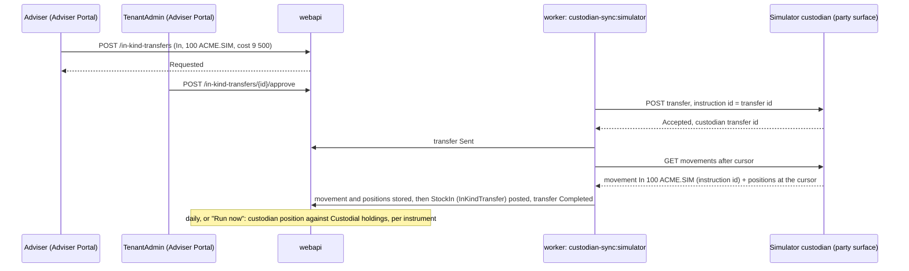

# In-kind transfers and custodian reconciliation

Step 14 of [custodial-roadmap.md](../custodial-roadmap.md) §13. It covers roadmap items **T1** (in-kind transfer) and **T3** (custodian reconciliation), with the simulator custodian (**S3**). It follows [ADR 0021](../adr/0021-outside-parties-behind-ports.md) rules 1–20 and does not re-decide them. It builds on the `StockIn` and `StockOut` types of [buy-sell.md](buy-sell.md), the source of [transaction-source.md](transaction-source.md), the orders and fills of [orders.md](orders.md), the instruction shape of [withdrawals.md](withdrawals.md) and the run of [bank-reconciliation.md](bank-reconciliation.md).

Today the securities on a Custodial account exist only in the platform's ledger. No outside record says the firm really holds them, and a Customer's existing shares can neither come in nor leave: `StockIn` and `StockOut` are refused, and no flow writes them. After this slice a firm has a **safekeeping account** at a custodian for each currency its securities are quoted in, where the securities of all its Custodial accounts in that currency are held together. The `worker` reads the custodian's **custody movements** and its **positions** through a new port. An Adviser requests an **in-kind transfer** of a Customer's shares in or out; a TenantAdmin approves it; the `worker` instructs the custodian; and the platform posts a `StockIn` or `StockOut` only when the custodian's movement shows the shares arrived or left. The broker delivers the shares of every order fill through the same safekeeping account. Once a day a **custodian reconciliation** compares the custodian's position in each instrument with the sum of the Custodial holdings and lists every difference.

New: permissions `in-kind-transfers.read`, `in-kind-transfers.request`, `in-kind-transfers.approve`, `custody-movements.manage` and `custodian-reconciliations.manage`; routes under `/in-kind-transfers`, `/custody-movements`, `/custodian-reconciliations` and `/tenants/{tenantId}/safekeeping-accounts`, and `GET /custodian-connections`; ports `ICustodianFeed` and `ICustodianTransfers` with adapters `SimulatorCustodianFeed` and `SimulatorCustodianTransfers`; custodian connections in configuration; source kind `InKindTransfer`; the in-kind transfer detail on the Transaction; `worker` jobs `custodian-sync:{connection}` and `custodian-reconciliation` on the new queue `custodian`; item fields `unsettledQuantity` and `transferableQuantity` (holding) and `inKindTransfer` (transaction); `safekeepingAccount` on the broker's order call. Scripts `0055_custodian.sql` and `0056_custodian_reconciliations.sql`; simulator script `database/simulator/0012_custodian.sql`. No new `TransactionType`, problem code or domain event.

**Status is `review` (2026-11-24).** It is not a build contract. The twenty-four points of §11 each carry a recommendation and wait for confirmation, except point 2, which was decided in discussion on 2026-11-24. The amendments to accepted docs listed in §12 are made when this spec is accepted.

---

## 1. Summary



| | Today | After this slice |
| --- | --- | --- |
| A Customer's existing shares | Cannot come into a Custodial account in use, and cannot leave it except by a sale | An in-kind transfer in or out, approved by a second person and confirmed by the custodian |
| Hand `StockIn` / `StockOut` on a Custodial account | Refused; nothing writes them | Refused; written by the in-kind transfer flow. External accounts unchanged |
| Proof that the firm holds the securities | None. The ledger is the only record | The custodian's positions, read with every page of its feed |
| Shares of an order fill | In the ledger only | Delivered into or out of the safekeeping account when the fill settles, and matched to the fill |
| Do holdings agree with the custodian? | Nobody can tell | A daily run per safekeeping account, and a "Run now" for the TenantAdmin |
| Shares that can leave an account | — | The **transferable quantity**: not reserved, and not from a purchase that has not settled |
| A holding with no securities behind it (seeded, traded before orders, migrated and not yet delivered) | Not visible as such | A break in the custodian reconciliation until the custodian holds it |

The rule that distinguishes this slice: a security moves into or out of a Custodial account only when the custodian says it moved, and every share on a Custodial account must be in the custodian's position. The reconciliation has no "known difference": a quantity the custodian does not hold is a break.

---

## 2. Scope

**In**

- Domain: `SafekeepingAccount` aggregate; `CustodianFeedCursor` and `CustodianPosition`; `CustodyMovement` (the inbound record) with its enums; `InKindTransfer` aggregate with its enums; `TransactionSourceKind.InKindTransfer` and `TransactionSource.InKindTransfer(transferPublicId)`; `TransactionInKindTransferDetail`; factories `Transaction.PostTransferIn` and `Transaction.PostTransferOut`; `Order.SafekeepingAccount`; `TransferableQuantity`; `CustodianReconciliation` aggregate with its lines and `CustodianReconciliation.Compute`; the `StockIn` / `StockOut` refusal message in `CustodyRules`
- Application: ports `ICustodianFeed` and `ICustodianTransfers`; services `SendInKindTransfers(connection)`, `PullCustodyMovements(connection)`, `ProcessCustodyMovements(connection)`, `ReconcileSafekeepingAccount`; the safekeeping account, in-kind transfer, custody movement and reconciliation commands and reads; reserved quantity counts transfers out; the transferable quantity rule; the holding and transaction reads map the new fields; placing an order stores the safekeeping account
- Infrastructure: `SimulatorCustodianFeed` and `SimulatorCustodianTransfers` adapters (HTTP, `X-Api-Key`); recurring jobs `custodian-sync:{connection}` and `custodian-reconciliation`; EF mappings; `SimulatorBrokerOrders` sends `safekeepingAccount`
- Scripts: `database/schema/0055_custodian.sql`, `database/schema/0056_custodian_reconciliations.sql`; `database/simulator/0012_custodian.sql`
- Security: five permissions (R1)
- HTTP (`webapi`): the routes of §8
- Simulator: the custodian on the party surface (transfers, movements with positions) and its control routes; the broker delivers settled fills through it; corporate actions change its positions
- Adviser Portal: Transfer securities on a Custodial account, the Transfers pages, the Custody movements pages, the Custodian reconciliation pages, the transfer on the transaction page; BFF prefixes `/in-kind-transfers`, `/custody-movements`, `/custodian-reconciliations`
- Customer Portal: transfers in progress, the transfer in the activity; BFF prefix `/in-kind-transfers`
- Back Office: safekeeping accounts on the Tenant page, a Custodian page with the connections
- Tests listed in §10

**Out**

- Tax lots and a cost in NZD (roadmap §10). A transfer in carries one cost and one optional acquisition date, stored and shown, and read by no rule
- Any tax worked out from a change of beneficial ownership. The flag is recorded (R21); nothing is computed from it
- A register of a Customer's verified accounts at other brokers or registries, like the nominated bank account. The approver checks the counterparty details of each transfer (§11 point 7)
- A transfer between two Custodial accounts of the firm (security legs on two Accounts). The shares do not move at the custodian; it stays an open item of [internal-transfers.md](internal-transfers.md)
- A transfer in of an instrument quoted in another currency than the Account's (roadmap D20, R23)
- Matching a custody movement to an account, a transfer or a batch by hand. A movement in suspense can only be ignored with a note (§11 point 13)
- A flow that reverses a completed transfer, and a transfer that comes back from the counterparty. A transfer back is a new transfer; a wrong posting is corrected with an adjustment (R41)
- Changing an open transfer, and a partial arrival booked in part. A wrong transfer is cancelled or set aside and requested again
- A status feed for transfer instructions. The custodian answers the instruction at once, and the movement is the confirmation (§11 point 9)
- What a corporate action does to an open transfer. The custodian's movement then differs from the instruction and goes to suspense (R39)
- Market claims: a trade that settles after a corporate action took effect. The simulator settles open trades in the symbol when the action takes effect (R68)
- A tolerance on the comparison, and a value in money of a position break. Every comparison is on quantities and is exact (§11 point 17)
- A PDF report of a custodian reconciliation (§11 point 20)
- Two active safekeeping accounts of one Tenant in the same currency, and one safekeeping account that holds securities quoted in several currencies (R5, R11)
- A safekeeping account chosen per Custodial account or per Customer (segregated accounts). Every safekeeping account is pooled (§11 point 2)
- Custodian fees, transfer fees and stamp duty
- A Customer requesting a transfer (roadmap D6). The Customer Portal stays read-only
- In-kind transfers on External accounts. They keep hand `StockIn` / `StockOut`
- Notifying the Customer, the Adviser or the TenantAdmin
- Named scenarios and the scenario library
- A real custodian adapter

---

## 3. Stories

1. As an Adviser I request a transfer of my Customer's existing shares into a Custodial account, with the other broker or registry, the cost the Customer paid and whether the owner changes.
2. As an Adviser I request a transfer of shares out of a Custodial account to the Customer's account at another broker or registry, and the shares are reserved from that moment.
3. As a TenantAdmin I approve or reject a transfer someone else requested, after checking the counterparty details and the cost.
4. As the platform I instruct the custodian once, with the same key on every retry, and book the transfer only when the custodian's movement shows the shares arrived or left.
5. As an Adviser and as a Customer I see a transfer move from requested to completed, and the shares on the account once it is completed.
6. As the platform I store every custody movement and the custodian's positions before I use them, and I match the delivery of each order fill to its fill.
7. As a TenantAdmin I see the custody movements the platform could not place, with the reason, and I set each aside with a note once I have dealt with it.
8. As a TenantAdmin I open Custodian reconciliation and see, per instrument, the custodian's position, the Custodial holdings and what explains a difference, and I run it again after a correction.
9. As an Adviser I cannot transfer out shares that are reserved for a sell order or bought and not settled yet.
10. As a SystemAdmin I set each firm's safekeeping accounts, one per currency, and see when its feed was last read and why the last read failed.
11. As the simulator operator I make the custodian execute, hold or reject transfers, book a movement nobody asked for, leave a movement out of the feed, round a corporate action to whole shares, and see its positions.

---

## 4. Rules

### 4.1 Access

| ID | Rule |
| --- | --- |
| R1 | **Access.** New permissions: `in-kind-transfers.read` (TenantAdmin, Adviser, Customer), `in-kind-transfers.request` (TenantAdmin, Adviser), `in-kind-transfers.approve` (TenantAdmin), `custody-movements.manage` (TenantAdmin) and `custodian-reconciliations.manage` (TenantAdmin). SystemAdmin has none of them → 403 (roadmap D5); the safekeeping account routes and `GET /custodian-connections` take `tenants.manage` (SystemAdmin only). A Customer reads and never writes (roadmap D6). Missing / dead Bearer → 401, never 302. Policy fail → 403, checked before anything is read. A disabled current tenant → 403. The scope of a transfer is its Account's, as withdrawals R17: TenantAdmin any Account of the tenant; Adviser Accounts of assigned Customers; Customer own Accounts. A transfer outside scope, of another tenant, or missing → 404. A custody movement, a reconciliation or a safekeeping account of another Tenant, or a missing one → 404. No caller on `/in-kind-transfers`, `/custody-movements` or `/custodian-reconciliations` names a tenant: a `tenantId` in a query or body → 400. |

### 4.2 Custodian connections and safekeeping accounts

| ID | Rule |
| --- | --- |
| R2 | **Configured, not stored.** A **custodian connection** is a named entry in configuration, like a bank connection (deposit-matching R1): `CustodianConnections:{name}:Adapter` (only `Simulator` in this slice) on `webapi` and `worker`; on `worker` also `BaseUrl`, `ApiKey`, optional `TimeoutSeconds` (integer 1–60, default 10) and optional `PollMinutes` (one of 1, 2, 3, 4, 5, 6, 10, 12, 15, 20, 30, 60; default 1). The name, the start-up checks and the secret on `worker` only follow deposit-matching R1. No connection configured is valid: nothing is read and no transfer can be requested. |
| R3 | **What a safekeeping account is.** The account at a custodian in which a firm holds, together, the securities quoted in one currency of all its Custodial accounts, in the firm's or its nominee's name. It holds Customers' securities only, never the firm's own, as a client money account holds Customers' cash only. The custodian knows one account and one position per instrument; which Customer owns what is the platform's ledger. Fields: `currency` (required; an enabled catalog code, stored upper-case, as client-money-accounts R2), `custodianName` (required, trimmed, 1–100), `accountName` (the name the account is held in, for example "North Advisory Nominees Ltd"; required, trimmed, 1–140), `accountNumber` (required; the shape of client-money-accounts R2), `custodianConnection` (required; a name configured on `webapi`, else 400 `errors.CustodianConnection`, `Unknown custodian connection.`) and `isActive`. Each field outside its rule → 400 `errors.<Field>`. |
| R4 | **Routes.** `POST /tenants/{tenantId}/safekeeping-accounts` with the R3 fields → 201 `{ "id" }` with `Location`; the new row is active; a disabled tenant → 400 `disabled` / `target=tenant`; the body must not carry `isActive`, `tenantId` or `id` (400). There is no PUT: the currency and the other details never change, and a wrong one is corrected by disabling the row and creating a new one (client-money-accounts R7). `POST …/{id}/disable` and `POST …/{id}/enable` with `rowVersion` → 204; missing → 400, stale → 409 `stale_row_version`; already in the target state → 204 and nothing written. `GET /tenants/{tenantId}/safekeeping-accounts` → list envelope, sorted by currency, then active before inactive, then newest first; `GET …/{id}` → the item. Unknown tenant → 404; an `{id}` that is not a safekeeping account of `{tenantId}` → 404. |
| R5 | **One active per currency.** A Tenant has at most one active safekeeping account per currency, as it has at most one active client money account per currency (client-money-accounts R4). Create or enable while another is active in that currency → 400 `errors.Currency` with the message `The tenant already has an active safekeeping account in USD.` (with the code). The currency is the **quote currency** of the Instruments held there: every holding of an Instrument quoted in USD, on whatever Custodial account, belongs to the Tenant's USD safekeeping account, so each holding has exactly one. A firm may use one custodian for every currency or another for each; each row names its own connection. No two active safekeeping accounts on the platform have the same `accountNumber` (compared without regard to case): 400 `errors.AccountNumber`, `This account number is already in use by an active safekeeping account.` Inactive rows do not count. Disable is always allowed. |
| R6 | **What needs one.** An in-kind transfer can be requested, approved and sent only while the Tenant has an active safekeeping account in the Instrument's quote currency (R23, R31, R34). An order placed while the Tenant has one in the Instrument's quote currency carries it (R46). A custodian reconciliation runs for an active one (R57, R58). Nothing else reads it: a Custodial account is opened, an order is placed, a migration batch is posted and a corporate action is applied without one. Holdings quoted in a currency with no active safekeeping account have no outside proof. Creating, disabling or enabling one changes no Account, order or Transaction, raises no domain event and writes no outbox row. |
| R7 | **Connection list and feed status.** `GET /custodian-connections` (`tenants.manage`) → list envelope of `{ name, adapter }`, sorted by name, every entry on page 1; no URL, key or timeout. The safekeeping account item is `{ id, currency, custodianName, accountName, accountNumber, custodianConnection, isActive, custodianFeed, rowVersion }`. `custodianFeed` is `{ lastSucceededAt, lastFailedAt, lastFailure, positionsAt }`, `null` until the first read of that account was tried. `lastFailure` is one of `Unreachable`, `Timeout`, `Unauthorized`, `Unavailable`, `UnknownAccount`, `BadResponse`, `InvalidItem`, or `null`; it never carries a message from the party. |

### 4.3 The custodian feed: movements and positions

| ID | Rule |
| --- | --- |
| R8 | **Port and records.** `ICustodianFeed` returns, for one safekeeping account of one connection, the custody movements after a cursor, one page at a time, and with every page the custodian's positions at that page's cursor. A **custody movement** is one change of the custodian's position in one instrument: an outside id (unique per connection, for ever), a direction (`In`: securities came into the safekeeping account; `Out`: they left), a kind, a symbol, a currency, a quantity and the custodian's settlement date. It is the custodian's inbound record (ADR 0021 rule 7) and belongs to the Tenant of its safekeeping account, like a bank statement line. |
| R9 | **One recurring job per connection.** `worker` registers `custodian-sync:{connection}` for each configured connection, on the new queue `custodian`, every `PollMinutes` of that connection (UTC; cron as deposit-matching R6). A run does three steps in this order: send the in-kind transfers (R34), pull every active safekeeping account of the connection in `Id` order (R10), process the movements (R14). A failed step, or a failed read of one account, is recorded and the run goes on with what is already stored; a run in which anything failed is reported to Hangfire as failed after every step was tried. No automatic Hangfire retries; the schedule is the retry (ADR 0021 rule 15). A run that starts while another run of the same connection is still going ends at once. An inactive safekeeping account is not read; its cursor and positions are kept. A recurring job of a connection that is no longer configured is removed when the `worker` starts. |
| R10 | **Pull and store a page.** For each account the job asks for the movements after that account's cursor, 100 at a time, until the party says there are no more or 20 pages were read. The new movements of one page, the new cursor, `lastSucceededAt` and the page's positions (R12) are written in one database transaction; the cursor is one opaque string of at most 500 characters per safekeeping account in `CustodianFeedCursors`. A movement whose (connection, outside id) is already stored is skipped and not changed; the unique index is the backstop. A failed call stores nothing more for that account, keeps its cursor and positions, and sets `lastFailedAt` and `lastFailure`. |
| R11 | **A movement the platform can store.** Outside id 1–100 characters; direction `In` or `Out`; symbol 1–32 characters; a currency equal to the safekeeping account's; quantity `> 0` with at most 8 decimal places; a settlement date. Optional: `instructionId`, `tradeReference` and `corporateActionId`, each 1–100 characters when present; the last is stored as the movement's corporate action reference, because `corporateActionId` on the platform's own items is the PublicId of a corporate action (R19). A page with any movement outside this → nothing of that page is stored, the cursor stays, `lastFailure` = `InvalidItem`. A kind the adapter does not know is not a reason to refuse a page: the movement is stored with no kind. Free text is not a reason either: `counterpartyName` and `reference` are trimmed and cut to 140 characters, `counterpartyAccount` to 34. |
| R12 | **Positions with every page.** A page carries `positions`: the custodian's quantity per symbol in the safekeeping account after the last movement up to the page's cursor, every movement the custodian booked up to that point counted once, including a movement the feed does not deliver. A symbol that is not in the list is `0`. A quantity is a decimal with at most 8 decimal places and may be negative. A page with no `positions`, with a symbol twice, with a currency other than the safekeeping account's, or with a quantity it cannot read is refused as `InvalidItem`. In the transaction of R10 the stored positions of the safekeeping account (`CustodianPositions`) are replaced by the page's, and `PositionsAt` on the cursor is set to the time of the commit. The **custodian positions** of a safekeeping account are therefore always the custodian's figures for exactly the movements the platform has stored for it. The platform never computes a position from the movements. |
| R13 | **New movement.** A stored movement has status `Received`, `receivedAt` = platform time, the Tenant of its safekeeping account, and the **Instrument** of that Tenant whose symbol equals the movement's (without regard to case) and whose `QuoteCurrency` equals its currency (the safekeeping account's, R11), or none. A Tenant has at most one such Instrument (instruments: the symbol is unique in a tenant). The Instrument of a movement is not looked up again later. |

### 4.4 Processing custody movements

| ID | Rule |
| --- | --- |
| R14 | **Processing.** When every account of the connection has been read, the same run processes every `Received` movement of that connection, oldest `receivedAt` first, then `Id`, each in one database transaction that also sets its status (ADR 0021 rule 8). The movement's `RowVersion` guards it; a conflict skips that movement until the next run. A movement left `Received` by a crash is processed by the next run. A failed read does not stop the processing of movements already stored. A movement becomes `Matched` with a method (`Transfer`, `Trade`, `CorporateAction`) or `Unmatched` with a reason, by the first row of R15 that applies. |
| R15 | **Classification.** See the table below. A movement is processed whatever the state of the Tenant, the Customer or the Instrument (R40). |

| Order | The movement | Outcome |
| --- | --- | --- |
| 1 | Has an `instructionId` that is the PublicId of an in-kind transfer of the movement's Tenant | R36: the transfer is posted and the movement is `Matched` with method `Transfer`; or `Unmatched` with `TransferNotOpen`, `TransferMismatch`, `AccountClosed` or `InsufficientHolding` |
| 2 | Has an `instructionId` that names no such transfer (not a GUID, another Tenant's, unknown) | `Unmatched` with `UnknownInstruction` |
| 3 | Kind `Trade` | R16: `Matched` with method `Trade`; or `Unmatched` with `UnknownTrade` or `TradeMismatch` |
| 4 | Kind `CorporateAction` | R17: `Matched` with method `CorporateAction`; or `Unmatched` with `UnknownCorporateAction` |
| 5 | Kind `Transfer` (with no `instructionId`) | `Unmatched` with `NoInstruction`: securities came or went that nobody on the platform asked for |
| 6 | No kind | `Unmatched` with `UnsupportedKind` |

| ID | Rule |
| --- | --- |
| R16 | **The delivery of a fill.** A `Trade` movement names the trade by `tradeReference`: the outside id of the broker's `Fill` execution report (orders R23), which the broker gives the custodian with its settlement instruction. The platform looks for the fill of an order of the movement's Tenant that came from that report and whose order carries this safekeeping account (R46). No `tradeReference`, or no such fill → `Unmatched` with `UnknownTrade`. The movement is `Matched` with method `Trade` and the fill when all hold: the movement's Instrument is the order's; its direction is `In` for a buy and `Out` for a sell; its quantity equals the fill's; the fill is not `Broken`; and no other movement is matched to that fill. Otherwise `Unmatched` with `TradeMismatch`. A matched delivery writes nothing to the ledger: the fill's own posting did (orders R31). A fill is **delivered** once a movement is matched to it; the fill may still be `Pending` (orders R36). |
| R17 | **A corporate action at the custodian.** A `CorporateAction` movement is the change the custodian made to the pooled position when a corporate action took effect. It names the event by `corporateActionId`: the issuer's id of the event, which the platform holds as the party action id of a `Feed` corporate action (corporate-actions R5). When the movement has an Instrument and the Tenant has a corporate action with origin `Feed`, that party action id and that Instrument, the movement is `Matched` with method `CorporateAction` and that corporate action, whatever its status. Otherwise `Unmatched` with `UnknownCorporateAction`: the custodian applied an event the platform has no record of. A matched movement writes nothing to the ledger: the entitlements of the corporate action do (corporate-actions R24). Whether the custodian's change equals the sum of the entitlements is a question for the reconciliation (R53), not for this rule. |
| R18 | **Movements in suspense.** An `Unmatched` movement waits for a TenantAdmin, like a statement line in suspense. `POST /custody-movements/{id}/ignore` with `rowVersion` and `note` (trimmed, 1–200, required, 400 `errors.Note`) → 204, from `Unmatched` only: the movement becomes `Ignored` and keeps its reason. `POST /custody-movements/{id}/reopen` with `rowVersion` and optional `note` → 204, from `Ignored` only: it is `Unmatched` again. Any other status → 400 `errors.Status` (`This movement is <status> and cannot be <ignored / reopened>.`). Missing `rowVersion` → 400; stale → 409 `stale_row_version`. Each action records the person, the time and the note as the movement's last action. Neither writes to the ledger. No route matches a movement by hand, and processing never looks at a movement again once it is `Matched`, `Unmatched` or `Ignored`. Ignoring means "a person has dealt with this": the TenantAdmin first removes the cause (the table below) and the reconciliation shows whether the books now agree (R53). |

| Reason | What happened | What the TenantAdmin does before ignoring |
| --- | --- | --- |
| `NoInstruction`, `UnknownInstruction` | Securities moved at the custodian with no transfer on the platform | Finds whose they are. The bulk delivery of a migration batch's holdings needs nothing more: the batch already posted them ([migration-batches.md](migration-batches.md) R22). Otherwise an adjustment with reason `ReconciliationBreak` on the Customer's account, or the custodian sends them back |
| `TransferNotOpen`, `TransferMismatch`, `AccountClosed`, `InsufficientHolding` | The custodian moved something else than the transfer says, or the platform could not book it | Sets the transfer aside (R33) and corrects the account with an adjustment, or has the custodian correct the movement |
| `UnknownTrade`, `TradeMismatch` | The custodian settled a trade the platform does not hold, or holds differently | Resolves it with the broker and the custodian; an adjustment when the ledger is the wrong side |
| `UnknownCorporateAction` | The custodian applied an event the platform does not know | Enters the corporate action by hand where the platform allows it (corporate-actions R15), else adjusts the holdings with reason `CorporateAction` |
| `UnsupportedKind` | A kind of movement this slice does not know | Reads the custodian's own statement and adjusts where needed |

| ID | Rule |
| --- | --- |
| R19 | **Movement reads.** `GET /custody-movements` (`custody-movements.manage`) → list envelope, newest `receivedAt` first, then newest `Id`. Optional filters: `status` (one or more names, comma-separated; unknown → 400 `errors.Status`), `direction`, `kind`, `instrumentId` (unknown or another Tenant's → an empty list) and `safekeepingAccountId`. `GET /custody-movements/{id}` → the item: `{ id, safekeepingAccountId, direction, kind, symbol, currency, instrument, quantity, settlementDate, instructionId, tradeReference, corporateActionReference, counterpartyName, counterpartyAccount, reference, receivedAt, status, unmatchedReason, method, accountId, transactionId, inKindTransferId, orderId, fillId, corporateActionId, lastAction, rowVersion }`. `kind` is `null` for a kind the adapter did not know; `instrument` is `{ id, symbol, name }` or `null`; `lastAction` is `{ action, by, at, note }` or `null`. Adviser and Customer → 403; they see a transfer through its item and its Transaction. |

### 4.5 An in-kind transfer (T1)

| ID | Rule |
| --- | --- |
| R20 | **What it is.** An in-kind transfer is an instruction to move a quantity of one Instrument between one Custodial account and a **counterparty** (another broker, another custodian or a share registry), with no money paid for it (roadmap P7). Direction `In`: the shares come from the counterparty into the firm's safekeeping account for the Instrument's quote currency, for this Account. Direction `Out`: they leave it for the counterparty. A transfer is not a Transaction and moves nothing in the ledger; the custodian's movement that confirms it does (R36). |
| R21 | **Request.** `POST /in-kind-transfers` (`in-kind-transfers.request`) → 201 `{ "id" }` with `Location`. Body: `accountId`; `direction` (`In` or `Out`); `instrumentId`; `quantity` (`> 0`, at most 8 decimal places, else 400 `errors.Quantity`); `counterparty`: `{ name, account, holderName }`, all required: `name` (the other broker, custodian or registry; trimmed, 1–100), `account` (the holder's account or holder number there; the shape of client-money-accounts R2) and `holderName` (the name the securities are held in there; trimmed, 1–140), each 400 `errors.Counterparty.<Field>`; `changesBeneficialOwner` (a boolean, required, 400 `errors.ChangesBeneficialOwner`: `false` when the Customer owns the shares before and after, `true` when ownership passes to or from someone else, which decides the tax treatment and is recorded, not acted on); and optional `memo` (an internal note: trimmed, 1–200). A transfer `In` also takes `cost` and `acquiredOn` (R25). A body with `bookedAt`, `status`, `tenantId` or `id` → 400. Requires `Idempotency-Key` (posting R21, ADR 0015): replay with the same hash → the original 201; same key, other hash → 409; missing → 400. The transfer is `Requested`, with the caller and the platform time as requested by and at. Nothing is sent to the custodian in the request (ADR 0021 rule 4). |
| R22 | **Account.** The Account must be in scope (else 404), Custodial (else 400 `errors.AccountId`, `Securities can be transferred in kind only on a Custodial account.`), Open (400, posting R6), not closing (400, the account-closure R12 message) and its Customer not Disabled (400 `disabled` / `target=user`). |
| R23 | **Instrument and currency.** The Instrument must be in the caller's Tenant (else 400 `errors.InstrumentId`, as buy-sell R7). A transfer `In` needs an active Instrument (400 `errors.InstrumentId`, as holdings R7) quoted in the Account's currency (roadmap D20); otherwise 400 `errors.InstrumentId` with the message `ACME.SIM is quoted in USD and this account is in NZD. Transfer it into a USD Custodial account.` A transfer `Out` is allowed for a disabled Instrument and in any quote currency, so that every holding can leave. In both directions the Tenant must have an active safekeeping account in the Instrument's quote currency whose connection is configured on `webapi` (R5); otherwise 400 `errors.InstrumentId` with the message `The firm has no safekeeping account for securities quoted in USD, so ACME.SIM cannot be transferred.` |
| R24 | **Not on an assigned account.** An account with an Active portfolio assignment takes no transfer request, in either direction: 400 `errors.AccountId` with the message `This account follows a portfolio. Unassign the portfolio before transferring securities.` On an assigned account only its rebalance changes holdings (portfolios R18, rebalances R24). Assigning a portfolio to an account with an open transfer (R27) → 400 `account_not_eligible` with the message `Complete or cancel the account's open transfers of securities before assigning a portfolio.` (as orders R49). |
| R25 | **In: the cost comes with the shares.** A transfer `In` requires `cost`: the total cost of the quantity in the Instrument's quote currency, `≥ 0` with at most 4 decimal places (400 `errors.Cost`); the body sends no currency (holdings R10). It is the caller's number and the platform reads no price for it: the Customer's own cost when ownership does not change, the value at the transfer when it does. Optional `acquiredOn`: the date the Customer acquired the shares, not after the platform's UTC date (400 `errors.AcquiredOn`). A transfer `Out` with `cost` or `acquiredOn` → 400 at that field (`Cost is given only for a transfer in.`). A transfer `In` reserves nothing. |
| R26 | **Out: the quantity is reserved.** The quantity of a transfer `Out` must not be more than the holding's **transferable quantity** (R44) when it is requested, checked with the Account row locked (posting R22); otherwise 400 `errors.Quantity` with the message `The account has 40 ACME.SIM available to transfer.`, followed by ` 10 is from purchases that have not settled.` when the unsettled quantity is above 0. No holding → the same refusal with `0`. From the request on the quantity is **reserved** (R43) while the transfer is open. |
| R27 | **Statuses.** A transfer is **open** while it is `Requested`, `Approved` or `Sent`. Only an open transfer `Out` reserves. |

| Status | Means | Open | Next |
| --- | --- | --- | --- |
| `Requested` | Waits for a second person | yes | `Approved`, `Rejected`, `Cancelled` |
| `Approved` | Approved; it waits to be sent, or the outcome of the send is not known yet | yes | `Sent`, `Failed`, `Cancelled` (before the first send attempt), `SetAside` (after one); `Completed` when the movement arrives after a lost answer |
| `Sent` | The custodian accepted the instruction; the shares are on their way | yes | `Completed`, `SetAside` |
| `Completed` | The custodian's movement confirmed it and the Transaction is posted | no | final |
| `Rejected` | The reviewer refused it | no | final |
| `Cancelled` | Withdrawn before the custodian was asked | no | final |
| `Failed` | The custodian refused the instruction | no | final |
| `SetAside` | A TenantAdmin ended it by hand after the custodian was asked | no | final |

| ID | Rule |
| --- | --- |
| R28 | **Item.** `{ id, accountId, customerId, direction, instrument: { id, symbol, name }, quantity, currency, cost, acquiredOn, changesBeneficialOwner, counterparty: { name, account, holderName }, memo, status, requestedBy, requestedAt, decision, send, failureReason, setAside, transactionId, completedAt, rowVersion }`. `currency` is the Instrument's quote currency. `cost` and `acquiredOn` are `null` on a transfer `Out`. `decision` is `{ action, by, at, note }` for the approve, reject or cancel, else `null`. `send` is `{ attempts, lastAttemptAt, lastFailure, acceptedAt, custodianTransferId }`. `failureReason` is the custodian's reason on a `Failed` transfer (R35). `setAside` is `{ by, at, note }` or `null`. A person is `{ id, name }`. The counterparty account is shown in full to every caller who can read the transfer: the approver must check it, and it is the Customer's own. A Customer sees every field except `memo`, the notes and `send` (`null` for a Customer). |
| R29 | **List.** `GET /in-kind-transfers` (`in-kind-transfers.read`) → list envelope, newest requested first. Optional filters: `accountId`, `customerId`, `instrumentId`, `direction`, `status` (one or more names, comma-separated; unknown → 400 `errors.Status`). A Customer's list is their own. `GET /in-kind-transfers/{id}` → the item. |
| R30 | **Every action.** Body with `rowVersion`; missing → 400, stale → 409 `stale_row_version`. A transfer not in a status that allows the action → 400 `errors.Status` with the message `This transfer is <status> and cannot be <approved / rejected / cancelled / set aside>.` Success → 204. No `Idempotency-Key`: the status and `rowVersion` make a repeat a 400 or a 409. `note`: trimmed, 1–200; required on reject and set aside (400 `errors.Note`), optional on approve and cancel. |
| R31 | **Approve and reject, by a second person.** `POST /in-kind-transfers/{id}/approve` and `…/reject` (`in-kind-transfers.approve`), from `Requested`. Both are refused when the caller requested the transfer → 400 `errors.Status` with the message `A transfer of securities must be approved by someone other than the person who requested it.` This holds for every Tenant, also one with a single TenantAdmin (withdrawals R28). Approve checks, with the Account row locked: the Account is Open (400, posting R6) and not closing, its Customer is not Disabled (400 `disabled` / `target=user`), the Tenant has an active safekeeping account in the Instrument's quote currency whose connection is configured on `webapi` (the R23 message), and for a transfer `In` the Instrument is still active (400 `errors.InstrumentId`). The transfer becomes `Approved` and stores that safekeeping account, which never changes. Reject makes it `Rejected` and releases the reservation of a transfer `Out`. |
| R32 | **Cancel.** `POST /in-kind-transfers/{id}/cancel` (`in-kind-transfers.request`): from `Requested`; or from `Approved` while it has no send attempt (R34). After the first attempt → 400 `errors.Status` with the message `The custodian has been asked to make this transfer, so it can no longer be cancelled.` The transfer's `RowVersion` guards the race with the send step. The reservation of a transfer `Out` is released. |
| R33 | **Set aside.** `POST /in-kind-transfers/{id}/set-aside` (`in-kind-transfers.approve`) with `rowVersion` and `note` → 204: from `Sent`, or from `Approved` once it has a send attempt. The transfer becomes `SetAside` with the person, the time and the note, releases the reservation of a transfer `Out`, and never changes again. It writes nothing to the ledger. It is the way to end a transfer the custodian will not confirm, or confirmed with something else (R39). A movement that names the transfer afterwards goes to suspense with `TransferNotOpen`. |

### 4.6 Sending transfers to the custodian

| ID | Rule |
| --- | --- |
| R34 | **The send step.** Every `Approved` transfer whose safekeeping account is active and on the job's connection is sent, oldest first. Per transfer: record the attempt (attempts + 1, time) and commit, then call `ICustodianTransfers` with the transfer's PublicId as the **instruction id**, the safekeeping account number, the direction, the symbol, the quote currency, the quantity and the counterparty (ADR 0021 rules 12, 13). The call carries no Tenant, Account, Customer, cost or ownership flag. A disabled Tenant's transfer gets no first attempt; one that already has an attempt is sent again, because the custodian may have it (withdrawals R32). One transfer's failure never stops the others or the pull. |
| R35 | **Outcome of a send.** `Accepted` with the custodian's transfer id → the transfer becomes `Sent` and keeps that id. `Rejected` with a reason → `Failed` with the reason; the reservation of a transfer `Out` is released. Reasons: `UnknownInstrument`, `InsufficientPosition`, `CounterpartyRefused`, `Refused`; a reason the adapter does not know → `Refused`. A failure of the call (`Unreachable`, `Timeout`, `Unauthorized`, `Unavailable`, `UnknownAccount`, `BadResponse`) → the transfer stays `Approved` with `lastFailure` set, and the next run sends it again with the same instruction id. Each outcome is one database transaction guarded by the transfer's `RowVersion`; a transfer that a movement already completed (R36) keeps its status and only takes the custodian's transfer id. The custodian sends no later status of an instruction: the movement is the confirmation (ADR 0021 rule 14). |

### 4.7 The transfer on the ledger

Amendment to [buy-sell.md](buy-sell.md), [holdings.md](holdings.md), [posting.md](posting.md) and [transaction-source.md](transaction-source.md).

| ID | Rule |
| --- | --- |
| R36 | **The movement confirms the transfer.** A movement whose `instructionId` names an in-kind transfer of its Tenant (R15 row 1) is checked in this order. The transfer is not `Sent`, and not `Approved` with a send attempt → `Unmatched` with `TransferNotOpen`. The movement is on another safekeeping account than the transfer's, its direction or its Instrument is not the transfer's, or its quantity is not equal to the transfer's → `Unmatched` with `TransferMismatch`. Otherwise, in one database transaction with the Account row locked (posting R22): R39 is checked, the Transaction of R37 is posted, the holdings projection follows (holdings R14), the transfer becomes `Completed` with the Transaction and the time and its reservation is released, and the movement becomes `Matched` with method `Transfer`, the Account, the Transaction and the transfer. An `Unmatched` outcome changes neither the transfer nor the ledger. |
| R37 | **The Transaction.** A transfer `In`: type `StockIn`, one security leg on the Account for the Instrument with `+quantity` and the transfer's cost in the quote currency (buy-sell R11, R15). A transfer `Out`: type `StockOut`, one security leg with `−quantity`, releasing cost at the holding's average (buy-sell R15). No cash leg. Source `InKindTransfer` (10) with the transfer's PublicId as source id; `bookedAt` = platform time when it is posted (ADR 0021 rule 10); memo `Transfer in` or `Transfer out`; `reference` `null`; and an in-kind transfer detail (R38). Built by `Transaction.PostTransferIn` / `PostTransferOut` without the manual entry matrix (custody-modes R7). `CreatedBy` is the worker's system name; the people are on the transfer. It raises `TransactionPosted` as every Transaction does. |
| R38 | **In-kind transfer detail.** Every Transaction with source `InKindTransfer` has exactly one: the transfer's PublicId, the counterparty name, the counterparty account masked to its last four letters or digits (`****1234`, the shape of deposit-matching R11), `changesBeneficialOwner`, `acquiredOn` (a transfer `In`, when given), the movement's settlement date and the movement's outside id as the custodian's reference. No other Transaction has one. `Transaction.Reverse` copies it, so a later flow can undo its own posting. |
| R39 | **When it cannot be posted.** Nothing is posted, the movement becomes `Unmatched` and the transfer stays as it is when: the Account is Closed (`AccountClosed`; R45 keeps this from happening); or a transfer `Out` is for more than the holding's quantity (`InsufficientHolding`; a consolidation shrank the holding after the request). It is decided once and not tried again. A TenantAdmin sets the transfer aside (R33), corrects the account with an adjustment ([adjustments.md](adjustments.md)) and ignores the movement (R18). The same path serves a movement with another quantity than the instruction (`TransferMismatch`), which is what a corporate action between the request and the arrival causes. |
| R40 | **The books follow the custodian.** A movement that confirms a transfer is posted whatever the state of the Tenant or the Customer, and for a disabled Instrument (deposit-matching R19, orders R29). The portfolio trade lock is not checked: R24 keeps a transfer and an assignment apart. The reserved quantity rule (R43) does not refuse the posting of a transfer `Out`, which releases its own reservation. No price, FX rate or trade fee schedule is read, and no cash moves, so available cash is unchanged. |
| R41 | **No reversal by hand, none by the flow.** `InKindTransfer` is not a hand-reversible source (transaction-source R12): `POST /transactions/{id}/reverse` of a transfer's Transaction → 400 by transaction-source R13. No flow of this slice reverses a completed transfer. Shares that should go back are a new transfer in the other direction; a wrong cost or quantity is corrected with an adjustment ([adjustments.md](adjustments.md), reason `EntryError`). A transfer's Transaction is a security activity on its holding, so a hand reverse of an earlier hand trade on that holding is refused by [ledger-write-guards](../fixes/ledger-write-guards.md) Decision 1. |
| R42 | **Transaction item.** Gains `inKindTransfer`: `{ transferId, direction, counterpartyName, counterpartyAccount, changesBeneficialOwner, acquiredOn, settlementDate, custodianReference }` on a transfer's Transaction (and a Reversal of one), `null` on every other Transaction. `counterpartyAccount` is the masked form of R38. `source` is `{ "kind": "InKindTransfer", "id": "<transfer PublicId>" }`. Every caller who can read the Transaction sees both, the Customer included. Holdings, net worth, both reports and the Customer's reads count the posting like any `StockIn` or `StockOut`. |

### 4.8 Reserved, unsettled and transferable quantity

Amendment to [orders.md](orders.md) R40 and R41, [holdings.md](holdings.md), [adjustments.md](adjustments.md) and [account-closure.md](account-closure.md) R5, R6 and R12.

| ID | Rule |
| --- | --- |
| R43 | **Reserved quantity counts transfers out.** The reserved quantity of a holding (orders R40) is now the reserved quantity of the Account's live sell orders in that Instrument plus the quantity of its open transfers `Out` in it (R27). Available quantity is unchanged in meaning: the holding's quantity minus its reserved quantity. So a sell order (orders R13) and an `Adjustment` that lowers a holding (orders R40) cannot take shares that are leaving; the adjustment's refusal reads `40 ACME.SIM is reserved for sell orders and transfers out.` |
| R44 | **Unsettled and transferable quantity.** The **unsettled quantity** of a holding is the sum of the quantities of the Account's `Posted` buy fills in that Instrument that are not settled (orders R43) and not broken. Those shares are in the holding and can be sold, but the custodian does not hold them yet. The **transferable quantity** is the available quantity minus the unsettled quantity, and never below 0. Only a transfer `Out` needs it (R26). The holding item of `GET /accounts/{id}/holdings` gains `unsettledQuantity` and `transferableQuantity`; on an External account they are `0` and the holding's quantity. Every caller who can read the Account sees them, the Customer included. |
| R45 | **Account closure.** Account-closure R5 gains a refusal, 400 `errors.AccountId`: an open in-kind transfer → `Open transfers of securities must be completed, rejected, cancelled or set aside before the account can be closed.` The account-closure R6 message becomes `Sell or transfer out every holding before closing the account.`: a transfer `Out` is now the second way to empty an account. A closing account takes no transfer request (R22); `POST /in-kind-transfers` joins the list of account-closure R12. |

### 4.9 Orders deliver through the safekeeping account

Amendment to [orders.md](orders.md) R20 and R53 and [trade-settlement.md](trade-settlement.md) R35.

| ID | Rule |
| --- | --- |
| R46 | **The safekeeping account of an order.** When an order is placed and the Tenant has an active safekeeping account in the Instrument's quote currency, the order stores it with its account number, and it never changes. Otherwise the order has none; having none never refuses an order. Orders placed before this slice have none. |
| R47 | **Sent with the order.** The send step (orders R20) adds `safekeepingAccount`, the account number, to the place call of an order that has one, and leaves the field out for an order that has none, so an order sent before this slice is sent again with the same body (as trade-settlement R4). The broker instructs the custodian to receive or deliver the shares of each fill there when the fill settles; the custodian's `Trade` movement then names the fill (R16). The fills of an order with no safekeeping account settle as in orders R43, with no securities at a custodian. |

### 4.10 The manual entry matrix and the source

Amendment to [custody-modes.md](custody-modes.md) R5.

| ID | Rule |
| --- | --- |
| R48 | **Matrix.** The cells `StockIn` / Custodial and `StockOut` / Custodial stay **refused** for every caller (custody-modes R5). Their "written by" is the in-kind transfer. The `errors.Type` message of both becomes `Securities move in or out of a Custodial account by an in-kind transfer. Request a transfer.` External accounts are unchanged: they keep hand `StockIn` and `StockOut`. The types keep their names (roadmap D4); a rename waits for the type route moves of [future-plans.md](../future-plans.md) §4. With this slice the known-issue row "Existing positions cannot be moved in" is closed. |
| R49 | **Source kind.** `InKindTransfer = 10`, with the transfer's PublicId as source id (required). Not hand-reversible (transaction-source R12, R13). |

### 4.11 Custodian reconciliation (T3)

| ID | Rule |
| --- | --- |
| R50 | **What a run is.** A custodian reconciliation of one safekeeping account (account S, Tenant T, currency K) at one instant: a stored record of the custodian's position and the platform's quantity in every instrument quoted in K, and of what explains the difference between them. It reads local tables only and calls no outside party (ADR 0021 rule 4), so it can run on `webapi` as well as on `worker`. Every input is read in one database transaction at `SNAPSHOT` isolation (bank-reconciliation R6), so a movement's status and the Transaction its flow wrote are seen together or not at all; the run is then stored in its own transaction. |
| R51 | **The two sides.** Custodian side: the stored positions of S (R12) with their `positionsAt`. Platform side: per Instrument of T quoted in K, the sum of every security leg on every Custodial account of T, whatever the account's status and currency. An Instrument quoted in another currency belongs to another safekeeping account and is not read. External accounts are never counted. Quantities of different instruments are never added together. |
| R52 | **Lines.** A run has one line per symbol, compared without regard to case: the symbol of a custodian position or of a movement of S, or the symbol of an Instrument of T quoted in K. A line is stored for every symbol with a custodian quantity that is not 0, a platform quantity that is not 0, or a component of R53 that is not 0. A line whose symbol names no Instrument of T quoted in K has `instrument: null` and a platform quantity of 0. `difference` = `custodianQuantity − platformQuantity`. |
| R53 | **What explains a difference.** Each line has five components, each the effect of its cause on custodian minus platform; they add up exactly to `difference`. See the table below. `unexplained` is the rest: it is not 0 when the platform holds a quantity the custodian does not (a holding from a seed, from a trade before orders or on an order with no safekeeping account, a migrated holding the previous provider has not delivered, a broken trade not reversed), when the custodian changed its position with no movement on the feed, when a movement was ignored and the ledger was not corrected, and when the custodian rounded a corporate action differently from the sum of the entitlements (corporate-actions R28). |

| Component | Class | Amount |
| --- | --- | --- |
| `notProcessed` | Timing | The signed quantity (`In` plus, `Out` minus) of the movements of S with this symbol that are `Received`: the custodian has moved and the platform has not processed it yet |
| `unsettledTrades` | Timing | Minus the signed quantity (buy plus, sell minus) of the `Posted` fills, not broken, of T's orders in this Instrument that carry S and are not delivered (R16): the ledger has moved and the custodian has not yet |
| `suspense` | Break | The signed quantity of the movements of S with this symbol that are `Unmatched` |
| `unbookedFills` | Break | The signed quantity (buy plus, sell minus) of the delivered fills of T's orders in this Instrument that are still `Pending` (orders R36): the custodian has moved and the fill cannot be booked |
| `unexplained` | Break | `difference` minus the four above |

| ID | Rule |
| --- | --- |
| R54 | **Class and status.** A line is a **break** when `suspense`, `unbookedFills` or `unexplained` is not 0; otherwise **timing** when `notProcessed` or `unsettledTrades` is not 0; otherwise **agreed**. A run is `Agreed` when no line is a break, `Breaks` when at least one is, and `NoPositions` when the cursor of S has never stored positions: the run then stores no line. A run stores the number of its lines per class. Lines are ordered by class (break, timing, agreed), then by symbol. |
| R55 | **Information.** A run also records, without making them lines: the number of in-kind transfers on S that are `Sent`, or `Approved` with a send attempt (neither side has moved yet); the number of posted fills not delivered; and the feed status of S (`lastSucceededAt`, `lastFailedAt`, `lastFailure`). |
| R56 | **A run never changes.** A stored run and its lines are never updated or deleted. A break is fixed only by its cause: a flow (a transfer, the delivery of a fill, a corporate action), an adjustment ([adjustments.md](adjustments.md), reason `ReconciliationBreak`), the custodian correcting its own books, or a TenantAdmin ignoring a movement they have dealt with (R18). The next run shows the result. There is no known difference and no way to accept a break (§11 point 16). |
| R57 | **Daily job.** `worker` registers the recurring job `custodian-reconciliation` on queue `custodian`, daily at 17:10 UTC (cron `10 17 * * *`, after the bank reconciliation of bank-reconciliation R16). It runs R50–R55 for every **active** safekeeping account of every Tenant, also a disabled Tenant, in `Id` order, each in its own transactions, with trigger `Scheduled` and no person. It reads stored data only, so it runs also when the custodian is unreachable; the run then shows an older `positionsAt` and the feed failure. A failure of one account is logged with its PublicId and does not stop the others; a job in which any account failed is reported to Hangfire as failed after every account was tried. No automatic Hangfire retries. The job does not wait for or start a custodian sync. |
| R58 | **Run now.** `POST /custodian-reconciliations` (`custodian-reconciliations.manage`) with `{ "safekeepingAccountId" }` runs R50–R55 at once on `webapi` with trigger `Manual` and the caller as `ranBy`, and answers 201 `{ "id" }` with `Location`. The safekeeping account must be one of the current Tenant's (else 404) and active (else 400 `errors.SafekeepingAccountId`, `Only an active safekeeping account can be reconciled.`): the platform side is every holding quoted in the account's currency, and once an account is replaced those holdings belong to its replacement. No `Idempotency-Key`: a repeat makes a second run, which harms nothing. |
| R59 | **Reads.** `GET /custodian-reconciliations/overview` → list envelope, one entry per safekeeping account of the Tenant that is active or has a run, sorted by currency, then active first: `{ safekeepingAccount, custodianFeed, latest }`, with `safekeepingAccount` as `{ id, currency, custodianName, accountName, accountNumber, isActive }` and `latest` the newest run's list item or `null`. `GET /custodian-reconciliations` → list envelope, newest `ranAt` first, then newest `Id`; optional filters `safekeepingAccountId`, `status` (one or more names; unknown → 400 `errors.Status`), `from` and `to` (UTC days on `ranAt`, as bank-reconciliation R20). A list item is the run without `lines` and `feed`. `GET /custodian-reconciliations/{id}` → the run with every line (§8.1); the lines are not paged. A line links to its movements through `GET /custody-movements?instrumentId=`. |

### 4.12 The simulator custodian (S3)

Amendment to [simulator.md](simulator.md), [orders.md](orders.md) §4.10, [trade-settlement.md](trade-settlement.md) §4.8 and [corporate-actions.md](corporate-actions.md) §4.8. The party routes add under `/party/custodian/…` (simulator R32), the control routes under `/control/custodian/…`.

| ID | Rule |
| --- | --- |
| R60 | **The party.** The simulator custodian keeps safekeeping accounts, movements and transfer instructions in its own tables. Each account has one currency, and its position in a symbol is the signed sum of its movements. It also stands in for the other side of a transfer, the other broker or the registry, whose books it does not keep. It checks no position: a delivery is never refused for lack of securities and a position may be negative (as withdrawals R55 for the bank's balance). It does not know which Tenant, Account or Customer a movement is for (simulator R33). Before any custodian route answers, control or party, the simulator brings the market and then the broker up to date (orders R52), which is when fills settle and corporate actions take effect, and so when the custodian's movements of R67 and R68 are added. |
| R61 | **Accounts.** Configuration `Simulator:Custodian:StandingAccounts` lists accounts (`AccountNumber`, `Currency`, `Name`, optional `Positions` as a list of `Symbol`, `Quantity`) that the simulator opens when the world is created and after every reset; one already open is left as it is. A listed position is booked as one movement left out of the feed (R66) when the account is opened, so an account can start with the holdings a seed gave the platform. A bad entry stops the host before it listens. `POST /control/custodian/accounts` `{ accountNumber, currency, name }` opens another (the number by the shape of deposit-matching R38; taken → 400 `errors.AccountNumber`). Log action `CustodianAccountOpened`. |
| R62 | **Transfer route.** Party port: `POST /party/custodian/accounts/{accountNumber}/transfers` with `{ instructionId, direction, symbol, currency, quantity, counterparty: { name, account, holderName } }`. `instructionId` 1–100 characters; `direction` `In` or `Out`; `symbol` 1–32; `currency` the account's; `quantity` `> 0` with at most 8 decimal places; the counterparty fields by R21. Unknown safekeeping account → 404. A body that breaks this → 400. Key and outage as every party route (simulator R27, R30). |
| R63 | **Answer.** 200 `{ "transferId", "status": "Accepted" }` or 200 `{ "transferId", "status": "Rejected", "reason" }`. `transferId` is `{WorldId:N}-T{n}`, never repeated (simulator R25). A second call with the same `instructionId` on the same account and the same body → the first answer again, nothing new; the same `instructionId` with another body → 409 (ADR 0021 rule 13). A transfer of a simulated instrument (a symbol the simulator market holds) in another currency than that instrument's is rejected with `UnknownInstrument`, whatever the transfer mode. |
| R64 | **Transfer mode.** `POST /control/custodian/transfer-mode` with `mode` (one of `Execute`, `Hold`, `Reject`) and optional `reason` sets how the custodian answers new transfers. `Execute` (the default) accepts and executes at once. `Hold` accepts and leaves the transfer held. `Reject` rejects with `reason` (one of R35's names, required with `Reject`, else 400 `errors.Reason`). Log action `CustodianTransferModeChanged`. |
| R65 | **Execute.** An executed transfer adds one movement to the account: kind `Transfer`, the transfer's direction, symbol, currency and quantity, `instructionId` = the instruction's, the counterparty name and account, `settlementDate` = the simulator day. It enters the feed at once. `POST /control/custodian/transfers/{transferId}/execute` with optional `quantity` executes a held transfer (400 `errors.Status` otherwise; unknown → 404); a typed `quantity` (`> 0`, at most 8 decimal places) replaces the instructed one, so the operator can show a movement that does not match its instruction. Log action `CustodianTransferExecuted`. A held transfer that is never executed stays held: the platform sets its own transfer aside (R33). |
| R66 | **A movement nobody asked for.** `POST /control/custodian/movements` → 201 `{ id }`. Body: `accountNumber` (an open account, else 400 `errors.AccountNumber`); `direction`; `symbol`; `quantity` (`> 0`, at most 8 decimal places); optional `counterpartyName` (≤ 140), `counterpartyAccount` (≤ 34) and `reference` (≤ 140); optional `omitFromFeed` (default `false`). It adds a movement of kind `Transfer` in the account's currency with no `instructionId`: the bulk delivery of a previous provider, shares sent to the wrong place, or the custodian's own correction. A movement with `omitFromFeed` is in the custodian's books and counts in `positions` from its place on (R69), but the feed never returns it; it shows on the platform as an unexplained difference (R53). Log action `CustodianMovementAdded`. |
| R67 | **Trades settle through the custodian.** `POST /party/broker/orders` (orders R53) takes an optional `safekeepingAccount` (the shape of deposit-matching R38). It is part of the body the idempotency check compares only when it is sent. When a fill settles (orders R61) and its order has a safekeeping account that is an open account of the simulator custodian in the order's currency, the custodian adds one movement there in the same step: kind `Trade`, `In` for a buy and `Out` for a sell, the order's symbol and currency, the fill's quantity, `tradeReference` = the outside id of the fill's `Fill` report, counterparty name `Simulator Broker`, `settlementDate` = the settled date. With no safekeeping account, or one the custodian does not hold in that currency, the fill settles as before and no movement is added. A broken fill never settles (trade-settlement R40) and so is never delivered. |
| R68 | **Corporate actions.** When a corporate action of a simulated instrument becomes effective (corporate-actions R42), in this order: first every fill in that symbol that has not settled settles at once, with the effective day as its settled date, its `Settled` report, its place in a broker settlement (trade-settlement R36) and its delivery (R67), so no trade on the old share basis settles after the event; then, for every safekeeping account whose position in the symbol is not 0, the custodian works out the new position as the old one times the factor of corporate-actions R3 and adds one movement of kind `CorporateAction` for the difference (`In` when it is above 0, `Out` below), with `corporateActionId` = the party action id (corporate-actions R43) and `settlementDate` = the effective day. No movement when the difference is 0. The new position is rounded by the **rounding mode**: `Fractional` rounds towards zero to 8 decimals; `WholeShares` rounds towards zero to a whole number, as a registry that issues no fraction does. `POST /control/custodian/rounding-mode` with `mode` sets it (default `Fractional`; log action `CustodianRoundingModeChanged`). The working orders in the symbol are cancelled as in orders R62. |
| R69 | **Feed route.** Party port: `GET /party/custodian/accounts/{accountNumber}/movements?after={cursor}&limit={n}` → 200 `{ items, cursor, hasMore, positions }`, the account's movements after the cursor, oldest first. `limit`, a missing or foreign-world cursor, an unreadable cursor (400), an unknown account (404), the key and the outage follow deposit-matching R44. A page passes over movements left out of the feed, and its cursor moves past them (bank-reconciliation R26–R28). `positions` is the list of `{ symbol, currency, quantity }` with the signed sum of the account's movements that have a place at or before the returned cursor's place, movements left out of the feed included, for every symbol whose sum is not 0, each with the account's currency; `quantity` is a JSON number. Wire item: `{ "id", "direction", "kind", "symbol", "currency", "quantity", "settlementDate", "instructionId", "tradeReference", "corporateActionId", "counterpartyName", "counterpartyAccount", "reference" }`; `id` is `{WorldId:N}-M{n}`, `n` counting the movements of the world from 1; `kind` is `Transfer`, `Trade` or `CorporateAction`; `settlementDate` is `yyyy-MM-dd`; a field a movement does not use is `null`. |
| R70 | **Its own books.** `GET /control/custodian` shows the transfer mode, the reject reason and the rounding mode. `GET /control/custodian/accounts` lists the accounts with their positions. `GET /control/custodian/accounts/{accountNumber}/movements` lists an account's movements newest first (envelope as simulator R28), with `omitFromFeed`. `GET /control/custodian/transfers` lists the transfer instructions newest first with status (`Held`, `Executed`, `Rejected`), mode at the time, instruction id and the movement they caused. A request on the party port is not a control action and is not in the control log. |
| R71 | **Reset.** A reset empties the accounts, movements and transfers, opens the standing accounts again with their listed positions, and sets the transfer mode to `Execute` and the rounding mode to `Fractional` (simulator R24). The platform's next read starts the new world from its first movement (simulator R25) and stores the new world's positions, so every holding the standing positions do not cover shows as an unexplained difference. That is correct: the custodian's books changed. The operator books the lost positions again with R66; each arrives as a movement in suspense that a TenantAdmin ignores with a note. A transfer the platform still holds as `Sent` is then unknown to the custodian and is set aside (R33). |
| R72 | **No platform knowledge.** The simulator stores `instructionId`, `tradeReference` and the safekeeping account number of an order as opaque text. It does not read in-kind transfers, orders, holdings or Tenants (simulator R33), and its positions are never fed from the platform's ledger (roadmap P10). |

### 4.13 The platform adapters

| ID | Rule |
| --- | --- |
| R73 | **`ICustodianFeed` and `SimulatorCustodianFeed`.** The port returns one page for a connection, a safekeeping account number and a cursor: the movements, the new cursor, whether more follow, and the positions. The adapter for `Adapter = Simulator` calls R69 at the connection's `BaseUrl` with `X-Api-Key`, the connection's timeout and its own wire types (ADR 0021, no shared contracts). `direction`: `In`, `Out` → that direction; any other text comes through empty. `kind`: `Transfer`, `Trade`, `CorporateAction` → that kind; any other text → no kind (R11). A field it cannot read (a quantity that is not a JSON number, a date that is not `yyyy-MM-dd`, a missing `positions`) comes through empty, so the pull refuses the page with `InvalidItem`. Failures: no connection → `Unreachable`; timeout → `Timeout`; 401 → `Unauthorized`; 503 → `Unavailable`; 404 → `UnknownAccount`; 400, any other status or an unreadable body → `BadResponse`; a cursor over 500 characters is `BadResponse`. The port reports a failure as a result, not as an exception the job must parse. |
| R74 | **`ICustodianTransfers` and `SimulatorCustodianTransfers`.** The port sends one transfer instruction for a connection and a safekeeping account number and returns `Accepted(custodianTransferId)`, `Rejected(reason)` or a failure. The adapter calls R62 with the same key and timeout. Failures as R73; a 409 is `BadResponse`. The body is built from the stored transfer only, so a 409 cannot come from a changed body. `SimulatorBrokerOrders` (orders R66) carries `safekeepingAccount` only when the order has one. |

Policies: `in-kind-transfers.read`, `in-kind-transfers.request`, `in-kind-transfers.approve`, `custody-movements.manage`, `custodian-reconciliations.manage` (new). Grants: as R1.

---

## 5. Domain

| Type | Kind | Change |
| --- | --- | --- |
| `SafekeepingAccount` | Aggregate (new) | `TenantId`, `PublicId`, `Currency`, `CustodianName`, `AccountName`, `AccountNumber`, `CustodianConnection`, `IsActive`, `RowVersion`. `Create(...)`, `Disable()`, `Enable()`. Holds R3; R5 is held by Application and two filtered unique indexes |
| `CustodianFeedCursor` | Entity (new) | One per safekeeping account: `Cursor?`, `LastSucceededAt?`, `LastFailedAt?`, `LastFailure?`, `PositionsAt?`. `StorePage(cursor, at)`, `RecordFailure(failure, at)` |
| `CustodianPosition` | Entity (new) | `SafekeepingAccountId`, `Symbol`, `Quantity`. Replaced as a set with every page (R12) |
| `CustodianFailure` | Enum (new) | `Unreachable = 0`, `Timeout = 1`, `Unauthorized = 2`, `Unavailable = 3`, `UnknownAccount = 4`, `BadResponse = 5`, `InvalidItem = 6` |
| `CustodyMovement` | Aggregate (new) | `TenantId`, `PublicId`, `SafekeepingAccountId`, `Connection`, `OutsideId`, `Direction`, `Kind?`, `Symbol`, `Currency`, `InstrumentId?`, `Quantity`, `SettlementDate`, `InstructionId?`, `TradeReference?`, `CorporateActionReference?`, `CounterpartyName?`, `CounterpartyAccount?`, `Reference?`, `ReceivedAt`, `Status`, `MatchMethod?`, `UnmatchedReason?`, `AccountId?`, `TransactionId?`, `InKindTransferId?`, `OrderFillId?`, `CorporateActionId?`, last action (`Action`, `ByUserId`, `At`, `Note`), `RowVersion`. `Receive(...)`, `MatchToTransfer(...)`, `MatchToFill(fillId)`, `MatchToCorporateAction(id)`, `Leave(reason)`, `Ignore(by, at, note)`, `Reopen(by, at, note)`. `SignedQuantity` (`In` plus, `Out` minus) |
| `CustodyMovementDirection`, `CustodyMovementKind` | Enums (new) | `In = 0`, `Out = 1`; `Transfer = 0`, `Trade = 1`, `CorporateAction = 2` |
| `CustodyMovementStatus`, `CustodyMatchMethod` | Enums (new) | `Received = 0`, `Matched = 1`, `Unmatched = 2`, `Ignored = 3`; `Transfer = 0`, `Trade = 1`, `CorporateAction = 2` |
| `CustodyUnmatchedReason` | Enum (new) | `NoInstruction = 0`, `UnknownInstruction = 1`, `TransferNotOpen = 2`, `TransferMismatch = 3`, `AccountClosed = 4`, `InsufficientHolding = 5`, `UnknownTrade = 6`, `TradeMismatch = 7`, `UnknownCorporateAction = 8`, `UnsupportedKind = 9` |
| `InKindTransfer` | Aggregate (new) | `TenantId`, `PublicId`, `AccountId`, `InstrumentId`, `Direction`, `Quantity`, `Currency`, `Cost?`, `AcquiredOn?`, `ChangesBeneficialOwner`, counterparty (`Name`, `Account`, `HolderName`), `Memo?`, `Status`, requested (`ByUserId`, `At`), decision (`Action`, `ByUserId`, `At`, `Note?`), `SafekeepingAccountId?`, send (`Attempts`, `LastAttemptAt`, `LastFailure`, `AcceptedAt`, `CustodianTransferId`), `FailureReason?`, set aside (`ByUserId`, `At`, `Note`), `TransactionId?`, `CompletedAt?`, `RowVersion`. `Request(...)`, `Approve(by, at, note, safekeepingAccountId)`, `Reject(by, at, note)`, `Cancel(by, at, note)`, `RecordAttempt(at)`, `Accept(custodianTransferId, at)`, `Fail(reason, at)`, `RecordFailure(failure)`, `SetAside(by, at, note)`, `Complete(transactionId, at)`; `IsOpen`; `ReservedQuantity` (the quantity of an open transfer `Out`, else 0). Holds R21, R25, R27, R30–R33, R35 and the four-eyes rule |
| `TransferDirection`, `InKindTransferStatus` | Enums (new) | `In = 0`, `Out = 1`; `Requested = 0`, `Approved = 1`, `Sent = 2`, `Completed = 3`, `Rejected = 4`, `Cancelled = 5`, `Failed = 6`, `SetAside = 7` |
| `TransferRejectReason` | Enum (new) | `UnknownInstrument = 0`, `InsufficientPosition = 1`, `CounterpartyRefused = 2`, `Refused = 3` |
| `TransactionSourceKind` | Enum (existing) | Add `InKindTransfer = 10`. Not hand-reversible |
| `TransactionSource` | VO (existing) | `TransactionSource.InKindTransfer(Guid transferPublicId)`; the id must not be empty |
| `TransactionInKindTransferDetail` | Entity (new, child of `Transaction`) | R38. 0..1 per Transaction |
| `Transaction` | Aggregate (existing) | `PostTransferIn(tenantId, accountId, accountType, instrumentId, quantity, cost, bookedAt, source, detail)`: the leg of a `StockIn`. `PostTransferOut(...)` without a cost: the leg of a `StockOut`. Both need source kind `InKindTransfer` and a detail, and set the memo of R37. `Reverse` copies the detail |
| `Order` | Aggregate (existing) | `SafekeepingAccountId?`, `SafekeepingAccountNumber?`, set by `Place` and never changed (R46) |
| `TransferableQuantity` | Static (new) | `Of(quantity, reserved, unsettled)` = `Max(0, quantity − reserved − unsettled)`; `Allows(quantity, transferable)` (R44, R26) |
| `CustodianReconciliation` | Aggregate (new) | `TenantId`, `PublicId`, `SafekeepingAccountId`, `Currency`, `Trigger`, `RanAt`, `RanByUserId?`, `Status`, `PositionsAt?`, line counts per class, `TransfersInFlight`, `FillsNotDelivered`, feed status, `Lines`. `Compute(CustodianReconciliationInputs, trigger, ranBy, at)` builds the lines, their components and classes, the status and the counts (R51–R55). No other method: a run never changes (R56) |
| `CustodianReconciliationInputs` | Value object (new) | What Application read at SNAPSHOT: the safekeeping account; `PositionsAt` and the positions (or none); the platform quantity per Instrument quoted in the account's currency, with its symbol; the signed quantities of `Received` and of `Unmatched` movements per symbol; the signed quantities of posted fills not delivered and of delivered fills still `Pending` per Instrument; transfers in flight; feed status |
| `CustodianReconciliationLine` | Entity (new, child) | `Position`, `Symbol`, `InstrumentId?`, `CustodianQuantity`, `PlatformQuantity`, `Difference`, `NotProcessed`, `UnsettledTrades`, `Suspense`, `UnbookedFills`, `Unexplained`, `Class` |
| `CustodianReconciliationStatus`, `CustodianLineClass` | Enums (new) | `Agreed = 0`, `Breaks = 1`, `NoPositions = 2`; `Break = 0`, `Timing = 1`, `Agreed = 2`. `ReconciliationTrigger` (bank-reconciliation §5) is reused |
| `CustodyRules` | Static (existing) | The `StockIn` / `StockOut` message of R48. The matrix still lives in one Domain class |

```text
InKindTransfer.Request(...)                               -> Requested (an Out reserves)
  Approve(by, at, note, safekeepingAccount)  Requested -> Approved; by is not the requester
  Reject(by, at, note)                       Requested -> Rejected; by is not the requester
  Cancel(by, at, note)                       Requested | Approved with no attempt -> Cancelled
  Accept(custodianTransferId, at)            Approved -> Sent      a later status keeps itself and takes the id
  Fail(reason, at)                           Approved -> Failed
  SetAside(by, at, note)                     Sent | Approved with an attempt -> SetAside
  Complete(transactionId, at)                Sent | Approved with an attempt -> Completed
  IsOpen = Requested | Approved | Sent
  ReservedQuantity = Direction = Out and IsOpen ? Quantity : 0

CustodianReconciliation.Compute(inputs, trigger, ranBy, at)
  no stored positions            -> NoPositions (no line)
  else one line per symbol (R52):
    difference   = custodianQuantity − platformQuantity
    notProcessed, unsettledTrades, suspense, unbookedFills   (R53)
    unexplained  = difference − the four
    class        = break | timing | agreed                    (R54)
  status: any break line -> Breaks, else Agreed
```

Invariants:

- A custody movement is unique on (connection, outside id). A fill has at most one movement matched to it. Held by Application (R10, R16) and two unique indexes.
- A transfer is `Completed` if and only if it has a Transaction, and that Transaction has source `InKindTransfer` with the transfer's PublicId and an in-kind transfer detail. Held by R36 and a CHECK.
- A transfer is approved or rejected by a person other than its requester. Held by `InKindTransfer`.
- On a Custodial account, a holding's quantity minus its reserved quantity is `≥ 0` after every write a person makes, with reserved quantity counting open transfers out. Held by Application under the Account lock (R26, R43).
- A `StockIn` or `StockOut` on a Custodial account has source `InKindTransfer` and was written in the database transaction that matched a custody movement to its transfer. No person enters one. Held by R36 and `CustodyRules`.
- The five components of a reconciliation line add up to its difference, and a run is `Agreed` exactly when no line is a break. Held by `Compute`.
- A run and its lines never change after they are stored.
- A Tenant has at most one active safekeeping account per currency, and a holding belongs to the safekeeping account of its Instrument's quote currency.

Domain events: none new. A transfer's posting raises `TransactionPosted` as every Transaction does.

To be recorded in [domain-model.md](../domain-model.md) §8.5 (holding quantities), §8.6 (source kind, in-kind transfer detail), §8.16 (the order's safekeeping account) and a new §8.20 (safekeeping accounts, custody movements, in-kind transfers, custodian reconciliations) when this spec is accepted.

---

## 6. Database

Forward only. Do not add EF migrations.

### 6.1 Script `0055_custodian.sql`

| Table | Change | Index / FK |
| --- | --- | --- |
| `SafekeepingAccounts` | Add: `Id`, `PublicId`, `TenantId`, `Currency char(3)`, `CustodianName nvarchar(100)`, `AccountName nvarchar(140)`, `AccountNumber nvarchar(34)`, `CustodianConnection nvarchar(50)`, `IsActive bit`, audit, `RowVersion` | PK `Id`. UQ `PublicId`. UQ `(TenantId, Id)`. FK `TenantId` → `Tenants` and `Currency` → `Currencies`, RESTRICT. Filtered unique `(TenantId, Currency) WHERE IsActive = 1`; filtered unique `(AccountNumber) WHERE IsActive = 1` |
| `CustodianFeedCursors` | Add: `SafekeepingAccountId` (PK), `TenantId`, `Cursor nvarchar(500) NULL`, `LastSucceededAt`, `LastFailedAt`, `PositionsAt datetimeoffset NULL`, `LastFailure int NULL` CHECK 0–6, `RowVersion` | FK `(TenantId, SafekeepingAccountId)` → `SafekeepingAccounts` RESTRICT |
| `CustodianPositions` | Add: `Id`, `TenantId`, `SafekeepingAccountId`, `Symbol nvarchar(32)`, `Quantity decimal(18,8)` | FK `(TenantId, SafekeepingAccountId)` → `SafekeepingAccounts` RESTRICT. UQ `(SafekeepingAccountId, Symbol)` |
| `CustodyMovements` | Add (columns below) | PK `Id`. UQ `PublicId`. UQ `UX_CustodyMovements_Connection_OutsideId`. UQ `(TenantId, Id)`. FK `(TenantId, SafekeepingAccountId)` → `SafekeepingAccounts`; `(TenantId, InstrumentId)` → `Instruments`; `(TenantId, AccountId)` → `Accounts`; `(TenantId, TransactionId)` → `Transactions`; `(TenantId, InKindTransferId)` → `InKindTransfers`; `(TenantId, OrderFillId)` → `OrderFills`; `(TenantId, CorporateActionId)` → `CorporateActions`; `(TenantId, LastActionByUserId)` → `Users`; all RESTRICT. Index `(Connection, Status, ReceivedAt)`; index `(TenantId, Status, ReceivedAt DESC)`; index `(SafekeepingAccountId, Symbol, Status)`; filtered unique `(OrderFillId) WHERE OrderFillId IS NOT NULL`; filtered index `(InKindTransferId) WHERE InKindTransferId IS NOT NULL` |
| `InKindTransfers` | Add (columns below) | PK `Id`. UQ `PublicId`. UQ `(TenantId, Id)`. FK `TenantId` → `Tenants`; `(TenantId, AccountId)` → `Accounts`; `(TenantId, InstrumentId)` → `Instruments`; `(TenantId, SafekeepingAccountId)` → `SafekeepingAccounts`; `(TenantId, TransactionId)` → `Transactions`; `(TenantId, RequestedByUserId)`, `(TenantId, DecisionByUserId)` and `(TenantId, SetAsideByUserId)` → `Users`; all RESTRICT. Index `(TenantId, RequestedAt DESC)`; index `(AccountId, InstrumentId, Status)`; filtered index `(SafekeepingAccountId, Id) WHERE Status = 1` for the send step |
| `TransactionInKindTransferDetails` | Add: `TransactionId` (PK), `TenantId`, `TransferPublicId uniqueidentifier`, `CounterpartyName nvarchar(100)`, `CounterpartyAccountMasked nvarchar(34)`, `ChangesBeneficialOwner bit`, `AcquiredOn date NULL`, `SettlementDate date`, `CustodianReference nvarchar(100)` | FK `(TenantId, TransactionId)` → `Transactions` RESTRICT. No `PublicId`, no `RowVersion`, no audit columns (part of an immutable Transaction) |
| `Orders` | Add `SafekeepingAccountId int NULL`, `SafekeepingAccountNumber nvarchar(34) NULL`; CHECK both null or both set | FK `(TenantId, SafekeepingAccountId)` → `SafekeepingAccounts` RESTRICT |
| `OrderFills` | Add `UQ_OrderFills_TenantId_Id` (`TenantId`, `Id`), which the movement's tenant FK needs | none |
| `Transactions` | Drop and re-add `CK_Transactions_SourceKind` (`BETWEEN 0 AND 10`) and `CK_Transactions_SourcePublicId` (`10` joins the kinds that need a `SourcePublicId`) | none |

`CustodyMovements`:

| Column | Type | Null | Notes |
| --- | --- | --- | --- |
| Id | int identity | no | |
| PublicId | uniqueidentifier | no | |
| TenantId | int | no | From the safekeeping account; tenant query filter |
| SafekeepingAccountId | int | no | |
| Connection | nvarchar(50) | no | The safekeeping account's connection when it was read |
| OutsideId | nvarchar(100) | no | Unique with `Connection` |
| Direction | int | no | CHECK 0–1 |
| Kind | int | yes | CHECK 0–2; null for a kind the adapter did not know |
| Symbol, Currency | nvarchar(32), char(3) | no | As the custodian sent them; the currency is the safekeeping account's (R11) |
| InstrumentId | int | yes | R13 |
| Quantity | decimal(18,8) | no | CHECK `> 0` |
| SettlementDate | date | no | The custodian's date |
| InstructionId, TradeReference, CorporateActionReference | nvarchar(100) | yes | |
| CounterpartyName, Reference | nvarchar(140) | yes | |
| CounterpartyAccount | nvarchar(34) | yes | |
| ReceivedAt | datetimeoffset | no | |
| Status | int | no | CHECK 0–3 |
| MatchMethod | int | yes | CHECK 0–2; set iff `Status = 1` |
| UnmatchedReason | int | yes | CHECK 0–9; set iff `Status IN (2, 3)` |
| AccountId, TransactionId, InKindTransferId | int | yes | All three set iff `MatchMethod = 0` (CHECK) |
| OrderFillId | int | yes | Set iff `MatchMethod = 1` (CHECK) |
| CorporateActionId | int | yes | Set iff `MatchMethod = 2` (CHECK) |
| LastAction | int | yes | `Ignore = 0`, `Reopen = 1` |
| LastActionByUserId, LastActionAt, LastActionNote | int, datetimeoffset, nvarchar(200) | yes | Set with `LastAction` (the note may be null on a reopen) |
| Created, CreatedBy, LastModified, LastModifiedBy | audit | | |
| RowVersion | rowversion | no | Guards processing and the two actions |

`InKindTransfers`:

| Column | Type | Null | Notes |
| --- | --- | --- | --- |
| Id | int identity | no | |
| PublicId | uniqueidentifier | no | The instruction id and the source id of its Transaction |
| TenantId | int | no | Tenant query filter |
| AccountId, InstrumentId | int | no | Immutable |
| Direction | int | no | CHECK 0–1 |
| Quantity | decimal(18,8) | no | CHECK `> 0` |
| Currency | char(3) | no | The Instrument's quote currency when requested |
| Cost | decimal(18,4) | yes | CHECK `>= 0`; set iff `Direction = 0` (CHECK) |
| AcquiredOn | date | yes | Null when `Direction = 1` (CHECK) |
| ChangesBeneficialOwner | bit | no | |
| CounterpartyName | nvarchar(100) | no | |
| CounterpartyAccount | nvarchar(34) | no | In full |
| CounterpartyHolderName | nvarchar(140) | no | |
| Memo | nvarchar(200) | yes | |
| Status | int | no | CHECK 0–7 |
| RequestedByUserId, RequestedAt | int, datetimeoffset | no | |
| DecisionAction | int | yes | `Approve = 0`, `Reject = 1`, `Cancel = 2` |
| DecisionByUserId, DecisionAt, DecisionNote | int, datetimeoffset, nvarchar(200) | yes | Set with `DecisionAction`; for an approve or a reject `DecisionByUserId <> RequestedByUserId` (CHECK) |
| SafekeepingAccountId | int | yes | Set from the approval on (CHECK: not null when `Status IN (1, 2, 3, 6, 7)`) |
| Attempts | int | no | Send attempts |
| LastAttemptAt, AcceptedAt | datetimeoffset | yes | |
| LastFailure | int | yes | CHECK 0–5 |
| CustodianTransferId | nvarchar(100) | yes | |
| FailureReason | int | yes | CHECK 0–3; set iff `Status = 6` |
| SetAsideByUserId, SetAsideAt, SetAsideNote | int, datetimeoffset, nvarchar(200) | yes | Set iff `Status = 7` |
| TransactionId, CompletedAt | int, datetimeoffset | yes | Both set iff `Status = 3` (CHECK) |
| Created, CreatedBy, LastModified, LastModifiedBy | audit | | |
| RowVersion | rowversion | no | Guards every action, the send step and the completion |

No back-fill. No Tenant has a safekeeping account, and no order, movement or Transaction with source `InKindTransfer` exists before this slice.

### 6.2 Script `0056_custodian_reconciliations.sql`

| Table | Change | Index / FK |
| --- | --- | --- |
| `CustodianReconciliations` | Add: `Id`, `PublicId`, `TenantId`, `SafekeepingAccountId`, `Currency char(3)`, `Trigger int` (CHECK 0–1), `RanAt`, `RanByUserId int NULL` (null iff `Trigger = 0`, CHECK), `Status int` (CHECK 0–2), `PositionsAt datetimeoffset NULL` (null iff `Status = 2`, CHECK), `BreakCount`, `TimingCount`, `AgreedCount`, `TransfersInFlight`, `FillsNotDelivered int`, `FeedLastSucceededAt`, `FeedLastFailedAt datetimeoffset NULL`, `FeedLastFailure int NULL` (CHECK 0–6), audit | PK `Id`. UQ `PublicId`. UQ `(TenantId, Id)`. FK `TenantId` → `Tenants`; `(TenantId, SafekeepingAccountId)` → `SafekeepingAccounts`; `(TenantId, RanByUserId)` → `Users`; all RESTRICT. Index `(TenantId, SafekeepingAccountId, RanAt DESC)` |
| `CustodianReconciliationLines` | Add: `Id`, `TenantId`, `ReconciliationId`, `Position int` (from 1), `Symbol nvarchar(32)`, `InstrumentId int NULL`, `CustodianQuantity`, `PlatformQuantity`, `Difference`, `NotProcessed`, `UnsettledTrades`, `Suspense`, `UnbookedFills`, `Unexplained` (each `decimal(26,8)`), `Class int` (CHECK 0–2) | PK `Id`. FK `(TenantId, ReconciliationId)` → `CustodianReconciliations`; `(TenantId, InstrumentId)` → `Instruments`; RESTRICT. UQ `(ReconciliationId, Position)`. CHECK `Difference = CustodianQuantity − PlatformQuantity`; CHECK the five components add up to `Difference` |

`SNAPSHOT` isolation is already allowed on the database (script `0045`).

### 6.3 Simulator script `database/simulator/0012_custodian.sql`

| Table | Content |
| --- | --- |
| `CustodianAccounts` | `AccountNumber` (unique), `Currency`, `Name`, `OpenedAt` |
| `CustodianMovements` | `Number` (the `n` of the outside id), `AccountNumber`, `Place` (its place in the account's feed order), `Direction`, `Kind`, `Symbol`, `Currency`, `Quantity`, `SettlementDate`, `InstructionId`, `TradeReference`, `CorporateActionId`, `CounterpartyName`, `CounterpartyAccount`, `Reference`, `OmitFromFeed`, `CreatedAt` |
| `CustodianTransfers` | `Number`, `AccountNumber`, `InstructionId` (unique with the account), the body as sent and its hash, `Status`, `ModeAtReceipt`, `RejectReason`, `MovementNumber`, `ReceivedAt` |
| `CustodianSettings` | One row: `TransferMode`, `RejectReason`, `RoundingMode`, `RowVersion` |
| `BrokerOrders` | Add `SafekeepingAccount nvarchar(34) NULL` (R67) |

A reset deletes the rows of the first three tables and sets the settings to their defaults (R71).

To be recorded in [database-design.md](../database-design.md) §9, §11.4, §11.16, a new §11.20 and §15 when this spec is accepted.

---

## 7. Application use cases

| Kind | Name | Change |
| --- | --- | --- |
| Port | `ICustodianFeed`, `ICustodianTransfers` (new) | R73, R74 |
| Command | `CreateSafekeepingAccount`, `DisableSafekeepingAccount`, `EnableSafekeepingAccount` (new) | `tenants.manage`; R3–R5 |
| Query | `GetSafekeepingAccounts`, `GetSafekeepingAccountById`, `GetCustodianConnections` (new) | `tenants.manage`; R4, R7 |
| Service | `SendInKindTransfers(connection)` (new) | R34, R35 |
| Service | `PullCustodyMovements(connection)` (new) | R10–R13 |
| Service | `ProcessCustodyMovements(connection)` (new) | R14–R17, R36–R40. The one place a transfer is posted |
| Job | `CustodianSyncJob` (new, Infrastructure) | R9: the three steps, under a run lock per connection |
| Command | `RequestInKindTransfer` (new) | `in-kind-transfers.request`; R21–R26 |
| Command | `ApproveInKindTransfer`, `RejectInKindTransfer`, `SetAsideInKindTransfer` (new) | `in-kind-transfers.approve`; R30, R31, R33 |
| Command | `CancelInKindTransfer` (new) | `in-kind-transfers.request`; R32 |
| Query | `GetInKindTransfers`, `GetInKindTransferById` (new) | `in-kind-transfers.read`; R28, R29 |
| Command | `IgnoreCustodyMovement`, `ReopenCustodyMovement` (new) | `custody-movements.manage`; R18 |
| Query | `GetCustodyMovements`, `GetCustodyMovementById` (new) | `custody-movements.manage`; R19 |
| Service | `ReconcileSafekeepingAccount` (new) | `RunAsync(safekeepingAccountId, trigger, ranBy)`: reads `CustodianReconciliationInputs` at SNAPSHOT across the Tenant of the safekeeping account, calls `CustodianReconciliation.Compute`, stores the run (R50–R56). Used by the job and the command |
| Job | `CustodianReconciliationJob` (new, Infrastructure) | R57 |
| Command | `RunCustodianReconciliation` (new) | `custodian-reconciliations.manage`; R58 |
| Query | `GetCustodianReconciliationOverview`, `GetCustodianReconciliations`, `GetCustodianReconciliationById` (new) | `custodian-reconciliations.manage`; R59 |
| Service | `OrderReservations` (existing; the one read of a holding's reserved quantity, used by the sell order check and the adjustment) | Reserved quantity counts open transfers out; gains the unsettled and the transferable quantity (R43, R44) |
| Command | `PlaceOrder` (existing) | Stores the safekeeping account (R46) |
| Service | `SendBrokerOrders` (existing) | Sends `safekeepingAccount` (R47) |
| Command | `RequestAccountClosure` (existing) | The refusal and the message of R45 |
| Command | `AssignPortfolio` (existing) | The refusal of R24 |
| Command | `CreateTransaction` (existing) | R48 (the message, through `CustodyRules`) |
| Query | `GetTransactions`, `GetTransactionById` | `source.kind` `InKindTransfer`, `inKindTransfer` (R42) |
| Query | `GetAccountHoldings` | `unsettledQuantity`, `transferableQuantity` (R44) |

Where each rule lives:

| Rule | Where |
| --- | --- |
| Shape of a transfer, its transitions and four eyes (R21, R25, R27, R30–R33) | `InKindTransfer` |
| Account, instrument, assignment and quantity checks (R22–R24, R26) | `RequestInKindTransfer`, under the Account lock |
| Transferable quantity (R44) | `TransferableQuantity` (Domain), sums read by Application |
| Classification of a movement (R15–R17) | `ProcessCustodyMovements` |
| Shape of the two Transactions (R37, R38) | `Transaction.PostTransferIn`, `Transaction.PostTransferOut` |
| Matrix message (R48) | `CustodyRules` |
| Lines, components, classes and status (R52–R54) | `CustodianReconciliation.Compute` |
| Which legs, movements and fills are read (R51, R53, R55) | `ReconcileSafekeepingAccount` (SQL sums at SNAPSHOT) |

---

## 8. API

| Method | Route | Policy | Success | Failure |
| --- | --- | --- | --- | --- |
| GET | `/custodian-connections` | `tenants.manage` | 200 envelope | 401 / 403 |
| GET | `/tenants/{tenantId}/safekeeping-accounts` | `tenants.manage` | 200 envelope | 401 / 403 / 404 |
| GET | `/tenants/{tenantId}/safekeeping-accounts/{id}` | `tenants.manage` | 200 item | 401 / 403 / 404 |
| POST | `/tenants/{tenantId}/safekeeping-accounts` | `tenants.manage` | 201 `{ id }` | 400 / 401 / 403 / 404 |
| POST | `/tenants/{tenantId}/safekeeping-accounts/{id}/disable`, `…/enable` | `tenants.manage` | 204 | 400 / 401 / 403 / 404 / 409 |
| GET | `/in-kind-transfers` | `in-kind-transfers.read` | 200 envelope | 400 / 401 / 403 |
| GET | `/in-kind-transfers/{id}` | `in-kind-transfers.read` | 200 item | 401 / 403 / 404 |
| POST | `/in-kind-transfers` | `in-kind-transfers.request` | 201 `{ id }` | 400 / 401 / 403 / 404 / 409 |
| POST | `/in-kind-transfers/{id}/approve`, `…/reject`, `…/set-aside` | `in-kind-transfers.approve` | 204 | 400 / 401 / 403 / 404 / 409 |
| POST | `/in-kind-transfers/{id}/cancel` | `in-kind-transfers.request` | 204 | 400 / 401 / 403 / 404 / 409 |
| GET | `/custody-movements` | `custody-movements.manage` | 200 envelope | 400 / 401 / 403 |
| GET | `/custody-movements/{id}` | `custody-movements.manage` | 200 item | 401 / 403 / 404 |
| POST | `/custody-movements/{id}/ignore`, `…/reopen` | `custody-movements.manage` | 204 | 400 / 401 / 403 / 404 / 409 |
| GET | `/custodian-reconciliations/overview` | `custodian-reconciliations.manage` | 200 envelope | 401 / 403 |
| GET | `/custodian-reconciliations` | `custodian-reconciliations.manage` | 200 envelope | 400 / 401 / 403 |
| GET | `/custodian-reconciliations/{id}` | `custodian-reconciliations.manage` | 200 item | 401 / 403 / 404 |
| POST | `/custodian-reconciliations` | `custodian-reconciliations.manage` | 201 `{ id }` | 400 / 401 / 403 / 404 |
| GET | `/accounts/{id}/holdings` | unchanged | `unsettledQuantity`, `transferableQuantity`; `reservedQuantity` counts transfers out | — |
| GET | `/transactions`, `/transactions/{id}` | unchanged | `source.kind` may be `InKindTransfer`; `inKindTransfer` | — |
| POST | `/transactions` | unchanged | — | the `errors.Type` message of R48 |
| POST | `/transactions/{id}/reverse` | unchanged | — | 400 for a Transaction a transfer wrote (R41) |
| POST | `/transactions/adjustment` | unchanged | — | the reserved quantity message of R43 |
| POST | `/accounts/{accountId}/closures` | unchanged | — | the refusal and the message of R45 |
| POST | `/accounts/{id}/portfolio` | unchanged | — | 400 `account_not_eligible` with an open transfer (R24) |

List envelope: `{ items, page, pageSize, totalCount }`; page default 1, pageSize default 20, max 100.

### 8.1 Bodies

Request a transfer in, `POST /in-kind-transfers`:

```json
{
  "accountId": "<account publicId>",
  "direction": "In",
  "instrumentId": "<ACME.SIM publicId>",
  "quantity": 100,
  "cost": 9500.00,
  "acquiredOn": "2024-03-18",
  "changesBeneficialOwner": false,
  "counterparty": { "name": "Harbour Brokers", "account": "HB-0044172", "holderName": "J Smith" },
  "memo": "Moving the Harbour holding across"
}
```

A transfer out sends the same body without `cost` and `acquiredOn`.

Transfer item, completed:

```json
{
  "id": "<transfer publicId>",
  "accountId": "<account publicId>",
  "customerId": "<customer publicId>",
  "direction": "In",
  "instrument": { "id": "<publicId>", "symbol": "ACME.SIM", "name": "Acme Simulated" },
  "quantity": 100,
  "currency": "USD",
  "cost": 9500.00,
  "acquiredOn": "2024-03-18",
  "changesBeneficialOwner": false,
  "counterparty": { "name": "Harbour Brokers", "account": "HB-0044172", "holderName": "J Smith" },
  "memo": "Moving the Harbour holding across",
  "status": "Completed",
  "requestedBy": { "id": "<user publicId>", "name": "Alex Adviser" },
  "requestedAt": "2026-11-24T01:00:00Z",
  "decision": { "action": "Approve", "by": { "id": "<user publicId>", "name": "Avery Admin" }, "at": "2026-11-24T01:10:00Z", "note": "Harbour statement sighted" },
  "send": { "attempts": 1, "lastAttemptAt": "2026-11-24T01:11:00Z", "lastFailure": null, "acceptedAt": "2026-11-24T01:11:00Z", "custodianTransferId": "5f0c…-T3" },
  "failureReason": null,
  "setAside": null,
  "transactionId": "<transaction publicId>",
  "completedAt": "2026-11-24T01:12:00Z",
  "rowVersion": "<base64>"
}
```

Actions: approve and cancel take `{ "rowVersion", "note"? }`; reject and set aside take `{ "rowVersion", "note" }`. Ignore a movement: `{ "rowVersion", "note" }`; reopen: `{ "rowVersion", "note"? }`.

Transaction item of a transfer in (other fields as today):

```json
{
  "id": "<transaction publicId>",
  "type": "StockIn",
  "bookedAt": "2026-11-24T01:12:00Z",
  "memo": "Transfer in",
  "reference": null,
  "source": { "kind": "InKindTransfer", "id": "<transfer publicId>" },
  "inKindTransfer": {
    "transferId": "<transfer publicId>",
    "direction": "In",
    "counterpartyName": "Harbour Brokers",
    "counterpartyAccount": "****4172",
    "changesBeneficialOwner": false,
    "acquiredOn": "2024-03-18",
    "settlementDate": "2026-11-24",
    "custodianReference": "5f0c…-M12"
  },
  "cash": [],
  "security": [ { "accountId": "<account publicId>", "instrumentId": "<publicId>", "quantity": 100, "cost": 9500.00, "...": "..." } ]
}
```

Custodian reconciliation item:

```json
{
  "id": "<run publicId>",
  "safekeepingAccount": { "id": "<publicId>", "currency": "USD", "custodianName": "Simulator Custody", "accountName": "Demo Advisory Nominees", "accountNumber": "SIM-DEMO-CUSTODY-USD", "isActive": true },
  "trigger": "Manual",
  "ranAt": "2026-11-24T02:00:00Z",
  "ranBy": { "id": "<user publicId>", "name": "Avery Admin" },
  "status": "Breaks",
  "positionsAt": "2026-11-24T01:59:00Z",
  "breakCount": 1,
  "timingCount": 1,
  "agreedCount": 1,
  "transfersInFlight": 0,
  "fillsNotDelivered": 1,
  "feed": { "lastSucceededAt": "2026-11-24T01:59:00Z", "lastFailedAt": null, "lastFailure": null },
  "lines": [
    { "instrument": { "id": "<publicId>", "symbol": "VTI", "name": "Vanguard Total Stock Market ETF" }, "symbol": "VTI", "custodianQuantity": 0, "platformQuantity": 1200, "difference": -1200, "notProcessed": 0, "unsettledTrades": 0, "suspense": 0, "unbookedFills": 0, "unexplained": -1200, "class": "Break" },
    { "instrument": { "id": "<publicId>", "symbol": "BETA.SIM", "name": "Beta Simulated" }, "symbol": "BETA.SIM", "custodianQuantity": 50, "platformQuantity": 60, "difference": -10, "notProcessed": 0, "unsettledTrades": -10, "suspense": 0, "unbookedFills": 0, "unexplained": 0, "class": "Timing" },
    { "instrument": { "id": "<publicId>", "symbol": "ACME.SIM", "name": "Acme Simulated" }, "symbol": "ACME.SIM", "custodianQuantity": 100, "platformQuantity": 100, "difference": 0, "notProcessed": 0, "unsettledTrades": 0, "suspense": 0, "unbookedFills": 0, "unexplained": 0, "class": "Agreed" }
  ]
}
```

The first line is a migrated holding the previous provider has not delivered yet; the second a purchase that has not settled.

A page of the custodian feed, as the simulator sends it (R69):

```json
{
  "items": [
    { "id": "5f0c…-M12", "direction": "In", "kind": "Transfer", "symbol": "ACME.SIM", "currency": "USD", "quantity": 100, "settlementDate": "2026-11-24", "instructionId": "<transfer publicId>", "tradeReference": null, "corporateActionId": null, "counterpartyName": "Harbour Brokers", "counterpartyAccount": "HB-0044172", "reference": null }
  ],
  "cursor": "5f0c…:12",
  "hasMore": false,
  "positions": [
    { "symbol": "ACME.SIM", "currency": "USD", "quantity": 100 },
    { "symbol": "BETA.SIM", "currency": "USD", "quantity": 50 }
  ]
}
```

### 8.2 Errors

All refusals are ordinary validation (400 with `errors`, no problem `code`) except where named.

| Case | Response |
| --- | --- |
| Caller without the permission of the route | 403 |
| A transfer outside scope; a movement, a run or a safekeeping account of another Tenant; a missing one | 404 |
| `tenantId` in a query or body of a tenant route | 400 |
| Bad transfer body; `cost` or `acquiredOn` on a transfer out; no `cost` on a transfer in | 400 `errors` at the field |
| Account External, Closed or closing | 400 `errors.AccountId` |
| Account with an Active portfolio assignment | 400 `errors.AccountId` |
| Disabled Customer | 400 `disabled` / `target=user` |
| Instrument disabled or in another currency on a transfer in; no active safekeeping account in the Instrument's quote currency | 400 `errors.InstrumentId` |
| Transfer out above the transferable quantity | 400 `errors.Quantity` |
| Missing `Idempotency-Key` on the request; same key, other hash | 400; 409 |
| An action from a status that does not allow it; approve or reject by the requester; cancel after a send attempt | 400 `errors.Status` |
| Missing note on reject, set aside or ignore | 400 `errors.Note` |
| Missing / stale `rowVersion` | 400 / 409 `stale_row_version` |
| A second active safekeeping account in a currency; a number in use; an unknown connection | 400 `errors.Currency` / `errors.AccountNumber` / `errors.CustodianConnection` |
| Run now on an inactive safekeeping account | 400 `errors.SafekeepingAccountId` |
| Hand `StockIn` or `StockOut` on a Custodial account | 400 `errors.Type` |
| Hand reverse of a Transaction a transfer wrote | 400 (transaction-source R13) |
| Assign a portfolio to an account with an open transfer | 400 `account_not_eligible` |
| Unknown `status` on a list | 400 `errors.Status` |

No new problem code. Cross-tenant or wrong-collection id → **404**, not 403. Keep the resource catalog in [api-design.md](../api-design.md) pointing here for these rules.

---

## 9. UI

Page contracts to amend when this spec is accepted: [adviser-portal-dashboard.md](../adviser-portal/adviser-portal-dashboard.md) (D86–D93), [customer-portal.md](../customer-portal/customer-portal.md) (C39–C41) and [back-office.md](../backoffice/back-office.md) (BO30–BO32). The Adviser Portal BFF gains the prefixes `/in-kind-transfers`, `/custody-movements` and `/custodian-reconciliations` ([bff-adviser-portal.md](bff-adviser-portal.md) R20); the Customer Portal BFF gains `/in-kind-transfers` ([bff-customer-portal.md](bff-customer-portal.md) R20).

**Adviser Portal**

| ID | Behaviour |
| --- | --- |
| D86 | `/accounts/:id` of an Open Custodial account gains a "Transfer securities" button that opens `/accounts/:id/transfer`. On an assigned account it is disabled with "This account follows a portfolio." The holdings table shows "<n> reserved" (sell orders and transfers out), "<n> not settled" when the unsettled quantity is above 0, and the account's open transfers are listed under the holdings (D88 columns). The refusal text for `StockIn` and `StockOut` in the portal's copy of the matrix (D18) becomes the message of R48. An External account is unchanged. |
| D87 | `/accounts/:id/transfer`: Direction (In, Out); Instrument (In: a search over `GET /instruments?enabledOnly=true`, an instrument quoted in another currency listed as disabled with "Quoted in NZD"; Out: the account's holdings with "<n> available to transfer"); Quantity; for In, Cost ("What the customer paid for these shares in total, in USD") and Acquired on (optional); "Does the owner change?" with No ("The customer owns these shares before and after") and Yes, and no default; the counterparty: Broker or registry, Account or holder number, Name on the account; Memo. Review repeats the details with "A firm administrator must approve this transfer before it is sent to the custodian." Confirm posts `POST /in-kind-transfers` with one `Idempotency-Key` per form open and opens `/transfers/:id`. A 400 is shown at its field. |
| D88 | Nav item "Transfers" (`/transfers`) for TenantAdmin and Adviser: Requested, Customer, Account, Direction, Instrument, Quantity, Counterparty, Status, Requested by. Status filter, default "Open" (Requested, Approved, Sent); options Open, Completed, Rejected, Cancelled, Failed, Set aside, All. Labels: Requested "Waiting for approval", Approved "Sending to the custodian", Sent "With the custodian", Completed "Completed", Rejected "Rejected", Cancelled "Cancelled", Failed "Refused by the custodian", SetAside "Set aside". A TenantAdmin sees a count of transfers waiting for approval beside the nav item. |
| D89 | `/transfers/:id` shows every field, the cost and "Owner changes" in words, the decision, the send attempts with the last failure for a TenantAdmin and Adviser, the custodian's reason on a failed transfer (UnknownInstrument "The custodian does not hold this instrument", InsufficientPosition "The custodian does not hold enough", CounterpartyRefused "The other broker or registry refused", Refused "Refused"), and a link to the Transaction once completed. Actions: Approve and Reject for a TenantAdmin on a `Requested` transfer, disabled for the requester with "Someone else must approve this transfer."; Cancel while the API allows it; "Set aside" for a TenantAdmin on a transfer the custodian was asked to make, with a required note and "Setting a transfer aside books nothing. Correct the account with an adjustment if the custodian has moved the shares." A 400 shows its sentence; a 409 reloads with "This transfer has changed." |
| D90 | A TenantAdmin sees a nav item "Custody movements" (`/custody-movements`), with the number in suspense. The page lists `GET /custody-movements`: Received, Direction, Kind ("Unknown" for `null`), Instrument (or the symbol and currency when there is none), Quantity, Counterparty, Status, Reason. Status filter, default "In suspense" (Unmatched). Reason labels: NoInstruction "No transfer was requested", UnknownInstruction "Names a transfer we do not hold", TransferNotOpen "The transfer is not open", TransferMismatch "Differs from the transfer", AccountClosed "The account is closed", InsufficientHolding "Not enough shares on the account", UnknownTrade "No such trade", TradeMismatch "Differs from the trade", UnknownCorporateAction "No such corporate action", UnsupportedKind "Kind not supported". A matched movement links to its transfer, order or corporate action. Ignore asks for a note, with the sentence of the reason's row in §4.4 as a hint; Reopen is offered on an ignored movement. An Adviser gets "Only a firm administrator can see custody movements." |
| D91 | A TenantAdmin sees a nav item "Custodian reconciliation" (`/custodian-reconciliations`): the overview with, per safekeeping account, the currency, the custodian, the account number, the last run's status ("Agreed", "<n> breaks", "No positions yet"), its time and "Positions as at <positionsAt>", the feed state, and "Run now". A firm with no safekeeping account sees "Your firm has no safekeeping account. Holdings are not checked against a custodian." |
| D92 | `/custodian-reconciliations/:id`: the run header, the information of R55, and the lines grouped under "Breaks", "Timing" and "Agreed" (the last collapsed): Instrument, At the custodian, On the platform, Difference, and the components that are not 0 as sentences: notProcessed "<n> arrived and not processed yet", unsettledTrades "<n> from trades not settled yet", suspense "<n> in movements waiting for a decision" (linking to the movements of that instrument), unbookedFills "<n> delivered for trades not booked" (linking to the orders with a pending fill), unexplained "<n> not explained". A line with no instrument shows "Not in your catalog". History is `/custodian-reconciliations/history?safekeepingAccountId=`. |
| D93 | `/transactions/:id` of a Transaction a transfer wrote: the Source line (D26) shows "In-kind transfer" with a link to the transfer; a "Transfer" section shows the counterparty, the masked account, "Owner changes: yes / no", Acquired on, the settlement date and the custodian's reference; Reverse is not offered (D27). The Close account page shows the new refusal of R45 as its other blockers, and the Assign control the 400 of R24 as its sentence. The adjustment form shows the reserved quantity message of R43. |

**Customer Portal**

| ID | Given | When | Then |
| --- | --- | --- | --- |
| C39 | A Customer with an in-kind transfer | Account page | A "Transfers" block from `GET /in-kind-transfers?accountId=` lists open transfers and those that ended in the last 30 days: "100 ACME.SIM from Harbour Brokers" or "… to Harbour Brokers", the status in the Customer's words (Requested "Being checked", Approved and Sent "On its way", Completed "Done", Rejected "Not accepted", Cancelled "Cancelled", Failed and SetAside "Not completed") and the requested date. No action. |
| C40 | A Customer with a Transaction that has `inKindTransfer` | Account page activity | A `StockIn` row is labelled "Shares transferred in" and a `StockOut` row "Shares transferred out", each with "100 ACME.SIM, Harbour Brokers" under it. A Transaction without `inKindTransfer` keeps today's labels. |
| C41 | A holding with a reserved or unsettled quantity | Holdings | "<n> reserved" under the quantity now also covers a transfer out ("reserved for a sale or a transfer"); "<n> not settled yet" when the unsettled quantity is above 0. |

**Back Office**

| ID | Behaviour |
| --- | --- |
| BO30 | The Tenant page gains a "Safekeeping accounts" section from `GET /tenants/{tenantId}/safekeeping-accounts`: Currency, Custodian, Account name, Account number, Connection, Active, and the feed with the three states of the Prices column of BO23 (never read, last success, failing since with the failure label) and "Positions as at". "Add" opens a form with the R3 fields and a select of `GET /custodian-connections` names. Disable and Enable act with `rowVersion`. A 400 (a second active account in the currency, a number in use) is shown at its field. |
| BO31 | A "Custodian" page lists `GET /custodian-connections`: Name and Adapter. |
| BO32 | The failure labels add UnknownAccount "The custodian does not know this account". |

### 9.1 Seeds and hosting

- `TestSeed` (Development and TestAppHost): for each client money account it seeds, the firm also gets one active safekeeping account in that currency on connection `simulator` (`SIM-DEMO-CUSTODY-USD`, `SIM-DEMO-CUSTODY-NZD`, `SIM-DEMO2-CUSTODY-USD`, `SIM-DEMO2-CUSTODY-NZD`). Its seeded Transactions keep source `Seed`.
- `webapi --seed-demo`: adds no safekeeping account, as it adds no client money account ([demo-tenant-seed.md](demo-tenant-seed.md)). SystemAdmin adds one in the Back Office.
- AppHost: `webapi` and `worker` get `CustodianConnections__simulator__Adapter=Simulator`; `worker` also `BaseUrl` (the simulator's `party` endpoint) and `ApiKey` (the existing party key parameter). The simulator gets those four standing custodian accounts as environment variables of its AppHost resource, with the holdings `TestSeed` gives its Custodial accounts as their `Positions`, so the first reconciliation in Development agrees. TestAppHost: no connection configured; the functional tests that need one configure it on their host and replace the two ports.
- VPS ([deployment.md](../deployment.md) §5): `compose.yml` gives `webapi` and `worker` the adapter key and `worker` the URL and key from `.env`, and the simulator its `Simulator__Custodian__StandingAccounts__N__*` entries, matching the safekeeping accounts SystemAdmin adds for the demo tenant. No new container, secret or hostname. `worker` runs the two new jobs on the new queue `custodian`.
- [architecture.md](../architecture.md): the two ports, the two jobs and the queue join the lists of outside parties and `worker` jobs.

---

## 10. Tests

| Project | Assert |
| --- | --- |
| Domain.UnitTests | `InKindTransfer`: `Request` → Requested; quantity 0, an In without a cost, an Out with a cost or `acquiredOn`, a cost below 0 and a blank counterparty field each throw; `Approve` and `Reject` only from Requested and not by the requester; `Cancel` from Requested and from Approved with no attempt, not after one; `Accept` → Sent, and a Completed transfer keeps its status and takes the id; `Fail` → Failed; `SetAside` only from Sent or Approved with an attempt, and needs a note; `Complete` only from Sent or Approved with an attempt; `ReservedQuantity` is the quantity of an open Out and 0 otherwise. `CustodyMovement`: each match method sets its own links; `Ignore` only from Unmatched and keeps the reason; `Reopen` only from Ignored; `SignedQuantity`. `TransferableQuantity.Of`: quantity minus reserved minus unsettled, never below 0. `Transaction.PostTransferIn`: one `StockIn` leg with the cost, memo `Transfer in`, the detail; a source other than `InKindTransfer` or no detail throws. `PostTransferOut`: one `StockOut` leg; `Reverse` copies the detail. `TransactionSource.InKindTransfer(Guid.Empty)` throws. `CustodyRules`: `StockIn` and `StockOut` refused on Custodial with the R48 message, allowed on External; `AllowsHandReverse(Custodial, InKindTransfer)` false. `CustodianReconciliation.Compute`: no positions → `NoPositions`; equal quantities → an agreed line; a position with no Instrument → a break line with `instrument` null; one case per component (a Received movement, a posted fill not delivered, an Unmatched movement, a delivered Pending fill) with its sign for In, Out, buy and sell; the rest is `unexplained`; the components add up; classes and the run status; the line order |
| Application.FunctionalTests — safekeeping accounts | No Bearer → 401; TenantAdmin, Adviser and Customer → 403. Create → 201 active; a second active in the same currency → 400, in another currency → 201; a number in use by another Tenant's active row → 400; an unknown connection → 400; disable then enable with `rowVersion`; stale → 409; no PUT. `GET /custodian-connections` lists the configured names |
| Application.FunctionalTests — transfer requests | No Bearer → 401; Customer and SystemAdmin → 403 on the request; Adviser → 403 on approve. Request In → 201 Requested, nothing in the ledger, replay of the key → the same id. External account, Closed account, closing account, Disabled Customer, an assigned account → each its 400. An instrument quoted in a currency with no active safekeeping account → 400 at `errors.InstrumentId`, in both directions. In: disabled instrument and an instrument in another currency → 400; no cost → 400. Out: more than the holding, more than the available quantity with a live sell order, shares of a buy fill that has not settled → 400 with the message; the request reserves, and `reservedQuantity`, `availableQuantity`, `unsettledQuantity` and `transferableQuantity` on the holding item follow; a sell order and an adjustment that would take the reserved shares → 400. Approve by the requester → 400; by a TenantAdmin → Approved with the safekeeping account; reject needs a note and releases the reservation; cancel from Requested and from Approved; stale `rowVersion` → 409. The list filters; an Adviser sees assigned Customers' transfers only; a Customer reads own transfers without `memo`, notes and `send`. Assign a portfolio with an open transfer → 400 `account_not_eligible`. Request a closure with an open transfer → 400. Two-tenant: tenant B's transfer id → 404 on every route with an id |
| Application.FunctionalTests — sending and completion | With fake `ICustodianTransfers` and `ICustodianFeed`: the send step calls the port once with the transfer's PublicId and the safekeeping account number; `Accepted` → Sent; `Rejected` → Failed with the reason and the reservation released; a failure → still Approved with `lastFailure`, sent again with the same id; cancel after an attempt → 400. A movement with the instruction id, the same direction, instrument and quantity → a `StockIn` with source `InKindTransfer`, the transfer's cost, memo, the detail and the masked account; holding and cost as entered; transfer Completed; movement Matched `Transfer`. The same for Out: a `StockOut` at average cost and the reservation released. A movement that arrives while the transfer is still Approved with an attempt completes it. Another quantity → Unmatched `TransferMismatch`, nothing posted; a movement for a Cancelled transfer → `TransferNotOpen`; an Out for more than the holding after a consolidation → `InsufficientHolding`. Set aside from Sent with a note → SetAside, reservation released; a later movement → `TransferNotOpen`. A hand reverse of the `StockIn` → 400. `POST /transactions` `StockIn` and `StockOut` on a Custodial account → 400 with the R48 message; on External → 201. A Disabled Customer's transfer is still completed. The Adviser and the Customer read the Transaction with `inKindTransfer` |
| Application.FunctionalTests — movements | A page is stored once: the same outside id again is skipped; a page with a bad item, no `positions`, or a movement or position in another currency than the account's stores nothing and sets `InvalidItem`; a failed call keeps the cursor and positions. Positions are replaced with each page and `positionsAt` moves. A `Trade` movement naming a fill's report → Matched `Trade`, nothing posted; a second movement for the same fill, another quantity or a sell delivered `In` → `TradeMismatch`; an unknown reference → `UnknownTrade`. A `CorporateAction` movement naming the party action id of the Tenant's `Feed` action → Matched; unknown → `UnknownCorporateAction`. A `Transfer` movement with no instruction → `NoInstruction`; an instruction id of tenant B's transfer → `UnknownInstruction`; no kind → `UnsupportedKind`. Ignore needs a note → Ignored; reopen → Unmatched with its reason; ignore of a Matched movement → 400. Adviser → 403 on every movement route. Two-tenant: tenant B's movement id → 404 |
| Application.FunctionalTests — orders | An order placed by a Tenant with an active safekeeping account in the instrument's quote currency stores it, and the fake `IBrokerOrders` receives `safekeepingAccount`; a Tenant with none, or with one in another currency only, sends no such field; an order placed before the account was added keeps none |
| Application.FunctionalTests — reconciliation | Adviser, Customer and SystemAdmin → 403. Run now with no stored positions → `NoPositions`. Holdings equal to the positions → `Agreed`. A seeded holding with no position → a break line with `unexplained` = minus its quantity. A posted buy fill not delivered → a timing line; after its `Trade` movement → agreed. An Unmatched movement → a break with `suspense`; an adjustment of the same quantity leaves `suspense` and an opposite `unexplained`; ignoring the movement → `Agreed`. A position in a symbol the Tenant does not list → a break line with no instrument. A completed transfer in leaves no difference. A holding quoted in another currency than the account's is not in the run. Run now on an inactive safekeeping account → 400; on tenant B's → 404. The overview, the list filters and the item. A stored run does not change when the ledger does |
| Infrastructure.IntegrationTests | `0055`: a second active safekeeping account of one Tenant in one currency violates, in another currency or inactive is allowed; the same number on two active rows violates; a movement twice on (connection, outside id) violates; a Matched movement without the links of its method violates; two movements on one fill violate; a Completed transfer without a Transaction violates; an In without a cost and an Out with one violate; an approve by the requester violates; `SourceKind = 10` needs a `SourcePublicId`, `11` violates; an order with a safekeeping account id and no number violates. `0056`: a line whose components do not add up violates; a `Scheduled` run with a person violates. EF round-trips of the new aggregates and of `TransactionInKindTransferDetails`. `CustodianSyncJob`: the three steps in order, a failed account does not stop the next, the run lock; `CustodianReconciliationJob`: every active safekeeping account, a disabled Tenant included, one failure does not stop the others. Adapters against canned HTTP: the feed page with positions, each failure mapping, an unknown kind, a bad quantity → `InvalidItem`; the transfer call, `Accepted`, `Rejected`, 404 → `UnknownAccount`, 409 → `BadResponse` |
| Simulator.Tests | The transfer route: a currency other than the account's → 400; `Execute` adds a movement and answers `Accepted`; the same instruction id and body → the first answer; another body → 409; `Hold` then execute, with and without a typed quantity; `Reject` with a reason; an unknown account → 404. A control movement, with and without `omitFromFeed`; the feed passes over an omitted movement and `positions` counts it. A fill of an order with a safekeeping account adds a `Trade` movement when it settles, with the fill's report id; one without adds none. A corporate action: open fills in the symbol settle first, then one `CorporateAction` movement per account with a position; `WholeShares` rounds towards zero; no movement for a difference of 0. Standing accounts and their positions after a reset. The key and the outage on the party routes |
| Adviser Portal | D86 the button, the holdings notes and the open transfers; D87 the form by direction, no default for the owner question, the review sentence; D88 the list, the filter and the labels; D89 the actions by role and status, Approve disabled for the requester, the set-aside note; D90 the nav item by role, the reason labels, Ignore and Reopen; D91 the overview and the empty state; D92 the groups and the component sentences; D93 the source line, the Transfer section, no Reverse |
| Customer Portal | C39, C40, C41 |
| Back Office | BO30 the section, the form and the disabled Add; BO31; BO32 |

Fan-out in the tests: `CustodyRulesTests` and `CustodialManualEntryTests` assert the old refusal message for `StockIn` and `StockOut` and change to the message of R48. The tests of the adjustment's reserved quantity message and of the account-closure R6 message change to the texts of R43 and R45. No existing test posts a `StockIn` on a Custodial account through a route.

---

## 11. Locked in this spec

No new ADR. The slice follows [ADR 0021](../adr/0021-outside-parties-behind-ports.md) as written: one port per party role (rule 1), a connection chosen by data (rule 3), no outside call on the request path (rule 4), pull with a stored cursor and inbound records stored first (rules 5–8), booking at processing time with the party's date in a detail (rule 10), an idempotent instruction whose outcome comes back as a signal (rules 12–14) and one job per connection (rule 15). Roadmap P5–P8, D2, D3, D4 and D6 apply as written.

| Item | Lock |
| --- | --- |
| Safekeeping account | A Tenant's pooled account at a custodian for the securities quoted in one currency, Customers' securities only; set by SystemAdmin under `/tenants/{tenantId}/safekeeping-accounts`; never edited; at most one active per Tenant and currency; names a custodian connection kept in configuration |
| Custodian feed | `ICustodianFeed`: movements after a cursor per safekeeping account, with the positions at the cursor on every page; job `custodian-sync:{connection}` on queue `custodian` |
| Custody movement | The custodian's inbound record; `Received` → `Matched` (`Transfer`, `Trade`, `CorporateAction`) or `Unmatched`; a person can only ignore or reopen |
| In-kind transfer | An instruction at `/in-kind-transfers`, `In` or `Out`; requested by an Adviser or TenantAdmin, approved by another TenantAdmin, sent by the `worker` with its PublicId as the key; completed only by the custodian's movement |
| Ledger | `StockIn` / `StockOut` with source `InKindTransfer` (10), the transfer as source id, `bookedAt` the processing time, an in-kind transfer detail; not hand-reversible, and no flow reverses them |
| Quantities | Reserved quantity counts open transfers out; transferable quantity is available quantity minus the quantity of buy fills not settled |
| Orders | An order stores the active safekeeping account and sends its number to the broker; the delivery of each fill is a `Trade` movement matched to the fill |
| Matrix | `StockIn` / `StockOut` stay refused by hand on a Custodial account, with a new message |
| Custodian reconciliation | A stored run per safekeeping account: one line per instrument with the custodian quantity, the platform quantity and five components that add up to the difference; classes break, timing, agreed; no known difference; daily at 17:10 UTC and "Run now" |
| Scripts | `0055_custodian.sql`, `0056_custodian_reconciliations.sql`; simulator `0012_custodian.sql` |
| Permissions | `in-kind-transfers.read` / `.request` / `.approve`, `custody-movements.manage`, `custodian-reconciliations.manage`; SystemAdmin none |
| Events, `TransactionType`, problem codes | None added |

### Points to confirm

Each point states the recommendation, written into the rules above, and the alternative.

1. **One spec for T1, T3 and S3.** Recommended: the roadmap puts them in one step, and each needs the others: a transfer is confirmed by the custodian's movement, the reconciliation needs the custodian's positions, and both need the simulator custodian. Alternative: two specs, as step 11 and 11b were: first the safekeeping account, the feed and the transfers, then the reconciliation.
2. **A Tenant may have several safekeeping accounts, at most one active per currency; each is pooled** (R3–R5). Decided in discussion on 2026-11-24, in place of the first draft's "at most one active per Tenant". A safekeeping account is the securities twin of the client money account (client-money-accounts §11): a row under the Tenant, set by SystemAdmin, never edited, holding Customers' assets only, with its own feed cursor and its own reconciliation. The currency is the quote currency of the Instruments held there, so every holding belongs to exactly one safekeeping account whatever the currency of its Custodial account, and a firm can keep the securities of one market at one custodian and those of another market elsewhere. Pooling is not a result of the number of accounts: a client money account pools every Customer's cash in the same way, and the ledger and the daily reconciliation are the control. Alternatives: one active per Tenant (too tight for a firm with two markets); several with no key (a holding could then not be placed, so nothing could be reconciled); a safekeeping account chosen per Custodial account or per Customer, which is real segregation and stays out: it changes how an account is opened, and the tables here do not have to change to add it later.
3. **A Custodial account can be opened without a safekeeping account** (R6). Recommended: a Custodial account may hold cash only, every existing Tenant has none on the day this lands, and requiring one would stop every test and demo that opens an account until SystemAdmin adds it. The reconciliation page says plainly when a firm has none. Alternative: refuse `POST /accounts` for a Custodial account whose currency has no active safekeeping account, as client-money-accounts R11 does.
4. **The custodian's positions come with every feed page, not as a daily statement** (R12). This refines roadmap T3 and S3 ("daily holding statement"). Recommended: the platform and the simulator have two clocks (roadmap D9), so a statement "for a day" has no fixed instant on the platform; positions at the cursor are the custodian's figures for exactly the movements the platform has stored, the same answer bank-reconciliation §11 point 1 gave for the bank's balance. Alternative: a separate statement feed with one statement per custodian day, compared with holdings as of that day (needs replay, roadmap X2).
5. **The transfer writes the existing types `StockIn` and `StockOut` with a new source** (R37, R48, R49). Recommended: roadmap D4 decided the same for deposits, withdrawals and opening balances; holdings, reports and both portals read the types as they are; and the rename belongs to the type route moves. Alternative: new types `TransferInKind` / `TransferOutKind`.
6. **Every transfer needs a second person, in both directions** (R31). Recommended: a transfer out sends a Customer's assets away, as a withdrawal does (withdrawals R28); a transfer in brings a typed cost into a record the platform owns, as a migration batch does (migration-batches R20). Alternatives: approval for a transfer out only; an Adviser's request sent at once.
7. **The counterparty is typed on each transfer and checked by the approver; there is no register of verified accounts** (R21). Recommended: transfers are rare per Customer, each is already reviewed by a second person, and a register would be a second resource with its own verify flow before the first transfer can be shown. Alternative: a "nominated securities account" per Customer, verified like the nominated bank account, and transfers out only to it.
8. **A transfer in carries one total cost and an optional acquisition date, both the caller's numbers** (R25). Recommended: roadmap T1 names both; one transfer is usually one parcel, so the date is cheap to capture and waits in the detail for tax lots. This differs from migration-batches §11 point 17, where a holding may be many parcels and a date would mean nothing. Alternative: no date until tax lots exist.
9. **The instruction is answered at once and the movement is the confirmation; there is no status feed for transfers** (R35, R36). Recommended: it is the shape of the payment (withdrawals §11: the bank rejects at once or returns later), it needs one feed, and a transfer the custodian never executes is ended by a person (R33). Alternative: transfer status reports on the feed (`Accepted`, `Rejected`, `Cancelled`), as the broker has for orders.
10. **A movement that does not match its transfer exactly posts nothing** (R36, R39). Recommended: a partial or changed arrival has no cost the platform could split by itself, so a person decides: set the transfer aside and adjust. Alternative: post the quantity the custodian moved with the cost in proportion, and keep the transfer open for the rest.
11. **"Set aside" ends a transfer the custodian was asked to make** (R33). Recommended: without a status feed (point 9) a held or lost instruction would reserve shares for ever; trade-settlement R15 has the same exit for a settlement. Alternative: a cancel instruction on the port, answered `Accepted` or `TooLate` like an order's.
12. **No transfer on an account that follows a portfolio** (R24). Recommended: a transfer changes holdings outside the model and a transfer out reserves shares the rebalance counts, so the two are kept apart as an order and an assignment are (orders R8, R49). Alternative: allow it and let the next rebalance see the result, as an adjustment and a migration batch do.
13. **A movement in suspense can only be ignored; nothing is matched by hand** (R18). Recommended: every correction of a holding already has one door with a reason and a memo (the adjustment), and a hand match would be a second way to write a `StockIn` with a typed cost. Alternative: `POST /custody-movements/{id}/match` to an account with a cost, or to an open transfer.
14. **The bulk delivery of a migration batch's holdings is a movement a TenantAdmin ignores with a note** (R18). This answers migration-batches §11 point 9 ("no outside proof yet"): the batch posts the holdings, the reconciliation shows them as unexplained until the previous provider delivers, and the line agrees once the delivery is stored. Recommended: no change to the batch. Alternative: match the delivery to the batch, as the bank receipt is its funding, and block the post until the securities arrived.
15. **The delivery of a fill is matched to the fill by the broker's fill id** (R16, R47, R67). Recommended: it makes "not settled yet" exact per fill, so a purchase on its way is timing and not a break, and it does not depend on the broker feed and the custodian feed being read at the same moment. Alternative: no trade movements on the platform; treat every fill the broker has not reported `Settled` as timing.
16. **The reconciliation has no known difference** (R53, R56). Recommended: for cash a known difference is money that is rightly not in the trust account yet (bank-reconciliation R10); for securities there is no such case, and a holding nothing stands behind is exactly what this control exists to show. Seeded and pre-order holdings therefore stay breaks until the custodian holds them. Alternative: a known class for holdings with source `Seed`, `Manual` or `Rebalance`.
17. **Quantities are compared exactly, per instrument, with no tolerance and no value in money** (R51, R53). Recommended: a fraction of a share is a real difference somebody owns, and a value would need a price and a currency fold the run does not otherwise read. A custodian that rounds a split of fractional holdings differently by 0.00000001 is then a break that an adjustment clears. Alternative: a tolerance of 0.000001 per line.
18. **A corporate action at the custodian is a movement linked to the platform's corporate action, and a rounding difference is `unexplained`** (R17, R53). This answers corporate-actions R28 and its open point. Recommended: both sides apply the event by their own rule and the reconciliation compares the results. A run taken in the minute between the platform applying the action and the custodian's movement being read shows the change as unexplained, and the next run is clean. Alternative: a timing component for an applied action the custodian has not shown; rejected because a holding the custodian never held would keep that component for ever.
19. **Only an active safekeeping account is reconciled, daily at 17:10 UTC and by "Run now"** (R57, R58). Recommended: the platform side is every holding quoted in the account's currency, which belongs to the replacement once an account is replaced. Alternative: also allow a run on an inactive account, as bank-reconciliation R18 does.
20. **No PDF report of a run** (§2 Out). Recommended: the stored runs and the page are the record, and the Tenant report scope of bank-reconciliation R22 is there when a firm asks for one. Alternative: a catalog row `custodian-reconciliation` now.
21. **Transferable quantity: shares of a purchase that has not settled cannot be transferred out** (R44). Recommended: the custodian does not hold them yet, so the instruction would fail or leave the pooled position short of other Customers' shares; it is the securities twin of withdrawable cash (orders R44). It reads the broker's `Settled` report, which the withdrawal rule already reads. Alternative: available quantity only.
22. **The simulator custodian checks no position and may go negative** (R60). Recommended: as the simulator bank checks no balance (withdrawals §11 point 21); `InsufficientPosition` comes from the transfer mode, and a short position shows where it should, in the reconciliation. Alternative: refuse a delivery above the position.
23. **In the simulator, a corporate action settles the open trades of its symbol first** (R68). Recommended: otherwise a purchase on the old share basis is delivered after the split and the custodian's own books are wrong, which no adjustment on the platform should have to hide. Alternative: model the market claim: deliver the old quantity and add a second movement for the difference.
24. **Two permissions for the TenantAdmin's work: `custody-movements.manage` and `custodian-reconciliations.manage`** (R1). Recommended: the same split as `statement-lines.manage` and `bank-reconciliations.manage`, so a later operations role (roadmap D5) can take them apart. Alternative: one permission for both.

Still open, not this slice:

- A register of a Customer's verified accounts at other brokers and registries
- Matching an arrived movement to a transfer or an account by hand
- A partial arrival, a transfer that comes back, and a flow that reverses a completed transfer
- A transfer between two Custodial accounts of the firm, and between two Customers (roadmap X4)
- What a corporate action does to an open transfer, and market claims on trades that settle after one
- Transfers in of instruments quoted in another currency than the account's (roadmap D20, future-plans §5)
- Tax lots, a cost in NZD, and any tax on a change of beneficial ownership
- A custodian statement as of a day, and a reconciliation as of a past date (roadmap X2)
- A PDF report and a notification of a break
- Requiring a safekeeping account before a Custodial account is opened
- One safekeeping account that holds securities quoted in several currencies, and a split by market in place of currency
- A safekeeping account chosen per Custodial account or per Customer (segregated accounts)
- Custodian and transfer fees
- A real custodian adapter

---

## 12. Suggested commits

The repository should build after each commit. Agents split each behaviour into red then green.

1. Script `0055`, `SafekeepingAccount`, `CustodianFeedCursor`, `CustodianPosition`, `CustodyMovement` and `InKindTransfer` with their enums and transitions, source kind `InKindTransfer`, the in-kind transfer detail, the two factories, `TransferableQuantity`, the EF mappings + Domain unit tests and the `0055` integration tests.
2. Custodian connections in configuration and the start-up checks; the safekeeping account routes and `GET /custodian-connections` (R2–R7) + functional tests.
3. The five permissions; request, list and get of an in-kind transfer with the account, instrument and assignment checks (R1, R20–R25, R28, R29) + functional tests, two-tenant.
4. Transfer out: reserved, unsettled and transferable quantity, the holding item fields, and the reserved quantity message (R26, R43, R44) + Domain unit and functional tests.
5. Approve, reject, cancel and set aside (R30–R33) + functional tests.
6. Ports `ICustodianFeed` and `ICustodianTransfers`, the send step and its outcomes (R34, R35) + functional tests with the fakes.
7. Pull and store: movements, cursor and positions (R8, R10–R13) + functional tests.
8. Processing: a movement completes its transfer, `inKindTransfer` on the transaction item, not hand-reversible (R14, R15 rows 1–2, R36–R42) + functional tests.
9. Processing: trade deliveries, corporate action movements and the rest of R15; ignore and reopen; the movement reads (R15–R19) + functional tests.
10. Orders store and send the safekeeping account (R46, R47) + functional tests.
11. The matrix message (R48) + Domain unit and functional tests.
12. Account closure and portfolio assignment against an open transfer (R24, R45) + functional tests.
13. Script `0056`, `CustodianReconciliation.Compute` (R51–R55) + Domain unit tests and the `0056` integration tests.
14. `ReconcileSafekeepingAccount`, run now and the reads (R50, R56, R58, R59) + functional tests.
15. The jobs `custodian-sync:{connection}` and `custodian-reconciliation` and the queue `custodian` (R9, R57) + integration tests.
16. Adapters `SimulatorCustodianFeed` and `SimulatorCustodianTransfers`; `safekeepingAccount` in `SimulatorBrokerOrders` (R73, R74) + integration tests against canned HTTP.
17. Simulator script `0012`; the custodian's accounts, transfer route, transfer mode, execute and control movements (R60–R66) + simulator tests.
18. Simulator: the feed route with positions, its own books and the reset (R69–R72) + simulator tests.
19. Simulator: trade deliveries and corporate actions at the custodian (R67, R68) + simulator tests.
20. BFF prefixes, Adviser Portal D86–D93 + frontend tests.
21. Customer Portal C39–C41 and its BFF prefix + frontend tests.
22. Back Office BO30–BO32 + tests.
23. `TestSeed`, AppHost and compose configuration (§9.1).
24. Repo docs: mark this file landed; roadmap §13 step 14, the §2 matrix and §14; remove the known-issue row "Existing positions cannot be moved in".

Do not put a register of counterparty accounts, a hand match of a movement, a reversal of a transfer, a PDF report or a tolerance in these commits.

### Docs to amend when this spec is accepted

[custody-modes.md](custody-modes.md) (R5 matrix: the "written by" of `StockIn` / `StockOut`; §4.2.1 the message), [buy-sell.md](buy-sell.md) (R8: on a Custodial account a `StockIn` or `StockOut` is written only by an in-kind transfer), [holdings.md](holdings.md) (the holding item: `unsettledQuantity`, `transferableQuantity`; reserved quantity counts transfers out), [posting.md](posting.md) (§1: the in-kind transfer is now one of the instructions), [transaction-source.md](transaction-source.md) (kind `InKindTransfer` = 10, not hand-reversible, the checks widened), [orders.md](orders.md) (R20: `safekeepingAccount` on the place call; R40, R41: reserved quantity; R52, R53: the broker delivers through the custodian; the "Out" and "still open" lines on the custodian), [trade-settlement.md](trade-settlement.md) (R35, R36: the order body, and settlement brought forward by a corporate action in the simulator; "still open" on custodian positions), [corporate-actions.md](corporate-actions.md) (R28 and the open point on custodian rounding: answered by R17, R53 and R68; R42: the simulator settles open trades and changes the custodian's positions), [migration-batches.md](migration-batches.md) (§11 point 9 and "still open": the custodian's proof of migrated holdings, point 14 here), [bank-reconciliation.md](bank-reconciliation.md) (§2 Out and "still open": the position reconciliation is this spec), [account-closure.md](account-closure.md) (R5 the new refusal, R6 the message, R12 the list), [adjustments.md](adjustments.md) (a note: the reserved quantity message, and an adjustment as the correction after a movement in suspense), [portfolios.md](portfolios.md) and [rebalances.md](rebalances.md) (assign is refused with an open transfer; a transfer is refused on an assigned account), [internal-transfers.md](internal-transfers.md) and [leg-accounts.md](leg-accounts.md) (the open item "in-kind transfer" now means only a transfer between two Accounts of the firm), [tenants.md](tenants.md) (safekeeping accounts under the Tenant), [simulator.md](simulator.md) (an amendment for S3: the custodian), [bff-adviser-portal.md](bff-adviser-portal.md) and [bff-customer-portal.md](bff-customer-portal.md) (the prefixes), [adviser-portal-dashboard.md](../adviser-portal/adviser-portal-dashboard.md) (D86–D93; D18, D26, D27), [customer-portal.md](../customer-portal/customer-portal.md) (C39–C41), [back-office.md](../backoffice/back-office.md) (BO30–BO32), [api-design.md](../api-design.md) (§3.1 five permission rows, §6 resource rows, a new §7.14, §7.3 the safekeeping accounts, §7.7 the `inKindTransfer` field, change log), [domain-model.md](../domain-model.md) and [database-design.md](../database-design.md) (the sections named in §5 and §6), [architecture.md](../architecture.md) (the ports, the jobs and the queue), [deployment.md](../deployment.md) (the `.env` keys), [adr/0021](../adr/0021-outside-parties-behind-ports.md) (links only: the custodian ports), [glossary.md](../glossary.md) (the review terms become accepted; Reserved quantity, Available quantity, Transaction source, Manual entry matrix, Simulator broker and Bank reconciliation gain this spec), [function-plan.md](../function-plan.md) §5, [features/README.md](README.md) row status, [known-issues/custodial-account-gaps.md](../known-issues/custodial-account-gaps.md) (the row "Existing positions cannot be moved in" notes this spec and is removed when the slice lands), and the roadmap §2 matrix, §9 T1 and T3, §11 S3, §13 status and §14.
