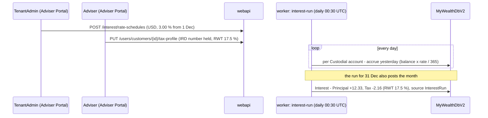

# Interest run

Step 9 of [custodial-roadmap.md](../custodial-roadmap.md) §13. It covers roadmap items **I1** (minimal Customer tax profile), **I2** (interest run) and the **S1 trust interest** part of the simulator bank. It answers roadmap D12 (the interest margin) and the "Open" of B7 (how the bank reconciliation shows interest). The interest run calls no outside party. The bank's interest on the trust account arrives through the existing bank feed and follows [ADR 0021](../adr/0021-outside-parties-behind-ports.md) rules 7–10. It amends [customers.md](customers.md), [posting.md](posting.md), [trade-fees.md](trade-fees.md), [custody-modes.md](custody-modes.md), [transaction-source.md](transaction-source.md), [accounts.md](accounts.md), [account-closure.md](account-closure.md), [deposit-matching.md](deposit-matching.md), [bank-reconciliation.md](bank-reconciliation.md), [reports.md](reports.md), [simulator.md](simulator.md) and the Adviser Portal, Customer Portal and Back Office contracts.

A TenantAdmin sets, per currency, an **interest rate schedule**: marginal bands of annual rates, effective from a date. Every day the platform works out, for each Custodial account, the interest its closing cash balance earned that day (a **daily accrual**) and stores it. After each calendar month the platform posts the accruals of the account as one `Interest` Transaction: the gross interest as the principal cash leg, and the **withholding tax** as a second cash leg with role `Tax`. The tax kind and rate come from the Customer's **tax profile** at that moment. An Adviser or TenantAdmin keeps the tax profile: tax residency, whether the firm holds the Customer's IRD number, and the RWT rate the Customer chose. One execution of this work for one Tenant is an **interest run**; it is stored and is the source of the Transactions it posts.

New: permissions `interest-rates.read`, `interest-rates.manage`, `interest-runs.read`, `interest-runs.start`; routes under the new `/interest` namespace (`/interest/rate-schedules`, `/interest/runs`), `GET|PUT /users/customers/{customerId}/tax-profile`, `GET /users/me/tax-profile`, `GET /accounts/{accountId}/interest-accruals`; source kind `InterestRun`; cash leg role `Tax` with a tax detail; an interest detail; statement line kind `Interest`; three reconciliation item kinds; problem code `interest_schedule_in_effect`; the `worker` job `interest-run`; the option `Interest:AllowFutureAsOfDates`. Scripts `0047_customer_tax_profiles.sql` and `0048_interest.sql`; simulator script `0007_bank_line_kind.sql`. No new `TransactionType`, domain event or port.

**Status is `accepted` (2026-11-22), landed 2026-11-22.** It depends on [account-closure.md](account-closure.md), which landed 2026-11-22. The nineteen points of §11 were confirmed on 2026-11-22, every one as recommended, and are written into the rules. The amendments to accepted docs listed in §12 were made when it was accepted.

Notes from landing:

- §5: `Transaction.PostInterest(tenantId, accountId, accountCurrency, decimalPlaces, accrued, period, withholding, bookedAt, source)` takes an `InterestPeriod` (from, to, days) and a `Withholding` (kind, rate, basis), both records in `MyWealthV2.Domain.Interest`. `InterestRateSchedule.AccrualFor` returns a `DayAccrual` (amount, effective rate). `InterestAccrual` has a `long` id and no audit columns, like its table.
- R3: `CustomerTaxProfile.RefusalOf` holds the three refusals for the Domain and the validator; a rate outside the five is checked first. A body without `rwtRatePercent` → 400 `errors.RwtRatePercent` (send `null` for no rate). A body `tenantId`, `customerId` or `withholding` → 400 at that field; any other unknown field is refused by the JSON reader.
- R6: a first write while a profile already exists (`rowVersion` `null`) → 409 `stale_row_version`, and so does a race on the key.
- R9, R13: band errors are reported at `Bands`, `Bands[i].From` and `Bands[i].RatePercent`, from the band checks the trade fee schedule uses (`TradeFeeScheduleRules.CheckBands`). R12: the cut-off date is `InterestCutOff` (Application). R15: a list `tenantId` → 400; an update body `currency` → 400 `errors.Currency`.
- R19: for an account never accrued, the first day is the UTC date of `Accounts.Created`; the walk starts at the later of that day and the first schedule's `EffectiveFrom`, because a day before it earns nothing (R11). The day balance is one read of the account's cash legs ordered by `bookedAt`.
- R20, R30: `RunInterest` (`IRunInterest`) and `AccountInterest` (`IAccountInterest`) read past the tenant query filter and name the Tenant themselves, as a SystemAdmin's run and the worker have no current tenant. `accountsProcessed` counts every account tried, a failed one included.
- R31: `InterestRunJob` and `InterestRunRecurringJob` live in `Infrastructure/Interest`. A run whose `accountsFailed` is above 0 also marks the job failed, after every Tenant was tried.
- R32: the option binds to `InterestOptions` (section `Interest`). The start-up check is `InterestOptions.EnsureAllowedOnHost`, called by `webapi` directly after the host is built. A manual run's Transactions have the SystemAdmin as `CreatedBy`.
- R33: the closure's run is stored only when the request posts a Transaction, with counts 1, 0, 1. A refused request rolls the interest posting back with the rest of its database transaction.
- R36: the route is `GET /accounts/{accountId}/interest-accruals`, a list envelope with page and pageSize (at most 100). R37: `ranBy` is `{ id, name }` or `null`.
- R38: the Customer Transactions PDF column widths were rebalanced so the Tax column fits.
- R40: the set-aside line's `lastAction.by` is `null` (the statement line item allowed only a person before); the Adviser Portal shows "The platform".
- §10: the run tests use a second `webapi` host on the fixture's database with the option on (`InterestRunHost`), whose `IAccountInterest` can be made to fail for one account. The account closure interest tests move an account's open date and its Transactions back in the database, and insert a schedule from a past day directly, since a Custodial account and a schedule cannot be dated in the past by a caller.
- D59: the rates page is `/interest/rates` with "New rate", and the form routes are `/interest/rates/new` and `/interest/rates/:id/edit`. D60: "Interest runs" is a link on the rates page; a run's page is `/interest/runs/:id`. D61: the daily table opens with a "Daily interest" button. D63: the Kind filter offers All, "Payments and receipts" and "Bank interest".
- BO21: the existing Back Office test that the configuration page offers no Run button for reports now checks the reports part of the page only, since the interest run form has its own Run button.
- The functional tests of §12 commit 4 were committed with the green commit of commit 3 by mistake; the red commit of commit 4 then added the permission tests.

Tax figures in this spec were checked against Inland Revenue's pages on 2026-11-22 (roadmap I1, [future-plans.md](../future-plans.md) §1). R4 names the pages.

---

## 1. Summary



| | After step 8 | After this slice |
| --- | --- | --- |
| Cash on a Custodial account | Earns nothing; `Interest` is refused by hand | Earns the Tenant's rate for its currency, accrued daily and posted monthly by the platform |
| Tax on that interest | Not recorded | Withheld on each posting as a `Tax` cash leg with its kind, rate and basis |
| A Customer's tax attributes | None | A tax profile: tax residency, IRD number held, chosen RWT rate |
| Interest the bank pays on the trust account | A receipt in suspense that a TenantAdmin ignores by hand | A statement line of kind `Interest` the platform sets aside itself, and its own item in the bank reconciliation |
| Closing a Custodial account | Pays out the balance | Posts the interest accrued so far first, then pays out |
| A month-end run in a demo | — | A SystemAdmin starts a run for an as-of date; a future date only where the option allows it |

The rule that distinguishes this slice: interest is earned per day and paid per month. A day's accrual, once stored, never changes, and the tax is decided only at the moment the interest is paid.

---

## 2. Scope

**In**

- Domain: `CustomerTaxProfile`, `TaxResidency`, `WithholdingRates`; `InterestRateSchedule` (reusing `FeeBands`); `InterestAccrual`; `InterestRun`, `InterestRunTrigger`; `CashLegRole.Tax`, `TaxKind`, `TransactionTaxDetail`, `TransactionInterestDetail`; `TransactionSourceKind.InterestRun` and `TransactionSource.InterestRun(runPublicId)`; factory `Transaction.PostInterest`; `Account.InterestAccruedThrough`; `StatementLineKind`; three `ReconciliationItemKind` values
- Application: tax profile command and queries; schedule commands and queries; service `AccountInterest` (accrue and post for one account); service `RunInterest` (one Tenant); command `StartInterestRun`; run and accrual queries; `RequestAccountClosure` posts the final interest; `ProcessStatementLines` sets a bank interest line aside; `ReconcileClientMoneyAccount` reads the new groups; account and transaction reads map the new fields; Customer Transactions Report gains a Tax column
- Infrastructure: EF mappings; recurring job `interest-run`; `SimulatorBankFeed` reads `kind`; the start-up check of the option
- Scripts: `database/schema/0047_customer_tax_profiles.sql`, `database/schema/0048_interest.sql`, `database/simulator/0007_bank_line_kind.sql`
- Security: four permissions (R1)
- HTTP (`webapi`): the routes of §8
- Simulator: `POST /control/bank/interest`; `kind` on the feed item
- Adviser Portal: tax details on the customer page, Interest rates pages, Interest runs page, interest on the ledger pages; BFF prefix `/interest`
- Customer Portal: tax details, accrued interest, the interest row
- Back Office: interest runs of a Tenant and "Run for a date"
- Tests listed in §10

**Out**

- Storing the IRD number itself, or any identity check. The profile says only that the firm holds it (roadmap I1: not a KYC module)
- Any other meaning of residency: a country or address of the Customer, a check when a Customer is created, or a limit on what an overseas Customer may open, hold or trade. `Overseas` is entered by the Adviser as the Customer states it
- Holders that are not individuals: companies (28 % default), trustees, Māori authorities, joint holders. RWT-exempt status. They need the legal structure of the holder, which the roadmap leaves out (§10 there)
- A reduced NRWT rate under a double tax agreement, and the approved issuer levy. An overseas Customer is withheld at 15 % (R4)
- Paying the withheld tax to Inland Revenue, the investment income report to Inland Revenue, and a tax certificate or year-end tax statement for the Customer
- Recording withholding tax on a hand-entered `Interest` of an External account (income events, future-plans §1 step 2)
- Dividends (roadmap C2). They reuse the `Tax` leg and the tax detail of R25
- Passing the bank's trust interest through to Customers, a fee on interest, and a computed margin figure (§11 point 6)
- Interest on negative balances (a Custodial balance is never negative), and negative rates
- Per-Customer, per-Account or per-portfolio rates. A platform default schedule
- An interest report (PDF) in the report framework, and a notification when interest is posted
- A flow that reverses an interest posting. A wrong posting is corrected with an adjustment (R27)
- Running the manual trigger on the `worker` queue (§11 point 12)
- Named scenarios and the scenario library in the simulator
- Any change to External accounts: they keep hand `Interest` as it is

---

## 3. Stories

1. As a TenantAdmin I set the interest my firm pays on USD cash to 3 % a year from next month, with a lower rate above a balance if I want, so that Custodial cash earns interest from then on.
2. As a TenantAdmin I correct or delete a rate that has not started yet, and I cannot change one that days were already accrued at.
3. As an Adviser I record that we hold my Customer's IRD number and that they chose the 17.5 % RWT rate, so that the right tax is withheld from their interest.
4. As a Customer I see my tax details, the interest my account has earned this month so far, and each month's interest with the tax taken off.
5. As the platform I accrue every Custodial account every day and post each month's interest once, also after a day on which the job did not run.
6. As a SystemAdmin I start an interest run for a Tenant and a date after a missed run, and in Development for a month end that has not come yet.
7. As an Adviser I close a Custodial account and the Customer is paid the interest earned up to the day before.
8. As a TenantAdmin I see the bank's interest on the trust account, the interest credited to Customers and the tax withheld as three known differences in the bank reconciliation, without ignoring a receipt by hand.
9. As the simulator operator I let the bank pay interest on a trust account and see the platform set the line aside.

---

## 4. Rules

### 4.1 Access

| ID | Rule |
| --- | --- |
| R1 | **Access.** New permissions: `interest-rates.read` (TenantAdmin, Adviser), `interest-rates.manage` (TenantAdmin), `interest-runs.read` (TenantAdmin, SystemAdmin), `interest-runs.start` (SystemAdmin). The tax profile routes under `/users/customers` take `customers.manage` or `customers.manage-own` with the scope of customers R17, as every route there; `GET /users/me/tax-profile` takes `users.me`; `GET /accounts/{accountId}/interest-accruals` takes `accounts.read` with the Account's scope. Missing / dead Bearer → 401, never 302. Policy fail → 403. A disabled current tenant → 403. A TenantAdmin, Adviser or Customer never names a tenant: a `tenantId` in a query or body → 400. A SystemAdmin on the `/interest/runs` routes must name one (R37). An id outside scope, of another tenant, or missing → 404. |

### 4.2 Customer tax profile (I1)

Amendment to [customers.md](customers.md).

| ID | Rule |
| --- | --- |
| R2 | **What it is.** Every Customer has one **tax profile** with three attributes: `taxResidency` (`NewZealand` or `Overseas`), `irdNumberHeld` (the firm holds the Customer's IRD number: `true` / `false`) and `rwtRatePercent` (the RWT rate the Customer chose: `10.5`, `17.5`, `30`, `33`, `39`, or `null` for none chosen). A Customer whose profile was never saved reads as `NewZealand`, `false`, `null`. The platform never stores the IRD number. Before this slice no attribute tells a New Zealand Customer from an overseas one ([function-plan.md](../function-plan.md) §5 lists tax residency under "Still later"); `taxResidency` is the first, and it decides the withholding of R4 and nothing else. |
| R3 | **Shape.** `rwtRatePercent` must be one of the five values or `null` (else 400 `errors.RwtRatePercent`). It may be set only with `taxResidency` `NewZealand` and `irdNumberHeld` `true` (else 400 `errors.RwtRatePercent`, `A rate can be chosen only when the IRD number is held.` or `An overseas customer has no RWT rate.`). With `Overseas`, `irdNumberHeld` is stored as sent and not used. |
| R4 | **Withholding.** The profile gives the tax kind and rate that R24 applies. The rates are constants in Domain (`WithholdingRates`) and change only with an amendment to this spec. Sources, read 2026-11-22: Inland Revenue, "Using the right resident withholding tax rate" (`ird.govt.nz/rwt-rate`, last updated 23 Sep 2026) for the five rates an individual may choose, the 33 % default and the 45 % non-declaration rate; "Deduct NRWT at the right rate" (last updated 29 Jun 2021) for 15 % on interest where no double tax agreement applies. |

| Profile | Tax kind | Rate | `basis` |
| --- | --- | --- | --- |
| `NewZealand`, IRD number held, a rate chosen | `Rwt` | the chosen rate | `Elected` |
| `NewZealand`, IRD number held, no rate chosen | `Rwt` | 33 % | `Default` |
| `NewZealand`, IRD number not held | `Rwt` | 45 % | `NonDeclaration` |
| `Overseas` | `Nrwt` | 15 % | `NonResident` |

| ID | Rule |
| --- | --- |
| R5 | **Read.** `GET /users/customers/{customerId}/tax-profile` → the item (R8) for a Customer in the caller's scope (TenantAdmin: the tenant; Adviser: assigned Customers; else 404). A Customer → 403 there, as on every `/users/customers` route. `GET /users/me/tax-profile` → the caller's own item when the caller is a Customer; any other role → 404. |
| R6 | **Write.** `PUT /users/customers/{customerId}/tax-profile` with `taxResidency`, `irdNumberHeld`, `rwtRatePercent` and `rowVersion` → 204. All three attributes are required on every write. `rowVersion` is the one the read returned, `null` while no profile is saved; stale → 409 `stale_row_version`. The first write creates the row. A Disabled Customer's profile may be changed. The body must not carry `tenantId`, `customerId` or a withholding field (400). |
| R7 | **When it applies.** The profile is read when interest is posted (R24) and applies to that whole posting, whichever days it covers. A write changes no posted Transaction and no accrual. The profile keeps who last changed it and when; there is no history table, because every tax detail stores the kind and rate that were applied. No domain event. |
| R8 | **Item.** `{ taxResidency, irdNumberHeld, rwtRatePercent, withholding: { kind, ratePercent, basis }, updatedBy, updatedAt, rowVersion }`. `withholding` is R4 for the stored attributes. `updatedBy` is `{ id, name }`; it, `updatedAt` and `rowVersion` are `null` while no profile is saved. A Customer sees every field except `updatedBy` (`null` for a Customer). |

### 4.3 Interest rate schedule (I2)

The pattern of the trade fee schedule ([trade-fees.md](trade-fees.md) R5–R13), per cash currency.

| ID | Rule |
| --- | --- |
| R9 | **Shape.** `currency`: an enabled catalog code. `effectiveFrom`: a date. `bands`: 1 to 10 rows of `{ from, ratePercent }`; the first `from` is `0`; `from` strictly ascending; the last band has no upper end. `ratePercent` is a rate per year, `≥ 0` and `≤ 100`, at most 4 decimals (`3` means 3 % a year). Every `from` has at most the currency's `DecimalPlaces` decimals. Bands are marginal: each rate applies only to the part of the balance inside its band. Violations → 400 `errors`. |
| R10 | At most one row per `(tenant, currency, effectiveFrom)`. Duplicate → 400 `errors.EffectiveFrom`. |
| R11 | **Applicable schedule.** For an account in currency `K` and a day `d`, the applicable schedule is the tenant's row for `K` with the latest `effectiveFrom` on or before `d`. No such row → the day earns nothing. |
| R12 | **Cut-off date.** For `(tenant, K)`, the cut-off date is the later of today (UTC) and the latest `interestAccruedThrough` (R19) of the tenant's Custodial accounts in `K`. A row is **in effect** when its `effectiveFrom` is on or before the cut-off date; otherwise it is **pending**. |
| R13 | **Create, update, delete.** A new row's `effectiveFrom` must be after the cut-off date (else 400 `errors.EffectiveFrom`). Only a pending row may be updated (`PUT` with `rowVersion`; the new `effectiveFrom` must also be after the cut-off date) or deleted. A row in effect → 409 `interest_schedule_in_effect`. `currency` is immutable. Update replaces the whole band set. To stop paying interest, add a row with one band `{ from: 0, ratePercent: 0 }`. |
| R14 | **Invariant.** No schedule write changes which row applied to an accrued day, or the values of that row. R12 and R13 exist to hold this. |
| R15 | **Routes.** `/interest/rate-schedules`: list (optional `currency`; sorted by `currency`, then `effectiveFrom`), get, create, update, delete. Reads need `interest-rates.read`, writes `interest-rates.manage`. The item has `inEffect` and `rowVersion`. No `Idempotency-Key` (configuration, not a ledger write). `/interest` is a namespace prefix like `/fees`: there is no `GET /interest`. |

### 4.4 Daily accrual (I2)

| ID | Rule |
| --- | --- |
| R16 | **Day and day balance.** A day is a UTC date, as everywhere on the platform ([utc-instants](../fixes/utc-instants.md)). The **day balance** of an account for day `d` is the sum of its cash legs, of every role, on Transactions with `bookedAt` before 00:00 UTC of `d + 1`: the closing balance of the day. Reserved cash counts, because the money is still in the trust account. On a Custodial account the server sets `bookedAt` (custody-modes R10), so the day balance of a past day never changes. |
| R17 | **Accrual.** For day `d` with an applicable schedule (R11): `accrual = Round(bands.Apply(dayBalance) / 365, 8, AwayFromZero)`, where `bands.Apply` is the sum over bands of `ratePercent / 100 × (the part of the balance inside the band)` (trade-fees R8). The divisor is 365 for every currency and every year (Actual/365 Fixed). When the accrual is `0` (no balance, no schedule, a zero rate) no row is stored. |
| R18 | **Accrual row.** One row per account and day: the day, the day balance, the schedule used, the effective annual rate (`bands.Apply(dayBalance) / dayBalance × 100`, 4 decimals) and the amount (8 decimals). At most one per `(Account, day)`. It is written once and never changed, except that R22 stamps it with the Transaction that paid it. |
| R19 | **Accrue through a day.** Each account has `interestAccruedThrough`: the last day accrual was worked out for, `null` before the first time. To accrue an account through day `D`, the platform locks the Account row as every posting does (posting R22) and, in one database transaction, stores the rows of every day after `interestAccruedThrough` (or from the UTC date the account was created, when `null`) up to `D`, then sets `interestAccruedThrough` to `D`. An account already accrued through `D` or later is left as it is. So each `(Account, day)` is accrued exactly once, whoever asks and however often. |
| R20 | **Which accounts.** Every Open Custodial account of the Tenant that is not closing (account-closure R11). A disabled Tenant and a Disabled Customer do not stop it: the cash is in the trust account whoever may sign in (deposit-matching R19). A Closed or closing account is skipped and its `interestAccruedThrough` stays, so a later run takes up the days in between (a reopened account earns nothing for the days it had no cash). External accounts are never accrued. |

### 4.5 Posting (I2)

Amendment to [posting.md](posting.md), [trade-fees.md](trade-fees.md) (cash leg role) and [transaction-source.md](transaction-source.md).

| ID | Rule |
| --- | --- |
| R21 | **Period.** Interest is posted for whole calendar months (UTC). For an as-of date `D`, the **posting date** `P` is the last day of the latest month that ended on or before `D` (`P = D` when `D` is the last day of a month). Posting an account takes every accrual row of the account that is not yet posted and has a day on or before `P`. Normally that is one month; after missed runs it is all the months missed, in one Transaction. |
| R22 | **Posting.** `accrued` = the sum of those rows. `gross = Round(accrued, dp, AwayFromZero)`, `dp` the currency's `DecimalPlaces`. When `gross` is `0`, nothing is posted and the rows stay unposted, so they count in the next posting. Otherwise the platform posts one `Interest` Transaction (R23) and stamps every row with it, in the same database transaction as R19. The part of `accrued` that rounding takes or adds is not carried forward. |
| R23 | **The Transaction.** Type `Interest`, with one `Principal` cash leg on the Account of `+gross`; when the tax of R24 is above 0, a second cash leg with role `Tax` of `−tax` and its tax detail (R25); an interest detail (R26); source `InterestRun` (6) with the run's PublicId as source id; `bookedAt` = platform time when it is posted (ADR 0021 rule 10); memo `Interest`; `reference` `null`. Built by `Transaction.PostInterest` without the manual entry matrix (custody-modes R7). `CreatedBy` is the worker's system name for the daily job, the person for a manual run or an account closure (R33). |
| R24 | **Withholding at posting.** The tax kind and rate are R4 for the Customer's tax profile when the Transaction is built. `tax = Round(gross × ratePercent / 100, dp, AwayFromZero)`, in the Account's currency. When `tax` is `0`, the Transaction has no `Tax` leg and no tax detail. Inland Revenue's pages state no rounding rule for the amount; the half-up rounding of the platform is used (§11 point 10). |
| R25 | **`Tax` cash leg and tax detail.** `CashLegRole` gains `Tax = 2`: an amount withheld from the Transaction's income and owed to a tax authority, always negative on the Account. Every `Tax` leg has exactly one tax detail, and no other leg has one: tax kind (`Rwt`, `Nrwt`), rate percent, basis amount (the gross the tax was computed on), tax amount and currency. At most one tax detail per `(Transaction, kind)`. In this slice a `Tax` leg appears only on an `Interest` posted by an interest run; the Domain refuses it on every other type. Dividends (roadmap C2) reuse the role and the detail and add their kinds. |
| R26 | **Interest detail.** Every interest posting has exactly one interest detail: `periodFrom` and `periodTo` (the earliest and latest day of the rows it paid), `days` (the number of rows), `accruedAmount` (8 decimals) and `grossAmount`. The rows themselves say which schedule and rate each day used (R36). |
| R27 | **No reversal by hand, none by the flow.** `InterestRun` is not a hand-reversible source (transaction-source R12): `POST /transactions/{id}/reverse` of an interest posting → 400 by transaction-source R13. No flow of this slice reverses one; a wrong posting is corrected with an adjustment ([adjustments.md](adjustments.md)). `Transaction.Reverse` copies a `Tax` leg with its role and tax detail and copies the interest detail, as it copies a fee detail (trade-fees R19), so a later flow can undo its own posting. |
| R28 | **Cash rules.** The net of an interest posting is never negative (the highest rate is 45 %), so available cash only rises (withdrawals R36). The portfolio trade lock does not apply and no rebalance is enqueued, as for a deposit (deposit-matching R19). |
| R29 | **Matrix.** The manual entry matrix cell `Interest` / Custodial stays **refused** (custody-modes R5); its "written by" is now the interest run. External accounts are unchanged: a hand `Interest` there has one `Principal` leg and no `Tax` leg. |

### 4.6 An interest run (I2)

| ID | Rule |
| --- | --- |
| R30 | **A run.** One execution for one Tenant and one as-of date `D`. For each account of R20, in `Id` order, each in its own database transaction under the Account lock: accrue through `D` (R19), then post (R21–R24). A failure on one account is logged with the account PublicId, rolls back that account only, and does not stop the others; the next run takes the account up where its `interestAccruedThrough` stands. The run is stored: Tenant, as-of date, trigger (`Scheduled`, `Manual`, `AccountClosure`), the person (none for `Scheduled`), start and end time, and the counts of accounts processed, accounts failed and Transactions posted. A stored run never changes after it ends. It reads local tables only and calls no outside party. |
| R31 | **Daily job.** `worker` registers the recurring job `interest-run` on a new queue `interest`, daily at 00:30 UTC (cron `30 0 * * *`). It starts one run with trigger `Scheduled` and `D` = yesterday (UTC) for every Tenant that has at least one interest rate schedule, in `Id` order, a disabled Tenant included. A failure of one Tenant's run is logged and does not stop the others; a job in which any run failed, or any account failed, is reported to Hangfire as failed after every Tenant was tried. No automatic Hangfire retries: R19 and R22 make the next day's run the retry. The run of the first day of a month posts the month before (R21). |
| R32 | **Manual run (roadmap D18).** `POST /interest/runs` with `{ tenantId, asOfDate }` (`interest-runs.start`) runs R30 at once on `webapi` with trigger `Manual` and the caller as the person, and answers 201 `{ id }` with `Location` on the item route. An unknown tenant → 404; a disabled one is allowed. `asOfDate` after yesterday (UTC) → 400 `errors.AsOfDate` (`Interest can be run only for days that have ended.`), unless the option `Interest:AllowFutureAsOfDates` is `true`. The rule reads the option, not the environment name. The option is `false` by default and `true` in the Development settings; a host outside Development with the option on fails at start-up, before it listens. With the option on, a day that has not ended is accrued on the balance at the time of the run (R16), and R19 keeps it from being accrued again. No `Idempotency-Key`: a repeat finds every account accrued and every row posted, and stores a run with zero counts. A manual run and the daily job may meet on the same Tenant; the Account lock and R19 keep each day and each row from being used twice. |
| R33 | **Account closure.** Amendment to [account-closure.md](account-closure.md) R4–R7. When an account closure is requested, after the checks of account-closure R3, R5 and R6 and before the payout is worked out (account-closure R7), under the same Account lock and in the same database transaction, the platform accrues the account through yesterday (UTC) and posts every accrual row not yet posted, whatever its month (R22–R26). When that posts a Transaction, it also stores a run with trigger `AccountClosure`, that one account and the requester, which is the Transaction's source. The payout then includes the net interest. A closing account is not accrued (R20): when the closure is cancelled, the next run accrues the days in between; when it completes, the account is Closed and earns nothing more. The day of the request and the days the payout is on its way earn no interest. |

### 4.7 Reads

| ID | Rule |
| --- | --- |
| R34 | **Transaction item.** Gains `interest`: `{ periodFrom, periodTo, days, accruedAmount, grossAmount }` on an interest posting (and its Reversal), `null` on every other Transaction. A cash leg's `role` may be `Tax`. Every cash leg gains `tax`: `{ kind, ratePercent, basisAmount, amount, currency }` on a `Tax` leg, `null` on any other. `source` is `{ "kind": "InterestRun", "id": "<run PublicId>" }`. Every caller who can read the Transaction sees all of it, the Customer included. |
| R35 | **Account item.** Gains `accruedInterest` (the sum of the account's accrual rows not yet posted, 8 decimals) and `interestAccruedThrough` (a date or `null`). On an External account `0` and `null`. Every caller who can read the Account sees them. |
| R36 | **Accrual rows.** `GET /accounts/{accountId}/interest-accruals` → list envelope, newest day first. Optional filters: `from` and `to` (days, inclusive; `to` before `from` → 400 `errors.To`), `transactionId` (the rows a Transaction paid; one the caller cannot see → an empty list) and `posted` (`true` / `false`). Item: `{ date, balance, ratePercent, scheduleId, amount, transactionId }`; `transactionId` is `null` until the row is posted. An External account → an empty list. |
| R37 | **Runs.** `GET /interest/runs` (`interest-runs.read`) → list envelope, newest start first. A TenantAdmin reads the current Tenant's runs; a SystemAdmin must send `tenantId` (missing → 400, unknown → 404). Optional filters: `trigger` (one or more names, comma-separated; unknown → 400 `errors.Trigger`), `from` and `to` on the as-of date. `GET /interest/runs/{id}` → the item: `{ id, asOfDate, postingDate, trigger, ranBy, accountId, startedAt, completedAt, accountsProcessed, accountsFailed, postingCount, totals }`. `postingDate` is R21 for the as-of date. `accountId` is set only for `AccountClosure`. `totals` is one entry per currency, `{ currency, postingCount, grossAmount, taxAmount }`, summed on read from the Transactions whose source is the run; a list item carries it too. |
| R38 | **Reports and balances.** Cash balance, net worth and the Adviser Balances Report sum every cash leg and are unchanged. The Customer Transactions Report gains a Tax column: the sum of the row's `Tax` legs, empty when there is none; its cash amount column stays the sum of the Account's cash legs (trade-fees R22), so an interest row shows the net. |

### 4.8 The bank's interest on the trust account (B7, S1 trust interest)

Amendment to [deposit-matching.md](deposit-matching.md) R10, R13, R45 and R49, [bank-reconciliation.md](bank-reconciliation.md) R9–R11 and [simulator.md](simulator.md).

| ID | Rule |
| --- | --- |
| R39 | **Line kind.** A bank statement line has a **kind**: `Transfer` (a payment in or out; the default) or `Interest` (interest the bank pays or charges on the account itself). The port's line carries it; an adapter maps the party's own code and gives `Transfer` for a code it does not know. A kind is never a reason to refuse a page (deposit-matching R10). Lines stored before this slice are `Transfer`. The statement line item gains `kind`, and `GET /statement-lines` an optional `kind` filter (unknown → 400 `errors.Kind`). |
| R40 | **Processing.** In the processing step (deposit-matching R13), a `Received` **credit** line of kind `Interest` is not matched and its reference is not read. In one database transaction the platform sets it `Ignored`, with last action `Ignored`, the note `Bank interest`, the time and no person. Nothing is written to the ledger: the interest Customers earn is posted by the interest run from the Tenant's schedule, not from this line (§11 point 6). A TenantAdmin may reopen the line and handle it like any receipt (deposit-matching R29). A **debit** line of kind `Interest` gets no special rule: it is processed as any debit line (bank-returns R2–R4) and waits in suspense. |
| R41 | **Reconciliation items.** Three new kinds, all Known. `BankInterest`: one item per `Ignored` credit line of kind `Interest`, in place of the `Ignored` item of bank-reconciliation R9, with the line's amount. `InterestCredited`: for the Transactions with source `InterestRun` on the Tenant's Custodial accounts in the currency, minus the sum of their `Principal` legs (negative: Custodial cash rose and the bank balance did not), `count` = the Transactions. `TaxWithheld`: minus the sum of their `Tax` legs (positive: Custodial cash fell and the money is still in the trust account), `count` = the Transactions with a `Tax` leg. These legs no longer count in `OtherLedgerCash`. An item whose amount is `0` is left out. The items of a run still add up to its difference. |
| R42 | **What the three items mean.** Their sum is the bank's interest that was not credited to Customers: the tax withheld and not yet paid over, plus the firm's interest margin when it is positive, minus what the firm credited above the bank's interest. The platform does not compute a margin, pay the tax or move the firm's share. When the firm takes money out of the trust account for either, the bank's debit line goes to suspense and a TenantAdmin ignores it with a note (bank-returns R9); that `Ignored` item offsets these. Whether a firm may keep a margin is a matter of its client agreement and the client money rules; the platform records the flows and does not decide it. |
| R43 | **Simulator: pay interest.** `POST /control/bank/interest` → 201 `{ id }` (the outside id). Body: `accountNumber` (an open account, else 400 `errors.AccountNumber`); `amount` (`> 0`, at most 4 decimal places); optional `reference` (≤ 140, default `Interest`); optional `valueDate`, `availableAfter` and `omitFromFeed` as for a bank charge (bank-reconciliation R27, R28). It adds a **credit** line of kind `Interest` with payer name `Bank interest`, no payer account, no `endToEndId` and no `returnOf`. The operator types the amount; the simulator does not compute interest from a rate. Log action `BankInterestPaid`. |
| R44 | **Simulator: wire and books.** The feed item (deposit-matching R45) gains `"kind"`: `"Interest"` on such a line, absent on every other. `GET /control/bank/accounts/{accountNumber}/statement-lines` shows `kind` on each line. The line counts in `balance` and `statementBalance` like any credit. A reset is unchanged. |
| R45 | **The adapter.** `SimulatorBankFeed` reads `kind`: `"Interest"` → `Interest`; absent, `null` or any other text → `Transfer`. A value that is not text → `BadResponse` (deposit-matching R49). |

Policies: the four of R1 (new). Grants: as R1.

---

## 5. Domain

| Type | Kind | Change |
| --- | --- | --- |
| `CustomerTaxProfile` | Entity (new), one per Customer | `TenantId`, `UserId`, `TaxResidency`, `IrdNumberHeld`, `RwtRatePercent?`, `UpdatedByUserId`, `UpdatedAt`, `RowVersion`. `Set(residency, irdNumberHeld, rwtRatePercent, by, at)` holds R3. `Withholding` returns R4. `CustomerTaxProfile.NotProvided` is the profile of a Customer with no row |
| `TaxResidency` | Enum (new) | `NewZealand = 0`, `Overseas = 1` |
| `WithholdingRates` | Static (new) | The five RWT rates, `Default = 33`, `NonDeclaration = 45`, `NonResident = 15`; `For(profile)` → `Withholding(kind, ratePercent, basis)` |
| `WithholdingBasis` | Enum (new) | `Elected = 0`, `Default = 1`, `NonDeclaration = 2`, `NonResident = 3`. Shown on the profile; not stored |
| `TaxKind` | Enum (new) | `Rwt = 0`, `Nrwt = 1`. Later kinds are added by their own specs |
| `InterestRateSchedule` | Aggregate (new) | Tenant, currency (immutable), `EffectiveFrom`, `FeeBands`. `AccrualFor(dayBalance)` implements R17 and returns the amount and the effective rate. Update and delete take the cut-off date and refuse a row in effect |
| `FeeBands` | Value object (existing) | Reused unchanged for the bands of R9 (trade-fees §5 wrote it for reuse). It is not renamed in this slice |
| `InterestAccrual` | Entity (new) | `TenantId`, `AccountId`, `Date`, `Balance`, `InterestRateScheduleId`, `EffectiveRatePercent`, `Amount`, `PostedTransactionId?`. `MarkPosted(transaction)` once |
| `Account` | Aggregate (existing) | `InterestAccruedThrough` (`DateOnly?`); `MarkInterestAccrued(through)` only moves it forward and only on a Custodial account |
| `InterestRun` | Aggregate (new) | `TenantId`, `PublicId`, `AsOfDate`, `Trigger`, `RanByUserId?`, `AccountId?`, `StartedAt`, `CompletedAt?`, `AccountsProcessed`, `AccountsFailed`, `PostingCount`. `Start(...)`, `Complete(counts, at)` once. `PostingDate` is R21 |
| `InterestRunTrigger` | Enum (new) | `Scheduled = 0`, `Manual = 1`, `AccountClosure = 2` |
| `CashLegRole` | Enum (existing) | Add `Tax = 2` |
| `TransactionTaxDetail` | Entity (new) | Exactly one per `Tax` cash leg: kind, rate percent, basis amount, tax amount, currency. At most one per `(Transaction, kind)`. Copied to a Reversal's matching leg |
| `TransactionInterestDetail` | Entity (new) | 0..1 per Transaction: `PeriodFrom`, `PeriodTo`, `Days`, `AccruedAmount`, `GrossAmount`. Copied to the Reversal |
| `TransactionSourceKind` | Enum (existing) | Add `InterestRun = 6`. Not hand-reversible |
| `TransactionSource` | VO (existing) | `TransactionSource.InterestRun(Guid runPublicId)`; the id must not be empty |
| `Transaction` | Aggregate (existing) | `PostInterest(tenantId, accountId, accountCurrency, decimalPlaces, accrued, period, withholding, bookedAt, source)`: R22–R26; source kind must be `InterestRun`; `gross` must be above 0. `Reverse` copies `Tax` legs, tax details and the interest detail (R27). Every other factory refuses a `Tax` leg |
| `StatementLineKind` | Enum (new) | `Transfer = 0`, `Interest = 1` |
| `BankStatementLine` | Aggregate (existing) | `Kind`. `SetAsideAsBankInterest(at)`: `Received` credit line of kind `Interest` → `Ignored` with the note of R40 and no person |
| `ReconciliationItemKind` | Enum (existing) | Add `BankInterest = 12`, `InterestCredited = 13`, `TaxWithheld = 14`, class Known |
| `BankReconciliation` | Aggregate (existing) | `Compute` builds the three kinds (R41); `ReconciliationInputs` gains the two ledger sums with counts and each line's kind |

```text
tax profile -> withholding (R4)
  NewZealand, IRD held, rate r   -> Rwt  r %     Elected
  NewZealand, IRD held, no rate  -> Rwt  33 %    Default
  NewZealand, IRD not held       -> Rwt  45 %    NonDeclaration
  Overseas                       -> Nrwt 15 %    NonResident

one account, as-of D (R19, R21-R24), one database transaction under the Account lock
  for each day d in (interestAccruedThrough, D]:
      accrual(d) = Round(bands(d).Apply(dayBalance(d)) / 365, 8)     row when > 0
  interestAccruedThrough = D
  rows = unposted rows with date <= P        P = last month end on or before D
  gross = Round(sum(rows), dp)               0 -> stop, rows stay
  tax   = Round(gross x rate / 100, dp)
  Interest: Principal +gross, Tax -tax (when > 0), interest detail, tax detail; rows stamped
```

Invariants:

- An `(Account, day)` has at most one accrual row, and a row's day is never after the account's `interestAccruedThrough`. Held by a unique index and R19.
- An accrual row is posted at most once, by exactly one Transaction. Held by `MarkPosted` and the Account lock.
- The `grossAmount` of an interest detail is the rounded sum of the rows stamped with its Transaction, and equals the `Principal` leg.
- A cash leg has a tax detail if and only if its role is `Tax`. A tax detail's tax amount is the opposite of its leg's amount, and its basis is the Transaction's gross.
- An interest rate schedule row in effect never changes (R14).
- A Customer's withholding is always one of the four rows of R4. Held by `CustomerTaxProfile` and `WithholdingRates`.
- On a Custodial account no person enters an `Interest`. Held by `CustodyRules` (unchanged).

Domain events: none new. An interest posting raises `TransactionPosted` as every Transaction does.

Recorded in [domain-model.md](../domain-model.md) §8.5 (`InterestAccruedThrough`), §8.6 (cash leg role `Tax`, the tax and interest details, source kind, `PostInterest`), §8.9 (statement line kind), §8.12 (reconciliation kinds) and §8.14 (tax profile and interest).

---

## 6. Database

Forward only. Do not add EF migrations.

### 6.1 Script `0047_customer_tax_profiles.sql`

| Table | Change | Index / FK |
| --- | --- | --- |
| `CustomerTaxProfiles` | Add | PK `UserId`. FK `(TenantId, UserId)` → `Users (TenantId, Id)`, `(TenantId, UpdatedByUserId)` → `Users (TenantId, Id)`, both RESTRICT |

| Column | Type | Null | Notes |
| --- | --- | --- | --- |
| UserId | int | no | The Customer. Role is checked in Domain and Application |
| TenantId | int | no | Tenant query filter |
| TaxResidency | int | no | CHECK 0–1 |
| IrdNumberHeld | bit | no | |
| RwtRatePercent | decimal(5,2) | yes | CHECK `IN (10.5, 17.5, 30, 33, 39)`; CHECK null unless `TaxResidency = 0 AND IrdNumberHeld = 1` |
| UpdatedByUserId, UpdatedAt | int, datetimeoffset | no | R7 |
| Created, CreatedBy, LastModified, LastModifiedBy | audit | | |
| RowVersion | rowversion | no | R6 |

No back-fill: a Customer without a row reads as not provided (R2).

### 6.2 Script `0048_interest.sql`

| Table | Change | Index / FK |
| --- | --- | --- |
| `InterestRateSchedules` | Add: `Id`, `PublicId`, `TenantId`, `Currency char(3)`, `EffectiveFrom date`, audit columns, `RowVersion` | UQ `PublicId`; UQ `(TenantId, Currency, EffectiveFrom)`; UQ `(TenantId, Id)`; FK `Tenants`, `Currencies` |
| `InterestRateBands` | Add: `Id`, `TenantId`, `InterestRateScheduleId`, `FromAmount decimal(18,4)`, `RatePercent decimal(7,4)` | UQ `(InterestRateScheduleId, FromAmount)`; FK `(TenantId, InterestRateScheduleId)` → schedule; CHECK from `≥ 0`; CHECK rate 0–100 |
| `Accounts` | Add `InterestAccruedThrough date NULL` | none |
| `InterestAccruals` | Add (columns below) | PK `Id`. UQ `(AccountId, AccrualDate)`. FK `(TenantId, AccountId)` → `Accounts`, `(TenantId, InterestRateScheduleId)` → `InterestRateSchedules`, `(TenantId, PostedTransactionId)` → `Transactions`, all RESTRICT. Filtered index `(AccountId, AccrualDate) WHERE PostedTransactionId IS NULL`; index `(PostedTransactionId)` |
| `InterestRuns` | Add (columns below) | PK `Id`. UQ `PublicId`. FK `TenantId` → `Tenants`, `RanByUserId` → `Users (Id)` (a SystemAdmin has no tenant, so no composite key), `(TenantId, AccountId)` → `Accounts`, all RESTRICT. Index `(TenantId, StartedAt DESC)` |
| `TransactionCashLegs` | Drop and re-add the `Role` CHECK as 0–2 | none |
| `TransactionTaxDetails` | Add: `CashLegId` (PK), `TenantId`, `TransactionId`, `Kind int`, `RatePercent decimal(5,2)`, `BasisAmount decimal(18,4)`, `TaxAmount decimal(18,4)`, `Currency char(3)` | FK `(TenantId, CashLegId)` → `TransactionCashLegs`, `(TenantId, TransactionId)` → `Transactions`, `Currencies`; UQ `(TransactionId, Kind)`; CHECK `Kind` 0–1; CHECK rate `> 0` and `≤ 100`; CHECK basis `> 0`, tax `> 0`. No `PublicId`, no `RowVersion` (part of an immutable Transaction, like `TransactionFeeDetails`) |
| `TransactionInterestDetails` | Add: `TransactionId` (PK), `TenantId`, `PeriodFrom date`, `PeriodTo date`, `Days int`, `AccruedAmount decimal(18,8)`, `GrossAmount decimal(18,4)` | FK `(TenantId, TransactionId)` → `Transactions`; CHECK `PeriodFrom ≤ PeriodTo`; CHECK `Days ≥ 1`; CHECK accrued `> 0`, gross `> 0` |
| `Transactions` | Drop and re-add `CK_Transactions_SourceKind` (`BETWEEN 0 AND 6`) and `CK_Transactions_SourcePublicId` (`(SourceKind IN (0, 1) AND SourcePublicId IS NULL) OR (SourceKind IN (2, 3, 4, 5, 6) AND SourcePublicId IS NOT NULL)`) | none |
| `BankStatementLines` | Add `Kind int NOT NULL` default 0, CHECK 0–1 | none |
| `BankReconciliationItems` | Drop and re-add `CK_BankReconciliationItems_Kind` as 0–14 and `CK_BankReconciliationItems_Line` with `Kind IN (2, 3, 4, 6, 12)` as the kinds that have a line | none |

`InterestAccruals`:

| Column | Type | Null | Notes |
| --- | --- | --- | --- |
| Id | bigint identity | no | |
| TenantId | int | no | Tenant query filter |
| AccountId | int | no | |
| AccrualDate | date | no | A UTC day |
| Balance | decimal(18,4) | no | The day balance; CHECK `> 0` |
| InterestRateScheduleId | int | no | The schedule used (R11) |
| EffectiveRatePercent | decimal(7,4) | no | R18 |
| Amount | decimal(18,8) | no | CHECK `> 0` |
| PostedTransactionId | int | yes | Set once (R22) |

`InterestRuns`:

| Column | Type | Null | Notes |
| --- | --- | --- | --- |
| Id | int identity | no | |
| PublicId | uniqueidentifier | no | The source id of the run's Transactions |
| TenantId | int | no | Tenant query filter |
| AsOfDate | date | no | |
| Trigger | int | no | CHECK 0–2 |
| RanByUserId | int | yes | Null iff `Trigger = 0` (CHECK) |
| AccountId | int | yes | Set iff `Trigger = 2` (CHECK) |
| StartedAt | datetimeoffset | no | Platform time |
| CompletedAt | datetimeoffset | yes | Null while the run is going or after a crash |
| AccountsProcessed, AccountsFailed, PostingCount | int | no | `0` until the run ends |
| Created, CreatedBy, LastModified, LastModifiedBy | audit | | |

No back-fill: no account was accrued before this slice, every existing cash leg keeps role 0 or 1, every stored statement line is `Transfer`, and no Transaction has source `InterestRun`.

### 6.3 Simulator script `database/simulator/0007_bank_line_kind.sql`

| Table | Content |
| --- | --- |
| `BankLines` | Add `Kind int NOT NULL DEFAULT 0` (`0` transfer, `1` interest), CHECK 0–1. Existing lines are transfers |

Recorded in [database-design.md](../database-design.md) §9, §11.3, §11.4, §11.9, §11.12, §11.14 and §15.

---

## 7. Application use cases

| Kind | Name | Change |
| --- | --- | --- |
| Query | `GetCustomerTaxProfile`, `GetMyTaxProfile` (new) | R1, R5, R8 |
| Command | `SetCustomerTaxProfile` (new) | R1–R3, R6, R7 |
| Command | `CreateInterestRateSchedule`, `UpdateInterestRateSchedule`, `DeleteInterestRateSchedule` (new) | R9, R10, R12, R13 |
| Query | `GetInterestRateSchedules`, `GetInterestRateSchedule` (new) | R15 |
| Service | `AccountInterest` (new) | `AccrueAndPostAsync(account, asOfDate, postingDate, run)` under the Account lock: R16–R19, R21–R26. The one place interest is accrued and posted |
| Service | `RunInterest` (new) | `RunAsync(tenantId, asOfDate, trigger, ranBy)`: R20, R30. Used by the job and the command |
| Job | `InterestRunJob` (new, Infrastructure) | R31 |
| Command | `StartInterestRun` (new) | `interest-runs.start`; R32 |
| Query | `GetInterestRuns`, `GetInterestRunById` (new) | R37 |
| Query | `GetInterestAccruals` (new) | R36 |
| Command | `RequestAccountClosure` (existing) | R33: calls `AccountInterest` with the posting date set to yesterday, and stores the `AccountClosure` run |
| Service | `ProcessStatementLines` (existing) | R40, before deposit matching |
| Service | `PullBankStatements` (existing) | Stores the line's kind (R39) |
| Service | `ReconcileClientMoneyAccount` (existing) | R41: the two ledger sums by leg role for source `InterestRun`; the line kind of `Ignored` lines |
| Query | `GetAccounts`, `GetAccountById` | Map `accruedInterest`, `interestAccruedThrough` (R35) |
| Query | `GetTransactions`, `GetTransactionById` | Map `interest`, leg `tax`, role `Tax`, source kind (R34) |
| Query | `GetStatementLines`, `GetStatementLineById` | Map `kind`; the `kind` filter (R39) |
| Report | Customer Transactions Report (existing) | Tax column (R38) |

Where each rule lives:

| Rule | Where |
| --- | --- |
| Profile shape and withholding (R3, R4) | `CustomerTaxProfile`, `WithholdingRates` |
| Band shape, accrual amount (R9, R17) | `InterestRateSchedule`, `FeeBands` |
| Cut-off date (R12) | Application, from `Accounts.InterestAccruedThrough` |
| Day balance (R16) | `AccountInterest` (one query of the account's cash legs ordered by `bookedAt`, summed per day) |
| Accrue once, post once (R19, R22) | `AccountInterest` under the Account lock; the unique index is the backstop |
| The Transaction's shape (R23–R26) | `Transaction.PostInterest` |
| As-of date and the option (R32) | `StartInterestRun`; the start-up check in the host |

---

## 8. API

| Method | Route | Policy | Success | Failure |
| --- | --- | --- | --- | --- |
| GET | `/users/customers/{customerId}/tax-profile` | `customers.manage` or `customers.manage-own` | 200 item | 401 / 403 / 404 |
| PUT | `/users/customers/{customerId}/tax-profile` | `customers.manage` or `customers.manage-own` | 204 | 400 / 401 / 403 / 404 / 409 |
| GET | `/users/me/tax-profile` | `users.me` | 200 item | 401 / 404 |
| GET | `/interest/rate-schedules` | `interest-rates.read` | 200 envelope | 400 / 401 / 403 |
| GET | `/interest/rate-schedules/{id}` | `interest-rates.read` | 200 item | 401 / 403 / 404 |
| POST | `/interest/rate-schedules` | `interest-rates.manage` | 201 `{ "id" }` | 400 / 401 / 403 |
| PUT | `/interest/rate-schedules/{id}` | `interest-rates.manage` | 204 | 400 / 401 / 403 / 404 / 409 |
| DELETE | `/interest/rate-schedules/{id}` | `interest-rates.manage` | 204 | 401 / 403 / 404 / 409 |
| GET | `/interest/runs` | `interest-runs.read` | 200 envelope | 400 / 401 / 403 / 404 |
| GET | `/interest/runs/{id}` | `interest-runs.read` | 200 item | 401 / 403 / 404 |
| POST | `/interest/runs` | `interest-runs.start` | 201 `{ "id" }` | 400 / 401 / 403 / 404 |
| GET | `/accounts/{accountId}/interest-accruals` | `accounts.read` | 200 envelope | 400 / 401 / 403 / 404 |
| GET | `/accounts`, `/accounts/{id}` | unchanged | item has `accruedInterest`, `interestAccruedThrough` | — |
| GET | `/transactions`, `/transactions/{id}` | unchanged | item has `interest`; legs have `tax`; `source.kind` may be `InterestRun` | — |
| GET | `/statement-lines[/{id}]` | unchanged | item has `kind`; list takes `kind` | adds 400 `errors.Kind` |
| POST | `/accounts/{accountId}/closures` | unchanged | posts the final interest first (R33) | — |

List envelope: `{ items, page, pageSize, totalCount }`; page default 1, pageSize default 20, max 100. `{id}` routes under `/interest/…` take a GUID only.

### 8.1 Bodies

Tax profile write, `PUT /users/customers/{customerId}/tax-profile`:

```json
{
  "taxResidency": "NewZealand",
  "irdNumberHeld": true,
  "rwtRatePercent": 17.5,
  "rowVersion": null
}
```

Tax profile item:

```json
{
  "taxResidency": "NewZealand",
  "irdNumberHeld": true,
  "rwtRatePercent": 17.5,
  "withholding": { "kind": "Rwt", "ratePercent": 17.5, "basis": "Elected" },
  "updatedBy": { "id": "<user publicId>", "name": "Alex Adviser" },
  "updatedAt": "2026-11-22T03:00:00Z",
  "rowVersion": "<base64>"
}
```

Never saved: `"taxResidency": "NewZealand"`, `"irdNumberHeld": false`, `"rwtRatePercent": null`, `"withholding": { "kind": "Rwt", "ratePercent": 45, "basis": "NonDeclaration" }`, and `null` for the last three fields.

Interest rate schedule create (update: the same without `currency`, plus `rowVersion`):

```json
{
  "currency": "USD",
  "effectiveFrom": "2026-12-01",
  "bands": [
    { "from": 0, "ratePercent": 3 },
    { "from": 100000.00, "ratePercent": 2 }
  ]
}
```

The item adds `"id"`, `"inEffect": false` and `"rowVersion"`.

Start a run: `{ "tenantId": "<tenant publicId>", "asOfDate": "2026-12-31" }`.

Run item:

```json
{
  "id": "<run publicId>",
  "asOfDate": "2026-12-31",
  "postingDate": "2026-12-31",
  "trigger": "Scheduled",
  "ranBy": null,
  "accountId": null,
  "startedAt": "2027-01-01T00:30:02Z",
  "completedAt": "2027-01-01T00:30:09Z",
  "accountsProcessed": 42,
  "accountsFailed": 0,
  "postingCount": 37,
  "totals": [
    { "currency": "NZD", "postingCount": 12, "grossAmount": 96.12, "taxAmount": 21.07 },
    { "currency": "USD", "postingCount": 25, "grossAmount": 410.55, "taxAmount": 93.40 }
  ]
}
```

Transaction item of an interest posting (a balance of 5 000.00 USD for 30 days at 3 %, RWT 17.5 %):

```json
{
  "id": "<transaction publicId>",
  "type": "Interest",
  "bookedAt": "2027-01-01T00:30:04Z",
  "memo": "Interest",
  "reference": null,
  "source": { "kind": "InterestRun", "id": "<run publicId>" },
  "interest": { "periodFrom": "2026-12-02", "periodTo": "2026-12-31", "days": 30, "accruedAmount": 12.32876700, "grossAmount": 12.33 },
  "cash": [
    { "accountId": "<account publicId>", "role": "Principal", "amount": 12.33, "currency": "USD", "fee": null, "tax": null, "...": "..." },
    {
      "accountId": "<account publicId>", "role": "Tax", "amount": -2.16, "currency": "USD", "fee": null,
      "tax": { "kind": "Rwt", "ratePercent": 17.5, "basisAmount": 12.33, "amount": 2.16, "currency": "USD" },
      "...": "..."
    }
  ],
  "security": []
}
```

Each day accrues `Round(5000 × 0.03 / 365, 8)` = `0.41095890`; thirty days are `12.32876700`.

Accrual row: `{ "date": "2026-12-31", "balance": 5000.00, "ratePercent": 3.0000, "scheduleId": "<schedule publicId>", "amount": 0.41095890, "transactionId": "<transaction publicId>" }`.

Account item (other fields unchanged): `"accruedInterest": 4.52054790, "interestAccruedThrough": "2026-12-12"`.

Simulator, control: `POST /control/bank/interest` `{ "accountNumber": "SIM-DEMO-USD", "amount": 520.00, "reference": "Interest December" }`. Party port: the feed item of that line carries `"kind": "Interest"`. Control log actions gain `BankInterestPaid`.

### 8.2 Errors

All refusals are ordinary validation (400 with `errors`, no problem `code`) except where named.

| Case | Response |
| --- | --- |
| Caller without the permission of the route; a Customer on `/users/customers/…/tax-profile` | 403 |
| A Customer, schedule, run or Account outside scope, of another Tenant, or missing; `GET /users/me/tax-profile` by a caller who is not a Customer | 404 |
| `tenantId` from a TenantAdmin, Adviser or Customer; `tenantId` missing from a SystemAdmin on `/interest/runs` | 400 |
| A rate outside the five values; a rate without a held IRD number or with `Overseas` | 400 `errors.RwtRatePercent` |
| Stale `rowVersion` on a tax profile or a schedule | 409 `stale_row_version` |
| Band shape (R9) | 400 `errors` |
| `effectiveFrom` not after the cut-off date, or a duplicate | 400 `errors.EffectiveFrom` |
| Update or delete of a schedule in effect | 409 `interest_schedule_in_effect` |
| `asOfDate` after yesterday without the option | 400 `errors.AsOfDate` |
| Unknown `trigger` or `kind` filter; `to` before `from` | 400 `errors.Trigger` / `errors.Kind` / `errors.To` |
| Hand `Interest` on a Custodial account | 400 `errors.Type` (custody-modes R5, unchanged) |
| Hand reverse of an interest posting | 400 (transaction-source R13) |

New problem code, in the registry in [api-design.md](../api-design.md) §4.2:

| `code` | Status | Meaning | Extra fields |
| --- | --- | --- | --- |
| `interest_schedule_in_effect` | 409 | The schedule row may already apply to an accrued day, so it cannot be updated or deleted. Add a new row instead. | — |

Cross-tenant or wrong-collection id → **404**, not 403. Keep the resource catalog in [api-design.md](../api-design.md) pointing here for these rules.

---

## 9. UI

Page contracts: [adviser-portal-dashboard.md](../adviser-portal/adviser-portal-dashboard.md) (D58–D63), [customer-portal.md](../customer-portal/customer-portal.md) (C28–C30) and [back-office.md](../backoffice/back-office.md) (BO20, BO21), amended and accepted together with this spec. The Adviser Portal BFF gains the prefix `/interest` ([bff-adviser-portal.md](bff-adviser-portal.md) R20). The Customer Portal BFF does not change: it already proxies `/users`, `/accounts` and `/transactions`.

**Adviser Portal**

| ID | Behaviour |
| --- | --- |
| D58 | The customer page gains a "Tax details" section from `GET /users/customers/{id}/tax-profile`: Tax residency ("New Zealand" / "Overseas"), IRD number ("Held" / "Not held"), RWT rate (the rate, or "Not chosen"), and the line "Tax withheld from interest: <kind label> <rate> %" with the basis in words (Elected "chosen rate", Default "no rate chosen", NonDeclaration "no IRD number held", NonResident "overseas resident"). Kind labels: Rwt "RWT", Nrwt "NRWT". Never saved → "Not provided" above the same line. Edit opens a form with the three fields; the rate select is disabled unless the residency is New Zealand and the IRD number is held. Save sends the PUT with the `rowVersion` read. A 400 is shown at its field; a 409 reloads with "Someone else changed these details." The form says: "We do not store the IRD number here." |
| D59 | TenantAdmin and Adviser see "Interest rates" under Fees in the nav (`/interest/rates`). The page lists `GET /interest/rate-schedules` grouped by currency: Effective from, Rates (each band as "3 % up to 100,000.00, then 2 %"), State ("In effect" / "Starts <date>"). A TenantAdmin sees New, and Edit and Delete on a pending row; an Adviser sees none, and the form routes render `/forbidden`. The form is the band editor of the fees page (adviser-portal-fees F6) without minimum and cap. 409 `interest_schedule_in_effect` shows "This rate has already been used and cannot be changed. Add a new one from a later date." and reloads. The effective-from field carries the UTC day note of F11, and: "Rates are per year. Interest is worked out on each day's closing balance and paid after the end of each month." |
| D60 | A TenantAdmin sees "Interest runs" (`/interest/runs`) from the Interest rates page; an Adviser does not, and a 403 shows "Only a firm administrator can see interest runs." The page lists `GET /interest/runs`: As of, Trigger (Scheduled "Daily run", Manual "Run by the platform team", AccountClosure "Account closure"), Accounts, Failed (in red when above 0), Interest paid and Tax withheld per currency. A run page shows the same with the posting date. There is no start button: a run is started by the platform team (R32). |
| D61 | `/transactions/:id` of an interest posting shows "Interest <periodFrom> to <periodTo> (<days> days)", Gross, Tax withheld with kind and rate, and Net; the Source line (D26) shows "Interest run". An expandable "Daily interest" table reads `GET /accounts/{id}/interest-accruals?transactionId=`: Day, Balance, Rate, Interest. Reverse is not offered (D27). The transactions list and account activity show the net amount with "incl. tax <amount>" under it, as they show a fee (adviser-portal-fees F13). |
| D62 | The page of a Custodial account shows "Interest accrued, not yet paid: <accruedInterest>" (4 decimals) with "up to <interestAccruedThrough>" when `accruedInterest` is above 0. The Close account page (D54) adds, when it is above 0: "Interest accrued so far is added before the payout. The amount to pay out may be higher than shown." |
| D63 | The Bank receipts list (D34) shows a "Bank interest" tag on a line of kind `Interest` and offers a Kind filter. The bank reconciliation run page (D51) labels the new kinds: BankInterest "Interest paid by the bank", InterestCredited "Interest credited to customers", TaxWithheld "Tax withheld from customers' interest". |

**Customer Portal**

| ID | Given | When | Then |
| --- | --- | --- | --- |
| C28 | A Customer | Profile page | A "Tax details" section from `GET /users/me/tax-profile`: Tax residency, IRD number ("On file" / "Not on file"), RWT rate, and "Tax taken from your interest: <rate> %". Under it: "To change these details, contact your adviser." No form. |
| C29 | A Customer with a Custodial account whose `accruedInterest` is above 0 | Account page | "Interest earned so far this period: <amount>" (the currency's minor unit, rounded down) under the balance, with "Paid after the end of the month." |
| C30 | A Customer with an interest posting | Account page activity | The row is labelled "Interest" with its period, and shows Gross, "Tax withheld (<kind label> <rate> %)" and the net amount. A hand-entered `Interest` on an External account keeps today's row. |

**Back Office**

| ID | Behaviour |
| --- | --- |
| BO20 | `/tenants/{id}/config` gains an "Interest runs" section: the newest ten runs from `GET /interest/runs?tenantId=` with As of, Trigger, Accounts, Failed, Posted and the totals per currency. |
| BO21 | A "Run for a date" form in that section: an as-of date (default yesterday, UTC) and Run, which posts `POST /interest/runs` and reloads the table. A 400 `errors.AsOfDate` is shown at the date. Under the form: "Runs every day by itself. Use this after a missed run. A run for a day already done changes nothing." |

### 9.1 Seeds and hosting

- `TestSeed` (Development / TestAppHost only): one interest rate schedule for USD and one for NZD in the demo tenant, effective the day after the cut-off date at seed time (so they obey R13), and a tax profile for one seeded Customer (IRD number held, 17.5 %). The others stay not provided. `DevelopmentSmokeSeeder` and `webapi --seed-demo`: no change.
- AppHost: the Development settings of `webapi` set `Interest:AllowFutureAsOfDates` to `true`. TestAppHost: `false`; the functional tests that need it turn it on for their host.
- VPS: no new secret, key or container. The option stays off. `worker` runs the new job on the new queue `interest`.
- Simulator: no new configuration.

---

## 10. Tests

| Project | Assert |
| --- | --- |
| Domain.UnitTests | `WithholdingRates.For`: the four rows of R4, each of the five chosen rates. `CustomerTaxProfile.Set`: a rate without a held IRD number, with `Overseas`, or outside the five → throws; `NotProvided` → Rwt 45 NonDeclaration. `InterestRateSchedule.AccrualFor`: one band (5 000 at 3 % → 0.41095890, rate 3.0000); two bands with the balance below, on and above the edge and the blended rate; a zero rate and a zero balance → 0; 8-decimal rounding. Pending and in effect for update and delete. `Transaction.PostInterest`: `Principal` +gross and `Tax` −tax with its detail; gross rounded per `DecimalPlaces` 2 and 0; tax 0 → no `Tax` leg and no detail; gross 0 → throws; the source must be `InterestRun`; the interest detail's fields. `Reverse` copies the `Tax` leg, tax detail and interest detail. `PostBuy`, `Post` and the other factories refuse a `Tax` leg. `TransactionSource.InterestRun(Guid.Empty)` → throws. `CustodyRules.AllowsHandReverse(Custodial, InterestRun)` false. `Account.MarkInterestAccrued`: never moves back; refused on External. `InterestRun.PostingDate`: 31 Dec → 31 Dec; 15 Jan → 31 Dec; 1 Jan → 31 Dec. `BankStatementLine.SetAsideAsBankInterest`: only a `Received` credit line of kind `Interest`. `BankReconciliation.Compute`: an ignored interest line → `BankInterest`, not `Ignored`; the two ledger kinds with their signs and counts; zero amounts left out; the items still add up to the difference |
| Application.FunctionalTests — tax profile | No Bearer → 401; SystemAdmin → 403; a Customer on the customers route → 403. Never saved → the not-provided item. TenantAdmin and the assigned Adviser set and read it; another Adviser → 404; each R3 refusal → 400; stale `rowVersion` → 409; the first write with `rowVersion` `null`, a second first write → 409. `GET /users/me/tax-profile`: the Customer's own, no `updatedBy`; an Adviser → 404. Two-tenant: tenant B's customer id → 404 on GET and PUT |
| Application.FunctionalTests — schedules | No Bearer → 401; Customer and SystemAdmin → 403; Adviser reads, write → 403; TenantAdmin creates, updates and deletes a pending row; `effectiveFrom` today → 400; duplicate → 400; band shape → 400; after an account was accrued through a later day, a row on or before that day → 400 on create and 409 `interest_schedule_in_effect` on update and delete; stale `rowVersion` → 409. Two-tenant: tenant B's schedule id → 404; a run uses only its own tenant's schedules |
| Application.FunctionalTests — runs | With the option on in the test host. A deposit, then a run through the month end → one row per day from the schedule's first day, each on that day's closing balance (a second deposit mid-month raises the later days only); `accruedInterest` and `interestAccruedThrough` on the account before the month end; at the month end one `Interest` with `Principal`, `Tax` (the profile's rate), both details, source `InterestRun`, the rows stamped, `accruedInterest` 0. The same run again → zero counts, no second Transaction. A mid-month as-of date → rows, no posting. Two missed months → one Transaction covering both. A balance too small to round above 0 → no Transaction, rows carried into the next month. A schedule change mid-month → each day at its own schedule. A profile changed before posting → the new rate on the whole posting; not provided → 45 %; `Overseas` → `Nrwt` 15 %. Reserved cash still earns. A Disabled Customer and a disabled Tenant are accrued. Closed, closing and External accounts are not. One account made to fail → the others are posted, `accountsFailed` 1, and the next run completes it. `POST /interest/runs`: SystemAdmin → 201; TenantAdmin, Adviser, Customer → 403; unknown tenant → 404; with the option off, an as-of date of today → 400 and of yesterday → 201. A host started with `UseEnvironment("Production")` and the option on fails at start-up. Reads: TenantAdmin sees the tenant's runs with totals; SystemAdmin without `tenantId` → 400; Adviser → 403. `GET /accounts/{id}/interest-accruals`: filters, the Customer's own, another Customer's account → 404. Hand reverse of the posting → 400; hand `Interest` on the Custodial account → 400 still. The Customer Transactions Report shows the net amount and the Tax column. Two-tenant: tenant B's run id → 404; a run for tenant A never accrues tenant B's accounts |
| Application.FunctionalTests — closure | Request a closure on an account with unposted rows → the final interest is posted first (source a run with trigger `AccountClosure`), the payout is the balance with the net interest, the closure's `cashBalanceAtRequest` includes it. A refused request (a holding) posts nothing. A closing account is skipped by a run; after the withdrawal is rejected the next run accrues the days in between. An account with no accrual → no run row |
| Application.FunctionalTests — bank interest | With the fake `IBankFeed`: a credit line of kind `Interest` → `Ignored` with the note `Bank interest` and no person, no Transaction, also when its reference names an account; reopen → `Unmatched`. A debit line of kind `Interest` → suspense (`UnknownPayment`). `GET /statement-lines?kind=Interest`. Reconciliation after an interest posting and a bank interest line → `BankInterest`, `InterestCredited`, `TaxWithheld`, status `Agreed`, nothing in `OtherLedgerCash` |
| Infrastructure.IntegrationTests | `0047`: the residency, rate and rate-needs-IRD CHECKs; one row per Customer. `0048`: a second row for the same `(Account, day)` violates; role `2` allowed and `3` violates; a second tax detail of the same kind on a Transaction violates; `SourceKind = 6` needs a `SourcePublicId`, `7` violates; line `Kind` 2 violates; item `Kind = 12` needs a line, `15` violates; the run CHECKs. EF round-trips. `InterestRunJob` on a worker host: every Tenant with a schedule, a Tenant without one skipped, one failing Tenant does not stop the next. `SimulatorBankFeed`: `kind` `Interest`, absent, `null`, an unknown text → `Transfer`; a number → `BadResponse`. TestSeed idempotent |
| Simulator.Tests | `0007` applies. `POST /control/bank/interest` → a credit line of kind `Interest`, payer name `Bank interest`; `kind` on the feed item of that line only; counted in `balance`; `omitFromFeed`; an unknown account → 400; the control log row |
| Adviser Portal | D58 the section, the disabled rate select, the 400 and 409; D59 the list, the band text, TenantAdmin-only actions, the in-effect message; D60 TenantAdmin only, columns and labels, no start button; D61 the interest block, the daily table, no Reverse, the list row; D62 the accrued line and the Close account sentence; D63 the tag, the filter, the three labels |
| Customer Portal | C28–C30 |
| Back Office | BO20, BO21 |

Fan-out in the tests:

- Tests that read a cash leg's `role` or the reconciliation item kinds as closed lists gain the new values.
- The Adviser Portal and Customer Portal `Transaction` types gain `interest` and leg `tax`; `Account` gains `accruedInterest` and `interestAccruedThrough`; `StatementLine` gains `kind`.

---

## 11. Locked in this spec

No new ADR. The interest run calls no outside party, so ADR 0021 applies only through rule 9 (a flow sets its source), rule 10 (book at processing time, the period in a detail row) and rule 11 (the platform keeps the real clock; a date-driven job gets a manual trigger). The bank's interest line follows rules 7 and 8. Roadmap P4, P5 and P6 apply as written.

| Item | Lock |
| --- | --- |
| Tax profile | Residency, IRD number held, chosen RWT rate; one per Customer; not provided by default; set by the Adviser or TenantAdmin; read by the Customer |
| Withholding | The four rows of R4, decided when interest is posted, stored on the tax detail |
| Rate schedule | Tenant, per currency, marginal bands of annual rates, effective-dated, never changed once in effect |
| Accrual | Per Custodial account and UTC day, on the closing balance, Actual/365, 8 decimals, stored once |
| Posting | Calendar months; one `Interest` per account with a `Principal` leg, a `Tax` leg, an interest detail and a tax detail; source `InterestRun` (6) |
| Run | Per Tenant and as-of date; daily at 00:30 UTC for yesterday; a SystemAdmin trigger; stored |
| Account closure | Final interest at the request; a closing account is not accrued |
| Bank interest | Statement line kind `Interest`, set aside by the platform; reconciliation kinds `BankInterest`, `InterestCredited`, `TaxWithheld` |
| Simulator | `POST /control/bank/interest`; `kind` on the feed item |
| Scripts | `0047_customer_tax_profiles.sql`, `0048_interest.sql`; simulator `0007_bank_line_kind.sql` |
| Permissions | `interest-rates.read`, `interest-rates.manage`, `interest-runs.read`, `interest-runs.start` |
| Problem code | `interest_schedule_in_effect` |
| Events, ports, `TransactionType` | None added |

### Confirmed in review (2026-11-22)

Each point was confirmed on 2026-11-22 as recommended, and is written into the rules above as stated here. The alternatives are kept for the record.

1. **One spec for I1, I2 and the trust interest of S1.** Decided: the tax profile has no reader but the interest posting, and the bank's interest line has no meaning without the interest the firm credits, so each part alone ships nothing a person can see. Alternative: a separate small spec for the tax profile, accepted and landed first.
2. **The tax profile is three attributes, and the IRD number is not stored** (R2). Decided: roadmap I1 asks for "whether an IRD number is held", and a stored tax number needs encryption, masking and access rules this slice does not have. A Customer with nothing saved is withheld at the non-declaration rate, which is what a payer must do without an IRD number. Alternative: store the number, masked on every read.
3. **Rates are constants from Inland Revenue's pages, for individuals only; an overseas Customer is withheld at 15 %** (R4). Decided: a Customer is a person, and the roadmap leaves the holder's legal structure out, so company and trustee rates and RWT-exempt status wait for that. 15 % is the rate without a double tax agreement, so it never withholds too little. Alternatives: a treaty rate per Customer typed by the TenantAdmin (needs the country and the treaty table); refuse interest for overseas Customers until that exists.
4. **An Adviser or TenantAdmin sets the profile, with the existing Customer permissions, and no second person checks it** (R1, R6). Decided: the rate is the Customer's own choice under the tax rules, the Adviser already edits the Customer, and a wrong rate moves no money out of the firm. The Customer reads it at `GET /users/me/tax-profile` and cannot change it (roadmap D6). Alternative: new permissions `tax-profiles.read` / `.manage`, or a TenantAdmin check as for a nominated bank account.
5. **The profile applies when interest is paid, and there is no history table** (R7, R24). Decided: withholding is a tax on the payment, so the rate on file at the payment is the rate that applies, as at a bank; the tax detail keeps what was applied. Alternative: an effective-dated profile and a rate per accrued day.
6. **Roadmap D12: the firm sets the Customer rate, and the margin is whatever the bank pays above it** (R9, R40–R42). Decided: the roadmap's I2 already describes a Tenant rate schedule; the Customer's interest then does not depend on when or whether the bank's line arrives; and the bank reconciliation shows the bank's interest, the interest credited and the tax withheld as three known differences, so the margin can be read but is not booked. Alternative: pass the bank's interest through, sharing each interest line among the accounts by their daily balances, with an optional fee to the firm; exact, but it needs the bank's period for each line and makes the Customers' interest wait for the bank.
7. **Marginal bands, Actual/365 for every currency, UTC days** (R9, R16, R17). Decided: bands reuse `FeeBands` as it is, and a firm with one rate enters one band; one day count keeps the worked examples simple; the platform has no Tenant time zone, and every date rule on it is a UTC day (trade-fees R7). A UTC day ends at noon or 1 pm in New Zealand, so a deposit made in the New Zealand morning earns from the UTC day before. Alternatives: one flat rate; Actual/360 for USD; a time zone per Tenant.
8. **Daily accruals are stored, with a cursor per account** (R18, R19). Decided: each day's balance, rate and amount can be shown and checked; the account page can show interest earned so far; an account closure can pay it; a schedule's cut-off date is a fact in a column; and a missed day is caught up by the next run. Alternative: compute the whole month from the cash legs when posting and store only the posting; fewer rows, but nothing to show before the month end and no record of what each day earned.
9. **Monthly posting by calendar month (UTC), rounded half away from zero, a sub-unit amount carried forward** (R21, R22). Decided: one posting per account and month, like a bank account; an amount that rounds to zero is not lost; the rounding of a posted amount is dropped because carrying it adds a column for less than half a minor unit a month. Alternatives: round down; carry the rounding remainder; post quarterly.
10. **A `Tax` cash leg with a tax detail, shared with dividends** (R25). Decided: it mirrors the `Fee` leg and fee detail (trade-fees §11 names `Tax` as the next role), keeps the gross and the tax apart for every later tax report, and gives roadmap C2 its shape (the roadmap asks that it be settled once). Tax is rounded half away from zero to the minor unit; the Inland Revenue pages read state no rule, so the RWT payer's guide (IR283) should be read before a real launch. Alternative: one net leg with the tax only in a detail row.
11. **A stored run is the source of its Transactions; totals are summed on read** (R30, R37). Decided: transaction-source R3 wants the PublicId of the run, and the run row tells a TenantAdmin what happened each day; the totals come from the Transactions themselves, so they cannot disagree with the ledger. Each account is its own database transaction, so one bad account does not hold up a firm's interest. Alternative: no run row, the source id naming the account's posting.
12. **Roadmap D18, refined: the as-of date is at most yesterday, the trigger runs at once on `webapi`, SystemAdmin only** (R32). The roadmap says "up to today on production". Decided: yesterday, because today's closing balance does not exist yet, and a day accrued early is never accrued again. The run calls no outside party, so it may run in the request, as "Run now" does for a bank reconciliation; it moves to the `worker` queue when a Tenant has enough accounts for the request to time out. The trigger is for the platform team (catch-up, demos), with a small Back Office form. Alternatives: allow today; a 202 and a `worker` job now; a TenantAdmin "Run now".
13. **The daily job runs at 00:30 UTC for yesterday, for every Tenant with a schedule, on its own queue** (R31). Decided: fixed in code like the other jobs; just after the UTC day ends; a Tenant with no schedule gets no empty run rows. Alternative: a cron per Tenant.
14. **An account closure pays the interest accrued up to the day before, and a closing account earns nothing** (R33). Decided: account-closure §11 point 1 left this step for this slice; posting it under the closure's own lock keeps the payout equal to the whole balance, and stopping accrual while closing keeps account-closure R16 true. The Customer gives up the interest of the last days. Alternatives: no final interest (unposted accruals of a closed account are lost); accrue while closing and pay a second payment after the close.
15. **The bank's interest is a kind on the statement line, set aside by the platform, and three known reconciliation kinds** (R39–R42). Decided: a bank statement names its interest entries, so the platform need not wait for a person to ignore the line (deposit-matching R27 named this case), and the reconciliation stays `Agreed`. Setting it `Ignored` reuses a status and its reopen. Alternatives: leave it to suspense and the TenantAdmin as today; a new line status `BankInterest`.
16. **The simulator operator types the bank's interest amount** (R43). Decided: the smallest addition (roadmap P11); the Interest runs page tells the operator what the firm credited, so a demo of a margin picks any larger amount. Alternative: the simulator computes it from a rate and its own daily balances by value date.
17. **Four new permissions; the TenantAdmin manages rates, the Adviser reads them, SystemAdmin starts and reads runs** (R1). Decided: as the later bank-stage specs, SystemAdmin has no Tenant operation, and holds only the trigger the roadmap gave it. Alternative: `fees.read` / `fees.manage` reused for the rates.
18. **No flow reverses an interest posting** (R27). Decided: a wrong posting is rare and is a correction a TenantAdmin makes with an adjustment and a memo; an "undo interest" flow would also have to un-stamp accrual rows and decide whether they are paid again. Alternative: a TenantAdmin action that reverses a posting and frees its rows for the next run.
19. **No report, tax statement or Inland Revenue filing in this slice** (§2 Out). Decided: the tax detail stores what every such document needs; each is its own slice once income events (future-plans §1 step 2) settle what a tax year's statement contains.

Still open, not this slice:

- Company, trust and joint holders, RWT-exempt status, treaty rates and the approved issuer levy
- Paying the withheld tax to Inland Revenue (monthly by the 20th when $500 or more a month is withheld, otherwise by 20 April and 20 October), the investment income report, and a tax certificate for the Customer
- A firm report of interest paid and tax withheld per period (report scope `Tenant`, bank-reconciliation §11 point 9)
- A margin or client money surplus figure, and moving the firm's share out of the trust account
- Whether a firm may keep a margin: check against the client money rules (FMA) before a real launch
- Concurrency between a schedule write and a run at the same moment (R12 reads the accounts; a schedule write takes no Account lock), as trade-fees left open for trades
- Interest shown in net worth or performance figures as income (future-plans §1 steps 2 and 5)
- A Tenant time zone for days and months

---

## 12. Suggested commits

The repository should build after each commit. Agents split each behaviour into red then green. Start after [account-closure.md](account-closure.md) has landed (it has, 2026-11-22).

1. Script `0047`, `CustomerTaxProfile`, `TaxResidency`, `WithholdingRates` + Domain unit tests and the `0047` integration tests.
2. Tax profile routes (R1–R8) + functional tests, two-tenant.
3. Script `0048`; `InterestRateSchedule` and `AccrualFor` (R9, R17) + Domain unit tests and the `0048` integration tests.
4. Interest rate schedule routes, the permissions, the cut-off date and the problem code (R9–R15) + functional tests, two-tenant.
5. `CashLegRole.Tax`, the tax detail, the interest detail, source kind `InterestRun`, `Transaction.PostInterest`, `Reverse` copies (R23–R27) + Domain unit tests.
6. `AccountInterest`: accrue through a day and post (R16–R22, R28) + functional tests through a test-only call of the service.
7. `RunInterest`, the run record, `POST /interest/runs`, the option and its start-up check, the run reads (R20, R30, R32, R37) + functional tests, two-tenant.
8. The daily job (R31) + integration tests on a worker host.
9. Reads: the transaction item, the account item, the accrual rows, the Customer Transactions Report Tax column (R34–R36, R38) + functional tests.
10. Account closure: the final interest and no accrual while closing (R33) + functional tests.
11. Statement line kind, the bank interest line set aside, `SimulatorBankFeed` (R39, R40, R45) + functional and integration tests.
12. Reconciliation kinds `BankInterest`, `InterestCredited`, `TaxWithheld` (R41) + Domain unit and functional tests.
13. Simulator: script `0007`, `POST /control/bank/interest`, `kind` on the feed (R43, R44) + `Simulator.Tests`.
14. TestSeed schedules and tax profile; the Development setting.
15. BFF prefix, Adviser Portal D58–D63 + frontend tests.
16. Customer Portal C28–C30 + frontend tests.
17. Back Office BO20, BO21 + tests.
18. Repo docs: mark this file landed; roadmap §13 step 9 and the §2 matrix; remove the "No interest" known-issue row.

Do not put dividends, a tax statement, an Inland Revenue filing or an interest report in these commits.

### Docs amended when this spec is accepted

[customers.md](customers.md) (the tax profile sub-resource and `GET /users/me/tax-profile`), [posting.md](posting.md) (R16, R20 and the type table: `Interest` on a Custodial account is written by the interest run, with a `Tax` leg), [trade-fees.md](trade-fees.md) (the cash leg role `Tax`; R20 wording), [custody-modes.md](custody-modes.md) (R5 matrix: "written by" the interest run), [transaction-source.md](transaction-source.md) (kind `InterestRun` = 6, not hand-reversible, check widened), [accounts.md](accounts.md) (`accruedInterest`, `interestAccruedThrough`, the accrual rows route), [account-closure.md](account-closure.md) (R4–R7: final interest; R11: not accrued while closing; §2 Out and "Still open" updated), [deposit-matching.md](deposit-matching.md) (R10, R13, R27, R45, R49: line kind, the interest line set aside), [bank-returns.md](bank-returns.md) (a debit line of kind `Interest`, unchanged rule, note), [bank-reconciliation.md](bank-reconciliation.md) (R9–R11 and §5: three kinds; §2 Out and "Still open" updated), [withdrawals.md](withdrawals.md) (R36: an interest posting only raises available cash, note), [reports.md](reports.md) (Customer Transactions Report Tax column), [simulator.md](simulator.md) (R43, R44, script `0007`), [bff-adviser-portal.md](bff-adviser-portal.md) (prefix `/interest`), [api-design.md](../api-design.md) (§3.1 four permission rows, §4.2 the problem code, §6 resource rows, a new §7.10 Interest, §7.4 and §7.6 notes, change log), [domain-model.md](../domain-model.md), [database-design.md](../database-design.md), [architecture.md](../architecture.md) (the `worker` job and queue), [adviser-portal-dashboard.md](../adviser-portal/adviser-portal-dashboard.md) (D58–D63), [customer-portal.md](../customer-portal/customer-portal.md) (C28–C30), [back-office.md](../backoffice/back-office.md) (BO20, BO21), [known-issues/custodial-account-gaps.md](../known-issues/custodial-account-gaps.md) (the "No interest" row notes this spec; it is removed when the slice lands), [glossary.md](../glossary.md) (the review terms become accepted; Cash leg role and Transaction source gain their new values), [function-plan.md](../function-plan.md) §5 (the roadmap step, and "Still later": tax residency and the IRD number flag now exist as the tax profile; KYC / AML stays later), [features/README.md](README.md) row status, [future-plans.md](../future-plans.md) §1 step 2 (the tax leg and the tax profile exist), and the roadmap §6 I1 and I2, §11 S1, §12 D12 and D18, and §13 status.

---

## Amendment 2026-11-24 (migration batches) — accepted

Status of this amendment: `accepted` (2026-11-24), together with [migration-batches.md](migration-batches.md). Rule R24 lives there; this section records what changes here.

- §4.4: migrated cash accrues interest from the closing balance of the UTC day its batch was posted, not from the batch's `asOfDate`.

---

## Amendment 2026-11-24 (dividends) — accepted

Status of this amendment: `accepted` (2026-11-24), together with [dividends.md](dividends.md). Rules R33, R38 and R45 live there; this section records what changes here.

- R25: `TaxKind` gains `ForeignWithholding` (2). A `Tax` leg is allowed on `Interest` (kinds `Rwt`, `Nrwt`) and on `Dividend` (all three kinds) and on no other type.
- R41: `TaxWithheld` also counts the `Rwt` and `Nrwt` legs of every `Dividend` on the Tenant's Custodial accounts in the currency.
- `WithholdingRates` gains the dividend rates: RWT 33 % for every New Zealand Customer, NRWT 30 % for an overseas Customer on a New Zealand company's dividend. The rates of interest are unchanged.
- §2 Out: dividends on Custodial accounts are no longer out; dividends on External accounts still are.
