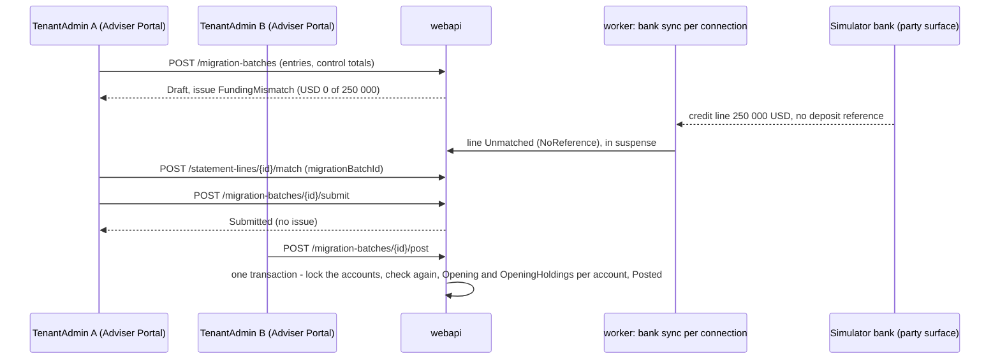

# Migration batches

Step 13 of [custodial-roadmap.md](../roadmaps/custodial-roadmap.md) §13. It covers roadmap item **T2** (migration batch). It needs no outside party of its own and makes no change to the simulator: the cash of a batch arrives through the bank feed of [deposit-matching.md](deposit-matching.md), as an ordinary receipt on the trust account. It builds on the `Opening` and `OpeningHoldings` types of [posting.md](posting.md) and [holdings.md](holdings.md), the source of [transaction-source.md](transaction-source.md) and the run of [bank-reconciliation.md](bank-reconciliation.md).

Today a Custodial account starts empty and stays empty until a Customer pays in and an order is filled. A firm that moves its existing Customers onto the platform has no way to bring their cash and holdings with them. After this slice a TenantAdmin prepares a **migration batch**: one entry per empty Custodial account with its opening cash and holdings, and the **control totals** typed from the previous provider's closing statement. The bulk transfer the previous provider pays into the trust account is matched to the batch as its **funding**. A second TenantAdmin posts the batch. The platform then writes one `Opening` and one `OpeningHoldings` Transaction per account, all of them or none.

New: permission `migration-batches.manage`; routes under `/migration-batches`; source kind `Migration`; statement line match method `Migration`, with `migrationBatchId` on the match body and on the statement line item; reconciliation item kind `MigrationNotPosted`; item field `migration` on the transaction item; problem code `migration_batch_not_valid`. Script `0054_migration_batches.sql`. No simulator script. No new `TransactionType`, port, job, queue or domain event.

**Status is `accepted` (2026-11-24), landed 2026-11-24.** The seventeen points of §11 were confirmed on 2026-11-24, every one as recommended, and are written into the rules. The amendments to accepted docs listed in §12 were made when it was accepted. It is a build contract.

Notes from landing:

- §5: `MigrationBatch.AddFunding` and `RemoveFunding` do what `Touch()` names (R13, R14): they refuse a batch that is not `Draft` with the sentences of R13 and R14 and update the row, so its `RowVersion` changes. `EnsureNotSubmitter` and `StatusMessage` are public for the commands. The control totals are stored as `MigrationBatchControlTotal` rows (kind `MigrationControlTotalKind`: `Cash`, `Quantity`, `Cost`) and the account count as a column; `MigrationControlTotals` is read from them. `MigrationTotal` (`AccountCount`, `Cash`, `Quantity`, `Cost`) is the `total` of an issue. The detail of a migrated Transaction is built from a `MigrationOrigin` (as-of date, previous provider).
- §6: the FKs from `MigrationBatchControlTotals`, `MigrationBatchEntries` and `MigrationBatchHoldings` to their parent are RESTRICT, not CASCADE, as every tenant FK is (`TenantCompositeKeysSchemaTests`); EF deletes the entries and holdings that `Replace` drops. `MigrationBatchEntries` has `UQ_MigrationBatchEntries_TenantId_Id` for the holdings' tenant FK. The child tables and `TransactionMigrationDetails` have no audit columns, like `RebalanceLines` and the other Transaction details. The CHECKs are `CK_MigrationBatches_Status`, `_ControlAccountCount`, `_Submitted`, `_Returned`, `_Posted`, `_Cancelled`, `CK_MigrationBatchControlTotals_Kind`, `_Target`, `_Amount`, `CK_MigrationBatchEntries_CashAmount`, `CK_MigrationBatchHoldings_Quantity` and `_Cost`; the indexes `IX_MigrationBatches_TenantId_Status_Created`, `IX_MigrationBatchEntries_TenantId_AccountId`, `IX_BankStatementLines_MigrationBatchId` and `IX_TransactionMigrationDetails_TenantId`.
- R4, R7: an Account twice in a body is a 400 at `Entries[i].AccountId` (`This account is already in the batch.`), an Instrument twice in an entry at `Entries[i].Holdings[j].InstrumentId`; an entry with neither cash nor a holding at `Entries[i].Cash`.
- R9: the issue messages name the account or the symbol, for example `J Smith brokerage already has transactions. A migration batch fills empty accounts only.`, `VTI is quoted in NZD; K Jones brokerage is in USD.`, `The control total of cash in USD is 250,000.01; the entries add up to 250,000.00.` and `BND has no control total; the entries hold 10.`
- R11, R21: `MigrationBatchValidator.ValidateAsync` (Application) loads the state of the batch's Accounts, Instruments and funding lines; the post calls it after the Account locks and the clock.
- R13: the extra permission is checked in `MigrationBatchFunding` (statement lines) with `RolePermissions.Has`, before the line is read.
- R15: `BankRecalls` handles a `Matched` line with method `Migration` before it would reverse a deposit.
- R17: the problem detail is `The migration batch has <n> issues.`
- R22: `CreatedBy` is the poster through the auditing interceptor. The holdings projection is synced per entry after the Transactions are saved, in the same database transaction.
- R32: `ReconciliationLine` gains `MigrationNotPosted`. The cash legs of a posted batch become `ReconciliationLedgerCash` rows of type `Opening`, one per client money account whose lines funded the batch in the run's currency, each with the batch's Transaction count; a remainder stays `OtherLedgerCash`.
- D81: a CSV row may have cash and a holding together; the cash rows of one account add up. Symbols are found among the first 100 active instruments. A body error of R7 is shown under its entry.
- D82: the post confirmation is the browser's confirm. D83: Remove reads the line's `rowVersion` before the undo; the Match page has a third choice, "To a migration batch", next to "By deposit reference" and "By customer".

---

## 1. Summary



| | Today | After this slice |
| --- | --- | --- |
| Opening cash on a Custodial account | None. `Opening` is refused; cash arrives only as a deposit, booked on the day it arrives | An `Opening` written by a migration batch |
| Opening holdings on a Custodial account | None. `OpeningHoldings` and `StockIn` are refused | An `OpeningHoldings` written by a migration batch, with the cost the batch carries |
| Who decides the numbers | — | The entries, checked against control totals a person typed from the previous provider's statement, and for cash against the bank statement |
| Who posts | — | A TenantAdmin other than the one who submitted the batch |
| The bulk transfer from the previous provider | A receipt in suspense that can only be matched to one account, ignored or returned | Matched to the batch; it is the batch's funding |
| Bank reconciliation | — | Funding of a batch not posted yet is a timing difference; a posted batch leaves no item |
| Hand `Opening` / `OpeningHoldings` on a Custodial account | Refused | Refused, with a message that names the migration batch. External accounts unchanged |

The rule that distinguishes this slice: a migration batch posts all of its entries or none, and only when three figures agree: the entries, the control totals a person typed from an outside statement, and, for cash, the money the bank statement shows in the trust account.

---

## 2. Scope

**In**

- Domain: `MigrationBatch` aggregate with its entries, holdings and control totals; `MigrationBatchStatus`; `MigrationBatchValidation` (computed totals and issues) and `MigrationIssueCode`; `TransactionSourceKind.Migration` and `TransactionSource.Migration(batchPublicId)`; `TransactionMigrationDetail`; factories `Transaction.PostMigratedCash` and `Transaction.PostMigratedHoldings`; `StatementLineMatchMethod.Migration` and the match of a line to a batch; `ReconciliationItemKind.MigrationNotPosted`; the `Opening` refusal message in `CustodyRules`
- Application: `CreateMigrationBatch`, `ReplaceMigrationBatch`, `SubmitMigrationBatch`, `ReturnMigrationBatch`, `CancelMigrationBatch`, `PostMigrationBatch`; `GetMigrationBatches`, `GetMigrationBatchById`; `MatchStatementLine` and `UnmatchStatementLine` take a batch; `ProcessStatementLines` handles the recall of a funding line; `ReconcileClientMoneyAccount` reads the new inputs; the transaction and statement line reads map the new fields
- Infrastructure: EF mapping of the new tables and columns
- Script: `database/schema/0054_migration_batches.sql`
- Security: one permission (R1)
- HTTP (`webapi`): `/migration-batches` (eight routes), `migrationBatchId` on `POST /statement-lines/{id}/match`, the new item fields
- BFF: the prefix `/migration-batches` on the Adviser Portal BFF
- Adviser Portal: the Migration batches pages with a CSV import, the funding of a batch, the labels on Bank receipts, Bank reconciliation and the transaction page
- Customer Portal: the label of a migrated opening balance
- Tests listed in §10

**Out**

- Moving one Customer's shares in or out after the account is in use. That is the in-kind transfer (roadmap T1). A migration batch only fills empty accounts (R10)
- An outside proof of the migrated holdings. The custodian statement and its reconciliation are roadmap T3 and S3; until then the holdings of a batch are checked against the typed control totals only (§11 point 9)
- Creating Customers, Accounts, Instruments, nominated bank accounts or tax profiles from a batch. Each exists before the batch names it
- Past Transactions. A batch brings balances as at one date, not the history behind them (the known-issue row "History cannot be entered" stays)
- Tax lots, acquisition dates and a cost in NZD (roadmap §10). An entry carries one cost per holding (§11 point 17)
- Holdings in an instrument quoted in another currency than the Account's (roadmap D20, R9)
- A migration into an account that already has a Transaction (§11 point 3)
- A funding line shared by two batches, or one line split between a batch and a Customer's deposit
- A flow that reverses a posted batch or one of its entries (R25)
- A server-side file upload. The API takes JSON; the Adviser Portal reads the CSV (§11 point 12)
- Migration of External accounts. They keep hand `Opening` and `OpeningHoldings`
- Notifying the Customer or the Adviser
- A Back Office page. SystemAdmin has no migration permission
- Any change to the simulator, the bank feed, the payment port or a `worker` job

---

## 3. Stories

1. As a TenantAdmin I prepare a migration batch from the previous provider's closing statement: the accounts, their opening cash and holdings, and the totals of that statement.
2. As a TenantAdmin I see, before anything is written, every entry the platform will not accept and every total that does not agree.
3. As a TenantAdmin I match the previous provider's bulk transfer to the batch, so Customers are credited only with cash that is in the trust account.
4. As a second TenantAdmin I post a batch someone else submitted, or return it with a note.
5. As the platform I post every entry of a batch or none, so the ledger never holds half of a migration.
6. As an Adviser I see my Customers' opening cash and holdings on their accounts once the batch is posted.
7. As a Customer I see my opening balance, where it came from and the date it was taken.
8. As a TenantAdmin I see in the bank reconciliation the money received for a batch that is not posted yet, and nothing once it is posted.

---

## 4. Rules

### 4.1 Access

| ID | Rule |
| --- | --- |
| R1 | **Access.** Every `/migration-batches` route requires the new permission `migration-batches.manage`, which only TenantAdmin holds (roadmap D5). Adviser, Customer and SystemAdmin → 403, checked before anything is read. Missing / dead Bearer → 401, never 302. A disabled current tenant → 403. A batch of another Tenant, or a missing one → 404. No caller names a tenant; a `tenantId` in a query or body → 400. |

### 4.2 The batch

| ID | Rule |
| --- | --- |
| R2 | **What it is.** A migration batch is a Tenant's record of one load of opening positions from a previous provider: a header, control totals, entries, funding lines and a status. It is not a Transaction and writes none until it is posted (R20–R23). |
| R3 | **Header.** `name` (trimmed, 1–100, required), `previousProvider` (trimmed, 1–100, required: the firm or platform the positions come from) and `asOfDate` (a date, required: the day the previous provider's statement was taken). An `asOfDate` after today's UTC date → 400 `errors.AsOfDate`. |
| R4 | **Entries.** One entry per Account: `accountId` (Account PublicId), optional `externalReference` (trimmed, 1–100: the account's number at the previous provider), optional `cash` (`> 0`, at most 4 decimal places) and `holdings`, a list of `{ instrumentId, quantity, cost }` with `quantity` `> 0` (at most 8 decimal places) and `cost` `≥ 0` (at most 4). An entry has `cash`, at least one holding, or both. An Account appears at most once in a batch and an Instrument at most once in an entry. The body sends no currency: cash is in the Account's currency (posting R8) and cost in the instrument's quote currency (holdings R10). A batch has at most 500 entries and 5 000 holdings. |
| R5 | **Control totals.** `controlTotals` is `{ accountCount, cash, quantity, cost }`: the number of accounts; `cash` as a list of `{ currency, amount }`; `quantity` as a list of `{ instrumentId, quantity }`; `cost` as a list of `{ currency, amount }`. Each list has at most one row per currency or instrument, and every figure is `≥ 0`. A person types them from the previous provider's closing statement. The platform never derives them from the entries, and the Adviser Portal never fills them in (D81). |
| R6 | **Create and replace.** `POST /migration-batches` with the header, the control totals and the entries → 201 `{ "id" }`, status `Draft`. The entries may be empty, so a batch can be started with its header. `PUT /migration-batches/{id}` with the same body and `rowVersion` replaces the header, the control totals and every entry → 204; `Draft` only (else 400 `errors.Status`, `Only a draft migration batch can be changed.`); missing `rowVersion` → 400, stale → 409 `stale_row_version`. Funding lines are not part of the body and stay. No `Idempotency-Key`: a repeated create makes a second `Draft`, which writes nothing to the ledger and can be cancelled. |
| R7 | **What a save checks.** Create and replace check the shape of R3–R5, and that every `accountId` and `instrumentId` names an Account or an Instrument of the Tenant. One that does not → 400 with `errors` keyed by its place in the body (`Entries[3].AccountId`, `ControlTotals.Quantity[0].InstrumentId`) and the message `Not found in this tenant.` A batch names many ids, so a 404 could not say which one; an id of another Tenant gets the same answer as a missing one. No other rule refuses a save: everything else is a validation issue (R9), so a `Draft` can be saved while it is still wrong. |

| Status | Means | Can change | Next |
| --- | --- | --- | --- |
| `Draft` | Being prepared | Body (R6), funding (R13, R14) | `Submitted`, `Cancelled` |
| `Submitted` | Valid when it was submitted; waits for a second person | Nothing | `Posted`, `Draft` (return), `Cancelled` |
| `Posted` | Every entry is in the ledger | Nothing | final |
| `Cancelled` | Ended without posting; its funding lines are back in suspense | Nothing | final |

### 4.3 Validation

| ID | Rule |
| --- | --- |
| R8 | **Computed totals.** From the entries the platform works out the same four figures as R5: the number of entries; the cash per Account currency; the quantity per Instrument; the cost per instrument quote currency. The **funding total** per currency is the sum of the batch's funding lines in that currency (R12). |
| R9 | **Issues.** A batch is **valid** when it has no issue. The issues are the rows of the table below, each with its code, the Account, Instrument, currency or total it is about, and a message. |
| R10 | **Empty account.** An Account is empty when no Transaction has a cash leg or a security leg on it, reversed ones included. This is the condition of posting R19 and holdings R11 for the two opening types. An empty account has no reserved cash, no order and no withdrawal, because each needs cash or a holding. An Active portfolio assignment does not make an account non-empty (R24). |
| R11 | **When validation runs.** On every read of the batch item while it is `Draft` or `Submitted` (R29), on submit (R17) and on post, there with the Accounts locked (R21). Issues are worked out from the current state and never stored, so a receipt that reaches an account after the batch was submitted shows as `AccountNotEmpty` on the next read and stops the post. |

| Code | About | Condition |
| --- | --- | --- |
| `NoEntries` | Batch | The batch has no entry |
| `AccountNotCustodial` | Entry | The Account is External |
| `AccountNotOpen` | Entry | The Account is Closed |
| `CustomerDisabled` | Entry | The Account's Customer is Disabled |
| `AccountNotEmpty` | Entry | The Account is not empty (R10) |
| `CashPrecision` | Entry | `cash` has more decimal places than the Account currency's `DecimalPlaces` (posting R8) |
| `InstrumentInactive` | Holding | The Instrument is disabled (holdings R7) |
| `InstrumentCurrencyMismatch` | Holding | The Instrument's quote currency is not the Account's currency (roadmap D20) |
| `ControlTotalMismatch` | One total | A control total differs from the computed total; or the entries have a currency or an Instrument with no control total; or a control total above 0 names one the entries do not have. `accountCount` is one total |
| `FundingMismatch` | One currency | The funding total of a currency differs from the computed cash total of that currency, a currency with funding and no cash included |

Every comparison is exact. There is no tolerance.

### 4.4 Funding

Amends [deposit-matching.md](deposit-matching.md) R23, R26 and R30, [bank-returns.md](bank-returns.md) R3 and [trade-settlement.md](trade-settlement.md) R21.

| ID | Rule |
| --- | --- |
| R12 | **What funding is.** The cash of a batch is Customers' money that the previous provider pays into the Tenant's trust account, as one or more bulk transfers. A statement line matched to the batch is a **funding line**. A batch is valid only when, for each currency, its funding lines add up exactly to the cash of its entries (R9 `FundingMismatch`), so no Customer is credited with cash the trust account does not hold. A batch with holdings only needs no funding. |
| R13 | **Match a receipt to a batch.** `POST /statement-lines/{id}/match` takes `migrationBatchId` in place of `accountId`: exactly one of the two, else 400 `errors.AccountId` (`Give an account or a migration batch.`). The caller also needs `migration-batches.manage` (else 403). The line is a credit line in `Unmatched`, with `rowVersion` and an optional `note`, as deposit-matching R23–R25. The batch must be one of the Tenant's (else 404) and `Draft` (else 400 `errors.MigrationBatchId`, `Only a draft migration batch can be funded.`). The line becomes `Matched` with the new method `Migration` and the batch, with no Account and no Transaction. Nothing is posted. The line's currency need not have cash in the batch yet; a difference is an issue (R9). The batch row is updated in the same database transaction, so its `rowVersion` changes and a submit that read the batch before fails with 409. `migrationBatchId` is one of three match targets, with `accountId` and `corporateActionId`; the message for none or more than one is `Give an account, a migration batch or a dividend.` (dividends R26). |
| R14 | **Undo.** `POST /statement-lines/{id}/unmatch` of a line matched with method `Migration` (note required, deposit-matching R25): while the batch is `Draft` the line becomes `Unmatched` again and keeps its `unmatchedReason`; nothing is posted and the batch row is updated as in R13. While the batch is `Submitted` → 400 `errors.Status`, `Return the migration batch to draft first.` Once it is `Posted` → 400 `errors.Status`, `The migration batch is posted, so this receipt cannot be taken out of it.` A funding line accepts no other action. |
| R15 | **Recall of a funding line.** Bank-returns R3 gains a case: the recalled credit line is `Matched` with method `Migration`. While its batch is not `Posted`: the credit line becomes `Returned` and loses its match, and the debit line becomes `Matched` with method `Recall`, with no Account and no Transaction, as for a receipt that was never credited. The batch itself does not change; its funding no longer agrees, so it cannot be submitted or posted (R9). When the batch is `Posted`: nothing is posted, the debit line becomes `Unmatched` with reason `RecallNotCovered`, and the credit line stays matched; a TenantAdmin corrects the accounts with adjustments and then ignores the line. |
| R16 | **Automatic processing: unchanged.** The platform never matches a line to a batch by itself. A bulk transfer quotes no deposit reference, so deposit matching leaves it `Unmatched` with `NoReference` (deposit-matching R15–R18), and a TenantAdmin matches it by R13. A bulk transfer that happens to quote one Customer's deposit reference is credited to that account as a deposit; the TenantAdmin undoes that match (deposit-matching R30) before the line can fund a batch. A `Matched` line now has an Account and a Transaction, or a related line, or a trade settlement, or a migration batch. |

### 4.5 Submit, return and cancel

| ID | Rule |
| --- | --- |
| R17 | **Submit.** `POST /migration-batches/{id}/submit` with `rowVersion` → 204, from `Draft` only (else 400 `errors.Status`, `This migration batch is <status> and cannot be submitted.`). The platform validates the batch (R9). Any issue → 400 with the problem code `migration_batch_not_valid` and the message `The migration batch has <n> issues.`; nothing changes, and the caller reads the issues on the item (R29). With no issue the batch becomes `Submitted` and records the person and the time. A `Submitted` batch accepts no replace (R6) and no funding change (R13, R14). |
| R18 | **Return.** `POST /migration-batches/{id}/return` with `rowVersion` and `note` (trimmed, 1–200, required, 400 `errors.Note`) → 204, from `Submitted` only (else 400 `errors.Status`). The batch becomes `Draft` again and records the person, the time and the note of this return, replacing the previous one. Any holder of the permission may return a batch, the person who submitted it included. |
| R19 | **Cancel.** `POST /migration-batches/{id}/cancel` with `rowVersion` and `note` (trimmed, 1–200, required) → 204, from `Draft` or `Submitted` (else 400 `errors.Status`). In the same database transaction every funding line of the batch becomes `Unmatched` again, as an undo (R14), with the cancel note and the person as its last action (deposit-matching R31). The batch becomes `Cancelled` with the person, the time and the note, and never changes again. A stale `rowVersion` on submit, return, cancel or post → 409 `stale_row_version`; missing → 400. |

### 4.6 Post

| ID | Rule |
| --- | --- |
| R20 | **Post, by a second person.** `POST /migration-batches/{id}/post` with `rowVersion` → 204, from `Submitted` only (else 400 `errors.Status`, `This migration batch is <status> and cannot be posted.`). The caller must not be the person who submitted the batch → 400 `errors.Status` with the message `A migration batch must be posted by someone other than the person who submitted it.` This holds for every Tenant, also one with a single TenantAdmin; such a firm keeps a second TenantAdmin login (withdrawals R28). No `Idempotency-Key`: the status and `rowVersion` make a repeat a 400 or a 409, never a second write. |
| R21 | **One database transaction.** The post runs on `webapi`; it reads local tables only and calls no outside party (ADR 0021 rule 4). It locks every Account of the batch in ascending `Accounts.Id` order (leg-accounts R11), reads the clock once after the locks (custody-modes R12), and validates the batch again on the locked state (R9). Any issue → 400 `migration_batch_not_valid`; nothing is written and the batch stays `Submitted`. Otherwise it writes R22 and R23 and commits. A failure of any write rolls back all of them. |
| R22 | **What is posted.** For each entry with `cash`: a Transaction of type `Opening` with one `Principal` cash leg of `+cash` on the Account (posting R19, R20). For each entry with holdings: a Transaction of type `OpeningHoldings` with one security leg per holding, carrying its quantity and its cost in the instrument's quote currency (holdings R9–R11, R13), written after the entry's `Opening`. Every one of them has source `Migration` with the batch's PublicId as source id (R27); `bookedAt` = the instant of R21, the same for the whole batch (ADR 0021 rule 10); memo `Opening balance`; `reference` = the entry's `externalReference`, or `null`; a **migration detail** with the batch's `asOfDate` and `previousProvider`; and `CreatedBy` = the person who posts. They are built by `Transaction.PostMigratedCash` and `Transaction.PostMigratedHoldings`, outside the manual entry matrix (custody-modes R7). The holdings projection follows in the same transaction (holdings R14), and each Transaction raises `TransactionPosted` as today. |
| R23 | **After the post.** The batch becomes `Posted` with the person and the time, and each entry stores the Transactions written for it. A `Posted` batch, its entries, its control totals and its funding never change. |
| R24 | **What does not apply.** A migration is not a trade: the portfolio trade lock (portfolios R18, rebalances R24) is not checked, an Active assignment does not stop an entry, and the post proposes no rebalance; the next rebalance a person requests sees the migrated holdings. Migrated cash is available cash and withdrawable cash at once (withdrawals R35, orders R44): it is neither reserved nor unsettled, and it is already in the trust account (R12). Interest accrues on it from the closing balance of the UTC day it was posted ([interest-run.md](interest-run.md) §4.4), not from `asOfDate` (roadmap D2). The trade fee schedule is not read, and no price or FX rate is read: cost is the batch's number. |
| R25 | **No reverse.** `Migration` is not a hand-reversible source: `POST /transactions/{id}/reverse` of a Transaction a batch wrote → 400 with the message of transaction-source R13. No flow reverses a posted batch or one of its entries. A wrong entry is corrected with an adjustment ([adjustments.md](adjustments.md), reason `EntryError`). |

### 4.7 The manual entry matrix and the source

| ID | Rule |
| --- | --- |
| R26 | **Matrix.** The cells `Opening` / Custodial and `OpeningHoldings` / Custodial stay **refused** for every caller (custody-modes R5). Their "written by" is the migration batch. The `errors.Type` message of both becomes `Opening balances on a Custodial account come from a migration batch.` External accounts are unchanged: they keep hand `Opening` and `OpeningHoldings`. |
| R27 | **Source kind.** `Migration = 9`, with the batch's PublicId as source id (required). Every Transaction of one batch has the same source id. Not hand-reversible (transaction-source R12, R13). |

### 4.8 Reads

| ID | Rule |
| --- | --- |
| R28 | **List.** `GET /migration-batches` → list envelope, newest created first, then newest `Id`. Optional filter `status` (one or more names, comma-separated; unknown → 400 `errors.Status`). A list item is `{ id, name, previousProvider, asOfDate, status, entryCount, holdingCount, createdBy, createdAt, submittedBy, submittedAt, postedBy, postedAt }`; each person is `{ id, name }` or `null`. |
| R29 | **Item.** `GET /migration-batches/{id}` → the list item plus `controlTotals`, `computedTotals` and `fundingTotals` (R8), `funding` (the funding lines), `entries` (every entry, in the order of the body), `validation`, `returned` and `cancelled` (`{ by, at, note }` or `null`) and `rowVersion` (§8.1). `validation` is `{ isValid, issues }` while the batch is `Draft` or `Submitted`, and `null` once it is `Posted` or `Cancelled`. An entry shows its Account (`id`, `name`, `depositReference`, `currency`, the Customer's `id` and name), each holding's Instrument (`id`, `symbol`, `name`, `quoteCurrency`) and, once posted, `openingTransactionId` and `openingHoldingsTransactionId`. The entries are not paged: a batch has at most 500 (R4). |
| R30 | **On the statement line item.** The item gains `migrationBatchId`: the PublicId of the batch the line funds, else `null`. `method` may be `Migration`. |
| R31 | **On the transaction item.** A Transaction a batch wrote has `source: { "kind": "Migration", "id": "<batch PublicId>" }` and the new field `migration: { asOfDate, previousProvider }`; `migration` is `null` on every other Transaction. Every caller who can read the Transaction sees both, the Customer included. An Adviser or a Customer cannot read the batch itself. |
| R32 | **Bank reconciliation.** Amendment to bank-reconciliation R9 and R10. A line `Matched` with method `Migration` to a batch that is not `Posted` is an item of the new kind `MigrationNotPosted` (Timing) with the line's amount: money in the trust account that is not in the ledger yet. A line matched to a `Posted` batch is not an item, like every matched line. The cash legs of a Transaction with source `Migration` are in the ledger through the funding lines of its batch: for a run of client money account A they make no item for the part funded by lines of A, and one item `OtherClientMoneyAccount` (Known) per other client money account whose lines funded the rest. They no longer count in `OtherLedgerCash`. The items of a run still add up to its difference. |
| R33 | **What does not change.** Cash balance, holdings, net worth, both reports and the Customer's reads add a migrated `Opening` and `OpeningHoldings` like any other. The Customer Transactions Report shows them with their type as today. External accounts, the simulator, the bank feed and every `worker` job are unchanged. The tax year read takes a migrated `OpeningHoldings` as an arrival at the market value of its day, or as half of a move ([tax-year-events.md](tax-year-events.md) R14, R15). |

Policies: `migration-batches.manage` (new). Grants: TenantAdmin only.

---

## 5. Domain

| Type | Kind | Change |
| --- | --- | --- |
| `MigrationBatch` | Aggregate (new) | `TenantId`, `PublicId`, `Status`, `Name`, `PreviousProvider`, `AsOfDate`, `ControlTotals`, `Entries`, submitted / returned / posted / cancelled (`ByUserId`, `At`, `Note` where R18 and R19 take one), `RowVersion`. `Create(...)`, `Replace(...)`, `Touch()` (a funding change, R13), `Submit(by, at)`, `Return(by, at, note)`, `Cancel(by, at, note)`, `MarkPosted(by, at)`. Holds R3–R6 and the transitions of R17–R20, the four-eyes rule included |
| `MigrationBatchEntry` | Entity (new, child) | `Position`, `AccountId`, `ExternalReference`, `Cash`, `Holdings`, `OpeningTransactionId`, `OpeningHoldingsTransactionId`. `RecordTransactions(...)` once, with the post |
| `MigrationBatchHolding` | Entity (new, child of the entry) | `InstrumentId`, `Quantity`, `Cost` |
| `MigrationControlTotals` | Value object (new) | `AccountCount`, and the three lists of R5 |
| `MigrationBatchStatus` | Enum (new) | `Draft = 0`, `Submitted = 1`, `Posted = 2`, `Cancelled = 3` |
| `MigrationBatchValidation` | Static (new) | `Compute(inputs)` → the computed totals, the funding totals and the issues (R8, R9). A pure function over the batch and the state of its Accounts, Instruments and funding lines, as `BankReconciliation.Compute` is |
| `MigrationIssueCode` | Enum (new) | The ten codes of R9, in that order from 0 |
| `TransactionSourceKind` | Enum (existing) | Add `Migration = 9`. Not hand-reversible |
| `TransactionSource` | VO (existing) | `TransactionSource.Migration(Guid batchPublicId)`; the id must not be empty |
| `TransactionMigrationDetail` | Entity (new, child of `Transaction`) | `AsOfDate`, `PreviousProvider` |
| `Transaction` | Aggregate (existing) | `PostMigratedCash(tenantId, accountId, accountCurrency, amount, bookedAt, reference, source, detail)`: one `Opening` `Principal` leg, `amount > 0`. `PostMigratedHoldings(tenantId, accountId, accountType, bookedAt, reference, source, detail, legs)`: the legs of `PostOpeningHoldings`. Both need source kind `Migration` and set the memo `Opening balance` |
| `StatementLineMatchMethod` | Enum (existing) | Add `Migration = 6` |
| `BankStatementLine` | Aggregate (existing) | `MigrationBatchId`; `MatchToMigrationBatch(batchId, by, at, note)`; `Unmatch` and the recall of R15 clear it |
| `ReconciliationItemKind` | Enum (existing) | Add `MigrationNotPosted = 19` (Timing). `ReconciliationInputs` gains each line's batch status and the migration cash and funding sums per client money account |
| `CustodyRules` | Static (existing) | The `Opening` / `OpeningHoldings` message of R26. The matrix still lives in one Domain class |

```text
MigrationBatch.Create(tenant, header, controlTotals, entries)     -> Draft
  Replace(header, controlTotals, entries)   Draft only
  Submit(by, at)             Draft -> Submitted
  Return(by, at, note)       Submitted -> Draft
  Cancel(by, at, note)       Draft | Submitted -> Cancelled
  MarkPosted(by, at)         Submitted -> Posted; by is not the submitter
```

Invariants:

- A batch is posted only from `Submitted`, by a person other than its submitter, and only when it has no issue under the locks of its Accounts.
- Every Transaction of a batch is written in the database transaction that sets the batch `Posted`. A batch is never partly posted.
- A Transaction with source `Migration` is an `Opening` or an `OpeningHoldings` on an Account that had no Transaction before the batch.
- For each currency, the funding lines of a `Posted` batch add up exactly to its `Opening` cash legs.
- A statement line funds at most one batch, and only a `Draft` batch gains or loses a funding line.
- On a Custodial account no person enters an `Opening` or an `OpeningHoldings`. Held by `CustodyRules`, called by Application.

Domain events: none new. Each Transaction raises `TransactionPosted` as today.

Recorded in [domain-model.md](../domain-model.md) §8.6 (source kind, migration detail), §8.9 (match method), §8.12 (item kind) and §8.19 (migration batch).

---

## 6. Database

Script: `database/schema/0054_migration_batches.sql`. Forward only. Do not add EF migrations.

| Table | Change | Index / FK |
| --- | --- | --- |
| `MigrationBatches` | Add | PK `Id`. Unique `PublicId`. FK `TenantId` → `Tenants`; `(TenantId, SubmittedByUserId)`, `(TenantId, ReturnedByUserId)`, `(TenantId, PostedByUserId)`, `(TenantId, CancelledByUserId)` → `Users`; all RESTRICT. Unique `UQ_MigrationBatches_TenantId_Id`. Index `(TenantId, Status, Created DESC)` |
| `MigrationBatchControlTotals` | Add | PK `Id`. FK `(TenantId, MigrationBatchId)` → `MigrationBatches` CASCADE; `(TenantId, InstrumentId)` → `Instruments` RESTRICT. Unique `(MigrationBatchId, Kind, Currency, InstrumentId)` |
| `MigrationBatchEntries` | Add | PK `Id`. FK `(TenantId, MigrationBatchId)` → `MigrationBatches` CASCADE; `(TenantId, AccountId)` → `Accounts`; `(TenantId, OpeningTransactionId)` and `(TenantId, OpeningHoldingsTransactionId)` → `Transactions`; RESTRICT. Unique `(MigrationBatchId, AccountId)` and `(MigrationBatchId, Position)`. Index `(TenantId, AccountId)` |
| `MigrationBatchHoldings` | Add | PK `Id`. FK `(TenantId, MigrationBatchEntryId)` → `MigrationBatchEntries` CASCADE; `(TenantId, InstrumentId)` → `Instruments` RESTRICT. Unique `(MigrationBatchEntryId, InstrumentId)` |
| `TransactionMigrationDetails` | Add | PK and FK `TransactionId` → `Transactions` RESTRICT; `TenantId` consistent with the header |
| `BankStatementLines` | Add `MigrationBatchId int NULL`. Widen `MatchMethod` to 0–6. Replace the Matched CHECK: `Status = 1` needs `MatchMethod` and `MatchedAt` and exactly one of (an Account and a Transaction), (a related line with no Account), (a trade settlement) and (a migration batch) | FK `(TenantId, MigrationBatchId)` → `MigrationBatches` RESTRICT. Filtered index `(MigrationBatchId) WHERE MigrationBatchId IS NOT NULL` |
| `Transactions` | Drop and re-add `CK_Transactions_SourceKind` (`BETWEEN 0 AND 9`) and `CK_Transactions_SourcePublicId` (kinds 0 and 1 without an id, kinds 2–9 with one) | none |
| `BankReconciliationItems` | Widen `CK_BankReconciliationItems_Kind` to 0–19 and add kind 19 to `CK_BankReconciliationItems_Line` | none |

`MigrationBatches`:

| Column | Type | Null | Notes |
| --- | --- | --- | --- |
| Id | int identity | no | |
| PublicId | uniqueidentifier | no | |
| TenantId | int | no | Tenant query filter |
| Status | int | no | CHECK 0–3 |
| Name, PreviousProvider | nvarchar(100) | no | |
| AsOfDate | date | no | |
| ControlAccountCount | int | no | CHECK `≥ 0` |
| SubmittedByUserId, SubmittedAt | int, datetimeoffset | yes | Both set when `Status` is 1 or 2, both null when it is 0 (CHECK). A return clears them; a cancel keeps them |
| ReturnedByUserId, ReturnedAt, ReturnNote | int, datetimeoffset, nvarchar(200) | yes | The last return; all three together (CHECK) |
| PostedByUserId, PostedAt | int, datetimeoffset | yes | Set iff `Status = 2`; `PostedByUserId <> SubmittedByUserId` (CHECK) |
| CancelledByUserId, CancelledAt, CancelNote | int, datetimeoffset, nvarchar(200) | yes | Set iff `Status = 3` |
| Created, CreatedBy, LastModified, LastModifiedBy | audit | | |
| RowVersion | rowversion | no | Guards every action and the funding changes (R13) |

`MigrationBatchControlTotals`: `Kind int` (CHECK 0–2: `Cash = 0`, `Quantity = 1`, `Cost = 2`), `Currency char(3) NULL`, `InstrumentId int NULL`, `Amount decimal(26,8)` (CHECK `≥ 0`). `Currency` is set and `InstrumentId` null for kinds 0 and 2, the reverse for kind 1 (CHECK).

`MigrationBatchEntries`: `Position int` (the place in the body, from 0), `AccountId int`, `ExternalReference nvarchar(100) NULL`, `CashAmount decimal(18,4) NULL` (CHECK `> 0`), `OpeningTransactionId int NULL`, `OpeningHoldingsTransactionId int NULL`. `MigrationBatchHoldings`: `InstrumentId int`, `Quantity decimal(18,8)` (CHECK `> 0`), `Cost decimal(18,4)` (CHECK `≥ 0`). `TransactionMigrationDetails`: `AsOfDate date`, `PreviousProvider nvarchar(100)`. Each has `TenantId` and the audit columns.

The rule "at least cash or one holding" spans two tables and is held by the aggregate, not by a CHECK. No back-fill: no batch and no Transaction with source `Migration` exists before this slice.

Recorded in [database-design.md](../database-design.md) §9, §11.4, §11.9, §11.12 and §11.19.

---

## 7. Application use cases

| Kind | Name | Change |
| --- | --- | --- |
| Command | `CreateMigrationBatch`, `ReplaceMigrationBatch` (new) | R1–R7 |
| Command | `SubmitMigrationBatch`, `ReturnMigrationBatch`, `CancelMigrationBatch` (new) | R17–R19; cancel releases the funding lines |
| Command | `PostMigrationBatch` (new) | R20–R24: the locks, the clock, the second validation, the Transactions, the holdings projection |
| Query | `GetMigrationBatches`, `GetMigrationBatchById` (new) | R28, R29; the item runs the validation |
| Service | `MigrationBatchValidator` (new, Application) | Loads the state of the batch's Accounts, Instruments and funding lines and calls `MigrationBatchValidation.Compute` (R8–R11) |
| Command | `MatchStatementLine`, `UnmatchStatementLine` (existing) | R13, R14 |
| Service | `ProcessStatementLines` (existing) | R15 |
| Service | `ReconcileClientMoneyAccount` (existing) | R32 |
| Command | `CreateTransaction` (existing) | R26 (the message, through `CustodyRules`) |
| Query | `GetTransactions`, `GetTransactionById` | `source.kind` `Migration`, `migration` (R31) |
| Query | `GetStatementLines`, `GetStatementLineById` | `migrationBatchId`, method `Migration` (R30) |

Where each rule lives:

| Rule | Where |
| --- | --- |
| Shape of the body, the limits, the transitions, four eyes (R3–R6, R17–R20) | `MigrationBatch` |
| Computed totals and issues (R8, R9) | `MigrationBatchValidation` |
| The empty account and the other state the issues read (R10) | `MigrationBatchValidator`, under the Account locks in `PostMigrationBatch` |
| Shape of the two Transactions (R22) | `Transaction.PostMigratedCash`, `Transaction.PostMigratedHoldings` |
| Matrix message (R26) | `CustodyRules` |
| Reconciliation items (R32) | `BankReconciliation.Compute` |

---

## 8. API

| Method | Route | Policy | Success | Failure |
| --- | --- | --- | --- | --- |
| GET | `/migration-batches` | `migration-batches.manage` | 200 envelope | 400 / 401 / 403 |
| GET | `/migration-batches/{id}` | `migration-batches.manage` | 200 item | 401 / 403 / 404 |
| POST | `/migration-batches` | `migration-batches.manage` | 201 `{ id }` | 400 / 401 / 403 |
| PUT | `/migration-batches/{id}` | `migration-batches.manage` | 204 | 400 / 401 / 403 / 404 / 409 |
| POST | `/migration-batches/{id}/submit` | `migration-batches.manage` | 204 | 400 / 401 / 403 / 404 / 409 |
| POST | `/migration-batches/{id}/return` | `migration-batches.manage` | 204 | 400 / 401 / 403 / 404 / 409 |
| POST | `/migration-batches/{id}/cancel` | `migration-batches.manage` | 204 | 400 / 401 / 403 / 404 / 409 |
| POST | `/migration-batches/{id}/post` | `migration-batches.manage` | 204 | 400 / 401 / 403 / 404 / 409 |
| POST | `/statement-lines/{id}/match` | unchanged, plus `migration-batches.manage` with a batch | — | takes `migrationBatchId` (R13) |
| POST | `/statement-lines/{id}/unmatch` | unchanged | — | R14 |
| GET | `/statement-lines[/{id}]` | unchanged | `migrationBatchId`; method `Migration` | — |
| GET | `/transactions`, `/transactions/{id}` | unchanged | `source.kind` may be `Migration`; `migration` | — |
| POST | `/transactions` | unchanged | — | the `errors.Type` message of R26 |
| POST | `/transactions/{id}/reverse` | unchanged | — | 400 for a Transaction a batch wrote (R25) |
| GET | `/bank-reconciliations/{id}` | unchanged | item kind `MigrationNotPosted` | — |

List envelope: `{ items, page, pageSize, totalCount }`; page default 1, pageSize default 20, max 100.

### 8.1 Bodies

Request, `POST /migration-batches` and `PUT /migration-batches/{id}` (the PUT adds `rowVersion`):

```json
{
  "name": "Acme Wealth transfer, November 2026",
  "previousProvider": "Acme Wealth",
  "asOfDate": "2026-11-20",
  "controlTotals": {
    "accountCount": 2,
    "cash": [ { "currency": "USD", "amount": 250000.00 } ],
    "quantity": [ { "instrumentId": "<VTI publicId>", "quantity": 1200 } ],
    "cost": [ { "currency": "USD", "amount": 264000.00 } ]
  },
  "entries": [
    {
      "accountId": "<account publicId>",
      "externalReference": "ACME-004417",
      "cash": 150000.00,
      "holdings": [ { "instrumentId": "<VTI publicId>", "quantity": 800, "cost": 176000.00 } ]
    },
    {
      "accountId": "<account publicId>",
      "externalReference": "ACME-004592",
      "cash": 100000.00,
      "holdings": [ { "instrumentId": "<VTI publicId>", "quantity": 400, "cost": 88000.00 } ]
    }
  ]
}
```

Item, a `Draft` whose bulk transfer has not been matched yet (entries as above, each with its Account and Instruments expanded):

```json
{
  "id": "<batch publicId>",
  "name": "Acme Wealth transfer, November 2026",
  "previousProvider": "Acme Wealth",
  "asOfDate": "2026-11-20",
  "status": "Draft",
  "entryCount": 2,
  "holdingCount": 2,
  "controlTotals": { "accountCount": 2, "cash": [ { "currency": "USD", "amount": 250000.00 } ], "quantity": [ "..." ], "cost": [ "..." ] },
  "computedTotals": { "accountCount": 2, "cash": [ { "currency": "USD", "amount": 250000.00 } ], "quantity": [ "..." ], "cost": [ "..." ] },
  "fundingTotals": [ { "currency": "USD", "amount": 0 } ],
  "funding": [],
  "validation": {
    "isValid": false,
    "issues": [
      { "code": "FundingMismatch", "accountId": null, "instrumentId": null, "currency": "USD", "total": null, "message": "Bank receipts for this batch add up to 0.00 USD; its cash is 250,000.00 USD." }
    ]
  },
  "entries": [
    {
      "account": { "id": "<publicId>", "name": "J Smith brokerage", "depositReference": "K7M2Q9X4B", "currency": "USD", "customer": { "id": "<publicId>", "name": "J Smith" } },
      "externalReference": "ACME-004417",
      "cash": 150000.00,
      "holdings": [ { "instrument": { "id": "<publicId>", "symbol": "VTI", "name": "Vanguard Total Stock Market ETF", "quoteCurrency": "USD" }, "quantity": 800, "cost": 176000.00 } ],
      "openingTransactionId": null,
      "openingHoldingsTransactionId": null
    }
  ],
  "createdBy": { "id": "<user publicId>", "name": "Avery Admin" },
  "createdAt": "2026-11-24T01:00:00Z",
  "submittedBy": null, "submittedAt": null,
  "postedBy": null, "postedAt": null,
  "returned": null,
  "cancelled": null,
  "rowVersion": "<base64>"
}
```

A funding line in `funding`: `{ "statementLineId": "<publicId>", "currency": "USD", "amount": 250000.00, "valueDate": "2026-11-23", "payerName": "Acme Wealth Client Trust", "reference": "ACME TRANSFER NOV" }`.

An issue about an entry carries its `accountId`, one about a holding also its `instrumentId`, and a `ControlTotalMismatch` carries `total` (`AccountCount`, `Cash`, `Quantity` or `Cost`) with the `currency` or `instrumentId` of its row.

Match a receipt to a batch, `POST /statement-lines/{id}/match`:

```json
{ "migrationBatchId": "<batch publicId>", "rowVersion": "<base64>", "note": "Bulk transfer from Acme Wealth" }
```

Actions: submit and post take `{ "rowVersion" }`; return and cancel take `{ "rowVersion", "note" }`.

Transaction item of a migrated opening balance (other fields as today):

```json
{
  "id": "<transaction publicId>",
  "type": "Opening",
  "bookedAt": "2026-11-24T02:15:00Z",
  "memo": "Opening balance",
  "reference": "ACME-004417",
  "source": { "kind": "Migration", "id": "<batch publicId>" },
  "migration": { "asOfDate": "2026-11-20", "previousProvider": "Acme Wealth" },
  "cash": [ { "accountId": "<account publicId>", "amount": 150000.00, "currency": "USD", "...": "..." } ],
  "security": []
}
```

### 8.2 Errors

All refusals are ordinary validation (400 with `errors`, no problem `code`) except where named.

| Case | Response |
| --- | --- |
| Caller without `migration-batches.manage` | 403 |
| A batch or a statement line of another Tenant, or a missing one | 404 |
| `tenantId` in a query or body | 400 |
| Bad header, entry or control total shape; more than 500 entries or 5 000 holdings | 400 `errors` at the field |
| An `accountId` or `instrumentId` in the body that is not in the Tenant | 400 `errors` at its place in the body (R7) |
| Replace, or a funding change, on a batch that is not `Draft` | 400 `errors.Status` / `errors.MigrationBatchId` |
| An action from a status that does not allow it | 400 `errors.Status` |
| Submit or post of a batch with an issue | 400 `migration_batch_not_valid` |
| Post by the person who submitted | 400 `errors.Status` |
| Missing note on return or cancel | 400 `errors.Note` |
| Missing / stale `rowVersion` | 400 / 409 `stale_row_version` |
| Match with both or neither of `accountId` and `migrationBatchId` | 400 `errors.AccountId` |
| Undo of a funding line of a `Submitted` or `Posted` batch | 400 `errors.Status` |
| Hand `Opening` or `OpeningHoldings` on a Custodial account | 400 `errors.Type` |
| Hand reverse of a Transaction a batch wrote | 400 (transaction-source R13) |
| Unknown `status` on the list | 400 `errors.Status` |

New problem code: `migration_batch_not_valid` (400). Cross-tenant or wrong-collection id → **404**, not 403. Keep the resource catalog in [api-design.md](../api-design.md) pointing here for these rules.

---

## 9. UI

Page contracts amended when this spec was accepted: [adviser-portal-dashboard.md](../adviser-portal/adviser-portal-dashboard.md) (D80–D85) and [customer-portal.md](../customer-portal/customer-portal.md) (C38). The Adviser Portal BFF gains the prefix `/migration-batches` ([bff-adviser-portal.md](bff-adviser-portal.md) R20). The Customer Portal reads the transaction item it already reads; its BFF does not change. Back Office: none.

**Adviser Portal**

| ID | Behaviour |
| --- | --- |
| D80 | A TenantAdmin sees a nav item "Migration batches" (`/migration-batches`). An Adviser does not; a 403 on the route shows "Only a firm administrator can see migration batches." The page lists `GET /migration-batches` with a status filter (default Draft and Submitted): Name, Previous provider, As at, Status, Accounts, Holdings, Created, Submitted by, Posted. "New batch" opens `/migration-batches/new`. |
| D81 | `/migration-batches/new` and `/migration-batches/:id/edit` (`Draft` only): Name, Previous provider, As at; the control totals (Number of accounts; a row per currency for Cash and for Cost; a row per instrument for Quantity), typed by hand and never filled in from the entries; and "Import CSV". The file has the header `account,externalReference,cash,symbol,quantity,cost`. `account` is the Account's deposit reference. A row has `cash`, or `symbol` with `quantity` and `cost`. The rows of one account become one entry. The portal reads the file in the browser, finds each account through the Tenant's Custodial accounts and each symbol through `GET /instruments`, and shows the rows it cannot read or place with their line number; such rows are not sent. Save posts or puts the whole body. A 400 of R7 is shown at its entry. |
| D82 | `/migration-batches/:id`: the header and status; a totals table with, per row, Control, From the entries, and for cash From the bank, and a mark where they differ; the issues with their messages, each linking to its account or instrument; the entries (Account, Customer, Deposit reference, Previous reference, Cash, Holdings), with links to the Transactions once posted. Actions by status: `Draft`: Edit, Submit (disabled while `validation.isValid` is false, with "Fix <n> issues first."), Cancel. `Submitted`: Post, Return, Cancel. For the person who submitted, Post is disabled with "Someone else must post this batch." Post asks: "Post <n> accounts: <cash totals> and <m> holdings. This cannot be undone." Return and Cancel ask for a note. A `migration_batch_not_valid` answer reloads the batch and shows the issues. |
| D83 | The batch page has a section "Bank receipts for this batch": the funding lines (Value date, Payer, Reference, Amount) with Remove, which calls undo match with a note, and, on a `Draft`, "Add receipt", which lists `GET /statement-lines?status=Unmatched` credit lines and matches the chosen one to the batch. On the Bank receipts pages (D34, D35) the Match dialog offers "To an account" (as today) or "To a migration batch", with the Tenant's `Draft` batches. Method label: Migration "Migration batch", with a link to the batch. Undo on such a line shows the sentence of R14 when the batch is not `Draft`. |
| D84 | Bank reconciliation (D51): kind label MigrationNotPosted "Received for a migration batch not posted yet", linking to the batch through the line. |
| D85 | `/transactions/:id` of a Transaction a batch wrote: the Source line (D26) shows "Migration batch", with a link to the batch for a TenantAdmin; a line "From <previousProvider>, balances as at <asOfDate>"; Reverse is not offered (D27). The refusal text for `Opening` and `OpeningHoldings` on a Custodial account in the portal's copy of the matrix becomes the message of R26. |

**Customer Portal**

| ID | Given | When | Then |
| --- | --- | --- | --- |
| C38 | Customer with a Transaction that has `migration` | Account page activity | An `Opening` row is labelled "Opening balance" and an `OpeningHoldings` row "Holdings transferred in", each with "From <previousProvider>, as at <asOfDate>" under it. A Transaction without `migration` keeps today's labels. |

### 9.1 Seeds and hosting

- `TestSeed`, `DevelopmentSmokeSeeder`, demo seed: no change. Their Transactions keep source `Seed`.
- AppHost, TestAppHost, VPS: no change. No new key, job, queue or port.
- The simulator: no change. The operator adds the bulk transfer with `POST /control/bank/receipts` and any reference text.

---

## 10. Tests

The tests are the executable form of §4. Where they live:

| Project | Where |
| --- | --- |
| Domain.UnitTests | Folder `Migrations/` |
| Application.FunctionalTests | Folder `MigrationBatches/` |
| Infrastructure.IntegrationTests | `AppliedSchema/MigrationBatchesSchemaTests.cs` |

---

## 11. Locked in this spec

No new ADR. The batch calls no outside party; its cash arrives through the existing bank feed and is stored before it is used ([ADR 0021](../adr/0021-outside-parties-behind-ports.md) rules 7 and 8). Roadmap P5 (flows call the factories and set the source), P6 (a person reverses only what a person entered) and D2 (a flow books at processing time, with outside dates in a detail) apply as written. D4 applies: the existing types with a new source.

| Item | Lock |
| --- | --- |
| Migration batch | A Tenant's record at `/migration-batches`: header, control totals, entries, funding lines; `Draft` → `Submitted` → `Posted`, or `Cancelled` |
| Entry | One empty Custodial account with opening cash, holdings or both; at most 500 entries and 5 000 holdings per batch |
| Control totals | Account count, cash per currency, quantity per instrument, cost per currency; typed by a person; compared exactly |
| Funding | Statement lines matched to the batch by a TenantAdmin; per currency they equal the batch's cash before it is submitted or posted |
| Post | By a second TenantAdmin; one database transaction on `webapi`; all entries or none; validated again under the Account locks |
| Ledger | `Opening` and `OpeningHoldings` with source `Migration` (9), the batch as source id, `bookedAt` the posting time, a migration detail; not hand-reversible, and no flow reverses them |
| Matrix | `Opening` / `OpeningHoldings` stay refused by hand on a Custodial account, with a new message |
| Bank reconciliation | `MigrationNotPosted` (19, Timing) for funding of a batch not posted; nothing for a posted batch |
| Script | `0054_migration_batches.sql`; no simulator script |
| Permission | `migration-batches.manage`, TenantAdmin only |
| Problem code | `migration_batch_not_valid` |
| Events, `TransactionType`, ports, jobs, simulator | None added |

### Points confirmed

Each point states the recommendation, written into the rules above, and the alternative. All seventeen were confirmed as recommended on 2026-11-24.

1. **One spec for T2, and the simulator does not change** (R16, §9.1). Recommended: the bulk transfer is an ordinary receipt the simulator bank can already add, and the batch calls no party (roadmap P11). Alternative: a simulator action "previous provider pays a bulk transfer" with its own payer.
2. **The batch writes the existing types `Opening` and `OpeningHoldings` with a new source** (R22, R27). Recommended: roadmap D4 decided the same for deposits and withdrawals, the matrix already names these two cells for the migration batch, and balances, holdings, reports and both portals read the types as they are. Alternative: one new type `Migration` with a cash leg and security legs on one Transaction, which every read and report would have to learn.
3. **Only an empty account can be migrated into** (R10). Recommended: it is the roadmap's wording and the existing rule of both opening types (posting R19, holdings R11), and it makes a second migration of the same account impossible without another rule. An account that received a deposit before the batch was posted is taken out of the batch; its shares arrive by in-kind transfer (roadmap T1). Alternative: any Open Custodial account, with at most one posted batch per account, adding to what the account holds.
4. **All entries or none, in one database transaction on `webapi`, with a limit of 500 entries and 5 000 holdings** (R4, R21). Recommended: the control totals are a statement about the whole batch, so a half-posted batch would agree with nothing; the limit keeps the request and its locks short, and a larger migration is several batches. Alternative: a `worker` job that posts account by account, with a `Posting` and a `PartlyPosted` status and a way to resume.
5. **Four control totals: account count, cash per currency, quantity per instrument, cost per currency, compared exactly** (R5, R9). Recommended: these are the figures a provider's closing statement carries, and each catches a different mistake (a missing account, a wrong amount, a wrong quantity, a cost typed in the wrong column). Alternatives: account count and cash only; a tolerance on cost.
6. **Cash must be funded from the bank statement before the batch is submitted** (R12, R17). This refines roadmap T2 ("Depends on: F1"): it now also builds on B3, B4 and B7. Recommended: migrated cash is withdrawable at once, so crediting it before the bulk transfer has arrived would pay one Customer out of other Customers' money; and the bank statement is the outside figure the roadmap's target asks for. Alternatives: post first and show the missing money as a break `MigrationUnfunded`, with the migrated cash reserved until it arrives; or no link at all, with the migrated cash as a known difference and the bulk transfer ignored by hand.
7. **A TenantAdmin matches the receipt to the batch by hand, on the existing match route** (R13, R16). Recommended: a migration is rare and its bulk transfer is one or a few lines, so a person's decision is cheap, recorded on the line like every suspense decision, and needs no reference agreed with the previous provider. Alternative: a funding reference per batch and currency that the provider quotes, matched automatically like a broker settlement id (trade-settlement R19).
8. **Four eyes with one permission: the person who posts is not the person who submitted** (R1, R20). Recommended: a batch creates cash and holdings from a file, so it gets the control a withdrawal has (withdrawals R28), by the same rule and without a second permission name while only TenantAdmin holds either (roadmap D5). Alternatives: `migration-batches.prepare` and `migration-batches.post` as two permissions; no second person.
9. **The holdings of a batch have no outside proof yet** (§2 Out). Recommended: accept it and say so. The custodian statement is roadmap T3 with S3; until it exists the typed control totals and the second person are the control, and T3 will then prove the migrated positions with every other. Alternative: wait with T2 until T3, which blocks every demo that needs a Customer with existing shares.
10. **A holding's instrument must be quoted in the Account's currency** (R9 `InstrumentCurrencyMismatch`). Recommended: roadmap D20 refuses a buy across currencies, so a migrated holding in another currency could be sold and never bought again; a Customer with shares in two currencies gets two Custodial accounts. Alternative: allow any instrument, as a sell across currencies is allowed (orders R34).
11. **`bookedAt` is the posting time; `asOfDate` and the previous provider are a detail on the Transaction** (R22, R31). Recommended: roadmap P4 and D2, as every other flow; interest and every later rule read the platform's time. Alternative: book at `asOfDate`, which needs balance checks as of a past date (roadmap X2).
12. **The API takes one JSON body that replaces the whole batch; the Adviser Portal reads the CSV** (R6, D81). Recommended: `webapi` has no file upload today, ids on the wire stay PublicIds, and a batch is prepared in a spreadsheet and loaded again rather than edited row by row. Alternatives: a `multipart` CSV upload parsed by `webapi`, with deposit references and symbols as keys; routes that add, change and remove one entry.
13. **A save checks the shape and the ids; everything else is an issue on the item** (R7, R9, R11). Recommended: a TenantAdmin sees every problem of a file at once, the state of accounts can change after a save anyway, and the same function decides the read, the submit and the post. Alternative: refuse a save at the first wrong entry.
14. **No flow reverses a posted batch** (R25). Recommended: after the post the accounts are in use, so a reversal could only work while nothing else has happened, and an adjustment already corrects one entry with a reason and a memo; interest postings and applied corporate actions have no reversing flow either. Alternative: `POST /migration-batches/{id}/reverse` while no account of the batch has a later Transaction.
15. **An Active portfolio assignment does not stop a migration, and the post proposes no rebalance** (R24). Recommended: a migration is not a trade, as an adjustment and a corporate action are not, and trading a Customer's whole position should follow a person's request. Alternatives: refuse an assigned account; propose a rebalance for every assigned account in the batch.
16. **The routes are a root collection `/migration-batches`, and funding is an action on the statement line** (R13, R28). Recommended: a batch is a Tenant's work queue across many Accounts (account-closure §11 point 13), and a receipt is decided on the line with the line's `rowVersion` and last action, like every other suspense decision. Alternative: `POST /migration-batches/{id}/funding` with the line's id.
17. **One cost per holding, no acquisition date** (R4). Recommended: the holdings projection keeps an average cost and nothing reads a lot or a date (roadmap §10), so a date would be stored and never used. Alternative: an optional `acquiredOn` per holding kept on the entry for the later tax lots.

Still open, not this slice:

- A migration into an account that is already in use, and the in-kind transfer of one Customer's shares (roadmap T1)
- The custodian's proof of migrated holdings (roadmap T3)
- One bulk transfer that funds several batches, or a batch and a Customer's deposit
- Batches above the limit, posted by a job
- Tax lots, acquisition dates and a cost in NZD for migrated holdings
- Migrated history: the Transactions behind an opening balance
- Review of the entries by an Adviser before the batch is submitted
- A report of a posted batch for the firm's records

---

Outside proof of migrated holdings (point 9 above): a migrated holding shows as `unexplained` in the custodian reconciliation until the previous provider delivers it to the safekeeping account. The bulk delivery arrives as a custody movement with no instruction (`NoInstruction`), which a TenantAdmin ignores with a note; the batch already posted the holdings ([in-kind-transfers.md](in-kind-transfers.md) R18, §11 point 14).

## 12. Docs changed when this spec was accepted

[posting.md](posting.md) (R19: on a Custodial account an `Opening` is written only by a migration batch), [holdings.md](holdings.md) (R8, R11: the same for `OpeningHoldings`), [custody-modes.md](custody-modes.md) (R5 matrix: the "written by" of `Opening` / `OpeningHoldings`; §4.2.1 the message; R9: a Transaction of a refused type can now exist on a Custodial account, with a flow's source), [transaction-source.md](transaction-source.md) (kind `Migration` = 9, not hand-reversible, the checks widened), [deposit-matching.md](deposit-matching.md) (R23, R26, R30: match to a batch and its undo; `migrationBatchId` and method `Migration` on the item), [bank-returns.md](bank-returns.md) (R3: the recall of a funding line), [trade-settlement.md](trade-settlement.md) (R21: what a `Matched` line has), [bank-reconciliation.md](bank-reconciliation.md) (R9, R10, §5: kind 19 and the migration cash legs), [adjustments.md](adjustments.md) (a note: an adjustment corrects a posted entry), [withdrawals.md](withdrawals.md) and [interest-run.md](interest-run.md) (notes: migrated cash is available at once and accrues from the day it is posted), [bff-adviser-portal.md](bff-adviser-portal.md) (the prefix), [adviser-portal-dashboard.md](../adviser-portal/adviser-portal-dashboard.md) (D80–D85; D34, D35, D51, D26, D27), [customer-portal.md](../customer-portal/customer-portal.md) (C38), [api-design.md](../api-design.md) (§3.1 one permission row, §4.2 one problem code, §6 resource row, a new §7.13, §7.7 the `migration` field, change log), [domain-model.md](../domain-model.md) and [database-design.md](../database-design.md) (the sections named in §5 and §6), [glossary.md](../glossary.md) (the review terms become accepted; Transaction source gains `Migration`), [function-plan.md](../function-plan.md) §5, [features/README.md](README.md) row status, [known-issues/custodial-account-gaps.md](../known-issues/custodial-account-gaps.md) (the row "No opening balance" notes this spec and is removed when the slice lands; the row "Existing positions cannot be moved in" then names the in-kind transfer of one Customer's shares only), and the roadmap §2 matrix, §9 T2, §13 status and the sentence under the §13 table (step 13 then builds on the bank stage, steps 5 and 7).

---

## 13. History

What changed in this file after it was accepted. The text of each change is in git (`git log -p -- docs/features/migration-batches.md`).

| Date | With | Change here |
| --- | --- | --- |
| 2026-11-24 | [in-kind-transfers.md](in-kind-transfers.md) | §11: how a migrated holding shows in the custodian reconciliation |
| 2026-11-24 | [dividends.md](dividends.md) | R13: three match targets |
| 2026-11-26 | — | The changes above were folded into the body. No rule changed |
| 2026-11-28 | [tax-year-events.md](tax-year-events.md) | R33: a migrated `OpeningHoldings` is an arrival, or half of a move, in the tax year read |
