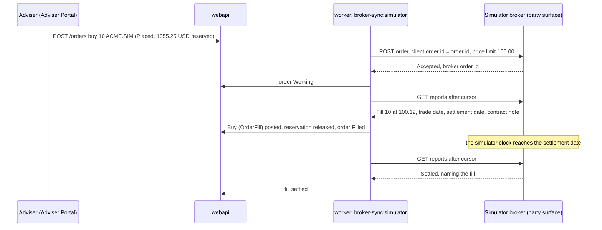

# Orders and settlement

Step 11 of [custodial-roadmap.md](../custodial-roadmap.md) §13. It covers roadmap items **O1** (orders) and **O2** (settlement), with the simulator broker (**S2**). It follows [ADR 0021](../adr/0021-outside-parties-behind-ports.md) rules 1–20 and does not re-decide them. It amends [buy-sell.md](buy-sell.md), [trade-fees.md](trade-fees.md), [holdings.md](holdings.md), [posting.md](posting.md), [custody-modes.md](custody-modes.md), [transaction-source.md](transaction-source.md), [withdrawals.md](withdrawals.md), [internal-transfers.md](internal-transfers.md), [fx-conversions.md](fx-conversions.md), [account-closure.md](account-closure.md), [portfolios.md](portfolios.md), [corporate-actions.md](corporate-actions.md), [adjustments.md](adjustments.md), [tenants.md](tenants.md), [accounts.md](accounts.md), [simulator.md](simulator.md) and the Adviser Portal, Customer Portal and Back Office contracts.

An Adviser no longer types a `Buy` or a `Sell` on a Custodial account. The Adviser places an **order**: buy or sell a quantity of one Instrument. The platform **reserves** the most the order can cost (a buy) or the quantity (a sell), and the `worker` sends the order to the firm's broker through a new port. The broker answers on a feed of **execution reports**: a fill, a cancellation, an expiry, a settlement. Each fill is posted as one `Buy` or `Sell` Transaction with source `OrderFill`, at the broker's price, with an **execution detail** (price, trade date, settlement date, contract note). A fill **settles** when the broker says so. Until then the cash of a sale is in the balance and can buy, but it cannot leave the account.

New: permissions `orders.read` and `orders.place`; routes under `/orders`, `GET /broker-connections`, `GET /execution-reports`; ports `IBrokerOrders` and `IBrokerFeed` with adapters `SimulatorBrokerOrders` and `SimulatorBrokerFeed`; broker connections in configuration and `brokerConnection` on the Tenant; source kind `OrderFill`; the execution detail on the Transaction; `worker` job `broker-sync:{connection}` on the new queue `broker`; item fields `unsettledCash` and `withdrawableCash` (account), `reservedQuantity` and `availableQuantity` (holding), `execution` (transaction). Script `0051_orders.sql`; simulator script `database/simulator/0010_broker.sql`. No new `TransactionType`, problem code or domain event.

**Status is `accepted` (2026-11-23), landed 2026-11-23.** The twenty-one points of §11 were confirmed on 2026-11-23, every one as recommended, and are written into the rules. The amendments to accepted docs listed in §12 were made when it was accepted. It is a build contract.

Notes from landing:

- R2–R4, R66, R67: the connections are read by `BrokerConnectionsConfiguration` (Infrastructure); `IBrokerOrders` and `IBrokerFeed` are `BrokerOrdersDispatcher` and `BrokerFeedDispatcher` over `SimulatorBrokerOrders` and `SimulatorBrokerFeed`, registered on `webapi` and `worker` by `AddBrokerConnections`. A connection with no adapter on the host answers `Unreachable`.
- R6–R13, R17: the checks of placing and of the preview are one helper, `OrderChecks` (Application). The date of the reference price comes from `IInstrumentPriceStore.LatestDateAsync`, added for R10, because `IMarketData.TryGetPrice` carries no date.
- R19: `BrokerSyncJob` (Infrastructure) runs send, cancel, pull, process, post in that order under `SqlRunLock` and throws `BrokerSyncFailedException` after every step was tried. The recurring job is registered per connection on queue `broker` by `BrokerSyncRecurringJob`.
- R31–R36: `PostOrderFills` (Application) is the one place a fill is posted; `ProcessExecutionReports` calls it in the report's own transaction and the last step of a run tries the `Pending` fills again. The posting's `CreatedBy` is `SystemActor.Name`.
- R33, R35: `Transaction.PostBuy` and `PostSell` take one optional `TradeExecution`. With it, `feeSchedule` and `enteredFee` together mean "this amount, charged under this schedule", so the fee detail names the order's schedule and its basis is the fill's gross; without it the factories behave as before.
- R39, R44: reserved, unsettled and withdrawable cash are plain sums read by `AccountCash` (Application); the rules are `AvailableCash.Withdrawable` and `AvailableCash.AllowsLeaving` (Domain).
- R48: `CreateTransaction` no longer prices a trade. The matrix refuses `Buy` and `Sell` on a Custodial account before any type-specific check, so a body with a price, a fee, a rate or a `bookedAt` gets the same 400 at `errors.Type`. The functional tests that only needed a holding write a `Manual` trade straight to the database (`CustodialHttp.InsertManualTradeAsync`); those about a platform trade place an order and feed the fake broker a fill (`CustodialHttp.TradeAsync`). The tests whose only subject was a hand trade on a Custodial account were removed with the branch; the commit that refuses the trade names them.
- R50: `CorporateActionEffect.MakeEffectiveAsync` requests the cancel of the open orders in the same transaction, with the note `Corporate action`.
- R52–R65: the simulator broker is `src/Simulator/Broker`. Every write on its books holds a lock on the `BrokerSettings` row, so the numbers of orders and fills and the places of reports follow the order the writes happen in. `BrokerReports` has no number column: the `n` of a report's outside id is its count among the reports of the world, which is stable because a report is removed only by a reset. R62 is applied when the broker is brought up to date: a working order accepted before the ex-date of an action that is now effective is cancelled before the day's expiries.
- D71: the list item carries no fills, so the Orders page reads `pendingFill=true` once more to mark the orders that need attention.
- D69: the new transaction form offers nothing on a Custodial account and links to Place order.
- BO26: the tenant edit form offers no "None", because an update without `brokerConnection` leaves the tenant's connection as it is (R3).

---

## 1. Summary



| | Today | After this slice |
| --- | --- | --- |
| A trade on a Custodial account | A person types a `Buy` or `Sell`; it is filled at once at the platform's last stored price | An order to the broker; each fill is posted at the broker's price when the report arrives |
| Hand `Buy` / `Sell` on a Custodial account | Allowed | Refused (400). External accounts unchanged |
| Cash a buy needs | Checked when the trade is typed | Reserved when the order is placed, up to a price limit the platform sets, so no fill can cost more |
| Shares of a sell | Checked when the trade is typed | Reserved when the order is placed |
| Trade date and settlement date | Not recorded | The broker's dates, in the execution detail |
| Cash from a sale | Can be withdrawn at once | In the balance at once; **withdrawable** only after the fill settles |
| Rebalance | Posts `Buy` / `Sell` at once | Unchanged until roadmap O3 |

The rule that distinguishes this slice: on a Custodial account a trade exists because the broker reported a fill. A person states what to buy or sell and how much; the price, the dates and the moment come from the broker.

---

## 2. Scope

**In**

- Domain: `Order` aggregate with its `OrderFill` children; `ExecutionReport` (the inbound record); `BrokerFeed` (cursor and feed state per connection); `OrderRules` (price limit, reference price age); enums; `TransactionSourceKind.OrderFill` and `TransactionSource.OrderFill(orderPublicId)`; `TransactionExecutionDetail`; `Transaction.PostBuy` and `PostSell` take an execution detail; `Reverse` copies it; `CustodyRules` cell `Buy` / `Sell` on Custodial refused; `AvailableCash.Withdrawable`; `AvailableQuantity`; `Tenant.BrokerConnection`
- Application: ports `IBrokerOrders` and `IBrokerFeed`; services `SendBrokerOrders(connection)`, `PullExecutionReports(connection)`, `ProcessExecutionReports(connection)`, `PostOrderFills(connection)`; order commands (place, cancel), the preview and the reads; reserved cash counts buy orders; the reserved quantity rule; the withdrawable cash rule in withdrawals, internal transfers and FX conversions; account, holding and transaction reads map the new fields
- Infrastructure: `SimulatorBrokerOrders` and `SimulatorBrokerFeed` adapters (HTTP, `X-Api-Key`); recurring job `broker-sync:{connection}`; EF mappings
- Scripts: `database/schema/0051_orders.sql`; `database/simulator/0010_broker.sql`
- Security: two permissions (R1)
- HTTP (`webapi`): the routes of §8
- Simulator: the broker on the party surface (place, cancel, reports) and its control routes (order mode, slippage, settlement days, fill, cancel, its own books)
- Adviser Portal: Place order on a Custodial account, the Orders pages, the fill on the transaction page, reserved, unsettled and withdrawable figures; BFF prefix `/orders`
- Customer Portal: open orders, the fill in the activity, unsettled and withdrawable cash; BFF prefix `/orders`
- Back Office: the broker connection on the Tenant page, a Broker page with the feed state and the newest execution reports
- Tests listed in §10

**Out**

- Rebalance through orders (roadmap O3). A rebalance still posts `Buy` / `Sell` at once at the stored price, with source `Rebalance` (R49)
- Paying and receiving settlement cash through the client money account, and the bank reconciliation of it. Trades stay the known difference `Trades` ([bank-reconciliation.md](bank-reconciliation.md) R10) until a later step (§11 point 1)
- A broken trade after a fill, and any flow that reverses a fill (§11 point 12). A report of a kind this slice does not know is stored and skipped (R24, R25)
- Limit orders, stop orders, orders by amount, orders that last longer than a day, and changing an order. A wrong order is cancelled and placed again
- A draft order and a second person's approval of an order. Drafts come with roadmap O3
- Order aggregation and allocation (roadmap O4). One order of one account is one order at the broker
- A buy order in an instrument quoted in another currency than the account's (roadmap D20, R9), and multi-currency cash
- The broker's own commission. It is the firm's cost and is not in the Customer ledger (roadmap O1)
- A custodian, positions at the custodian and their reconciliation (roadmap T3, S3). The simulator broker checks no position and no cash
- Orders on External accounts. They keep hand `Buy` / `Sell` with the caller's numbers ([external-caller-numbers.md](external-caller-numbers.md))
- A Customer placing or cancelling an order (roadmap D6). The Customer Portal stays read-only
- A contract note as a document (PDF). The execution detail on the Transaction carries its content (R35)
- Trading hours, market holidays and a settlement calendar on the platform. The broker sends every date
- Marking a fill settled by hand, and a settlement that fails at the broker
- Notifying the Customer, the Adviser or the TenantAdmin of a fill
- A real broker adapter
- Named scenarios and the scenario library

---

## 3. Stories

1. As an Adviser I place a buy or sell order for my Customer's Custodial account by choosing the instrument and the quantity. I see about what it will cost and the most it can cost before I confirm.
2. As the platform I reserve the cash of a buy order and the shares of a sell order when it is placed, so the same cash or shares cannot be used twice.
3. As the platform I send each order to the firm's broker once, with the same key on every retry, and book a trade only when the broker reports a fill.
4. As an Adviser I see an order move from sent to partly filled to filled, with every fill, its price and its dates.
5. As an Adviser I cancel an order that is not filled yet. If the broker already has it, the broker decides, and a fill that crossed my cancellation is still booked.
6. As a Customer I see my open orders, each trade with its price, trade date, settlement date and contract note, and how much of my cash I can withdraw now.
7. As a TenantAdmin I see a fill the platform could not book and why, fix the cause with an adjustment, and see the platform book it on the next run.
8. As an Adviser I cannot withdraw the cash of a sale before it settles, but I can buy with it.
9. As an Adviser I can no longer type a `Buy` or `Sell` on a Custodial account.
10. As a SystemAdmin I choose each firm's broker connection, and I see when each connection was last read, why the last read failed, and the reports the platform skipped.
11. As the simulator operator I make the broker fill, partly fill, hold or reject orders, fill or cancel a held order, let orders expire at the end of the day, and settle fills by moving the clock.

---

## 4. Rules

### 4.1 Access

| ID | Rule |
| --- | --- |
| R1 | **Access.** New permissions: `orders.read` (TenantAdmin, Adviser, Customer) and `orders.place` (TenantAdmin, Adviser). SystemAdmin has neither → 403 (roadmap D5, as the bank stage); `GET /broker-connections` and `GET /execution-reports` take `tenants.manage`. A Customer reads and never writes (roadmap D6). Missing / dead Bearer → 401, never 302. Policy fail → 403. A disabled current tenant → 403. Scope is the Account's, as withdrawals R17: TenantAdmin any Account of the tenant; Adviser Accounts of assigned Customers; Customer own Accounts. An order outside scope, of another tenant, or missing → 404. No caller on `/orders` names a tenant: a `tenantId` in a query or body → 400. |

### 4.2 Broker connections

| ID | Rule |
| --- | --- |
| R2 | **Configured, not stored.** A **broker connection** is a named entry in configuration, like a bank connection (deposit-matching R1): `BrokerConnections:{name}:Adapter` (only `Simulator` in this slice) on `webapi` and `worker`; on `worker` also `BaseUrl`, `ApiKey`, optional `TimeoutSeconds` (integer 1–60, default 10) and optional `PollMinutes` (one of 1, 2, 3, 4, 5, 6, 10, 12, 15, 20, 30, 60; default 1). A name is 1–50 characters, a lower-case letter followed by lower-case letters, digits and hyphens. The secret is only on `worker` (ADR 0021 rule 17). A host whose configuration has a bad name, an unknown adapter, or (on `worker`) a missing `BaseUrl` or `ApiKey` or a `TimeoutSeconds` or `PollMinutes` outside its values fails at start-up, before it listens. The rule reads the configuration, not the environment name (ADR 0021 rule 3). No connections configured is valid: no order can be placed. A broker connection may also have `BankAccounts:{currency}:AccountNumber` and `:AccountName`, the broker's own bank account per currency; `GET /broker-connections` carries `settlementCurrencies` (trade-settlement R2). |
| R3 | **A Tenant names its connection.** `POST /tenants` and `PUT /tenants/{id}` take an optional `brokerConnection`: a name configured on `webapi`; unknown → 400 `errors.BrokerConnection` (`Unknown broker connection.`). Omitted or `null` on PUT leaves it as it is; it cannot be cleared in this slice. The tenant item on list, get-by-id and by-code carries `brokerConnection`, `null` when the Tenant has none. Script `0051` sets `simulator` on every existing Tenant (roadmap D19), as `0040` did for the bank connection. An order takes the Tenant's connection when it is placed and keeps it; a later change routes only new orders. |
| R4 | **Connection list.** `GET /broker-connections` (`tenants.manage`) → list envelope of `{ name, adapter, reports }`, sorted by name, every entry on page 1. `reports` is `{ lastSucceededAt, lastFailedAt, lastFailure }`, `null` until the first read was tried. `lastFailure` is one of `Unreachable`, `Timeout`, `Unauthorized`, `Unavailable`, `BadResponse`, `InvalidItem`, or `null`; it never carries a message from the party. No URL, key or timeout. TenantAdmin, Adviser, Customer → 403. |

### 4.3 An order (O1)

| ID | Rule |
| --- | --- |
| R5 | **What it is.** An order is an instruction to buy or sell a quantity of one Instrument for one Custodial account at the Tenant's broker (roadmap P7). It has a side (`Buy`, `Sell`), the type `Market` and the time in force `Day`: fill at the best price now, and what is not filled by the end of the broker's trading day ends. An order is not a Transaction and moves nothing in the ledger; each of its **fills** does (R31). One order of one account is one order at the broker. A rebalance order is an ordinary order: `Market`, `Day`, the reference price and price limit, the fee terms, the reservation and the settlement account; memo `Rebalance`; placed by the person who confirmed the rebalance. Its fills are posted as any fill (rebalances R15). |
| R6 | **Place.** `POST /orders` (`orders.place`) with `accountId`, `instrumentId`, `side`, `quantity` and optional `memo` → 201 `{ "id" }` with `Location`. `quantity > 0` with at most 8 decimal places (400 `errors.Quantity`). `memo` is an internal note: trimmed, 1–200. `type` and `timeInForce` may be sent and must then be `Market` and `Day` (400 `errors.Type`, `errors.TimeInForce`). A body with a price, a limit, an amount, `bookedAt`, `status`, `tenantId` or `id` → 400. Requires `Idempotency-Key` (posting R21, ADR 0015): replay with the same hash → the original 201; same key, other hash → 409; missing → 400. The order is `Placed`, with the caller and the platform time as placed by and at. Nothing is sent to the broker in the request (ADR 0021 rule 4). An order gets a **settlement account** when it is placed (trade-settlement R3): the Tenant's active client money account in the Account's currency, when the Instrument is quoted in that currency and the broker connection has the broker's bank account for it. It never refuses an order. |
| R7 | **Account.** The Account must be in scope (else 404), Custodial (else 400 `errors.AccountId`, `An order can be placed only on a Custodial account.`), Open (400, posting R6), not closing (400, the account-closure R12 message) and its Customer not Disabled (400 `disabled` / `target=user`). The Tenant must name a broker connection that is configured on `webapi` (else 400 `errors.AccountId`, `The firm has no broker connection, so orders cannot be placed.`). |
| R8 | **Not on an assigned account.** An account with an Active portfolio assignment takes no order: 400 with the message of the portfolio trade lock (portfolios R18). An order is a hand trade; on an assigned account only a rebalance trades. The lock is for a person's order. On an assigned Account the only orders are the orders of its rebalance, which need the Active assignment (rebalances R15, R24). |
| R9 | **Instrument and currency.** The Instrument must be in the caller's Tenant and active (else 400 `errors.InstrumentId`, as buy-sell R7). A **buy** order needs an Instrument quoted in the Account's currency (roadmap D20); otherwise 400 `errors.InstrumentId` with the message `ACME.SIM is quoted in USD and this account is in NZD. Convert cash to a USD Custodial account and buy there.` A **sell** order is allowed in any quote currency, so a holding that a rebalance or an earlier hand trade bought can always be sold; its proceeds are converted when the fill is posted (R34). |
| R10 | **Reference price and price limit.** The **reference price** is `IMarketData.TryGetPrice(instrument)` for the platform's UTC date when the order is placed: the latest stored price. No price → 400 `errors.InstrumentId` (`No price is stored for ACME.SIM.`). A price dated more than 4 calendar days before that date → 400 `errors.InstrumentId` (`The latest price of ACME.SIM is from 2026-11-10. An order needs a price from the last 4 days.`). The **price limit** is `Round(referencePrice × 1.05, 8)` for a buy and `Round(referencePrice × 0.95, 8)` for a sell (`OrderRules.CollarPercent = 5`): the highest price the broker may buy at, the lowest it may sell at. The caller does not choose it. Both prices and the price's date are stored on the order and sent to the broker (R20). |
| R11 | **Fee terms fixed at placement.** The order stores the trade fee schedule that applies to the Instrument's quote currency on the UTC date it is placed (trade-fees R7), or none. Every fill of the order is charged from that schedule (R33), whenever it arrives. A schedule that applies on that date is in effect and never changes (trade-fees R9, R11). |
| R12 | **Buy: cash is reserved.** `maximumGross = Round(quantity × priceLimit, 4)` and `maximumFee` is the stored schedule's fee on `maximumGross` (trade-fees R8), `0` with no schedule. The order's **reserved cash** is `maximumGross + maximumFee`: the most the order can cost. It must not be more than the Account's available cash (withdrawals R35) when the order is placed; otherwise 400 `errors.Quantity` with the message `This order can cost up to 1055.25 USD with fees. The account's available cash is 900.00 USD.` The request locks the Account row and checks under that lock (posting R22, withdrawals R22). |
| R13 | **Sell: the quantity is reserved.** The order's **reserved quantity** is its quantity. It must not be more than the holding's available quantity (R40) when the order is placed, under the same lock; otherwise 400 `errors.Quantity` with the message `The account has 40 ACME.SIM available to sell.` No holding → the same refusal with `0`. A sell order reserves no cash. |
| R14 | **Statuses.** An order is **open** while it is `Placed`, `Working` or `PartlyFilled`. Its `filledQuantity` is the sum of its fills' quantities; its `openQuantity` is `quantity − filledQuantity` while it is open and `0` once it is final. An order is **live** while it is open or has a fill that is not posted yet (R36); only a live order reserves (R39, R40). A fill may be `Broken` (2). A broken fill does not count in `filledQuantity` or `averagePrice`, nor, when it was reversed, in the posted gross and charged fee; an open order takes its quantity back and a `Filled` order becomes `Cancelled` with close reason `Trade broken` (trade-settlement R32). |

| Status | Means | Open | Next |
| --- | --- | --- | --- |
| `Placed` | The platform holds it; it waits to be sent, or the outcome of the send is not known yet | yes | `Working`, `Rejected`, `Cancelled`; `PartlyFilled` or `Filled` when a report arrives after a lost answer |
| `Working` | The broker accepted it; no fill yet | yes | `PartlyFilled`, `Filled`, `Cancelled`, `Expired` |
| `PartlyFilled` | Some of it is filled; the rest is still at the broker | yes | `Filled`, `Cancelled`, `Expired` |
| `Filled` | The whole quantity is filled | no | final |
| `Cancelled` | Ended before it was filled in full: by a person before it was sent, or by the broker | no | final; `Filled` only by R28 |
| `Rejected` | The broker refused it | no | final |
| `Expired` | The broker ended it at the end of its trading day | no | final; `Filled` only by R28 |

| ID | Rule |
| --- | --- |
| R15 | **Item.** `{ id, accountId, customerId, instrument: { id, symbol, name }, side, type, timeInForce, quantity, filledQuantity, openQuantity, currency, referencePrice, referencePriceDate, priceLimit, reservedCash, reservedQuantity, averagePrice, status, memo, placedBy, placedAt, send, rejectReason, cancelRequest, closedAt, closeReason, fills, rowVersion }`. `currency` is the Instrument's quote currency. `reservedCash` and `reservedQuantity` are what the order reserves now (R39, R40), `0` when it is not live. `averagePrice` is the quantity-weighted price of its fills, `null` with none. `send` is `{ attempts, lastAttemptAt, lastFailure, acceptedAt }`. `cancelRequest` is `{ by, at, note }` or `null`; `by` is `null` for a request the platform made (R50). `closeReason` is the broker's text on a `Cancelled` or `Expired` order. `fills` is the list of R26's fills, oldest first: `{ id, quantity, price, tradeDate, settlementDate, brokerReference, status, holdReason, transactionId, postedAt, settledAt }`. A person is `{ id, name }`. A Customer sees every field except `memo`, the cancel `note` and `send` (`null` for a Customer). The item also carries `rebalanceId`, the rebalance's PublicId, `null` on a person's order; every caller who reads the order sees it, the Customer included (rebalances R27). |
| R16 | **List.** `GET /orders` (`orders.read`) → list envelope, newest placed first, without `fills`. Optional filters: `accountId`, `customerId`, `instrumentId`, `side`, `status` (one or more names, comma-separated; unknown → 400 `errors.Status`) and `pendingFill=true` (only orders with a fill not posted yet). `GET /orders/{id}` → the item. `GET /orders` also has the filter `rebalanceId`. `pendingFill=true` also returns an order with a break that waits. |
| R17 | **Preview.** `POST /orders/preview` (`orders.place`) with `accountId`, `instrumentId`, `side` and `quantity` → 200 `{ currency, referencePrice, referencePriceDate, priceLimit, estimatedGross, estimatedFee, maximumGross, maximumFee, maximumCost, availableCash, availableQuantity }`. It runs R7–R13 and answers with their 400s. `estimatedGross = Round(quantity × referencePrice, 4)` and `estimatedFee` is the schedule's fee on it. `maximumCost` is the reserved cash of R12, `null` for a sell; `availableQuantity` is `null` for a buy. It writes nothing, takes no `Idempotency-Key` and holds no price: the order placed after it reads the price again. |
| R18 | **Cancel.** `POST /orders/{id}/cancel` (`orders.place`) with `rowVersion` and optional `note` (trimmed, 1–200) → 204. Missing `rowVersion` → 400; stale → 409 `stale_row_version`. A `Placed` order with no send attempt (R19) becomes `Cancelled` in the request and its reservation is released. Any other open order gets a **cancel request** with the caller, the time and the note; its status does not change, the `worker` asks the broker (R22), and the broker's report ends it (R27). A fill that arrives before the broker cancels is booked. An order that already has a cancel request → 400 `errors.Status` (`A cancellation was already requested for this order.`). An order that is not open → 400 `errors.Status` (`This order is <status> and cannot be cancelled.`). No `Idempotency-Key`: the status, the request and `rowVersion` make a repeat a 400 or a 409. `POST /orders/{id}/cancel` on an order with a rebalance → 400 `errors.Status`, `This order belongs to a rebalance. Cancel the rebalance.` (rebalances R20). The platform cancels a rebalance's open orders when the rebalance is cancelled, with the note `Rebalance cancelled`. |

### 4.4 Sending orders to the broker

| ID | Rule |
| --- | --- |
| R19 | **One recurring job per connection.** `worker` registers `broker-sync:{connection}` for each configured connection, on the new queue `broker`, every `PollMinutes` of that connection (UTC; cron as deposit-matching R6). A run does five steps in this order: send the orders (R20), send the cancel requests (R22), pull the execution reports (R24), process them (R25), post the fills that wait (R36). A failed step is recorded and the run goes on with the next step on what is already stored; a run in which any step failed or left work is reported to Hangfire as failed after every step was tried. No automatic Hangfire retries; the schedule is the retry (ADR 0021 rule 15). A run that starts while another run of the same connection is still going ends at once. A recurring job of a connection that is no longer configured is removed when the `worker` starts. `broker-sync:{connection}` has a sixth step, **advance**, after the fills are posted: every rebalance in progress on the connection with no live order ends or places its next wave (rebalances R17). A failure in it is logged per rebalance and does not stop the run being reported. |
| R20 | **The send step.** Every `Placed` order of the connection with no cancel request is sent, oldest first. Per order: record the attempt (attempts + 1, time) and commit, then call the port with the order's PublicId as the **client order id**, the symbol, the quote currency, the side, the quantity, `Market`, `Day`, the price limit and the reference price (ADR 0021 rules 12, 13). The call carries no Tenant, Account or Customer. A disabled Tenant's order gets no first attempt; one that already has an attempt is sent again, because the broker may have it (withdrawals R32). The send step adds `settlementAccount` to the place call only for an order that has one (trade-settlement R4). An order placed while the Tenant has an active safekeeping account in the Instrument's quote currency stores it with its account number, and the place call carries `safekeepingAccount` (the account number); an order with none leaves the field out (in-kind-transfers R46, R47). |
| R21 | **Outcome of a send.** `Accepted` with the broker's order id → the order becomes `Working` and keeps that id. `Rejected` with a reason → `Rejected`; the reservation is released. Reasons: `UnknownInstrument`, `InvalidOrder`, `MarketClosed`, `Refused`; a reason the adapter does not know → `Refused`. A failure of the call (`Unreachable`, `Timeout`, `Unauthorized`, `Unavailable`, `BadResponse`) → the order stays `Placed` with `lastFailure` set, and the next run sends it again with the same client order id. Each outcome is one database transaction guarded by the order's `RowVersion`; an order that a report already moved on (R28) keeps its status and only takes the broker's order id. One order's failure never stops the others or the pull. |
| R22 | **The cancel step.** For every open order of the connection with a cancel request the broker has not answered, oldest first, the `worker` calls the port with the client order id. `Accepted` → the request is marked answered; the order ends when the broker's `Cancelled` report arrives (R27). `TooLate` → the request is marked answered and nothing else changes; the reports say how the order ended. `UnknownOrder` → the broker never had the order: it becomes `Cancelled` with close reason `Not at the broker` and its reservation is released. A failure of the call → the request stays unanswered and the next run asks again. An order with a cancel request is never sent (R20), so an order whose first send did not arrive ends here. |

### 4.5 Execution reports

| ID | Rule |
| --- | --- |
| R23 | **Port and record.** `IBrokerFeed` returns the execution reports of one broker connection after a cursor, one page at a time; one feed per connection, for every Tenant that uses it. An **execution report** is one thing the broker says about one order: an outside id (unique per connection, for ever), a kind and the client order id. Kinds: `Fill` (a quantity filled at a price, with trade date, settlement date and the broker's contract note), `Cancelled` and `Expired` (the rest of the order ended, with an optional reason) and `Settled` (the fill named by its outside id has settled, with the settled date). It is the broker's inbound record (ADR 0021 rule 7) and platform data with no Tenant, like a corporate action announcement. Execution report kinds `Broken` (4) and `Settlement` (5); a `Settled` report may carry a `settlementId`; skip reasons `FillSettled` (5), `FillBroken` (6), `UnknownSettlement` (7). A `Settlement` report needs no client order id. A report also carries `settlementId`, `settlementAccount`, `currency`, `netAmount` and `fillCount` (trade-settlement R6–R8, R26, R27, R41). |
| R24 | **Pull and store.** The pull step asks for the reports after the connection's cursor, 100 at a time, until the party says there are no more or 20 pages were read. The new reports of one page, the new cursor and `lastSucceededAt` are written in one database transaction; the cursor is one opaque string of at most 500 characters per connection in `BrokerFeeds`. A report whose (connection, outside id) is already stored is skipped and not changed; the unique index is the backstop. A stored report has status `Received` and `receivedAt` = platform time. Every item needs an outside id of 1–100 characters. An item of a known kind also needs a client order id of 1–100 characters and its own fields: `Fill` a quantity `> 0` with at most 8 decimal places, a price `> 0` with at most 8 decimal places, a trade date and a settlement date not before it, and an optional contract note cut to 50 characters; `Settled` the fill's outside id (1–100 characters) and a settled date; a reason is cut to 140 characters. A page with any item outside this → nothing of that page is stored, the cursor stays, `lastFailure` = `InvalidItem`. A kind the adapter does not know is not a reason to refuse a page: it is stored with no kind. A failed call stores nothing, keeps the cursor and sets `lastFailedAt` and `lastFailure`. |
| R25 | **Processing.** Every `Received` report of the connection is processed, oldest `receivedAt` first, then `Id`, each in one database transaction that also sets its status (ADR 0021 rule 8). The order is found by the client order id: a PublicId of an order that was placed on this connection. The report becomes `Processed` when it changed its order (R26, R27, R43), otherwise `Skipped` with the first reason that applies: `UnsupportedKind` (no kind); `UnknownOrder` (the client order id is not a GUID, or names no order of this connection); `UnknownFill` (a `Settled` report names no fill of that order); `Overfill` (a `Fill` whose quantity is more than the order's quantity minus its filled quantity); `Repeated` (a `Cancelled` or `Expired` report for an order that is not open, or a `Settled` report for a fill already settled). A report left `Received` by a crash or a conflict is processed by the next run. |
| R26 | **A fill.** A `Fill` report adds one **fill** to its order: the quantity, the price, the trade date, the settlement date and the contract note, linked to the report. In the same database transaction the platform tries to post it (R31). A fill is `Posted` once its Transaction exists and `Pending` until then. A report is the source of at most one fill; a unique index is the backstop. |
| R27 | **Cancelled and expired.** A `Cancelled` or `Expired` report ends an open order: it becomes `Cancelled` or `Expired` with `closedAt` = platform time and the report's reason as `closeReason`. Its fills stay, and what was not filled is no longer reserved. |
| R28 | **Order status after a report.** After any report, an order whose `filledQuantity` equals its quantity is `Filled`, whatever it was. Otherwise an order ended by R27, R18 or R22 keeps that status, and an order that is still open is `PartlyFilled` when it has a fill and `Working` when it has none. So a fill that arrives before the `Accepted` answer was stored moves a `Placed` order on, and a fill that crossed a cancellation is added to the `Cancelled` order. |
| R29 | **The books follow the broker.** A report is processed whatever the state of the Tenant, the Customer or the order: a disabled Tenant, a Disabled Customer and an order that has ended do not stop a fill within the order's quantity (deposit-matching R19, withdrawals R40). The platform does not compare a fill's price with the price limit: the broker's fill is the fact, and R36 decides whether it can be booked. The portfolio trade lock is not checked on a fill (R8 and R49 keep an order and an assignment apart). |
| R30 | **Report read.** `GET /execution-reports` (`tenants.manage`) → list envelope, newest `receivedAt` first, then newest `Id`. Optional filters: `connection`, `status` (one or more names, comma-separated; unknown → 400 `errors.Status`). Item: `{ id, connection, outsideId, kind, clientOrderId, brokerOrderId, quantity, price, tradeDate, settlementDate, contractNote, fillOutsideId, settledDate, reason, receivedAt, status, skipReason, processedAt }`. `kind` is `null` for a kind the adapter did not know. TenantAdmin, Adviser, Customer → 403; they see a fill through its order and its Transaction. |

### 4.6 The fill on the ledger

Amendment to [buy-sell.md](buy-sell.md), [trade-fees.md](trade-fees.md), [holdings.md](holdings.md), [posting.md](posting.md) and [transaction-source.md](transaction-source.md).

| ID | Rule |
| --- | --- |
| R31 | **Posting a fill.** Each fill is posted in one database transaction with the Account row locked as on every posting (posting R22). The platform reads the fill again (two runs may meet; only a `Pending` one is posted), checks R36, posts the Transaction of R32, updates the holdings projection (holdings R14), marks the fill `Posted` with the Transaction, the time and its net cash, and updates the order's posted gross, charged fee and reservation (R39, R40). |
| R32 | **The Transaction.** Type `Buy` or `Sell` by the order's side; one security leg on the Account for the Instrument with the fill's quantity (negative for a sell); `gross = Round(quantity × price, 4)` in the quote currency, with the fill's price in place of a stored price; the principal cash leg, the `Fee` cash leg with its fee detail, the `Buy` cost `gross + fee` and the `Sell` release at average cost exactly as buy-sell R11–R15 and trade-fees R15–R18 define them, with the fee of R33. Source `OrderFill` (8) with the **order's** PublicId as source id; `bookedAt` = platform time when it is posted (ADR 0021 rule 10); memo `Buy order` or `Sell order`; `reference` `null`; and an execution detail (R35). Built by `Transaction.PostBuy` / `PostSell` without the manual entry matrix (custody-modes R7). `CreatedBy` is the worker's system name. |
| R33 | **The fee is charged on the order, across its fills.** The fee of a fill is the stored schedule's fee (R11) on the order's posted gross including this fill, minus the fee already charged on the order's earlier fills; `0` with no schedule. So an order filled in three parts pays the same fee as one filled at once, and a schedule's minimum is charged once, on the first fill. The fee detail of the fill names that schedule, with the fill's own gross as basis amount (trade-fees R18). This replaces "the schedule for the UTC date of `bookedAt`" (trade-fees R7) for a fill; rebalance trades and External trades are unchanged. The fee of a later fill is never below 0 (trade-settlement). |
| R34 | **A sell in another currency.** When the Instrument's quote currency differs from the Account's currency (a sell only, R9), the principal and the fee leg are converted with `IFxRate` for the UTC date of `bookedAt`, as a hand `Sell` was before this slice (buy-sell R12, trade-fees R15). A missing rate does not fail the report: the fill waits (R36, `NoFxRate`). |
| R35 | **Execution detail.** Every Transaction with source `OrderFill` has exactly one: the fill's PublicId, the price, the trade date, the settlement date and the broker's reference (the contract note; `null` when the broker sent none). No other Transaction has one. `Transaction.Reverse` copies it, so a later flow can undo its own posting. It is the content of the broker's contract note for the Customer; whether the fill has settled is on the fill, not in the detail (R43). |
| R36 | **A fill that cannot be posted waits.** A fill stays `Pending` with a **hold reason** and nothing is posted when: the Account is Closed (`AccountClosed`); a sell's quantity is more than the holding (`InsufficientHolding`); a needed FX rate is missing (`NoFxRate`); or the cash `SUM` after the fill would be below the reserved cash that remains (`InsufficientCash`, withdrawals R36 with the order's own reservation recomputed by R39). Its report is still `Processed`, and the fill keeps its order live. The last step of every run tries every `Pending` fill of the connection again, oldest first, each in its own database transaction; a failure on one is logged with the order PublicId and leaves it for the next run. No person posts or drops a fill: a TenantAdmin removes the cause (an adjustment with reason `ReconciliationBreak`, a reopen) and the next run posts it. With R10–R13 a fill within the price limit of an open order always fits its reservation; the rule is for a fill beyond the limit, a fill after the order ended, and a holding that a corporate action changed (R50). A broken fill is not retried. The adjustment that removes the cause of a waiting fill is requested by one TenantAdmin and approved by another; the next run posts the fill after the approval (adjustment-review). |
| R37 | **No reversal by hand, none by the flow.** `OrderFill` is not a hand-reversible source (transaction-source R12): `POST /transactions/{id}/reverse` of a fill → 400 by transaction-source R13. No flow of this slice reverses a fill. A fill booked wrongly is corrected with an adjustment ([adjustments.md](adjustments.md)). A fill is a security activity on its holding, so a hand reverse of an earlier trade on that holding is refused by [ledger-write-guards](../fixes/ledger-write-guards.md) Decision 1. The flow of a broken trade reverses the fill's Transaction once, with source `OrderFill` (trade-settlement R29); a hand reverse stays refused. |
| R38 | **Transaction item.** Gains `execution`: `{ orderId, fillId, price, tradeDate, settlementDate, brokerReference, settledAt }` on a fill's Transaction (and a Reversal of one), `null` on every other Transaction. `settledAt` is read from the fill (R43). `source` is `{ "kind": "OrderFill", "id": "<order PublicId>" }`. Every caller who can read the Transaction sees both, the Customer included. Holdings, net worth and both reports read the posting like any `Buy` or `Sell`. `execution` also carries `brokenAt`. |

### 4.7 Reserved cash and reserved quantity

Amendment to [withdrawals.md](withdrawals.md) R35–R37, [holdings.md](holdings.md) and [adjustments.md](adjustments.md).

| ID | Rule |
| --- | --- |
| R39 | **Reserved cash counts buy orders.** The reserved cash of an Account is the sum of the amounts of its open withdrawals (withdrawals R35) plus the reserved cash of its live buy orders. A buy order's reserved cash is the most that what is left of it can still cost: with `q` = its open quantity plus the quantity of its fills not posted yet, `Round(q × priceLimit, 4)` plus the schedule's fee on the posted gross with that amount added, minus the fee already charged; `0` when `q` is `0`. It is stored on the order and recomputed whenever the order changes, so the Account's figure is a plain sum. Withdrawals R36 is unchanged and now protects orders too: every write that lowers cash on a Custodial account leaves available cash `≥ 0`. The refusal of withdrawals R37 reads `Available cash cannot become negative: 1055.25 USD is reserved for withdrawals and orders.` |
| R40 | **Reserved quantity.** The reserved quantity of a holding is the sum, over the Account's live sell orders in that Instrument, of the open quantity plus the quantity of the fills not posted yet. **Available quantity** is the holding's quantity minus its reserved quantity. On a Custodial account, a sell order (R13) and an `Adjustment` that lowers a holding's quantity must leave available quantity `≥ 0`, checked under the Account lock; the adjustment is refused with 400 `errors.Security` (the key of adjustments R11) and the message `40 ACME.SIM is reserved for sell orders.` A fill, a rebalance (R49) and an entitlement posting (R50) are not refused by this rule. On an External account reserved quantity is always 0. The reserved quantity of a holding also counts the quantity of the Account's open in-kind transfers `Out`, and the adjustment's refusal reads `40 ACME.SIM is reserved for sell orders and transfers out.` (in-kind-transfers R43). For an adjustment the available quantity check runs when it is requested and again when it is approved; an open adjustment request reserves no quantity (adjustment-review R4, R9). |
| R41 | **Item fields.** The holding item of `GET /accounts/{id}/holdings` gains `reservedQuantity` and `availableQuantity`. The account item keeps `reservedCash` and `availableCash` with the meaning of R39 and gains the two fields of R44. Every caller who can read the Account sees them, the Customer included. |

### 4.8 Settlement (O2)

Amendment to [withdrawals.md](withdrawals.md) R21, [internal-transfers.md](internal-transfers.md), [fx-conversions.md](fx-conversions.md) and [account-closure.md](account-closure.md) R5.

| ID | Rule |
| --- | --- |
| R42 | **The broker's dates.** A fill carries the trade date and the settlement date the broker sent. They are stored and shown and never worked out by the platform: it holds no settlement cycle, trading calendar or holiday list (ADR 0021 rule 11). The ledger moves when the fill is posted (R31): from then on the cash and the shares are in the balance and the holding, and in net worth. |
| R43 | **Settled by the broker's signal.** A fill is **settled** when a `Settled` report that names it is processed: the fill gets `settledAt` = platform time and the report's settled date. The platform's calendar never settles a fill (roadmap D9); a fill whose settlement date has passed with no report stays unsettled. Settlement writes nothing to the ledger. A fill can settle while it is still `Pending`. A Transaction that is not an order fill (a rebalance trade, a trade typed before this slice) has no settlement and counts as settled. Settlement still writes nothing to the ledger and still decides withdrawable cash. The settlement cash of an order with a settlement account moves through the client money account as a trade settlement ([trade-settlement.md](trade-settlement.md)). The unsettled quantity of a holding is read from the `Posted` buy fills that are not settled and not broken; a transfer out may not take it (in-kind-transfers R44). |
| R44 | **Unsettled and withdrawable cash.** The **unsettled cash** of an Account is the sum, over its posted sell fills that are not settled, of the fill's net cash on the Account (its principal leg plus its fee leg) when that is above 0. **Withdrawable cash** is available cash minus unsettled cash, and never below 0. The cash of an unsettled buy has already left the balance and is not netted against a sale. The account item gains `unsettledCash` and `withdrawableCash`; on an External account they are `0` and the cash balance. A broken sell that could not be reversed still counts as unsettled cash. |
| R45 | **What needs withdrawable cash.** Cash leaves a Custodial account for somewhere else only from its withdrawable cash: a withdrawal request (withdrawals R21: 400 `errors.Amount`, `The account's withdrawable cash is 120.00 USD. 500.00 USD is from sales that have not settled.`), and the from side of an `InternalTransfer` or an `FxConversion` (400 under the key that write uses for withdrawals R37, with the message `Cash from sales that have not settled cannot leave the account: 500.00 USD settles later.`). The FX quote applies the same check. Without the second part, unsettled cash could move to another account of the Customer and be withdrawn there. |
| R46 | **What available cash still decides.** A buy order (R12), a negative `Adjustment`, a rebalance and every flow use available cash, unsettled cash included: the proceeds of a sale can buy at once. The cash balance, net worth, funds under management, the day balance of the interest run and both reports count unsettled cash like any cash. The payout of a withdrawal is not checked again (withdrawals R36). |
| R47 | **Account closure.** Account-closure R5 gains two refusals, each 400 `errors.AccountId`: a live order → `Open orders must be filled, cancelled or expired before the account can be closed.`; a fill that is not settled → `Trades must settle before the account can be closed.` A closing account takes no order (R7). Account closure is also refused while a break waits (trade-settlement R33). |

### 4.9 The manual entry matrix and the flows around it

Amendment to [custody-modes.md](custody-modes.md) R5, [portfolios.md](portfolios.md) and [corporate-actions.md](corporate-actions.md) R22.

| ID | Rule |
| --- | --- |
| R48 | **Hand `Buy` / `Sell` refused on a Custodial account.** The manual entry matrix cell `Buy` / `Sell` on a Custodial account becomes **refused**: `POST /transactions` → 400 `errors.Type` with the message `Trades on a Custodial account go through the broker. Place an order.`, for every caller, SystemAdmin included. External accounts are unchanged. A `Buy` or `Sell` typed before this slice keeps source `Manual` and can still be reversed by hand while it is the latest security activity on its holding. The refusal of `StockIn` / `StockOut` (custody-modes §4.2.1) now ends `Place an order.` in place of `Use Buy and Sell.` |
| R49 | **Rebalance.** A rebalance trades through orders ([rebalances.md](rebalances.md)): it no longer posts `Buy` / `Sell` at once, and its trades are order fills. The only orders on an assigned Account are the orders of its rebalance: R8 refuses a person's order there, and assigning a portfolio to an Account with a live order → 400 `account_not_eligible` with the message `Cancel the account's open orders before assigning a portfolio.` A rebalance plans with available cash, so it may spend unsettled cash (R46). |
| R50 | **A corporate action ends open orders.** When a corporate action becomes effective (corporate-actions R22), in the same database transaction every open order of the Tenant in that Instrument that has no cancel request gets one from the platform (no person, note `Corporate action`); a `Placed` order with no send attempt becomes `Cancelled` at once. The order's quantity and price limit are on the old share basis. A fill that still arrives is booked as the broker reported it (R29); when a consolidation has left the holding smaller than a sell fill, the fill waits with `InsufficientHolding` (R36). The cancel applies to `Split`, `Consolidation` and `Bonus` only: a dividend that goes ex cancels no open order (dividends R16). |
| R51 | **Matrix.** After this slice a person enters on a Custodial account only `InternalTransfer`, `FxConversion`, an `Adjustment` and the reverse of a hand-reversible source. The known-issue list gains no row and loses none: the gap this slice closes ("trades are filled at once at the platform's price") was a transitional cell of the matrix (custody-modes §4.2), not a missing write. |

### 4.10 The simulator broker (S2)

Amendment to [simulator.md](simulator.md). The party routes add under `/party/broker/…` (simulator R32), the control routes under `/control/broker/…`.

| ID | Rule |
| --- | --- |
| R52 | **The party.** The simulator broker takes orders for any symbol and plays the exchange too. It keeps orders, fills and reports in its own tables. It holds no positions and no cash: it never refuses a sell for lack of shares or a buy for lack of money, and it does not know which Tenant, Account or Customer an order is for (simulator R33). Before any broker route answers, control or party, the simulator brings the market (simulated-instruments R18) and then the broker up to date: R62, then R60, then R61. |
| R53 | **Order route.** Party port: `POST /party/broker/orders` with `{ clientOrderId, symbol, currency, side, quantity, type, timeInForce, priceLimit, referencePrice }`. `clientOrderId` 1–100 characters; `symbol` 1–32; `currency` three letters; `side` `Buy` or `Sell`; `quantity`, `priceLimit` and `referencePrice` `> 0` with at most 8 decimal places; `type` `Market`; `timeInForce` `Day`. A body that breaks this → 400. Key and outage as every party route (simulator R27, R30). The broker instructs the simulator custodian to receive or deliver the shares of each fill of an order with a safekeeping account when the fill settles; the custodian's `Trade` movement names the fill by the outside id of its `Fill` report (in-kind-transfers R67). |
| R54 | **Answer.** 200 `{ "brokerOrderId", "status": "Accepted" }` or 200 `{ "status": "Rejected", "reason" }`. `brokerOrderId` is `{WorldId:N}-O{n}`, never repeated (simulator R25). A second call with the same `clientOrderId` and the same body → the first answer again, nothing new; the same `clientOrderId` with another body → 409 (ADR 0021 rule 13). An order for a simulated instrument (a symbol the simulator market holds) in another currency than that instrument's is rejected with `UnknownInstrument`, whatever the order mode. |
| R55 | **Order mode.** `POST /control/broker/order-mode` `{ "mode": "Fill" | "Hold" | "Reject", "fillPercent"?, "reason"? }` sets how the broker answers new orders. `Fill` (the default) accepts and fills at once `fillPercent` of the quantity (whole number 1–100, default 100; the filled part is rounded down to 8 decimals), and the rest stays working. `Hold` accepts and leaves the order working. `Reject` rejects with `reason` (one of R21's names, required with `Reject`, else 400 `errors.Reason`). Log action `BrokerOrderModeChanged`. |
| R56 | **Fill price.** For a simulated instrument the base price is the market's price of the current simulator day (simulated-instruments R17); for any other symbol it is the order's `referencePrice`, so a real instrument fills near the price the platform values it at (roadmap D11). The fill price is `Max(0.0001, Round(base × (1 + slip), 4))`, with `slip = slippagePercent / 100 × (2u − 1)` and `u` the first value in `[0, 1)` of `SeededRandom.For(seed, "broker-fill", n)`, `n` counting the fills of the world from 1 (simulator R26). `slippagePercent` is 0 to 5 with at most 2 decimal places, default `0.10`, set by `POST /control/broker/slippage` `{ slippagePercent }` (log action `BrokerSlippageSet`). A price above the limit of a buy or below the limit of a sell fills nothing: the order stays working. |
| R57 | **A fill.** A fill appends one `Fill` report: the quantity, the price, `tradeDate` = the simulator day, `settlementDate` (R61) and `contractNote` = `CN-{n}`, `n` counting the fills of the world from 1. An order whose whole quantity is filled is `Filled`. |
| R58 | **The operator's hand on a working order.** `POST /control/broker/orders/{brokerOrderId}/fill` `{ "quantity"?, "price"? }` fills a working order: `quantity` defaults to the rest and must be `> 0` and not more than it (400 `errors.Quantity`); `price` defaults to R56 and, when typed, must be `> 0` with at most 4 decimal places and within the order's limit (400 `errors.Price`). `POST /control/broker/orders/{brokerOrderId}/cancel` `{ "reason"? }` cancels a working order as the broker (reason 1–140, default `Broker`) and appends a `Cancelled` report. An order that is not working → 400 `errors.Status`; unknown → 404. Log actions `BrokerOrderFilled`, `BrokerOrderCancelled`. |
| R59 | **Cancel route.** Party port: `POST /party/broker/orders/{clientOrderId}/cancel` → 200 `{ "status": "Accepted" }` for a working order, which is cancelled at once with a `Cancelled` report of reason `Requested`; 200 `{ "status": "TooLate" }` for an order that is filled, cancelled, expired or rejected; 404 for a client order id the broker does not hold. A request on the party port is not a control action and is not in the control log. |
| R60 | **Expiry.** An order belongs to the simulator day it was accepted on. When the broker is brought up to date on a later simulator day, every order still working from an earlier day becomes `Expired` and appends an `Expired` report. The operator lets orders expire by advancing the clock (simulator R22). |
| R61 | **Settlement.** A fill's settlement date is its trade date plus `settlementDays` weekdays (Saturday and Sunday are skipped; there is no holiday calendar). `settlementDays` is a whole number 0 to 5, default 2, set by `POST /control/broker/settlement-days` `{ settlementDays }` (log action `BrokerSettlementDaysSet`); it applies to later fills. When the broker is brought up to date and the simulator day is on or after an unsettled fill's settlement date, the fill settles and appends a `Settled` report with that settlement date. With `0` a fill settles on its trade date, at the next request. |
| R62 | **A corporate action ends working orders.** When a corporate action of a simulated instrument becomes effective (corporate-actions R42), every working order in that symbol is cancelled with a `Cancelled` report of reason `CorporateAction`, as an exchange purges its order book. A dividend that goes ex cancels no order at the simulator broker. |
| R63 | **Reports and the feed route.** Every fill, cancellation, expiry and settlement appends one report, in the order they happen; its outside id is `{WorldId:N}-X{n}`, `n` counting the reports of the world from 1. Party port: `GET /party/broker/reports?after={cursor}&limit={n}` → 200 `{ items, cursor, hasMore }`, the reports after the cursor, oldest first; one feed for the whole broker. `limit`, a missing or foreign-world cursor, an unreadable cursor (400), the key and the outage follow deposit-matching R44. Wire item: `{ "id", "kind", "clientOrderId", "brokerOrderId", "quantity", "price", "tradeDate", "settlementDate", "contractNote", "fillId", "settledDate", "reason" }`; `kind` is `Fill`, `Cancelled`, `Expired` or `Settled`; `quantity` and `price` are JSON numbers; the dates are `yyyy-MM-dd`; a field a kind does not use is `null`. `fillId` on a `Settled` report is the outside id of the fill's `Fill` report. |
| R64 | **Its own books.** `GET /control/broker` shows the order mode, `fillPercent`, the reject reason, `slippagePercent` and `settlementDays`. `GET /control/broker/orders` lists the orders newest first (envelope as simulator R28) with status (`Working`, `Filled`, `Cancelled`, `Expired`, `Rejected`), filled quantity and client order id; optional `status` and `symbol`. `GET /control/broker/orders/{brokerOrderId}` shows one with its fills and reports. |
| R65 | **Reset.** A reset empties the orders, fills and reports and sets the mode to `Fill` at 100, the slippage to `0.10` and the settlement days to 2 (simulator R24). An order the platform still holds is then unknown to the broker: a cancel request ends it (R22). |

### 4.11 The platform adapters

| ID | Rule |
| --- | --- |
| R66 | **`IBrokerOrders` and `SimulatorBrokerOrders`.** The port places one order and asks to cancel one order on a connection. Place returns `Accepted(brokerOrderId)`, `Rejected(reason)` or a failure; cancel returns `Accepted`, `TooLate`, `UnknownOrder` or a failure. The adapter for `Adapter = Simulator` calls R53 and R59 at the connection's `BaseUrl` with `X-Api-Key`, the connection's timeout and its own wire types (ADR 0021, no shared contracts). Failures: no connection → `Unreachable`; timeout → `Timeout`; 401 → `Unauthorized`; 503 → `Unavailable`; 400, 409, any other status or an unreadable body → `BadResponse`. A 404 on cancel is `UnknownOrder`, an answer and not a failure. The port reports a failure as a result, not as an exception the job must parse. The place body is built from the stored order only, so a 409 cannot come from a changed body. |
| R67 | **`IBrokerFeed` and `SimulatorBrokerFeed`.** The adapter calls R63 with the same key and timeout. `kind`: `Fill`, `Cancelled`, `Expired`, `Settled` → that kind; any other text → no kind (R24). A field of a known kind that it cannot read (a quantity or price that is not a JSON number, a date that is not `yyyy-MM-dd`) comes through empty, so the pull refuses the page with `InvalidItem`. Failures as R66; a cursor over 500 characters is `BadResponse`. |

Policies: `orders.read`, `orders.place` (new). Grants: as R1.

---

## 5. Domain

| Type | Kind | Change |
| --- | --- | --- |
| `Order` | Aggregate (new) | `TenantId`, `PublicId`, `AccountId`, `InstrumentId`, `Side`, `Type`, `TimeInForce`, `Quantity`, `Currency`, `ReferencePrice`, `ReferencePriceDate`, `PriceLimit`, `TradeFeeScheduleId?`, `Connection`, `Status`, `FilledQuantity`, `PostedGross`, `FeeCharged`, `ReservedCash`, `ReservedQuantity`, `Memo?`, placed (`ByUserId`, `At`), send (`Attempts`, `LastAttemptAt`, `LastFailure`, `AcceptedAt`, `BrokerOrderId`), `RejectReason?`, cancel request (`At`, `ByUserId?`, `Note?`, `AnsweredAt?`), `ClosedAt?`, `CloseReason?`, `RowVersion`. `Place(...)`, `RecordAttempt(at)`, `Accept(brokerOrderId, at)`, `Reject(reason, at)`, `RecordFailure(failure)`, `CancelUnsent(by?, note, at)`, `RequestCancel(by?, note, at)`, `AnswerCancel(at)`, `EndAsUnknown(at)`, `AddFill(...)`, `End(status, reason, at)`, `RecordPostedFill(gross, fee)`; `IsOpen`, `IsLive`. Holds R14, R18, R21, R22, R27, R28, R39, R40 |
| `OrderFill` | Entity (new, child of `Order`) | `TenantId`, `PublicId`, `ExecutionReportId`, `Quantity`, `Price`, `TradeDate`, `SettlementDate`, `BrokerReference?`, `Status`, `HoldReason?`, `TransactionId?`, `NetCash?`, `PostedAt?`, `SettledAt?`, `SettledDate?`. `MarkPosted(transactionId, netCash, at)` once and only from `Pending`; `Hold(reason)`; `Settle(date, at)` once |
| `OrderSide`, `OrderType`, `TimeInForce` | Enums (new) | `Buy = 0`, `Sell = 1`; `Market = 0`; `Day = 0` |
| `OrderStatus`, `OrderRejectReason` | Enums (new) | `Placed = 0`, `Working = 1`, `PartlyFilled = 2`, `Filled = 3`, `Cancelled = 4`, `Rejected = 5`, `Expired = 6`; `UnknownInstrument = 0`, `InvalidOrder = 1`, `MarketClosed = 2`, `Refused = 3` |
| `OrderFillStatus`, `FillHoldReason` | Enums (new) | `Pending = 0`, `Posted = 1`; `InsufficientCash = 0`, `InsufficientHolding = 1`, `AccountClosed = 2`, `NoFxRate = 3` |
| `OrderRules` | Static (new) | `CollarPercent = 5`; `ReferencePriceMaxAgeDays = 4`; `PriceLimit(side, referencePrice)`; `MaximumGross(quantity, priceLimit)` (R10, R12) |
| `ExecutionReport` | Aggregate (new, platform data) | `PublicId`, `Connection`, `OutsideId`, `Kind?`, `ClientOrderId?`, `BrokerOrderId?`, `Quantity?`, `Price?`, `TradeDate?`, `SettlementDate?`, `ContractNote?`, `FillOutsideId?`, `SettledDate?`, `Reason?`, `ReceivedAt`, `Status`, `SkipReason?`, `ProcessedAt?`. `Receive(...)`, `MarkProcessed(at)`, `Skip(reason, at)` |
| `ExecutionReportKind`, `ExecutionReportStatus`, `ExecutionReportSkipReason` | Enums (new) | `Fill = 0`, `Cancelled = 1`, `Expired = 2`, `Settled = 3`; `Received = 0`, `Processed = 1`, `Skipped = 2`; `UnsupportedKind = 0`, `UnknownOrder = 1`, `UnknownFill = 2`, `Overfill = 3`, `Repeated = 4` |
| `BrokerFeed` | Entity (new) | One per connection: `Connection`, `Cursor?`, `LastSucceededAt?`, `LastFailedAt?`, `LastFailure?`. `Advance(cursor, at)`, `RecordFailure(failure, at)` |
| `BrokerFailure` | Enum (new) | `Unreachable = 0`, `Timeout = 1`, `Unauthorized = 2`, `Unavailable = 3`, `BadResponse = 4`, `InvalidItem = 5` |
| `Tenant` | Aggregate (existing) | `BrokerConnection?`; `SetBrokerConnection(name)` (R3) |
| `TransactionSourceKind` | Enum (existing) | Add `OrderFill = 8`. Not hand-reversible |
| `TransactionSource` | VO (existing) | `TransactionSource.OrderFill(Guid orderPublicId)`; the id must not be empty |
| `TransactionExecutionDetail` | Entity (new, child of `Transaction`) | R35. 0..1 per Transaction |
| `Transaction` | Aggregate (existing) | `PostBuy` and `PostSell` take an optional execution detail: required when the source kind is `OrderFill`, refused otherwise. `Reverse` copies it. The legs and the cost rules do not change |
| `CustodyRules` | Static (existing) | `AllowsManualEntry(Custodial, Buy)` and `(Custodial, Sell)` → `false` with the R48 message; the `StockIn` / `StockOut` message changes. `AllowsHandReverse` unchanged |
| `AvailableCash` | Static (existing) | Gains `Withdrawable(cashSum, reserved, unsettled)` and `AllowsLeaving(cashSumAfter, reserved, unsettled)` (R44, R45) |
| `AvailableQuantity` | Static (new) | `Of(quantity, reserved)`; `Allows(quantityAfter, reserved)` (R40) |

```text
Order.Place(...)                                        -> Placed (reserves)
  Accept(brokerOrderId, at)   Placed -> Working         a later status keeps itself and takes the id
  Reject(reason, at)          Placed -> Rejected
  CancelUnsent(by?, note, at) Placed, no attempt -> Cancelled
  RequestCancel(by?, note)    open, no request yet      status unchanged
  EndAsUnknown(at)            open, cancel request -> Cancelled   the broker never had it
  AddFill(...)                any status, within Quantity − FilledQuantity
  End(Cancelled | Expired)    open -> Cancelled | Expired
  status after a report (R28) FilledQuantity = Quantity -> Filled
                              else ended stays ended; open -> PartlyFilled | Working
  IsOpen = Placed | Working | PartlyFilled
  IsLive = IsOpen or a fill is Pending

reserved, with q = open quantity + quantity of Pending fills (R39, R40)
  Buy:   ReservedCash     = q = 0 ? 0
                          : Round(q x PriceLimit, 4)
                            + FeeFor(PostedGross + Round(q x PriceLimit, 4)) − FeeCharged
  Sell:  ReservedQuantity = q

fee of a fill (R33)       = FeeFor(PostedGross + gross) − FeeCharged
```

Invariants:

- A report is unique on (connection, outside id), and is the source of at most one fill. Held by Application (R24, R26) and two unique indexes.
- An order's filled quantity never exceeds its quantity. Held by `Order.AddFill` and R25 (`Overfill`).
- A fill is `Posted` if and only if it has a Transaction, and that Transaction has source `OrderFill` with its order's PublicId and an execution detail with the fill's PublicId. Held by R31 and a CHECK.
- On a Custodial account, cash `SUM − reserved ≥ 0` after every write, with reserved cash counting live buy orders; and a holding's quantity minus its reserved quantity `≥ 0` after every write a person makes. Held by Application under the Account lock (R12, R13, R36, R39, R40).
- A fill of an open order within its price limit never costs more than the order reserves. Held by `OrderRules` and the reservation formula.
- On a Custodial account no person enters a `Buy` or a `Sell`. Held by `CustodyRules`, called by Application.

Domain events: none new. A fill's posting raises `TransactionPosted` as every Transaction does.

Recorded in [domain-model.md](../domain-model.md) §8.5, §8.6 and a new §8.16 when accepted.

---

## 6. Database

Forward only. Do not add EF migrations.

### 6.1 Script `0051_orders.sql`

| Table | Change | Index / FK |
| --- | --- | --- |
| `Tenants` | Add `BrokerConnection nvarchar(50) NULL`; set `'simulator'` on every existing row | none |
| `Orders` | Add (columns below) | PK `Id`. UQ `PublicId`. UQ `(TenantId, Id)`. FK `TenantId` → `Tenants`; `(TenantId, AccountId)` → `Accounts`; `(TenantId, InstrumentId)` → `Instruments`; `(TenantId, TradeFeeScheduleId)` → `TradeFeeSchedules`; `(TenantId, PlacedByUserId)` and `(TenantId, CancelRequestedByUserId)` → `Users`; all RESTRICT. Index `(TenantId, PlacedAt DESC)`; index `(AccountId, Status)`; filtered index `(Connection, Id) WHERE Status IN (0, 1, 2)` for the send and cancel steps |
| `OrderFills` | Add (columns below) | PK `Id`. UQ `PublicId`. UQ `ExecutionReportId`. FK `(TenantId, OrderId)` → `Orders`, `(TenantId, TransactionId)` → `Transactions`, `ExecutionReportId` → `ExecutionReports`, all RESTRICT. Index `(OrderId)`; filtered index `(OrderId) WHERE Status = 0`; filtered index `(TenantId, OrderId) WHERE Status = 1 AND SettledAt IS NULL` for unsettled cash |
| `ExecutionReports` | Add (columns below) | PK `Id`. UQ `PublicId`. UQ `UX_ExecutionReports_Connection_OutsideId`. Index `(Connection, Status, ReceivedAt)`. No `TenantId` |
| `BrokerFeeds` | Add: `Connection nvarchar(50)` (PK), `Cursor nvarchar(500) NULL`, `LastSucceededAt`, `LastFailedAt datetimeoffset NULL`, `LastFailure int NULL` CHECK 0–5, `RowVersion` | none |
| `TransactionExecutionDetails` | Add: `TransactionId` (PK), `TenantId`, `FillPublicId uniqueidentifier`, `Price decimal(18,8)`, `TradeDate date`, `SettlementDate date`, `BrokerReference nvarchar(50) NULL` | FK `(TenantId, TransactionId)` → `Transactions`; CHECK `Price > 0`; CHECK `SettlementDate >= TradeDate`. No `PublicId`, no `RowVersion` (part of an immutable Transaction) |
| `Transactions` | Drop and re-add `CK_Transactions_SourceKind` (`BETWEEN 0 AND 8`) and `CK_Transactions_SourcePublicId` (`8` joins the kinds that need a `SourcePublicId`) | none |

`Orders`:

| Column | Type | Null | Notes |
| --- | --- | --- | --- |
| Id | int identity | no | |
| PublicId | uniqueidentifier | no | The client order id and the source id of its Transactions |
| TenantId | int | no | Tenant query filter |
| AccountId, InstrumentId | int | no | Immutable |
| Side | int | no | CHECK 0–1 |
| Type, TimeInForce | int | no | CHECK `= 0` each |
| Quantity | decimal(18,8) | no | CHECK `> 0` |
| Currency | char(3) | no | The Instrument's quote currency when placed |
| ReferencePrice, PriceLimit | decimal(18,8) | no | CHECK `> 0` |
| ReferencePriceDate | date | no | |
| TradeFeeScheduleId | int | yes | The schedule of R11 |
| Connection | nvarchar(50) | no | The Tenant's broker connection when placed |
| Status | int | no | CHECK 0–6 |
| FilledQuantity | decimal(18,8) | no | CHECK `>= 0 AND <= Quantity` |
| PostedGross, FeeCharged | decimal(18,4) | no | Of the posted fills |
| ReservedCash | decimal(18,4) | no | CHECK `>= 0`; `0` on a sell |
| ReservedQuantity | decimal(18,8) | no | CHECK `>= 0`; `0` on a buy |
| Memo | nvarchar(200) | yes | |
| PlacedByUserId, PlacedAt | int, datetimeoffset | no | |
| Attempts | int | no | Send attempts |
| LastAttemptAt, AcceptedAt | datetimeoffset | yes | |
| LastFailure | int | yes | CHECK 0–4 |
| BrokerOrderId | nvarchar(100) | yes | |
| RejectReason | int | yes | CHECK 0–3; set iff `Status = 5` (CHECK) |
| CancelRequestedAt, CancelRequestedByUserId, CancelNote, CancelAnsweredAt | datetimeoffset, int, nvarchar(200), datetimeoffset | yes | The person is `NULL` for the platform's request |
| ClosedAt | datetimeoffset | yes | Set iff `Status IN (3, 4, 5, 6)` (CHECK) |
| CloseReason | nvarchar(140) | yes | |
| Created, CreatedBy, LastModified, LastModifiedBy | audit | | |
| RowVersion | rowversion | no | |

`OrderFills`:

| Column | Type | Null | Notes |
| --- | --- | --- | --- |
| Id | bigint identity | no | |
| PublicId | uniqueidentifier | no | `fillId` on the wire |
| TenantId | int | no | Tenant query filter |
| OrderId | int | no | |
| ExecutionReportId | bigint | no | The `Fill` report |
| Quantity, Price | decimal(18,8) | no | CHECK `> 0` each |
| TradeDate, SettlementDate | date | no | |
| BrokerReference | nvarchar(50) | yes | The contract note |
| Status | int | no | CHECK 0–1 |
| HoldReason | int | yes | CHECK 0–3; `NULL` when `Status = 1` (CHECK) |
| TransactionId | int | yes | Set iff `Status = 1` (CHECK) |
| NetCash | decimal(18,4) | yes | Set iff `Status = 1`: the Transaction's cash on the Account, signed |
| PostedAt | datetimeoffset | yes | |
| SettledAt, SettledDate | datetimeoffset, date | yes | Both or neither (CHECK) |
| RowVersion | rowversion | no | |

`ExecutionReports`:

| Column | Type | Null | Notes |
| --- | --- | --- | --- |
| Id | bigint identity | no | |
| PublicId | uniqueidentifier | no | |
| Connection | nvarchar(50) | no | |
| OutsideId | nvarchar(100) | no | |
| Kind | int | yes | CHECK 0–3; `NULL` for a kind the adapter did not know |
| ClientOrderId, BrokerOrderId | nvarchar(100) | yes | The party's text |
| Quantity, Price | decimal(18,8) | yes | |
| TradeDate, SettlementDate, SettledDate | date | yes | |
| ContractNote | nvarchar(50) | yes | |
| FillOutsideId | nvarchar(100) | yes | On a `Settled` report |
| Reason | nvarchar(140) | yes | |
| ReceivedAt | datetimeoffset | no | Platform time |
| Status | int | no | CHECK 0–2 |
| SkipReason | int | yes | CHECK 0–4; set iff `Status = 2` (CHECK) |
| ProcessedAt | datetimeoffset | yes | |
| RowVersion | rowversion | no | |

No back-fill of Transactions: every `Buy` and `Sell` posted before this slice keeps its source (`Manual`, `Rebalance`, `Seed`) and gets no execution detail, no order and no settlement.

### 6.2 Simulator script `database/simulator/0010_broker.sql`

| Table | Content |
| --- | --- |
| `BrokerSettings` | One row: `Mode int` CHECK 0–2, `FillPercent int` CHECK 1–100, `RejectReason int NULL`, `SlippagePercent decimal(5,2)`, `SettlementDays int` CHECK 0–5, `RowVersion` |
| `BrokerOrders` | `Id int` identity PK, `Number int` (the `n` of R54, unique), `ClientOrderId nvarchar(100)` unique, `BodyHash`, `Symbol`, `Currency`, `Side int`, `Quantity decimal(18,8)`, `PriceLimit`, `ReferencePrice decimal(18,8)`, `Status int` CHECK 0–4, `RejectReason int NULL`, `FilledQuantity decimal(18,8)`, `AcceptedDay date NULL`, `RowVersion` |
| `BrokerFills` | `Id int` identity PK, `Number int` (unique), `OrderId` FK, `Quantity`, `Price decimal(18,4)`, `TradeDate date`, `SettlementDate date`, `ContractNote nvarchar(50)`, `Settled bit` |
| `BrokerReports` | `Id bigint` identity PK (the place in the feed), `Kind int`, `OrderId` FK, `FillId` FK NULL, `SettledDate date NULL`, `Reason nvarchar(140) NULL` |

Recorded in [database-design.md](../database-design.md) §6.5, §9, §11.4, a new §11.16 and §15 when accepted.

---

## 7. Application use cases

| Kind | Name | Change |
| --- | --- | --- |
| Port | `IBrokerOrders` (new) | `PlaceAsync(connection, order)` and `CancelAsync(connection, clientOrderId)` (R66) |
| Port | `IBrokerFeed` (new) | `GetReportsAsync(connection, cursor, limit)` → a page (items, cursor, has more) or a `BrokerFailure` (R67) |
| Service | `SendBrokerOrders` (new) | `RunAsync(connection)`: R20–R22 |
| Service | `PullExecutionReports` (new) | `RunAsync(connection)`: R24 |
| Service | `ProcessExecutionReports` (new) | `RunAsync(connection)`: R25–R29, R43. Reads past the tenant query filter and names each Tenant itself |
| Service | `PostOrderFills` (new) | `RunAsync(connection)` and one fill at a time for the processing step: R31–R36. The one place a fill is posted |
| Job | `BrokerSyncJob` (new, Infrastructure) | R19 |
| Command | `PlaceOrder`, `CancelOrder` (new) | R6–R13, R18 |
| Query | `PreviewOrder`, `GetOrders`, `GetOrderById` (new) | R15–R17 |
| Query | `GetBrokerConnections`, `GetExecutionReports` (new) | R4, R30 |
| Command | `CreateTenant`, `UpdateTenant` | Take `brokerConnection` (R3) |
| Command | `CreateTransaction` | The matrix refuses `Buy` / `Sell` on a Custodial account (R48); the server-priced Custodial branch has no caller left and is removed. `AccountRebalancer` keeps its own pricing |
| Command | `ReverseTransaction` | No change in code: the source rule already refuses (R37) |
| Command | `RequestWithdrawal`, `CreateInternalTransfer`, `CreateFxConversion`; query `GetFxConversionQuote` | The withdrawable cash rule (R45) |
| Command | `CreateAdjustment` | The reserved quantity rule (R40) |
| Command | `RequestAccountClosure` | The two refusals of R47 |
| Command | `AssignPortfolio` | Refuses an account with a live order (R49) |
| Service | `CorporateActionEffect` | Requests the cancellation of open orders in the Instrument (R50) |
| Query | `GetAccounts`, `GetAccountById`, `GetAccountCashBalance` | Reserved cash counts buy orders; map `unsettledCash` and `withdrawableCash` (R39, R44) |
| Query | `GetAccountHoldings` | Map `reservedQuantity` and `availableQuantity` (R41) |
| Query | `GetTransactions`, `GetTransactionById` | Map `execution` and the source kind (R38) |
| Query | Tenant reads | Map `brokerConnection` (R3) |

Where each rule lives:

| Rule | Where |
| --- | --- |
| Price limit, reference price age (R10) | `OrderRules` |
| Status moves, filled and open quantity, the reservation formula (R14, R28, R39, R40) | `Order` |
| Reserve under the Account lock (R12, R13) | `PlaceOrder`, with `AccountCash` and `AvailableCashGuard` next to the withdrawal request |
| Fee across fills (R33) | `PostOrderFills`, with `TradeFeeSchedule.FeeFor` |
| Can it be posted (R36) | `PostOrderFills`, before the factory is called |
| The Transaction's shape (R32, R35) | `Transaction.PostBuy` / `PostSell` |
| Unsettled and withdrawable cash (R44, R45) | `AccountCash` and `AvailableCash`, read by the three writes and the account reads |
| The matrix (R48) | `CustodyRules` |

---

## 8. API

| Method | Route | Policy | Success | Failure |
| --- | --- | --- | --- | --- |
| GET | `/orders` | `orders.read` | 200 envelope | 400 / 401 / 403 |
| GET | `/orders/{id}` | `orders.read` | 200 item | 401 / 403 / 404 |
| POST | `/orders` | `orders.place` | 201 `{ "id" }` | 400 / 401 / 403 / 404 / 409 |
| POST | `/orders/preview` | `orders.place` | 200 preview | 400 / 401 / 403 / 404 |
| POST | `/orders/{id}/cancel` | `orders.place` | 204 | 400 / 401 / 403 / 404 / 409 |
| GET | `/broker-connections` | `tenants.manage` | 200 envelope | 401 / 403 |
| GET | `/execution-reports` | `tenants.manage` | 200 envelope | 400 / 401 / 403 |
| POST, PUT | `/tenants`, `/tenants/{id}` | unchanged | take `brokerConnection` | 400 `errors.BrokerConnection` |
| GET | `/accounts`, `/accounts/{id}` | unchanged | item has `unsettledCash`, `withdrawableCash` | — |
| GET | `/accounts/{id}/holdings` | unchanged | item has `reservedQuantity`, `availableQuantity` | — |
| GET | `/transactions`, `/transactions/{id}` | unchanged | item has `execution`; `source.kind` may be `OrderFill` | — |
| POST | `/transactions` | unchanged | — | `Buy` / `Sell` on a Custodial account → 400 `errors.Type` |

List envelope: `{ items, page, pageSize, totalCount }`; page default 1, pageSize default 20, max 100. `{id}` routes under `/orders` take a GUID only.

Simulator, control port (session):

| Method | Route | Success | Failure |
| --- | --- | --- | --- |
| GET | `/control/broker` | 200 settings | 401 |
| POST | `/control/broker/order-mode` | 200 settings | 400, 401, 415 |
| POST | `/control/broker/slippage` | 200 settings | 400, 401, 415 |
| POST | `/control/broker/settlement-days` | 200 settings | 400, 401, 415 |
| GET | `/control/broker/orders` | 200 list | 401 |
| GET | `/control/broker/orders/{brokerOrderId}` | 200 order with fills and reports | 401, 404 |
| POST | `/control/broker/orders/{brokerOrderId}/fill` | 200 order | 400, 401, 404, 415 |
| POST | `/control/broker/orders/{brokerOrderId}/cancel` | 200 order | 400, 401, 404, 415 |

Simulator, party port (machine credential):

| Method | Route | Success | Failure |
| --- | --- | --- | --- |
| POST | `/party/broker/orders` | 200 answer | 400, 401, 409, 503 |
| POST | `/party/broker/orders/{clientOrderId}/cancel` | 200 answer | 401, 404, 503 |
| GET | `/party/broker/reports` | 200 page | 400, 401, 503 |

### 8.1 Bodies

Place (the preview takes the same without `memo`):

```json
{
  "accountId": "<custodial account publicId>",
  "instrumentId": "<instrument publicId>",
  "side": "Buy",
  "quantity": 10,
  "memo": "Monthly top-up"
}
```

Preview answer, with a schedule of 0.5 % and a minimum of 5.00:

```json
{
  "currency": "USD",
  "referencePrice": 100.00000000,
  "referencePriceDate": "2026-11-23",
  "priceLimit": 105.00000000,
  "estimatedGross": 1000.0000,
  "estimatedFee": 5.00,
  "maximumGross": 1050.0000,
  "maximumFee": 5.25,
  "maximumCost": 1055.2500,
  "availableCash": 5000.00,
  "availableQuantity": null
}
```

Cancel: `{ "rowVersion": "<base64>", "note": "Customer changed their mind" }`.

Order item, filled in two parts:

```json
{
  "id": "<order publicId>",
  "accountId": "<account publicId>",
  "customerId": "<customer publicId>",
  "instrument": { "id": "<instrument publicId>", "symbol": "ACME.SIM", "name": "Acme Simulated Holdings" },
  "side": "Buy",
  "type": "Market",
  "timeInForce": "Day",
  "quantity": 10.00000000,
  "filledQuantity": 10.00000000,
  "openQuantity": 0.00000000,
  "currency": "USD",
  "referencePrice": 100.00000000,
  "referencePriceDate": "2026-11-23",
  "priceLimit": 105.00000000,
  "reservedCash": 0.0000,
  "reservedQuantity": 0.00000000,
  "averagePrice": 100.15000000,
  "status": "Filled",
  "memo": "Monthly top-up",
  "placedBy": { "id": "<user publicId>", "name": "Avery Adviser" },
  "placedAt": "2026-11-23T02:10:00Z",
  "send": { "attempts": 1, "lastAttemptAt": "2026-11-23T02:11:00Z", "lastFailure": null, "acceptedAt": "2026-11-23T02:11:00Z" },
  "rejectReason": null,
  "cancelRequest": null,
  "closedAt": "2026-11-23T02:13:01Z",
  "closeReason": null,
  "fills": [
    { "id": "<fill publicId>", "quantity": 4.00000000, "price": 100.12000000, "tradeDate": "2026-11-23", "settlementDate": "2026-11-25", "brokerReference": "CN-1", "status": "Posted", "holdReason": null, "transactionId": "<transaction publicId>", "postedAt": "2026-11-23T02:11:02Z", "settledAt": null },
    { "id": "<fill publicId>", "quantity": 6.00000000, "price": 100.17000000, "tradeDate": "2026-11-23", "settlementDate": "2026-11-25", "brokerReference": "CN-2", "status": "Posted", "holdReason": null, "transactionId": "<transaction publicId>", "postedAt": "2026-11-23T02:13:01Z", "settledAt": null }
  ],
  "rowVersion": "<base64>"
}
```

The fee of that order: the first fill's gross is `400.48`, the schedule's fee on it is the minimum `5.00`. The second fill's gross is `601.02`; the fee on `1001.50` is `5.01`, so the second fill is charged `0.01`. The order paid `5.01`, the fee of one fill of `1001.50`.

Transaction item of the first fill:

```json
{
  "id": "<transaction publicId>",
  "type": "Buy",
  "bookedAt": "2026-11-23T02:11:02Z",
  "memo": "Buy order",
  "reference": null,
  "source": { "kind": "OrderFill", "id": "<order publicId>" },
  "execution": {
    "orderId": "<order publicId>", "fillId": "<fill publicId>", "price": 100.12000000,
    "tradeDate": "2026-11-23", "settlementDate": "2026-11-25", "brokerReference": "CN-1", "settledAt": null
  },
  "cash": [
    { "accountId": "<account publicId>", "customerId": "<customer publicId>", "role": "Principal", "amount": -400.4800, "currency": "USD", "fee": null },
    { "accountId": "<account publicId>", "customerId": "<customer publicId>", "role": "Fee", "amount": -5.0000, "currency": "USD", "fee": { "kind": "Brokerage", "scheduleId": "<schedule publicId>", "basisAmount": 400.4800, "amount": 5.00, "currency": "USD" } }
  ],
  "security": [
    { "accountId": "<account publicId>", "customerId": "<customer publicId>", "instrumentId": "<instrument publicId>", "quantity": 4.00000000, "cost": 405.48, "costCurrency": "USD" }
  ]
}
```

Account item (other fields unchanged), after a sale of 2 000.00 USD that has not settled and with one buy order open: `"cashBalance": 6200.00, "reservedCash": 1055.25, "availableCash": 5144.75, "unsettledCash": 2000.00, "withdrawableCash": 3144.75`.

Holding item (other fields unchanged): `"quantity": 100.00000000, "reservedQuantity": 40.00000000, "availableQuantity": 60.00000000`.

Connection item: `{ "name": "simulator", "adapter": "Simulator", "reports": { "lastSucceededAt": "2026-11-23T02:13:00Z", "lastFailedAt": null, "lastFailure": null } }`.

Simulator, party port. Place:

```json
{
  "clientOrderId": "<order publicId>",
  "symbol": "ACME.SIM",
  "currency": "USD",
  "side": "Buy",
  "quantity": 10,
  "type": "Market",
  "timeInForce": "Day",
  "priceLimit": 105.00,
  "referencePrice": 100.00
}
```

The `Fill` report of the first fill, and the `Settled` report that follows it:

```json
{
  "id": "0f8fad5bd9cb469fa16570867728950e-X1",
  "kind": "Fill",
  "clientOrderId": "<order publicId>",
  "brokerOrderId": "0f8fad5bd9cb469fa16570867728950e-O1",
  "quantity": 4,
  "price": 100.12,
  "tradeDate": "2026-11-23",
  "settlementDate": "2026-11-25",
  "contractNote": "CN-1",
  "fillId": null,
  "settledDate": null,
  "reason": null
}
```

```json
{
  "id": "0f8fad5bd9cb469fa16570867728950e-X3",
  "kind": "Settled",
  "clientOrderId": "<order publicId>",
  "brokerOrderId": "0f8fad5bd9cb469fa16570867728950e-O1",
  "quantity": null,
  "price": null,
  "tradeDate": null,
  "settlementDate": null,
  "contractNote": null,
  "fillId": "0f8fad5bd9cb469fa16570867728950e-X1",
  "settledDate": "2026-11-25",
  "reason": null
}
```

Control, order mode: `{ "mode": "Fill", "fillPercent": 40 }`. Control log actions gain `BrokerOrderModeChanged`, `BrokerSlippageSet`, `BrokerSettlementDaysSet`, `BrokerOrderFilled` and `BrokerOrderCancelled`.

### 8.2 Errors

All refusals are ordinary validation (400 with `errors`, no problem `code`) except where named.

| Case | Response |
| --- | --- |
| Caller without the permission of the route; a Customer on a write; a SystemAdmin on `/orders` | 403 |
| An order or an Account outside scope or of another Tenant, or a missing one | 404 |
| `tenantId` in a query or body on `/orders` | 400 |
| An External account; a firm with no broker connection | 400 `errors.AccountId` |
| A Closed or closing account; a Disabled Customer | 400 (posting R6, account-closure R12, `disabled` / `target=user`) |
| An account with an Active portfolio assignment | 400 (the portfolios R18 message) |
| An unknown or disabled instrument; a buy in another currency; no price or a price older than 4 days | 400 `errors.InstrumentId` |
| A quantity `≤ 0` or with more than 8 decimals; a buy that can cost more than the available cash; a sell of more than the available quantity | 400 `errors.Quantity` |
| A `type` other than `Market`; a `timeInForce` other than `Day` | 400 `errors.Type`, `errors.TimeInForce` |
| Missing `Idempotency-Key` on place; the same key with another body | 400; 409 |
| Cancel of an order that is not open, or that already has a cancel request | 400 `errors.Status` |
| Stale `rowVersion` on cancel | 409 `stale_row_version` |
| Unknown `status` filter | 400 `errors.Status` |
| Hand `Buy` or `Sell` on a Custodial account | 400 `errors.Type` |
| Hand reverse of a fill | 400 (transaction-source R13) |
| A withdrawal above the withdrawable cash | 400 `errors.Amount` |
| A transfer or conversion that takes unsettled cash out | 400, the key of withdrawals R37 |
| An unknown `brokerConnection` on a Tenant | 400 `errors.BrokerConnection` |

Cross-tenant or wrong-collection id → **404**, not 403. Keep the resource catalog in [api-design.md](../api-design.md) pointing here for these rules.

---

## 9. UI

Page contracts: [adviser-portal-dashboard.md](../adviser-portal/adviser-portal-dashboard.md) (D69–D75), [customer-portal.md](../customer-portal/customer-portal.md) (C32–C35) and [back-office.md](../backoffice/back-office.md) (BO26–BO28), amended and accepted together with this spec. Both BFFs gain the prefix `/orders` ([bff-adviser-portal.md](bff-adviser-portal.md) R20, [bff-customer-portal.md](bff-customer-portal.md) R20).

**Adviser Portal**

| ID | Behaviour |
| --- | --- |
| D69 | `/accounts/:id` of an Open Custodial account: the Buy and Sell actions and the `Buy` / `Sell` types of the new transaction form are gone (D18, D39 change), and a "Place order" button opens `/accounts/:id/order`. On an assigned account the button is disabled with "This account follows a portfolio." The header shows "Cash", "Reserved" (withdrawals and orders; only when not 0), "Available", "Not settled" (only when not 0) and "Available to withdraw". The holdings table shows "<n> reserved" under a quantity with a reserved part. The account's open orders are listed under the holdings (D71 columns). An External account is unchanged. |
| D70 | `/accounts/:id/order`: Side (Buy, Sell), Instrument (Buy: a search over `GET /instruments?enabledOnly=true`, an instrument quoted in another currency listed as disabled with "Quoted in NZD"; Sell: the account's holdings with their available quantity), Quantity, Memo. With a valid instrument and quantity the form calls `POST /orders/preview` (debounced ~300 ms) and shows, for a buy, "About 1,000.00 USD at the last price 100.00 (23 Nov), plus about 5.00 USD in fees. At most 1,055.25 USD is reserved until the order is filled. Available 5,000.00 USD." and for a sell "About 1,000.00 USD before fees. 60 available to sell." A preview 400 is shown at its field and blocks Review. Review repeats the sentence with "The broker fills at the market price, not above 105.00." Confirm posts `POST /orders` with one `Idempotency-Key` per form open and opens `/orders/:id`. No price and no booked-at input. |
| D71 | Nav item "Orders" (`/orders`) for TenantAdmin and Adviser: Placed, Customer, Account, Side, Instrument, Quantity, Filled, Status, Placed by. Status filter, default "Open" (Placed, Working, PartlyFilled); options Open, Filled, Cancelled, Rejected, Expired, All. Labels: Placed "Sending to the broker", Working "At the broker", PartlyFilled "Partly filled", Filled "Filled", Cancelled "Cancelled", Rejected "Refused by the broker", Expired "Expired". An order with a cancel request shows "Cancelling" beside its status. An order with a fill not posted shows "Needs attention" in amber; a "Needs attention" filter reads `pendingFill=true`. |
| D72 | `/orders/:id` shows every field: the price limit as "The broker may buy up to 105.00" or "may sell down to 95.00"; what the order reserves now; the send attempts with the last failure (labels as BO18) for a TenantAdmin and Adviser; the reject reason (UnknownInstrument "The broker does not trade this instrument", InvalidOrder "The broker could not read the order", MarketClosed "The market is closed", Refused "Refused"); the cancel request ("by <name>", or "by the platform" for `null`); and the fills table: Trade date, Quantity, Price, Settlement ("Settles 25 Nov", "Settled 25 Nov"), Contract note, Status (Posted "Booked" with a link to the Transaction; Pending "Waiting" with the reason: InsufficientCash "Not enough cash", InsufficientHolding "Not enough shares", AccountClosed "The account is closed", NoFxRate "No exchange rate"). A pending fill shows to a TenantAdmin: "Correct the account with an adjustment. The platform books the fill on its next run." |
| D73 | Cancel on `/orders/:id` and in the list, on an open order with no cancel request: a dialog with an optional note and "If the broker has already filled part of this order, that part stays." A 400 shows its sentence; a 409 reloads with "This order has changed." |
| D74 | `/transactions/:id` of a fill or its Reversal shows a "Trade" section: Price, Trade date, Settlement date with "Settled <date>" or "Not settled yet", Contract note, and a link to the order; the Source line (D26) shows "Order". Reverse is not offered (D27). The transactions list and the account activity show a fill like any `Buy` or `Sell`, with "Settles <date>" under the amount while it is not settled. |
| D75 | The Withdraw form (D45) shows "Available to withdraw 3,144.75 USD" from `withdrawableCash`, with "2,000.00 USD from sales settles later." when `unsettledCash` is above 0. The transfer and conversion forms (D19) show the same figure for a Custodial from account. The Close account page shows the two new refusals as its other blockers. The Assign control shows the 400 of R49 as its sentence. |

**Customer Portal**

| ID | Given | When | Then |
| --- | --- | --- | --- |
| C32 | A Customer with an open order | Account page | An "Orders" block from `GET /orders?accountId=` lists open orders and those that ended in the last 30 days: "Buy 10 ACME.SIM", the status label of D71 in the Customer's words (Placed and Working "With the broker", PartlyFilled "Partly filled (4 of 10)", Filled "Done", Cancelled "Cancelled", Rejected "Not accepted", Expired "Expired") and the placed date. No action. |
| C33 | A Custodial account with unsettled or reserved cash | Account page cash block | "Cash", "Reserved" (when not 0), "From sales, not settled yet" (when not 0) and "Available to withdraw" from `withdrawableCash`. |
| C34 | A Customer with a fill | Account page activity | The row is labelled "Bought 4 ACME.SIM at 100.12" or "Sold …", with the trade date, "Settles 25 Nov" or "Settled", and the contract note. A trade that is not a fill keeps today's row. |
| C35 | A holding with a reserved quantity | Holdings | "<n> reserved for a sell order" under the quantity. |

**Back Office**

| ID | Behaviour |
| --- | --- |
| BO26 | The Tenant create and edit forms gain "Broker connection": a select of `GET /broker-connections` names, with "None" only on create. The Tenant page shows it. An unknown name's 400 is shown at the field. |
| BO27 | A "Broker" page lists `GET /broker-connections`: Name, Adapter and "Reports" with the three states of the Prices column of BO23 (never read, last success, failing since with the failure label; InvalidItem "The party sent a record that cannot be read"). |
| BO28 | Under the connections, the newest twenty reports from `GET /execution-reports`: Received, Connection, Kind ("Unknown" for `null`), Client order id, Quantity, Price, Status and Reason (UnsupportedKind "Kind not supported", UnknownOrder "No such order", UnknownFill "No such fill", Overfill "More than the order", Repeated "Already known"). A status filter (default All). A row skipped as `UnknownOrder`, `UnknownFill` or `Overfill` is shown in red: it needs a person. |

### 9.1 Seeds and hosting

- `TestSeed`: no order is seeded. The trades it builds on the Custodial demo account keep source `Seed` and are built by the factories, which the matrix does not reach (custody-modes R7). Script `0051` gives every seeded firm the connection `simulator`; a firm `TestSeed` creates later gets it from the seed.
- AppHost: `webapi` and `worker` get `BrokerConnections__simulator__Adapter=Simulator`; `worker` also `BaseUrl` (the simulator's `party` endpoint) and `ApiKey` (the existing party key parameter). TestAppHost: no connection configured; the functional tests that need one configure it on their host.
- VPS: `compose.yml` gives `webapi` and `worker` the same key and `worker` the URL and key from `.env`. No new container, secret or hostname. `worker` runs the new job on the new queue `broker`.
- `webapi --seed-demo` sets `brokerConnection` to `simulator` on the demo tenant it creates when that connection is configured, and leaves an existing tenant alone ([demo-tenant-seed.md](demo-tenant-seed.md)).

---

## 10. Tests

The tests are the executable form of §4. Where they live:

| Project | Where |
| --- | --- |
| Domain.UnitTests | Folder `Orders/` |
| Application.FunctionalTests | Folders `Orders/` and `Broker/`; `Custody/CustodialTradeRefusedTests.cs` |
| Infrastructure.IntegrationTests | Folder `Broker/`; `AppliedSchema/OrdersSchemaTests.cs`, `BrokerSyncJobTests.cs` |
| Simulator.Tests | The simulator broker |

---

## 11. Locked in this spec

No new ADR. ADR 0021 applies as written: rule 1 (ports `IBrokerOrders`, `IBrokerFeed`), 4 (no broker call in a request), 5–8 (pull, cursor, inbound record, processing as its own step), 9 (source), 10 (book at processing time, the broker's dates in a detail row), 11 (settlement by the broker's signal), 12–14 (the order is sent by the `worker`, idempotent on its PublicId, and the outcome comes back as a report), 15–19. Roadmap P3–P8 apply.

| Item | Lock |
| --- | --- |
| Order | One Instrument, one Custodial account, `Buy` or `Sell`, a quantity; `Market`, `Day`; `Placed` → `Working` → `PartlyFilled` → `Filled`, or `Cancelled`, `Rejected`, `Expired` |
| Price limit | Reference price × 1.05 (buy) or × 0.95 (sell), set by the platform; reference price at most 4 days old |
| Reservation | A buy reserves the most it can cost at the limit with fees; a sell reserves its quantity |
| Broker connection | In configuration; named by the Tenant; kept on the order |
| Execution report | Platform data, unique on (connection, outside id); kinds `Fill`, `Cancelled`, `Expired`, `Settled` |
| The fill's Transaction | `Buy` or `Sell` at the broker's price, an execution detail, source `OrderFill` (8) with the order's PublicId |
| Fee | The order's schedule, fixed at placement, on the order's total gross across its fills |
| Settlement | The broker's `Settled` report; no ledger write; unsettled sale proceeds are not withdrawable |
| Matrix | `Buy` / `Sell` refused by hand on a Custodial account |
| Simulator | Order mode, slippage, settlement days; expiry and settlement by the clock; reports on one feed |
| Scripts | `0051_orders.sql`; simulator `0010_broker.sql` |
| Permissions | `orders.read`, `orders.place` |
| Job | `broker-sync:{connection}` on queue `broker` |
| Problem codes, events, `TransactionType` | None added |

### Points confirmed

Each point states the decision, written into the rules above, and the alternative. All twenty-one were confirmed on 2026-11-23 as recommended.

1. **One spec for O1, O2 and S2, without settlement cash at the bank.** Recommended: orders, fills, the settled status and the simulator broker are one flow and land together. Paying the broker from the client money account and receiving sale proceeds into it, and the bank reconciliation of those lines, is a second flow on top (the broker and the bank must agree on a settlement account and a reference) and gets its own step, as bank returns did (step 6b). Until then trades stay the known difference `Trades` in the bank reconciliation. Alternative: settle through the trust account in this spec.
2. **The Tenant names its broker connection** (R3). Recommended: ADR 0021 rule 3 asks for data or configuration, and a client money account already names its bank connection; a firm has one executing broker. Alternatives: one platform-wide connection in configuration; a connection per instrument or market.
3. **One feed of execution reports per connection, stored as platform data; the order is named by its PublicId** (R20, R23). Recommended: a broker reports on its own orders, not per firm, and the PublicId is already the idempotency key of the call (ADR 0021 rule 13). Alternative: a broker account per Tenant with one feed each, as a client money account has.
4. **`Market` and `Day` only, by quantity, with no draft** (R5, R6). Recommended: the roadmap's first version; limit orders, amounts and drafts arrive with their users (O3 needs drafts). Fractions of a share are allowed to 8 decimals, as holdings are. Alternative: whole shares only.
5. **No second person approves an order** (R6). Recommended: an Adviser trades alone today, the money stays in the Customer's account, and a wrong order is cancelled or sold back. Alternative: approval by a TenantAdmin above an amount.
6. **The platform puts a price limit of 5 % on every order and reserves a buy at that limit** (R10, R12). Recommended: a market order has no known price, so only a limit makes "no fill costs more than was reserved" true; real brokers apply the same kind of collar. It also needs a reference price that is not old (4 days, the FX staleness limit). Alternative: reserve the estimate plus a buffer and book a dearer fill anyway, which can take cash another order or a withdrawal reserved.
7. **Roadmap D20 is kept for buys and relaxed for sells** (R9, R34). Recommended: a buy across currencies is refused as decided. A sell is allowed and converted at the reference rate at the fill, because a mixed-currency portfolio or an earlier hand trade can leave such a holding on a Custodial account, and from this slice no hand `Sell` could remove it. It is the rule D13 gives a dividend in another currency. Alternative: refuse both sides; such a holding then leaves only through a rebalance or an adjustment.
8. **The trade fee is charged on the order, across its fills, from the schedule of the day it was placed** (R11, R33). Recommended: a partial fill is the broker's doing, and charging a minimum per fill would make the Customer pay for it; fixing the schedule at placement makes the reservation exact and tells the Customer the terms before confirming. Alternative: each fill is its own trade with the schedule of its `bookedAt` (trade-fees R7 as written).
9. **Each fill is one Transaction; the source id is the order's PublicId; the fill is named in the execution detail** (R32, R35). Recommended: transaction-source R3 names the instruction as the source id, and all fills of one order share it, as all trades of one rebalance share the handle. Alternative: the fill's PublicId as source id.
10. **A fill that cannot be posted waits and is tried again on every run; no person posts or drops it** (R36). Recommended: the broker's fill is a fact the books must end up showing; the fix is on the account (an adjustment, a reopen). Alternative: a suspense list with match and ignore actions, as for bank lines.
11. **The books follow the broker** (R29). Recommended: a fill of an ended order, of a disabled firm or beyond the price limit is still booked when the account can carry it, as a payout is posted whatever the Customer's state (withdrawals R40). Alternative: skip such a fill and leave it to a person.
12. **No broken trade and no flow that reverses a fill in this slice** (R37). Recommended: the roadmap lists a broken trade under S2; reversing a fill meets the latest-security-activity rule and needs its own suspense path, as recalls did. It follows as its own step; a wrong fill is corrected with an adjustment until then. Alternative: include a `Broken` report that reverses the fill while nothing later happened on the holding.
13. **Settlement is a status on the fill, set by the broker's report, with no ledger write** (R42, R43). Recommended: the ledger books at processing time (ADR 0021 rule 10) and the roadmap asks for a signal, not the calendar (D9). Alternative: a second Transaction on the settlement date.
14. **Unsettled cash is the net proceeds of unsettled sales; unsettled buys are not netted** (R44). Recommended: always safe, and one sum. Netting a buy against a sale is right only when both settle on the same day; a figure per settlement date is a later refinement. Alternative: net all unsettled fills.
15. **Withdrawals, internal transfers and FX conversions need withdrawable cash; orders, adjustments and rebalance use available cash** (R45, R46). Recommended: the roadmap makes unsettled cash unavailable to withdraw only; transfers and conversions are included so the rule cannot be walked around through another account. Alternative: only withdrawals.
16. **Rebalance stays as it is until O3, and an order and an assignment never share an account** (R8, R49). Recommended: step 12 owns rebalance; keeping the two apart means a rebalance never has to plan around a reservation. Alternative: allow orders on an assigned account once the lock is re-thought in O3.
17. **A corporate action that takes effect ends the open orders in its instrument** (R50, R62). Recommended: it answers the open point of [corporate-actions.md](corporate-actions.md) ("a halt on trades … once orders exist"): an order's quantity and limit are on the old basis. Alternative: leave the orders to the broker.
18. **Cancelling: at once before the first send, otherwise a request the broker answers** (R18, R22). Recommended: after the first attempt the broker may hold the order, so only its report can end it; an order the broker never got ends on `UnknownOrder`. Alternative: cancel locally whenever the broker has not answered yet.
19. **The Customer sees orders, fills and withdrawable cash, read-only; the contract note is the execution detail, not a document** (R15, R38). Recommended: roadmap D6; a PDF contract note can be a report later. Alternative: no orders in the Customer Portal until the Customer may place them.
20. **The simulator broker: an order mode with a fill percentage, a seeded slippage, expiry at the end of the simulator day, settlement after a number of weekdays, no position or cash check, no scenario library** (R52–R65). Recommended: the smallest party that shows every path (roadmap P11), driven by the clock like the rest of the simulator. Real settlement cycles differ by market and change over time, so the cycle is the operator's setting and the platform reads the date from the report. Alternative: a cycle per currency or exchange in the simulator; a holiday calendar.
21. **SystemAdmin gets no order permission; reports and connection state are read in the Back Office only** (R1, R30). Recommended: as the bank stage (roadmap D5); a report has no Tenant. Alternative: a Tenant view of the reports of its own orders.

Still open, not this slice:

- Settlement cash through the client money account and its reconciliation (point 1)
- A broken trade and a flow that reverses a fill (point 12)
- Rebalance through orders, draft orders and the Customer's consent (roadmap O3)
- Limit orders, orders by amount, longer-lived orders, changing an order
- Order aggregation and allocation (roadmap O4)
- Buy orders across currencies and multi-currency cash (roadmap D20, future-plans §5)
- A trade the broker made before a corporate action that is posted after it (corporate-actions §11 point 6)
- A fill that fails to settle, and marking a fill settled by hand
- Unsettled cash netted per settlement date
- The broker's commission as the firm's cost, and sweeping the trade fee out of the client money account
- Custodian positions and their reconciliation with unsettled trades (roadmap T3)
- A contract note document and a trade report
- A real broker adapter

---

## 12. Docs changed when this spec was accepted

[buy-sell.md](buy-sell.md) (R8–R12: on a Custodial account a `Buy` / `Sell` is written by an order fill at the broker's price; hand entry stays for External accounts), [trade-fees.md](trade-fees.md) (R7, R14: the fee of an order fill), [holdings.md](holdings.md) (reserved and available quantity), [posting.md](posting.md) (the type table and R20; available cash counts orders), [custody-modes.md](custody-modes.md) (R5 matrix and §4.2.1 messages; R18), [transaction-source.md](transaction-source.md) (kind `OrderFill` = 8, not hand-reversible, check widened), [withdrawals.md](withdrawals.md) (R21, R35–R37), [internal-transfers.md](internal-transfers.md) and [fx-conversions.md](fx-conversions.md) (withdrawable cash on the from side), [account-closure.md](account-closure.md) (R5, R12), [portfolios.md](portfolios.md) (R18 covers an order; assign with a live order), [corporate-actions.md](corporate-actions.md) (R22 and the open point on a halt), [adjustments.md](adjustments.md) (reserved quantity), [cross-currency-trades.md](cross-currency-trades.md) (a note: orders decide the Custodial rules it drafted), [bank-reconciliation.md](bank-reconciliation.md) (a note: fills stay `Trades`), [tenants.md](tenants.md) (`brokerConnection`), [accounts.md](accounts.md) (the two cash fields), [demo-tenant-seed.md](demo-tenant-seed.md), [simulator.md](simulator.md) (R52–R65, script `0010`, the routes and log actions; §11 point 8 answered), [simulated-instruments.md](simulated-instruments.md) (a note: fills of simulated instruments), [bff-adviser-portal.md](bff-adviser-portal.md) and [bff-customer-portal.md](bff-customer-portal.md) (prefix `/orders`), [api-design.md](../api-design.md) (§3.1 two permission rows, §6 resource rows, a new §7.12 Orders, §7.3, §7.6 and §7.7 notes, change log), [domain-model.md](../domain-model.md), [database-design.md](../database-design.md), [architecture.md](../architecture.md) (ports `IBrokerOrders` and `IBrokerFeed`, the job `broker-sync:{connection}`, queue `broker`), [adviser-portal-dashboard.md](../adviser-portal/adviser-portal-dashboard.md) (D69–D75), [customer-portal.md](../customer-portal/customer-portal.md) (C32–C35), [back-office.md](../backoffice/back-office.md) (BO26–BO28), [glossary.md](../glossary.md) (the review terms become accepted; Transaction source, Reserved cash, Available cash and Known difference change), [function-plan.md](../function-plan.md) §5, [features/README.md](README.md) row status, [future-plans.md](../future-plans.md) §9, and the roadmap §8 O1 and O2, §11 S2, §12 D20, §13 (the status, and a new step 11b for settlement cash at the bank and broken trades) and §14. The roadmap §2 matrix changes when the slice lands.

---

## 13. History

What changed in this file after it was accepted. The text of each change is in git (`git log -p -- docs/features/orders.md`).

| Date | With | Change here |
| --- | --- | --- |
| 2026-11-23 | [trade-settlement.md](trade-settlement.md) | R2, R6, R14, R20, R23, R33, R36–R38, R43, R44, R47: settlement accounts, broken fills, the settlement reports |
| 2026-11-23 | [rebalances.md](rebalances.md) | R5, R8, R15, R16, R18, R19, R49: the orders of a rebalance |
| 2026-11-24 | [in-kind-transfers.md](in-kind-transfers.md) | R20, R40, R43, R53: safekeeping accounts; reserved and unsettled quantity |
| 2026-11-24 | [dividends.md](dividends.md) | R50, R62: a dividend cancels no order |
| 2026-11-25 | [adjustment-review.md](adjustment-review.md) | R36, R40: an adjustment is requested and approved |
| 2026-11-26 | — | The changes above were folded into the body. No rule changed |
