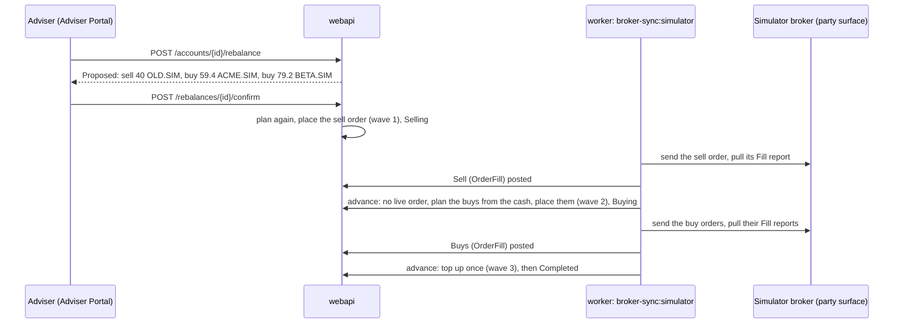

# Rebalance through orders

Step 12 of [custodial-roadmap.md](../custodial-roadmap.md) §13. It covers roadmap item **O3** and answers its open question (the Customer's consent). It builds on the orders, fills and reservations of [orders.md](orders.md) and the settlement of [trade-settlement.md](trade-settlement.md), keeps the portfolio, the assignment and the targets of [portfolios.md](portfolios.md), and follows [ADR 0021](../adr/0021-outside-parties-behind-ports.md) without re-deciding it. The simulator broker (**S2**) does not change.

Today a rebalance posts `Buy` and `Sell` Transactions at once, at the platform's stored price, with source `Rebalance`. It is the last trade on a Custodial account that no broker executed. After this slice a rebalance is a **rebalance**: a stored run with a **proposal** (the trades the plan would make) that an Adviser or TenantAdmin confirms. The platform then places ordinary orders in **waves**: the sells first, and, when they are filled, the buys, sized from the cash that is really there. Each fill is posted as any order fill. Nothing is traded before a person confirms.

New: permissions `rebalances.read` and `rebalances.confirm`; routes under `/rebalances`; a sixth step in the `worker` job `broker-sync:{connection}`; `rebalanceId` on the order item and `rebalance` on the account's portfolio item; five problem codes. Script `0053_rebalances.sql`. No simulator script. No new `TransactionType`, source kind, port, job, queue or domain event. The source kind `Rebalance` is no longer written and is no longer hand-reversible on a Custodial account.

**Status is `review` (2026-11-23).** It is not a build contract. The seventeen points of §11 each carry a recommendation and wait for confirmation. The amendments to accepted docs listed in §12 are made when this spec is accepted.

---

## 1. Summary



| | Today | After this slice |
| --- | --- | --- |
| A rebalance | Trades posted at once at the stored price, source `Rebalance` | A stored rebalance: a proposal, a person's confirmation, then orders at the broker in waves |
| Assign, "Rebalance" on an account | Trades at once; answers `Success` or `NoChange` | A proposal; answers `Proposed` or `NoChange` with the rebalance id |
| A weight change, bulk rebalance | A job trades every assigned account | A job makes one proposal per assigned account; each waits for confirmation |
| Price and date of a rebalance trade | The platform's stored price, now | The broker's fill price, trade date and settlement date |
| Cash for the buys | Planned from the stored prices of the sells | The buys are placed after the sells are filled, from the available cash, each reserved at its price limit |
| Bank reconciliation of rebalance trades | The known difference `Trades` | As any order fill: settled through the trust account |
| Hand reverse of a rebalance trade | Allowed on a Custodial account | Refused; a fill is undone only by its flow |
| An order on an assigned account | Never | Only the orders of the account's rebalance |

The rule that distinguishes this slice: a rebalance decides what to trade, and the broker decides the price. The proposal is an estimate at the stored prices; the quantities are worked out when each wave is placed, and a wave is placed only when the wave before it is in the ledger.

---

## 2. Scope

**In**

- Domain: `Rebalance` aggregate with its targets and lines; `RebalanceRules`; enums; `RebalancePlanner` plans one wave and sizes buys by their reservation; `Order.RebalanceId`; `AccountPortfolioAssignment` loses the last-rebalance fields; `CustodyRules.AllowsHandReverse(Custodial, Rebalance)` becomes false
- Application: `ProposeRebalance` (used by assign, the account request and the job), commands `ConfirmRebalance` and `CancelRebalance`, queries `GetRebalances` and `GetRebalanceById`, service `AdvanceRebalances(connection)`; `AssignPortfolio`, `UnassignPortfolio`, `DisablePortfolio`, `RebalanceAccount`, `RebalanceJob`, `CancelOrder` and the order and portfolio reads change; the immediate-trade path of `AccountRebalancer` is removed
- Infrastructure: `BrokerSyncJob` runs the sixth step; EF mappings
- Script: `database/schema/0053_rebalances.sql`
- Security: two permissions (R1)
- HTTP (`webapi`): the routes of §8
- Adviser Portal: the proposal and its confirmation, the Rebalances pages, the portfolio and account pages; BFF prefix `/rebalances`. Customer Portal: a rebalance order is labelled
- Tests listed in §10

**Out**

- The Customer's consent to each rebalance, and a Customer acting in the Customer Portal (roadmap D6; §11 point 3)
- A scheduled or drift-triggered rebalance. The triggers stay: assign, a person's request, a weight change, a bulk request
- A second person's approval of a rebalance, and one route that confirms many rebalances
- Order aggregation and allocation across accounts (roadmap O4). Each account's order is its own order at the broker
- Orders by amount, limit orders and orders that last longer than a day (orders §2)
- Buying an instrument quoted in another currency than the account's (roadmap D20, R8)
- An overlay or partial rebalance, tax lots, and a rebalance that avoids selling at a loss
- A preview that stores nothing. A proposal is the preview, and it is stored
- A change to the simulator broker, a real broker adapter, named scenarios
- Rebalancing an External account (custody-modes R14)

---

## 3. Stories

1. As an Adviser I ask for a rebalance of an assigned account and see what it would sell and buy, about how much, and the fees, before anything is traded.
2. As an Adviser I confirm the proposal. The platform sells first and buys when the sales are filled, so the account never needs cash it does not have.
3. As an Adviser I see the rebalance move from selling to buying to completed, with every order and its fills.
4. As an Adviser I cancel a rebalance. What is not filled yet is cancelled at the broker, and what was filled stays.
5. As a TenantAdmin I change a portfolio's weights and get one proposal per assigned account. No account trades until its proposal is confirmed.
6. As an Adviser I see why a rebalance could not be planned (a missing or old price, an instrument in another currency) or why it ended early (an order expired).
7. As a Customer I see the orders and trades of a rebalance on my account, marked as a rebalance.
8. As an Adviser I cannot place an order of my own on an assigned account, and I cannot reverse a rebalance trade by hand.

---

## 4. Rules

### 4.1 Access

| ID | Rule |
| --- | --- |
| R1 | **Access.** New permissions: `rebalances.read` and `rebalances.confirm`, both for TenantAdmin and Adviser. Customer and SystemAdmin have neither → 403 on every `/rebalances` route (roadmap D5, D6); a Customer sees a rebalance through its orders (R27). Missing / dead Bearer → 401, never 302. A disabled current tenant → 403. Scope is the Account's, as orders R1: TenantAdmin any Account of the tenant; Adviser Accounts of assigned Customers. A rebalance outside scope, of another tenant, or missing → 404. A `tenantId` in a query or body on `/rebalances` → 400. The routes that existed before this slice (`POST /accounts/{id}/portfolio`, `DELETE /accounts/{id}/portfolio`, `POST /accounts/{id}/rebalance`, `POST /portfolios/{id}/rebalance`, `PUT /portfolios/{id}`, `POST /portfolios/{id}/disable`) keep their policies and their Book rules (portfolios §8 and amendment 2026-11-13). |

### 4.2 A rebalance

| ID | Rule |
| --- | --- |
| R2 | **What it is.** A **rebalance** is one run that brings one assigned Custodial account towards the targets of its portfolio through orders. It is an instruction with its own lifecycle (roadmap P7): it is not a Transaction and not an order, and it moves nothing in the ledger. It holds the targets it aims at, a proposal (R9), and the orders it placed. Its PublicId is the `handle` of portfolios R23. Every attempt to rebalance an account is stored as a rebalance, also one that found nothing to trade and one that could not be planned. |
| R3 | **Statuses.** A rebalance is **open** while it is `Proposed`, `Selling` or `Buying`, and **in progress** while it is `Selling` or `Buying`. Every other status is final. |

| Status | Means | Open | Next |
| --- | --- | --- | --- |
| `Proposed` | The plan is made and waits for a person | yes | `Selling`, `Buying`, `NoChange`, `Cancelled` |
| `Selling` | Confirmed; the sell orders of the first wave are live | yes | `Buying`, `Completed`, `Incomplete`, `Cancelled` |
| `Buying` | A wave of buy orders is live | yes | `Buying` (the top-up), `Completed`, `Incomplete`, `Cancelled` |
| `Completed` | Every order it placed was filled in full, and it has nothing more to place | no | final |
| `Incomplete` | It ended early: an order was not filled in full, or a wave could not be planned | no | final |
| `Cancelled` | A person cancelled it, a newer proposal replaced it, or its assignment ended | no | final |
| `NoChange` | The plan found nothing to trade | no | final |
| `Failed` | The proposal could not be planned | no | final |

| ID | Rule |
| --- | --- |
| R4 | **One open rebalance per Account.** A new proposal for an Account whose rebalance is `Proposed` replaces it: the older one becomes `Cancelled` with reason `Superseded` in the same database transaction. A new proposal for an Account whose rebalance is in progress is not made: a person's request answers 400 `rebalance_in_progress` (`A rebalance of this account is in progress. Cancel it or wait until it has ended.`), and the job marks the one in progress for a follow-up (R12). A filtered unique index is the backstop. |
| R5 | **Triggers.** A rebalance records what started it: `Assign` (R10), `Account` (`POST /accounts/{id}/rebalance`), `Portfolio` (the job after a weight change or `POST /portfolios/{id}/rebalance`) or `FollowUp` (R12). It records the person who asked, `null` for the job and a follow-up. |

### 4.3 The proposal

| ID | Rule |
| --- | --- |
| R6 | **Who can be rebalanced.** The Account is Open, Custodial and has an Active assignment (custody-modes R15); its Customer is not Disabled and its Tenant is active (orders R7); else `account_not_eligible`. The portfolio is active, else `portfolio_inactive`. The Tenant names a broker connection that is configured on the host (orders R2, R3), else the new code `no_broker_connection` (`The firm has no broker connection, so a rebalance cannot place orders.`). These are checked when a rebalance is proposed, when it is confirmed and before every wave. |
| R7 | **The plan.** Portfolios R8, R10, R14, R19–R21 and trade-fees R25–R29 stand: `V` is available cash (withdrawals R35) plus the market value of the holdings in the portfolio base currency; sell every holding outside the targets in full; then bring each target line to `(weight / 100) × V × (1 − residual)`; trades below the minimum trade are skipped; the fee of each trade is estimated from the schedule of the UTC date. A plan is made against a set of targets and settings, with the latest stored prices and rates. Its outcome is a list of sells and buys, nothing to trade, or a failure with a code. |
| R8 | **What orders add to the plan.** Each of these fails the whole plan, as a missing price does (portfolios R10): an Instrument the plan would trade is not active → `instrument_inactive`; its latest price is more than 4 days old (orders R10) → `stale_price`, with the message of orders R10; a target line's Instrument is quoted in another currency than the Account's (roadmap D20, orders R9) → `currency_mismatch` (`BHP.AX is quoted in AUD and this account is in NZD. A rebalance buys only instruments quoted in the account's currency.`). A holding quoted in another currency is still sold (orders R9, R34). `missing_price`, `missing_fx` and `insufficient_cash` keep their meaning. |
| R9 | **A proposal.** A plan with trades is stored as a `Proposed` rebalance: the portfolio, a copy of its target lines, minimum trade and cash residual (the rebalance's **own targets**), `V` and the cash it was planned with, and one **line** per Instrument that is held or is a target: the quantity held, its weight now, its target weight (`null` outside the targets), and, when the plan trades it, the side, the quantity, the reference price with its date, the estimated gross and the estimated fee. The lines are never changed afterwards. A proposal places no order and reserves nothing. A plan with nothing to trade is stored as `NoChange`, and a failed plan as `Failed` with its code and message; both have no lines. |
| R10 | **The routes that propose.** `POST /accounts/{id}/rebalance` → 200 `{ "status", "rebalanceId" }` with `status` `Proposed` or `NoChange`; a failed plan → 400 with its problem code, and the `Failed` rebalance is stored. `POST /accounts/{id}/portfolio` (assign) writes the assignment as today, then proposes and answers the same way; a failed plan still leaves the assignment Active (portfolios §8.2). Both are synchronous and take no `Idempotency-Key`: a repeat makes a newer proposal (R4). Eligibility refusals of assign (custody-modes R14, account-closure R13, orders R49) are unchanged and write nothing. |
| R11 | **Validity.** A proposal can be confirmed for 24 hours after it was made (`RebalanceRules.ProposalValidHours`); the item carries `expiresAt`. After that it stays `Proposed` until it is replaced or cancelled, and confirm answers 400 `errors.Status` (`This proposal has expired. Propose the rebalance again.`). |
| R12 | **The job.** A weight change (`PUT /portfolios/{id}` with changed lines) and `POST /portfolios/{id}/rebalance` still answer 202 with `jobId` and one `handle` per targeted Account, filtered to the Adviser's Book (portfolios R23, PB2, PB8), and still run one job per Account on the queue `rebalance`. The job now proposes (R6–R9) with the handle as the rebalance's id. For an Account whose rebalance is in progress it makes no rebalance: it sets `followUp` on the one in progress, and when that one ends, in any final status, and the assignment is still Active, the platform proposes again with trigger `FollowUp` and a new id. A failed plan is stored as `Failed` and is not retried (portfolios R13). |

### 4.4 Confirm, the waves and the end

| ID | Rule |
| --- | --- |
| R13 | **Confirm.** `POST /rebalances/{id}/confirm` (`rebalances.confirm`) with `rowVersion` → 204. Only a `Proposed` rebalance that has not expired (else 400 `errors.Status`, `This rebalance is <status> and cannot be confirmed.`, or R11). Missing `rowVersion` → 400; stale → 409 `stale_row_version`. In one database transaction with the Account row locked (posting R22): R6 is checked, the plan is made again against the rebalance's own targets (R7, R8), and the first wave is placed (R14). A plan that fails now → 400 with its code, and the rebalance stays `Proposed`. A plan with nothing to trade → the rebalance ends `NoChange`. Otherwise it records the person, the time and the Tenant's broker connection, which every order of the rebalance takes. Nothing is sent to the broker in the request (ADR 0021 rule 4). No `Idempotency-Key`: the status and `rowVersion` make a repeat a 400 or a 409. |
| R14 | **Waves.** A **wave** is a set of orders the rebalance places together. The first wave is every sell of the plan, and the rebalance is `Selling`; a plan with no sell starts with a buy wave, and the rebalance is `Buying`. Buys are never placed while an order of the rebalance is live (orders R14), so the cash a buy reserves is in the ledger. Sells are placed only in the first wave: a sell that a later plan would make is left to the next rebalance. A rebalance places at most two buy waves (`RebalanceRules.MaxBuyWaves`): the buys, and one top-up (R16). |
| R15 | **A rebalance order.** Each order of a wave is an ordinary order (orders R5): `Market`, `Day`, the reference price and price limit of orders R10, the fee terms of R11, the reservation of R12 or R13, the settlement account of trade-settlement R3. It is sent, filled, posted, settled and broken as any order, and its fills have source `OrderFill` with the order's PublicId. It differs in four ways: it is created by the rebalance and not by `POST /orders`; it needs the Account's Active assignment, where orders R8 refuses a person's order; it carries the rebalance (`rebalanceId` on the order item) and the memo `Rebalance`; and it is placed by the person who confirmed the rebalance, in every wave. |
| R16 | **Sizing the buys.** A buy order reserves the most it can cost at its price limit, with fees (orders R12). The buys of a wave are the plan's buys, scaled by one factor so that the sum of their reserved cash is not more than the Account's available cash: the bisection of trade-fees R27 with each buy costed at its reservation, then trade-fees R28 (a buy below the minimum trade is dropped). So the first buy wave invests about 95 % of what the plan wants, and the top-up wave, planned after those fills are posted, invests most of the rest. Each order pays its own fee (orders R33); the portfolio's minimum trade decides whether a top-up is worth an order. |
| R17 | **The advance step.** `broker-sync:{connection}` (orders R19) gains a sixth step after the fills are posted: for every rebalance in progress that took this connection and has no live order, in one database transaction with the Account row locked and guarded by the rebalance's `RowVersion`, the first case that applies: (a) it has a cancel request → `Cancelled`, with reason `Requested` when a person asked (R19) and `Unassigned` when the platform did (R22); (b) an order of its last wave is not `Filled` → `Incomplete` with code `order_not_filled` and the message `<n> of <m> orders were not filled in full.`; (c) it has placed two buy waves → `Completed`; (d) R6 fails or the plan fails → `Incomplete` with that code and message; (e) the plan, made against the rebalance's own targets and sized by R16, has no buy → `Completed`; (f) otherwise the buys are placed as the next wave and it is `Buying`. A failure on one rebalance is logged with its PublicId and leaves it for the next run. The orders of a new wave are sent by the next run. |
| R18 | **What `Completed` promises.** Every order the rebalance placed was filled. It does not promise exact weights: fills are at the broker's price, a buy is sized at its price limit, and trades below the minimum trade are skipped. A later rebalance moves the account closer, and answers `NoChange` when nothing is left above the minimum trade. A trade the broker breaks after the rebalance ended (trade-settlement R27) does not change its status. |
| R19 | **Cancel.** `POST /rebalances/{id}/cancel` (`rebalances.confirm`) with `rowVersion` and optional `note` (trimmed, 1–200) → 204. A `Proposed` rebalance becomes `Cancelled` with reason `Requested`. A rebalance in progress gets a **cancel request** with the person, the time and the note; every open order of it is cancelled as orders R18 does (at once before the first send, otherwise a request the broker answers) with the note `Rebalance cancelled`; it places no further wave and becomes `Cancelled` when none of its orders is live, in the request when that is already so, otherwise in the advance step. A fill that crossed the cancellation is booked (orders R28). A second cancel → 400 `errors.Status` (`A cancellation was already requested for this rebalance.`); a final rebalance → 400 `errors.Status` (`This rebalance is <status> and cannot be cancelled.`). |
| R20 | **Its orders are not cancelled one by one.** `POST /orders/{id}/cancel` on an order with a rebalance → 400 `errors.Status` (`This order belongs to a rebalance. Cancel the rebalance.`). |
| R21 | **What else ends a wave early.** A corporate action that takes effect requests the cancel of the open orders in its Instrument (orders R50), a rebalance order included; the wave then has an order that is not `Filled` and the rebalance ends `Incomplete` (R17 b). So does an order the broker rejects, an order that expires at the end of the broker's day, and a fill broken while the rebalance is in progress (the order is `Cancelled`, trade-settlement R32). A fill that cannot be posted keeps its order live (orders R36), and the rebalance waits until a TenantAdmin removes the cause. The platform does not place an order again: the Adviser asks for a new rebalance. |

### 4.5 The assignment and the trade lock

Amendment to [portfolios.md](portfolios.md) R9, R11–R13, R15, R18, R22–R25, [orders.md](orders.md) R8, R18, R49 and [custody-modes.md](custody-modes.md) R15, R17.

| ID | Rule |
| --- | --- |
| R22 | **When an assignment ends.** Unassign (portfolios R15) and disabling a portfolio (R22) are never refused because of a rebalance. In the same database transaction the Account's open rebalance is cancelled by the platform with reason `Unassigned`: a `Proposed` one at once, one in progress as R19 with no person. Still no trade is made to undo anything. |
| R23 | **Assigning another portfolio.** Assign on an Account whose rebalance is in progress → 400 `rebalance_in_progress`, and nothing is written; the refusal of an Account with a live order (orders R49) stays. Assign on an Account whose rebalance is `Proposed` replaces the assignment (portfolios R5), cancels that rebalance with reason `Unassigned` and proposes for the new portfolio. |
| R24 | **The trade lock.** Portfolios R18 on a Custodial account now reads: on an Account with an Active assignment only its rebalance places orders. `POST /orders` stays refused (orders R8), and a hand reverse of a `Buy` or `Sell` typed before orders stays refused by the lock. "An order and an assignment never meet on one account" (orders R49) is replaced by: the only orders on an assigned Account are the orders of its rebalance. An adjustment, an entitlement posting and every cash write stay outside the lock (adjustments R16, corporate-actions R30, portfolios R18). |
| R25 | **The assignment item.** `GET /accounts/{id}/portfolio` loses `lastRebalanceStatus`, `lastRebalanceMessage` and `lastRebalanceAt` and gains `rebalance`: the newest rebalance of the assignment as `{ id, status, failure, proposedAt, endedAt }`, `null` when it has none. `failure` is `{ code, message }` on a `Failed` or `Incomplete` rebalance, else `null`. The three columns are dropped with no back-fill; rebalances before this slice are in the ledger as Transactions with source `Rebalance`. |

### 4.6 The ledger, the source and the reads

Amendment to [transaction-source.md](transaction-source.md) R5, R9, R12, [trade-fees.md](trade-fees.md) R24–R29, [trade-settlement.md](trade-settlement.md) R5 and [bank-reconciliation.md](bank-reconciliation.md) R10.

| ID | Rule |
| --- | --- |
| R26 | **No Transaction is written by a rebalance.** From this slice no Transaction gets source `Rebalance`; the kind stays for the rows that have it. A rebalance trade is the fill of a rebalance order: source `OrderFill`, an execution detail, the fee of orders R33, `bookedAt` when it is posted. The planner's fees (trade-fees R25–R29) are estimates for the proposal and for sizing. A rebalance order gets a settlement account like any order, so its fills settle through the client money account and leave the known difference `Trades` (trade-settlement R5, R23). The idempotency records a rebalance wrote per trade (transaction-source R9) are no longer written. |
| R27 | **Reads.** The order item gains `rebalanceId`, `null` on a person's order; every caller who can read the order sees it, the Customer included. `GET /orders` gains the filter `rebalanceId`. `GET /rebalances` (`rebalances.read`) → list envelope, newest proposed first, without `targets`, `lines` and `orders`; optional filters `accountId`, `customerId`, `portfolioId`, `status` (one or more names, comma-separated; unknown → 400 `errors.Status`) and `open=true`. `GET /rebalances/{id}` → the item of §8.1 with its targets, its lines and its orders, oldest first. |
| R28 | **A rebalance trade is not reversed by hand.** `Rebalance` leaves the hand-reversible sources (transaction-source R12; roadmap D15 said "until O3"): on a Custodial account `POST /transactions/{id}/reverse` of a Transaction with source `Rebalance` → 400 with the message of transaction-source R13. It is corrected with an adjustment. The fills of a rebalance order were never hand-reversible (orders R37). External accounts are unchanged. After this slice the only source a person reverses on a Custodial account is `Manual`. |

Policies: `rebalances.read`, `rebalances.confirm` (new). Grants: as R1.

---

## 5. Domain

| Type | Kind | Change |
| --- | --- | --- |
| `Rebalance` | Aggregate (new) | `TenantId`, `PublicId`, `AccountId`, `PortfolioId`, `AssignmentId`, `Trigger`, `Status`, `BaseCurrency`, `TotalValue`, `Cash`, `MinimumTrade`, `CashResidualPercent`, `Connection?`, `Waves`, `BuyWaves`, `FailureCode?`, `FailureMessage?`, proposed (`ByUserId?`, `At`, `ExpiresAt`), confirmed (`ByUserId?`, `At?`), cancel request (`At?`, `ByUserId?`, `Note?`), `CancelReason?`, `FollowUp`, `EndedAt?`, `RowVersion`. `Propose(...)`, `NoChange(...)`, `Fail(...)`, `Confirm(by, connection, at)`, `StartWave(side)`, `Complete(at)`, `EndIncomplete(code, message, at)`, `RequestCancel(by?, note, at)`, `Cancel(reason, at)`, `MarkFollowUp()`; `IsOpen`, `IsInProgress`. Holds R3, R11, R13, R14, R17, R19 |
| `RebalanceTarget` | Entity (new, child) | `InstrumentId`, `TargetWeight`, `SortOrder`: the copy of the portfolio's lines (R9) |
| `RebalanceLine` | Entity (new, child) | `InstrumentId`, `Quantity`, `Weight`, `TargetWeight?`, `Side?`, `TradeQuantity?`, `ReferencePrice?`, `ReferencePriceDate?`, `EstimatedGross?`, `EstimatedFee?`, `Currency` (R9) |
| `RebalanceStatus` | Enum (new meaning) | `Proposed = 0`, `Selling = 1`, `Buying = 2`, `Completed = 3`, `Incomplete = 4`, `Cancelled = 5`, `NoChange = 6`, `Failed = 7`. The existing enum of that name (`Success`, `NoChange`, `Failed`: the planner's outcome) is renamed `RebalancePlanOutcome` |
| `RebalanceTrigger`, `RebalanceCancelReason` | Enums (new) | `Assign = 0`, `Account = 1`, `Portfolio = 2`, `FollowUp = 3`; `Requested = 0`, `Superseded = 1`, `Unassigned = 2` |
| `RebalanceRules` | Static (new) | `ProposalValidHours = 24`; `MaxBuyWaves = 2` |
| `RebalancePlanner` | Static (existing) | Takes the targets and settings it is given (a portfolio's, or a rebalance's own). Gains the checks of R8 and a mode that costs each buy at its reservation (`OrderRules.PriceLimit`, the schedule's fee on the maximum gross) for R16. Targets, sells and the bisection are unchanged |
| `Order` | Aggregate (existing) | `RebalanceId?`, set by `Place`. `RequestCancel` by a person is refused for an order with a rebalance (R20); the platform's request is not |
| `AccountPortfolioAssignment` | Entity (existing) | Loses `LastRebalanceAt`, `LastRebalanceStatus`, `LastRebalanceMessage` and `RecordRebalance` (R25) |
| `CustodyRules` | Static (existing) | `AllowsHandReverse(Custodial, Rebalance)` → `false` (R28) |
| `TransactionSource` | VO (existing) | `Rebalance(handle)` stays for reading existing rows; nothing calls it to write |

```text
Rebalance.Propose(...)                     -> Proposed (lines, own targets, expires in 24 h)
  Confirm(by, connection, at)   Proposed, not expired
  StartWave(Sell)               Proposed -> Selling            only as the first wave
  StartWave(Buy)                Proposed | Selling | Buying -> Buying   at most MaxBuyWaves
  Complete(at)                  Selling | Buying -> Completed
  EndIncomplete(code, msg, at)  Selling | Buying -> Incomplete
  RequestCancel(by?, note, at)  Selling | Buying, no request yet       status unchanged
  Cancel(reason, at)            Proposed -> Cancelled; Selling | Buying -> Cancelled when no order is live
  IsOpen = Proposed | Selling | Buying;  IsInProgress = Selling | Buying
```

Invariants:

- An Account has at most one open rebalance. Held by Application (R4) and a filtered unique index.
- A rebalance has orders only after it was confirmed, and every order of it is on its Account and its connection. Held by `Rebalance` and R13, R15.
- A buy wave is placed only while no order of the rebalance is live, and never reserves more than the available cash. Held by R14, R16, R17 under the Account lock.
- On an Account with an Active assignment, an order has a rebalance. Held by orders R8 and R15.
- On a Custodial account a person reverses only a `Manual` source. Held by `CustodyRules`.

Domain events: none new. `PortfolioWeightsChanged` still starts the job.

To be recorded in [domain-model.md](../domain-model.md) (portfolios, §8.16 and a new §8.18) when accepted.

---

## 6. Database

Forward only. Do not add EF migrations.

Script `0053_rebalances.sql`:

| Table | Change | Index / FK |
| --- | --- | --- |
| `Rebalances` | Add (columns below) | PK `Id`. UQ `PublicId`. UQ `(TenantId, Id)`. FK `TenantId` → `Tenants`; `(TenantId, AccountId)` → `Accounts`; `(TenantId, PortfolioId)` → `Portfolios`; `(TenantId, AssignmentId)` → `AccountPortfolioAssignments`; `(TenantId, ProposedByUserId)`, `(TenantId, ConfirmedByUserId)` and `(TenantId, CancelRequestedByUserId)` → `Users`; all RESTRICT. Filtered UQ `(AccountId) WHERE Status IN (0, 1, 2)`. Index `(TenantId, ProposedAt DESC)`; index `(PortfolioId, Status)`; filtered index `(Connection, Id) WHERE Status IN (1, 2)` for the advance step |
| `RebalanceTargets` | Add: `Id`, `TenantId`, `RebalanceId`, `InstrumentId`, `TargetWeight decimal(5,2)`, `SortOrder int` | FK `(TenantId, RebalanceId)` → `Rebalances`, `(TenantId, InstrumentId)` → `Instruments`, RESTRICT. UQ `(RebalanceId, InstrumentId)` |
| `RebalanceLines` | Add: `Id`, `TenantId`, `RebalanceId`, `InstrumentId`, `Quantity decimal(18,8)`, `Weight decimal(5,2)`, `TargetWeight decimal(5,2) NULL`, `Side int NULL` CHECK 0–1, `TradeQuantity decimal(18,8) NULL`, `ReferencePrice decimal(18,8) NULL`, `ReferencePriceDate date NULL`, `EstimatedGross decimal(18,4) NULL`, `EstimatedFee decimal(18,4) NULL`, `Currency char(3)`. CHECK the five trade columns are set iff `Side` is set | FK as `RebalanceTargets`. UQ `(RebalanceId, InstrumentId)` |
| `Orders` | Add `RebalanceId int NULL` | FK `(TenantId, RebalanceId)` → `Rebalances` RESTRICT. Filtered index `(RebalanceId) WHERE RebalanceId IS NOT NULL` |
| `AccountPortfolioAssignments` | Drop `CK_AccountPortfolioAssignments_LastRebalanceStatus`, then `LastRebalanceAt`, `LastRebalanceStatus` and `LastRebalanceMessage`. Add `UQ_AccountPortfolioAssignments_TenantId_Id` on `(TenantId, Id)`, the key the tenant composite FK from `Rebalances` needs (the table has none today) | none |

`Rebalances`:

| Column | Type | Null | Notes |
| --- | --- | --- | --- |
| Id | int identity | no | |
| PublicId | uniqueidentifier | no | The `handle` of the 202 body |
| TenantId | int | no | Tenant query filter |
| AccountId, PortfolioId, AssignmentId | int | no | Immutable |
| Trigger | int | no | CHECK 0–3 |
| Status | int | no | CHECK 0–7 |
| BaseCurrency | char(3) | no | The portfolio's, when proposed |
| TotalValue, Cash | decimal(18,4) | yes | `V` and the available cash of the plan; `NULL` on a `Failed` rebalance |
| MinimumTrade, CashResidualPercent | decimal(18,4), decimal(5,2) | no | The rebalance's own settings |
| Connection | nvarchar(50) | yes | Set when confirmed |
| Waves, BuyWaves | int | no | Waves placed; CHECK `BuyWaves <= 2 AND BuyWaves <= Waves` |
| FailureCode, FailureMessage | nvarchar(50), nvarchar(500) | yes | Both set iff `Status IN (4, 7)` (CHECK) |
| ProposedByUserId | int | yes | `NULL` for the job and a follow-up |
| ProposedAt, ExpiresAt | datetimeoffset | no | |
| ConfirmedByUserId, ConfirmedAt | int, datetimeoffset | yes | Both or neither (CHECK); required when `Status IN (1, 2, 3, 4)` |
| CancelRequestedAt, CancelRequestedByUserId, CancelNote | datetimeoffset, int, nvarchar(200) | yes | The person is `NULL` for the platform's request |
| CancelReason | int | yes | CHECK 0–2; set iff `Status = 5` (CHECK) |
| FollowUp | bit | no | Default 0 |
| EndedAt | datetimeoffset | yes | Set iff `Status >= 3` (CHECK) |
| Created, CreatedBy, LastModified, LastModifiedBy | audit | | |
| RowVersion | rowversion | no | |

No back-fill. No rebalance is created for a run before this slice, existing orders have no rebalance, and existing Transactions keep source `Rebalance`. No simulator script.

To be recorded in [database-design.md](../database-design.md) §9, §11.6, §11.16 and a new §11.18 when accepted.

---

## 7. Application use cases

| Kind | Name | Change |
| --- | --- | --- |
| Service | `ProposeRebalance` (new) | R4–R9: checks, plans, supersedes, stores. Replaces the planning half of `AccountRebalancer`; the posting half is removed |
| Command | `RebalanceAccount` | Calls `ProposeRebalance` with trigger `Account`; returns `{ status, rebalanceId }` (R10) |
| Command | `AssignPortfolio` | The refusal of R23; cancels a `Proposed` rebalance; proposes with trigger `Assign` (R10) |
| Command | `UnassignPortfolio`, `DisablePortfolio` | Cancel the open rebalance (R22) |
| Command | `UpdatePortfolio`, `RebalancePortfolio` | Unchanged: they enqueue the job (R12) |
| Job | `RebalanceJob` | Proposes with trigger `Portfolio`, or marks the follow-up (R12) |
| Command | `ConfirmRebalance`, `CancelRebalance` (new) | R13, R19 |
| Service | `AdvanceRebalances` (new) | `RunAsync(connection)`: R17, and the follow-up proposal of R12. Reads past the tenant query filter and names each Tenant itself, as `ProcessExecutionReports` |
| Service | `PlaceRebalanceWave` (new) | The one place a rebalance places orders, for confirm and the advance step: R14–R16, with `OrderChecks` and `Order.Place` |
| Job | `BrokerSyncJob` | Runs `AdvanceRebalances` as its sixth step (R17) |
| Command | `PlaceOrder` | No change: R8 of orders still refuses an assigned Account |
| Command | `CancelOrder` | The refusal of R20 |
| Command | `ReverseTransaction` | No change in code: `CustodyRules` refuses (R28) |
| Query | `GetRebalances`, `GetRebalanceById` (new) | R27 |
| Query | `GetOrders`, `GetOrderById` | Map `rebalanceId`; the filter (R27) |
| Query | `GetAccountPortfolio` | Maps `rebalance` (R25) |

Where each rule lives:

| Rule | Where |
| --- | --- |
| Status moves, validity, the wave count (R3, R11, R14) | `Rebalance`, `RebalanceRules` |
| The plan, the checks of R8, buy sizing (R7, R8, R16) | `RebalancePlanner`, fed by `ProposeRebalance` and `PlaceRebalanceWave` |
| One open rebalance, supersede, follow-up (R4, R12) | `ProposeRebalance`, `RebalanceJob`, `AdvanceRebalances` |
| What ends a rebalance (R17) | `AdvanceRebalances`, under the Account lock |
| The hand-reverse rule (R28) | `CustodyRules` |

---

## 8. API

| Method | Route | Policy | Success | Failure |
| --- | --- | --- | --- | --- |
| GET | `/rebalances` | `rebalances.read` | 200 envelope | 400 / 401 / 403 |
| GET | `/rebalances/{id}` | `rebalances.read` | 200 item | 401 / 403 / 404 |
| POST | `/rebalances/{id}/confirm` | `rebalances.confirm` | 204 | 400 / 401 / 403 / 404 / 409 |
| POST | `/rebalances/{id}/cancel` | `rebalances.confirm` | 204 | 400 / 401 / 403 / 404 / 409 |
| POST | `/accounts/{id}/rebalance` | unchanged | 200 `{ status, rebalanceId }` | 400 with a problem code / 404 |
| POST | `/accounts/{id}/portfolio` | unchanged | 200 `{ status, rebalanceId }` | 400 / 404 / 409 |
| DELETE | `/accounts/{id}/portfolio` | unchanged | 204; the open rebalance is cancelled | 404 |
| PUT, POST | `/portfolios/{id}`, `/portfolios/{id}/rebalance` | unchanged | 202 / 204 as today; the job proposes | as today |
| POST | `/portfolios/{id}/disable` | unchanged | 204; the open rebalance of each assigned Account is cancelled | as today |
| GET | `/accounts/{id}/portfolio` | unchanged | item has `rebalance`; the three `lastRebalance…` fields are gone | — |
| GET | `/orders`, `/orders/{id}` | unchanged | item has `rebalanceId`; filter `rebalanceId` | — |
| POST | `/orders/{id}/cancel` | unchanged | — | a rebalance order → 400 `errors.Status` |
| POST | `/transactions/{id}/reverse` | unchanged | — | source `Rebalance` on a Custodial account → 400 |

List envelope: `{ items, page, pageSize, totalCount }`; page default 1, pageSize default 20, max 100. `{id}` routes under `/rebalances` take a GUID only.

### 8.1 Bodies

Answer of `POST /accounts/{id}/rebalance` and of assign: `{ "status": "Proposed", "rebalanceId": "<rebalance publicId>" }`.

Confirm: `{ "rowVersion": "<base64>" }`. Cancel: `{ "rowVersion": "<base64>", "note": "Customer is withdrawing next week" }`.

Rebalance item, a proposal for an account with 10 000.00 USD and no holding, a portfolio of 60 % and 40 %, a residual of 1 % and a fee schedule of 0.5 %:

```json
{
  "id": "<rebalance publicId>",
  "accountId": "<account publicId>",
  "customerId": "<customer publicId>",
  "portfolio": { "id": "<portfolio publicId>", "name": "Demo Growth" },
  "trigger": "Account",
  "status": "Proposed",
  "baseCurrency": "USD",
  "totalValue": 10000.0000,
  "cash": 10000.0000,
  "minimumTrade": 100.00,
  "cashResidualPercent": 1.00,
  "targets": [
    { "instrument": { "id": "<instrument publicId>", "symbol": "ACME.SIM", "name": "Acme Simulated Holdings" }, "targetWeight": 60.00 },
    { "instrument": { "id": "<instrument publicId>", "symbol": "BETA.SIM", "name": "Beta Simulated Group" }, "targetWeight": 40.00 }
  ],
  "lines": [
    { "instrument": { "id": "<instrument publicId>", "symbol": "ACME.SIM", "name": "Acme Simulated Holdings" }, "quantity": 0.00000000, "weight": 0.00, "targetWeight": 60.00, "side": "Buy", "tradeQuantity": 59.40000000, "referencePrice": 100.00000000, "referencePriceDate": "2026-11-23", "estimatedGross": 5940.0000, "estimatedFee": 29.70, "currency": "USD" },
    { "instrument": { "id": "<instrument publicId>", "symbol": "BETA.SIM", "name": "Beta Simulated Group" }, "quantity": 0.00000000, "weight": 0.00, "targetWeight": 40.00, "side": "Buy", "tradeQuantity": 79.20000000, "referencePrice": 50.00000000, "referencePriceDate": "2026-11-23", "estimatedGross": 3960.0000, "estimatedFee": 19.80, "currency": "USD" }
  ],
  "orders": [],
  "waves": 0,
  "failure": null,
  "proposedBy": { "id": "<user publicId>", "name": "Avery Adviser" },
  "proposedAt": "2026-11-23T02:10:00Z",
  "expiresAt": "2026-11-24T02:10:00Z",
  "confirmedBy": null,
  "confirmedAt": null,
  "cancelRequest": null,
  "cancelReason": null,
  "followUp": false,
  "endedAt": null,
  "rowVersion": "<base64>"
}
```

A line the plan leaves alone has `side`, `tradeQuantity`, `referencePrice`, `referencePriceDate`, `estimatedGross` and `estimatedFee` `null`. `weight` is the holding's market value over `totalValue`, in percent with 2 decimals. `orders` is `{ id, wave, side, instrument: { id, symbol, name }, quantity, filledQuantity, status }` per order. `cancelRequest` is `{ by, at, note }`; `by` is `null` for the platform. `proposedBy` is `null` for the job and a follow-up.

In that example the first buy wave reserves at the price limit of 105 %, so it is scaled to about 95.7 % of the plan: about 56.86 ACME.SIM and 75.81 BETA.SIM. When those fills are posted, the top-up wave buys what is still missing above the minimum trade of 100.00, and the rebalance is `Completed`.

### 8.2 Errors

The plan's refusals are problem codes ([api-design.md](../api-design.md) §4.2), as the rebalance failures of portfolios §11 are. Every other refusal is ordinary validation (400 with `errors`).

| Case | Response |
| --- | --- |
| Customer or SystemAdmin on `/rebalances`; a caller without the permission | 403 |
| A rebalance or an Account outside scope or of another Tenant, or a missing one | 404 |
| `tenantId` in a query or body on `/rebalances` | 400 |
| Propose, assign or confirm: the account or the portfolio cannot be rebalanced | 400 `account_not_eligible`, `portfolio_inactive`, `no_broker_connection` (new) |
| Propose, assign or confirm: the plan fails | 400 `missing_price`, `missing_fx`, `insufficient_cash`, `stale_price` (new), `instrument_inactive` (new), `currency_mismatch` (new) |
| Propose or assign while a rebalance of the Account is in progress | 400 `rebalance_in_progress` (new) |
| Confirm of a rebalance that is not `Proposed`, or has expired; cancel of a final one or a second cancel | 400 `errors.Status` |
| Stale `rowVersion` on confirm or cancel | 409 `stale_row_version` |
| Unknown `status` filter | 400 `errors.Status` |
| Cancel of a rebalance order through `/orders` | 400 `errors.Status` |
| Hand reverse of a `Rebalance` Transaction on a Custodial account | 400 (transaction-source R13) |

A wave that fails in the `worker` answers no one: the rebalance is `Incomplete` with `failure.code` one of the codes above or `order_not_filled`.

Cross-tenant or wrong-collection id → **404**, not 403. Keep the resource catalog in [api-design.md](../api-design.md) pointing here for these rules.

---

## 9. UI

Page contracts to amend when this spec is accepted: [adviser-portal-portfolios.md](../adviser-portal/adviser-portal-portfolios.md) (P14–P20), [adviser-portal-dashboard.md](../adviser-portal/adviser-portal-dashboard.md) (D79) and [customer-portal.md](../customer-portal/customer-portal.md) (C37). The Adviser Portal BFF gains the prefix `/rebalances` ([bff-adviser-portal.md](bff-adviser-portal.md) R20). The Customer Portal BFF and the Back Office do not change.

**Adviser Portal**

| ID | Behaviour |
| --- | --- |
| P14 | On an assigned account, "Rebalance" (P7) calls `POST /accounts/{id}/rebalance`. `Proposed` opens `/rebalances/:id`; `NoChange` shows "Nothing to trade. The account is in line with its portfolio."; a 400 shows the server message. Assign (P5, P13) does the same after `POST /accounts/{id}/portfolio`. |
| P15 | `/rebalances/:id` of a `Proposed` rebalance: the account, the portfolio, "Proposed <time> by <name>" ("by the platform" for `null`) and the lines as a table: Instrument, Holding, Now %, Target %, Trade ("Sell 40", "Buy 59.4", "—"), About (the estimated gross), Fee. Under it: "Sales are placed first. Purchases are placed when the sales are filled and are worked out again from the cash then, so the quantities bought may differ. The broker fills at the market price." Buttons Confirm and Cancel. An expired proposal shows "This proposal has expired." and offers "Propose again" (P14) in place of Confirm. |
| P16 | Confirm posts `POST /rebalances/{id}/confirm`. A 400 shows its message; a 409 reloads with "This rebalance has changed." After 204 the page shows the status and the orders by wave: Wave, Side, Instrument, Quantity, Filled, Status (labels of D71), each linked to `/orders/:id`. Manual refresh only. |
| P17 | Status labels: Proposed "Waiting for confirmation", Selling "Selling", Buying "Buying", Completed "Completed", Incomplete "Ended early", Cancelled "Cancelled" (with "replaced by a newer proposal" for `Superseded` and "the portfolio was unassigned" for `Unassigned`), NoChange "Nothing to trade", Failed "Could not be planned". `Incomplete` and `Failed` show `failure.message`. A rebalance with a cancel request shows "Cancelling"; one with `followUp` shows "A new proposal follows when this one ends." |
| P18 | Cancel on an open rebalance: a dialog with an optional note and, for one in progress, "Orders the broker has already filled stay." Posts `POST /rebalances/{id}/cancel`. |
| P19 | Nav item "Rebalances" (`/rebalances`) for TenantAdmin and Adviser: Proposed, Customer, Account, Portfolio, Status, Started by (the trigger: Assign "Assignment", Account "Request", Portfolio "Portfolio change", FollowUp "Follow-up"). Status filter, default "Open"; options Open, Waiting for confirmation, Ended early, All. |
| P20 | `/portfolios/:id`: the assigned accounts table (P7, P8) shows each account's `rebalance` status with a link, in place of the last rebalance status. The weight-change confirmation reads "This will propose a rebalance for every account assigned to this portfolio. Nothing is traded until each proposal is confirmed. Continue?" A "Confirm proposals" button lists the `Proposed` rebalances of the portfolio from `GET /rebalances?portfolioId=&status=Proposed`, and after a dialog ("Confirm <n> proposals?") calls confirm for each in turn and shows how many were confirmed and each refusal. The account page (P7) shows the same status line and links. |
| D79 | Orders pages (D71–D73): an order with `rebalanceId` shows "Rebalance" with a link to `/rebalances/:id`, and Cancel is not offered on it; the detail page says "This order belongs to a rebalance. Cancel the rebalance to cancel it." The Source line of D26 keeps "Rebalance" for existing Transactions, and Reverse (D27) is offered only for `Manual`. |

**Customer Portal**

| ID | Given | When | Then |
| --- | --- | --- | --- |
| C37 | A Customer with an order that has a `rebalanceId` | Account page, Orders block (C32) | The row shows "Rebalance" under the order. No link and no action. The fill rows of C34 are unchanged. |

### 9.1 Seeds and hosting

- `TestSeed`: unchanged. It assigns `Demo Growth` to the Custodial demo account and seeds no rebalance and no order; the first rebalance is asked for in the portal.
- AppHost, TestAppHost, `compose.yml`: no change. The job runs in the existing `broker-sync:{connection}`; proposals from a weight change still run on the queue `rebalance`.
- Simulator: no change. With the order mode `Fill` a rebalance completes in about three runs of the broker job; `Hold`, `Reject`, a fill percentage and the clock show the other paths.

---

## 10. Tests

| Project | Assert |
| --- | --- |
| Domain.UnitTests | `Rebalance`: every move of §5 and each refused one; confirm after `ExpiresAt` throws; a sell wave only first; a third buy wave throws; a cancel request twice throws; `Cancel` of one in progress needs no live order. `RebalancePlanner`: the plan against given targets equals today's for the same inputs; each check of R8; buy sizing by reservation never exceeds the available cash, with and without a fee schedule, a minimum and a cap; a buy below the minimum trade after sizing is dropped. `CustodyRules.AllowsHandReverse(Custodial, Rebalance)` false, `(External, Rebalance)` true, `(Custodial, Manual)` true |
| Application.FunctionalTests — proposal | No Bearer → 401; Customer and SystemAdmin → 403 on `/rebalances`; an Adviser of an unassigned Customer → 404. `POST /accounts/{id}/rebalance`: `Proposed` with the lines, the own targets and `expiresAt`, no order and no reservation; an aligned account → `NoChange`; each failure code of R6 and R8 → 400 with the code and a stored `Failed` rebalance (a price five days old; a disabled instrument; a target in another currency; a holding in another currency is proposed as a sell; no broker connection; a Disabled Customer). A second request supersedes the first (`Cancelled`, `Superseded`). Assign: the assignment and a proposal; a failed plan leaves the assignment Active. Reads and filters. Two-tenant: tenant B's rebalance id → 404 on every route |
| Application.FunctionalTests — confirm and waves | With fakes for `IBrokerOrders` and `IBrokerFeed`. Confirm with sells: one wave of sell orders with `rebalanceId`, memo `Rebalance`, placed by the confirmer, the Tenant's connection; status `Selling`; no buy order yet. After the sell fills are posted, the advance step places the buys, sized so the reserved cash is not above the available cash; `Buying`. After those fills, a top-up wave; after it, `Completed`; no third buy wave. A plan with no sell starts `Buying`. A plan that changed to nothing at confirm → `NoChange`. An expired proposal → 400; a second confirm → 400; stale `rowVersion` → 409. The fills have source `OrderFill`, an execution detail and the fee of the order's schedule; no Transaction with source `Rebalance` is written. A sell that expires, an order the broker rejects, a fill broken in progress → `Incomplete` with `order_not_filled`, and no buy is placed. A pending fill keeps the rebalance in progress. A price that went stale before the buy wave → `Incomplete` with `stale_price`. Unsettled sale proceeds are used by the buys |
| Application.FunctionalTests — cancel and assignment | Cancel of a proposal → `Cancelled`. Cancel in progress: an unsent order is cancelled at once, a sent one gets a cancel request, the rebalance is `Cancelled` when no order is live, a fill that crossed is booked, no further wave. `POST /orders/{id}/cancel` on a rebalance order → 400. `POST /orders` on an assigned account → 400 (unchanged). Unassign with a proposal → `Cancelled` `Unassigned`; unassign in progress → cancel requested by the platform. Disable portfolio does the same for each account. Assign another portfolio: with a proposal → replaced; in progress → 400 `rebalance_in_progress`. `POST /accounts/{id}/rebalance` in progress → 400 `rebalance_in_progress`. `GET /accounts/{id}/portfolio` carries `rebalance` and not the three old fields |
| Application.FunctionalTests — the job | A weight change and a bulk request: 202 with handles; each job stores a proposal whose id is the handle; an Adviser's call proposes only for the Book (PB-T1 kept). An account with a proposal gets a newer one. An account in progress gets `followUp` and, when its rebalance ends, a proposal with trigger `FollowUp`; none when the assignment was removed. A failed plan is stored `Failed` and not retried |
| Application.FunctionalTests — reverse and reconciliation | Hand reverse of an existing `Rebalance` Transaction on a Custodial account → 400 with the transaction-source R13 message; on an External account → 201. Bank reconciliation lists the fills of a rebalance order as `UnsettledTrades` and `TradeFees`, not `Trades` |
| Infrastructure.IntegrationTests | `0053`: a second open rebalance on one Account violates, a second after the first ended does not; the status, failure, confirmed, cancel and ended CHECKs; the line CHECK; the three assignment columns are gone; existing orders have no rebalance. EF round-trips. `BrokerSyncJob` runs the sixth step after the fills are posted, and a failure in it does not stop the run being reported |
| Adviser Portal | P14 the three outcomes; P15 the table, the sentence, the expired state; P16 confirm and the orders by wave; P17 labels; P18 cancel; P19 list and filter; P20 the portfolio page, the new confirmation copy and "Confirm proposals"; D79 the label, no Cancel, Reverse only for `Manual` |
| Customer Portal | C37 |

Fan-out in the tests:

- Functional tests that rebalanced and then read `Buy` / `Sell` Transactions use a new helper `CustodialHttp.RebalanceAsync`: it proposes, confirms and feeds the fake broker a fill for each order of each wave at a price the test gives. Tests of the planner's numbers move to Domain unit tests where they only need the plan.
- `TradeLockTests` and the reverse-by-source tests: the reverse of a `Rebalance` trade after unassign is now 400.
- Tests that read `lastRebalanceStatus` read `rebalance.status`.
- The Adviser Portal `Order` and account portfolio types gain and lose the fields of R25 and R27.

---

## 11. Locked in this spec

No new ADR. ADR 0021 applies as written: rule 4 (no broker call in a request), 12–14 (orders are sent by the `worker` and their outcome comes back as a report). Roadmap P5–P8 apply; D15 ends here.

| Item | Lock |
| --- | --- |
| Rebalance | A stored run per Account: `Proposed` → `Selling` → `Buying` → `Completed`, or `Incomplete`, `Cancelled`, `NoChange`, `Failed`; one open per Account |
| Proposal | The plan at the stored prices, with its own copy of the targets; valid 24 hours; places and reserves nothing |
| Confirmation | A person confirms every rebalance; no Customer consent; no second approver |
| Waves | Sells first; buys when no order is live, sized by their reservation; one top-up; no order is placed again |
| Rebalance order | An ordinary order with `rebalanceId`; fills have source `OrderFill` |
| Trade lock | On an assigned Account only its rebalance places orders |
| Source `Rebalance` | No longer written; not hand-reversible on a Custodial account |
| Script | `0053_rebalances.sql`; no simulator script |
| Permissions | `rebalances.read`, `rebalances.confirm` |
| Job | A sixth step in `broker-sync:{connection}`; proposals from a weight change on the queue `rebalance` |
| Problem codes | `stale_price`, `instrument_inactive`, `currency_mismatch`, `no_broker_connection`, `rebalance_in_progress`; failure code `order_not_filled` on the item |
| Events, `TransactionType`, source kinds, ports | None added |

### Points to confirm

Each point states the recommendation, written into the rules above, and the alternative.

1. **One spec for O3, and the simulator broker does not change.** Recommended: rebalance orders are ordinary orders, and the order mode, the fill percentage and the clock already show every path (roadmap P11). Alternative: a simulator action that fills all working orders of one client in one step.
2. **A rebalance is its own aggregate, and its proposal is lines on it, not draft orders** (R2, R9). Recommended: an order row exists only once it is placed, so the order statuses and reservations of orders R14 do not change, and nothing "draft" can be sent by mistake. This is how the drafts that orders §11 point 4 left to O3 arrive. Alternative: a `Draft` status on `Order` and a rebalance that only groups orders.
3. **The service is discretionary: no Customer consent is recorded per rebalance** (R1, R13). Recommended: assigning a portfolio is the mandate. A weight change already rebalances every assigned account, which only fits a discretionary service, and the Adviser's confirmation is the firm's control, not the Customer's consent. Whether the firm may offer this is checked against its licence before a real launch. Alternative: a non-discretionary assignment, where confirm requires the consent the Adviser recorded (date, channel, note; roadmap D6). It can be added later as a flag on the assignment without changing this flow.
4. **A person confirms every rebalance, also the ones a weight change proposes; there is no route that confirms many** (R12, R13, P20). Recommended: the roadmap asks for "the Adviser confirms", and a proposal made by a job should not trade unseen. The portal's "Confirm proposals" calls confirm once per rebalance. Alternatives: a weight change places orders without confirmation; one bulk confirm route.
5. **Quantities are worked out when each wave is placed; the proposal is an estimate, valid 24 hours** (R9, R11, R13). Recommended: the buys must be planned again after the sells in any case, so one rule for every wave is simpler than "sells as proposed, buys as planned", and no proposal can go stale against a changed holding. The validity keeps what the Adviser saw close to what is placed. Alternative: place exactly the proposed quantities and refuse confirm when the account changed.
6. **Sells first, buys after the sells are in the ledger, each buy reserved at its price limit, and one top-up wave** (R14, R16). Recommended: it keeps orders R12 true (no fill costs more than was reserved) without credit. Sizing at the limit leaves about 5 % of the buys in cash, so one more wave invests most of it; a third would move less than the minimum trade in most accounts. Alternatives: one buy wave and a visible cash drag; buys sized at the reference price with a fill that may wait for cash; orders by amount (later).
7. **No second confirmation before the buys** (R17). Recommended: the Adviser confirmed the targets and the approximate trades, and the buys follow by the same rule. A second step would leave accounts in cash until someone returns. Alternative: the rebalance waits in a status `SalesDone` for a confirm.
8. **A wave with an order that was not filled in full ends the rebalance; the platform places nothing again** (R17, R21). Recommended: an expired, rejected or broken order needs a person to look, and a new rebalance plans from what the account then holds. Alternative: place the rest again on the next day, up to a number of tries.
9. **One open rebalance per Account: a newer proposal replaces an unconfirmed one; while one is in progress a person's request is refused and a job's is kept as a follow-up** (R4, R12). Recommended: a rebalance never plans around another one's reservations, and a weight change is never lost. Alternative: refuse a weight change while any assigned account is in progress.
10. **The later waves aim at the rebalance's own copy of the targets** (R9, R13, R17). Recommended: it buys what was confirmed even if the portfolio changed meanwhile; the follow-up proposal brings the new weights. Alternative: read the portfolio's lines at each wave.
11. **Unassign and disable are never refused; they cancel the open rebalance** (R22). Recommended: the same end state as cancel then unassign, in one step, and disabling a portfolio does not depend on every account's orders. Alternative: refuse while a rebalance is in progress.
12. **The trade lock stays, and a rebalance order cannot be cancelled by itself** (R20, R24). Recommended: a person's order on an assigned account would be undone by the next rebalance, and one way to stop a rebalance is easier to reason about than a wave with a hole in it. This answers the alternative of orders §11 point 16. Alternative: allow hand orders on an assigned account and plan around their reservations.
13. **Rebalance trades are order fills with source `OrderFill`; the kind `Rebalance` is no longer written and no longer hand-reversible** (R26, R28). Recommended: the source id is the order, as for every fill, and the order names the rebalance; roadmap D15 set the end of the exception at O3, so after this slice a person reverses only `Manual` (roadmap §2). Alternative: keep old rebalance trades reversible by hand.
14. **Roadmap D20 holds: every target line must be quoted in the Account's currency** (R8). Recommended: a rebalance cannot do what an order cannot. A holding in another currency is still sold. Alternative: skip such lines and rebalance the rest, which leaves their weight in cash without saying so.
15. **Every attempt is a stored rebalance, and the assignment loses its last-rebalance fields** (R2, R9, R25). Recommended: one place for the outcome, the failure and the history; the three columns would be a second, lossy copy of eight statuses. No back-fill: earlier runs are in the ledger. Alternative: keep the columns and write them from the rebalance.
16. **Permissions `rebalances.read` and `rebalances.confirm` for TenantAdmin and Adviser; the propose routes keep `transactions.create`; the Customer sees the orders, not the rebalance** (R1, R27). Recommended: a proposal trades nothing, so the existing routes keep their callers, and two names leave room for a Customer read when consent arrives. Alternative: reuse `orders.read` and `orders.place`, which would show a Customer unconfirmed proposals.
17. **The advance is a step of the broker job, and a rebalance keeps the broker connection it was confirmed with** (R13, R17). Recommended: a wave can only end through that connection's reports, and the step runs right after the fills are posted. Alternative: a recurring job of its own on the queue `rebalance`.

Still open, not this slice:

- A non-discretionary service with recorded consent (point 3)
- A scheduled or drift-triggered rebalance, and telling anyone that a proposal waits
- A second approver, and a bulk confirm route
- Order aggregation and allocation (roadmap O4), which would also net sells and buys across accounts
- Orders by amount, which would remove the top-up wave
- Buying across currencies and multi-currency cash (roadmap D20, future-plans §5)
- Placing the unfilled part again (point 8)
- A rebalance that keeps a holding outside the targets (overlay), and tax-aware selling

---

## 12. Suggested commits

The repository should build after each commit. Agents split each behaviour into red then green.

1. `RebalanceRules`, the enums (with the rename to `RebalancePlanOutcome`), `Rebalance` with its targets, lines and moves (R3, R11, R14, R19) + Domain unit tests.
2. Script `0053`, EF mappings, `Order.RebalanceId` (§6) + integration tests.
3. `RebalancePlanner`: given targets, the checks of R8, buy sizing by reservation (R7, R8, R16) + Domain unit tests.
4. The permissions; `ProposeRebalance` behind `POST /accounts/{id}/rebalance`; one open rebalance and supersede; the rebalance reads (R1, R4–R10, R27) + functional tests, two-tenant. The immediate-trade path stays until commit 6.
5. Confirm and the first wave (R13–R15) + functional tests with the fake broker.
6. The advance step in `BrokerSyncJob`: the buy wave, the top-up, `Completed`, `Incomplete` (R16–R18, R21) + functional and integration tests. Remove the posting half of `AccountRebalancer`, with the test helper `CustodialHttp.RebalanceAsync`.
7. Cancel, and the refusal to cancel a rebalance order (R19, R20) + functional tests.
8. Assign proposes; unassign, disable and assign-replace against an open rebalance; `rebalance` on the assignment item, the three columns unmapped (R10, R22–R25) + functional tests.
9. The job proposes; the follow-up (R12) + functional tests.
10. `Rebalance` no longer hand-reversible (R28) + Domain unit and functional tests.
11. `rebalanceId` on the order item and the filter (R27) + functional tests.
12. BFF prefix, Adviser Portal P14–P20 and D79 + frontend tests.
13. Customer Portal C37 + frontend tests.
14. Repo docs: mark this file landed; roadmap §13 step 12 and the §2 matrix.

Do not put a consent record, a bulk confirm route, a scheduled rebalance or order aggregation in these commits.

### Docs to amend when this spec is accepted

[portfolios.md](portfolios.md) (the summary; R8, R9, R11–R13, R15, R18, R22–R25; §8 answers and the `lastRebalance…` fields; the failure codes of §11), [orders.md](orders.md) (R8, R15, R16, R18, R19 the sixth step, R49; §2 Out and §11 points 4 and 16 answered), [transaction-source.md](transaction-source.md) (R5, R9: no longer written; R12: `Rebalance` not hand-reversible), [custody-modes.md](custody-modes.md) (R15, R17 and the reverse row of the matrix), [trade-fees.md](trade-fees.md) (R24–R29: the planner's fees are estimates; a rebalance order is charged as any order), [trade-settlement.md](trade-settlement.md) (R5, R23 and "still open": rebalance orders settle like any order), [bank-reconciliation.md](bank-reconciliation.md) (R10: `Trades` keeps only rebalance trades from before this slice), [withdrawals.md](withdrawals.md) (R36: a rebalance lowers cash only through its orders), [account-closure.md](account-closure.md) (a note: R5 already refuses an assigned account), [corporate-actions.md](corporate-actions.md) (a note: a cancelled rebalance order ends its rebalance), [adjustments.md](adjustments.md) (R16: the next rebalance sees the adjusted holding, unchanged), [bff-adviser-portal.md](bff-adviser-portal.md) (prefix `/rebalances`), [api-design.md](../api-design.md) (§3.1 two permission rows, §4.2 five codes, §6 resource row, §7.6 and §7.12 notes, change log), [domain-model.md](../domain-model.md), [database-design.md](../database-design.md), [architecture.md](../architecture.md) (the sixth step of `broker-sync:{connection}`), [adviser-portal-portfolios.md](../adviser-portal/adviser-portal-portfolios.md) (P14–P20; P7, P8 and the confirmation copy), [adviser-portal-dashboard.md](../adviser-portal/adviser-portal-dashboard.md) (D79; D27), [customer-portal.md](../customer-portal/customer-portal.md) (C37), [glossary.md](../glossary.md) (the review terms become accepted; Portfolio, AccountPortfolioAssignment, Order, Manual entry matrix, Transaction source and Hand-reversible source change), [function-plan.md](../function-plan.md) §5, [features/README.md](README.md) row status, [future-plans.md](../future-plans.md) §9, and the roadmap §8 O3, §11 S2, §12 D15, §13 and §14. The roadmap §2 matrix (the `Buy` / `Sell` and Reverse rows) changes when the slice lands.
