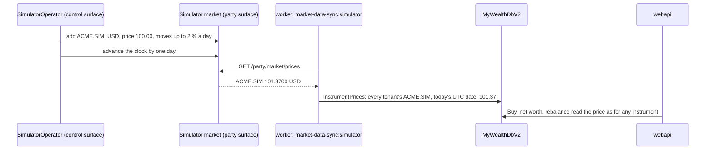

# Simulated instruments

Step 10a of [custodial-roadmap.md](../roadmaps/custodial-roadmap.md) §13. It covers roadmap decision **D11** (where the simulator gets prices) and the data vendor half of **S4** (issuer and data vendor). It is the first of the two specs of step 10; the second is [corporate-actions.md](corporate-actions.md) (C1 and the issuer half of S4), which builds on this one. It follows [ADR 0021](../adr/0021-outside-parties-behind-ports.md) rules 1–4, 11, 15–19 and 21–23. It amends [instrument-prices.md](instrument-prices.md), [instruments.md](instruments.md), [simulator.md](simulator.md) and the Back Office contract.

The simulator gets its second outside party, the **simulator market**. It holds **simulated instruments**: made-up symbols that end in `.SIM`, each with a price that moves once per simulator day by a seeded random step. The platform reads those prices through a new port, **market prices**, on a named **market data connection**. A connection has a symbol suffix; an instrument of any Tenant whose symbol ends with that suffix is served by the connection, and its prices come from there and not from EODHD. Nothing else about such an instrument is special: it is an ordinary catalog row, it can be bought, sold, held and rebalanced, and `IMarketData` reads its price from `InstrumentPrices` as for every other instrument.

New: configuration `MarketDataConnections:{name}`; port `IMarketPrices` with adapter `SimulatorMarketPrices`; `worker` job `market-data-sync:{connection}` on the new queue `market`; table `MarketDataFeeds`; route `GET /market-data-connections`; instrument item field `marketDataConnection`. Script `0049_market_data_feeds.sql`; simulator script `database/simulator/0008_market.sql`. No new permission, `TransactionType`, problem code or domain event.

**Status is `accepted` (2026-11-22), landed 2026-11-22.** The thirteen points of §11 were confirmed on 2026-11-22, every one as recommended, and are written into the rules. The amendments to accepted docs listed in §12 were made when it was accepted. [corporate-actions.md](corporate-actions.md) (step 10b) stays in review and was not part of this contract.

Notes from landing:

- R1–R3: the start-up check is `MarketDataConnectionsConfiguration.Read` (Infrastructure), called by `AddMarketDataConnections(MarketDataHost)` on `webapi` and `worker` before the host is built, the pattern of bank connections. The name rule is `BankConnectionName.IsValid`. `ConfiguredMarketDataConnections` holds the settings; the Domain `MarketDataConnections` (`src/Domain/MarketData`) is registered beside it and refuses a repeated suffix with a `DomainException`.
- R4: `MarketDataConnection.Serves` also needs the symbol to be longer than the suffix, so `.SIM` itself is served by no connection.
- R8–R11: `SyncMarketPrices.RunAsync` returns a `MarketPricesOutcome` (failure, rows stored). A failed call writes only the feed state. "More than 8 decimal places" means a price that changes when rounded to 8 places. `IInstrumentPriceStore.UpsertAsync` gained a `source` overload; a row the run did not quote keeps its own `Source`.
- R7, R25: the adapter dispatch is `MarketPricesDispatcher` over `IMarketPricesAdapter` (`SimulatorMarketPrices`); a connection with no adapter on the host is `Unreachable`. A 404 is `BadResponse`. `MarketDataSyncJob` reuses `SqlRunLock` and throws `MarketDataSyncFailedException` on a failed read. The cron is the bank job's.
- R12: `InstrumentPriceSyncJob` takes `MarketDataConnections`; its tests stay next to its fakes in `Infrastructure.IntegrationTests` (§10 was adjusted for this when the spec was accepted).
- R16, R22: the first price of an instrument added by the control route is marked `set` (the operator typed it); a standing instrument's first price is not. The price list route is paged like the control log (`page`, `pageSize` at most 100).
- R18: each instrument is brought up to date in its own transaction under `UPDLOCK, HOLDLOCK`, inside the execution strategy (`MarketPricePath.BringUpToDateAsync`).
- R23: the reset adds the standing instruments on the real UTC date, which is the first simulator day of the new world.
- §9.1: `TestSeed` writes the two simulated instruments' seed rows with `Source` `Simulator`. The two seed catalog tests now ask for page size 100, since the catalog has 21 rows.
- BO22: the Back Office test that the New instrument page has no price field now looks for a `Price` label, since the BO22 note says "priced". BO23: `FeedStatus.Text` gained an overload that `MarketDataStatus` shares, so both columns word times the same way.
- The 401 and 403 tests of `GET /market-data-connections` and the simulator's port tests passed already in their red commits, as the route shell carried the policy and the port rule exists since S0.

---

## 1. Summary



| | Today | After this slice |
| --- | --- | --- |
| Price of every instrument | From EODHD once a day; a symbol EODHD does not know has no price | An instrument whose symbol ends with a connection's suffix is priced through that connection; every other instrument as today |
| The simulator | Plays the bank only | Also plays a market: simulated instruments and their prices |
| A price the operator controls | None: a demo waits for a real market day | The operator moves the simulator clock or sets a price, and the platform shows it within the polling interval |
| A simulated split | Not possible | Still not possible here. [corporate-actions.md](corporate-actions.md) adds it, and needs a price the simulator owns so that quantity and price change together (roadmap D11) |

The rule that distinguishes this slice: the symbol's suffix decides where a price comes from, and a price read from a connection is stored under the platform's date, never the party's.

---

## 2. Scope

**In**

- Configuration: named **market data connections** (`MarketDataConnections:{name}`), adapter `Simulator`, with a symbol suffix
- Domain: `MarketDataConnection` (name, adapter, suffix; `Serves(symbol)`); `MarketDataFeed` entity (state of one feed of one connection); enums `MarketDataFeedKind`, `MarketDataFailure`
- Application: port `IMarketPrices`; service `SyncMarketPrices(connection)`; query `GetMarketDataConnections`; `InstrumentPriceSyncJob` leaves out served instruments; the instrument reads map `marketDataConnection`
- Infrastructure: `SimulatorMarketPrices` adapter (HTTP, `X-Api-Key`); recurring job `market-data-sync:{connection}` on queue `market`; EF mapping
- Scripts: `database/schema/0049_market_data_feeds.sql`; `database/simulator/0008_market.sql`
- HTTP (`webapi`): `GET /market-data-connections`; `marketDataConnection` on the instrument item
- Simulator: simulated instruments, the daily price path, set a price, standing instruments from configuration, the price route on the party surface, control routes
- Back Office: the connection on the Instruments page; a Market data page
- `TestSeed`, AppHost and deploy entries for the connection
- Tests listed in §10

**Out**

- Corporate action announcements and their effect on a simulated price: [corporate-actions.md](corporate-actions.md)
- Orders and fills on a simulated instrument, and fills of real instruments at the reference close plus slippage (roadmap S2, the rest of D11)
- A business calendar. A simulated instrument has a price every simulator day, weekends included (simulator §2 leaves calendars to S2)
- Intraday prices, bid and ask, volume, and a price history route on `webapi` (instrument-prices R12 is unchanged)
- A second real vendor, and moving EODHD behind a market data connection. EODHD stays as it is: one job, one key, the symbol table in `EodhdSymbols`
- A rule that ties simulated instruments to a custody mode, a Tenant or an environment. Any Tenant may add one to its catalog
- Simulated FX rates. `IFxRate` is unchanged
- Named scenarios and the scenario library (ADR 0021 rule 20)
- Any change to `IMarketData`, Buy / Sell, net worth, rebalance or reports

---

## 3. Stories

1. As the simulator operator I add a simulated instrument with a start price and see its price move each simulator day, the same way after a reset with the same seed.
2. As the simulator operator I set today's price of a simulated instrument by hand, so a demo can show a rise or a fall at once.
3. As an Adviser I add `ACME.SIM` to my firm's catalog and trade it on a Custodial account like any instrument; its price is the simulator's.
4. As the platform I spend no EODHD call on a simulated symbol, and a stopped simulator leaves the last stored price in place.
5. As a SystemAdmin I see which market data connections are configured, which suffix each serves, and when its prices were last read or why the last read failed.

---

## 4. Rules

### 4.1 Market data connections

| ID | Rule |
| --- | --- |
| R1 | **Configured, not stored.** A **market data connection** is a named entry in configuration, like a bank connection (deposit-matching R1): `MarketDataConnections:{name}:Adapter` (only `Simulator` in this slice) and `MarketDataConnections:{name}:SymbolSuffix` on `webapi` and `worker`; on `worker` also `BaseUrl`, `ApiKey`, optional `TimeoutSeconds` (integer 1–60, default 10) and optional `PollMinutes` (one of 1, 2, 3, 4, 5, 6, 10, 12, 15, 20, 30, 60; default 1). A name is 1–50 characters, a lower-case letter followed by lower-case letters, digits and hyphens. The secret is only on `worker` (ADR 0021 rule 17). No connections configured is valid: every instrument is priced by EODHD as today. |
| R2 | **Symbol suffix.** `SymbolSuffix` is a `.` followed by 2 to 10 letters or digits, compared without regard to case (for example `.SIM`). No two connections have the same suffix. |
| R3 | **Start-up check.** A host whose configuration has a bad name, an unknown adapter, a missing or bad suffix, a suffix used twice, or (on `worker`) a missing `BaseUrl` or `ApiKey` or a `TimeoutSeconds` or `PollMinutes` outside its values fails at start-up, before it listens. The rule reads the configuration, not the environment name (ADR 0021 rule 3). |
| R4 | **Which instruments a connection serves.** An Instrument of any Tenant is **served** by a connection when its `Symbol` ends with the connection's suffix. This is worked out from the symbol each time it is needed; no column stores it. Renaming an instrument's symbol (instruments R14) can therefore change who prices it, from the next run. An instrument served by no connection is priced by EODHD as today. |
| R5 | **Connection list.** `GET /market-data-connections` (`tenants.manage`) → list envelope of `{ name, adapter, symbolSuffix, prices }`, sorted by name, every entry on page 1. `prices` is `{ lastSucceededAt, lastFailedAt, lastFailure }`, `null` until the first read was tried. `lastFailure` is one of `Unreachable`, `Timeout`, `Unauthorized`, `Unavailable`, `BadResponse`, or `null`; it never carries a message from the party. No URL, key or timeout. TenantAdmin, Adviser, Customer → 403. The connection item also carries `corporateActions`, the state of the connection's corporate action feed (corporate-actions R38). |
| R6 | **Instrument item.** The instrument item of `GET /instruments` and `GET /instruments/{id}` gains `marketDataConnection`: the name of the connection that serves it, or `null`. Every caller who can read the instrument sees it. No filter on it. |

### 4.2 Reading prices

Amendment to [instrument-prices.md](instrument-prices.md) R1, R3, R5, R14 and R15.

| ID | Rule |
| --- | --- |
| R7 | **One recurring job per connection.** `worker` registers `market-data-sync:{connection}` for each configured connection, on the new queue `market`, every `PollMinutes` of that connection (UTC; cron as deposit-matching R6). No automatic Hangfire retries; the schedule is the retry (ADR 0021 rule 15). A run that starts while another run of the same connection is still going ends at once and does nothing. A recurring job of a connection that is no longer configured is removed when the `worker` starts. |
| R8 | **A run.** The job asks the port once for the current price of every instrument the party prices. A failed call stores no price, sets `lastFailedAt` and `lastFailure` on the connection's `Prices` feed, is logged with the connection and the failure, and is reported to Hangfire as failed. The prices already stored stay (instrument-prices R8). `market-data-sync:{connection}` has three steps before its price read: pull the corporate action announcements, process them, and apply the corporate actions of the connection's instruments. When the announcement pull fails, the price read of that run is skipped and the run is reported as failed (corporate-actions R8). |
| R9 | **Store.** For each item whose symbol ends with the connection's suffix, every **active** Instrument, in any Tenant, with that symbol and with `QuoteCurrency` equal to the item's currency gets one row in `InstrumentPrices`, upserted on `(InstrumentId, AsOfDate)`: the price, `Source` = `Simulator` (the adapter's name) and `FetchedAt`. All rows of a run and `lastSucceededAt` are written in one database transaction. |
| R10 | **The platform's date.** `AsOfDate` of such a row is the platform's UTC date at the run, not the date the party sent. `IMarketData` reads the latest row on or before the platform's today (instrument-prices R6), and a simulator clock that runs ahead would date its prices in the platform's future, where no read finds them (ADR 0021 rule 11). So each run replaces today's row, and the first run of a new UTC day adds a row. The party's own date is not stored. |
| R11 | **Items the platform skips.** An item whose symbol does not end with the suffix is ignored. An item with a symbol that is empty or longer than 32 characters, a currency that is not three letters, or a price that is not `> 0` or has more than 8 decimal places is skipped with a warning; the other items are stored. An item whose currency differs from an instrument's `QuoteCurrency` is skipped for that instrument with a warning, as the EODHD job does today. An active served instrument with no item keeps its last row, with a warning. |
| R12 | **EODHD leaves served instruments alone.** `InstrumentPriceSyncJob` leaves out every instrument served by a connection: from the instruments it fetches, and from its test whether every active instrument has today's date (instrument-prices R14). No EODHD call is spent on a simulated symbol. |
| R13 | **Everything else is unchanged.** `IMarketData`, Buy / Sell, net worth, rebalance and reports read `InstrumentPrices` as today. A served instrument can be held on an External and on a Custodial account. Inactive instruments are not updated (instrument-prices R3). No cursor and no inbound table: a price read is a snapshot that replaces the last one, the pattern of the EODHD and Frankfurter reads (ADR 0021, Context). An order's reference price for a served instrument is the latest price the platform stored from the connection; the fill is then priced by the simulator, so the two can differ by the price's move since the last read. |

### 4.3 The simulator market: instruments and prices (S4)

Amendment to [simulator.md](simulator.md). The party routes add under `/party/market/…` (simulator R32), the control routes under `/control/market/…`.

| ID | Rule |
| --- | --- |
| R14 | **The party.** The simulator market plays the issuer and the data vendor of its own instruments. It never reads the platform's catalog (ADR 0021 rule 22); a Tenant adds the same symbols to its catalog by hand or by seed. |
| R15 | **Simulated instrument.** Symbol (5–32 characters of letters, digits, `.` and `-`, stored upper case, ending in `.SIM`, unique), name (1–200), currency (three letters, upper case; the simulator holds no currency catalog), price (`> 0`, at most 4 decimal places) and `dailyMovePercent` (0 to 20, at most 2 decimal places, default 2). The suffix `.SIM` is fixed in the simulator, so a simulated symbol never looks like a real ticker. |
| R16 | **Add an instrument.** `POST /control/market/instruments` `{ symbol, name, currency, price, dailyMovePercent? }` → 201 with the instrument. A symbol that already exists → 400 `errors.Symbol`. The price is the price of the current simulator day. Log action `MarketInstrumentAdded`. Nothing but `dailyMovePercent` and the price can change later, and an instrument is never removed except by a reset. |
| R17 | **Price path.** An instrument has exactly one price per **simulator day**, the UTC date of simulator now. The price of day `d` is `Max(0.0001, Round(price(d − 1) × (1 + move), 4))`, rounded half away from zero, with `move = dailyMovePercent / 100 × (2u − 1)` and `u` the first value in `[0, 1)` of `SeededRandom.For(seed, "market-price:{symbol}", n)`, `n` being the day number of `d` counted from 2000-01-01 (simulator R26). Same seed, same instruments and same clock steps give the same prices. With `dailyMovePercent` `0` the price never moves by itself. |
| R18 | **Bringing the market up to date.** Before any market route answers, control or party, the simulator works out and stores the price of every day from each instrument's last priced day up to the current simulator day, in day order, under a lock on the instrument row, so two requests at once step a day once. A clock advance of 366 days (simulator R22) therefore stores at most 366 prices per instrument on the next request. When the market is brought up to date and steps to a day on or after the `exDate` of an `Announced` corporate action of the instrument, the price of the day before is rebased by the action's ratio before that day's move (corporate-actions R42). The simulator broker fills an order for a simulated instrument at the market's price of the current simulator day, with a seeded slippage, and the market is brought up to date before any broker route answers (orders R52, R56). |
| R19 | **Set a price.** `POST /control/market/instruments/{symbol}/price` `{ price }` → 200 with the instrument. It replaces the price of the current simulator day; the next day steps from it. Unknown symbol → 404. Log action `MarketPriceSet`. `POST /control/market/instruments/{symbol}/daily-move` `{ dailyMovePercent }` → 200; it applies from the next day. Log action `MarketDailyMoveSet`. |
| R20 | **Standing instruments.** Configuration `Simulator:Market:StandingInstruments` lists instruments (`Symbol`, `Name`, `Currency`, `Price`, optional `DailyMovePercent`) that the simulator adds when the world is created and after every reset; one that already exists is left as it is. A bad entry stops the host before it listens. Development lists `ACME.SIM` (USD, 100.00, "Acme Simulated Holdings") and `KIWI.SIM` (NZD, 5.00, "Kiwi Simulated Fund"), the symbols `TestSeed` adds to the demo catalog (§9.1). |
| R21 | **Price route.** Party port: `GET /party/market/prices` → 200 `{ asOf, items }`. `asOf` is simulator now; `items` holds one entry per instrument, sorted by symbol: `{ "symbol", "currency", "price", "date" }`, `price` a JSON number and `date` the simulator day. No paging: the simulator holds few instruments. The key (simulator R30) and the outage (simulator R27) apply as to every party route. |
| R22 | **Its own books.** `GET /control/market/instruments` lists the instruments with the current price and `dailyMovePercent`. `GET /control/market/instruments/{symbol}/prices` → list envelope of `{ date, price, set }`, newest day first, `set` being `true` for a price the operator typed. |
| R23 | **Reset.** A reset empties the instruments and their prices (simulator R24), then adds the standing instruments again at their configured price (R20). |
| R24 | **No platform knowledge.** The simulator does not know which Tenant lists or holds an instrument (simulator R33). |

### 4.4 The platform adapter

| ID | Rule |
| --- | --- |
| R25 | **`SimulatorMarketPrices`.** The Infrastructure adapter for `Adapter = Simulator` calls R21 at `BaseUrl` with header `X-Api-Key` = the connection's `ApiKey` and the connection's timeout. Its own wire types (ADR 0021, no shared contracts). Failures: no connection → `Unreachable`; timeout → `Timeout`; 401 → `Unauthorized`; 503 → `Unavailable`; any other status or a body it cannot read → `BadResponse`. The port reports a failure as a result, not as an exception the job must parse. A `price` that is not a JSON number makes the body unreadable. |

Policies: none added. `tenants.manage` reads `GET /market-data-connections`.

---

## 5. Domain

`MarketDataFeedKind` also has `CorporateActions = 1`, a feed with a cursor that `MarketDataFeed` keeps, and `MarketDataFailure` also has `InvalidItem = 5` ([corporate-actions.md](corporate-actions.md)).

| Type | Kind | Change |
| --- | --- | --- |
| `MarketDataConnection` | Value (new, from configuration) | `Name`, `Adapter`, `SymbolSuffix`. `Serves(symbol)` holds R4 |
| `MarketDataConnections` | Service (new) | The configured connections. `For(symbol)` → the connection that serves it, or none. Holds R2 |
| `MarketDataFeed` | Entity (new) | `Connection`, `Kind`, `Cursor`, `LastSucceededAt`, `LastFailedAt`, `LastFailure`, `RowVersion`. One row per connection and feed kind. `Succeeded(at)`, `Failed(failure, at)`. The `Prices` feed has no cursor |
| `MarketDataFeedKind` | Enum (new) | `Prices = 0`. [corporate-actions.md](corporate-actions.md) adds the next value |
| `MarketDataFailure` | Enum (new) | `Unreachable = 0`, `Timeout = 1`, `Unauthorized = 2`, `Unavailable = 3`, `BadResponse = 4` |
| `Instrument` | Aggregate (existing) | No change. Being served is a fact about its symbol and the configuration |

Invariants:

- An instrument is served by at most one connection. Held by R2 and the start-up check.
- A price row written from a connection has the platform's UTC date. Held by `SyncMarketPrices`.
- A served instrument is never sent to EODHD. Held by `InstrumentPriceSyncJob`.

Domain events: none.

The simulator has no shared Domain project. Its own types live in `src/Simulator/Market`: `MarketInstrument`, `MarketPrice`, `MarketPricePath` (R17, R18), `MarketStandingInstruments`.

Recorded in [domain-model.md](../domain-model.md) §8.4.

---

## 6. Database

Forward only. Do not add EF migrations.

### 6.1 Script `0049_market_data_feeds.sql`

| Table | Change | Index / FK |
| --- | --- | --- |
| `MarketDataFeeds` | Add | PK `(Connection, Kind)`. No `TenantId`: platform data, like `InstrumentPrices` |

| Column | Type | Null | Notes |
| --- | --- | --- | --- |
| Connection | nvarchar(50) | no | The configured name |
| Kind | int | no | `MarketDataFeedKind`, CHECK `= 0` |
| Cursor | nvarchar(500) | yes | Not used by `Prices` |
| LastSucceededAt | datetimeoffset | yes | |
| LastFailedAt | datetimeoffset | yes | |
| LastFailure | int | yes | `MarketDataFailure`, CHECK 0–4 |
| RowVersion | rowversion | no | |

`InstrumentPrices` does not change. Its `Source` column holds `Simulator` on rows this slice writes. No back-fill.

### 6.2 Simulator script `database/simulator/0008_market.sql`

| Table | Content |
| --- | --- |
| `MarketInstruments` | `Id int` identity PK, `Symbol nvarchar(32)` unique, `Name nvarchar(200)`, `Currency char(3)`, `DailyMovePercent decimal(5,2)` CHECK 0–20, `Price decimal(18,4)` CHECK `> 0`, `PriceDate date` (the last priced day), `RowVersion rowversion` |
| `MarketPrices` | PK `(InstrumentId, PriceDate)`, FK → `MarketInstruments`, `Price decimal(18,4)` CHECK `> 0`, `IsSet bit` |

Recorded in [database-design.md](../database-design.md) §9, §13, §14.3 and §15.

---

## 7. Application use cases

| Kind | Name | Change |
| --- | --- | --- |
| Port | `IMarketPrices` (new) | `GetPricesAsync(connection)` → the items of R21, or a `MarketDataFailure` |
| Service | `SyncMarketPrices` (new) | `RunAsync(connection)`: R8–R11. A plain class, like `PullBankStatements` |
| Job | `MarketDataSyncJob` (new, Infrastructure) | R7; runs `SyncMarketPrices` under the one-run lock |
| Job | `InstrumentPriceSyncJob` (existing) | R12 |
| Query | `GetMarketDataConnections` (new) | R5 |
| Query | `GetInstruments`, `GetInstrumentById` | Map `marketDataConnection` (R6) |

Where each rule lives:

| Rule | Where |
| --- | --- |
| Suffix shape and uniqueness (R2, R3) | The configuration reader each host calls at start-up, before it builds (the pattern of bank connections; no options validation class) |
| Served or not (R4) | `MarketDataConnections.For(symbol)` |
| The platform's date (R10) | `SyncMarketPrices`, from `TimeProvider` |
| Price path (R17, R18) | `MarketPricePath` in the simulator |

---

## 8. API

| Method | Route | Policy | Success | Failure |
| --- | --- | --- | --- | --- |
| GET | `/market-data-connections` | `tenants.manage` | 200 envelope | 401 / 403 |
| GET | `/instruments`, `/instruments/{id}` | unchanged | item has `marketDataConnection` | — |

Simulator, control port (session):

| Method | Route | Success | Failure |
| --- | --- | --- | --- |
| GET | `/control/market/instruments` | 200 list | 401 |
| POST | `/control/market/instruments` | 201 instrument | 400, 401, 415 |
| POST | `/control/market/instruments/{symbol}/price` | 200 instrument | 400, 401, 404, 415 |
| POST | `/control/market/instruments/{symbol}/daily-move` | 200 instrument | 400, 401, 404, 415 |
| GET | `/control/market/instruments/{symbol}/prices` | 200 list envelope | 401, 404 |

Simulator, party port (machine credential):

| Method | Route | Success | Failure |
| --- | --- | --- | --- |
| GET | `/party/market/prices` | 200 | 401, 503 |

### 8.1 Bodies

Connection item:

```json
{
  "name": "simulator",
  "adapter": "Simulator",
  "symbolSuffix": ".SIM",
  "prices": { "lastSucceededAt": "2026-11-22T03:15:01Z", "lastFailedAt": null, "lastFailure": null }
}
```

Instrument item (other fields unchanged): `"marketDataConnection": "simulator"`, or `null`.

Simulator, add an instrument:

```json
{ "symbol": "ACME.SIM", "name": "Acme Simulated Holdings", "currency": "USD", "price": 100.00, "dailyMovePercent": 2 }
```

Simulator instrument: `{ "symbol": "ACME.SIM", "name": "Acme Simulated Holdings", "currency": "USD", "price": 101.3700, "priceDate": "2026-11-23", "dailyMovePercent": 2 }`.

Party port, prices:

```json
{
  "asOf": "2026-11-23T09:30:00Z",
  "items": [
    { "symbol": "ACME.SIM", "currency": "USD", "price": 101.3700, "date": "2026-11-23" },
    { "symbol": "KIWI.SIM", "currency": "NZD", "price": 4.9600, "date": "2026-11-23" }
  ]
}
```

Control log actions gain `MarketInstrumentAdded`, `MarketPriceSet` and `MarketDailyMoveSet`.

### 8.2 Errors

All refusals are ordinary validation (400 with `errors`, no problem `code`).

| Case | Response |
| --- | --- |
| TenantAdmin, Adviser or Customer on `GET /market-data-connections` | 403 |
| Simulator: a symbol that does not end in `.SIM`, is too short or too long, or exists | 400 `errors.Symbol` |
| Simulator: a price not `> 0` or with more than 4 decimal places; a daily move outside 0–20 | 400 `errors.Price` / `errors.DailyMovePercent` |
| Simulator: an unknown symbol in a path | 404 |

Keep the resource catalog in [api-design.md](../api-design.md) pointing here for these rules.

---

## 9. UI

Page contract: [back-office.md](../backoffice/back-office.md) (BO22, BO23) and [back-office-instruments.md](../backoffice/back-office-instruments.md), amended and accepted together with this spec. No Adviser Portal, Customer Portal or BFF change: prices have no page, and the portals show a simulated instrument like any other.

**Back Office**

| ID | Behaviour |
| --- | --- |
| BO22 | The Instruments page ([back-office-instruments.md](../backoffice/back-office-instruments.md)) shows "Prices from <connection>" under the symbol of an instrument whose `marketDataConnection` is set. The create form notes: "A symbol that ends with a market data suffix (for example .SIM) is priced by that connection." |
| BO23 | A new page "Market data" (`/market-data`) lists `GET /market-data-connections`: Name, Adapter, Suffix and Prices: `null` → "Not read yet"; `lastFailedAt` later than `lastSucceededAt` (or no success) → "Failing since <lastFailedAt>: <failure label>"; otherwise "Read <lastSucceededAt>". Times as BO18. Failure labels: Unreachable "Market data source not reachable", Timeout "Market data source did not answer in time", Unauthorized "Market data source refused the key", Unavailable "Market data source unavailable", BadResponse "Market data answer not understood" (BO18's labels name the bank). With no connection: "No market data connection is configured. Every instrument is priced by EODHD." |

### 9.1 Seeds and hosting

- `TestSeed` (Development / TestAppHost only): adds `ACME.SIM` (USD) and `KIWI.SIM` (NZD) to the catalog of each firm it seeds, with one price row each on the fixed seed date (100 and 5), so the TestAppHost, which runs no simulator, has a price. `DevelopmentSmokeSeeder` and `webapi --seed-demo`: no change.
- AppHost: `webapi` and `worker` get `MarketDataConnections__simulator__Adapter=Simulator` and `MarketDataConnections__simulator__SymbolSuffix=.SIM`; `worker` also `BaseUrl` (the simulator's `party` endpoint) and `ApiKey` (the existing party key parameter). The simulator resource gets the standing instruments of R20 in its environment, as it gets the standing accounts. TestAppHost: no connection configured; the functional tests that need one configure it on their host.
- VPS: `compose.yml` gives `webapi` and `worker` the same two keys and `worker` the URL and key from `.env`; the simulator service gets its standing instruments. The operator adds the simulated instruments to the demo catalog in the Back Office. No new container, secret or hostname.

---

## 10. Tests

The tests are the executable form of §4. Where they live:

| Project | Where |
| --- | --- |
| Domain.UnitTests | Folder `MarketData/`; `Entities/MarketDataFeedTests.cs` |
| Application.FunctionalTests | Folder `MarketData/` |
| Infrastructure.IntegrationTests | Folder `MarketData/`; `AppliedSchema/MarketDataFeedsSchemaTests.cs`, `MarketDataSyncJobTests.cs`, `MarketDataReadTests.cs` |
| Simulator.Tests | The simulator market |

---

## 11. Locked in this spec

No new ADR. ADR 0021 applies through rules 1–4 (a port per party role, the simulator as one adapter, the adapter chosen by data and configuration, no outside call on the request path), 11 (two clocks), 15–18 (failure, credentials, network) and 19 (tests). Rules 6–8 (cursor, inbound records) do not apply to a price snapshot, as the ADR's context says of the price and FX reads.

| Item | Lock |
| --- | --- |
| Market data connection | Named in configuration, adapter `Simulator`, one symbol suffix each, secrets on `worker` only |
| Served instrument | Symbol ends with the suffix; no column; priced by the connection, never by EODHD |
| Price read | Snapshot of every price each polling interval; stored under the platform's UTC date; `Source` `Simulator` |
| Job | `market-data-sync:{connection}` on queue `market`; no automatic retries |
| Feed state | `MarketDataFeeds`, one row per connection and feed kind |
| Simulator market | Instruments ending in `.SIM`, one price per simulator day by a seeded step, set by hand, standing instruments |
| Scripts | `0049_market_data_feeds.sql`; simulator `0008_market.sql` |
| Routes | `GET /market-data-connections`; `marketDataConnection` on the instrument item |
| Permissions, problem codes, events, `TransactionType` | None added |

### Points confirmed (2026-11-22)

Each point states the decision (confirmed as recommended on 2026-11-22), written into the rules above, and the alternative that was not taken.

1. **Two specs for step 10, this one first.** Recommended: prices of simulated instruments are useful and testable alone (a controllable price for demos), and [corporate-actions.md](corporate-actions.md) is large enough without them. Alternative: one spec for C1 and all of S4.
2. **Roadmap D11 is built now, for prices only.** Recommended: a simulated split on a real instrument would not show in EODHD prices, so the corporate action demo needs instruments whose price the simulator owns; fills (the other half of D11) wait for S2. Alternative: announce simulated splits on real symbols and accept a wrong market value in the demo.
3. **The suffix is configured per connection and decides the source; no column on `Instruments`** (R2, R4). Recommended: ADR 0021 rule 3 names the suffix as the choice, the catalog needs no migration, and a Tenant adds a simulated instrument with the ordinary create route. A rename can move an instrument between sources; that is accepted. Alternative: a `PriceSource` column set on create.
4. **A price is stored under the platform's date** (R10). Recommended: the two clocks (ADR 0021 rule 11). Alternative: store the simulator's date, and accept that prices vanish from every read while the simulator clock is ahead.
5. **A snapshot every polling interval, default one minute, no cursor and no inbound table** (R7–R9, R13). Recommended: the simulator has no call limit, and a demo should show a new price soon after the operator acts. Alternative: once a day at 12:00 UTC with the EODHD job.
6. **A new port `IMarketPrices` next to `IInstrumentPriceSource`** (§7). Recommended: EODHD is asked one symbol at a time under a daily call limit, and the simulator answers every price in one call; forcing both through one interface would bend one of them. `IMarketData`, the read port, is untouched. Alternative: a second `IInstrumentPriceSource` chosen per symbol.
7. **A uniform step of at most `dailyMovePercent` per simulator day, every day of the week, and the operator may set a price** (R17, R19). Recommended: small, seeded and easy to check by hand; a business calendar comes with S2. Alternative: a normal distribution with drift; no step on weekends.
8. **`.SIM` is fixed in the simulator, and standing instruments come from configuration** (R15, R20). Recommended: a made-up symbol can never be mistaken for a real one, and the catalog rows a Tenant already has keep a price after a reset. Alternative: any symbol; instruments only by control call.
9. **Simulated instruments are ordinary catalog rows for every Tenant and both custody modes** (R13). Recommended: no rule to enforce, and the showcase is one shared outside world (roadmap D19). Alternative: Custodial accounts only.
10. **`GET /market-data-connections` and a Back Office page; `marketDataConnection` on the instrument item** (R5, R6, BO22, BO23). Recommended: ADR 0021 rule 16 wants the feed's state stored and visible, and [corporate-actions.md](corporate-actions.md) R16 needs the field to tell a person why an instrument takes no hand entry. Alternative: store only, show later.
11. **One feed state table keyed by connection and feed kind** (§6.1). Recommended: [corporate-actions.md](corporate-actions.md) adds the corporate action feed and its cursor to the same table. Alternative: a table per feed.
12. **`TestSeed` adds two simulated instruments; the demo seed does not** (§9.1). Recommended: as with client money accounts (client-money-accounts §11 point 10), the showcase operator adds what must match the simulator's configuration. Alternative: `--seed-demo` adds them.
13. **No scenario library** (§2 Out). Recommended: as in every simulator slice so far; nothing here has steps to name.

Still open, not this slice:

- Fills of simulated and real instruments (roadmap S2), and whether a fill of a simulated instrument uses this price
- A business calendar and market hours
- A price history read on `webapi` (instrument-prices R12)
- EODHD behind a market data connection, and its symbol table as data instead of code ([known issue](../known-issues/eodhd-nz-jp-coverage.md))
- A second connection with a real vendor, and what happens to an instrument when its connection is removed from configuration (its last price stays; EODHD is asked for it from the next daily run)

---

## 12. Docs changed when this spec was accepted

[instrument-prices.md](instrument-prices.md) (R1, R3, R5, R14, R15: served instruments are priced by their connection under the platform's date; the EODHD job leaves them out), [instruments.md](instruments.md) (`marketDataConnection` on the item), [simulator.md](simulator.md) (the market party, script `0008`, the new control and party routes and log actions), [deposit-matching.md](deposit-matching.md) (a note that market data connections follow the shape of bank connections), [back-office.md](../backoffice/back-office.md) (BO22, BO23), [back-office-instruments.md](../backoffice/back-office-instruments.md) (the connection line), [api-design.md](../api-design.md) (§6 resource row, §7.5 note, change log), [domain-model.md](../domain-model.md), [database-design.md](../database-design.md), [architecture.md](../architecture.md) (port `IMarketPrices`, the job and queue `market`), [deployment.md](../deployment.md) (the connection keys and the standing instruments), [glossary.md](../glossary.md) (the review terms become accepted), [function-plan.md](../function-plan.md) §5 (the roadmap step), [features/README.md](README.md) row status, and the roadmap §11 S4, §12 D11, §13 status and §14.

---

## 13. History

What changed in this file after it was accepted. The text of each change is in git (`git log -p -- docs/features/simulated-instruments.md`).

| Date | With | Change here |
| --- | --- | --- |
| 2026-11-22 | [corporate-actions.md](corporate-actions.md) | R5, R8, R18, §5: the corporate action feed of a connection |
| 2026-11-23 | [orders.md](orders.md) | R13, R18: the price of a fill on a simulated instrument |
| 2026-11-26 | — | The changes above were folded into the body. No rule changed |
