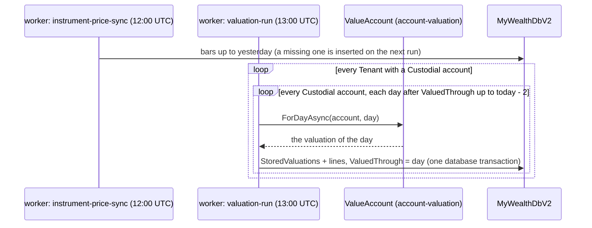

# Valuation run

Step 3 of [valuation-roadmap.md](../valuation-roadmap.md) §8. It covers roadmap item **V3** and writes the decisions **Q5** (when a day is final), **Q6** (External accounts are not stored) and the stored half of **Q7** (a stored line keeps both values and the rate used) as rules. It stores what [account-valuation.md](account-valuation.md) works out; it adds no valuation rule of its own.

Every day the platform values each Custodial account for each day that has not been valued yet, up to the **last final day** (the day before yesterday, UTC), and stores the result: a **stored valuation** per account and day, with one line per holding that keeps the price and the rate it used. A stored valuation is never changed. Each account keeps the last day it was valued through. One execution of this work for one Tenant is a **valuation run**; it is stored, like an interest run. The stored rows are the "holding snapshots" of the business roadmap and the "daily snapshots" that [function-plan.md](../function-plan.md) §5.4 leaves open.

New: tables `StoredValuations`, `StoredValuationLines` and `ValuationRuns`, and `Accounts.ValuedThrough`, in script `0059_stored_valuations.sql`; permissions `valuation-runs.read` and `valuation-runs.start`; routes `GET /accounts/{id}/valuations`, `GET /accounts/{id}/valuations/{date}`, `GET|POST /valuation-runs` and `GET /valuation-runs/{id}`; `valuedThrough` on the account item; the `worker` job `valuation-run` on the new queue `valuation`; `TestSeed` history; a Back Office section. No problem code, domain event, `TransactionType`, port, setting or simulator change. No Adviser Portal or Customer Portal page.

**Status is `accepted` (2026-11-26), landed 2026-11-26.** The twelve points of §11 were confirmed as recommended. Point 1 refines roadmap Q5, which was reworded.

Notes from landing:

- §7: `StoreAccountValuations.ValueThroughAsync(account, throughDate, run)` returns what it did for the account (whether it had a day to value, the days stored, how many were incomplete, and the day and error it stopped at) instead of throwing, so `RunValuations` counts R13 and logs R12 with the account PublicId and the day. `RunValuations` also refuses a through date after the last final day itself, so no caller can store a day that is not final (§5 invariants).
- R6: the day after `valuedThrough` is checked again under the lock inside each day's database transaction; a day another run already stored is skipped and the loop goes on with the next day.
- R13: `accountsProcessed` counts an account whose next day (the day after `valuedThrough`, or its first day) is on or before its last day; an account with nothing to value is not counted.
- R15, R17, R22: `throughDate`, `from`, `to` and `{date}` bind as text and are parsed as `yyyy-MM-dd` (as account-valuation R20), so a bad date answers `errors.ThroughDate`, `errors.From`, `errors.To` or `errors.Date` rather than a binding error. A `complete` filter that is not `true` or `false` is refused by binding (400, no `errors` key).
- R5: `Account.MarkValued` stamps the Account's `LastModified` with each stored day, as `MarkInterestAccrued` does.
- §9.1: the fixed pattern is a factor `1 + 0.01 × w`, with `w` taken from `0, 1, 2, 1, 0, −1, −2, −1` counting back from 2026-03-31, so each history row is within 2 % of its 2026-01-01 row and the row of 2026-03-31 equals it again; a pair into USD moves the other way. The Sell is booked at 2026-02-17 10:00 +13:00 (UTC day 2026-02-16) at that day's seeded price (VTI 252.50) and the TransferIn at 2026-03-03 10:00 +13:00 (UTC day 2026-03-02). `Created` is the instant of the funding. The two buys of custody-modes §9.1 and the buy of "Demo brokerage" keep the 2026-01-01 prices, so the history does not change them. The demo Custodial account of the second firm gets the same rows.
- §10: the worked example is booked through the API on an External account, as in account-valuation §10, then made Custodial in the database, because a Custodial `bookedAt` is set by the server. That ledger books T5 on its ex-date, so the restated quantity of Thursday 5 is covered by the Domain tests (`StoredValuationTests`). The job tests record the run of any Tenant that is not part of the test and do not execute it, because the schema test database is shared.

---

## 1. Summary



| | After step 2 | After this slice |
| --- | --- | --- |
| What a Custodial account was worth on a past day | Worked out on each read; may differ if a price row is inserted later | Stored once per account and day, with the price and rate each line used, and never changed |
| A series of days | One read per day | `GET /accounts/{id}/valuations?from=&to=` |
| Which days are valued | Any day a caller asks for | Every day of every Custodial account from the day it was opened, up to the day before yesterday |
| A missed day | — | The next run values every day after the account's `valuedThrough` |
| An External account | Valued on read | Unchanged: valued on read, never stored (roadmap Q6) |
| A run for a date | — | A SystemAdmin runs through a date after a missed run (`POST /valuation-runs`) |
| Funds under management on a past day | Not available | The sum of the stored valuations of the day, per currency (R26); no route yet |

The rule that distinguishes this slice: a stored valuation is the figure later steps rely on. It is stored only for a day whose prices and rates are final, once, and it does not follow a price that arrives afterwards.

### 1.1 Worked example

The Custodial account in NZD of [account-valuation.md](account-valuation.md) §1.1, with the same ledger, prices and rates. Its `valuedThrough` is Sunday 1 March 2026, from earlier runs. The job runs at 13:00 UTC and values up to the last final day: the run of Wednesday 4 March values up to Monday 2 March.

| Run | Trigger | Through | Days stored | Total (NZD) of each day | Complete |
| --- | --- | --- | --- | --- | --- |
| Wed 4 Mar 13:00 | `Scheduled` | Mon 2 | Mon 2 | 41,550.00 | yes |
| Thu 5 Mar 13:00 | — | — | none: `worker` was down | — | — |
| Fri 6 Mar 13:00 | `Scheduled` | Wed 4 | Tue 3, Wed 4 | 41,983.00; 44,133.32 | yes |
| Sat 7 Mar 13:00 | `Scheduled` | Thu 5 | Thu 5 | 44,434.00 | yes |
| Sun 8 to Thu 12 Mar, 13:00 | `Scheduled` | Fri 6 to Tue 10 | one day each | 42,790.45; 42,790.45; 42,804.72; 43,092.48; 42,930.09 | yes |
| Fri 13 Mar 09:00 | `Manual` | Thu 12 | refused: 400 `errors.ThroughDate`, Thu 12 is not final yet | — | — |
| Fri 13 Mar 09:05 | `Manual` | Wed 11 | Wed 11 | 34,750.72 | **no** (`CCC` `StalePrice`) |
| Fri 13 Mar 13:00 | `Scheduled` | Wed 11 | none: already valued through Wed 11 | — | — |

What the example shows:

- **Catch-up** (R6). The run of Friday 6 March finds `valuedThrough` at Monday 2 and stores Tuesday 3 and Wednesday 4, one day after the other.
- **As booked.** Wednesday 4 is stored on Friday 6, after the Reversal T4 was booked at 01:15 that morning, and still includes the 2,000.00 of T2 (account-valuation R5).
- **The ex-date of the split.** Thursday 5 is stored on Saturday 7. Its `BBB` line has `quantity` 100 and `ledgerQuantity` 50, because T5 was booked after Thursday ended (account-valuation R18).
- **The last final day** (R4). On Friday 13 at 09:00 the last final day is Wednesday 11: a run through Thursday 12 is refused.
- **An incomplete day is stored** (R9). Wednesday 11 is stored with `complete` `false`, `unvaluedCount` 1 and the `CCC` line as `StalePrice` with the price row of Friday 6.
- **A repeat changes nothing** (R7). The job of Friday 13 at 13:00 finds every account valued through Wednesday 11 and stores a run with zero counts.
- **A later price changes nothing** (R10). On Monday 16 March the price job inserts `CCC` bars for Monday 9 to Wednesday 11 that the source had not had, with 41.50 for Wednesday 11. `GET /accounts/{id}/valuation?date=2026-03-11` now answers `CCC` as `Valued` (120 × 41.50 = 4,980.00 USD → 8,620.38) and a total of 43,371.10, complete. `GET /accounts/{id}/valuations/2026-03-11` still answers 34,750.72, incomplete, as it was stored. Monday 9 and Tuesday 10 stay as stored, at Friday's price.

---

## 2. Scope

**In**

- Domain: `StoredValuation` and `StoredValuationLine` (entities, `src/Domain/Valuations`); `ValuationRun`, `ValuationRunTrigger`; `Account.ValuedThrough` and `Account.MarkValued`; `ValuationRules.LastFinalDay`
- Application: service `StoreAccountValuations` (one account through a date); service `RunValuations` (one Tenant); command `StartValuationRun`; queries `GetStoredValuations`, `GetStoredValuation`, `GetValuationRuns`, `GetValuationRunById`; account reads map `valuedThrough`
- Infrastructure: EF mappings; recurring job `valuation-run` on queue `valuation`; `TestSeed` history
- Script: `database/schema/0059_stored_valuations.sql`
- Security: two permissions (R1)
- HTTP (`webapi`): the routes of §8
- Back Office: valuation runs of a Tenant and "Run through a date"
- Tests listed in §10

**Out**

- Any new valuation rule. What a valuation is, its statuses, rounding and the ex-date rule stay in [account-valuation.md](account-valuation.md)
- Stored valuations of External accounts (roadmap Q6; H7). They are valued on read. Revisit with period close (custodial-roadmap X3)
- Changing or deleting a stored valuation, for any reason: a late or corrected price or rate, a corporate action posted late, an adjustment. Roadmap §6: step 4 decides what a fee does when its base would change
- Valuing today or yesterday, or any day after the last final day, and an option to allow it
- Funds under management per day as a route, a series of a scope (a Customer, an Adviser's book, the firm), the fold into the reporting currency, charts and the Adviser Balances Report for a past date (roadmap V4)
- Cost, average cost and unrealised gain on a past day (ledger replay)
- Income earned but not posted (roadmap Q8)
- The advisory fee itself (business roadmap step 4)
- An Adviser Portal or Customer Portal page; a TenantAdmin page for the runs
- Running the manual trigger on the `worker` queue (§11 point 7)
- Seeded stored valuations: the run makes them

---

## 3. Stories

1. As the platform I store the value of every Custodial account for every day it was open, once, so that the advisory fee (business roadmap step 4) reads a base that never changes.
2. As the platform I catch up by myself: after a day on which the job did not run, the next run values every day it missed.
3. As a SystemAdmin I run the valuations of a Tenant through a date after a missed run, and see what each run did.
4. As a TenantAdmin I read my firm's valuation runs.
5. As an Adviser or a Customer I read the stored daily values of an account I may read, with the price and the rate each line used.
6. As a developer I compare a stored valuation with the valuation read of the same day, and they agree unless a price or rate row was inserted after the day was stored.
7. As an Adviser I cannot read the stored valuations of another Adviser's Customer, and a firm cannot read another firm's (404).
8. As a developer in Development I run the valuations and get more than one day to look at, from the seeded history.

---

## 4. Rules

### 4.1 Access

| ID | Rule |
| --- | --- |
| R1 | **Access.** New permissions: `valuation-runs.read` (TenantAdmin, SystemAdmin) and `valuation-runs.start` (SystemAdmin). `GET /accounts/{id}/valuations` and `GET /accounts/{id}/valuations/{date}` take `accounts.read` with the Account's scope, as `GET /accounts/{id}/valuation` (account-valuation R1). Missing / dead Bearer → 401, never 302. Policy fail → 403. A disabled current tenant → 403. A TenantAdmin never names a tenant: a `tenantId` in a query or body → 400. A SystemAdmin on the `/valuation-runs` routes must name one (R22, R24). An Account or run of another Tenant, of an unassigned Customer or of another Customer, or a missing id → 404. `{id}` is a PublicId. |

### 4.2 Which days and which accounts

| ID | Rule |
| --- | --- |
| R2 | **Custodial accounts only** (roadmap Q6). The run values the Custodial accounts of a Tenant, whatever the status of the Account, of its Customer or of the Tenant. External accounts are never stored: on an External account the caller sets `bookedAt` (custody-modes R11), so a stored day could stop matching the ledger (account-valuation R8). |
| R3 | **The days of an account.** The **first day** is the UTC date of `Accounts.Created`. The **last day** is the through date of the run (R6) for an Account that is Open, closing or Open again after a reopen. For a Closed account it is the earlier of the through date and the UTC date of `CompletedAt` of its latest completed account closure (account-closure R9, R17): the day its cash was written off and it was closed. A reopened account is valued again from the day after its `valuedThrough`, so the days it was Closed are stored, empty. |
| R4 | **The last final day.** The last final day is the platform's UTC date minus 2 days (`ValuationRules.LastFinalDay`): the latest day whose price and rate rows are final (market-data-history R4). No run stores a day after it. A stored day was valued after two daily runs of `instrument-price-sync` and of `fx-rate-history-sync` had the chance to store its rows, and after `corporate-action-apply` posted the entitlements those rows set off (corporate-actions R23). This refines roadmap Q5, which valued yesterday (§11 point 1). |
| R5 | **Valued through.** Each Custodial account has `valuedThrough`: the last day a valuation is stored for, `null` before the first. The days of an account are stored in order, without a gap: the next day stored is the day after `valuedThrough`, or the first day when it is `null`. `valuedThrough` only moves forward, one day with each stored valuation. It is never set on an External account. |

### 4.3 Storing a day

| ID | Rule |
| --- | --- |
| R6 | **Value through a date.** To value an account through date `D` (at most the last final day), the platform takes each day from the day after `valuedThrough` (or the first day) up to the earlier of `D` and the last day (R3), in order. For each day `d`, in one database transaction: it locks the Account row as every posting does (posting R22), reads `valuedThrough` again under the lock, and when `d` is the day after it, works out the valuation of `d` by `ValueAccount.ForDayAsync` (account-valuation §7), stores it with its lines (R8) and sets `valuedThrough` to `d`. When `valuedThrough` is already `d` or later, it stores nothing for `d`. An account already valued through its last day is left as it is. |
| R7 | **Exactly once.** Each `(Account, day)` has at most one stored valuation, whoever asks and however often. Held by R6 and a unique index. A repeat run, or a manual run and the daily job on the same Tenant at the same time, stores nothing twice. |
| R8 | **What is stored.** The valuation as `ValueAccount` returned it, nothing recomputed: the day, the Account's currency, `cash`, `holdingsValue`, `total`, `complete` and `unvaluedCount` (account-valuation R16), and one line per line of the valuation with the Instrument, `quantity`, `ledgerQuantity`, `status`, the price row it read (amount, currency, date, source), `marketValue`, the rate row it read (rate, date, source), and `value`, each `null` where the valuation has none (account-valuation R14, R21). With them: the run that stored it and the time it was stored (`valuedAt`). Symbol and name are not stored; a read takes them from the Instrument. |
| R9 | **An incomplete day is stored** with its mark. A day with a line that is not `Valued` is stored with `complete` `false`, its `unvaluedCount` and the status of each line, and `valuedThrough` moves past it. It is not valued again. A reader of the stored row sees that it is partial and which holding was left out (account-valuation R16). |
| R10 | **Never changed.** A stored valuation and its lines are never updated or deleted: not when a missing price or rate row is inserted later (market-data-history R4), not when a corporate action with an earlier ex-date is posted later (account-valuation R13), not when an adjustment or a Reversal is booked, not when the Account is closed or the Instrument disabled. At the moment it is stored it equals the read `GET /accounts/{id}/valuation?date=` of that account and day; afterwards the two differ only in those cases. |
| R11 | **An empty day is stored.** A day with cash 0 and no holding is stored like any other: `cash` 0, no line, `total` 0, `complete` `true`. So every day from the first day to `valuedThrough` has a row, and a missing row always means "not valued yet". |
| R12 | **A failure.** A failure while an account's day is valued or stored (any exception) rolls that day back and is logged with the account PublicId and the day. The run stops that account there, so no later day of it is valued before the failed one, and goes on with the next account. The next run starts the account at the failed day again. |

### 4.4 A valuation run

| ID | Rule |
| --- | --- |
| R13 | **A run.** One execution for one Tenant and one through date `D`. For each Custodial account of the Tenant (R2), in `Id` order, it values the account through `D` (R6). The run is stored: Tenant, through date, trigger (`Scheduled`, `Manual`), the person (none for `Scheduled`), start and end time, and four counts: `accountsProcessed` (the accounts that had at least one day to value, a failed one included), `accountsFailed`, `daysValued` (stored valuations) and `daysIncomplete` (of those, the ones with `complete` `false`). A stored run never changes after it ends. It reads local tables only and calls no outside party. Each stored valuation names the run that stored it. |
| R14 | **Daily job.** `worker` registers the recurring job `valuation-run` on a new queue `valuation`, daily at 13:00 UTC (cron `0 13 * * *`), after `instrument-price-sync` at 12:00. It starts one run with trigger `Scheduled` and `D` = the last final day for every Tenant that has at least one Custodial account, in `Id` order, a disabled Tenant included. A failure of one Tenant's run is logged and does not stop the others; a job in which any run failed, or any account failed, is reported to Hangfire as failed after every Tenant was tried. No automatic Hangfire retries: R6 makes the next day's run the retry. |
| R15 | **Manual run** (roadmap H8, as interest-run R32). `POST /valuation-runs` with `{ tenantId, throughDate }` (`valuation-runs.start`) runs R13 at once on `webapi` with trigger `Manual` and the caller as the person, and answers 201 `{ id }` with `Location` on the item route. An unknown tenant → 404; a disabled one is allowed. `throughDate` missing or not a date → 400 `errors.ThroughDate`; after the last final day → 400 `errors.ThroughDate` (`A valuation can be stored only for a day whose prices and rates are final.`). There is no option that allows a later date, in any environment. No `Idempotency-Key`: a repeat finds every account valued and stores a run with zero counts. |
| R16 | **The first run after the deploy** values every day of every Custodial account since it was opened. A day before the first stored price of an Instrument (the history floor date, market-data-history R2) stores that line as `NoPrice` and the day as incomplete, like any other read of such a day. |

### 4.5 Reads

| ID | Rule |
| --- | --- |
| R17 | **Series.** `GET /accounts/{id}/valuations` → list envelope of `{ date, currency, cash, holdingsValue, total, complete, unvaluedCount }`, newest day first. Optional filters: `from` and `to` (days, inclusive, as `yyyy-MM-dd`; not a date → 400 `errors.From` / `errors.To`; `from` after `to` → 400 `errors.From`) and `complete` (`true` / `false`). `page` default 1, `pageSize` default 20, at most 100. An External account, or a Custodial account not valued yet, → an empty page. |
| R18 | **One day.** `GET /accounts/{id}/valuations/{date}` → the stored item: the item of account-valuation R21 (`accountId`, `date`, `currency`, `cash`, `holdings`, `holdingsValue`, `total`, `complete`, `unvaluedCount`), each line with the symbol and name of its Instrument now, plus `runId` and `valuedAt`. `holdings` is sorted as there. `{date}` not a date → 400 `errors.Date`; no stored valuation of that day → 404. |
| R19 | **Every caller sees every field.** Whoever may read the Account sees every field of R17 and R18, the Customer included (account-valuation R21). |
| R20 | **Account item.** Gains `valuedThrough` (a date or `null`). `null` on an External account. Every caller who can read the Account sees it. |
| R21 | **A read only.** R17 and R18 write nothing, take no lock and take no `Idempotency-Key`. |
| R22 | **Runs.** `GET /valuation-runs` (`valuation-runs.read`) → list envelope, newest start first. A TenantAdmin reads the current Tenant's runs; a SystemAdmin must send `tenantId` (missing → 400, unknown → 404). Optional filters: `trigger` (one or more names, comma-separated; unknown → 400 `errors.Trigger`), `from` and `to` on the through date. `GET /valuation-runs/{id}` → the item: `{ id, throughDate, trigger, ranBy, startedAt, completedAt, accountsProcessed, accountsFailed, daysValued, daysIncomplete }`; `ranBy` is `{ id, name }` or `null`. A list item carries the same fields. |
| R23 | **`{id}` routes** under `/valuation-runs` take a GUID only. A run of another Tenant → 404 for a TenantAdmin. |
| R24 | **The manual run's tenant.** `tenantId` in the body of `POST /valuation-runs` is required (missing → 400 `errors.TenantId`). |

### 4.6 What the stored rows mean for later steps

| ID | Rule |
| --- | --- |
| R25 | **The base of a fee.** A later step that needs the value of a Custodial account on a past day reads the stored valuation of that day, not the read of account-valuation. When the day is not stored yet, it waits; when the stored day is incomplete, it decides itself what to do (roadmap §6). This spec does not decide either. |
| R26 | **Funds under management of a past day.** For a scope of Custodial accounts and a day `d`: per currency, the sum of `total` of the stored valuations of day `d` of the accounts of the scope, no FX fold; **complete** when every one of them is complete and every Custodial account of the scope whose first day is on or before `d` has a stored valuation of `d`. It is a sum of the rows, not a second table (roadmap V3). No route reads it in this slice; roadmap V4 does. It is not the same figure as `breakdowns.byCustodyMode` of net worth now, which counts a holding with no price as 0 (net-worth R7) and only Open accounts. |

Policies: the two of R1 (new). Grants: as R1.

---

## 5. Domain

| Type | Kind | Change |
| --- | --- | --- |
| `StoredValuation` | Entity (new, `src/Domain/Valuations`) | `TenantId`, `AccountId`, `Date`, `Currency`, `Cash`, `HoldingsValue`, `Total`, `Complete`, `UnvaluedCount`, `ValuationRunId`, `ValuedAt`, `Lines`. `From(tenantId, accountId, valuation, runId, at)` copies an `AccountValuation` (R8); there is no other way to build one, and no method changes one (R10). `long` id, no audit columns, like `InterestAccrual` |
| `StoredValuationLine` | Entity (new) | `InstrumentId`, `Quantity`, `LedgerQuantity`, `Status` (`ValuationLineStatus`), the price (amount, currency, date, source), `MarketValue`, the rate (rate, date, source), `Value`. Copied from one line of the valuation |
| `ValuationRun` | Aggregate (new) | `TenantId`, `PublicId`, `ThroughDate`, `Trigger`, `RanByUserId?`, `StartedAt`, `CompletedAt?`, `AccountsProcessed`, `AccountsFailed`, `DaysValued`, `DaysIncomplete`. `Start(...)`, `Complete(counts, at)` once |
| `ValuationRunTrigger` | Enum (new) | `Scheduled = 0`, `Manual = 1` |
| `ValuationRules` | Static (existing) | Adds `LastFinalDay(today)`: `today` minus 2 days (R4), the latest day `d` for which `MarketDataRow.IsFinal(d, today)` is true |
| `Account` | Aggregate (existing) | `ValuedThrough` (`DateOnly?`); `MarkValued(day)`: only on a Custodial account, and only to the day after `ValuedThrough` (R5). The first day is checked by the service, which knows `Created` |
| `AccountValuation`, `ValueAccount` | Existing | No change |

```text
one account, run through D  (D <= LastFinalDay(today))
  last = D                                      Open, closing, reopened
       = min(D, day of closure CompletedAt)     Closed                        (R3)
  for d = (ValuedThrough + 1, or day of Created) .. last:
      one database transaction under the Account lock:                         (R6)
          ValuedThrough still d - 1 ?  no -> stop
          v = ValueAccount.ForDayAsync(account, d)                           (account-valuation)
          StoredValuation.From(v)  + one line per valuation line              (R8)
          Account.MarkValued(d)
      failure -> roll back d, log, stop this account                         (R12)
```

Invariants:

- An `(Account, day)` has at most one stored valuation. Held by R6 and a unique index.
- An account's stored valuations cover every day from its first day to `ValuedThrough`, without a gap, and none is after `ValuedThrough`. Held by `MarkValued` and R6.
- No stored valuation is of a day after the last final day of the moment it was stored. Held by R15 and the job.
- A stored valuation has the invariants of `AccountValuation` (account-valuation §5): a line has a value if and only if it is `Valued`, and `Total` equals `Cash` plus the values. Copied, and checked again by the table's CHECKs.
- A stored valuation is never changed. Held by the entity (no setter after `From`) and by the absence of any update path.
- Only Custodial accounts have `ValuedThrough` or stored valuations. Held by `MarkValued` and a CHECK.

Domain events: none. A stored valuation is not posted and nothing listens to it in this slice.

[domain-model.md](../domain-model.md) §8.5 (`ValuedThrough`) and §8.23 (the stored valuation and the run) list these types.

---

## 6. Database

Forward only. Do not add EF migrations.

### 6.1 Script `0059_stored_valuations.sql`

| Table | Change | Index / FK |
| --- | --- | --- |
| `ValuationRuns` | Add (columns below) | PK `Id`. UQ `PublicId`. UQ `(TenantId, Id)`. FK `TenantId` → `Tenants`, `RanByUserId` → `Users (Id)` (a SystemAdmin has no tenant, so no composite key), RESTRICT. Index `(TenantId, StartedAt DESC)` |
| `Accounts` | Add `ValuedThrough date NULL`; CHECK `ValuedThrough IS NULL OR CustodyMode = 1` | none |
| `StoredValuations` | Add (columns below) | PK `Id`. UQ `(AccountId, ValuationDate)`. UQ `(TenantId, Id)`. FK `(TenantId, AccountId)` → `Accounts`, `(TenantId, ValuationRunId)` → `ValuationRuns`, `Currency` → `Currencies`, RESTRICT. Index `(TenantId, ValuationDate)` INCLUDE `(AccountId, Currency, Total, Complete)` for R26 |
| `StoredValuationLines` | Add (columns below) | PK `Id`. UQ `(StoredValuationId, InstrumentId)`. FK `(TenantId, StoredValuationId)` → `StoredValuations (TenantId, Id)`, `(TenantId, InstrumentId)` → `Instruments (TenantId, Id)`, `PriceCurrency` → `Currencies`, RESTRICT |

`ValuationRuns`:

| Column | Type | Null | Notes |
| --- | --- | --- | --- |
| Id | int identity | no | |
| PublicId | uniqueidentifier | no | |
| TenantId | int | no | Tenant query filter |
| ThroughDate | date | no | |
| Trigger | int | no | CHECK 0–1 |
| RanByUserId | int | yes | Null iff `Trigger = 0` (CHECK) |
| StartedAt | datetimeoffset | no | Platform time |
| CompletedAt | datetimeoffset | yes | Null while the run is going or after a crash |
| AccountsProcessed, AccountsFailed, DaysValued, DaysIncomplete | int | no | `0` until the run ends; CHECK `≥ 0`; CHECK `DaysIncomplete ≤ DaysValued` |
| Created, CreatedBy, LastModified, LastModifiedBy | audit | | |

`StoredValuations`:

| Column | Type | Null | Notes |
| --- | --- | --- | --- |
| Id | bigint identity | no | |
| TenantId | int | no | Tenant query filter |
| AccountId | int | no | A Custodial account (checked in Domain and Application) |
| ValuationDate | date | no | A UTC day |
| Currency | char(3) | no | The Account's currency |
| Cash | decimal(18,4) | no | Not rounded (account-valuation R3) |
| HoldingsValue | decimal(18,4) | no | |
| Total | decimal(18,4) | no | CHECK `Total = Cash + HoldingsValue` |
| Complete | bit | no | CHECK `(Complete = 1 AND UnvaluedCount = 0) OR (Complete = 0 AND UnvaluedCount > 0)` |
| UnvaluedCount | int | no | |
| ValuationRunId | int | no | The run that stored it |
| ValuedAt | datetimeoffset | no | Platform time |

`StoredValuationLines`:

| Column | Type | Null | Notes |
| --- | --- | --- | --- |
| Id | bigint identity | no | |
| TenantId | int | no | Tenant query filter |
| StoredValuationId | bigint | no | |
| InstrumentId | int | no | |
| Quantity | decimal(18,8) | no | Restated or not (account-valuation R18) |
| LedgerQuantity | decimal(18,8) | no | |
| Status | int | no | `ValuationLineStatus`, CHECK 0–6 |
| PriceAmount | decimal(18,8) | yes | With `PriceCurrency`, `PriceDate` and `PriceSource`: all four set or all four null (CHECK) |
| PriceCurrency | char(3) | yes | |
| PriceDate | date | yes | |
| PriceSource | nvarchar(50) | yes | As `InstrumentPrices.Source` |
| MarketValue | decimal(18,4) | yes | |
| FxRate | decimal(18,8) | yes | With `FxDate` and `FxSource`: all three set or all three null (CHECK) |
| FxDate | date | yes | |
| FxSource | nvarchar(50) | yes | As `FxRates.Source` |
| Value | decimal(18,4) | yes | CHECK `(Status = 0 AND Value IS NOT NULL) OR (Status <> 0 AND Value IS NULL)` |

No back-fill: no account is valued before the first run, and `ValuedThrough` starts `null` everywhere. The first run values the past (R16).

No new index on the ledger tables. The read of a day is the read of account-valuation §6: the cash legs and the security legs of one Account, already indexed by `AccountId`, joined to `Transactions` on `BookedAt`.

Size: one `StoredValuations` row per Custodial account and day, and one line per holding of the day: about 365 rows and 365 × the number of holdings lines per account a year.

[database-design.md](../database-design.md) §11.22 records these tables and the `Accounts` column.

---

## 7. Application use cases

| Kind | Name | Change |
| --- | --- | --- |
| Service | `StoreAccountValuations` (new) | `ValueThroughAsync(account, throughDate, run)`: R3, R5, R6, R8–R12. Calls `IValueAccount.ForDayAsync` for each day. The one place a valuation is stored. Behind `IStoreAccountValuations`, registered in Infrastructure as `IAccountInterest` is |
| Service | `RunValuations` (new) | `RunAsync(tenantId, throughDate, trigger, ranBy)`: R2, R13. Used by the job and the command. Reads past the tenant query filter and names the Tenant itself, as `RunInterest` does |
| Job | `ValuationRunJob` (new, Infrastructure) | R14 |
| Command | `StartValuationRun` (new) | `valuation-runs.start`; R15, R24 |
| Query | `GetValuationRuns`, `GetValuationRunById` (new) | R22, R23 |
| Query | `GetStoredValuations`, `GetStoredValuation` (new) | R1, R17–R19, R21: find the Account as `GetAccountValuation` does |
| Query | `GetAccounts`, `GetAccountById` (existing) | Map `valuedThrough` (R20) |

Where each rule lives:

| Rule | Where |
| --- | --- |
| The last final day (R4) | `ValuationRules.LastFinalDay`, with the platform's clock in the job and in the validator of `StartValuationRun` |
| The days of an account (R3) | `StoreAccountValuations`, from `Accounts.Created` and `AccountClosures.CompletedAt` |
| One day at a time, exactly once (R5–R7) | `StoreAccountValuations` under the Account lock; `Account.MarkValued`; the unique index is the backstop |
| What is stored (R8) | `StoredValuation.From` |
| A valuation (every figure) | `ValueAccount` and `AccountValuation.Compute`, unchanged |
| Scope and the 404 (R1) | The Account lookup `GetAccountValuation` already uses |

---

## 8. API

| Method | Route | Policy | Success | Failure |
| --- | --- | --- | --- | --- |
| GET | `/accounts/{id}/valuations` | `accounts.read` | 200 envelope | 400 / 401 / 403 / 404 |
| GET | `/accounts/{id}/valuations/{date}` | `accounts.read` | 200 item | 400 / 401 / 403 / 404 |
| GET | `/valuation-runs` | `valuation-runs.read` | 200 envelope | 400 / 401 / 403 / 404 |
| GET | `/valuation-runs/{id}` | `valuation-runs.read` | 200 item | 401 / 403 / 404 |
| POST | `/valuation-runs` | `valuation-runs.start` | 201 `{ "id" }` | 400 / 401 / 403 / 404 |
| GET | `/accounts`, `/accounts/{id}` | unchanged | item has `valuedThrough` | — |

List envelope: `{ items, page, pageSize, totalCount }`; page default 1, pageSize default 20, max 100.

### 8.1 Bodies

`GET /accounts/{id}/valuations?from=2026-03-09&to=2026-03-11` (§1.1):

```json
{
  "items": [
    { "date": "2026-03-11", "currency": "NZD", "cash": 14356.60, "holdingsValue": 20394.12, "total": 34750.72, "complete": false, "unvaluedCount": 1 },
    { "date": "2026-03-10", "currency": "NZD", "cash": 14356.60, "holdingsValue": 28573.49, "total": 42930.09, "complete": true, "unvaluedCount": 0 },
    { "date": "2026-03-09", "currency": "NZD", "cash": 14356.60, "holdingsValue": 28735.88, "total": 43092.48, "complete": true, "unvaluedCount": 0 }
  ],
  "page": 1,
  "pageSize": 20,
  "totalCount": 3
}
```

`GET /accounts/{id}/valuations/2026-03-11`, the `CCC` line and the fields this slice adds; the rest is the item of account-valuation §8.1:

```json
{
  "accountId": "<account publicId>",
  "date": "2026-03-11",
  "currency": "NZD",
  "cash": 14356.60,
  "holdings": [
    {
      "instrumentId": "<instrument publicId>",
      "symbol": "CCC",
      "name": "Charlie Corp",
      "quantity": 120,
      "ledgerQuantity": 120,
      "status": "StalePrice",
      "price": { "amount": 41.30, "currency": "USD", "date": "2026-03-06", "source": "EODHD" },
      "marketValue": null,
      "fx": null,
      "value": null
    }
  ],
  "holdingsValue": 20394.12,
  "total": 34750.72,
  "complete": false,
  "unvaluedCount": 1,
  "runId": "<run publicId>",
  "valuedAt": "2026-03-13T09:05:02Z"
}
```

Start a run: `{ "tenantId": "<tenant publicId>", "throughDate": "2026-03-11" }`.

Run item (the run of Friday 6 March in §1.1):

```json
{
  "id": "<run publicId>",
  "throughDate": "2026-03-04",
  "trigger": "Scheduled",
  "ranBy": null,
  "startedAt": "2026-03-06T13:00:01Z",
  "completedAt": "2026-03-06T13:00:03Z",
  "accountsProcessed": 1,
  "accountsFailed": 0,
  "daysValued": 2,
  "daysIncomplete": 0
}
```

Account item (other fields unchanged): `"valuedThrough": "2026-03-11"`.

`date`, `throughDate` and `valuedThrough` are dates with no zone ([api-design.md](../api-design.md) §2). Numbers as account-valuation §8.1.

### 8.2 Errors

All refusals are ordinary validation (400 with `errors`, no problem `code`).

| Case | Response |
| --- | --- |
| No Bearer, or a dead one | 401, never 302 |
| Caller without the permission of the route | 403 |
| An Account or run of another Tenant, of an unassigned Customer or of another Customer; a missing id; no stored valuation of the day | 404 |
| `tenantId` from a TenantAdmin; `tenantId` missing from a SystemAdmin on `/valuation-runs` | 400 |
| `throughDate` missing, not a date, or after the last final day | 400 `errors.ThroughDate` |
| `from` or `to` not a date; `from` after `to`; `{date}` not a date | 400 `errors.From` / `errors.To` / `errors.Date` |
| Unknown `trigger` filter | 400 `errors.Trigger` |

Cross-tenant or wrong-collection id → **404**, not 403. Keep the resource catalog in [api-design.md](../api-design.md) pointing here for these rules.

---

## 9. UI

Page contract: [back-office.md](../backoffice/back-office.md) (BO34, BO35), amended when this spec was accepted. No Adviser Portal or Customer Portal page shows a stored valuation or a run; the series and the charts are roadmap V4.

`bff-adviser-portal` and `bff-customer-portal` already proxy the prefix `/accounts`, so R17 and R18 can be reached through both by a signed-in user who may read the Account. No page calls them. `/valuation-runs` is on no BFF allow-list; a TenantAdmin reads it with a Bearer token (Scalar).

**Back Office**

| ID | Behaviour |
| --- | --- |
| BO34 | `/tenants/{id}/config` gains a "Valuation runs" section: the newest ten runs from `GET /valuation-runs?tenantId=` with Through, Trigger (Scheduled "Daily run", Manual "Run by the platform team"), Accounts, Failed (in red when above 0), Days stored and Incomplete. |
| BO35 | A "Run through a date" form in that section: a through date (default the last final day: today minus two days, UTC) and Run, which posts `POST /valuation-runs` and reloads the table. A 400 `errors.ThroughDate` is shown at the date. Under the form: "Runs every day by itself. Use this after a missed run. A day already stored is never valued again, and the last two days cannot be stored yet." |

### 9.1 Seeds and hosting

- `TestSeed` (Development / TestAppHost only) gains a short history so that a run in Development has days to value (roadmap V3):
  - Prices: for each seeded instrument with a seeded price that no market data connection serves (no `.SIM` suffix), one row per weekday from 2026-01-02 to 2026-03-31, derived from its 2026-01-01 price by a fixed daily pattern, so that two seeds write the same rows. A row is written only where no row of that instrument and date exists, so real bars the price job already stored stay. Served instruments get none (simulated-instruments R10).
  - Rates: one row per calendar day from 2026-01-02 to 2026-03-31 for each pair seeded on 2026-01-01, by the same kind of rule and the same "only where missing" check.
  - The demo Custodial account: `Created` is set to 2026-01-19, the UTC day of its funding, and it gains a `Sell` of 10 `VTI` on 2026-02-16 and a `TransferIn` of 5,000.00 on 2026-03-02, both source `Seed` and idempotent by their references; its Holdings rows are synced as today.
  - No stored valuation, run or `valuedThrough` is seeded.
- With that history, the first run in Development stores the demo Custodial account from 2026-01-19. From 2026-04-05 its days are incomplete (`StalePrice`) unless the price job has stored real bars for those days (Development sets the history floor date to 2026-01-01).
- `DevelopmentSmokeSeeder` and `webapi --seed-demo`: no change.
- AppHost and TestAppHost: no new setting. `worker` runs the new job on the new queue `valuation`.
- VPS: no new secret, key, setting or container. The first daily run after the deploy values every day since each Custodial account was opened (R16).

---

## 10. Tests

The tests are the executable form of §4. Where they live:

| Project | Where |
| --- | --- |
| Domain.UnitTests | Folder `Valuations/`: `StoredValuationTests` (R8, R9, R11), `ValuationRunTests` (R13), `LastFinalDayTests` (R4), `AccountValuedThroughTests` (R5) |
| Application.FunctionalTests | Folder `Valuations/`: `ValuationRunTests` (§1.1 as a sequence of runs, R2–R13), `StartValuationRunTests` (R1, R15, R24), `GetValuationRunsTests` (R22, R23 and the cross-tenant 404), `GetStoredValuationsTests` (R17–R21), `StoredValuationAccessTests` (R1 and the cross-tenant 404) |
| Application.FunctionalTests | `BackOffice/`: BO34, BO35 |
| Infrastructure.IntegrationTests | `AppliedSchema/StoredValuationsSchemaTests` (§6.1), `TenantCompositeKeysSchemaTests` (the four keys), `ValuationRunJobTests` (R14), `TestSeedValuationTests` (§9.1) |
| Application.UnitTests | `RolePermissionsTests`: the two permissions |

No Simulator.Tests: the simulator does not change.

---

## 11. Locked in this spec

No new ADR. The valuation run calls no outside party, so [ADR 0021](../adr/0021-outside-parties-behind-ports.md) applies only through rule 11 (the platform keeps the real clock; a date-driven job gets a manual trigger).

| Item | Lock |
| --- | --- |
| What is stored | The account-valuation result of one Custodial account and day, with its lines and the price and rate rows each used; never changed |
| Which days | Every day from the account's creation day to its last day, without a gap, an empty or incomplete day too; at most the day before yesterday (UTC) |
| Which accounts | Custodial, any status; a Closed one through the day its closure completed |
| Marker | `Accounts.ValuedThrough`, one day forward with each stored valuation |
| Run | Per Tenant and through date; daily at 13:00 UTC on queue `valuation` through the last final day; a SystemAdmin trigger; stored |
| Reads | `GET /accounts/{id}/valuations[/{date}]` (`accounts.read`); `/valuation-runs` (`valuation-runs.read`, `valuation-runs.start`); `valuedThrough` on the account item |
| Funds under management of a past day | A sum of the stored rows per currency; no route |
| Script | `0059_stored_valuations.sql` |
| Permissions | `valuation-runs.read`, `valuation-runs.start` |
| Problem codes, events, ports, settings, `TransactionType` | None |

### Points to confirm

Each point was confirmed as recommended (2026-11-26) and is written into the rules above as stated here. The alternatives are kept for the record.

1. **The run values the day before yesterday, not yesterday** (R4, R14). This refines roadmap Q5, which values yesterday after today's price job. Recommended, for three reasons. (a) A price or rate row of yesterday may still change until today ends (market-data-history R5): `fx-rate-sync` writes every hour, and a stored day would then disagree with the read of the same day for good. From the day before yesterday on, the rows are final, so the stored valuation equals the read (R10), which is what account-valuation R13 and its story 5 were written for. (b) When today's price job fails or is late, a valuation of yesterday finds the bar of the day before, which is still fresh: the day is stored as complete at the wrong price, and never corrected. Two days later the next price job has inserted the missing bar (market-data-history R8). (c) A fee base one day later costs nothing: a monthly fee is worked out after the month ends. Alternative: roadmap Q5 as written, a run at 12:30 UTC for yesterday.
2. **Every day is stored, an empty day too** (R11). Recommended: a gap then always means "not valued yet", the fee step can count days without asking the ledger, and an empty day is one small row with no line. Alternative: store nothing for a day with no cash and no holding.
3. **An incomplete day is stored with its mark, and the run moves past it** (R9). Recommended in roadmap V3: the fee step sees the day and decides; a run that waited for a price could wait forever for a suspended instrument and hold up every later day of the account. Alternative: stop the account at an incomplete day and try it again on each run until it is complete or the day is a set number of days old.
4. **Custodial accounts of any status; a Closed account through the day its closure completed; a reopened one goes on** (R2, R3). Recommended: the roadmap asks for every day an account was open; account-closure is the only way a Custodial account is closed, and its `CompletedAt` says when. The days a reopened account was Closed are stored as empty days rather than adding a rule. Alternatives: Open accounts only, which loses the last days of an account closed before the run got to them; every Custodial account every day for ever, which stores an empty row a day for every Closed account.
5. **One database transaction per account and day, under the Account lock** (R6, R12). Recommended: the first run after the deploy values months of days, and a failure keeps the days already stored; the lock and the check of `valuedThrough` keep a manual run and the job from storing a day twice, as interest-run R19 does. Alternative: one database transaction per account for all its days, which is fewer commits and loses all of them on a failure.
6. **What is stored is the account-valuation result itself, with the rows it read; symbol and name are read from the Instrument** (R8). Recommended (roadmap H6): the figures can be checked from the row alone, and a symbol or name is not a figure. Alternative: store symbol and name too, so a renamed instrument shows its name of the day.
7. **The manual run: SystemAdmin, at once on `webapi`, through a date not after the last final day, no option for a later date** (R15). Recommended: the pattern of interest-run R32, and a stored day must be final in every environment, so no option weakens it. The risk is a long request when a Tenant has many days to catch up; then the trigger moves to the `worker` queue, as interest-run §11 point 12 says for its own. Alternatives: a 202 and a `worker` job now; an option for Development as `Interest:AllowFutureAsOfDates`.
8. **The reads sit under the Account with `accounts.read`, a Customer included; the runs are read by a TenantAdmin and a SystemAdmin** (R1, R17–R22). Recommended: the same scope as the valuation read (account-valuation point 8), and the runs as interest-run R1. Alternative: stored valuations for staff only; runs for SystemAdmin only.
9. **Funds under management of a past day is a sum of the rows, defined here and read by no route** (R26). Recommended (roadmap V3): no second table that could disagree with the rows; the route, the scope and the fold belong with the charts in roadmap V4. Alternative: `GET /valuations/funds-under-management?date=` now.
10. **`TestSeed` history is a fixed window, 2026-01-02 to 2026-03-31, with two more demo Transactions** (§9.1). Recommended: fixed dates keep the seed the same on every machine and fit its 2026-01-01 rows; the days after the window show the incomplete mark in a demo, unless real bars are stored. Alternative: a window that ends on the day of the seed, which needs a seed that writes new rows every day it runs.
11. **A Back Office section and no portal page** (§9). Recommended: the platform team needs to see a run and start one after a missed day, as for interest runs (BO20, BO21); what an Adviser or a Customer sees of the series is roadmap V4. Alternative: Scalar only; or an Adviser Portal page for a TenantAdmin now.
12. **No path that changes a stored valuation** (R10, §2 Out). Recommended (roadmap §6): business roadmap step 4 decides what happens to a fee when its base would change, and until then nothing reads the rows that could be hurt by a correction. Alternative: a SystemAdmin command that deletes an account's stored days from a date and moves `valuedThrough` back.

### Found while writing, not changed here

- **Roadmap Q5 and account-valuation R13 disagreed.** Q5 valued yesterday; account-valuation R13 and its story 5 expect a stored day to be two or more days back. Point 1 settles it, and Q5 was reworded in the roadmap, as H5 was by account-valuation point 1.
- **A Custodial account Closed with no completed account closure.** Between custody-modes (2026-11-17) and account-closure (2026-11-22), `POST /accounts/{id}/close` was allowed on a Custodial account. Such an account has no `CompletedAt` to stop at, and R3 would value it through every run's through date as an empty day. A development database may hold one; the VPS should be checked before the deploy.
- **A holding of an inactive Instrument** becomes `StalePrice` after four days and every stored day of the account is incomplete from then on (account-valuation, "Found while writing"). With stored valuations this lasts: the days are not valued again. The fix there (keep fetching an Instrument any Account holds) should land before step 4 reads the rows.
- **Two failed price jobs in a row** still store a day at the bar of the day before (fresh, so complete). Point 1 covers one failure, not two. A check that the price job succeeded for the day before a run values it would cover more, and needs a record of the job's runs that does not exist.
- **London shares in pence** (market-data-history §11) is still unchecked; a stored valuation would keep the error for good.

Still open, not this slice:

- What a fee does with an incomplete or missing day, and with a base that a later price would change (business roadmap step 4)
- Stored valuations of External accounts (period close, custodial-roadmap X3)
- Funds under management per day as a route, series of a scope, the fold into the reporting currency, charts, the Adviser Balances Report for a past date (roadmap V4)
- Moving the manual trigger to the `worker` queue
- Cost and unrealised gain on a past day (ledger replay)

---

## 12. Changes to other docs

Made when this spec was accepted (2026-11-26):

[account-valuation.md](account-valuation.md) (R13: a stored valuation is made from the day before yesterday on; §2 Out and "Still open": the V3 rows point here), [accounts.md](accounts.md) (`valuedThrough` on the account item), [account-closure.md](account-closure.md) (a Closed Custodial account is valued through the day its closure completed, note), [custody-mode-grouping.md](custody-mode-grouping.md) and [net-worth.md](net-worth.md) (funds under management of a past day is R26 here; "daily snapshots" in Out point here, the series stays V4), [back-office.md](../backoffice/back-office.md) (BO34, BO35), [api-design.md](../api-design.md) (§3.1 two permission rows, §6 resource rows, a new §7.18 Valuations, a §7.6 note on `valuedThrough` and the two account routes, change log), [domain-model.md](../domain-model.md) (§8.5 `ValuedThrough`, §8.23 the stored valuation and the run), [database-design.md](../database-design.md) (§11.22 and the change log), [architecture.md](../architecture.md) (§10 the `worker` job and queue), [function-plan.md](../function-plan.md) §5.4 ("daily snapshots" is no longer open), [glossary.md](../glossary.md) (the review terms become accepted; "Funds under management" gains its past-day reading; "Final row" and "Valuation" point at the stored valuation), [features/README.md](README.md) row status, [future-plans.md](../future-plans.md) §1 (step 3 is done when this lands; step 4 can open), and [valuation-roadmap.md](../valuation-roadmap.md) (Q5 reworded by point 1, §5 V3, §8).

When it landed (2026-11-26): [custody-modes.md](custody-modes.md) §9.1 (the seeded Sell and TransferIn, the open date and the cash balance of the demo Custodial account).
