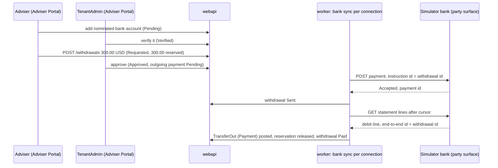

# Nominated bank accounts and withdrawals

Step 6 of [custodial-roadmap.md](../custodial-roadmap.md) §13. It covers roadmap items **B5** (nominated bank account) and **B6** (withdrawals, available cash), with the payments side of the simulator bank (**S1 payments**). It also handles the debit lines that [deposit-matching.md](deposit-matching.md) stores and leaves waiting (its R14): payouts, returns of unmatched receipts, recalls, and returned payments. It follows [ADR 0021](../adr/0021-outside-parties-behind-ports.md) rules 1–20, including the outgoing-call rules 12–14 that no slice has used yet, and does not re-decide them. It amends [deposit-matching.md](deposit-matching.md), [posting.md](posting.md), [custody-modes.md](custody-modes.md), [transaction-source.md](transaction-source.md), [internal-transfers.md](internal-transfers.md), [portfolios.md](portfolios.md), [adjustments.md](adjustments.md), [accounts.md](accounts.md), [simulator.md](simulator.md) and the Adviser Portal and Customer Portal contracts.

An Adviser records a Customer's own bank account as a **nominated bank account**, and a TenantAdmin other than the person who added it verifies it. An Adviser then requests a **withdrawal** from a Custodial account to a verified nominated bank account. The amount is **reserved** at once, so it cannot be spent twice. A second person, a TenantAdmin, approves it. The `worker` sends an **outgoing payment** to the bank through a new port, and the withdrawal's **payout** (a `TransferOut` with source `Payment`) is posted only when the bank statement shows the money leaving. From this slice on, a person can no longer enter a `TransferOut` on a Custodial account.

New: permissions `nominated-bank-accounts.read`, `nominated-bank-accounts.manage`, `nominated-bank-accounts.verify`, `withdrawals.read`, `withdrawals.request` and `withdrawals.approve`; routes under `/nominated-bank-accounts` and `/withdrawals`; port `IBankPayments`; source kind `Payment`; item fields `reservedCash` and `availableCash` (account), `payment` (transaction); new statement line statuses, reasons and match methods. Scripts `0042_nominated_bank_accounts.sql` and `0043_withdrawals.sql`; simulator script `database/simulator/0004_bank_payments.sql`. No new `TransactionType`, problem code or domain event.

**Status is `review` (2026-11-20).** §11 lists the points to confirm, each with a recommendation written into the rules. The amendments to accepted docs listed in §12 are made in the change that accepts this spec, not before.

---

## 1. Summary



| | Today | After this slice |
| --- | --- | --- |
| Money leaving a Custodial account | A person types a `TransferOut` with any amount | A withdrawal to a verified nominated bank account, approved by a second person, paid by the bank; the platform posts it from the statement |
| Hand `TransferOut` on a Custodial account | Allowed (transitional) | Refused (400). External accounts unchanged |
| Hand `CloseOut` on a Custodial account | Allowed for the whole balance (transitional) | Allowed only for a remainder smaller than the currency's minor unit |
| Cash a person can spend | Cash balance | **Available cash**: cash balance minus cash reserved for open withdrawals |
| A Customer's own bank account | Not recorded | Nominated bank account, verified by a TenantAdmin |
| Debit lines on the statement | Stored, waiting | Matched to the payment that caused them, or left in suspense |
| A receipt marked for return | Status only | Sent back to the payer by the bank |
| A receipt recalled by the payer's bank | Not handled | The deposit is reversed by the flow while the cash is still there |
| Cash between two Customers' Custodial accounts | `InternalTransfer` allowed | Refused (roadmap D14) |

The rule that distinguishes this slice: money leaves a Custodial account only as a payment the bank made to an account a second person verified, and the ledger moves only when the bank statement shows it.

---

## 2. Scope

**In**

- Domain: `NominatedBankAccount` aggregate; `Withdrawal` aggregate; `OutgoingPayment` aggregate; `TransactionSourceKind.Payment` and `TransactionSource.Payment(withdrawalPublicId)`; `TransactionPaymentDetail` (child of `Transaction`); factory `Transaction.PostPayout`; `Reverse` copies the detail; `BankStatementLine` gains end-to-end id, related line, return reason, two statuses and new transitions; `CustodyRules` cells `TransferOut` / Custodial refused and `CloseOut` / Custodial limited; `AvailableCash`
- Application: port `IBankPayments`; the send step `SendBankPayments(connection)`; `ProcessStatementLines` processes debit lines and returns; nominated bank account commands and reads; withdrawal commands and reads; the available cash rule in every Custodial write that lowers cash; `GetAccounts`, `GetAccountById` and `GetAccountCashBalance` map `reservedCash` and `availableCash`; transaction reads map `payment`
- Infrastructure: `SimulatorBankPayments` adapter (HTTP, `X-Api-Key`); `BankStatementSyncJob` runs send, pull, process; `SimulatorBankFeed` reads the new wire fields; EF mappings
- Scripts: `database/schema/0042_nominated_bank_accounts.sql`, `database/schema/0043_withdrawals.sql`; `database/simulator/0004_bank_payments.sql`
- Security: six permissions (R1, R17)
- HTTP (`webapi`): `/nominated-bank-accounts` (six routes), `/withdrawals` (six routes), the new item fields, the matrix refusals, the statement line changes
- Simulator: payments on the party surface, payment mode, execute, return, recall on the control surface, debit lines in the feed
- Adviser Portal: bank accounts on the Customer page, the verification list, Withdraw on a Custodial account, the withdrawals pages, the payment on the transaction page, debit lines on the Bank receipts pages; BFF prefixes `/nominated-bank-accounts` and `/withdrawals`
- Customer Portal: nominated bank accounts on the profile, available cash and withdrawals on the account page, the payout label; BFF prefixes `/nominated-bank-accounts` and `/withdrawals`
- `TestSeed`: one verified nominated bank account for the demo Customer
- Tests listed in §10

**Out**

- A Customer acting in the Customer Portal: adding a bank account, requesting a withdrawal (roadmap D6). The Customer Portal stays read-only
- Bank reconciliation, closing balances, break lists (B7). The simulator keeps its own balance for B7 to read later
- The account closure flow (B8). `CloseOut` is limited, not replaced (R43)
- Settled versus unsettled cash (O2). Every cash is available once it is in the balance
- Buy orders and their reservations (O1). This slice ships the reservation mechanism and its only user, the withdrawal
- Third-party payments: a withdrawal to an account that is not the Customer's own (roadmap X4)
- A withdrawal in another currency than the account's, or FX at payout (roadmap D20)
- A payment status feed: a rejection that the bank reports after it accepted a payment. In this slice a bank rejects synchronously or returns the money later (R33, §11 point 12)
- Proof of account ownership as a document (a bank statement or deposit slip upload). The verifier records what they checked in the note (R11)
- Withdrawal limits, daily caps, or an amount above which a second approver is needed
- Expiry of a withdrawal that waits for approval
- Notifying the Customer, the Adviser or the TenantAdmin of a request, approval or payout
- An operations role separate from TenantAdmin (roadmap D5)
- Bank interest on the trust account (B7, I2)
- A real bank adapter
- Named scenarios and the scenario library (§11 point 22)
- A Back Office page. SystemAdmin has none of the new permissions
- Any change to External accounts beyond the new item fields, the `CloseOut` rule's External column (unchanged) and D14's External column (unchanged)

---

## 3. Stories

1. As an Adviser I record my Customer's own bank account (bank, account name, account number, currency) so money can later be paid to it.
2. As a TenantAdmin I check a newly added bank account against evidence the Customer gave and verify it, or reject it with a reason. I cannot verify an account I added myself.
3. As an Adviser I remove a nominated bank account the Customer no longer uses. Its details never change; a correction is a new account.
4. As an Adviser I request a withdrawal from my Customer's Custodial account to one of their verified bank accounts in the same currency. The amount is reserved at once and the account's available cash goes down.
5. As a TenantAdmin I approve or reject a withdrawal someone else requested. I cannot approve my own.
6. As an Adviser or TenantAdmin I cancel a withdrawal before the bank was asked to pay it.
7. As the platform I send an approved withdrawal to the bank once, with the same key on every retry, and post it to the ledger only when the statement shows the payment.
8. As a Customer I see my nominated bank accounts, my withdrawals and their status, and my available cash.
9. As a TenantAdmin I see a receipt I marked for return actually go back to the payer, and a recalled receipt taken off the Customer's account.
10. As an Adviser I can no longer type a withdrawal on a Custodial account, close one out with more than a rounding remainder, or move its cash to another Customer.
11. As the simulator operator I make the bank pay, hold, or reject payments, return a payment a day later, and recall a receipt, so every path can be shown.

---

## 4. Rules

### 4.1 Nominated bank accounts (B5)

| ID | Rule |
| --- | --- |
| R1 | **Access.** New permissions: `nominated-bank-accounts.read` (TenantAdmin, Adviser, Customer), `nominated-bank-accounts.manage` (TenantAdmin, Adviser) and `nominated-bank-accounts.verify` (TenantAdmin). SystemAdmin has none of them → 403. Missing / dead Bearer → 401, never 302. A disabled current tenant → 403. Scope is the Customer's: TenantAdmin any Customer of the tenant; Adviser assigned Customers only; Customer own only. A nominated bank account outside the caller's scope, of another tenant, or missing → 404. No caller names a tenant; a `tenantId` in a query or body → 400. |
| R2 | **Fields.** `customerId` (Customer PublicId), `currency` (an enabled currency of the catalog, else 400 `errors.Currency`), `bankName` (trimmed, 1–100), `accountName` (the holder's name as the bank shows it, trimmed, 1–140) and `accountNumber` (trimmed, 1–34 characters of letters, digits, spaces and hyphens, no two spaces in a row; the client-money-accounts R2 shape). Each refused with its own `errors` key. |
| R3 | **Full account number.** The number is stored and returned in full on the nominated bank account item to every caller who can read it, the Customer included: the platform pays to it and the Adviser and TenantAdmin must check it. The withdrawal item and the payment detail show it masked (R25, R39). It is never written to a log. |
| R4 | **Add.** `POST /nominated-bank-accounts` with the R2 fields → 201 `{ "id" }`. The Customer must be in scope (else 404) and not Disabled (else 400 `disabled` / `target=user`). The new row is `Pending`, with the caller and time as added by and at. The body must not carry `status`, `tenantId` or `id` (400). No `Idempotency-Key`: the duplicate rule (R5) refuses a second add. |
| R5 | **No duplicates.** A Customer has at most one `Pending` or `Verified` nominated bank account with the same account number (compared without regard to case, spaces and hyphens) and currency. A second → 400 `errors.AccountNumber` with the message `This bank account is already nominated for this customer.` `Rejected` and `Removed` rows do not count. The same number may be nominated by two Customers (a joint account). |
| R6 | **No edit.** There is no PUT. The R2 fields never change. A wrong detail is corrected by removing the row and adding a new one, which is verified again. |
| R7 | **Statuses.** |

| Action | Route | Permission | From | To |
| --- | --- | --- | --- | --- |
| Verify | `POST /nominated-bank-accounts/{id}/verify` | `nominated-bank-accounts.verify` | `Pending` | `Verified` |
| Reject | `POST /nominated-bank-accounts/{id}/reject` | `nominated-bank-accounts.verify` | `Pending` | `Rejected` |
| Remove | `POST /nominated-bank-accounts/{id}/remove` | `nominated-bank-accounts.manage` | `Pending`, `Verified` | `Removed` |

| ID | Rule |
| --- | --- |
| R8 | **Every action.** Body with `rowVersion`; missing → 400, stale → 409 `stale_row_version`. A row not in a "From" status → 400 `errors.Status` with the message `This bank account is <status> and cannot be <verified / rejected / removed>.` Success → 204. `Rejected` and `Removed` are final. |
| R9 | **Four eyes.** Verify and reject are refused when the caller is the person who added the row → 400 `errors.Status` with the message `A bank account must be verified by someone other than the person who added it.` |
| R10 | **Customer state.** Verify needs the Customer not Disabled (400 `disabled` / `target=user`). Reject and remove work whatever the Customer's state. |
| R11 | **Note.** `note`: trimmed, 1–200 characters. Required on verify (what was checked, for example `Bank statement sighted 2026-11-20`), reject and remove (400 `errors.Note`). |
| R12 | **Record.** Verify and reject record the reviewer, time and note; remove records the remover, time and note. Each is kept in its own columns, so the row shows who added, who reviewed and who removed it. No history table, because the details never change (R6). No domain event, no outbox row. |
| R13 | **List.** `GET /nominated-bank-accounts` → list envelope, newest added first. Optional filters: `customerId`, `status` (one or more names, comma-separated; unknown → 400 `errors.Status`), `currency`. A Customer's list is their own. `GET /nominated-bank-accounts/{id}` → the item. |
| R14 | **Removal with open withdrawals.** Remove is allowed while a withdrawal to the row is open. An open withdrawal to a row that is no longer `Verified` cannot be approved (R29); one already approved is paid as approved, because the bank has its details. |
| R15 | **Not tied to Custodial accounts.** A nominated bank account belongs to the Customer, not to an Account, and does not need a Custodial account to exist. Only withdrawals use it in this slice. |
| R16 | **Customer read.** The Customer sees every field of their own rows, including who reviewed them by name, but not the note of a reject or a remove (`note: null` on those for a Customer). |

### 4.2 Withdrawals (B6)

| ID | Rule |
| --- | --- |
| R17 | **Access.** New permissions: `withdrawals.read` (TenantAdmin, Adviser, Customer), `withdrawals.request` (TenantAdmin, Adviser) and `withdrawals.approve` (TenantAdmin). SystemAdmin none → 403. 401 / 403 / tenant rules as R1. Scope is the Account's: TenantAdmin any Account of the tenant; Adviser Accounts of assigned Customers; Customer own Accounts. A withdrawal outside scope, of another tenant, or missing → 404. |
| R18 | **Request.** `POST /withdrawals` with `accountId`, `nominatedBankAccountId`, `amount`, optional `reference`, optional `memo` → 201 `{ "id" }`. Requires `Idempotency-Key` (posting R21, ADR 0015): replay with the same hash → the original 201; same key, other hash → 409; missing → 400. The withdrawal is `Requested`, with the caller and time as requested by and at. |
| R19 | **Account.** The Account must be in scope (else 404), Custodial (else 400 `errors.AccountId`, `A withdrawal can be requested only from a Custodial account.`), Open (400, posting R6) and its Customer not Disabled (400 `disabled` / `target=user`). |
| R20 | **Nominated bank account.** It must belong to the Account's Customer (another Customer's, another tenant's or a missing one → 404 for the whole command), be `Verified` (else 400 `errors.NominatedBankAccountId`, `The bank account is not verified.`) and be in the Account's currency (else 400 `errors.NominatedBankAccountId`, `The bank account is in NZD; this account is USD.`). |
| R21 | **Amount.** `amount > 0`, with no more decimal places than the Account currency's `DecimalPlaces` (else 400 `errors.Amount`), and not more than the Account's available cash (R35) when the request is made (else 400 `errors.Amount`, `The account's available cash is 120.00 USD.`). No minimum, no maximum. |
| R22 | **Reserve under the Account lock.** The request locks the Account row as every posting does (posting R22) and checks R21 against the available cash under that lock, so a request and a posting on the same Account never both see the old cash. From then on the amount is **reserved** (R35). |
| R23 | **Reference and memo.** `reference` is the text the bank puts on the payee's statement: trimmed, 1–18 characters of letters, digits, spaces, hyphens and full stops; omitted → the Account's deposit reference, so the Customer recognises the payment. `memo` is an internal note: trimmed, 1–200, never sent to the bank. |
| R24 | **Statuses.** A withdrawal is **open** while it is `Requested`, `Approved` or `Sent`. Only an open withdrawal reserves cash. |

| Status | Means | Reserved | Next |
| --- | --- | --- | --- |
| `Requested` | Waiting for approval | yes | `Approved`, `Rejected`, `Cancelled` |
| `Approved` | An outgoing payment waits to be sent, or its outcome is not known yet | yes | `Sent`, `Paid`, `Failed`, `Cancelled` (R30) |
| `Sent` | The bank accepted the payment | yes | `Paid` |
| `Paid` | The statement showed the payment; the payout is posted | no | `Returned` |
| `Rejected` | A TenantAdmin refused it | no | final |
| `Cancelled` | Withdrawn before the bank was asked | no | final |
| `Failed` | The bank refused the payment | no | final |
| `Returned` | The money came back after it was paid; the payout is reversed | no | final |

| ID | Rule |
| --- | --- |
| R25 | **Item.** `{ id, accountId, customerId, nominatedBankAccount: { id, bankName, accountName, accountNumber }, amount, currency, reference, memo, status, requestedBy, requestedAt, decision, payment, payoutTransactionId, returnTransactionId, failureReason, returnReason, rowVersion }`. `accountNumber` is masked to its last four letters or digits as `****1234` (deposit-matching R11 shape). `decision` is `{ action, by, at, note }` for the approve, reject or cancel, else `null`. `payment` is the outgoing payment's `{ status, attempts, lastAttemptAt, lastFailure, sentAt }` once approved, else `null`. A Customer sees every field except `memo` and the decision `note` (`null` for a Customer). |
| R26 | **List.** `GET /withdrawals` → list envelope, newest requested first. Optional filters: `accountId`, `customerId`, `status` (one or more names, comma-separated; unknown → 400 `errors.Status`). `GET /withdrawals/{id}` → the item. |

| Action | Route | Permission | From | To |
| --- | --- | --- | --- | --- |
| Approve | `POST /withdrawals/{id}/approve` | `withdrawals.approve` | `Requested` | `Approved` |
| Reject | `POST /withdrawals/{id}/reject` | `withdrawals.approve` | `Requested` | `Rejected` |
| Cancel | `POST /withdrawals/{id}/cancel` | `withdrawals.request` | `Requested`, `Approved` (R30) | `Cancelled` |

| ID | Rule |
| --- | --- |
| R27 | **Every action.** Body with `rowVersion`; missing → 400, stale → 409 `stale_row_version`. A withdrawal not in a "From" status → 400 `errors.Status` with the message `This withdrawal is <status> and cannot be <approved / rejected / cancelled>.` Success → 204. No `Idempotency-Key`: the status and `rowVersion` make a repeat a 400 or a 409. `note`: trimmed, 1–200; required on reject (400 `errors.Note`), optional on approve and cancel. |
| R28 | **Four eyes.** Approve and reject are refused when the caller requested the withdrawal → 400 `errors.Status` with the message `A withdrawal must be approved by someone other than the person who requested it.` This holds for every tenant, also one with a single TenantAdmin (§11 point 9). |
| R29 | **Approve.** Under the Account lock: the Account is Open (400, posting R6), its Customer not Disabled (400 `disabled` / `target=user`), the nominated bank account still `Verified` (400 `errors.NominatedBankAccountId`, `The bank account is no longer verified.`), and the Tenant has an active client money account in the currency (400 `errors.AccountId`, `There is no active client money account in USD to pay from.`). Then, in one database transaction, the withdrawal becomes `Approved` and an outgoing payment (R31) is created, `Pending`, from that client money account. The reservation is already held, so approve checks no cash. |
| R30 | **Cancel.** From `Requested`; or from `Approved` while its outgoing payment has no send attempt (R32), in which case the payment becomes `Cancelled` in the same database transaction. After the first attempt → 400 `errors.Status` with the message `The bank has been asked to pay this withdrawal, so it can no longer be cancelled.` The `RowVersion` of the outgoing payment guards the race with the send step. |
| R31 | **Outgoing payment.** One record per payment the platform asks a bank to make from a client money account: the client money account and its connection, the kind (`Withdrawal` or `ReceiptReturn`), the instruction's PublicId (the withdrawal's, or the statement line's for a return, R48), amount and currency, the payee or the line returned, the reference, status (`Pending`, `Accepted`, `Rejected`, `Cancelled`, `Paid`, `Returned`), send attempts, last attempt and failure, the bank's payment id. It has no HTTP route of its own; the withdrawal and the statement line show it. Unique on the instruction PublicId. |

### 4.3 Sending payments

| ID | Rule |
| --- | --- |
| R32 | **The send step.** The recurring job `bank-statement-sync:{connection}` (deposit-matching R6) gains a first step: before the pull, it sends every `Pending` outgoing payment of the connection whose client money account is active, oldest first. Per payment: record the attempt (attempts + 1, time) and commit, then call the port (ADR 0021 rules 12, 13). The job id, schedule, queue, lock and no-retry rule are unchanged. A Tenant that is disabled gets no first attempt; a payment that already has an attempt is still sent again, because the bank may have it (§11 point 24). |
| R33 | **Outcome of a call.** `Accepted` with the bank's payment id → payment `Accepted`; a `Withdrawal` payment's withdrawal becomes `Sent`, a `ReceiptReturn` payment's line becomes `ReturnSent` (R48). `Rejected` with a reason → payment `Rejected`; its withdrawal becomes `Failed` with the reason and its reservation is released, or its line goes back to suspense (R48). A failure of the call (`Unreachable`, `Timeout`, `Unauthorized`, `Unavailable`, `UnknownAccount`, `BadResponse`) → the payment stays `Pending` with `lastFailure` set, and the next run sends it again with the same instruction id. Each outcome is one database transaction guarded by the payment's `RowVersion`. A payment's failure never stops the others or the pull. |
| R34 | **Rejection reasons.** `InvalidAccount`, `AccountClosed`, `InsufficientFunds`, `UnknownLine`, `Refused`. A reason the adapter does not know → `Refused`. The withdrawal item shows it as `failureReason`. |

### 4.4 Available cash

| ID | Rule |
| --- | --- |
| R35 | **Definition.** **Reserved cash** of an Account is the sum of the amounts of its open withdrawals (R24). **Available cash** is the cash balance (the cash `SUM`, posting R9) minus reserved cash. On an External account reserved cash is always 0. |
| R36 | **Every Custodial write keeps available cash `≥ 0`.** On a Custodial account, every write that lowers cash must leave available cash `≥ 0`, computed under the Account lock: `Buy` (with its fee), `CloseOut` (R43), the from side of `InternalTransfer` and `FxConversion`, an `Adjustment` with a negative amount, a hand reverse that lowers cash, a rebalance, an undo match (deposit-matching R30) and a recall (R47). This replaces "cash `SUM ≥ 0`" (posting R9) for those writes; External accounts keep R9 as it is. The only write exempt is the payout of a withdrawal (R38), which releases its own reservation in the same database transaction. |
| R37 | **Refusal.** When the cash `SUM` after the write would still be `≥ 0` but below reserved cash → 400 with the ordinary message `Available cash cannot become negative: 300.00 USD is reserved for withdrawals.`, under the same `errors` key each write already uses for posting R9. When the `SUM` itself would be negative, the existing message stays. A rebalance plans with available cash in place of the cash balance (portfolios R8 `V`, R11), so its trades never need the refusal. |

### 4.5 Debit lines and returns on the statement

Amendment to [deposit-matching.md](deposit-matching.md) R13, R14, R18, R23. The bank's wire item gains three optional fields (R54): `endToEndId` (the instruction id the platform sent, echoed on the line the payment caused), `returnOf` (the outside id of the line this line takes back) and `returnReason`. The statement line stores them; `returnOf` is resolved to the stored line of the same connection.

| ID | Rule |
| --- | --- |
| R38 | **Payout.** A **debit** line whose `endToEndId` is the PublicId of a withdrawal of the line's Tenant, with its outgoing payment `Pending` or `Accepted` from the line's client money account, and whose amount equals the withdrawal's, is the payout: in one database transaction, with the Account row locked, the platform posts a `TransferOut` (R39), the withdrawal becomes `Paid` and its reservation is released, the payment becomes `Paid`, and the line becomes `Matched` with method `Payment`. It is posted even when the Customer is Disabled: the bank has paid, and the books follow the bank (deposit-matching R19). A `Pending` payment whose accepted answer was lost is paid the same way. |
| R39 | **The payout on the ledger.** A Transaction of type `TransferOut` with one `Principal` cash leg on the Account, amount = − the withdrawal's amount; source `Payment` (4) with the withdrawal's PublicId as source id; `bookedAt` = platform time when it is posted (ADR 0021 rule 10); memo `Withdrawal`; `reference` `null`; and a **payment detail**: the line's value date, the reference sent, the payee name and the masked payee account. Built by `Transaction.PostPayout` without the manual entry matrix (custody-modes R7). `CreatedBy` is the worker's system name. |
| R40 | **Returned payment.** A **credit** line whose `returnOf` is the line of a `Paid` withdrawal's payout, with the same amount, returns it: in one database transaction the platform posts `Transaction.Reverse` of the payout with source `Payment` and the same withdrawal PublicId (transaction-source R7), copying the payment detail; the withdrawal becomes `Returned` with the line's `returnReason`; the payment becomes `Returned`; the line becomes `Matched` with method `PaymentReturn`. A Closed Account → nothing is posted and the line becomes `Unmatched` with reason `AccountClosed`; a TenantAdmin reopens the Account and matches the line by hand as a deposit. A Disabled Customer does not stop it. |
| R41 | **No hand reverse.** `Payment` is not a hand-reversible source (transaction-source R12). `POST /transactions/{id}/reverse` of a payout or its Reversal → 400 by transaction-source R13. |
| R42 | **Hand `TransferOut` refused on a Custodial account.** The manual entry matrix cell `TransferOut` / Custodial becomes **refused**: `POST /transactions` → 400 `errors.Type` with the message `Withdrawals from a Custodial account are paid to the customer's nominated bank account. Request a withdrawal.`, for every caller, SystemAdmin included. External accounts unchanged. A `TransferOut` entered by hand before this slice keeps source `Manual` and can still be reversed by hand. |
| R43 | **`CloseOut` only for a remainder.** On a Custodial account a hand `CloseOut` is allowed only when the cash balance is smaller than one minor unit of the currency (`0 < SUM < 10^−DecimalPlaces`), the part a `Buy` / `Sell` leaves (custody-modes §4.2); otherwise → 400 `errors.Type` with the message `Only a remainder smaller than 0.01 USD can be closed out on a Custodial account. Withdraw the balance first.` (the minor unit from the currency). With reserved cash, R36 refuses it too. External accounts unchanged. Roadmap B8 replaces it with the account closure flow. |
| R44 | **Same Customer on Custodial transfers (roadmap D14).** `POST /transactions/transfer` between two Custodial accounts of two different Customers → 400 `errors.ToAccountId` with the message `Cash can be transferred between Custodial accounts of the same customer only.` A transfer to another Customer is a third-party payment (roadmap X4). External accounts unchanged. Existing transfers stay and can still be reversed. |

| ID | Rule |
| --- | --- |
| R45 | **Processing.** Deposit-matching R13 now processes every `Received` line of the connection, credit and debit, oldest `ReceivedAt` first, then `Id`, after the send step and the pull. Each line is classified in this order: a debit with an `endToEndId` (R38, R49); a debit with a `returnOf` (R47); any other debit (R46); a credit with a `returnOf` (R40, R50); any other credit (deposit-matching R15–R20, unchanged). A line whose `endToEndId` or `returnOf` names nothing it can act on becomes `Unmatched` with the first reason that applies: `UnknownPayment`, `UnknownReturn`, `PaymentMismatch` (the amount differs from the payment's). |
| R46 | **Other debit lines.** A debit the platform did not cause (a bank fee on the trust account, an error) becomes `Unmatched` with reason `UnknownPayment`. Nothing is written to the ledger. |
| R47 | **Recall of a receipt.** A **debit** line whose `returnOf` is a stored credit line, with the same amount and no `endToEndId`, is a recall or dishonour. When that credit line is `Matched`: the platform posts the Reversal of its deposit with source `BankFeed` and that line's PublicId (as deposit-matching R33), if the Account is Open and available cash stays `≥ 0` (R36); the credit line becomes `Returned` and loses its match (as an undo match), and the debit line becomes `Matched` with method `Recall`. When the cash is gone or the Account is Closed: nothing is posted, the debit line becomes `Unmatched` with reason `RecallNotCovered`, and a TenantAdmin corrects with an adjustment (F3) and then ignores the line. When that credit line is `Unmatched`, `Ignored` or `ReturnRequested`: the credit line becomes `Returned` and the debit line becomes `Matched` with method `Recall`; a return payment of that line with no attempt becomes `Cancelled`, and one already attempted is left to its answer, which then changes only the payment (R48). A credit line already `Returned` → `UnknownReturn`. |
| R48 | **Returning a receipt (deposit-matching R28 completed).** Request return now also creates an outgoing payment of kind `ReceiptReturn` in the same database transaction: `Pending`, instruction id = the line's PublicId, amount and currency of the line, `returnOf` = the line's outside id, from the line's client money account. The bank pays it back to the original payer; the platform never holds the payer's full account number (deposit-matching R11). Reopen (deposit-matching R29) from `ReturnRequested` is allowed only while that payment has no attempt, and cancels it; after an attempt → 400 `errors.Status`, `The bank has been asked to return this receipt, so it can no longer be reopened.` Accepted → line `ReturnSent`. Rejected → line `Unmatched` with reason `ReturnRejected`; the TenantAdmin decides again. When the line is already `Returned` (a recall came first, R47), an answer changes only the payment. |
| R49 | **Return paid.** A **debit** line whose `endToEndId` is the PublicId of a `ReturnSent` (or `ReturnRequested` with an attempted payment) credit line of the same Tenant, with the same amount: the credit line becomes `Returned`, the payment `Paid`, and the debit line `Matched` with method `Payment`. Nothing is written to the ledger. |
| R50 | **Return of a return.** A **credit** line whose `returnOf` is the debit line of a receipt return (the payer's bank sent the money back again) becomes `Unmatched` with reason `UnknownReturn`. The TenantAdmin matches, ignores or returns it as any receipt. |
| R51 | **Actions on debit lines.** Deposit-matching R23 changes: on a debit line, ignore (from `Unmatched`, note required) and reopen (from `Ignored`) are allowed; match, request return and undo match stay refused with `errors.Status`. `ReturnSent`, `Returned` and every `Matched` debit line accept no action. A matched payout, return or recall is undone only by its flow. |
| R52 | **New statuses, reasons and methods.** Statuses `ReturnSent = 5`, `Returned = 6`. Unmatched reasons `UnknownPayment = 7`, `UnknownReturn = 8`, `PaymentMismatch = 9`, `RecallNotCovered = 10`, `ReturnRejected = 11`. Match methods `Payment = 2`, `Recall = 3`, `PaymentReturn = 4`. A `Matched` line has an Account and a Transaction (methods `Reference`, `Manual`, `Payment` of a payout, `Recall` with a Reversal, `PaymentReturn`), or a related line and no Transaction (method `Payment` of a receipt return, `Recall` of an unmatched receipt). |
| R53 | **Line item.** Gains `relatedLineId` (the PublicId of the line this line returns, recalls, or pays back; `null` otherwise), `withdrawalId` (on a payout or returned payment line), `returnReason`, and `returnPayment: { status, attempts, lastFailure }` on a credit line with a `ReceiptReturn` payment. `match.method` may be `Payment`, `Recall` or `PaymentReturn`; `match.accountId` and `match.transactionId` are `null` where R52 has no Transaction. `GET /statement-lines` gains an optional `direction` filter (`Credit`, `Debit`). |

### 4.6 The simulator bank, payments side (S1 payments)

Amendment to [simulator.md](simulator.md) and [deposit-matching.md](deposit-matching.md) §4.6. Party routes stay under `/party/bank/…`, control routes under `/control/bank/…`.

| ID | Rule |
| --- | --- |
| R54 | **Wire item.** Deposit-matching R45 gains `endToEndId`, `returnOf` and `returnReason` (each a string or `null`) and `direction` `Debit`. On a debit line the `payerName` and `payerAccount` fields carry the payee: the account the money went to. |
| R55 | **Payment route.** Party port: `POST /party/bank/accounts/{accountNumber}/payments` with `{ instructionId, amount, currency, reference, payee: { accountNumber, name } }` or, in place of `payee`, `returnOf` (the outside id of a credit line on that account). Exactly one of `payee` and `returnOf`. `instructionId` 1–100 characters. Unknown trust account → 404. A body that breaks the field rules (amount `> 0` with at most 4 decimals, currency = the account's, `reference` ≤ 18, payee number by deposit-matching R38's shape, name ≤ 140) → 400. Key and outage as every party route (simulator R27, R30). |
| R56 | **Answer.** 200 `{ "paymentId", "status": "Accepted" }` or 200 `{ "paymentId", "status": "Rejected", "reason" }`. `paymentId` is `{WorldId:N}-P{n}`, never repeated (simulator R25). A `returnOf` that names no credit line of the account, or one already returned or recalled, → `Rejected` with `UnknownLine`. Otherwise the payment mode (R58) decides. |
| R57 | **Idempotent on the instruction id (ADR 0021 rule 13).** A second call with the same `instructionId` on the same account and the same body → the first answer again, nothing new. The same `instructionId` with another body → 409. |
| R58 | **Payment mode.** `POST /control/bank/payment-mode` `{ "mode": "Execute" | "Hold" | "Reject", "reason"? }` sets how the bank answers new payments: `Execute` (default) accepts and executes at once; `Hold` accepts and leaves the payment held; `Reject` rejects with `reason` (one of R34's names, required with `Reject`). Log action `BankPaymentModeChanged`. A reset sets `Execute`. |
| R59 | **Execute.** An executed payment adds a **debit** line on the trust account: the payment's amount, value date = the simulator date, `endToEndId` = the `instructionId`, `reference` = the payment's, payee in the payer fields (R54), and for a return `returnOf` = the returned line's id. It enters the feed at once (deposit-matching R43). `POST /control/bank/payments/{paymentId}/execute` executes a held payment (400 `errors.Status` otherwise). Log action `BankPaymentExecuted`. |
| R60 | **Return a payment.** `POST /control/bank/payments/{paymentId}/return` `{ "reason", "availableAfter"? }` on an executed payment to a payee (not a return of a receipt; not returned before; else 400 `errors.Status`) adds a **credit** line: the same amount, `returnOf` = the payment's debit line id, `returnReason` = `reason` (1–140), payer fields = the payee; `availableAfter` as deposit-matching R41. Log action `BankPaymentReturned`. |
| R61 | **Recall a receipt.** `POST /control/bank/lines/{outsideId}/recall` `{ "reason", "availableAfter"? }` on a credit line that is a receipt (not a return), not returned or recalled before (else 400 `errors.Status`), adds a **debit** line with the same amount, `returnOf` = that line, `returnReason`, no `endToEndId`. Log action `BankReceiptRecalled`. |
| R62 | **Its own books.** `GET /control/bank/payments` lists payments newest first (envelope as simulator R28) with status (`Accepted`, `Held`, `Executed`, `Returned`, `Rejected`), mode at the time, instruction id and the lines they caused. The account `balance` (deposit-matching R46) includes debit lines. The simulator does not refuse a payment for the balance; `InsufficientFunds` comes only from the `Reject` mode (§11 point 21). |
| R63 | **Reset.** A reset also empties the payments and sets the mode to `Execute` (simulator R24). |
| R64 | **No platform knowledge.** The simulator stores `instructionId` as an opaque string and echoes it as `endToEndId`. It does not read withdrawals, statement line PublicIds or nominated bank accounts (simulator R33). |

### 4.7 The platform adapter

| ID | Rule |
| --- | --- |
| R65 | **`IBankPayments` and `SimulatorBankPayments`.** The port sends one payment for a connection and a trust account number and returns `Accepted(paymentId)`, `Rejected(reason)` or a failure. The adapter for `Adapter = Simulator` calls R55 at the connection's `BaseUrl` with `X-Api-Key`, the connection's timeout, and its own wire types. Failures as deposit-matching R49: no connection → `Unreachable`; timeout → `Timeout`; 401 → `Unauthorized`; 503 → `Unavailable`; 404 → `UnknownAccount`; 400, 409, any other status or an unreadable body → `BadResponse`. A `BadResponse` payment stays `Pending` and is sent again, so a 409 from a changed body shows on every run until a person looks; the body is built from stored data only, so it does not change. |
| R66 | **`SimulatorBankFeed`.** Reads the three new wire fields; `endToEndId` and `returnOf` over 100 characters → `InvalidLine` (deposit-matching R10); `returnReason` is cut to 140. |

Policies: the six of R1 and R17 (new). Grants: as R1 and R17.

---

## 5. Domain

| Type | Kind | Change |
| --- | --- | --- |
| `NominatedBankAccount` | Aggregate (new) | `TenantId`, `PublicId`, `CustomerId`, `Currency`, `BankName`, `AccountName`, `AccountNumber`, `Status`, added (`ByUserId`, `At`), review (`ByUserId`, `At`, `Note`), removal (`ByUserId`, `At`, `Note`), `RowVersion`. `Add(...)`, `Verify(byUserId, note, at)`, `Reject(...)`, `Remove(...)`. Holds R2, R6–R9, R11, R12 |
| `NominatedBankAccountStatus` | Enum (new) | `Pending = 0`, `Verified = 1`, `Rejected = 2`, `Removed = 3` |
| `Withdrawal` | Aggregate (new) | `TenantId`, `PublicId`, `AccountId`, `NominatedBankAccountId`, `Amount`, `Currency`, `Reference`, `Memo`, `Status`, requested (`ByUserId`, `At`), decision (`Action`, `ByUserId`, `At`, `Note`), `PayoutTransactionId`, `ReturnTransactionId`, `FailureReason`, `ReturnReason`, `RowVersion`. `Request(...)`, `Approve`, `Reject`, `Cancel`, `MarkSent`, `MarkPaid(transactionId)`, `MarkFailed(reason)`, `MarkReturned(transactionId, reason)`; `IsOpen`. Holds R24, R27, R28 |
| `WithdrawalStatus` | Enum (new) | `Requested = 0`, `Approved = 1`, `Sent = 2`, `Paid = 3`, `Rejected = 4`, `Cancelled = 5`, `Failed = 6`, `Returned = 7` |
| `WithdrawalDecision` | Enum (new) | `Approved = 0`, `Rejected = 1`, `Cancelled = 2` |
| `OutgoingPayment` | Aggregate (new) | `TenantId`, `PublicId`, `ClientMoneyAccountId`, `Connection`, `Kind`, `InstructionPublicId`, `WithdrawalId?`, `ReturnOfLineId?`, `Amount`, `Currency`, `Reference`, `Status`, `Attempts`, `LastAttemptAt`, `LastFailure`, `BankPaymentId`, `AcceptedAt`, `RejectReason`, `RowVersion`. `ForWithdrawal(...)`, `ForReceiptReturn(...)`, `RecordAttempt(at)`, `Accept(paymentId, at)`, `Reject(reason)`, `RecordFailure(failure)`, `Cancel()` (only with no attempt), `MarkPaid()`, `MarkReturned()` |
| `OutgoingPaymentKind` / `OutgoingPaymentStatus` / `PaymentRejectReason` | Enums (new) | `Withdrawal = 0`, `ReceiptReturn = 1`; `Pending = 0`, `Accepted = 1`, `Rejected = 2`, `Cancelled = 3`, `Paid = 4`, `Returned = 5`; R34 in order from 0. `LastFailure` reuses `BankFeedFailure` values 0–5 |
| `BankStatementLine` | Aggregate (existing) | `EndToEndId`, `ReturnOfOutsideId`, `RelatedLineId`, `ReturnReason`, `WithdrawalId`. New: `MarkPayout(accountId, transactionId, withdrawalId, at)`, `MarkReturnPaid(relatedLineId, at)`, `MarkRecall(...)`, `MarkPaymentReturn(...)`, `MarkReturnSent()`, `MarkReturned(...)`, `ReturnRejected()`; `Ignore` and `Reopen` allowed on debit lines (R51); `Reopen` from `ReturnRequested` needs the caller to say the payment had no attempt (R48). Statuses, reasons and methods of R52 |
| `TransactionSourceKind` | Enum (existing) | Add `Payment = 4`. Not hand-reversible |
| `TransactionSource` | VO (existing) | `TransactionSource.Payment(Guid withdrawalPublicId)`; the id must not be empty |
| `TransactionPaymentDetail` | Entity (new, child of `Transaction`) | `ValueDate`, `Reference`, `PayeeName`, `PayeeAccount` (masked). 0..1 per Transaction |
| `Transaction` | Aggregate (existing) | `PostPayout(tenantId, account, amount, bookedAt, source, paymentDetail)`: one `TransferOut` cash leg, `amount > 0` given and posted negative, source kind must be `Payment`. `Reverse` copies the payment detail |
| `CustodyRules` | Static (existing) | `AllowsManualEntry(Custodial, TransferOut)` → `false` with the R42 message; `CloseOutMessage(currency)` for R43; `AllowsCustodialTransfer(fromCustomerId, toCustomerId)` for R44. The matrix still lives in one Domain class |
| `AvailableCash` | Static (new) | `Of(cashSum, reserved)`; `Allows(cashSumAfter, reserved)` (R35–R37) |
| `AccountNumberMask` | Static (existing `PayerAccountMask`, renamed) | Used for payee and nominated account numbers too |

```text
NominatedBankAccount.Add(...)                         -> Pending
  Verify(by, note, at)   Pending -> Verified          by != addedBy
  Reject(by, note, at)   Pending -> Rejected          by != addedBy
  Remove(by, note, at)   Pending | Verified -> Removed

Withdrawal.Request(...)                               -> Requested (reserves)
  Approve(by, note?, at)   Requested -> Approved      by != requestedBy
  Reject(by, note, at)     Requested -> Rejected
  Cancel(by, note?, at)    Requested | Approved (payment not attempted) -> Cancelled
  MarkSent()               Approved -> Sent
  MarkFailed(reason)       Approved -> Failed
  MarkPaid(txId)           Approved | Sent -> Paid
  MarkReturned(txId, why)  Paid -> Returned
  IsOpen = Requested | Approved | Sent

OutgoingPayment: Pending -> Accepted | Rejected | Cancelled (no attempt) ; Pending | Accepted -> Paid ; Paid -> Returned
```

Invariants:

- A nominated bank account's details never change; it is verified or rejected by someone other than the person who added it.
- A withdrawal is approved or rejected by someone other than the person who requested it.
- On a Custodial account, cash `SUM − reserved ≥ 0` after every write except a payout. Held by Application under the Account lock (R22, R36).
- A payout has source `Payment` with the PublicId of its withdrawal, and a payment detail. A withdrawal has at most one payout and at most one return Reversal. Held by `PostPayout`, the withdrawal and the statement line processing.
- An outgoing payment is unique on its instruction PublicId and is cancelled only before its first attempt.
- On a Custodial account no person enters a `TransferOut`, a `CloseOut` of more than a remainder, or an `InternalTransfer` to another Customer. Held by `CustodyRules`, called by Application.

Domain events: none.

Update [domain-model.md](../domain-model.md) §8.5, §8.6 and §8.9, and add §8.10 (nominated bank account) and §8.11 (withdrawal, outgoing payment), when this spec is accepted.

---

## 6. Database

Forward only. Do not add EF migrations.

### 6.1 Script `0042_nominated_bank_accounts.sql`

| Table | Change | Index / FK |
| --- | --- | --- |
| `NominatedBankAccounts` | Add | PK `Id`. Unique `PublicId`. FK `TenantId` → `Tenants`; `Currency` → `Currencies.Code`; `(TenantId, CustomerId)`, `(TenantId, AddedByUserId)`, `(TenantId, ReviewedByUserId)`, `(TenantId, RemovedByUserId)` → `Users (TenantId, Id)`, all RESTRICT. Unique filtered `UX_NominatedBankAccounts_Customer_Number` on `(TenantId, CustomerId, AccountNumberKey, Currency) WHERE Status IN (0, 1)` (R5). Index `(TenantId, Status, AddedAt DESC)` |

| Column | Type | Null | Notes |
| --- | --- | --- | --- |
| Id | int identity | no | |
| PublicId | uniqueidentifier | no | |
| TenantId | int | no | Tenant query filter |
| CustomerId | int | no | A `Users` row with role Customer |
| Currency | char(3) | no | |
| BankName | nvarchar(100) | no | |
| AccountName | nvarchar(140) | no | |
| AccountNumber | nvarchar(34) | no | As entered, trimmed |
| AccountNumberKey | nvarchar(34) | no | Upper case, spaces and hyphens removed (R5) |
| Status | int | no | CHECK 0–3 |
| AddedByUserId, AddedAt | int, datetimeoffset | no | |
| ReviewedByUserId, ReviewedAt, ReviewNote | int, datetimeoffset, nvarchar(200) | yes | Set together or not at all (CHECK). Set when `Status IN (1, 2)`; null when `Status = 0`; either when `Status = 3` (removed after or before a verify) |
| RemovedByUserId, RemovedAt, RemovedNote | int, datetimeoffset, nvarchar(200) | yes | All set iff `Status = 3` (CHECK) |
| Created, CreatedBy, LastModified, LastModifiedBy | audit | | |
| RowVersion | rowversion | no | |

### 6.2 Script `0043_withdrawals.sql`

| Table | Change | Index / FK |
| --- | --- | --- |
| `Withdrawals` | Add | PK `Id`. Unique `PublicId`. FK `TenantId` → `Tenants`; `(TenantId, AccountId)` → `Accounts`; `(TenantId, NominatedBankAccountId)` → `NominatedBankAccounts`; `(TenantId, RequestedByUserId)`, `(TenantId, DecisionByUserId)` → `Users`; `(TenantId, PayoutTransactionId)`, `(TenantId, ReturnTransactionId)` → `Transactions`; all RESTRICT. Index `(TenantId, AccountId, Status)` for reserved cash; index `(TenantId, Status, RequestedAt DESC)` |
| `OutgoingPayments` | Add | PK `Id`. Unique `PublicId`. Unique `UX_OutgoingPayments_Instruction` on `InstructionPublicId`. FK `TenantId` → `Tenants`; `ClientMoneyAccountId` → `ClientMoneyAccounts`; `(TenantId, WithdrawalId)` → `Withdrawals`; `(TenantId, ReturnOfLineId)` → `BankStatementLines`; all RESTRICT. CHECK: exactly one of `WithdrawalId` and `ReturnOfLineId`, by `Kind`. Index `(Connection, Status, Id)` for the send step |
| `TransactionPaymentDetails` | Add | PK `TransactionId`; `TenantId`; FK `(TenantId, TransactionId)` → `Transactions (TenantId, Id)` RESTRICT, as `TransactionBankReceiptDetails` |
| `BankStatementLines` | Add `EndToEndId nvarchar(100) NULL`, `ReturnOfOutsideId nvarchar(100) NULL`, `ReturnReason nvarchar(140) NULL`, `RelatedLineId int NULL`, `WithdrawalId int NULL`. Widen `Status` CHECK to 0–6, `UnmatchedReason` to 0–11, `MatchMethod` to 0–4, `LastAction` unchanged. Replace the Matched CHECK by R52: `Status = 1` needs `MatchMethod` and `MatchedAt`, and either both `MatchedAccountId` and `MatchedTransactionId` or both null with `RelatedLineId` set | FK `(TenantId, RelatedLineId)` → `BankStatementLines`, `(TenantId, WithdrawalId)` → `Withdrawals`, RESTRICT. Index `(Connection, EndToEndId)` filtered `WHERE EndToEndId IS NOT NULL` |
| `Transactions` | Drop and re-add `CK_Transactions_SourceKind` (`BETWEEN 0 AND 4`) and `CK_Transactions_SourcePublicId` (`(SourceKind IN (0, 1) AND SourcePublicId IS NULL) OR (SourceKind IN (2, 3, 4) AND SourcePublicId IS NOT NULL)`) | none |

`Withdrawals`: `Id`, `PublicId`, `TenantId`, `AccountId`, `NominatedBankAccountId`, `Amount decimal(18,4)` (CHECK `> 0`), `Currency char(3)`, `Reference nvarchar(18)`, `Memo nvarchar(200) NULL`, `Status int` (CHECK 0–7), `RequestedByUserId`, `RequestedAt`, `DecisionAction int NULL` (CHECK 0–2), `DecisionByUserId`, `DecisionAt`, `DecisionNote nvarchar(200)` (all null or all but the note set), `PayoutTransactionId int NULL` (set iff `Status IN (3, 7)`), `ReturnTransactionId int NULL` (set iff `Status = 7`), `FailureReason int NULL` (set iff `Status = 6`), `ReturnReason nvarchar(140) NULL`, audit, `RowVersion`.

`OutgoingPayments`: `Id`, `PublicId`, `TenantId`, `ClientMoneyAccountId`, `Connection nvarchar(50)`, `Kind int` (CHECK 0–1), `InstructionPublicId uniqueidentifier`, `WithdrawalId int NULL`, `ReturnOfLineId int NULL`, `Amount decimal(18,4)`, `Currency char(3)`, `Reference nvarchar(18) NULL`, `Status int` (CHECK 0–5), `Attempts int` (default 0), `LastAttemptAt datetimeoffset NULL`, `LastFailure int NULL` (CHECK 0–5), `BankPaymentId nvarchar(100) NULL`, `AcceptedAt datetimeoffset NULL`, `RejectReason int NULL` (CHECK 0–4), audit, `RowVersion`.

`TransactionPaymentDetails`: `TransactionId int` PK, `TenantId int NOT NULL`, `ValueDate date NOT NULL`, `Reference nvarchar(18) NULL`, `PayeeName nvarchar(140) NULL`, `PayeeAccount nvarchar(40) NULL`.

No back-fill: no Transaction has source `Payment` before this slice; existing statement lines keep null in the new columns. Debit lines already stored as `Received` are processed by the first run after the deploy (R45); the simulator sent none before this slice (deposit-matching R14).

### 6.3 Simulator script `database/simulator/0004_bank_payments.sql`

| Table | Content |
| --- | --- |
| `BankPayments` | `Id bigint` identity PK, `PaymentId nvarchar(100)` unique, `BankAccountId` FK, `InstructionId nvarchar(100)`, unique `(BankAccountId, InstructionId)`, `RequestHash varbinary(32)`, `Amount decimal(18,4)`, `Reference nvarchar(18) NULL`, `PayeeAccountNumber nvarchar(34) NULL`, `PayeeName nvarchar(140) NULL`, `ReturnOfLineId bigint NULL` FK `BankLines`, `Status int`, `RejectReason nvarchar(30) NULL`, `Mode int`, `ReceivedAt` (simulator time), `DebitLineId bigint NULL`, `ReturnLineId bigint NULL` |
| `BankLines` | Add `EndToEndId nvarchar(100) NULL`, `ReturnOfLineId bigint NULL` (FK self), `ReturnReason nvarchar(140) NULL` |
| `World` | Add `NextPaymentNumber bigint NOT NULL DEFAULT 1`, `BankPaymentMode int NOT NULL DEFAULT 0`, `BankPaymentRejectReason nvarchar(30) NULL` |

A reset deletes `BankPayments` with the other bank tables and resets the three `World` columns (R63).

Update [database-design.md](../database-design.md) §9, §11.4, §11.9 and §15, and add §11.10 and §11.11, when this spec is accepted.

---

## 7. Application use cases

| Kind | Name | Change |
| --- | --- | --- |
| Command | `AddNominatedBankAccount`, `VerifyNominatedBankAccount`, `RejectNominatedBankAccount`, `RemoveNominatedBankAccount` (new) | R1–R12, R14 |
| Query | `GetNominatedBankAccounts`, `GetNominatedBankAccountById` (new) | R1, R13, R16 |
| Command | `RequestWithdrawal` (new) | R17–R23; `Idempotency-Key` |
| Command | `ApproveWithdrawal`, `RejectWithdrawal`, `CancelWithdrawal` (new) | R27–R30 |
| Query | `GetWithdrawals`, `GetWithdrawalById` (new) | R17, R25, R26 |
| Port | `IBankPayments` (new) | `Task<BankPaymentResult> SendAsync(BankPaymentRequest request, CancellationToken)`. `BankPaymentRequest(Connection, TrustAccountNumber, InstructionId, Amount, Currency, Reference?, Payee?, ReturnOfOutsideId?)`. Infrastructure dispatches by connection (deposit-matching R1) |
| Service | `SendBankPayments(connection)` (new) | R32–R34. A `RunAsync(connection)` service like `PullBankStatements` (deposit-matching notes from landing) |
| Job | `BankStatementSyncJob` (existing) | Runs `SendBankPayments`, `PullBankStatements`, `ProcessStatementLines` in that order (R32, R45) |
| Service | `ProcessStatementLines` (existing) | Debit lines and returns (R38, R40, R45–R50) |
| Command | `RequestStatementLineReturn`, `ReopenStatementLine`, `IgnoreStatementLine` (existing) | R48, R51 |
| Service | `AccountCash` (new, Application) | `SumAsync`, `ReservedAsync`, `AvailableAsync` for one Account under its lock; replaces the direct `TransactionCash.SumAsync` checks of R36 |
| Command | `CreateTransaction`, `CreateInternalTransfer`, `CreateFxConversion`, `CreateAdjustment`, `ReverseTransaction`, `RebalanceAccount`, `UnmatchStatementLine` | R36, R37 (Custodial); `CreateTransaction` R42, R43; `CreateInternalTransfer` R44 |
| Query | `GetAccounts`, `GetAccountById`, `GetAccountCashBalance` | Map `reservedCash` and `availableCash` (R35) |
| Query | `GetTransactions`, `GetTransactionById` | Map `payment` (R39) and source kind `Payment` |
| Query | `GetStatementLines`, `GetStatementLineById` | R53 |

Where each rule lives:

| Rule | Where |
| --- | --- |
| Nominated account transitions, four eyes (R7–R9) | `NominatedBankAccount` |
| Withdrawal transitions, four eyes (R24, R27, R28) | `Withdrawal` |
| Cancel before the first attempt (R30, R48) | `OutgoingPayment.Cancel`, called by the two command handlers in the same transaction |
| Reserve and available cash (R22, R35–R37) | `AccountCash` with `AvailableCash`, under the Account lock in each handler |
| Matrix (R42–R44) | `CustodyRules` |
| Line classification (R45) | `ProcessStatementLines` |

---

## 8. API

| Method | Route | Policy | Success | Failure |
| --- | --- | --- | --- | --- |
| GET | `/nominated-bank-accounts` | `nominated-bank-accounts.read` | 200 envelope | 400 / 401 / 403 |
| GET | `/nominated-bank-accounts/{id}` | `nominated-bank-accounts.read` | 200 item | 401 / 403 / 404 |
| POST | `/nominated-bank-accounts` | `nominated-bank-accounts.manage` | 201 `{ id }` | 400 / 401 / 403 / 404 |
| POST | `/nominated-bank-accounts/{id}/verify` | `nominated-bank-accounts.verify` | 204 | 400 / 401 / 403 / 404 / 409 |
| POST | `/nominated-bank-accounts/{id}/reject` | `nominated-bank-accounts.verify` | 204 | 400 / 401 / 403 / 404 / 409 |
| POST | `/nominated-bank-accounts/{id}/remove` | `nominated-bank-accounts.manage` | 204 | 400 / 401 / 403 / 404 / 409 |
| GET | `/withdrawals` | `withdrawals.read` | 200 envelope | 400 / 401 / 403 |
| GET | `/withdrawals/{id}` | `withdrawals.read` | 200 item | 401 / 403 / 404 |
| POST | `/withdrawals` | `withdrawals.request` | 201 `{ id }` | 400 / 401 / 403 / 404 / 409 |
| POST | `/withdrawals/{id}/approve` | `withdrawals.approve` | 204 | 400 / 401 / 403 / 404 / 409 |
| POST | `/withdrawals/{id}/reject` | `withdrawals.approve` | 204 | 400 / 401 / 403 / 404 / 409 |
| POST | `/withdrawals/{id}/cancel` | `withdrawals.request` | 204 | 400 / 401 / 403 / 404 / 409 |
| GET | `/accounts`, `/accounts/{id}`, `/accounts/{id}/cash-balance` | unchanged | item has `reservedCash`, `availableCash` | — |
| POST | `/transactions` | unchanged | — | adds 400 `errors.Type` for `TransferOut` and a larger `CloseOut` on Custodial; R37 |
| POST | `/transactions/transfer` | unchanged | — | adds 400 `errors.ToAccountId` (R44); R37 |
| POST | `/transactions/fx`, `/transactions/adjustment`, `/transactions/{id}/reverse`, `/accounts/{id}/rebalance`, `/statement-lines/{id}/unmatch` | unchanged | — | R37 |
| GET | `/transactions`, `/transactions/{id}` | unchanged | item has `payment`; `source.kind` may be `Payment` | — |
| GET | `/statement-lines[/{id}]` | unchanged | R53 fields; `direction` filter | — |
| POST | `/statement-lines/{id}/reopen` | unchanged | — | adds 400 `errors.Status` (R48) |

### 8.1 Bodies

Nominated bank account, add:

```json
{
  "customerId": "<customer publicId>",
  "currency": "USD",
  "bankName": "ANZ",
  "accountName": "J Smith",
  "accountNumber": "06-0123-0456789-00"
}
```

Item:

```json
{
  "id": "<publicId>",
  "customerId": "<customer publicId>",
  "currency": "USD",
  "bankName": "ANZ",
  "accountName": "J Smith",
  "accountNumber": "06-0123-0456789-00",
  "status": "Verified",
  "added": { "by": { "id": "<user publicId>", "name": "Alex Adviser" }, "at": "2026-11-20T03:00:00Z" },
  "review": { "by": { "id": "<user publicId>", "name": "Ana Admin" }, "at": "2026-11-20T03:10:00Z", "note": "Bank statement sighted 2026-11-20" },
  "removal": null,
  "rowVersion": "<base64>"
}
```

Verify, reject, remove: `{ "note": "…", "rowVersion": "<base64>" }`.

Withdrawal, request (`Idempotency-Key` header):

```json
{
  "accountId": "<account publicId>",
  "nominatedBankAccountId": "<nominated bank account publicId>",
  "amount": 300.00,
  "reference": null,
  "memo": "Customer asked by phone 2026-11-20"
}
```

Item:

```json
{
  "id": "<withdrawal publicId>",
  "accountId": "<account publicId>",
  "customerId": "<customer publicId>",
  "nominatedBankAccount": { "id": "<publicId>", "bankName": "ANZ", "accountName": "J Smith", "accountNumber": "****8900" },
  "amount": 300.00,
  "currency": "USD",
  "reference": "K7M3Q9PXB",
  "memo": "Customer asked by phone 2026-11-20",
  "status": "Sent",
  "requestedBy": { "id": "<user publicId>", "name": "Alex Adviser" },
  "requestedAt": "2026-11-20T04:00:00Z",
  "decision": { "action": "Approved", "by": { "id": "<user publicId>", "name": "Ana Admin" }, "at": "2026-11-20T04:05:00Z", "note": null },
  "payment": { "status": "Accepted", "attempts": 1, "lastAttemptAt": "2026-11-20T04:06:00Z", "lastFailure": null, "sentAt": "2026-11-20T04:06:01Z" },
  "payoutTransactionId": null,
  "returnTransactionId": null,
  "failureReason": null,
  "returnReason": null,
  "rowVersion": "<base64>"
}
```

Approve, cancel: `{ "rowVersion": "<base64>", "note": null }`. Reject: `{ "rowVersion": "<base64>", "note": "Customer has not confirmed" }`.

Account item and `cash-balance` (other fields unchanged):

```json
{ "cashBalance": 1000.00, "reservedCash": 300.00, "availableCash": 700.00, "currency": "USD" }
```

Transaction item of a payout:

```json
{
  "id": "<transaction publicId>",
  "type": "TransferOut",
  "bookedAt": "2026-11-20T04:07:02Z",
  "memo": "Withdrawal",
  "reference": null,
  "source": { "kind": "Payment", "id": "<withdrawal publicId>" },
  "payment": { "valueDate": "2026-11-20", "reference": "K7M3Q9PXB", "payeeName": "J Smith", "payeeAccount": "****8900" },
  "bankReceipt": null,
  "cash": [ { "accountId": "<account publicId>", "amount": -300.00, "currency": "USD", "...": "..." } ],
  "...": "..."
}
```

Statement line item, additions (other fields as deposit-matching §8.1):

```json
{
  "direction": "Debit",
  "status": "Matched",
  "relatedLineId": null,
  "withdrawalId": "<withdrawal publicId>",
  "returnReason": null,
  "returnPayment": null,
  "match": { "accountId": "<account publicId>", "customerId": "<customer publicId>", "transactionId": "<payout publicId>", "method": "Payment", "at": "…" }
}
```

Simulator, party port, `POST /party/bank/accounts/SIM-DEMO-USD/payments`:

```json
{
  "instructionId": "6b1f…",
  "amount": 300.00,
  "currency": "USD",
  "reference": "K7M3Q9PXB",
  "payee": { "accountNumber": "06-0123-0456789-00", "name": "J Smith" }
}
```

```json
{ "paymentId": "3f2c…e1-P4", "status": "Accepted" }
```

A return of a receipt sends `"returnOf": "3f2c…e1-L7"` in place of `payee`. Feed item of the payout: `{ "id": "3f2c…e1-L12", "direction": "Debit", "amount": 300.00, "endToEndId": "6b1f…", "returnOf": null, "returnReason": null, "payerName": "J Smith", "payerAccount": "06-0123-0456789-00", "reference": "K7M3Q9PXB", "...": "..." }`.

Control log actions gain `BankPaymentModeChanged`, `BankPaymentExecuted`, `BankPaymentReturned`, `BankReceiptRecalled`. A payment received on the party port is not a control action and is not logged there; `GET /control/bank/payments` shows it.

### 8.2 Errors

All refusals are ordinary validation (400 with `errors`, no problem `code`) except where named.

| Case | Response |
| --- | --- |
| Caller without the permission of the route | 403 |
| A nominated bank account, withdrawal or Account outside scope, of another Tenant, or missing | 404 |
| `tenantId` in a query or body | 400 |
| Duplicate nominated bank account | 400 `errors.AccountNumber` |
| Verify or reject by the person who added; approve or reject by the requester | 400 `errors.Status` |
| Action from a wrong status; cancel after the first attempt; reopen of a return after its first attempt | 400 `errors.Status` |
| Missing note where required | 400 `errors.Note` |
| Missing / stale `rowVersion` | 400 / 409 `stale_row_version` |
| Withdrawal from an External account; no active client money account on approve | 400 `errors.AccountId` |
| Nominated bank account not verified, or in another currency | 400 `errors.NominatedBankAccountId` |
| Amount above available cash, or too many decimals | 400 `errors.Amount` |
| Closed Account | 400 (posting R6) |
| Disabled Customer | 400 `disabled` / `target=user` |
| Missing `Idempotency-Key` on request / same key other body | 400 / 409 |
| A Custodial write below reserved cash | 400 (R37) |
| Hand `TransferOut`, or a `CloseOut` above the remainder, on a Custodial account | 400 `errors.Type` |
| Transfer between two Customers' Custodial accounts | 400 `errors.ToAccountId` |
| Hand reverse of a payout or its Reversal | 400 (transaction-source R13) |

Cross-tenant or wrong-collection id → **404**, not 403. Keep the resource catalog in [api-design.md](../api-design.md) pointing here for these rules.

---

## 9. UI

Page contracts: [adviser-portal-dashboard.md](../adviser-portal/adviser-portal-dashboard.md) (D40–D49) and [customer-portal.md](../customer-portal/customer-portal.md) (C22–C25), amended and accepted together with this spec. The Adviser Portal BFF's prefix allow-list ([bff-adviser-portal.md](bff-adviser-portal.md) R20) and the Customer Portal BFF's ([bff-customer-portal.md](bff-customer-portal.md) R20) gain `/nominated-bank-accounts` and `/withdrawals`. Back Office: none.

**Adviser Portal**

| ID | Behaviour |
| --- | --- |
| D40 | `/customers/:id` gains a "Bank accounts" section from `GET /nominated-bank-accounts?customerId=`: Bank, Account name, Account number, Currency, Status (Pending "Waiting for check", Verified "Verified", Rejected "Rejected", Removed "Removed"), Added by. Removed and Rejected rows are behind "Show removed". An "Add bank account" button opens D41. Each Pending or Verified row has Remove (D43). |
| D41 | Add form: Bank, Account name, Account number, Currency (enabled currencies). A sentence above it: "Add only an account in the customer's own name. A firm administrator checks it before money can be paid to it." A 400 is shown at its field. Success returns to the Customer page. |
| D42 | A TenantAdmin sees a nav item "Bank account checks" (`/nominated-bank-accounts`), listing Pending rows of the firm: Customer, Bank, Account name, Account number, Currency, Added by, Added. A row opens a dialog with every field and Verify and Reject, each with a required note ("What did you check?" / "Why is it rejected?"). On a row the TenantAdmin added, both buttons are disabled with "Added by you. Another administrator must check it." An Adviser does not see the nav item; a 403 on the route shows "Only a firm administrator can check bank accounts." A 409 reloads with "This bank account changed. Check it and try again." |
| D43 | Remove asks for a required note in a dialog: "Remove this bank account? Withdrawals already approved to it are still paid." |
| D44 | D18 and D39 change: on a Custodial account the action buttons and the type selector no longer offer TransferOut, and offer CloseOut only when `0 < cashBalance <` the minor unit. A "Withdraw" button opens `/accounts/:id/withdraw` on an Open Custodial account. The account header shows "Cash", "Reserved for withdrawals" (only when not 0) and "Available". Open withdrawals of the account are listed under the holdings (D46 columns). External accounts unchanged. |
| D45 | `/accounts/:id/withdraw`: To (the Customer's Verified bank accounts in the account's currency; none → "No verified bank account in USD. Add one on the customer page." with a link), Amount (shows "Available 700.00 USD"), Reference (placeholder: the deposit reference), Memo. Review: "Withdraw 300.00 USD from <account> to <bank> <accountName> ****8900. A firm administrator must approve it." Confirm posts `POST /withdrawals` with one `Idempotency-Key` per form open and opens `/withdrawals/:id`. A 400 is shown at its field. |
| D46 | Nav item "Withdrawals" (`/withdrawals`) for TenantAdmin and Adviser: Requested, Customer, Account, Amount, Currency, To, Status, Requested by. Status filter, default "Waiting for approval" (Requested); options Requested, Approved, Sent, Paid, Rejected, Cancelled, Failed, Returned, All. Status labels: Requested "Waiting for approval", Approved "Approved, sending", Sent "Sent to bank", Paid "Paid", Rejected "Rejected", Cancelled "Cancelled", Failed "Bank refused", Returned "Returned by bank". |
| D47 | `/withdrawals/:id` shows every field, the decision, the payment (attempts, last failure label as BO18), the failure or return reason, and links to the payout and the return Reversal (`/transactions/:id`). Actions: a TenantAdmin who did not request it sees Approve (optional note) and Reject (required note) on a Requested one; the requester sees "Waiting for another administrator to approve." in their place. Cancel (optional note) is offered on Requested, and on Approved while `payment.attempts` is 0. A 400 shows its sentence; a 409 reloads with "This withdrawal changed. Check it and try again." |
| D48 | `/transactions/:id` of a payout or its Reversal shows a "Payment" section: Value date, Reference, Payee, Payee account. The Source line (D26) shows "Withdrawal" for `Payment`, with a link to `/withdrawals/:source.id`. Reverse is not offered (D27). |
| D49 | The Bank receipts pages (D34, D35) gain a Direction filter (Receipts, the default; Payments out; All). New status labels: ReturnSent "Return sent", Returned "Returned". New reason labels: UnknownPayment "Payment out not recognised", UnknownReturn "Return not recognised", PaymentMismatch "Amount differs from the payment", RecallNotCovered "Recalled, but the cash is gone", ReturnRejected "Bank refused the return". New method labels: Payment "Paid by the platform", Recall "Recalled by the payer's bank", PaymentReturn "Payment returned". A line with a related line or a withdrawal links to it. A debit line offers only Ignore (Unmatched) and Reopen (Ignored). On a To be returned line, Reopen is offered only while `returnPayment.attempts` is 0; the return payment's status shows under the status. On a RecallNotCovered line the page says "Correct the account with an adjustment, then ignore this line." |

**Customer Portal**

| ID | Given | When | Then |
| --- | --- | --- | --- |
| C22 | Customer with nominated bank accounts | Profile page | A "Bank accounts" section lists Pending and Verified rows: Bank, Account name, Account number, Currency, and "Verified" or "Being checked". No add or remove control. "To change your bank accounts, contact your adviser." |
| C23 | Customer with a Custodial account | Account page | Under the cash balance: "Available to withdraw" with `availableCash`, and when `reservedCash` is not 0, "Withdrawals in progress" with it. |
| C24 | Customer with withdrawals on a Custodial account | Account page | A "Withdrawals" section lists open withdrawals and those of the last 90 days: Requested, Amount, To (****8900), Status ("Waiting for approval", "Approved", "Sent to bank", "Paid", "Rejected", "Cancelled", "Bank refused", "Returned by bank"). No action. No memo or note. |
| C25 | Customer with a payout on a Custodial account | Account page activity | The row is labelled "Withdrawal" instead of the `TransferOut` label and shows "Value date <date>" under it. Its Reversal stays "Reversal". A `TransferOut` without `payment` keeps today's label. |

### 9.1 Seeds and hosting

- `TestSeed`: one Verified nominated bank account in USD for the demo Customer (`Demo Customer`, `SIM-PAYEE-0001`), added by the demo Adviser and verified by the demo TenantAdmin, so a withdrawal can be requested in Development without a check. Idempotent on (Customer, account number).
- `DevelopmentSmokeSeeder`, demo seed: no change.
- AppHost and VPS: no new key. The payment calls use the bank connection's `BaseUrl` and `ApiKey` (deposit-matching R1).
- TestAppHost: functional tests replace `IBankPayments` with a fake whose answers the test sets (§10).

---

## 10. Tests

| Project | Assert |
| --- | --- |
| Domain.UnitTests | `NominatedBankAccount`: every allowed transition; every other From status → throws; verify and reject by the adder → throws; note limits; details have no setter. `Withdrawal`: every transition of R24; approve and reject by the requester → throws; `IsOpen` per status. `OutgoingPayment`: cancel with no attempt, refused after one; accept, reject, failure, paid, returned. `Transaction.PostPayout`: one negative `TransferOut` leg, source must be `Payment`, detail kept; `Reverse` copies it. `TransactionSource.Payment(Guid.Empty)` → throws. `CustodyRules`: `TransferOut` refused on Custodial with the R42 message, allowed on External; `CloseOut` on Custodial allowed below the minor unit (USD 0.004, JPY 0.4) and refused at it; `AllowsHandReverse(Custodial, Payment)` false; different Customers on Custodial refused. `AvailableCash`. `BankStatementLine`: the new transitions; ignore and reopen on a debit line; the rest still refused on debit |
| Application.FunctionalTests — nominated bank accounts | No Bearer → 401; SystemAdmin → 403 on all six routes; Customer → 403 on writes, 200 on own reads, 404 on another Customer's. Add → 201, Pending; each field limit; Disabled Customer → 400 `disabled`; duplicate (other case and hyphens) → 400; the same number after remove → 201. Verify by another TenantAdmin → 204; by the adder → 400; by an Adviser → 403; without a note → 400 `errors.Note`. Reject, remove from each status; wrong status → 400 `errors.Status`; stale `rowVersion` → 409. Customer sees no reject or remove note. Adviser: unassigned Customer → 404. Two-tenant: tenant B's id → 404 on get and every action; adding for tenant B's Customer → 404 |
| Application.FunctionalTests — withdrawals | No Bearer → 401; SystemAdmin → 403 on all six routes; Customer → 403 on writes, own reads only. Request → 201, Requested; `reservedCash` and `availableCash` change on the account item; replay with the same key → same id, one row; other body → 409; no key → 400. External account → 400; Closed → 400; Disabled Customer → 400 `disabled`; another Customer's or another tenant's nominated account → 404; Pending or Removed nominated account → 400; other currency → 400; amount over available, with too many decimals, `≤ 0` → 400. Two requests that together exceed the cash → the second 400. Approve by another TenantAdmin → 204, outgoing payment Pending; by the requester → 400; by an Adviser → 403; nominated account removed since → 400; no active client money account → 400. Reject without a note → 400; with → 204, reserved released. Cancel from Requested; from Approved with no attempt → 204, payment Cancelled; after an attempt → 400. Two-tenant: tenant B's withdrawal id → 404 on get and every action |
| Application.FunctionalTests — send and process | With fakes for `IBankPayments` and `IBankFeed`: approved → send step calls the port once with the withdrawal id; Accepted → Sent, payment id stored; Rejected → Failed with reason, reserved released; each failure → stays Approved, `lastFailure` set, next run calls again with the same instruction id; a disabled Tenant → no first call, an attempted payment is called again; inactive client money account → not sent. Debit line with the withdrawal id → one `TransferOut`, source `(Payment, withdrawal id)`, `payment` detail with masked payee, memo `Withdrawal`, `CreatedBy` system, cash down, reserved released, available unchanged, withdrawal Paid, line Matched (Payment); the same with the payment still Pending (lost answer); with a Disabled Customer → posted. Amount differs → line Unmatched `PaymentMismatch`. Processing twice → one payout. Return credit line → Reversal with source `Payment`, detail copied, withdrawal Returned with reason, line Matched (PaymentReturn); on a Closed account → line Unmatched `AccountClosed`, nothing posted. Unknown debit → `UnknownPayment`; then ignore → 204, reopen → 204; match, request return, undo match on it → 400. Recall of a matched receipt → deposit reversed (source `BankFeed`), credit line Returned, debit Matched (Recall); with the cash spent or reserved → `RecallNotCovered`, nothing posted; of an unmatched receipt → credit Returned; of a ReturnRequested receipt whose payment had no attempt → payment Cancelled. Request return → outgoing payment `ReceiptReturn`; reopen before the attempt → 204, payment Cancelled; after → 400; Accepted → line ReturnSent; Rejected → Unmatched `ReturnRejected`; the debit with the line id → line Returned, debit Matched (Payment), no Transaction. A hand reverse of a payout → 400 (transaction-source R13) |
| Application.FunctionalTests — available cash and matrix | On a Custodial account with 300.00 reserved of 1 000.00: `Buy` costing 800.00 with fee → 400 R37 message, 600.00 → 201; `InternalTransfer` and `FxConversion` from it, a negative `Adjustment`, a hand reverse of a `Sell`, an undo match → each refused above 700.00; a rebalance invests at most the available cash. External accounts unchanged (R9 only). `POST /transactions` `TransferOut` on Custodial → 400 R42 for TenantAdmin, Adviser and SystemAdmin; on External → 201; an existing `Manual` `TransferOut` on Custodial can still be reversed. `CloseOut` on Custodial: of 0.004 USD → 201; of 5.00 → 400 R43. `POST /transactions/transfer` between Custodial accounts of two Customers → 400; of one Customer → 201; External two Customers → 201. `GET /accounts/{id}`, the list and `cash-balance` show `reservedCash` and `availableCash`; 0 and the cash balance on External |
| Infrastructure.IntegrationTests | `0042`: the filtered unique index (Pending and Verified only), the review and removal CHECKs. `0043`: `SourceKind = 4` needs a `SourcePublicId`, `5` violates; the new Matched CHECK (account and transaction together, or a related line); `OutgoingPayments` kind CHECK and unique instruction id; `Withdrawals` status CHECKs. EF round-trip of the five tables. `SimulatorBankPayments` against canned HTTP: payee and `returnOf` bodies, the `X-Api-Key` header, Accepted and Rejected answers, an unknown reason → `Refused`, 400, 401, 404, 409, 503, 500, a timeout and a refused connection → R65. `SimulatorBankFeed`: the three new fields, a debit line, an over-long `endToEndId` → `InvalidLine`. `BankStatementSyncJob`: send, pull, process in that order |
| Simulator.Tests | `0004` applies. Payment: no key → 401; outage → 503; unknown account → 404; field limits → 400; both or neither of `payee` and `returnOf` → 400. Mode `Execute` → Accepted and a debit line in the feed with `endToEndId`; `Hold` → Accepted, no line until execute; `Reject` → Rejected with the reason; `Reject` without a reason → 400. Same instruction id and body → same answer, one payment; other body → 409. `returnOf` of a receipt → executed debit line with `returnOf`; of an unknown or already returned line → Rejected `UnknownLine`. Return of a payment → credit line with `returnOf` and reason, after `availableAfter`; twice → 400; of a receipt return → 400. Recall → debit line; twice → 400; of a return line → 400. Payment ids contain the world id and never repeat across a reset; a reset empties payments and sets `Execute`. Balance counts debit lines. Control log rows for the four actions; a 400 writes none |
| Adviser Portal | D40 the section and Show removed; D41 the form and field errors; D42 nav for TenantAdmin only, the disabled buttons on own rows, notes required, 403 sentence, 409; D43 the dialog; D44 no TransferOut, CloseOut only for a remainder, Withdraw button, the three cash figures; D45 the payee list, the empty state, review sentence, one key per form open; D46 filter and labels; D47 actions by role and requester, cancel only with no attempt, 400 and 409; D48 the section and link; D49 the filter, labels, debit actions, reopen rule, RecallNotCovered sentence |
| Customer Portal | C22–C25 |

Fan-out in the tests:

- Tests that post a hand `TransferOut` on a Custodial account, or a `CloseOut` of a whole balance there, change to the R42 / R43 refusals. Tests that empty a Custodial account to close it use a withdrawal through the fakes, or a helper `CustodialHttp.WithdrawAsync` that requests, approves (as a second TenantAdmin), and feeds the debit line.
- Tests of transfers between two Customers use External accounts or expect R44.
- The functional host registers a fake `IBankPayments`; the two-TenantAdmin fixture gains a second TenantAdmin for approvals.
- The Adviser Portal and Customer Portal `Account` types gain `reservedCash` and `availableCash`; `Transaction` gains `payment`; `StatementLine` gains the R53 fields.

---

## 11. Locked in this spec

No new ADR. It follows [ADR 0021](../adr/0021-outside-parties-behind-ports.md) rules 1–20, and is the first slice to use rules 12–14 (instructions, idempotent outgoing calls, outcome as a signal). Roadmap D3 (instructions are their own aggregates; posting §1 amended), D6 (the Customer Portal stays read-only) and D14 (same Customer on Custodial transfers) are written as rules here.

| Item | Lock |
| --- | --- |
| Nominated bank account | Per Customer and currency, full number, immutable; Pending → Verified / Rejected by a TenantAdmin other than the adder; removed with a note. `/nominated-bank-accounts` |
| Withdrawal | Instruction aggregate, `/withdrawals`; reserved on request; approved by a TenantAdmin other than the requester; cancelled only before the first send attempt |
| Outgoing payment | One record per payment from a client money account, kinds `Withdrawal` and `ReceiptReturn`, unique on the instruction PublicId |
| Port and job | `IBankPayments`, adapter `SimulatorBankPayments`; sent by the existing `bank-statement-sync:{connection}` before its pull |
| Payout | `TransferOut`, source `Payment` (4) with the withdrawal id, payment detail, server `bookedAt`, posted from the debit line |
| Available cash | Cash balance minus open withdrawals; every Custodial write that lowers cash keeps it `≥ 0`, except the payout |
| Matrix | Hand `TransferOut` refused; hand `CloseOut` only for a remainder; `InternalTransfer` same Customer only (all on Custodial) |
| Statement lines | Debit lines processed; returns sent; recalls applied; two statuses, five reasons, three methods |
| Permissions | `nominated-bank-accounts.read` / `.manage` / `.verify`, `withdrawals.read` / `.request` / `.approve` |
| Scripts | `0042_nominated_bank_accounts.sql`, `0043_withdrawals.sql`; simulator `0004_bank_payments.sql` |
| Problem codes, events | None added |

### Points to confirm

Each point has a recommendation, written into the rules above. The alternative is kept for the record.

1. **One spec for B5 and B6** (this file). Recommended: one spec per roadmap step, as [features/README.md](README.md) says, since no withdrawal exists without a nominated bank account and B5 alone ships nothing a person can use. Alternative: `nominated-bank-accounts.md` on its own first, which lets B5 land earlier.
2. **The full account number on the nominated bank account item** (R3). Recommended: the platform pays to it, the TenantAdmin must check it, and it is the Customer's own; it is masked on the withdrawal, the payment detail and the statement. Alternative: mask it for the Customer and the Adviser, and show it in full only to the verifier.
3. **A nominated bank account has a currency, and a withdrawal pays only into the same currency** (R2, R20). Recommended: no FX at payout (roadmap D20), and a USD account at a New Zealand bank is a separate account number anyway. Alternative: no currency on the nominated account, and the bank converts, which puts an outside rate the platform cannot see into the payment.
4. **Details never change** (R6). Recommended: the same rule as client money accounts; a changed number is the classic payment fraud, so it must go through a new check. Alternative: an edit that sets the row back to Pending.
5. **Four eyes on verification** (R9). Recommended: the verifier is a TenantAdmin and never the person who added the row; in the demo tenant the Adviser adds and the TenantAdmin verifies. Alternative: an Adviser may add and verify, with a TenantAdmin review later.
6. **Six new permissions** (R1, R17). Recommended: read, manage and verify for each resource, so the approving permission can later move to an operations role (roadmap D5) without touching the others; SystemAdmin has none, as for `statement-lines.manage`. Alternative: reuse `customers.manage(-own)` and `transactions.create` for the writes.
7. **Withdrawal as an instruction, payout from the statement** (R24, R38; roadmap D3, ADR 0021 rules 12–14). Recommended: the `TransferOut` is posted when the debit line arrives, not when the bank accepts the call; posting §1 is amended to say that instructions are separate aggregates and the Transaction itself is still posted in one step. Alternative: post at acceptance, and reverse on a later failure.
8. **Reserve on request, and every Custodial write respects it** (R22, R35–R37). Recommended: reserving at request means an Adviser cannot spend money that is waiting for approval; flows (undo match, recall) and rebalance respect it too, so a payout never makes the cash `SUM` negative. Alternative: reserve at approval, which lets the cash be spent between request and approval, so approval can fail for lack of cash.
9. **The requester never approves, also in a one-administrator firm** (R28). Recommended: the four-eyes rule is what the approval is for; a firm with one TenantAdmin has its Advisers request. Alternative: allow self-approval when the tenant has a single TenantAdmin, recorded on the withdrawal.
10. **Cancel only before the first send attempt** (R30, R48). Recommended: after the first call the bank may have the payment, even if the answer was lost; cancelling then could let the money leave with nothing reserved. Alternative: a cancel call to the bank port, which a pull-only first version (ADR 0021 rule 5) does not have.
11. **One outgoing payment record for withdrawals and receipt returns, sent by the existing job** (R31, R32). Recommended: both are payments out of the trust account through the same port; one table holds attempts, failures and the bank's id, and the per-connection job sends them before its pull, so a payment and its debit line can meet in one run. The job id stays `bank-statement-sync:{connection}`, so no deploy change. Alternatives: the send state on the withdrawal and on the statement line separately; a second recurring job `bank-payments:{connection}`; renaming the job to `bank-sync:{connection}`.
12. **The bank rejects at once or returns later** (R33, R40). Recommended: a rejection is the answer to the call; a payment the bank accepted and could not complete comes back as a return credit line, as on a real statement. Alternative: a payment status feed (as pain.002), a second inbound feed for one case.
13. **Debit lines found by end-to-end id, returns and recalls by the returned line's id** (R45). Recommended: the platform sends its instruction id and the bank echoes it, as real payment schemes do; a return or recall names the line it takes back. Alternative: match debit lines by amount and date, which is ambiguous when two withdrawals have the same amount.
14. **A payout is posted even for a Disabled Customer; a return to a Closed account waits in suspense** (R38, R40). Recommended: the money has left; the books must follow the bank. A Closed account has a zero balance by rule, so the return is a new receipt for a person to place. Alternative: refuse both and list them for a TenantAdmin.
15. **Receipt returns** (R48). Recommended: request return creates the payment at once; reopen cancels it until the first attempt; a rejected return goes back to suspense with its reason. Alternative: a separate "send return" action after request return.
16. **A recall the cash no longer covers** (R47). Recommended: as an undo match (deposit-matching §11 point 11): no balance goes negative; the TenantAdmin corrects with an adjustment and ignores the line. Alternative: post the Reversal and let the cash go negative.
17. **Unknown debit lines wait in suspense, and only ignore applies to them** (R46, R51). Recommended: a bank fee or an error on the trust account is the firm's, not a Customer's; B7 shows ignored lines as known differences. Alternative: a TenantAdmin may match a debit line to a Custodial account by hand, which would be a hand withdrawal.
18. **Hand `TransferOut` refused for every caller** (R42). Recommended: this is the cell step 6 closes; the adjustment is the break-glass write. Alternative: keep it for SystemAdmin.
19. **`CloseOut` limited to the rounding remainder now** (R43). Recommended: with `TransferOut` refused, a hand `CloseOut` of the whole balance would be the one way to take cash out without the bank; limiting it keeps closing possible (withdraw, then close out the remainder) and leaves B8 the automation. Alternative: keep `CloseOut` as it is until B8 and keep the known-issue row for it.
20. **Roadmap D14 in this slice** (R44). Recommended: a transfer to another Customer's Custodial account moves money to a third party without a withdrawal's review, so it closes with withdrawals. Alternative: its own small amendment to internal-transfers.
21. **No balance check in the simulator bank** (R62). Recommended: the `TestSeed` funding of `Demo custodial brokerage` is not in the simulator's books (deposit-matching §11, still open), so a balance check would refuse the first demo withdrawal; `Reject` with `InsufficientFunds` shows the case on demand. B7 decides the seed's funding. Alternative: refuse a payment above the simulated balance.
22. **Still no scenario library** (§2 Out). Deposit-matching §11 point 16 expected one from B6. Recommended: the payment mode and four control calls cover every path one step at a time; the library earns its place with B7, where a day of receipts, payments and a closing balance is one scenario. Alternative: add the library now with the step kinds receipt, payment mode, execute, return, recall and advance clock.
23. **The payment reference defaults to the deposit reference** (R23). Recommended: the Customer sees on their statement the same code they pay in with. Alternative: a required reference typed by the Adviser.
24. **A disabled Tenant** (R32). Recommended: no new payment is sent for it, but a payment already attempted is sent again with the same key, and its statement lines are still processed (deposit-matching R19). Alternative: send everything, as the bank would accept it.
25. **No limits** (R21). Recommended: no minimum, maximum or daily cap in this slice; the second person's approval is the control. Alternative: a Tenant setting for an amount above which approval needs a note.
26. **`Idempotency-Key` on request only** (R18, R27). Recommended: the request creates a row that reserves money, like a posting; the actions are status changes guarded by `rowVersion`, as on statement lines. Alternative: no key, relying on the available cash check, which lets a double click reserve twice when the cash allows.
27. **A seeded verified nominated bank account** (§9.1). Recommended: Development and the TestAppHost can request a withdrawal without first going through a check. Alternative: none; every demo starts with add and verify.

Still open, not this slice:

- Bank reconciliation of payments sent but not yet on the statement, and of ignored debit lines (B7)
- The `TestSeed` funding of the demo Custodial account in the simulator's books (B7)
- Settled cash and buy order reservations (O1, O2)
- The account closure flow that withdraws the balance and closes out the remainder (B8)
- A withdrawal that waits for approval for ever, and notifications
- A payment status feed, and cancelling a payment at the bank
- How many Customers nominate the same account number, as a check for the verifier
- Third-party payments (X4)
- A real bank adapter

---

## 12. Suggested commits

The repository should build after each commit. Agents split each behaviour into red then green.

1. Nominated bank accounts (R1–R16): Domain, script `0042`, permissions, the six routes + unit, integration and functional tests, two-tenant.
2. Available cash on the account item (R35): `AccountCash`, `reservedCash` and `availableCash` on the three reads + functional tests (reserved is 0 until commit 3).
3. Request a withdrawal and reserve (R17–R26): `Withdrawal`, script `0043` (all its tables), permissions, `POST /withdrawals`, the reads + unit, integration and functional tests, two-tenant.
4. Approve, reject, cancel (R27–R31): `OutgoingPayment` + functional tests.
5. Every Custodial write keeps available cash `≥ 0` (R36, R37) in the eight writes and rebalance + functional tests.
6. The payments port and the send step (R32–R34, R65): `IBankPayments`, the fake, `SendBankPayments`, the job order + functional and integration tests.
7. The simulator adapter `SimulatorBankPayments` and the feed's new fields (R65, R66) + canned-HTTP integration tests.
8. Payout and returned payment (R38–R41, R45): source kind `Payment`, `TransactionPaymentDetail`, `PostPayout`, `payment` on the item + unit and functional tests.
9. Hand `TransferOut` refused and `CloseOut` limited on a Custodial account (R42, R43) + functional tests and the fan-out.
10. Same Customer on Custodial transfers (R44) + functional tests.
11. Receipt returns, recalls and unknown debit lines (R46–R53): statement line statuses, reasons, methods, the item fields, the `direction` filter, the action changes + unit and functional tests.
12. Simulator bank payments: script `0004`, the payment route, mode, execute, return, recall, its books, reset (R54–R64) + `Simulator.Tests`.
13. `TestSeed` nominated bank account (§9.1).
14. Adviser Portal (D40–D49), both BFF prefixes, Customer Portal (C22–C25) + frontend tests.
15. Repo docs: mark this file landed; roadmap §13 step 6; the known issue row.

Do not put reconciliation, account closure, orders or settlement in these commits.

### Docs amended when this spec is accepted

[posting.md](posting.md) (§1 and D3: instructions are separate aggregates; R9 on Custodial accounts reads available cash; a `TransferOut` may be a payout with a payment detail; R16 `TransferOut` refused and `CloseOut` limited on Custodial), [custody-modes.md](custody-modes.md) (R5 matrix: `TransferOut` refused, `CloseOut` remainder only, `InternalTransfer` same Customer; §4.2.1 messages; the `CloseOut` paragraph), [transaction-source.md](transaction-source.md) (kind `Payment` = 4, not hand-reversible, check widened), [deposit-matching.md](deposit-matching.md) (R13, R14, R18, R23, R28, R29, R30, R45 and the item: debit lines, returns, recalls, available cash on undo), [internal-transfers.md](internal-transfers.md) (D14), [portfolios.md](portfolios.md) (R8 `V` and R11 use available cash on Custodial), [adjustments.md](adjustments.md) (R9 available cash), [accounts.md](accounts.md) (`reservedCash`, `availableCash`), [customers.md](customers.md) (nominated bank accounts belong to the Customer), [simulator.md](simulator.md) (S1 payments amendment: R54–R64, script `0004`), [bff-adviser-portal.md](bff-adviser-portal.md) and [bff-customer-portal.md](bff-customer-portal.md) (two prefixes each), [api-design.md](../api-design.md) (§3.1 six permission rows, §7.6, §7.7 rows, catalog entries for `/nominated-bank-accounts` and `/withdrawals`, change log), [domain-model.md](../domain-model.md), [database-design.md](../database-design.md), [architecture.md](../architecture.md) (the first outgoing port), [adviser-portal-dashboard.md](../adviser-portal/adviser-portal-dashboard.md) (D40–D49, D18, D34, D35, D39), [customer-portal.md](../customer-portal/customer-portal.md) (C22–C25), [known-issues/custodial-account-gaps.md](../known-issues/custodial-account-gaps.md) (the withdrawal half of the first row; the `CloseOut` part stays until B8 in a smaller form), [function-plan.md](../function-plan.md) §5, [features/README.md](README.md) row status, the roadmap §5 B5 / B6, §11 S1 and §13 status.
